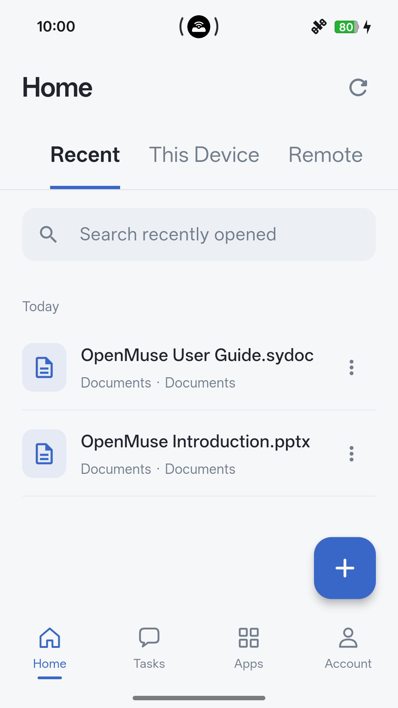
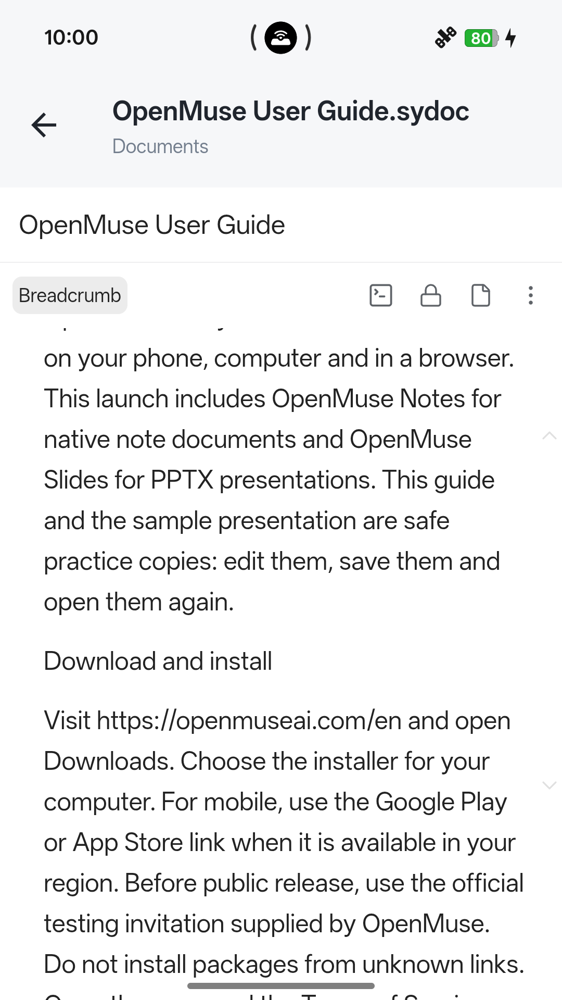
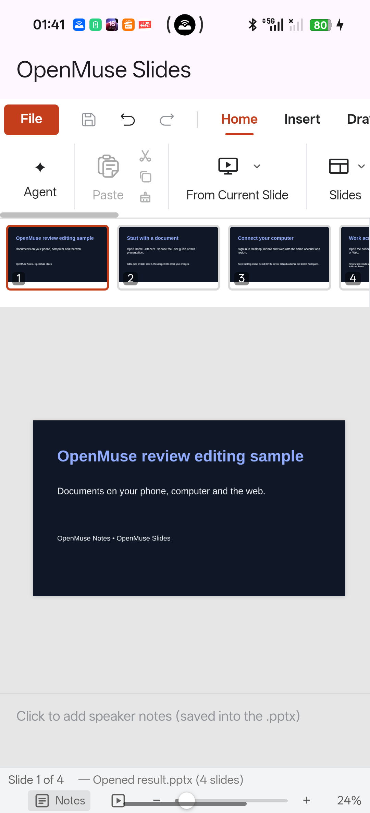

# OpenMuse User Guide

**Documents first. Your phone, computer and browser, connected when you choose.**

This illustrated guide helps you install OpenMuse, read and edit documents, and work with a connected Desktop. The first release includes **OpenMuse Notes** for native note documents and **OpenMuse Slides** for PPTX presentations. The guide and presentation in Home are practice copies: you can edit them and open them again.

Edition: 3 November 2026 · United States service · English

## 1. Start here: a five-minute tour

1. Open **Home → Recent**. OpenMuse places this guide and **OpenMuse Introduction.pptx** here on first use.
2. Open this guide to try Notes. Read a section, unlock editing if necessary, and add a short practice paragraph.
3. Return to Home and reopen the guide to check that the paragraph was saved.
4. Open **OpenMuse Introduction.pptx**. Select a slide, edit a text box, save, and reopen it.
5. When you are ready to use a computer's workspace or run a Desktop task, follow section 8 below. Local document viewing does not require an online Desktop.

*Figure 1. Home → Recent. This is an actual application screenshot. Layout and system controls vary by device and screen size.*

## 2. Download and install safely

Use the [official OpenMuse website](https://openmuseai.com/en) and its download links. Mobile distribution uses the official Google Play or Apple App Store listing when it is available in your region. During testing, use the official testing invitation supplied by OpenMuse. Avoid installers sent by unknown accounts.

**Android:** open the official listing or testing invitation on your Android device and install OpenMuse. Keep the app updated through the same distribution channel. If you are using a private testing package, follow the invitation's installation instructions.

**iPhone and iPad:** use the App Store listing or official TestFlight invitation. Complete the system installation process, then launch OpenMuse from the Home Screen.

**Computer:** download the installer for your operating system from the official website. Install and launch OpenMuse Desktop. Keep the computer awake and Desktop running when it is serving a phone or browser session. A Linux Desktop used for connected workspaces is a running application, not just a downloaded installer.

**Web:** open the [United States Web App](https://us.openmuseai.com/app/) in a current browser. No mobile installer is needed. Keep browser and operating system security updates current. Browser capabilities and document editors can differ from the native mobile and macOS applications.

## 3. First launch, region and account

Read the [Terms of Service](https://us.openmuseai.com/en/terms/) and [Privacy Policy](https://us.openmuseai.com/en/privacy/). The first-use page requires an explicit agreement before continuing. Its checkbox is not selected for you. If you do not agree, exit the app. The policies remain available later from account or settings controls.

For the overseas service, choose **United States**. Use the **same service region and account** on your phone, Web App and Desktop. Changing the display language does not move your account or documents to another region. Regions have separate service sessions and data.

Sign in using the method offered by the application, such as your email and password or an email code. For a new account, complete the confirmation sent to your email address. Check the spam folder if needed. Do not share your password, confirmation link or one-time code with support.

Local resources may be available before sign-in. Signed-out local storage and signed-in account storage are separate scopes; signing in does not silently move every local document into your account. If a practice file seems missing after sign-in, check which account and region are active before importing another copy.

## 4. Understand Home and document locations

**Recent** lists resources you have opened. It is a convenient history, not a second copy of each file. Opening or renaming a resource should not create a new independent document merely because it appears in Recent.

**This Device** shows resources available on the current device. Use the plus control to see the available creation and import actions. When importing a file, select only the document you intend to use in the system file picker. Importing creates a managed copy; edits to that copy do not automatically overwrite the original file in another application.

**Remote** shows resources exposed by an authorized, connected computer. If it says **No locations connected**, no shared workspace is currently available. Follow section 8, then refresh. A successful account login alone does not grant access to every folder on a computer.

Use the search field to narrow the visible list by name. If you cannot find a document, clear the search and check both the selected location and account. An offline computer can make a remote document unavailable even while local documents still work.

## 5. Read, edit and save a Notes document

1. In Home, tap **OpenMuse User Guide.sydoc** or another native Notes document. Wait for the editor to finish opening.
2. Read by scrolling the document body. The document title remains separate from its content. On a small screen, some editor controls are in the overflow menu.
3. If the document is locked for reading, use the lock/edit control to enable editing. Tap a paragraph to place the caret. On a phone, the system keyboard should appear and the caret should remain visible above it.
4. Add a practice paragraph, for example: “My first OpenMuse note.” Use the editor's formatting tools to structure the document with headings, lists and emphasis.
5. Notes flushes changes through the local editor. Let any save activity finish, then return to Home. Reopen the same document and verify your change before relying on it.
6. For an important document, keep a separate exported or backed-up copy using the actions available on your platform. A paired connection is not a substitute for a backup.

*Figure 2. The native Notes editor on Android. This screenshot shows an earlier edition of the guide so you can identify the editor controls; the guide you are reading includes additional images and links.*

If opening fails, leave the original file in place and retry after checking the message. Do not delete a file simply to clear an error. If saving fails, keep the editor open if possible and use the offered retry action; check the saved result before closing. Include the error and app version when contacting support, but do not include confidential document content.

## 6. Images and clickable links in Notes

This guide is a portable **.sydoc** document. Its screenshots are embedded assets, so the illustrations do not require an external image host when you read the local file. The images are actual application captures, not invented interface mockups.

Tap an image to use the viewer controls offered by your platform. Return to the document after viewing it. Keep captions near images when creating your own instructions so another reader can understand what each picture demonstrates.

Text such as [OpenMuse Support](https://us.openmuseai.com/en/support/) is a clickable hyperlink. External HTTPS links open using the device's normal link handling. Opening a website requires a network connection and may leave the editor. In edit mode, use the editor's link action or return to reading mode if tapping places a caret instead of following the link.

When you insert a link, use its full destination, including **https://**. Check where it goes before sharing the document. Do not embed passwords, session tokens, private remote-desktop access links or confidential file-sharing credentials in a guide. A link to a remote document does not automatically grant its recipient permission to read it.

## 7. View and edit a PPTX presentation

1. From **Home → Recent**, open **OpenMuse Introduction.pptx**. OpenMuse Slides opens the presentation.
2. Choose a slide from the thumbnail strip. On a phone, scroll the strip to reach the other slides.
3. Select a text box on the slide and edit a short sentence. The ribbon contains the available editing and insertion tools. Some controls extend beyond the width of a phone and can be reached by horizontal scrolling.
4. Use **Undo** to reverse a practice change. Use **Save** (the disk control) to write changes to the presentation.
5. Return to Home and reopen the file. Check the edited slide and any speaker notes you changed.
6. When presenting, use the available slide-show control. Exit the show to return to editing.

*Figure 3. OpenMuse Slides on Android during a real document acceptance test. The sample title is test content. The ribbon, thumbnail strip, canvas, Save and Undo controls are the application UI.*

Use PPTX files for the Slides workflow. This release does not promise a Word, PDF or spreadsheet editor. Complex presentations may use fonts or effects unavailable on a particular device. Check the result on the device you will present from, and keep the source file when importing a copy.

## 8. How to connect a Desktop

A Desktop connection lets the phone or Web App use resources that a computer explicitly makes available. It is needed for computer-hosted workspaces and tasks; it is not required to open every local note or presentation.

1. **On the computer:** install and launch OpenMuse Desktop. Sign in to the United States service using the same account as the phone or Web App.
2. **Keep Desktop online:** leave the application running, allow the computer's normal internet connection, and prevent sleep while using a remote session.
3. **Choose the workspace:** use Desktop's workspace controls to select the workspace you intend to expose. Authorize only the resources needed for the task. Do not select an entire private home directory for a public demonstration.
4. **On phone or Web:** open the device connection control and refresh the account's device list. Select the intended computer. Verify the device name rather than choosing an unfamiliar entry.
5. **Complete authorization:** follow any connection or workspace approval shown by Desktop. A shared account does not mean every workspace is automatically authorized.
6. **Verify resources:** on mobile, return to **Home → Remote** and refresh. Open a resource from the selected computer's authorized location.
7. **Disconnect when finished:** use the available connection controls. Closing or sleeping Desktop makes its remote resources unavailable until it is online again.

If no computer appears, check the account email and service region on both sides, verify Desktop is running, refresh the list, and try again. If a computer appears but no location is available, check its workspace selection and authorization. Do not change server addresses or bypass certificate warnings as a troubleshooting shortcut.

[Open the online Desktop connection guide](https://us.openmuseai.com/en/guide/#8-how-to-connect-a-desktop).

## 9. Open a computer's content from mobile and Web

Use the [United States Web App](https://us.openmuseai.com/app/) on your computer or browser device. Sign in to the same account and region, select the connected Desktop, and use the workspace or resource controls offered there. On mobile, use **Home → Remote** to distinguish the computer's shared resources from **This Device**.

Before editing, confirm whether you are opening the shared resource itself or importing a separate copy. A separate copy has its own later edits. Let saves complete before switching devices and reopen the intended resource to verify the result. If Desktop disconnects, reconnect it before expecting a remote save to arrive.

**There is no promise that every local file automatically synchronizes to every platform.** Only explicitly supported, authorized resource and workspace flows transfer content. A local Notes file on a phone is not automatically published to the Web App just because the account is signed in. Likewise, connecting Desktop does not share all of its folders.

Native Notes editing is available in the supported Android, iOS and macOS application builds. A Linux Desktop can serve connected workspaces and tasks; do not assume it has the same native Notes editor. Browser, Windows and Linux editor availability depends on the installed build and available handlers. If a resource has no supported editor on a platform, keep the original and use a supported native application rather than renaming its extension.

## 10. Send a task to Desktop

Open **Tasks** and select the intended connected Desktop and workspace. Review the message and any attached resources before sending. Share only the files or text needed for the task. Keep Desktop running until the task completes.

When the app asks you to bind or connect a Desktop, use its **How to** help link to open the relevant guide. Complete section 8, return to the task and check the selected workspace again. Repeatedly pressing Send cannot bring an offline computer online.

If you cancel before sending, the task should not be submitted. If a connection is interrupted after sending, inspect the conversation and task state before retrying so you do not accidentally start the same operation twice. A successful task response does not prove an attached document was saved; reopen its output to verify it.

## 11. Optional AI assistance and safety reports

AI assistance depends on the connected Desktop's configured provider and model. Availability, pricing and provider accounts can differ. OpenMuse does not promise that an external provider is included free of charge.

Before the first applicable AI transfer, read the disclosure identifying the selected provider/model and the content to be sent. Continue only if you want that content sent. Cancel to keep it from being sent in that step. Review the disclosure again if the provider changes. Never paste passwords, private keys or confidential data into a demonstration conversation.

AI responses can be incomplete or wrong. Check important output, especially facts, calculations and instructions that affect other people or files. To report an unsafe response, use the response's report action, choose a reason, review the selected response and submit. Only a confirmed receipt means the report was accepted. The reporting flow does not require uploading unrelated conversation history or document attachments.

For report handling or removal, see [report-data deletion](https://us.openmuseai.com/en/account-deletion/#reports-only). You can ask to remove submitted reports while keeping the rest of your account.

## 12. Offline use, permissions and privacy

Local Notes and presentation workflows do not need a paired Desktop. Network-dependent sign-in, external links, remote workspaces and AI tasks do require a working connection. Download or import a document intentionally before relying on it offline; a Recent entry alone is not proof that the remote content is cached locally.

Microphone access is optional and requested when voice input is used. If you decline it, use text input. Use the system picker to select a document for import. The application does not need broad photo-library access just to import a selected document. An imported file may itself contain images or personal information; decide what it contains before sharing it with another device or provider.

Read the [Privacy Policy](https://us.openmuseai.com/en/privacy/) for the service's actual data handling, infrastructure and retention descriptions. Device-local storage, connected workspace transfers and external AI processing are different operations. Do not assume that choosing an English interface changes where your account data is stored.

## 13. Account deletion and managing copies

Use **Delete account** in the account settings when available, read the permanent-deletion confirmation, and continue only if you intend to remove that account. For another request method and the scope of deletion, follow [Delete your OpenMuse account](https://us.openmuseai.com/en/account-deletion/).

Files separately saved or exported on your own devices or other services must be managed there. Deleting an account is not a way to clear a single practice document. Do not use a shared review account or your production account to test permanent deletion.

If you edited an earlier bundled guide, the app must preserve your copy. Future help editions may be offered separately or replace only an unchanged starter file. Keep a personal copy of notes you want to retain before removing practice resources.

## 14. Troubleshooting checklist

**A document will not open:** confirm the file type, wait for initialization, retry, and keep the original. A PPTX belongs in Slides; a native .sydoc belongs in a supported Notes build. Do not merely change a file extension.

**The keyboard does not appear:** enable document editing, tap a paragraph rather than the outer page title, and check whether an external keyboard is connected. On a phone, dismiss a system dialog if one is covering the editor. If the whole interface is unresponsive, record the app version and action that triggered it.

**A change seems missing:** check the account, region, resource location and whether you edited an imported copy. Reopen the exact same resource after save completion. Remote saves require the relevant Desktop connection.

**Desktop is missing or offline:** follow section 8. Refresh the device list, verify matching accounts and regions, and keep Desktop awake. A remote-desktop access page is not the same thing as the OpenMuse Web App.

**An AI task cannot run:** check the Desktop connection, selected workspace and configured provider/model. Read any consent prompt. Do not send a real document just to test whether a provider is configured.

**An email does not arrive:** check the address and spam folder, allow a reasonable delivery interval, then use the resend control if offered. Do not forward your confirmation link to support.

## 15. Help and useful links

- [Official website and downloads](https://openmuseai.com/en)
- [United States Web App](https://us.openmuseai.com/app/)
- [Online illustrated user guide](https://us.openmuseai.com/en/guide/)
- [Support](https://us.openmuseai.com/en/support/)
- [Terms of Service](https://us.openmuseai.com/en/terms/)
- [Privacy Policy](https://us.openmuseai.com/en/privacy/)
- [Account and report-data deletion](https://us.openmuseai.com/en/account-deletion/)
- [Email OpenMuse support](mailto:developer@openmuseai.com)

When requesting help, include the app version/build, platform, selected region and the steps that failed. Attach only a screenshot you have checked for private information. Do not include passwords, one-time codes, access tokens or confidential documents.
