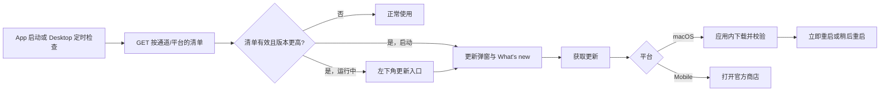
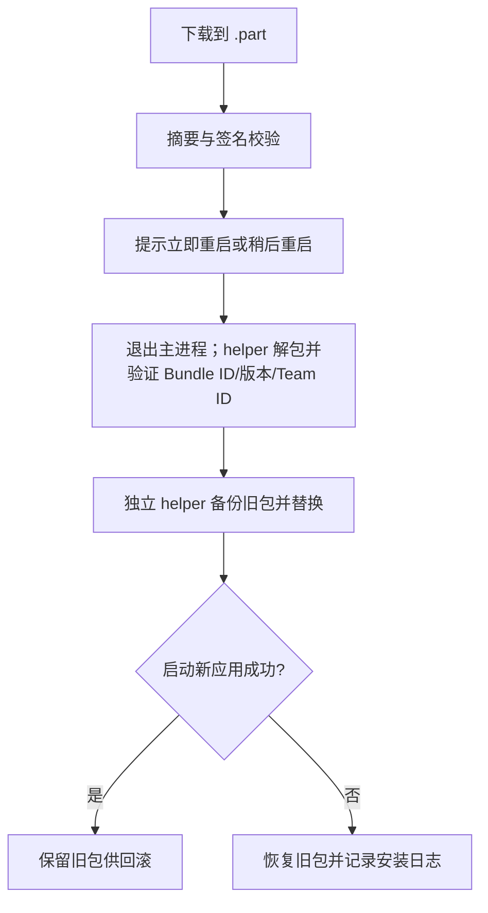

# OpenMuse Desktop / Mobile 版本更新 PRD 与交付方案

状态：2026-10-13，macOS canary `1.0.7+8` 已发布；公开清单、制品长度、SHA-256 与 HTTP Range 已核对，隔离安装助手、后台下载与通知 UI 的端到端测试通过。运行中的旧版客户端已识别新清单、校验更新包并到达「更新已就绪」，选择「稍后重启」保留当前会话。正式稳定版仍需 Developer ID 签名、公证及 Windows 发行门禁。

## 1. 产品范围

| 场景 | 用户看到什么 | 当前交付 |
|---|---|---|
| Desktop / Mobile 启动 | 先读取更新清单；发现比本机更高的版本后，在进入主工作流时弹出版本和 What's new | 已接入；网络失败 4 秒内放行启动 |
| Desktop 持续运行 | 每 5 分钟及窗口恢复前台时检查；左下角显示「发现新版本」、Update 按钮和 What's new；× 可隐藏横幅 | 已接入 |
| 通知中心 | 左下角“通知”入口，未读更新显示红点；通知面板可查看版本说明和执行更新/继续下载/重启 | 已接入版本更新通知；通知已读与横幅隐藏按版本持久化 |
| 用户点击「获取更新」 | macOS 后台下载；左下角显示进度，主界面继续可操作；Mobile 跳官方商店页面 | macOS 已接入；Windows 待安装包格式确定 |
| macOS 原地安装 | 校验 SHA-256、签名与版本；询问立即或稍后重启；独立 helper 替换、重启，失败恢复旧包 | canary 已接入；隔离副本原地替换与重启命令验收通过 |
| Windows 原地安装 | 下载签名安装器、校验发布者、关闭应用、进程外安装并重启 | 方案已定义；需 Windows 签名制品与平台测试 |
| Mobile 原地安装 | iOS 交给 App Store/TestFlight；Google Play 交给 Play In-App Updates；企业 Android APK 交给系统安装器 | 方案已定义；本里程碑只打开商店更新页 |

启动检查不要求登录，也不发送账号、设备 ID 或工作区数据。网络失败不能阻止离线使用。普通更新允许「稍后」，安全强制更新可由清单声明 `mandatory`，但此类清单必须先完成签名与发行审核。

## 2. 为什么沿用下载服务

生产官网已经通过 `https://openmuseai.com/downloads/` 映射 `/opt/openmuse-downloads`，可独立于 Next.js 发布文件。新增只读清单：

`GET /downloads/updates/v1/{channel}/{target}.json`

首个目标为 `canary/macos-universal.json`。`stable` 与 `canary` 相互隔离；本次测试不改官网现有 `downloads.catalog.json`。客户端在编译时固定通道和默认 HTTPS origin。服务器先上传不可变版本文件，核对 SHA-256，再原子切换小清单。回滚时将清单指针恢复到上一版本，已有文件不立即删除。

示例：

```json
{
  "schema": "openmuse.app-update/v1",
  "channel": "canary",
  "target": "macos-universal",
  "version": "1.0.1",
  "build": 2,
  "publishedAt": "2026-10-13T00:00:00Z",
  "downloadUrl": "https://openmuseai.com/downloads/updates/v1/canary/OpenMuse-1.0.1-2-macos-universal.zip",
  "sha256": "<64 hex chars>",
  "sizeBytes": 1,
  "installKind": "macos-zip",
  "mandatory": false,
  "notes": {"zh": "版本更新说明", "en": "Release notes"}
}
```

客户端拒绝未知 schema、通道/目标不符、无效版本/摘要/大小和跨源 Desktop 下载地址。版本使用 `version + build` 比较；相同或更旧的发布不会提示。404 表示该目标还没有可用版本。清单应设置短缓存或 `no-cache`，安装包可以长缓存；在 CDN 层保留 ETag、Range 与请求日志。服务器暂不需要账号鉴权。



静态清单 + 5 分钟轮询提供可验证的运行中通知；这是准实时更新提示，不是服务端主动 WebSocket 消息。如果将来需要秒级强制撤回，可在现有 Cloud/设备通道只发送「清单 revision 变化」事件，客户端仍必须回读 HTTPS 清单，不把推送 payload 当作发行真源。

## 3. Desktop 原地替换设计

macOS 正式发行的前提是 Developer ID 签名、公证和固定 Team ID。当前 canary 使用本地 ad-hoc 签名，可在用户可写的测试目录验证自动替换，但不能作为生产 stable 包。现有 helper 的顺序：

1. 用户点击 Update 后，应用在后台下载到 Application Support 的 `.partial` 文件，并在左下角显示进度，不遮挡主界面。网络中断时保留部分文件，使用 HTTP Range 和严格的 Content-Range 校验续传，最多自动重试 8 次；最终核对长度、SHA-256 和同源 HTTPS 下载地址。已完成且校验通过的文件用于「稍后重启」后的再次安装。清单签名尚未实现。
2. 用户点击「立即重启」后，独立 helper 等待主进程退出；解包到与目标 `.app` 同一文件系统的临时目录；拒绝路径逃逸；核对 Bundle ID、版本、深度代码签名和签名 Team ID。应用目录不可写时展示错误。
3. helper 将旧包重命名为备份，再将新包移入原路径并启动；启动命令失败时恢复备份。旧包保留供人工回滚。新进程健康回执与自动清理备份尚未实现。
5. `/Applications` 无写权限时走系统授权或用户确认安装器；不能静默修改受保护目录。更新期间保留用户数据、DSH profile 和插件数据，升级前运行兼容性门禁与数据迁移备份。

Windows 采用签名安装器/MSIX 的进程外 updater，校验发布者证书和 SHA-256，在用户作用域原目录升级并保留回滚包。Linux 按 AppImage、deb、rpm 各自发行渠道处理；deb/rpm 不绕过系统包管理器。更新包与宿主/插件 API 的兼容矩阵应写入发行门禁，不能仅靠更新 UI 放行。



## 4. Mobile 安装渠道

- **iOS**：App Store 发行版跳应用商店，TestFlight 构建跳 TestFlight。iOS 应用自身不替换可执行文件；下载 IPA 不应被当作 App 内热更新。账号与文档状态由现有持久化层恢复。
- **Android Google Play**：正式方案采用 Play Core Flexible 更新（普通版本）和 Immediate 更新（强制版本），系统负责下载、安装和重启。当前 Flutter UI 先跳转 Play 页面，待上架与签名身份固定后接入原生桥。
- **Android 企业直发 APK**：单独通道、同一签名证书和递增 `versionCode`；App 下载后使用系统 PackageInstaller，用户显式确认。不能混用 Play 包和企业 APK 更新链。
- **配置与 DSH 插件**：动态配置可改变已编译能力的开关、文案和渲染映射；新增原生控件、权限或 ABI 仍需发新版 App。配置有 schema、宿主最低版本和回滚版本，不承载可执行代码。

## 5. 发布门禁与验收

`scripts/package_macos.sh --build-name 1.0.0 --build-number 1 --update-channel canary` 生成旧版测试包；再构建 `1.0.1+2`。`scripts/publish_app_update.py` 从 ZIP 内的 Info.plist 回读版本和 Bundle ID，计算摘要，准备 canary 清单；`--deploy` 才将制品上传到既有生产 `/downloads/`，清单最后原子发布。发布前后核对公开 GET、制品长度与摘要。

验收覆盖：旧版启动弹窗、What's new、稍后继续；左下角 Update、后台进度、× 隐藏及通知中心操作；HTTP Range 续传、长度与 SHA-256 校验；独立 helper 在隔离副本中完成旧包替换、签名校验、版本读回和重新启动命令校验（`scripts/test_update_helper_macos.sh`）；新版不提示同版本；无网和坏清单不阻断启动；macOS 与 Mobile Widget 测试；包内 CLI 和 DSH 运行不受更新检查影响。真实用户会话中的「立即重启」应等用户保存当前工作后执行；正式 stable 发行需另过 Developer ID 签名/公证、健康回执回滚、Windows 和 Mobile 商店链路的门禁。
