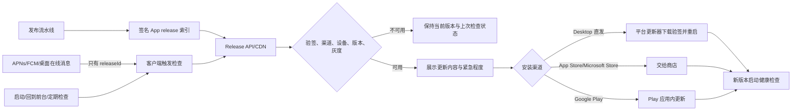
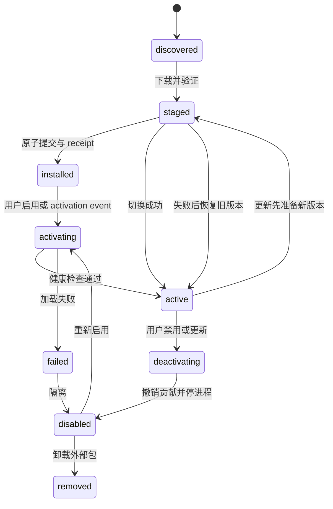
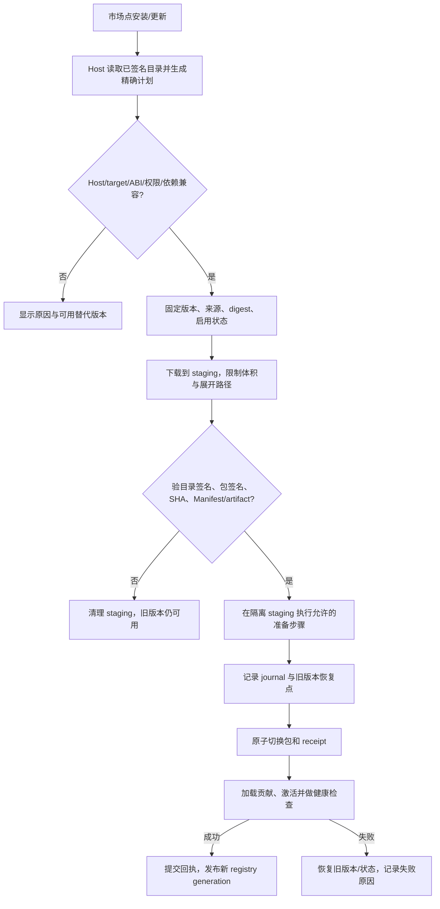
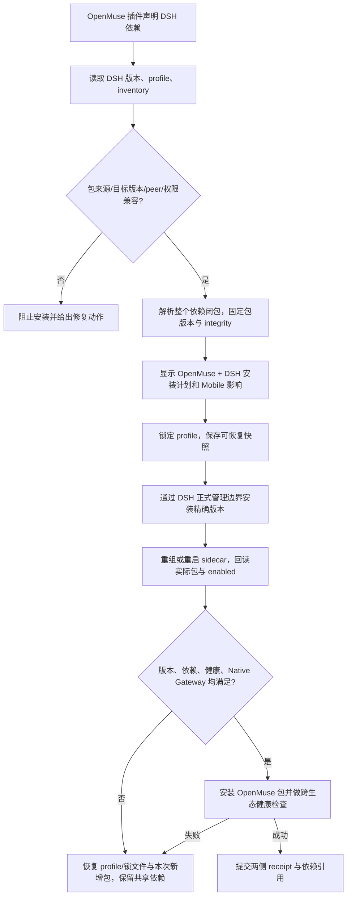
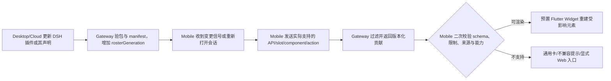

# OpenMuse 内置插件市场 PRD 与实施方案

状态：方案评审稿（2026-10-11）。范围是产品定义与实施计划，尚未实现市场功能。

本文同时定义 Desktop/Mobile 的 App 版本通知与更新，以及 Mobile 对 DSH 插件变化的声明式适配。App 二进制更新、Desktop 插件包更新、Mobile 会话 UI 配置更新是三条不同链路，均由版本与能力协商决定是否可用。

## 1. 产品结论

OpenMuse 提供一个预装、可启停的 `com.openmuse.plugin-market` 插件。它负责发现插件、展示安装计划和操作结果；插件安装、版本解析、授权和回滚由 Host 的统一插件管理服务负责。市场不能直接改安装目录、DSH profile 或权限设置。CLI 和未来其他界面调用同一服务。

首版先面向桌面 OpenMuse 插件，随后把经过筛选的 DSH 插件纳入同一目录。V1 对需要**新装 DSH 插件**的 OpenMuse 包显示“暂不可安装”，不能装一半；V1.1 支持后，用户应看到**一次操作、一个安装计划**：OpenMuse 插件及必需的 DSH 插件一起检查、安装和验证。DSH 插件仍由 DSH profile 的正式管理边界安装，不能伪装成 OpenMuse 原生插件。

“市场自身可更新”分两种交付物：市场的目录、文案、图标等非执行内容可按签名目录更新；市场 Flutter 代码随宿主 App 更新。仓库目前没有可见的 App 自动更新器，因此首版发布门禁必须新增发行渠道适配：支持的桌面直发渠道由“更新市场”一键下载安装新版 App，商店渠道交给商店更新并如实提示。按钮需明确展示将更新整个 App；更新器未就绪时不能把“打开下载页”称为一键更新。独立替换市场 Flutter 代码与当前 AOT 装配方式冲突；若产品要求市场代码脱离 App 发版独立更新，需在第二阶段改为经过签名的外部 WebView/进程插件，并保留预装恢复入口，不能声称首版已做到独立热更新。

## 2. 现状与设计约束

| 已有事实 | 对市场的影响 |
| --- | --- |
| `distribution/openmuse_builtin_plugins` 在编译期装配内置 Flutter 插件；`OpenMusePluginRegistry` 管激活/停用 | 市场应按普通插件注册；Flutter 代码更新需要重新发布 App。 |
| Manifest v2 区分 `ui_runtime`、`execution_connector`、target/artifact，并严格拒绝未知字段 | 可复用 target、摘要、签名和协议门禁；宿主版本范围与跨生态依赖尚需扩展合同。 |
| `plugin_package.dart` 可从目录安装 `.omplugin`、核对包和 artifact 摘要、执行 install steps | 它尚非生产级更新事务：当前写入目标目录，失败可能留下新旧混合文件；无来源签名、持久操作记录和完整回滚。 |
| 桌面“插件”弹窗仅列内置插件；CLI 有 install/list/uninstall 过渡入口 | 市场需要可发现的完整页面；所有入口必须收敛到 Host 插件管理服务，不能各自写状态。 |
| `plugins/dsh-agent` 以 sidecar 管 DSH；发行闭包已预装 `dshmarket` 并默认挂载 patch | 过渡期存在 DSH 原市场。OpenMuse 新市场不能与其同时写同一 profile；需要明确迁移和失败回退。 |
| 现有 SDK 注册表的 provider 查询未统一按 `active/enabled` 过滤 | 做启停开关前必须修正路由和持久化状态，否则界面显示“已停用”仍可能被选中。 |

本方案遵循 [Host/Plugin/DSH 架构](PLUGIN-HOST-DSH-ARCHITECTURE.zh-CN.md)、[Manifest v2](PLUGIN-MANIFEST-V2.zh-CN.md)、[CLI 插件设计](OPENMUSE-CLI-PLUGIN-DESIGN.zh-CN.md)及 [Distribution Lock](DISTRIBUTION-LOCK-SBOM-CLOSURE-GATE.zh-CN.md)。`third_party/dsh-market` 值得借鉴的是目录与安装解耦、来源身份、异步操作、版本核验和恢复流程；它的 Cordis/React UI、pnpm/profile 文件写法、路由和重启方案属于 DSH 自身边界，不直接移植。

## 3. 用户、目标与成功标准

主要用户是安装功能的桌面用户、管理多个插件的重度用户，以及通过 CLI 或 DSH 调用插件能力的开发者。用户应该知道“这个插件能做什么、能否在当前设备运行、会安装哪些关联组件、操作是否生效、出错后怎么恢复”，无需先理解 Manifest、profile 或 artifact。

首版验收目标：

1. 从市场详情点“安装”后，一次操作获得明确的成功/失败回执；重复点击不会产生重复安装。
2. “可更新”只表示存在**当前设备和宿主可用**的更高版本；检查失败不能显示“已是最新”。
3. 停用后插件贡献不再出现在新路由/命令发现中；已运行的会话按生命周期策略结束或保留到完成，并向用户说明。
4. 更新失败或健康检查不通过时，旧版本、启用状态和工作区数据保持可用；崩溃后重启可识别并恢复未完成操作。
5. 任何跨 DSH 的必需依赖都在安装前列明版本和作用；没有 DSH 或不兼容时不开始部分安装。
6. 内置市场更新失败后，用户仍能通过 Host 最小恢复入口查看和修复插件状态。

## 4. 功能范围与发布阶段

| 能力 | V1 桌面市场 | V1.1 DSH 接入 | 后续 |
| --- | --- | --- | --- |
| 发现、搜索、详情、已安装、可更新 | OpenMuse 官方签名目录；离线显示已装列表和“上次检查时间” | 加入精选 DSH 条目，清楚标注运行于 DSH | 多来源/开发者提交门户 |
| 一键安装/逐个更新 | 受支持的外部 `.omplugin` runtime/CLI 包；版本固定并可回滚 | DSH 插件由 DSH 管理适配器执行；跨生态依赖同一计划 | 批量更新、频道策略 |
| 启用/禁用 | 内置插件和外部插件的持久化启停；受保护的基础设施不提供开关 | DSH 插件使用官方 profile 管理能力，完成状态回读 | 每 Workspace 配置 |
| 市场自身更新 | Flutter 代码随 App 更新，直发渠道需补 App 更新器；目录内容可独立更新 | 不把已预装的 `dshmarket` 更新按钮当作 OpenMuse 市场更新 | 独立签名 WebView/进程版市场代码热替换 |
| App 版本通知与更新 | Desktop 按发行渠道检查、提示、安装整包更新 | Mobile 通过 App Store/Google Play 更新，配置可单独刷新 | 企业/侧载渠道按签名发行能力开放 |
| 卸载、手工来源 | 已装外部插件可卸载；内置插件只能停用 | DSH 插件卸载需处理被依赖关系 | 第三方仓库、侧载、评分评论 |
| 平台 | 先 macOS，Windows 在同一 V1 完成门禁后开放；Linux headless 通过 CLI | 与桌面 DSH sidecar 支持矩阵一致 | Mobile/网页端远程管理；不在 iOS 上下载执行插件代码 |

V1 不承诺任意 Flutter/Dart 包下载安装后运行，不把 DSH 的全部公开 npm 生态自动上架，不允许市场直接修改 Host 核心组件或任意本机命令。对于现有如 Easel 的 Python 安装步骤，只有在安装沙箱、大小限制、签名及回滚门禁通过后才可上架；现有开发者安装路径不能直接当作市场发布条件。

## 5. 核心页面与场景

市场作为插件贡献一个完整管理页面。当前 `OpenMuseSurfaceRegion` 只有 editor/rightSidebar/bottomPanel，实施时需扩展 SDK 的 `managementPage` contribution 与 Host 通用页面容器，不能把全屏市场硬塞进右侧栏。Host 菜单保留通用“插件”入口，由 Contribution Registry 找到管理页；市场被停用/损坏时进入 Host 的最小“插件恢复”页，仅可查看状态、重新启用、回滚市场或打开 App 更新。Host 不持有市场卡片、分类或推荐逻辑。

页面有“发现”“已安装”“更新”三个主视图。卡片显示名称、简述、来源、当前状态和主按钮；详情显示版本、支持设备、开发者、权限用途、依赖、更新说明和来源。高级诊断（digest、ABI、profile、operation ID）收起。安装前只在存在新增权限、DSH 组件、停机/重启或不可逆数据迁移时展示计划确认。进度中允许关闭页面，返回后继续显示同一操作。

| 场景 | 期望流程与结果 |
| --- | --- |
| 首次安装普通插件 | 搜索 → 查看详情 → 安装 → 展示下载/验证/启用进度 → 可立即使用；需要重启则明确显示“重启后可用”。 |
| 安装依赖 DSH 的插件 | 计划显示 OpenMuse 包、必需 DSH 包与兼容版本；用户一次确认；按依赖顺序安装，全部验证后启用；失败恢复已更改部分。 |
| 插件版本不兼容 | 列表可浏览但按钮为“当前版本不可用”；详情说明需升级宿主、DSH 或换设备，若目录有兼容旧版可提供明确版本。 |
| 停用正在使用的插件 | 说明将关闭的面板/会话；完成停用后新请求不可路由；失败时保留可见错误和重试。 |
| 更新插件 | 显示当前→目标版本及更新说明；先备份旧版本，验签并验证实际落盘版本，健康检查后切换；失败自动恢复旧版本。 |
| 更新市场自身 | 按钮检查 App 发行通道；下载安装后按平台规则重启 App；重进市场显示实际版本；App 更新不可用时显示原因与可操作入口。 |
| 离线/目录故障 | 已安装页仍可用，发现页显示“无法检查新插件”及重试；不把缓存版本称为最新。 |
| DSH 未配置/sidecar 故障 | 仍可使用 OpenMuse 市场；DSH 条目说明“先修复 DSH”，不触发隐式安装或反复重启。 |
| 市场被停用或更新中断 | Host 恢复入口可重新启用；持久操作日志用于启动时清理/回滚，不依赖市场 UI 存活。 |

## 6. 技术选型

| 方案 | 当前架构契合度 | 独立更新市场 UI | 主要代价 | 决策 |
| --- | --- | --- | --- | --- |
| 内置 Flutter 插件 | 直接使用现有 SDK、主题、无障碍和桌面布局 | Flutter 代码随 App；内容可独立更新 | 不能通过下载 Dart 包热更新代码 | **V1 采用** |
| 内置 WebView/React 插件 | 可复用部分网页技能，UI 资产可单独签名替换 | 可以，但需稳定 JS↔Host 桥及可靠恢复页 | 新的鉴权、CSP、WebView2/WKWebView、焦点与多平台门禁 | 仅在独立代码更新成为硬要求时进入 V2 |
| Tauri/Electron 独立市场进程 | 进程隔离和独立发版明确 | 可以 | 第二套窗口、打包、IPC 和运行时，违背当前 Host/Plugin 容器 | 不采用 |
| 嵌入 `dsh-market` 页面 | DSH 功能丰富 | 更新的是 DSH 插件市场，不是 OpenMuse 市场 | 只能管理 DSH profile，依赖 DSH 存活，React/Cordis 语义不同 | 只保留为过渡期 DSH 管理入口 |

这一选择基于仓库实际装配方式，而不是认为 Flutter 一般性优于 Web。Flutter 官方的 deferred components 仅覆盖 Android/Web，Android 仍需重新上传完整 App Bundle，不能作为桌面/ iOS 任意 Dart 插件热更新方案（[Flutter 文档](https://docs.flutter.dev/perf/deferred-components)）。若发行到 Apple App Store，下载执行改变功能的代码和绕过商店更新另受 [App Review Guidelines 2.5.2 与 Mac App Store 规则](https://developer.apple.com/app-store/review/guidelines/) 约束；具体发行渠道在发布前单独审核。

## 7. 合同与组件边界

```text
Flutter 内置市场插件 / CLI / Host 恢复页
                  │ PluginManagement API
                  ▼
Host Plugin Authority ─ Catalog & Version Resolver ─ Signed OpenMuse catalog
        │                │
        │                └── Dependency plan / compatibility result
        ├── Transaction journal / receipt / trust / grants
        ├── OpenMuse package adapter ─ verified .omplugin / lifecycle registry
        └── DSH adapter ─ DSH sidecar/profile 的正式管理边界
```

### 7.1 插件身份与目录

统一展示模型至少包含 `ecosystem`（`openmuse`/`dsh`）、稳定 ID、来源 ID、发布者、签名主体、版本、渠道、target、包 SHA-256、manifest 摘要、更新说明 URL 和审核状态。`ecosystem + id + source` 才是更新身份；同名包不能互相接管。目录签名应覆盖元数据和每个 immutable 包地址/摘要，客户端内置可轮换的信任根并支持撤销。HTTPS 和包 SHA 本身不能证明目录未被替换。

目录快照可缓存用于展示，但每次安装/更新都以新鲜且已验签的索引确定精确版本；无法获取时停止变更。离线本地 `.omplugin` 另走显式开发者/侧载流程，不自动获得官方来源标识。目录服务只发布经过 target 构建、License/SBOM、签名、TCK 和烟测的版本。

### 7.2 兼容性与依赖

在 Manifest 的下个兼容修订中增加声明式 `host.versionRange`、`host.pluginApiRange`、`dependencies[]`（`ecosystem/id/versionRange/optional/reason`）以及需要时的 `dsh.versionRange`。当前 v2 Rust/Dart/JSON Schema 均 `deny_unknown_fields`，新字段必须同步变更、配 fixture 和版本迁移门禁；在此之前可先在**已签名目录**承载发布兼容矩阵，安装时仍需包内声明与目录一致，不能仅凭目录卡片放行。协议 major、Host 版本、target triple、artifact kind/ABI、权限、发行渠道都要校验；未知或无法比较的版本默认不可自动安装。

Resolver 从已安装状态和当前 Host/DSH 版本计算确定性的依赖闭包：只选同一渠道允许的最高兼容稳定版，预发布版需用户显式加入；检测缺失、冲突、循环、降级、被其他插件依赖和不可用的 DSH。安装计划固定每个组件的精确版本、来源和 digest，用户确认后不能悄悄换目标。可选依赖不自动安装；缺失时对应功能标为不可用。工作区里的 requirement 只能要求既有插件，不能授予安装权限。

### 7.3 Host 插件管理服务

新增版本化 `PluginManagement` 服务，至少提供 `catalog.list/get`、`installed.list/get`、`plan.install/update/enable/disable/uninstall`、`operation.start/get/cancel`、`recovery.rollback`。所有变更携带 request ID、期望 generation 和 actor；按受影响插件及 DSH profile 加锁，同一请求幂等。状态为 `queued → downloading → verifying → staging → applying → healthChecking → succeeded/rolledBack/failed`，附阶段进度、是否需要刷新/重启、稳定错误码与回执。操作记录落盘，UI 关闭或进程重启后可查询。

包安装先落独立 staging 目录，验证压缩包展开上限、路径、symlink、包/artifact 摘要、签名、target 和 Manifest；再执行声明的 prepare 步骤。执行步骤只能修改 staged 内容，需受控工作目录、权限、超时、取消和日志脱敏；需要改动已有用户工作区的脚本不进入 V1 自动更新。旧版本及配置快照保留到健康检查完成；同卷原子切换；失败恢复原 receipt、内容、启用状态及配置。含不可逆数据迁移的包不得自动更新。真实进程/DSH 插件健康检查通过后才报成功，不以下载或包管理器退出码 0 代替。

启停状态由 Host 持久化，Registry 的 editor/panel/command/service/provider 发现统一过滤 disabled/inactive；卸载先处理依赖方和正在运行的会话。内置 Market 可停用，但 Host 恢复页、安装服务和操作日志不可随之消失。基础设施插件的可停用性按依赖图判断，不能靠 ID 特判。

### 7.4 DSH 适配与现有 `dshmarket` 的关系

当前发行闭包已把 `dshmarket` 作为 DSH 插件预装。V1 保留它管理 DSH 插件，OpenMuse 市场只列 OpenMuse 条目，并可提供“在 DSH 中管理”入口。V1.1 在**受控测试 profile**中验证 DSH 版本与安装管理 API；适配器只调用 DSH 正式的插件/profile 管理边界并回读实际版本与启用状态，不写 `cordis.patch.yml`、`package.json` 或 `node_modules`。若所用 DSH 版本缺稳定 API，就暂缓 OpenMuse UI 中的 DSH 变更按钮，继续由 `dshmarket` 管理。

跨生态依赖的事务顺序为：预检两侧 → 记录恢复点 → 安装/验证 DSH 依赖 → 安装/验证 OpenMuse 包 → 启用 → 健康检查。失败按相反顺序恢复本次新装组件；已经存在且被其他插件使用的 DSH 依赖不能被误删。DSH profile 属于具体用户/实例，不能跨 profile 复用一次安装回执。V1.1 达到目录、安装、更新、启停、回滚对等后，才在后续发行中决定是否移除默认 `dshmarket` patch；迁移前后始终只有一个写入者执行单次操作。

## 8. 开发计划与验收门禁

| 阶段 | 交付物 | 通过条件 |
| --- | --- | --- |
| P0 合同与基线（约 1 周） | 状态/来源/兼容字段、页面流程原型、官方目录格式、当前安装器差距清单 | Rust/Dart/Schema 一致；明确 macOS/Windows target 和 Host 版本来源；可用 fixture 重放版本/依赖解析。 |
| P1 Host 管理服务（约 2–3 周） | 单一写入服务、签名目录、精确版本解析、事务 journal/staging/rollback、启停持久化 | 断网、摘要错、签名错、准备脚本失败、崩溃恢复、并发点击均不破坏旧版本；CLI 与 UI 读同一状态。 |
| P2 Flutter 市场插件（约 1–2 周） | `plugins/plugin-market`、分发层注册、完整页面、进度和恢复入口、App 更新引导 | 停用市场不影响其他插件；重启后可续看操作；内置/外部插件状态准确；深浅色、窄窗、中英与无障碍验收。 |
| P3 桌面发布门禁（约 1–2 周，App 更新器另估） | 官方签名发布流水线、macOS 与 Windows E2E、发行锁/SBOM、回滚演练、直发渠道 App 更新器 | 各平台安装/更新/禁用/启用/卸载及坏包反例通过；实际安装版本等于计划；市场自身一键更新 App 后可用。 |
| P4 DSH 接入（约 2 周，取决于 API） | 精选 DSH 目录映射、DSH 管理适配器、跨生态依赖计划 | 同一计划安装和失败恢复；sidecar 缺失/崩溃、profile 切换、版本不兼容、已共享依赖均有确定结果。 |
| P5 独立市场代码更新（另立项） | WebView/进程版市场与预装恢复壳 | 签名包原子替换、自更新失败回滚、桥权限和跨平台 UI 验收后才替代 Flutter 版本。 |
| M1 Mobile 更新与声明式适配（与 P1–P4 并行） | Mobile 发行通道驱动、发布通知、Gateway roster generation、协商刷新、配置安全回退 | 商店安装链真实可用；新 DSH 插件使用已支持组件可展示；不支持的 UI 不空白且可显式进入 Web。 |

工期为单团队粗估，P1/P3 的签名基础设施、Windows 发行流程和直发渠道 App 更新器若尚未具备，需要单列依赖工作，不能按页面开发时间估算。首个可发布里程碑是 P0–P3；P4 在 DSH 正式管理边界可验证后发布。

### 必测场景

- 同 ID 不同来源、目录被篡改、签名撤销、artifact 摘要不符、压缩包路径逃逸和解压炸弹。
- Host 低于最小版本、高于明确上限、协议 major 不兼容、错误 target/ABI、预发布版、目录旧快照和镜像落后。
- A 依赖 B、循环依赖、DSH profile 中已装不同版本、共享依赖被多个插件引用、停用依赖方后的影响。
- 安装中强退 App、两入口同时更新、健康检查超时、更新实际版本与目标不一致、回滚再次失败。
- 内置 Market 禁用/损坏、DSH sidecar 不启动、离线状态、无权限、受保护插件、插件面板正被使用。

## 9. Desktop 与 Mobile App 版本推送更新

### 9.1 当前发行基础与统一版本合同

当前 `app/openmuse_host/pubspec.yaml` 为 `1.0.0+1`，`app/openmuse_mobile/pubspec.yaml` 为 `0.0.1+1`。桌面构建脚本产出 macOS `.app`/ZIP 和 Windows ZIP；macOS 脚本允许开发阶段 ad-hoc 签名，尚无生产级公证、App feed 或 Windows MSIX 发行链。因此“更新市场时一键更新 App”是**待开发能力**，不能直接接现有 ZIP 下载冒充已完成。

新增独立于市场插件的 `AppReleaseAuthority`：发布流水线按 `appId + os + arch + distribution + channel` 发布**已签名发行索引**；Host/Mobile 的轻量 `AppUpdateClient` 负责检查和显示，平台 `UpdateDriver` 负责实际安装。市场被停用时，App 更新入口仍在设置/帮助菜单。服务端消息与系统推送只携带 `releaseId` 或“请重新检查”，客户端必须拉取已签名索引，不能按推送 payload 安装。

发行记录至少包含：`releaseId`、`version`、严格递增的 `buildNumber`、target、发行渠道、发布时间、rollout 比例、`minSupportedBuild`、升级原因、变更摘要、下载目标及 SHA-256/签名或商店 ID、所含 Host Plugin API/DSH Gateway API/DSH closure 版本、签名 key ID 和有效期。客户端内置其安装来源与信任根，拒绝远端把商店包改指到直发包、跨渠道跳转、降级、过期索引和比已见 sequence 更旧的索引。展示版本供用户理解，比较用单调 build number；App 版本、插件版本和 DSH 版本各有自己的命名空间。



检查时机：启动后延迟检查、回前台且距离上次检查超过设定 TTL、用户手动检查；联网失败继续用旧版并显示上次检查时间。后台推送仅降低发现延迟，不作为唯一通路。iOS 的静默推送可能被延迟或丢弃，Apple 明确不保证送达（[Apple Background Updates](https://developer.apple.com/documentation/usernotifications/pushing-background-updates-to-your-app)）。若要给用户发系统通知，需遵循其通知偏好；普通更新在 App 内提示即可。灰度按稳定设备安装 ID 与 release ID 做确定性分桶，服务端可暂停/撤回发行记录；安全修复可逐步提高优先级，但不得把尚未在对应商店可下载的版本标记为强制升级。

| 安装来源 | 更新驱动 | 界面承诺 |
| --- | --- | --- |
| macOS 官网直发 | 将现有 ZIP 流程升级为 Developer ID 签名、公证和 [Sparkle](https://sparkle-project.org/) 签名 appcast；安装时由独立 helper 接管 | “下载并安装”，完成后重启到新版本。 |
| macOS Mac App Store | 仅由 Mac App Store 分发更新；市场/设置可检查和打开商店页 | 不显示 App 内自安装。Apple 禁止 Mac App Store 应用使用其他更新机制（[审核指南](https://developer.apple.com/app-store/review/guidelines/)）。 |
| Windows 官网直发 | 优先从现有 ZIP 迁移到签名 MSIX + `.appinstaller`，由 Windows App Installer 管理更新；若保留 ZIP，须另建独立签名更新器与回滚门禁 | 在 MSIX/更新器完成之前只能提示下载，不能称作一键更新。[Microsoft App Installer](https://learn.microsoft.com/en-us/windows/msix/app-installer/auto-update-and-repair--overview) 支持按启动和后台策略检查。 |
| Windows Microsoft Store | 商店管理版本 | 展示更新并打开商店；不绕开商店替换二进制。 |
| Android Google Play | Play In-App Updates：普通版 flexible，确需阻断不兼容版本时 immediate | 更新下载和安装由 Google Play 执行，不能自行替换 APK（[Android 文档](https://developer.android.com/guide/playcore/in-app-updates)）。 |
| iOS App Store | App Store / 系统自动更新；App 内展示版本并打开商店 | 不在 App 内下载/安装 IPA；可使用 App Store 分阶段发布（[Apple 文档](https://developer.apple.com/help/app-store-connect/update-your-app/release-a-version-update-in-phases)）。 |

企业/侧载 Mobile 需独立发行渠道、签名与设备管理策略，不复用 Play/App Store 的安装承诺。App 更新流程不得在正在写插件包、工作区或 DSH profile 时强行退出：先停止接收新安装操作，等待或取消可安全取消的任务，保存文档和会话状态，记录恢复点，再由平台更新器接管。新版首次启动核对 App/DSH closure/plugin API 与旧 receipt，隔离不兼容的外部插件并保留其数据；Desktop 直发可设计上一个已签名 App 版本的恢复方案。商店渠道的二进制回退不受我们控制，应通过暂停灰度、配置回滚和修复版处理。

更新提示分为“可选”“建议尽快”“必须更新”。“必须更新”仅用于 `minSupportedBuild` 已超过当前 build，且目标版本在该设备的发行渠道已实际可取时；先阻止不兼容的写操作，保留登录、查看、导出和更新入口，避免错误的全屏死锁。发布索引和插件目录使用不同签名密钥、缓存与审计日志。市场自身的“更新”按钮读取 App 更新状态，因此用户看到的是“市场随 OpenMuse 1.2.0 更新”，不会误以为只替换 Flutter 插件代码。

### 9.2 发布前的版本兼容演算

App 发行前模拟 `{旧 App + 已安装 OpenMuse 插件 + DSH profile + Mobile 客户端能力}` 到目标版本的迁移。Desktop 包内固定的 DSH closure 若升级，须重新运行 DSH 插件 peer 版本与 Native Gateway 合同检查；不兼容插件可在更新后隔离，不能静默删包或改用户数据。旧 Mobile 继续连接新 Desktop 时，Gateway 在协议/组件层做协商，不能仅凭 App 版本号推断可显示新插件 UI。App 更新索引要披露“哪些插件需要更新/暂不可用”；插件市场随后提供修复计划。

## 10. Flutter 市场如何管理插件生命周期与安装

Flutter 市场本身是编译进 Desktop 的 `OpenMusePlugin`，由 `distribution/openmuse_builtin_plugins` 预装，向通用管理页贡献 UI。它只通过 `OpenMusePluginContext.executeHostCommand` 的受控命令或后续版本化 SDK port 调用 `PluginManagement`，接收目录快照、安装计划、操作进度与状态。下载、验签、写盘、权限审批、进程启动和 DSH profile 变更都在 Host/对应 runtime 适配器中。这样市场 UI 关闭、禁用或崩溃时，安装事务仍有独立日志和恢复入口。

**需要收敛的现状**：`OpenMusePluginRegistry.install(plugin)` 现在只是把已构造的 Dart 对象放进内存；它不下载安装包。外部 `.omplugin` 目前由 `plugin_package.dart` 写盘并产生 `DistributedPluginReceipt`，未自动变成 Flutter Widget 插件；人类 CLI 另读回执。设计中的 `InstalledPluginIndex` 把内置 Flutter、外部 runtime/CLI、DSH profile 投影为统一的“已安装”视图，但三个运行时的激活方式必须分开处理。不得把 receipt 的存在直接显示为“已启用”。



内置 Flutter 插件的代码不可从市场包中载入。启用是调用 Registry `activate`，发布其 panel/editor/command contribution；禁用是 `deactivate`、取消订阅、停止该插件持有的进程并从路由中过滤。状态要持久化并在 App 启动时重建；当前 Registry 的 provider 查询需要补统一状态过滤。外部 runtime 插件的“安装”则是 `Manifest + 已验签 artifact + receipt`，启用时按协议启动独立进程并注册贡献；CLI 插件启用时加入命令发现，不应凭安装回执自动获得 Agent grant。DSH 插件由 DSH profile 管理器启停，Host 仅回读投影和依赖关系。



这张图是目标流程；当前安装器已经做目录包 SHA、Manifest target 与 artifact 摘要检查，但尚缺可信目录签名、事务 staging/原子切换、持久 journal、完整回滚和外部 UI runtime 装载。必须先补这些能力，Flutter 页面不能绕过门禁直接调用现有写盘函数。

## 11. DSH 插件依赖的校验与安装

OpenMuse Manifest 的跨生态依赖用 `ecosystem=dsh`、DSH 包名、版本范围、是否必需、用途和要求的 `dshVersionRange` 声明。它引用 DSH 插件，不是把 npm 的所有传递依赖复制进 OpenMuse Manifest；npm 依赖树由 DSH 的包/profile 管理器解析并锁定。市场同时查询：当前 DSH runtime 精确版本、当前用户 profile、已安装 DSH 包的实际版本/启用状态、该包的来源和 integrity、DSH 插件的 peerDependencies、`dsh.client` 对话 UI 影响以及 Native Gateway 对 Mobile 的覆盖状态。

预检顺序是：OpenMuse 插件签名与 Host/target → DSH runtime 是否存在 → DSH 包来源是否在精选目录中 → 精确目标版本与 peer range 是否满足 → 当前 profile 是否有冲突或共享依赖 → DSH Native UI 对已配对 Mobile 的兼容等级。Mobile UI 不兼容通常**不阻止 Desktop 安装**，但计划中需明确“Mobile 将显示通用卡/需打开 Web/需更新 App”；若该插件声明 Mobile 为必需平台且没有安全 fallback，才阻止一键安装。



这里的“正式管理边界”需在产品固定的 DSH 版本上完成 API/CLI 契约测试。`dshmarket` 的 Profile patch 语义可以作为参考，但 OpenMuse 不应自行写 `cordis.patch.yml` 或 `node_modules`；单次操作只能由一个管理器写 profile。DSH 安装完成后须**独立回读**实际落盘版本、锁定依赖和 loader inventory，防止 registry 镜像滞后或 `latest` 解析成另一版。更新正在服务的 DSH 插件前，要等在途 Agent turn/会话到安全切换点；profile 重组与 restart 所需的用户影响写进安装计划。若 DSH 管理 API 没有可恢复快照或精确版本安装能力，跨生态“一键安装”保持关闭，不能使用两次无回滚的按钮拼出假事务。

## 12. Mobile 不热更新时如何适配新的 DSH 插件

### 12.1 可通过配置变化适配的范围

Mobile 不安装 DSH npm 包，也不下载 Dart/原生代码。DSH 插件装在 Desktop 或 Cloud 的 DSH profile，Mobile 连接同一个 Session。插件若提供 `openmuse.nativeConversation@1` 声明式贡献，Gateway 从**已启用、已验证**的插件包读 manifest，按 Mobile 上报的组件和 slot 能力筛选，返回数据树；Flutter 的 `DshNativeComponentRegistry` 使用预置 Widget 渲染。这就是“更新插件配置即可适配”的原理：改变服务端描述、绑定、文案、工具名或已支持组件组合，不改变 Mobile 可执行代码。

例如新上线的图像标注 DSH 插件，其包内声明 `tool.call.toolview`，使用 `text@1`、`status@1` 和 `progress@1` 组合工具卡。现有 Mobile 可按同一协议显示它；插件将 `status` 文案或节点组合改版后，Gateway 重新协商即可显示新内容。若插件只有新的工具事件、无专用 UI，Mobile 显示通用工具卡并保留输入/输出。若它只提供 React/CSS 对话扩展，Flutter 不能凭远端配置“自动翻译”成同款 UI，用户需看到元素级不兼容提示并可显式打开完整 DSH Web 兼容页。

插件包可用如下**示意声明**表达已支持的只读工具卡；实际发布仍需通过 schema、工具 wire name 和真机 TCK，`tool.status` 缺失时走 fallback 文案：

```json
{
  "openmuse": {
    "nativeConversation": {
      "schemaVersion": 1,
      "impact": "conversation",
      "contributions": [{
        "slot": "tool.call.toolview",
        "key": "image_annotate",
        "template": "toolCard",
        "requires": {"nativeUiApi": 1, "components": ["status@1"]},
        "fallback": "genericToolCard",
        "title": "图像标注",
        "body": [{"component": "status", "text": {"bind": "tool.status", "fallback": "处理中"}}],
        "actions": []
      }]
    }
  }
}
```

| 插件变化 | 无 Mobile App 更新的处理 | 何时必须发 Mobile App |
| --- | --- | --- |
| 新工具名、新文案、布局顺序、已支持组件组合 | 更新 DSH 插件包内 declarative manifest 或可信适配配置；重新协商 | 不需要。 |
| Tool card 的状态/进度/只读信息 | 预置 `tool.call.toolview` + 已实现 binding 渲染 | 需要新数据绑定语义、组件或 slot 时。 |
| 新的会话头按钮、Composer 接管、消息行替换 | 当前能力集不支持；元素级提示或 Web 兼容 | 增加相应 slot、Widget、授权 action 与 TCK 后。 |
| 插件新增可点击操作 | 当前 `NativeDshPage` 未把 `onNativeCommand` 接入；按钮不得呈现可用假象 | 接通受控 command bridge 并完成授权验收后；若已有动作合同可仅更新声明。 |
| 新协议 major、新原生解码器/系统 API、任意 React/CSS | Web 兼容或明确不可用 | 必须更新 App，配置不得越权启用。 |

当前代码的**真实上限**比 JSON Schema 小：`DshNativeCapabilities.standard()` 只报 `tool.call.toolview` 一个 slot，且声明的 `toolCard@1` 等能力与实际 `buildNode` 分支尚未完全对齐；部分 Schema 组件 Flutter 尚未实现，未知节点现在可能变成空白；`NativeDshPage` 未传 `onNativeCommand`；`DshGatewayHello` 对 DSH `0.1.7-rc.1` 做精确版本比较；协商只在会话打开时执行一次。因此“新插件或插件更新后配置自动适配 Mobile”目前尚未完整实现。第一阶段必须让上报能力等于实际 renderer，未知节点变成可见 fallback，缺 handler 的动作禁用，DSH 合同改为版本范围/能力校验并覆盖新版本 TCK。

### 12.2 配置更新与协商刷新流程

目标合同给 DSH 插件 inventory 增加 `profileId + rosterGeneration + pluginId + exactVersion + manifestDigest + enabled`，Gateway 在 hello/negotiate 返回 roster 摘要、每个 contribution 的身份/版本与 `requiredCapabilities`。Gateway 需从**实际节点树**推导用到的组件/绑定/动作，再与声明的 `requires` 和 Mobile 能力取交集；Mobile 也要二次验证，不能只信插件自报的 `requires`。插件安装、更新、启停或配置变化时生成新的 generation；Mobile 在进入会话、重连及收到 roster-change 事件时重新协商。新贡献只作用于新事件或在稳定节点 ID 下重建的投影；正在输入的草稿、已完成消息和当前 Session ID 保持。中途协商失败保留上一个有效配置，并在受影响元素上显示降级，不能清空整段对话。



对于旧 DSH 插件无法改包声明的情况，可由 OpenMuse 发布**签名语义适配表**，按 `DSH 版本 + 插件 ID + 精确版本范围 + client entry digest + Mobile 能力` 匹配，将已知事件/slot 映射到上述声明式组件。适配表只能引用允许的模板、字段绑定和受控 command ID；无法改变协议解析、增加 Widget 或执行脚本。命中不确定、签名过期、插件实际 digest 不符时禁用该适配，回到通用卡/Web。配置采用“内置上一个可用版本 + 原子替换 + generation pin + 可回滚”的发布方式，开发/审核中必须用真实插件包与 Mobile TCK 证明映射正确。更新“配置”只是更新受限数据，不等同更新 App 或偷偷运行插件前端代码。

Mobile 远程业务插件的工作台继续走独立的 `remote-surface/v1` 协议，不能把它的组件或动作自动拿来渲染 DSH 对话 slot；两条协议各自协商和授权，详见 [Mobile DSH 实现说明](../app/openmuse_mobile/docs/DSH-NATIVE-CONVERSATION.zh-CN.md)与[远程插件 Surface 合同](MOBILE-REMOTE-PLUGIN-SURFACE-PROTOCOL.zh-CN.md)。

## 13. 新增实施任务与验收

| 工作项 | 顺序与交付 | 验收重点 |
| --- | --- | --- |
| U0 发行身份与索引 | 固定 appId/渠道/签名根、单调 build、签名 feed、灰度及撤回接口 | 旧 feed/跨渠道/回退/签名错均拒绝；推送丢失仍能发现新版。 |
| U1 Desktop 直发更新 | macOS Developer ID/公证 + Sparkle；Windows 从 ZIP 迁移到签名 MSIX/App Installer 或实现独立签名更新器 | 安装中断可恢复；插件/DSH 事务不会被强杀；新版启动健康检查。 |
| U2 Mobile 商店更新 | Android Play flexible/immediate driver；iOS App Store 入口；统一 App 内提示 | 分阶段发布、未上架版本、用户取消、离线和强制更新均有正确状态；不在 App 内装 IPA。 |
| U3 Flutter 市场生命周期 | `managementPage` contribution/容器、`InstalledPluginIndex`、Registry 状态过滤、外部 runtime controller、Host 管理 API | 内置 `install` 仅是注册；外部包 receipt 不冒充 active；停用后贡献不可路由。 |
| U4 DSH 依赖适配 | 版本/peer/来源解析、profile 快照、正式管理边界、回读与回滚 | 已共享依赖不删；镜像版本错、DSH 启动失败、在途会话等反例通过。 |
| U5 Mobile 配置适配 | 真实能力清单、roster generation、增量重协商、签名适配表、显式降级 | 新 toolview 插件无需 App 更新；新 slot/未知节点不会空白；动作无 handler 不可点击。 |

## 14. 发布前待确认的产品决策

1. OpenMuse 桌面发行渠道：官网直发、Mac App Store、Microsoft Store 的更新链不同。自更新必须由对应渠道提供的 App 更新器执行；上架策略决定“更新市场”按钮的最终行为。
2. 是否要求**市场代码**独立于 App 更新。如果这是首发硬指标，应把 P5 前移，改选独立 WebView/进程 UI，并同步投入桥接与恢复能力。
3. DSH 插件的上架范围：建议先精选并逐项验证，不直接镜像整个 DSH 生态；对无法通过兼容和来源校验的条目仅可浏览或引导到现有 DSH 市场。

这些决策不阻止 P0 的合同、解析器与原型工作。产品界面在相应能力通过发布门禁前应保持真实状态，不出现无法完成的“安装成功”或“已是最新”。

## 15. 首个实施里程碑：Archify 纵向验证

分支 `codex/plugin-market-archify` 已加入内置 Flutter 市场插件 `com.openmuse.plugin-market`，由分发层预装。Flutter 面板只经 `plugin.market.list/plan/install` Host 命令操作；`openmuse market list/plan/install` CLI 调用同一个 `DshMarketInstaller`。首个精选条目为 Archify 的 **DSH 发布包** `@tt-a1i/archify-dsh@1.0.0`；`third_party/archify` 当前没有可用工作树，不能将仓库根目录直接交给 `dsh plugin add`。

当前目录随 App 构建固定，包含 npm 包精确版本、SHA-512 integrity 和已验收的 DSH `0.1.7-rc.1`。安装前核对 DSH 与 Node 版本，执行 `dsh plugin --profile <name> add @tt-a1i/archify-dsh@1.0.0 --save-exact`，安装后回读包身份/版本、profile 依赖与 bundle、对应 lockfile 包条目的 integrity。CLI 支持 `--dsh-home`、`--profile`、`--dsh-cli`、`--node`，便于隔离验收。Flutter 面板安装到当前账户的 `web` profile；更换运行中的 DSH 组合后提示重启生效。

用 `bash scripts/test_plugin_market_archify_e2e.sh` 在临时 DSH_HOME 中执行目录、计划、安装、重复安装和 `--dump-config` 组合验证。脚本要求本机已有 `target/dsh-closure` 与 Node 22.19+/24+，首次运行需从 npm 下载 Archify。另有 Host 负例测试（未验证 DSH 版本、伪造 lockfile）和 Flutter 面板 Host 命令边界测试。

这是 P0/P2 的第一条可运行链路，并未完成 P1/P3/P4：远端签名目录、更新/启停、事务回滚、App 自更新、全生态版本解析、DSH 依赖闭包和 Mobile 配置适配仍按上文计划实施。当前面板仅显示内置精选条目；固定 DSH 兼容版本可确保这次测试可复现，不能据此宣称支持其他 DSH 版本。

### 15.1 Desktop UI 验收

工作台左下角“插件”入口打开与应用主题一致的圆角弹窗；“发现”页采用 DSH 市场的搜索、双列卡片和状态布局，“已安装”页同时列出 DSH 已安装条目和原有 OpenMuse 插件列表。旧版保存的编辑区市场分栏会在工作台启动时移除。`app/openmuse_host/test/workbench_shell_test.dart` 验证弹窗、分页、旧布局迁移和重复打开。`app/openmuse_host/integration_test/plugin_market_ui_e2e_test.dart` 在原生 macOS 应用内点击入口、安装按钮和“已安装”分页，使用隔离的 DSH_HOME 执行真实安装，确认界面显示“已安装 1.0.0”、profile 精确依赖、技能文件和 DSH `--dump-config` 中的 `archify-skill-filesystem`。同一路径另有 Flutter tester 版本，便于无桌面窗口的 CI 复核。

Archify 发布包是 DSH skill，不声明 OpenMuse 编辑器或面板贡献；安装后它在 DSH 会话中生效，不能被当成可直接打开的编辑器。若产品需要“打开 Archify”专用编辑界面，需先定义 Archify 的资源类型及独立 UI 贡献，再做该功能的验收。

截图中的安装失败码 127 源于 App 内的 DSH runtime 缺少 `pnpm`，而图形应用启动 PATH 不包含开发机上的 Corepack shim。现在 `third_party/dsh` 锁定 `pnpm@10.34.1`，closure 构建与 macOS 打包校验其可执行文件和许可证；安装器只使用随 DSH closure 打包的 `pnpm`，并在安装计划阶段验证版本。UI 端到端测试在去掉终端 PATH 的环境中验证实际安装；实际 Debug App bundle 内的 DSH runtime 另通过先重现 127、再在同一 profile 中计划→安装→重复安装→DSH 组合的 CLI 测试，确认失败后可恢复。
