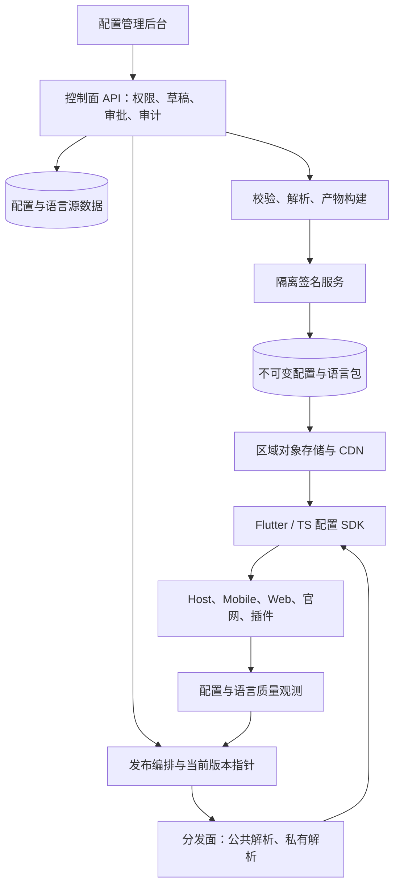

**OpenMuse 国际化与动态配置平台详细设计**

当前 Desktop、Mobile、Web 的整改范围与实施顺序以 [多端全球化整改计划](/Users/mac/src/openmuse-io/Muse-Client/docs/GLOBALIZATION-MULTIPLATFORM-REMEDIATION-PLAN.zh-CN.md) 为执行入口：保留 Word/PDF/表格产品层，未 ready 内核不纳入首发；保留现有市场及源管理，官方首发目录单独管理。本设计继续作为配置和语言平台的技术基础。

日期：2026-10-30。状态：共享契约、签名 SDK、四端刷新接入、统一语言控制器、基础配置后台及本地签名发布闭环已落地；生产基础设施与官网/存量界面迁移仍在推进。范围：Flutter Desktop、Linux、Mobile、Web、Next.js 官网，以及 Host 管理的插件、Office 和 DSH 展示层；其他客户端按能力契约接入。

本文基于当前工作区代码设计。工作区包含未提交修改；现状描述针对读取时的文件，不代表线上已部署状态。本文的架构目标与仓库当前交付范围分开记录。实现入口见 `packages/openmuse_runtime_config/README.md`、`packages/openmuse_i18n/README.md` 与 `services/config-control/README.md`。

**1. 目标与必须确定的边界**

目标是建立统一的配置控制面、可独立运行的配置分发面，以及多端共用契约的配置 SDK。业务代码只使用服务 ID、路由 ID、翻译 key 和能力 ID；部署地址、支持语言、外链、区域策略与产品开关由配置提供。

需要满足以下产品行为：

- 同一客户端发行包在已支持的平台能力范围内切换语言，不再为中文、英文分别实现业务逻辑。
- 更换 API、插件市场、帮助中心或下载地址，无须修改客户端业务代码；涉及系统注册或信任边界的变化按平台流程发布。
- 支持官方全球部署、不同数据区域、企业私有部署与不同发行渠道。
- 断网、配置后台故障或错误发布时，保留本地工作能力与已验证配置；云功能按安全策略降级。
- 配置、语言包、域名映射、开关和路由映射以发布版本关联，能灰度、观测、回滚、审计。

“不允许硬编码”应约束业务可变数据，而不是删除所有常量。客户端首次启动必须先知道从哪里发现配置、信任哪个签名者。采用三层边界：

| 层级 | 允许内容 | 维护方式 |
|---|---|---|
| 业务代码 | 类型、服务 ID、语义路由 ID、翻译 key、协议版本、编译期安全边界 | 代码评审与 CI |
| 发行引导配置 | 配置发现地址列表、根公钥、产品/发行身份、内置安全快照 | CI 注入、企业受管配置或签名安装资源 |
| 动态业务配置 | 实际服务地址、语言目录、外链、导航展示、区域能力、灰度规则 | 管理后台发布 |

生产 host、默认语言和 URL 不出现在业务源码默认值中；发行引导资源中的值可随部署生成。端口、回环地址和虚拟 origin 若承担本地协议或隔离语义，不应机械地变成远程可改项。根公钥、token audience 边界、权限校验和平台安全策略不允许被普通配置覆盖。

**2. 当前仓库的事实与迁移入口**

| 现状 | 文件 | 设计处理 |
|---|---|---|
| Desktop 集中解析 dart-define、进程环境和默认地址，但保留生产 host，Linux 有对应实现 | `app/openmuse_host/lib/src/host/endpoint_config.dart`、`app/openmuse_linux/lib/src/host/endpoint_config.dart` | 提取共享 SDK，现有对象作为兼容适配器 |
| Mobile 入口也维护认证与 Cloud 默认地址 | `app/openmuse_mobile/lib/main.dart` | 通过注入获得已验证的配置快照 |
| Mobile 通过 `OPENMUSE_DEFAULT_LANGUAGE` 选语言，并通过中文字符串替换 HTML | `app/openmuse_mobile/lib/mobile_build_locale.dart` | 使用运行时 LocaleContext 和消息模板，移除 replaceAll 翻译 |
| Office 根据构建语言选择文案 | `packages/openmuse_office_flutter/lib/src/office_build_locale.dart` | 跟随宿主语言，接入 Office namespace |
| 登录插件有 ARB、生成的本地化类与独立语言控制器 | `plugins/auth-gotrue/lib/l10n/`、`lib/src/auth_localizations.dart` | 保留现有语言资产，控制器归宿主公共包 |
| 更新模块单独读取构建地址，并保留生产 URL 默认值 | `packages/openmuse_app_update/lib/src/update_bootstrap.dart` | 注入 updates 服务与发行通道；保留安装包自身签名校验 |
| 官网使用 next-intl，语言列表写死 en/zh，语言资源通过动态 import 选择构建模块 | `Muse-WebSite/i18n/routing.ts`、`i18n/request.ts` | 使用运行时语言目录与已校验语言数据，保留框架路由结构 |
| 官网中间件对 en/zh 使用固定正则，并显式放行配对和网关路径 | `Muse-WebSite/middleware.ts` | 固定语言正则改为目录解析；网关、API、回调继续由协议路由隔离 |
| Desktop/Web 的内置 CJK 字体是当前界面 341 字的子集 | `packages/openmuse_host_shell/assets/fonts/README.md` | 增加字体覆盖率门禁，防止文案热更新后出现缺字 |
| Web 是 Flutter 入口，另外有同页 DSH DOM 模块；公开说明中生产 Edge 仍有待验收项 | `app/openmuse_web/README.md`、`web/dsh-pane/` | 统一契约覆盖 Dart 与 JS，不把配置设计当作 Edge 已就绪的证据 |

服务端保留 AppFlowy-Cloud/GoTrue 业务与认证边界。配置能力放在 Muse 自有服务与编排层，不直接改上游内核。旧服务端文档中的目录和部署入口存在历史描述，实施前以现有脚本核实；动态配置服务挂入现有部署流程，服务器密钥仍由环境/Secret 系统提供。

**3. 总体架构**



控制面负责编辑与治理，分发面负责提供已发布配置，二者独立部署和扩缩容。控制面不可用时，分发面继续服务已发布版本；公共快照不依赖后台数据库逐次读取。

第一期实现为一个独立服务的两个逻辑模块，加一个发布 worker；不必立即拆成大量微服务。建议沿用团队熟悉的 Rust HTTP 技术栈；后台使用 TypeScript/React 与现有 Next.js 能力。源数据使用 PostgreSQL，产物使用 S3 兼容对象存储/CDN。Redis 用于缓存、限流、通知；其不可用不影响持久版本正确性。具体库版本在实施时验证。

**4. 必须分开的运行上下文**

| 字段 | 含义 | 能否随语言切换 |
|---|---|---|
| `environment` | dev/staging/production | 否，由发行身份绑定 |
| `distribution` | 商店、企业、官网侧载等发行身份 | 否，由安装与发行事实确定 |
| `dataRegion` | 账号/租户数据归属与允许的服务区域 | 否，由账号/租户绑定 |
| `market` | 产品供给、支付和法律文档的业务市场 | 否，不从语言直接推导 |
| `uiLocale` | 用户界面语言 | 是 |
| `contentLocale` | 用户明确指定的内容或生成输出语言 | 独立设置 |
| `timeZone` | 展示与任务调度时区 | 独立设置 |
| `currency` | 交易结算币种 | 由商品/订单与市场规则决定 |

IP、系统地区和语言最多用于首次展示建议，不能决定已登录账号的数据归属。中文用户可以使用全球数据区，英语用户可以在企业私有部署使用中文。更改 UI 语言不会重新登录、迁移数据或更换 Cloud。

账号的 home deployment 通过可信认证/账号目录流程返回，并由服务端校验。账号发现避免公开暴露邮箱是否注册；客户端不能仅凭 query 参数切换租户。跨区域访问与切换必须走正式账号路由流程，不是 endpoint 故障后的自动 fallback。

**5. 配置模型与覆盖规则**

采用命名空间和类型化契约，不提供任意字符串覆盖整个客户端的能力。

| Namespace | 内容 | 生效时机 |
|---|---|---|
| `bootstrap` | 发现地址、根信任、发行身份 | 启动/受管安装 |
| `deployment` | 区域、服务发现、issuer/audience 引用 | 受控重新绑定 |
| `localization` | 语言目录、回退策略、语言包引用 | 资源准备成功后即时 |
| `navigation` | 语义路由映射、别名、菜单顺序 | 下次导航或重建菜单 |
| `links` | 帮助、隐私、协议、支持等外链 | 下次打开 |
| `features` | 客户端已有能力的开启、实验和熔断 | 按能力声明 |
| `branding` | 名称、logo、允许的主题 token | 资源准备完成后即时 |
| `updates` | 更新发现服务与通道策略 | 下次检查；不改变发行身份 |
| `legal` | 文档 ID、版本、适用市场、同意要求 | 按版本与操作场景 |
| `telemetry` | 事件采样和已允许的采集设置 | 受本地同意和地区策略约束 |

构建候选配置的顺序为：产品默认 → 环境 → 数据区 → 发行/平台 → 已授权租户覆盖 → 已分桶的版本变体。服务端生成完整有效快照，客户端不自行合并大量远程 JSON。用户偏好单独存放，只能作用于声明为可选的字段，例如语言与时区。

不进行无规则 deep merge：标量可按注册表覆盖；对象按明确字段合并；服务 endpoint 集合、路由条目和语言包引用按整个条目替换；数组整体替换，禁止按位置合并。未注册键和越权覆盖在发布前失败。每个有效值保留来源，供后台解释“为什么这个设备拿到这个值”。

约束优先于覆盖：租户策略与平台硬边界先形成可用集合，再应用偏好。企业策略可把 UI 语言锁定在某个集合，但不能借此修改数据区域或绕过客户端能力检查。开发覆盖只在本地开发/受管测试模式启用，不允许 Release 从普通环境变量任意接管认证地址。

每个配置键登记：类型、默认来源、负责人、允许覆盖层、敏感级别、校验器、生效时机、失效策略、最小客户端能力。禁止把数据库密码、模型服务私钥、支付密钥或服务端 token 放入客户端配置。public client ID 与秘密区分管理。

**6. 引导配置与端侧发现**

Flutter 原生：发行流水线生成 `bootstrap.json` 与内置签名快照，作为安装资源；企业可通过已授权的 MDM/签名配置文件替换部署身份。普通业务代码不读取散落的 `OPENMUSE_*_ORIGIN`。

Web/官网：在应用加载之前读取当前受信任 origin 的固定相对路径 `/.well-known/openmuse/bootstrap.json`，或由服务端将等价 JSON 安全嵌入 HTML。根脚本、TLS 与最初 HTML 仍是浏览器初始信任基础；运行时验签无法补救初始站点本身被攻破。

发现路径是协议常量；实际 host 来自当前 origin 或发行配置，允许固定协议路径不等于写死生产 URL。避免使用运行时配置去发现运行时配置的循环依赖。

引导文件包含 `productId`、`distributionId`、`environment`、多个发现 endpoint、根公钥集合、签名策略、内置快照引用与兼容版本。发现地址可以通过旧根签名的引导更新迁移，但首次启动时所有种子失效，只能依靠系统受管配置或新版安装资源恢复，不能凭空发现新域名。

DNS、CDN、TLS、OAuth 回调、iOS Associated Domains、Android App Links、CORS、CSP 和 ATS 都必须一起纳入域名迁移清单。其中部分属于网关配置或原生声明，不能保证仅下发一份 JSON 即支持任意新域名。

**7. 运行时快照示例**

下面是签名载荷解码后的结构示意；`.example` 地址仅为配置数据示例，实际由后台发布。签名封装见下一节；摘要值由构建器生成。

```json
{
  "schemaVersion": 1,
  "releaseId": "r-20261030-0042",
  "sequence": 42,
  "productId": "openmuse",
  "environment": "production",
  "distributionId": "global-store",
  "scope": {
    "dataRegion": "region-a",
    "platform": "ios",
    "variantId": "default"
  },
  "issuedAt": "2026-10-30T02:00:00Z",
  "expiresAt": "2026-10-31T02:00:00Z",
  "compatibility": {
    "minBuild": 100,
    "requiredCapabilities": ["config.v1", "messages.icu-subset.v1"]
  },
  "deployment": {
    "id": "deployment-a",
    "authBindingId": "identity-a",
    "services": {
      "auth": {
        "baseUrl": "https://identity-a.example/gotrue/",
        "credentialScope": "auth-only"
      },
      "cloud": {
        "baseUrl": "https://api-a.example/",
        "credentialScope": "cloud-a"
      },
      "pluginRegistry": {
        "baseUrl": "https://plugins-a.example/",
        "credentialScope": "public"
      },
      "updates": {
        "baseUrl": "https://downloads-a.example/",
        "credentialScope": "public"
      }
    }
  },
  "localization": {
    "defaultLocale": "en",
    "enabledLocales": ["en", "zh-Hans"],
    "catalogRef": "locale-catalog-42",
    "fallbacks": {
      "zh-Hans-CN": ["zh-Hans", "en"],
      "zh-Hans": ["en"]
    },
    "bundleRefs": ["shell-en-42", "shell-zh-Hans-42"]
  },
  "navigation": {
    "routes": {
      "workspace.open": {
        "handlerId": "workspace.open.v1",
        "pathTemplate": "/workspaces/:workspaceId",
        "requiredCapabilities": ["workspace.open.v1"]
      }
    }
  },
  "links": {
    "legal.privacy": {
      "originRef": "website",
      "pathByLocale": {
        "en": "/en/privacy",
        "zh-Hans": "/zh/privacy"
      },
      "fallbackLocale": "en"
    }
  },
  "origins": {
    "website": "https://www.example"
  },
  "features": {
    "speech.input": {"enabled": false}
  },
  "resources": [
    {
      "id": "shell-en-42",
      "kind": "messages",
      "locale": "en",
      "namespace": "shell",
      "url": "https://cdn-a.example/sha256/example-shell-en.json",
      "sha256": "<builder-generated-digest>",
      "maxBytes": 524288
    },
    {
      "id": "shell-zh-Hans-42",
      "kind": "messages",
      "locale": "zh-Hans",
      "namespace": "shell",
      "url": "https://cdn-a.example/sha256/example-shell-zh.json",
      "sha256": "<builder-generated-digest>",
      "maxBytes": 524288
    }
  ]
}
```

真实 schema 还应定义资源媒体类型、消息 schema 版本、字体引用、有效值约束和更新时间。示例不是可直接发布的完整配置。`authBindingId` 引用受安全发布策略约束的 issuer/audience 组合，不能仅相信接口返回的任意地址。

**8. 签名、版本、防重放与回滚**

使用标准 JWS 封装 UTF-8 载荷字节，固定允许算法与消息类型，第一版采用 Ed25519，对应 JWS 的 EdDSA 算法；已通过 Dart VM 与 Chrome 验证。其他算法需独立技术验证和协议评审。对收到的原始载荷验签，禁止解析后重新序列化再验签。protected header 包含 `alg`、`kid` 和配置专用 `typ`；客户端忽略未知算法，并校验产品、环境、发行身份、scope 与 schema。

客户端信任链来自安装资源中的根公钥。发布签名私钥由隔离签名服务/KMS 托管，Web 后台和普通发布 worker 不持有私钥。在线签名 key 可轮换；新 key 必须由旧可信根授权，根轮换保留交叠窗口和恢复流程，不能仅从待验证响应自身接受新公钥。

`sequence` 在同一明确发布流内严格递增，发布流至少绑定 product/environment/distribution/deployment/platform/variant；租户流另外隔离。客户端持久化每个流的最高可信版本。配置回滚时创建更高 sequence 的新 release，引用上一版内容，而不是直接回退旧签名包，从而同时支持回滚与防重放。

所有必需资源上传、摘要校验和区域预热完成后，才以 compare-and-swap 更新当前版本指针。客户端先 stage 完整快照和必需语言包，再原子替换 active 指针。任何一步失败保留上一版；懒加载资源必须被清单明确标记，不能把缺少必需资源的快照视为激活成功。

签名只证明来源与完整性，不证明内容永远新鲜。客户端校验有效期、持久化 sequence 和时钟异常；使用最近可信时间下界降低系统时钟回拨影响，但离线时无法可靠获知撤销或远端最新版本。HTTP 304 不能延长签名载荷的 expiresAt。

按字段风险制定有效期：网络信任/认证绑定严格到期，过期后停止新建相关云会话；普通文案和视觉资源可继续使用本地已验证副本；离线编辑不因配置过期被锁死。新安装没有历史 sequence 时仍受内置最低版本、签名有效期与根信任约束，不能声称可以完全阻止首次安装接收有效期内的旧包。

**9. 客户端生命周期与离线策略**

```text
读取受信任 bootstrap
  → 加载适配当前身份的 last-known-good / 内置安全快照
  → 显示本地界面
  → 限时发现并拉取候选配置
  → 验签、校验 scope/schema/能力/有效期
  → 下载并校验必需语言与资源
  → 原子激活热更新部分
  → 对 endpoint/认证变化执行受控重绑定
  → 上报接收、激活或拒绝原因
```

建议初始启动联网预算 1.5～2 秒，作为待测目标，不阻塞本地工作台。首次安装且无可用网络配置时，仍能展示内置启动/错误文案，提供重试和离线能力；不能猜测生产地址后发送凭据。

桌面/移动恢复前台时按距离上次拉取时间刷新；运行期间采用例如 5～15 分钟的 jitter 轮询、ETag 与指数退避，具体间隔由受限策略配置。在线通知只提示“有新版本”，客户端仍拉取完整签名包；后台 App 不能依赖持久连接保证实时性。

缓存键包含部署身份、环境、发行、平台/能力、发布流、版本；私有快照再加账号/租户隔离。语言包按 locale/namespace/schema/hash 缓存。退出登录清理或隔离账号配置、分桶身份与 token；禁止 A 租户缓存被 B 租户命中。

Desktop/Mobile 使用应用私有文件与原子 rename/事务指针；Web 使用 IndexedDB/Cache Storage，防止 Service Worker 缓存旧 bootstrap 或把私有响应写进公共缓存。官网 SSR 将本次采用的 config release 和 messages 一起传给客户端，hydration 期间不自动切换到另一快照。

**10. 客户端 SDK 与调用约束**

建议新增公共包：

```text
Muse-Client/
  contracts/runtime-config/v1/       # JSON Schema、协议、跨语言测试向量
  packages/openmuse_runtime_config/ # 发现、验签、缓存、上下文、服务解析
  packages/openmuse_i18n/           # LocaleContext、消息、格式化、字体
  packages/openmuse_navigation/     # RouteId、LinkId、URI 安全构造
  web/runtime-config/              # 与 Dart 相同契约的 TS SDK
  scripts/ci/check_globalization.* # 业务源码硬编码门禁
```

目录为建议，不代表已创建。Next.js 站点复用 TS SDK 的协议核心和服务端 adapter，DSH DOM 模块复用浏览器 adapter；通过包或产物依赖共享，避免复制实现。现有多个 Host endpoint 解析器逐步退为同一对象的适配器。

业务层使用类似以下接口：

```dart
final cloud = context.services.client(ServiceId.cloud);
final label = context.messages.filesCount(count);
final privacy = context.links.resolve(LinkId.privacy);
context.navigation.open(RouteId.workspace, workspaceId: id);
```

接口为示意。`ServiceResolver` 同时绑定 endpoint、认证策略、数据区和会话代际；不只是字符串拼接工具。安全键不向任意插件开放。Host 向插件提供其权限范围内的 i18n、navigation 和 service capability，不给插件完整私有配置。

所有请求在发出时确定所属会话代际。地址变化不把正在进行的上传或 WebSocket 强行迁移；新建连接走新代际，旧连接按可控策略耗尽。变更 issuer/audience/deployment 时重新认证，禁止把现有 bearer token 带到新 host 验证“是否可用”。故障备选只能选择同一数据区、同一凭据受众且预授权的 endpoint。

HTTP client 默认不跟随携带凭据的跨 origin redirect。非幂等写入不因切换 endpoint 自动重试；有业务幂等键和服务端保证时才可重放。对象存储预签名上传 URL、用户输入链接和配对授予 URL 属于动态业务数据，由专门校验器处理，不能强行登记为静态配置地址。

**11. Locale 选择、目录与能力**

平台统一使用 BCP 47 tag，例如 `en`、`en-GB`、`zh-Hans`、`zh-Hant`。`zh` 作为已有 URL 的兼容别名可继续存在；规范化时结合地区/脚本信息，不能把全部中文都映射成简体。语言匹配和逐 key 资源回退是两个阶段，不能混用。

原生端选择顺序：受管锁定策略 → 本机用户明确选择 → 账号同步偏好 → 系统语言列表匹配 → 部署默认。支持“跟随系统”，以枚举模式保存，不将系统解析结果伪装成用户永久选择。

Web 端先满足受管策略；合法且明确的 locale URL 表示本次浏览意图，应优先于 cookie/账号默认。没有明确 URL 时，按用户偏好、账号、浏览器语言、部署默认选择。打开分享链接的语言不应直接覆盖跨端账号偏好；用户操作语言选择器时才按设置同步。

```text
effectiveLocales = 部署启用语言
                 ∩ 发行/租户允许语言
                 ∩ 当前端已声明能力可覆盖的语言
                 ∩ 必需 namespace 已验收语言
```

语言目录包含 canonical tag、自称名称、script、textDirection、URL alias、回退链、必需字体/组件能力、资源版本与适用平台。名称由目录提供，不在代码维护中英文 if/else。

新增语言可能受 Material/Cupertino delegate、日期数字格式数据、字体、RTL 布局与原生系统文案限制。只有通过上述能力检查才能远程启用；否则需先发客户端版本。现有语言内的消息更新可动态生效；不能把“下载一份 JSON”描述为所有平台无条件新增任意语言。

**12. 语言包与翻译生产流程**

语言平台维护一个消息源注册表，每条包括稳定 message ID、namespace、原文、描述、页面上下文、截图引用、占位符类型、长度约束、owner、sourceRevision 和翻译状态。注册表使用中立的消息模型；通过 adapter 导出 Flutter ARB、TypeScript messages 与运行时 JSON。

namespace 建议为 `shell`、`auth`、`workspace`、`settings`、`office.word`、`office.sheet`、`office.pdf`、`dsh`、`market`、`website`、`errors`。插件使用 `plugin.<publisher>.<name>`，防止互相覆盖。不同客户端不必下载官网整包。

消息 ID 使用稳定语义，例如 `workspace.files.count`，不以中文原文、数组位置或当前英文句子作为 ID。生成代码将消息 ID 转为合法 Dart/TS 符号，并保留参数类型。

```json
{
  "workspace.files.count": "{count, plural, =0 {No files} one {# file} other {# files}}"
}
```

Dart 与 JS 运行时只使用经过验证的 ICU MessageFormat 共同子集，定义参数、plural/select、转义和嵌套深度限制；不要混用不兼容的消息格式版本。日期、数字、货币等使用结构化类型和 formatter，金额绑定 ISO 币种，不随 UI 语言擅自换币。

Flutter 的 `gen_l10n` 负责生成已有 ARB 的编译期实现，不直接提供远程 JSON 热替换。为满足动态语言包，新增受限的运行时消息解释器和 `DynamicLocalizationsDelegate`，由代码生成的 typed facade 调用：远程已验证消息 → 同语言内置消息 → 配置回退链 → 内置安全基线。启动/配置错误等少量文案必须内置，保证断网可用。

旧认证插件先通过 facade 调用既有生成类作为 fallback，再逐步收敛，避免重写登录链。运行时解释器是数据解释，不执行下载的 Dart/JS。解析限制字节数、key 数、嵌套、参数类型和执行成本；富文本只支持预定义组件 token，不接受任意 HTML、脚本和链接。

翻译流程：开发者提交 key/说明 → 注册表同步 → 机器预翻译（可选）→ 人工审校 → 参数/格式/覆盖率校验 → 多端预览 → 语言包发布 → 关联产品配置灰度。原文变化提升 sourceRevision，旧翻译标记 stale；发布包引用精确 sourceRevision，防止后台编辑结果被未审核地带出。

单语言或 namespace 可独立生成包，但客户端激活一个配置版本时按 manifest 锁定具体资源 hash。关键路径如登录、支付、删除账号、权限、协议必须完成审校；初始建议核心 namespace 100% 必需 key 覆盖，其他模块也必须具有经过批准的回退，不以随意比例掩盖缺失文案。

替换整段 HTML 的旧实现改为模板中的 message ID 与参数；只处理宿主自有界面，不对用户文档、代码、模型输出做翻译替换。服务端返回稳定错误码、结构化参数和 trace ID，客户端本地化；未知错误显示通用消息和追踪编号，避免直接展示内部错误内容。

**13. 全局格式、字体与多端展示**

- 时间按存储时刻与指定 IANA 时区格式化；定时任务同时保存 wall time/zone/重复规则，明确夏令时跳过和重复的处理，语言切换不改变任务触发时刻。
- 覆盖数值、复数、百分比、文件大小、排序、搜索和输入法组合态；协议 ID 不做本地化。
- RTL 使用方向感知布局，图标按语义选择镜像；代码、文件路径和混排文本保留正确方向，不能全局反转所有图标。
- 建立伪语言，扩大文案长度约 30%～50%，并增加重音/RTL 示例；适配大字体、屏幕阅读器和窄屏。
- 现有 341 字 CJK 子集不能直接承担动态中文文案。构建完整基础子集，按脚本补充签名字体资源并验证授权、体积、字形覆盖与加载退化；不依赖第三方字体服务保证首屏。
- App 名称、系统权限说明、原生菜单、商店截图与商店本地化单独管理。iOS/Android 等平台要求打包的声明仍走客户端发行；后台显示其可动态修改与需发版的边界。

Host 通过 versioned locale context 向 Office、DSH Web Pane 和插件广播语言、方向、时区与消息版本。DSH 若存在自己的语言配置，接入其官方支持接口；不使用 DOM 文本替换，也不把 UI 语言默认为模型输出语言。插件拒绝未知 locale 时执行明确回退并记录能力缺口。

**14. 路由、host 与 URL 设计**

分开管理三个层次：基础设施 host → 页面/应用语义路由 → 外部链接。域名与 base path 是部署数据；路由 ID 与组件 handler 是客户端能力；URL 生成规则与别名是受校验配置。

| 类别 | 约定 | 约束 |
|---|---|---|
| 官网公开页面 | 在已知 `[locale]` 结构下生成规范语言 URL | 支持 SEO、canonical、hreflang、sitemap |
| Flutter Web 工作台 | 维持当前应用 mount/base path，语言为运行时状态；如需前缀由网关 rewrite | 不破坏 assets、刷新、Service Worker 与既有链接 |
| 原生内部页面 | `RouteId + typed params` | 无需绝对 host，配置只映射已实现 handler |
| 外部帮助/协议链接 | `LinkId + locale/market/context` | 由目录解析，不在 widget 拼 URL |
| API/WS/配对/认证回调 | 独立协议路由 | 不进入 locale 重定向逻辑 |

官网先保留 `/en` 和 `/zh` 兼容性，再通过目录映射规范标签，例如 `zh-Hans → /zh`。不要求第一次迁移就把既有 URL 全改成 `/zh-Hans`。确需改名时配置显式别名、无环重定向与保留期限；固定页面迁移可永久重定向，语言偏好和地域推荐使用临时重定向，避免被浏览器/CDN 固化。

Next.js middleware 与导航 helper 必须读取同一发布快照。当前语言正则改为按 path segment 对目录查询，避免把动态目录编译为未经验证的正则。请求路径与语言值不直接拼成动态 import；运行时加载已验签资源映射，阻止路径穿越。

现有 `/v1/account/open`、`/v1/pair/open`、`/u/`、`/openmuse/` 以及实际 API、WS、`/.well-known`、静态资源和 OAuth 回调按所属部署协议精确匹配并绕过本地化。排除规则的安全含义保留在代码/生成的协议契约中，不允许后台任意将业务页面伪装成认证回调。

官网 SSR/SSG 需要单独处理：当前 `import(messages)` 只覆盖构建时存在模块；运行时增语言需改为数据加载。若页面用 `generateStaticParams`、静态导出或语言专属内容文件，新语言还需要内容生成/重建，或改为可按请求渲染；next-intl 的运行时语言配置不会自动解决静态产物缺失。

内部 route 配置只引用已注册 handler，参数有 schema。路由模板更改必须保留旧 matcher/别名，后端与网关先支持新路径再灰度客户端。新增页面能力仍需发版或遵循独立插件交付流程，不通过普通配置下载可执行代码。

URI 由标准库构造，path segment 和 query 分别编码；不能字符串 replace。外链只允许已批准 scheme 与域名，拒绝 javascript/data URL、userinfo、路径穿越与开放重定向；桌面本地文件/自定义 scheme 走专门 capability。Host header、Forwarded header 只信任受配置代理，不能从攻击者可控 Host 生成密码重置地址。

域名切换的顺序：新域名基础设施与认证注册就绪 → 增加 CSP/CORS/Deep Link 支持 → 预热验证 → 发布新路由配置 → 保留旧地址与凭据兼容期 → 观测后撤回旧入口。不能只改客户端 host 即完成迁移。

**15. 配置管理后台产品设计**

| 页面 | 核心能力 |
|---|---|
| 总览 | 应用/环境/区域/平台的当前版本、发布状态、配置拉取与激活健康度 |
| 配置目录 | 按 namespace 编辑，类型化表单、说明、负责人、风险、生效方式；高级 JSON 也必须过 schema |
| 部署与服务 | 区域、服务 ID、origin/base path、授权边界、连通性预检、域名迁移流程 |
| 语言管理 | 语言目录、平台能力、回退链、字体依赖、是否可启用 |
| 翻译工作台 | namespace、key、上下文、源文版本、占位符、审校、导入导出、缺失与 stale 列表 |
| 路由与外链 | RouteId/LinkId、模板、语言 alias、目标域名、重定向检查与兼容记录 |
| 功能与实验 | 已注册能力、目标规则、稳定分桶、退出条件、到期时间、owner |
| 发布中心 | 差异、影响范围、预检、审批、灰度、暂停、回滚、自动停止阈值 |
| 设备模拟 | 输入版本/平台/能力/发行/租户/语言，展示有效配置、字段来源和规则命中解释 |
| 审计与安全 | 操作人、审批人、工单、版本、签名 key、变更摘要、失败原因 |

后台默认先选应用与环境，生产操作使用显著环境标识。编辑器提示字段是即时生效、下次导航、重连还是下次启动，并显示受影响的旧版客户端。禁止保存后直接变更线上。

建议角色为 Viewer、Translator、TranslationReviewer、ConfigEditor、ReleaseManager、SecurityAdmin 和 Auditor，配应用/环境/区域/namespace 范围。翻译人员不能更改 host，运营人员不能修改认证绑定和信任根。生产关键地址/认证/法律变更要求独立复核，避免提交人自批；流程属于本平台设计，非本次聊天的额外审批要求。

导入语言包前先显示 key 增删、参数变更、覆盖率和危险内容，不直接覆盖整库。预览使用隔离环境与短期预览 token，不把未发布翻译放到公共 CDN；截图任务用预定义测试账号和固定页面，不开放任意内网 URL 抓取。

**16. 控制面和分发面的接口**

以下路径为建议协议，实际 base URL 来自引导/服务发现；`/v1` 属于版本化协议常量。

| 接口 | 用途 | 缓存与身份 |
|---|---|---|
| `GET /.well-known/openmuse/bootstrap.json` | Web 当前部署引导 | 公共，短缓存；按可信 host 路由 |
| `POST /v1/runtime/resolve` | 根据公开发行/平台/能力上下文解析公共发布包 | 返回签名结果或内容 hash 引用；不含私有租户值 |
| `POST /v1/runtime/resolve-private` | 认证后解析账号/租户策略 | 严格授权，private/no-store |
| `GET /v1/runtime/manifests/{contentHash}` | 读取不可变签名快照 | 仅公共产物允许公共缓存 |
| `GET /v1/runtime/resources/{contentHash}` | 读取语言/品牌等不可变资源 | 按资源公开性独立授权；资源摘要校验 |
| `POST /v1/runtime/events` | 接收配置激活/拒绝/缺失等事件 | 最小化采集、限流、不作为权限事实 |
| `POST /v1/admin/changesets` | 创建草稿与变更集合 | 后台权限、乐观锁、幂等键 |
| `POST /v1/admin/changesets/{id}/validate` | 编译、差异、安全与兼容校验 | 不修改线上指针 |
| `POST /v1/admin/changesets/{id}/preview` | 模拟上下文与渲染预览 | 受限临时权限 |
| `POST /v1/admin/changesets/{id}/submit` | 提交审批 | 明确状态流转 |
| `POST /v1/admin/changesets/{id}/approve` | 复核指定内容摘要 | 禁止批准后静默改内容 |
| `POST /v1/admin/releases` | 从审批的内容创建发布 | 幂等键、CAS、目标 scope |
| `POST /v1/admin/releases/{id}/promote` | 扩大灰度 | 新发布事件与可审计指针 |
| `POST /v1/admin/releases/{id}/rollback` | 创建递增 sequence 的恢复版本 | 不直接复活旧 sequence |

`resolve` 请求的可公开字段为 app、build、platform、architecture、distribution、schema/capability 版本、当前 release 和匿名分桶标识。环境/发行声明只能用于选择公开数据，不能当授权依据。租户身份、会员、地区权限等由服务器认证结果决定，禁止客户端 query 自报即生效。

公共解析若使用个体分桶标识，不让响应进入共享缓存；响应可为 no-store 的解析结果，指向可缓存的有限 cohort 清单。CDN cache key 必须覆盖完整公开 scope 与 variant；避免给每个用户生成独一份公共 manifest。私有快照不使用“只有 URL 难猜”作为权限控制，也不通过公共 contentHash 读取接口泄露。

不可变公共资源可长期缓存；当前指针与 bootstrap 使用短缓存/ETag，并设定明确传播窗口。ETag 用于内容再验证，不能代替数字签名或权限。版本失效与新指针传播分别观测，不用全网 purge 作为唯一正确性机制。

**17. 数据模型与发布一致性**

| 实体 | 关键字段/职责 |
|---|---|
| `application` | 产品、客户端集合、契约版本 |
| `config_definition` | namespace/key、类型、约束、owner、覆盖层、生效策略 |
| `scope` | 环境、区域、发行、平台、租户；规范化 identity/hash |
| `changeset` / `config_revision` | 草稿、base revision、内容、状态、内容摘要 |
| `locale` | tag、alias、script、direction、能力与字体要求 |
| `message` / `translation` | 稳定 ID、源文版本、占位符 schema、译文与审校状态 |
| `artifact` | 内容 hash、对象 key、大小、媒体类型、状态、区域可用性 |
| `release` / `release_artifact` | 完整快照、依赖资源、兼容要求、signature/key ID |
| `release_pointer` | 发布流、当前 release、递增 sequence、CAS revision |
| `target_rule` / `rollout` | 有限规则 AST、规则优先级、bucket 版本与百分比 |
| `approval` / `audit_event` | 对内容摘要的审批、操作者、前后版本、原因 |
| `outbox_event` / `release_job` | 事务后可靠发布、预热、重试、通知 |

唯一约束至少覆盖产品内 message ID、locale/消息/sourceRevision、content hash、发布流/sequence、scope 当前指针。草稿使用乐观锁；冲突时展示差异，避免最后一次写入覆盖他人工作。

数据库提交与对象上传无法当成一个跨系统原子事务。采用状态机与 outbox：保存冻结 revision → 构建 → 上传临时产物 → 校验与区域预热 → 签名 → 标记 ready → 事务性切换指针并写 outbox → 异步通知。重复任务通过内容 hash/幂等键去重，未 ready 的产物绝不成为当前版本。

审批绑定内容摘要与目标 scope；内容、目标或关键规则变化后审批失效。清理旧资源前计算所有活跃 release、受支持旧版本及回滚窗口的引用，避免 GC 删除仍被离线客户端使用的依赖。

**18. 灰度、熔断、权限与安全治理**

建议流程为：草稿 → 校验 → 预览 → 审批 → 内部设备 → 1% → 5% → 25% → 100%，比例和观察时长按变更风险确定。每轮同时满足最小样本量与观察窗口，再按激活失败、登录失败、请求错误、崩溃/白屏与语言资源异常判定。配置拒收率高时不能仅因为业务错误暂未增长就扩大灰度。

分桶使用固定版本算法与稳定 ID，不用每次随机数或 IP。未登录先按安装分桶，登录后按既定实验策略保留或转换，避免频繁换桶；跨端一致实验优先在认证后使用服务端账号级分桶。涉及认证/服务地址的变更以会话/部署为单位，不在一次操作中混用两套配置。

客户端开关只是展示与体验控制，功能权限、订阅权益、地区限制、支付和数据访问仍由服务端校验。kill switch 不能扩大权限或关闭签名校验。已经离线的设备无法收到即时停用，服务端必须能独立拒绝高风险操作。

后台启用组织 SSO/MFA、最小权限、不可变审计和独立复核。域名预检/资源预览在受限 worker 中执行，校验 SSRF、DNS 解析、redirect 与私网访问；企业私网场景使用单独部署的受管探测器，不放宽公共平台 worker 的网络边界。

配置平台与更新平台、插件签名体系分别保持信任边界。配置只选择受支持分发源，不能凭配置签名替代安装包/插件包的签名校验；远程资源加载不扩张插件 Broker 权限。

**19. 观测、运维与建议验收目标**

观测拉取成功、缓存命中、验签/兼容拒绝、stage/激活耗时、active release 分布、版本滞后、语言 key 回退、字体失败、endpoint 重绑定和回滚结果。发布 trace 关联 release/variant/build/platform；用户标识最小化，不记录 token、完整私有配置、用户文件内容或文档文本。

后台健康总览区分“下载成功”“激活成功”“已进入新会话”和“离线未更新”。对于暂停刷新/后台设备，不承诺收到更新的分钟级时限。提供受控诊断页导出脱敏的版本、来源与拒绝原因，正常产品主流程只显示用户能处理的语言/连接状态。

以下是建议目标，需结合区域拓扑与基准压测确认：

| 指标 | 初始目标 |
|---|---|
| 公共配置分发可用性 | 月度 99.95%，控制面单独统计 |
| 有 LKG 时配置引入的启动阻塞 | 0；后台刷新 |
| 无 LKG 的首次联网等待预算 | 1.5～2 秒后可展示离线/重试界面 |
| 配置响应大小 | 核心压缩后尽量 ≤100 KB，语言与字体单独分包 |
| 发布至在线活跃端接收 | 正常条件下 P95 ≤5 分钟；紧急路径另测，不含离线端 |
| 后台生成回滚版本与切换指针 | 目标 ≤1 分钟，不等于全体设备已生效 |
| 核心文案、参数、schema 验证 | 必需覆盖率 100%，零参数类型冲突 |

配置数据库和产物存储分别备份；定期演练主区域故障、签名服务不可用与根 key 轮换。只有同一数据边界内被明确允许的副本参与灾备，不因全球可用性目标自动跨区域转移私有配置或业务数据。

**20. 迁移实施顺序与交付物**

下列为依赖顺序，工作量是初步估算，不是承诺工期；需先盘点实际活跃入口和现有发行要求。

| 阶段 | 交付物 | 完成标准 |
|---|---|---|
| P0：盘点与契约，约 1 周 | hardcode 清单、owner、schema、bootstrap、能力与版本规则、ADR | 所有活跃宿主和外链/服务入口有归属，CI 能报告新增问题 |
| P1：SDK 与静态发行配置，约 1～2 周 | 配置加载/校验/缓存/验签；typed service/link/route；环境资源生成 | 同一二进制使用两份授权部署配置连接不同测试环境，不改业务源码 |
| P2：全端基础本地化，约 2～3 周，可与 P1 后段重叠 | 公共 LocaleContext、语言目录、typed facade、ARB/TS 适配、核心 en/zh-Hans | 登录、Host、Mobile、Office 与 DSH 支持范围内切换；去除构建语言分支/HTML 替换 |
| P3：控制面 MVP，约 2～3 周 | 后台、草稿审批、产物构建签名、公共/私有分发、审计、手动灰度回滚 | 测试环境完整演练语言修复、服务切换、失败拒收与回滚 |
| P4：Web/官网路由与生产接入，约 1～2 周 | 运行时目录、SSR 一致性、旧路由兼容、Deep Link/CSP/CORS 联调 | 旧链接、刷新、认证回调、配对网关、Service Worker 无回归 |
| P5：扩展与治理 | 翻译协作、自动门禁、更多语言、企业覆盖、实验与自动停止 | 依据真实流量指标逐步扩大，新增语言经过能力验收 |

具备 Flutter、服务端、Web/后台与测试投入、部分工作并行的前提下，核心落地粗估 8～12 周；范围、现有测试覆盖和上架约束可能调整该估算。不以迁移 deprecated 客户端和第三方 vendor 全量源码作为第一期目标；活跃第三方展示通过 adapter 或正式上游接口接入。

首个闭环建议选择：Desktop/Mobile/Web 的登录与设置语言、Cloud/auth/market/updates 服务、隐私与协议链接，再扩展工作台、Office、DSH 与官网。先建立一条完整“后台修改 → 签名发布 → 下载激活 → 指标 → 回滚”链路，再扩展所有 namespace。

迁移期保留旧解析器 adapter 和旧 URL alias；允许旧版本继续读取兼容 v1 快照。schema 增量采用可忽略的非必需字段；破坏性变更升级 schema 主版本，旧客户端继续拿最后兼容流，不能把 minBuild 简单当成强制更新理由锁死离线编辑。

**21. 验收清单与必须覆盖的故障场景**

| 场景 | 预期 |
|---|---|
| 换测试部署域名 | 只更新授权配置/基础设施；不改业务源码，不泄露旧 token |
| 更换语言并重启 | 偏好按用户选择持久化，所有接入展示层一致，不切数据区 |
| zh-TW/zh-Hant、未支持 locale | 正确匹配脚本或执行已定义回退，不静默全转简体 |
| 新语言无组件/字体能力 | 后台阻止向该 build 启用，客户端亦拒绝不兼容资源 |
| 配置后台和数据库故障 | 已发布分发继续工作，LKG 可用 |
| 首次安装断网/缓存损坏 | 内置界面可用，有重试/离线入口，不猜业务 host |
| 包被篡改、过期或重放 | 拒收并记录原因，按风险保留安全资源或停用相关云连接 |
| 下载一半断网/资源 404/摘要不符 | 不切 active，继续上一版本 |
| 回滚 | 产生更高 sequence 的恢复版，资源版本一致 |
| A 租户切到 B 租户 | 缓存、token、私有配置与灰度上下文隔离 |
| 灰度重启/多次请求 | 稳定命中，能解释规则，不能用客户端伪造权益 |
| OAuth 回调/密码重置/设备配对 | 不被语言中间件重写，redirect 校验生效 |
| 旧 en/zh URL、深链、直接刷新 | 保持兼容，无循环重定向，资源加载正确 |
| SSR 与客户端初始化 | 同一 release 与 locale，无 hydration 文案跳变 |
| API host 变化期间上传/WS 存活 | 代际切换，不重放非幂等写入，不跨区兜底 |
| 文案变长/RTL/字体补包失败 | 无关键操作遮挡，缺字可控，回退策略生效 |
| DST、时区和语言变化 | 定时任务遵守既定时区规则，不因界面变化漂移 |

CI 采取增量封禁再清偿存量：扫描业务目录中 URL literal、`Locale` literal、语言数组、内联可见文案和构建语言分支。使用 AST/lint 为主，rg 为盘点辅助；测试 fixture、协议常量、发行生成资源、第三方来源链接、虚拟 origin 和授权用户数据适配器通过带原因/owner 的白名单处理。禁止简单禁止所有 ASCII/中文字符串，也禁止海量临时 ignore 掩盖问题。

针对共享 Dart/TS 契约建立相同输入的黄金测试向量，验证签名、版本、合并规则、分桶、locale 匹配、ICU 参数和 URI 编码一致。测试覆盖新行为与实际故障边界，不为每个配置字段机械生成重复单元测试。

**22. 第一版范围与后续决策**

第一版必须包含：共享契约、可信 bootstrap、LKG、签名快照、类型化地址与链接、统一 LocaleContext、核心语言包、基础后台、审批审计、分桶、手动回滚及观测。后续扩展翻译供应商集成、自动灰度晋级、多层企业定制和高级实验分析；不要让第一版依赖自建完整翻译 SaaS。

实施前需要通过 ADR 固定的决策包括：活跃平台/入口清单；数据区与账号绑定事实源；发行身份的可信输入；公共/私有配置边界；签名实现支持矩阵；现有 URL 的兼容期限；原生新增语言能力；法律文档和字体来源。以上可以先以本设计默认值推进技术验证，涉及真实业务归属时再向对应 owner 确认，不能从语言猜测。

**23. 设计依据**

- [Flutter 官方国际化文档](https://docs.flutter.dev/ui/internationalization)：已有 ARB、delegate、Locale 与复数/格式化机制的基础；运行时远程语言包解释与签名是本方案新增的应用层能力。
- [next-intl 路由配置](https://next-intl.dev/docs/routing/configuration)：支持运行时语言目录与按请求路由配置；本项目通过本地 HTTP 回归与生产构建验证当前版本的接入。
- [Unicode UTS #35](https://www.unicode.org/reports/tr35/)：语言标签规范化、likely subtags 与语言匹配的参考；不把 locale matching 与资源继承混为一谈。
- [RFC 9111：HTTP Caching](https://www.rfc-editor.org/rfc/rfc9111.html)：缓存与再验证语义；本设计另外规定签名有效期、私有配置隔离和发布传播窗口。
- [RFC 8725：JWT Best Current Practices](https://www.rfc-editor.org/rfc/rfc8725.html)：固定算法、校验受众/用途与避免消息类型混淆的参考；配置签名与登录 token 使用不同消息类型和校验策略。


**24. 本轮实际落地与部署边界（2026-10-30）**

已实现：

- Desktop、Linux、Mobile、Flutter Web 读取可信安装 bundle，按部署身份持久缓存、恢复签名快照并后台刷新。原生缓存整体原子替换，Web 使用 IndexedDB 事务。
- 匿名分发采用无凭据请求和禁止重定向的传输；所有资源完成摘要与语言语义校验后才提交。已验签但资源损坏的缓存不能续用云端配置；本地 UI 仍可使用内置资源。
- 语言偏好按部署持久化，支持显式选择、跟随系统、动态默认语言/可用语言/alias；每个窗口独立。移动端、Office、认证、更新提示和终端入口已接入消息接口，注册表与类型化接口可重复生成并检查一致性。
- 第一方 HTML 插件消费相同消息 AST，切换语言保留表单、用户文件名和重新打开控件；文本、占位符、ARIA 与日期节点分别更新。
- 服务端点变更暂存到下一次建立会话；已绑定会话的有效期不能被新端点配置延长。认证请求、账号 bootstrap 和 token 读取经过网络配置检查，过期时保留本地工作并提示刷新。
- 类型化语义路由限制到已安装 handler，路径来自快照；Flutter Web 入口已接入。现有文件、工作区与插件授权路由继续由对应能力接口处理，远程配置不能注入执行代码或越过授权。
- 配置服务提供按 scope 的草稿、校验、冻结审批、签名发布、稳定分组、回滚重发、资源分发及事务审计。后台支持快照/语言 diff、语言包编辑、审批与灰度预览；本地演示流程已实际操作验证。
- 审批绑定内容摘要及提交时的活动指针版本。发生后续发布或灰度操作时，旧审批不能覆盖当前部署。回滚生成新草稿并取得更高 sequence。
- 官网已接入相同的签名快照与语言资源协议。中间件和 SSR 以发布 ID + 内容摘要固定同一版本，来源请求不能伪造渲染 pin；公开正文、元数据、链接和客户端上下文共享该版本。
- 官网保留 `/en`、`/zh`，规范标签使用 `en`、`zh-Hans`；按启用语言生成 `hreflang`，认证、配对、API 和 Web 应用入口绕过语言重定向。支持邮箱、备案展示与主要入口外链均由安装/动态配置提供。
- 发布器可通过产品消息注册表适配官网；当前参考进程使用一个产品契约。新增语言、路由前缀、消息 ID、字体或渲染能力仍需先发布安装版本；已安装能力内可通过后台热更新。
- CI 检查共享契约、生成文案、Node 发布器与 Dart/官网验签互通、浏览器缓存/请求策略以及新增业务 host/locale 硬编码。客户端剩余匹配是带说明的协议常量；官网旧版组件的待迁移匹配独立列入基线，不能扩散到新的业务代码。

本地参考服务使用 Node 24 + SQLite 单写事务，便于直接启动、审阅和验证。本文前述生产控制面拓扑仍需落地受管身份、外部签名服务、持久化高可用存储、CDN/区域分发、密钥轮换流程、指标与告警。当前服务没有声称实现跨地域数据库或多副本仲裁。

内置 production profile 的发现地址与发布公钥保持未登记状态。必须先部署受信任的分发入口、准备安装公钥与 origin allow-list，再生成并发布对应客户端 bundle。不会将开发密钥或本地演示地址写入正式发行资源。

仍需推进：更多存量静态 UI 文案/非第一方插件迁移；真实设备上的 RTL、字体与时区矩阵；端点代际切换覆盖上传/长连接的产品级交互；生产身份、签名、分发与观测基础设施。


复现与代码入口：

- 配置服务：`services/config-control/README.md`，本地已演练草稿 → 独立审批 → 签名发布 → 公共分发。
- SDK：`packages/openmuse_runtime_config/README.md`；共享语言与 HTML 接入：`packages/openmuse_i18n/README.md`。
- 官网：相邻 `Muse-WebSite/docs/globalization-runtime.zh-CN.md`，含独立仓库的公开签名向量与真实发布器互通测试。
- 发行配置：`scripts/release/prepare-runtime-config.sh` 统一生成受校验 bundle，生产不再从独立 endpoint/language define 拼装部署；调试覆盖仅在 debug 生效。

本轮验证包括 SDK/语言组件、控制面事务/审批/HTTP、移动端行为与窄屏语言切换、官网实际 HTTP 路由与生产构建。真实设备的完整能力矩阵与正式生产发布不包含在本地测试结论中。


本轮最终验证记录（2026-10-30）：

| 验证范围 | 结果 |
|---|---|
| SDK 静态检查与 VM 契约/签名/缓存测试 | 通过，15 项 |
| 共享语言组件与 Node → Dart 互通 | 通过，10 项 |
| 配置服务审批/事务/分发/密钥工具 | 通过，9 项 |
| 移动端组件与行为回归 | 通过，67 项；含窄屏、大文字、键盘与语言切换保留草稿 |
| Desktop / Linux 端点解析 | 各通过 11 项，相关入口静态检查通过 |
| 官网 TypeScript、实时发布器互通与独立公开向量 | 通过 |
| 官网真实 HTTP 与生产构建/进程 | 通过；另验证中英文页、canonical/hreflang、公开 SSR 缓存和语言跳转 |
| 文案生成与新增硬编码门禁 | 客户端、官网均通过；官网门禁的新增 URL 反例被拒绝 |

官网生产构建仍报告部分存量页面的格式/a11y 提示与依赖缓存提示，本轮没有批量改写无关组件或升级依赖。原生商店二进制与真实区域基础设施尚未构建/部署。


**25. 地区与不发版参数需求补充**

按后续需求，已增加受信任市场/地区目录、四端首次启动地区门禁、`settings.v1` 动态开关/参数和 `messages.dynamic.v1` 按需语言目录。它取代前文第一版“仅能更新内置语言”的限制；仍不能远程安装未知原生渲染能力。当前只开放中国和美国。以 [本次整改清单](REGIONAL-APPS-RUNTIME-REMEDIATION.zh-CN.md) 为当前实现说明。
