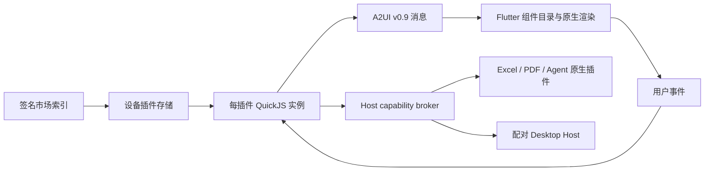

# Mobile 插件市场：A2UI + QuickJS 实施方案

状态：Android 原型已在真机验证，外部市场发布与跨设备安装尚待验收（2026-10-13）。本文区分已实现功能与目标设计。

## 技术选型

| 方案 | 可下载界面 | Flutter 观感 | 适配成本 | 本项目决定 |
| --- | --- | --- | --- | --- |
| A2UI + GenUI | 下发受控组件树和数据 | 组件由 Flutter 本地绘制 | 需要固定 Catalog 与协议版本 | Mobile 主线；当前锁定 `genui 0.10.4` 和 `a2ui_core 0.1.1` |
| Flutter RFW | 下发远端 widget 声明 | Flutter 本地绘制 | 需要自行定义业务事件与 Agent 互通 | 备用渲染器，暂不并行维护 |
| Stac/自研 JSON UI | 下发 JSON 视图 | Flutter 本地绘制 | 需维护自己的协议与跨端适配 | 不作为基础协议 |
| WebView | 下发完整 Web UI | 与现有原生交互分离 | 现有 Web 插件迁移容易 | 仅用于需完整浏览器能力的内容 |

| 执行内核 | 优点 | 约束 | 决定 |
| --- | --- | --- | --- |
| QuickJS（FJS，Rust 封装） | Android/iOS 内置运行时，不依赖 WebView；可按插件建 VM | 第三方 JS 必须经过可信分发；FJS 本身并非安全边界 | 首选，当前锁定 `fjs 3.3.2` |
| 无头 WebView JS | 浏览器 API 丰富 | 生命周期、桥接、Cookie 和 DOM 权限边界复杂 | 仅特殊插件使用 |
| Wasm/Rust 插件 | 接近原生性能 | iOS 动态代码政策、ABI 和分发成本高 | 首版不下发可执行模块 |

A2UI 渲染出的 Text/Button/Card 等组件是 Flutter Widget，系统输入法、布局和触控仍由 Flutter 处理；它与手写 Flutter 页面共享底层渲染，但组件集合、动画细节和复杂交互受预置 Catalog 限制。输入绑定先在本地更新；Button 动作进入 QuickJS，再由 A2UI 增量消息刷新。当前真机测试证明流程可用，尚未采集 p95 延迟，所以实时性数字仅是目标。

## 产品边界

一个市场条目代表一个逻辑插件 ID，可以含 Mobile、Desktop、Web 不同 artifact。平台徽标按**已验证 artifact**显示，不能根据原 DSH 包名推断 Mobile 可运行。详情页展示作者、来源、版本、权限、预览、安装量和喜欢数；统计由市场服务产生，客户端不伪造。安装是设备级状态，启用是设备及账号级状态。Desktop 插件的安装和禁用由配对 Desktop Host 执行，Mobile 只是受权控制端。

截图中 `dsh-codex-ui`、`dsh-better-sidebar` 属于 DSH Web UI 扩展，不可直接在 Mobile QuickJS 运行。`dsh-task-board` 等含 Host/浏览器部分的插件也必须做独立 Mobile 适配 artifact，标注来源、作者和许可；未经作者授权不重发原包。首批以任务看板、用量看板等功能为适配目标，不能把同名演示包冒充原作者插件。

## 分层和协议

固定 `OpenMuse A2UI Profile 1`：A2UI v0.9（锁定的 GenUI 0.10.4 / a2ui_core 0.1.1 实际接受的消息版本），受控组件目录和 action 名，限制消息大小、节点数与嵌套层数。v0.9.1 协议文档作为后续升级目标，升级须通过一致性测试。A2UI 只用于 UI、数据绑定及用户事件；插件执行、安装、授权、任务幂等、跨设备连接均由 OpenMuse 私有协议负责。Flutter 客户端在本地同步处理焦点和输入，用户动作异步送至插件 JS；运行 JS 时不阻塞 Flutter UI isolate。业务级实时性目标：本地输入不经过 JS，每次动作到新画面 p95 < 100ms（目标，须在设备上测量）；远端服务时间单独计量。

QuickJS 由预置 native runtime 提供，Mobile 下载内容仅包含声明式 A2UI 和 JS，不含动态 native 代码。当前每个会话单独创建 VM，设有 16 MiB 内存与 512 KiB 栈上限，无默认文件/网络/进程 builtins。Host bridge 已分层，但市场演示插件的能力调用当前一律拒绝；Excel/PDF/Agent 等业务能力 broker、权限提示、执行超时、审计和进程级崩溃隔离仍需实施。QuickJS 不是安全沙箱本身。iOS 分发需单独过 App Review 的动态代码审查；当前方案不保证审核通过。

## 安装事务

1. 获取 HTTPS 市场索引并校验可信发布者签名、时间/版本、防回滚；条目提供平台、最低 Host 版本、UI profile、JS ABI、许可、图片、统计及 artifact SHA-256。
2. 规划依赖和权限，下载到临时目录，限大小与重定向，验证 SHA-256 和 artifact 签名。
3. 验证 manifest、A2UI、JS ABI 与声明权限；原子移动到版本目录并更新 installed 指针。失败恢复旧版本。
4. 首次启用时创建 QuickJS 实例。禁用时取消任务、删除 A2UI Surface、关闭 runtime；卸载保留或删除用户数据由 UI 明示。
5. 配对 Desktop 的安装/禁用需要 Host 侧独立计划、授权和回执，Mobile 不发送任意 shell 命令。

**当前实现范围**：HTTPS Ed25519 目录、单调 `sequence` 防回滚、同源 artifact 与 SHA-256 校验、设备内原子文件替换、启动时完整性复查、预览及启停已落地。依赖求解、artifact 单独签名、账号级启用状态、事务日志和跨版本回滚还未落地。市场服务的安装量、点赞和评论 API 尚不存在，界面明确显示暂无数据。

Desktop 控制入口复用既有配对 grant，Host 对 `list/plan/install/enable/disable` 操作和固定目录 ID 二次校验。当前内置 Desktop 目录只有经 DSH 版本及 npm integrity 固定的 Archify。启停更改 `web` profile 的 bundles，需重启 DSH 生效。网关与安装器分别通过自动化测试；同一真机到实际 Desktop Host 的完整配对安装链路尚未测试。

## 开发计划与验收门槛

| 阶段 | 工作 | 验收 |
| --- | --- | --- |
| 1 | 扩展 v2 manifest 的 `a2ui` / `quickjs` / `js-bundle` | 既有 manifest 可解析；不兼容版本被拒绝 |
| 2 | 接入 Flutter A2UI renderer 与 QuickJS，定义 plugin/Host bridge | 真机显示 A2UI，动作通过 JS 改变数据；无 WebView |
| 3 | 市场目录、下载、校验、安装、启用、禁用、预览与平台标识 | 离线/重复安装/摘要错误/重启恢复测试 |
| 4 | 以 DSH 市场中的任务看板、用量看板为功能参照制作两个 OpenMuse 示例 | Android 真机从内置市场安装任务看板、触发 JS 动作、刷新 A2UI 已通过；尚不是原第三方插件的完整移植 |
| 5 | Desktop 配对市场管理 | 网关权限及本地安装器启停测试通过；真机到实际 Desktop Host 的联调待做 |
| 6 | 正式签名索引、市场统计及外部发布 | 已有离线签名发布脚本；需要正式 HTTPS 地址、Ed25519 发布密钥与市场服务，尚未上传 |

公开基建：[A2UI 规范](https://a2ui.org/specification/v0.9.1-a2ui/)、[GenUI Flutter renderer](https://pub.dev/packages/genui)、[FJS QuickJS runtime](https://pub.dev/packages/fjs)。这些依赖锁在 Mobile 适配层；当前仅完成 Android 构建和真机验证，iOS 构建与商店审查未完成。
