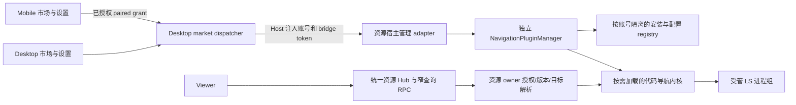

# 插件市场安装与配置管理协议

日期：2026-11-17。关联：[产品规格](PRODUCT.zh-CN.md)、[实施计划](PLAN.zh-CN.md)。



管理与语义查询分开。Viewer 仍只发送 reference/version/operation/UTF-16 position，不附加安装命令、配置或宿主路径。配置操作不经过对话模型、executeCommand 或通用 JSON-RPC 透传。

## 管理请求

复用 `POST /openmuse/plugin-market/v1`。固定操作 `list / plan / install / configure / detect / enable / disable / uninstall`。新增的管理操作只允许代码导航已知身份；未知 ID 在 registry 拒绝。正文上限 64KiB，响应上限 1MiB。

```json
{
  "operation": "configure",
  "pluginId": "com.openmuse.code-navigation.dart",
  "options": {
    "expectedRevision": 7,
    "values": {
      "sdkPath": "/path/to/dart-sdk/bin/dart",
      "initializationOptions": {},
      "configuration": {"dart": {}}
    }
  }
}
```

账号取自当前 paired grant，Desktop 再与当前登录态核对，不能由正文设置。处理前后检查 grant、到期时间和账号。Desktop 本地 Host adapter 在 IPC 前后再次核对当前账号。只有它向私有 token-gated bridge 传入 partition。paired 通用代理明确禁止 `/openmuse-native/v1/code-navigation/`，避免绕过可信账号注入。

成功的 plan 返回身份/版本、installedVersion、enabled、configuration、revision、detected、instances 和 action。检测额外返回 `detection: {ok, elapsedMs, instancesAfter}`。错误使用稳定 code；UI 将依赖、配置冲突、缺少 SDK、超时等映射为可操作说明，不乐观显示成功。

## Registry 与安装

独立管理器位于 `plugins/code-navigation-manager`，没有 Flutter/DSH 依赖。运行时目录按可信 partition 的 SHA-256 隔离；state 包含 revision、插件 receipt/配置及 workspace 策略。写入使用临时文件 + 原子 rename，模式 0600；目录默认 0700。

发行输入为三个独立归档、`catalog.lock.json` 和完整文件 SHA-256。应用签名覆盖信任根。构建先核对归档摘要，再按有界文件清单恢复；安装再次逐文件校验，拒绝路径穿越、symlink、额外文件或身份不符。安装先落临时目录验证，再切换；receipt 只在成功后写入。不开网络、不运行 npm hooks。

服务内核只从已安装且验证通过的插件目录加载；TS/JS 的 LS 与 TypeScript 由其语言插件目录提供。Dart SDK 是用户在宿主明确配置的外部依赖，卸载不能删除 SDK。源代码中的 `plugin.json` 为语言 profile 交付物内部格式，不向冻结的 OpenMuse manifest v2 增加私有顶层字段。

## 进程与变更

管理写操作串行；配置采用全 registry revision 进行比较更新。配置变更/关闭/卸载先取消并停止旧内核，停止失败保持可见且不写成功 receipt。初始化单飞；管理器等待正在创建的运行时后再清理，避免创建完成后泄漏。

初始化参数与 LS configuration 按 profile 保存；`workspace/configuration` 按请求 section 读取对应子树。启动配置变更使用停止后重建，首期不在正在执行的语言进程内热改启动参数。JS/TS typing acquisition 与 tsserver 路径为宿主受控值，客户端设置不能覆盖。

检测使用插件实际 backend 创建私有临时源码，执行 initialize + definition，随后 await 停止并删除仅该检测私有目录。不修改用户 workspace。关闭/配置/卸载请求会取消正在进行的检测。实例上限、请求边界、超时与空闲回收复用独立服务；Node runtime 的最低版本由语言服务要求决定，并使用官方归档摘要验证的受管版本。

DSH adapter 只恢复会话文件上下文、校验当前源码摘要、进行目标授权和转为统一引用。非本地/容器文件系统不能把远端路径传给本地 stdio backend，需相应执行 Provider 提供 adapter。
