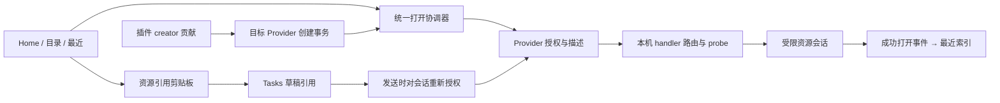

# 资源中心 · 框架衔接与拟新增能力

原始设计：2026-11-01。下文保留设计时的缺口与 draft 示例。2026-11-02 的已实现契约见 [IMPLEMENTED-CONTRACT](IMPLEMENTED-CONTRACT.zh-CN.md)，验收见 [ACCEPTANCE](ACCEPTANCE-2026-11-02.zh-CN.md)；不要把旧 draft JSON 当生产输入，也不要把原型模拟当真机证据。

**多端边界澄清：** 本目录设计的是 Mobile 入口，统一资源/版本/可用性、打开/创建/编辑贡献、最近事件、引用交接属于多端共享框架。Host 核心服务不能落成 Mobile 私有协议，各端只实现 UI 与平台/传输 adapter。手机文档被 PC 任务引用、临时目录清理后重新打开及源端离线的详细行为，见 [多端资源引用、可用性与对话交接](../../RESOURCE-REFERENCE-AVAILABILITY-AND-HANDOFF.zh-CN.md)。

## 1. 仓库核对结果

| 现有代码/契约 | 已有基础 | 对本稿的限制 |
| --- | --- | --- |
| [`muse_resource_contract/resource.dart`](../../../packages/muse_resource_contract/lib/src/resource.dart) | Descriptor v1、ResourceRef/Revision、format/confidence、安全分类、Materialization | 严格 wire，不添加裸 path、cookie 或任意未知字段；它本身不是目录树、剪贴板或最近服务 |
| [`WORKSPACE-RESOURCE-AUTHORITY-V1`](../../WORKSPACE-RESOURCE-AUTHORITY-V1.zh-CN.md) + [`MuseWorkspaceAuthority`](../../../packages/muse_resource_bridge/lib/src/authority.dart) | WorkspaceRef/MountRef、describe/list/materialize、已有资源 draft/commit、audience/generation/TTL、CAS | 当前 reference provider 不能冒称生产 Local/PC 存储；createDraft 接受已有 ResourceRef，不等于创建新文件；缺通用 metadata rename/new-resource 事务 |
| [`OpenMuseResource / editorCandidates`](../../../packages/openmuse_plugin_sdk/lib/openmuse_plugin_sdk.dart) | URI/名称/MIME，按 editor contribution 匹配候选 | URI/文件名不够当跨源稳定身份；当前候选函数不自行证明平台、启用状态与运行时 probe 可用，需能力过滤 |
| [`MuseEngineRouter`](../../../packages/muse_engine_adapter/lib/src/router.dart) | probe、requested mode、policy、effective mode、候选原因 | 可复用路由原则/契约，不能声称 Mobile Home 已完整走过该链；需适配当前插件 Registry 与资源上下文 |
| [`RESOURCE-OPEN-ROUTING`](../plugin-platform-v2/RESOURCE-OPEN-ROUTING.zh-CN.md) | 已安装收据、MCP tools schema 到编辑器贡献；MIME 探测、默认打开方式设计 | 安装包不提供可动态加载的原生 Flutter 代码；工具发现不等于 creator 发现 |
| [`WorkspaceMirrorPort / WorkspaceActionPort`](../../../packages/openmuse_workbench_layout/lib/src/workspace_mirror.dart) | mount、目录分页、generation 隔离、抽象工作区动作接口 | 抽象 action 入口不意味着每个 Provider 都支持 rename；缺统一可用动作、幂等及 typed receipt |
| [`MobileWorkspaceMirrorClient`](../../../app/openmuse_mobile/lib/mobile_plugins/mobile_workspace_mirror_client.dart) | 通过配对 grant 浏览 mount/children/search，读取受限资源，区分超时/授权失效 | 当前读取整包且上限 64 MiB，不是通用视频流/seek；短期连接/节点引用不可直接存成永久最近记录 |
| [`MobileWorkspaceFilesPlugin`](../../../app/openmuse_mobile/lib/mobile_plugins/workspace_files_plugin.dart) | 当前 PC 文件插件和 onOpenResource bridge | 目前是作用域只读，传入 `workspace:/<name>` 的 UI 对象并以 reader 闭包带真实资源上下文；不能直接把此 display URI 存为全局主键 |
| [`manifest_v2.dart`](../../../packages/openmuse_plugin_sdk/lib/src/manifest_v2.dart) | commands/services/editors/panels/agent_cli/cli | contributes 严格校验，没有 creators/resources 字段；不可把新字段直接塞入冻结 v2 并称兼容 |
| [`OpenMuseAgentContributor`](../../../packages/openmuse_plugin_sdk/lib/openmuse_plugin_sdk.dart) | 接受 MCP content blocks 的 Agent 接口 | 不证明 Tasks composer 已有 ResourceRef 卡片、跨 Workspace handoff、发送时单独授权；这些均需新增与验收 |
| [`WorkBuddyShell / WbTab`](../../../app/openmuse_mobile/lib/workbuddy/workbuddy_shell.dart)、[`models`](../../../app/openmuse_mobile/lib/workbuddy/workbuddy_models.dart) | 四栏壳、任务/编辑会话、附件入口 | 当前不是五栏 Home；新增资源中心必须保持 Task 草稿和原有深链；附件按钮不等于协议级资源剪贴板已打通 |

本稿以现有代码和 Accepted C3 为准；不把 `OpenMuseResource`、旧 Mobile `ResourceHandle`、Resource v1 Descriptor 三种不同层级混成一个已有全能协议。

## 2. 拟新增的 Host 服务边界

下面的名称仅为设计名，批准后单独做契约评审/版本协商。

| 服务 | 负责 | 不负责 |
| --- | --- | --- |
| ResourceCatalog / SourceRegistry | 本机、PC、将来 Cloud/URL 的源注册、稳定定位与目录展示模型 | 不解析 opaque refs，不根据裸路径跨源取数据 |
| ResourceOpenCoordinator | 连接/权限、describe/probe/候选、materialize、编辑会话、opened 事件、取消 | 不包含 PPT/PDF/视频等格式的业务实现 |
| RecentResourceStore | 当前账号/游客分区、成功打开事件、去重、保留策略、历史元数据更新 | 不保存 HandleRef、grant，不负责复制缓存内容 |
| ResourceClipboardBroker / Receiver | 单资源类型化引用，用户明确复制/粘贴，重新授权后交给接收插件 | 不把剪贴板当 capability，不自动读系统剪贴板 |
| ResourceMutationAdapter | source-side rename/copy/create、权限能力、冲突及原子 receipt | 不在 UI 用字符串改路径或制造本地成功 |
| ResourceCreatorRegistry | 收据绑定的 creator 声明、安装/启用/平台过滤、生命周期变化 | 不从工具名称猜新建类型，不包含类型白名单 |

全局资源打开统一汇入 Coordinator；从 Home、工作区插件、聊天引用、系统打开文件进入时都产生同一种已打开事件。仅对 Home 记最近会漏掉其他入口，不满足产品定义。



## 3. 引用与展示模型草案

```text
ResourceLocator（新 Host 模型，非冻结 wire 的替代物）
  sourceRef / accountScope / workspaceRef / mountRef / resourceRef
  revisionHint?                  // 非权限；可提示上次打开版本

RecentResourceRecord（本机元数据）
  locator / lastOpenedAt / lastOpenedRevision / lastHandler?
  displaySnapshot {name, mediaType, sourceLabel, logicalBreadcrumbs}

ResolvedResourceSession（运行时，不写最近/剪贴板）
  descriptor: MuseResourceDescriptorV1
  materialization: MuseResourceMaterializationV1
  audience / generation / expiry / providerContext
```

sourceRef 应是在账号作用域内可跨端解析的稳定源身份；当前客户端 Registry 维护到 Provider/传输 adapter 的映射，不能把某次连接 ID 或本机临时注册 ID 当这个身份。ResourceRef 等仍是 opaque。显示 breadcrumb 是 Provider 可公开的逻辑层级，不能塞进 Descriptor 变相暴露绝对路径。源端若只提供随连接过期的 nodeRef/resourceRef，必须先补可恢复的稳定定位/映射；没补齐的条目最多是“本次连接历史”，不冒称永久最近。

本机 Provider 的私有适配层封装 Android SAF/content URI、iOS 文件授权或应用目录；对外只交稳定资源身份。迁移到新手机时不可复用本机私有 grant。账号切换隔离全部 Provider cache、最近及内部剪贴板。

### 剪贴板候选格式（明确为 draft）

```json
{
  "protocol": "openmuse.resource-reference/draft-1",
  "scopeRef": "demo-scope",
  "locator": {
    "sourceRef": "demo-pc",
    "workspaceRef": "demo-workspace",
    "mountRef": "demo-mount",
    "resourceRef": "demo-resource"
  },
  "display": {"name": "秋季发布提案.pptx", "sourceLabel": "工作电脑 · 产品设计"},
  "revisionHint": "demo-revision"
}
```

候选平台表示：Android MIME `application/vnd.openmuse.resource-reference+json`；iOS 自定义类型标识需正式注册/验证。两者只是待评审的载体名，不是已发布协议。接收端把整个剪贴板当不可信输入：版本、大小、对象结构和作用域检查；ignore 展示内容里的 HTML/路径/任意命令；经 Provider describe 验证身份后才能打开。纯文本降级仅名称与逻辑位置，不编造已上线的 `https://.../r/...` 分享链接。

## 4. 本机插件打开与 Agent handoff

- 从现有安装收据/Registry 构建 handler 索引，再按启用状态、目标平台、运行时、probe、资源安全/模式政策过滤；过滤结果可解释。不可依靠 `editorFor()` 的第一候选就断言手机可编辑。
- 默认 handler 是偏好而非权限，卸载/停用失效；远程资源的数据面按该插件新建 audience 的 materialization。插件页面与 HTML 不拿配对 grant、源端本机路径或裸文件下载 URL。
- Tasks 粘贴的是同一资源身份，展示为草稿引用。发送时需要会话/Agent 的独立 consumer 授权，不能把手机 UI grant 转发给 PC DSH 或模型。
- MCP `resource_link` 只作为接收方协商支持时的表达；不能把内部 opaque ResourceRef 随便包装成公网 URI。若 Agent 不支持受控引用，显示不支持并保留草稿；显式读取/截取/附字节应另走权限和大小策略，不静默降级上传全文。
- 最近打开可取当前 revision；聊天发送应 pin 一次确定 revision，避免从“用户选中的版本”滑成后来变化的内容。Task 的执行 Workspace 与引用来源 Workspace 可以不同，权限与传输必须分别成立。
- pin 版本不等于保留了字节。聊天卡片需保存原件关联、所用版本/摘要、明确保留策略与可选的持久对话快照；临时目录不能当引用目标。源 Provider 可达则重取准确版本，或使用仍被授权的有效副本；两者都不可用时保留卡片并显示暂不可打开，不把当前新版偷偷替换进去。
- 手机 → PC 是需要新增并验收的反向 Provider/数据通道；现有手机读取 PC 的 Mirror 不能证明该方向已实现。对话是否持久保留附件、保存到哪个端/地区及保留期限仍待审核，不能默认为自动 Cloud 上传。

## 5. 创建贡献与事务草案

新增可选贡献协商（例如 SDK 的 `ResourceCreatorContributor` 与声明式 creator catalog）；名称未冻结。v2 manifest 未声明 creators，所以**本稿不修改冻结 v2 字段**；后续选择版本化扩展/新 manifest 版本，并为旧 Host 设置显式兼容规则。第三方标准 MCPB 没有该扩展时仍可安装/打开已支持资源，只是不出现新建入口。

```text
ResourceCreator（概念字段）
  creatorId + owningPluginRef + contributionRevision
  localizedTitle + safeIconAsset + output mediaType/format
  supportedTargets: local / pairedWorkspace / ...
  requiredEffects + inputSchema + defaultName policy
  create operation reference（插件能力，不是任意命令字符串）
```

贡献发现不等于执行授权。安装 receipt、插件版本、creator catalog 和目标写能力一起校验；MCP Tool 的名称/描述或一个 `create` 注解不自动授予磁盘写权限。新建参数通过允许的表单 schema 或插件受限页面展示；禁止执行任意下载 Dart/JS 本机代码。

事务链建议：

```text
选 creator/位置/名称 → Host 目标授权 → Provider 预留新资源身份与幂等键
→ 插件在限定 working copy 中产出 → 校验类型/体积 → Provider 原子提交 receipt
→ describe(new ResourceRef) → Coordinator 打开 → opened → 最近
```

现有 Authority 的 `createDraft(resourceRef)` 只覆盖已有资源编辑。全新资源需要另评审“预留/提交/放弃”的版本化操作；同一幂等键不能产生第二份，失败草稿要回收，不能先创建空文件再宣布完成。Local / Paired / Cloud 可共享语义，不同源分别通过 TCK 后才广告支持。PC rename 同样需要 metadata revision/CAS 与 receipt；不要把内容 Revision 当所有元数据变更的万能锁。

## 6. 实施验收与原型边界

契约测试优先验证：Ref 不解析、禁止物理 path、expiry/generation/audience、跨账号拒绝、旧连接重新定位、分页、create/rename 幂等/冲突、Blob 成功但 metadata 失败不返回成功、插件卸载中断创建、聊天 handoff 重新授权。

`index.html` 只使用内存 fixtures 演示：行点击、长按菜单、打开方式、复制/粘贴卡片、新建贡献安装变化、重命名、搜索和错误恢复。它不访问真实剪贴板、文件、PC、云、账号或模型，不证明上述新契约已实现。设计原型使用无依赖 HTML/CSS/JS 方便离线审核，正式实现仍为 Flutter 和框架插件体系，不引入新 Web 应用栈。
