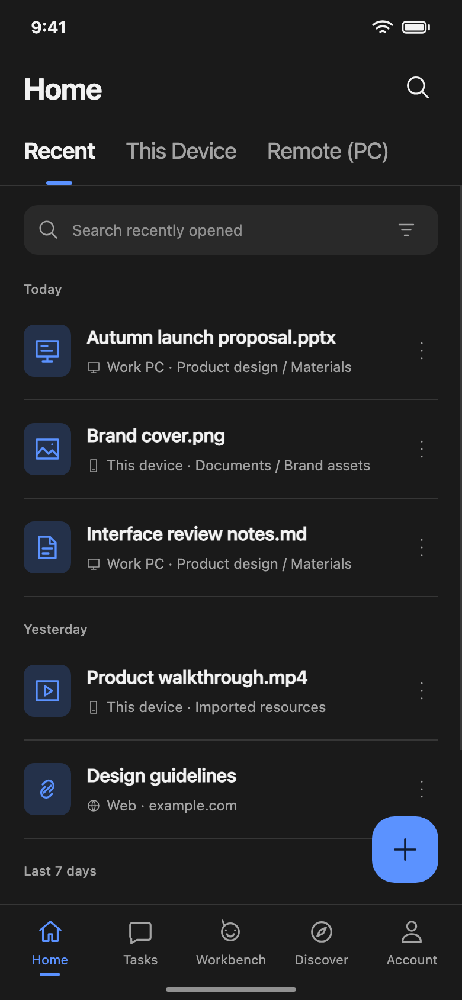
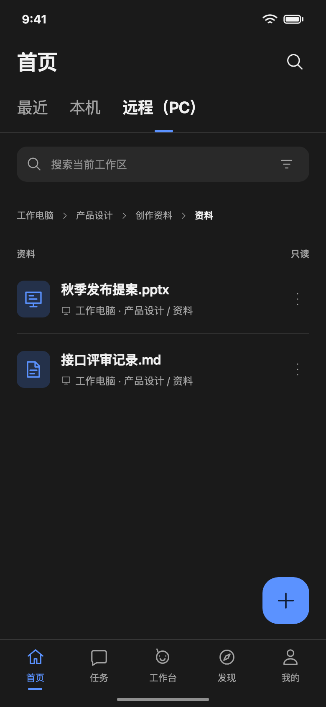
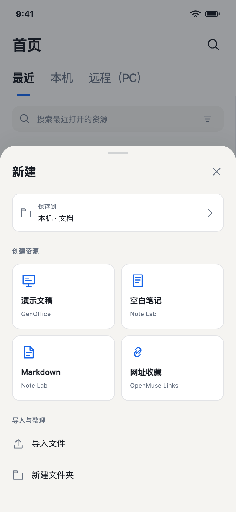
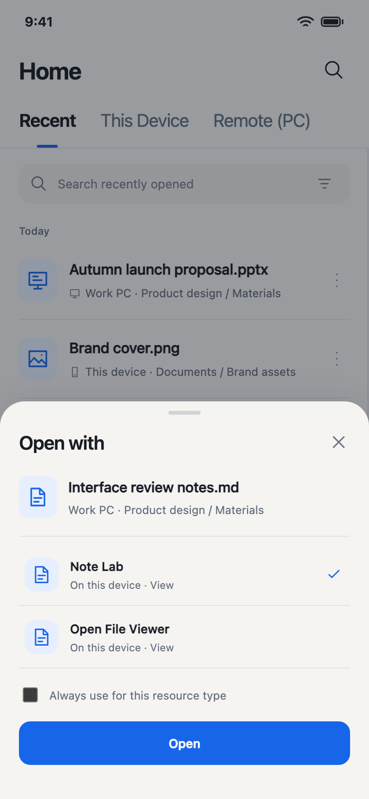

# Home 资源中心 · 人工审核包

**设计基线：2026-11-01；实现与验收更新：2026-11-02。** 用户随后明确授权按多端共享框架实施。此目录保留最初的审核原型；实际 Flutter 实现须与原型分别评估。

当前状态见 [开发计划](IMPLEMENTATION-PLAN.zh-CN.md)、[实现契约](IMPLEMENTED-CONTRACT.zh-CN.md) 和 [验收报告](ACCEPTANCE-2026-11-02.zh-CN.md)。原型中的示意插件不等于已发布插件能力。

## 从这里开始

1. 打开 [可交互原型 index.html](index.html)。无需安装依赖，可离线双击，也可用下方本地服务器。左侧选场景，右侧切换插件安装状态、电脑在线状态和列表空/错/加载状态。
2. 阅读 [产品范围与交互稿](PRODUCT.zh-CN.md)，重点看首期范围、复制语义、目录层级和新建规则。
3. 技术审核看 [框架衔接与拟新增能力](FRAMEWORK-MAPPING.zh-CN.md)：逐项标明现有代码、缺口及 draft 契约，不将设计原型当作已完成的功能。
4. 跨端场景看 [统一资源引用、可用性与对话交接](../../RESOURCE-REFERENCE-AVAILABILITY-AND-HANDOFF.zh-CN.md)：Mobile 只是 UI 入口；手机资源被 PC 对话消费、源端离线、临时目录清理以及对话版本保留，按共享框架语义处理。

```bash
cd /Users/mac/src/openmuse-io/Muse-Client
python3 -m http.server 8767 --bind 127.0.0.1 --directory docs/design/mobile-resource-center
# 浏览器打开 http://127.0.0.1:8767/
```

正式实现仍为 Flutter。HTML/CSS/JS 只用作可携带、无外部依赖的设计审核样机；没有接入真实文件、账号、电脑、系统剪贴板、云或模型，所有操作仅改变原型内存。刷新/重置即还原，图中状态栏时间、文件、电脑和插件名称均为示例。

## 产品建议摘要

- 五项底栏：**Home / Tasks / Workbench / Discover / Account**；Home 为普通冷启动建议入口，默认最近；保留既有任务草稿及深链恢复。
- Home 三分栏：最近、本机、远程（PC）。最近跨来源、跨格式；PC 按电脑 → Workspace → mount → 目录浏览。
- 点击资源交由本机可用插件路由；长按/更多提供打开方式、添加到对话、复制、复制资源路径、按能力重命名和移除最近。
- **复制资源 = 复制引用**，粘贴到聊天形成可点卡片，不自动发送或上传；**复制路径 = 逻辑位置文本**，不暴露 PC 物理路径，不将路径当访问授权。
- `+` 由当前安装且兼容的插件贡献创建类型，Host 不写死 Office/图片/PDF 按钮。PC 写入和创建必须有源端能力/回执，未满足时明确只读。
- Cloud 最近记录可沿用同一身份模型扩展；首期不新增 Cloud 浏览栏、跨设备最近同步、批量剪切移动或永久删除。

## 原型可以操作什么

| 场景 | 建议试法 |
| --- | --- |
| 最近 | 搜索名称；点文件；多候选时选择打开方式；视频会展示没有可用 handler 的状态 |
| 远程层级 | 点“产品设计 → 创作资料 → 资料”；也可检查共享素材、个人笔记；关闭“电脑在线”再恢复 |
| 长按菜单 | 长按 450ms、右键或点行尾更多，进入同一菜单；PC 只读资源重命名有禁用原因 |
| 复制到聊天 | 复制资源 → Tasks → 粘贴资源，查看草稿引用；同一引用去重；可移除、发送、点卡片返回查看 |
| 新建与插件贡献 | 点 `+`；开关右侧“安装笔记插件”，创建类型即时变为 4/2 项；在 Discover 也可模拟安装/停用 |
| 新建与失败 | 点击创建类型，尝试空名称或同名名称；创建后进入示意预览；创建中关闭会取消原型操作 |
| 重命名与移除 | 对本机图片改名；扩展名保留；从最近移除可撤销，源资源不删除 |
| 外观与状态 | 浅/深色、中文/English；首次为空、骨架、加载失败、无 handler、PC 离线 |

图中的 GenOffice 创建入口、Note Lab、OpenMuse Links 等 **仅展示拟议贡献形式**，不声明现有发行插件已经支持创建。编辑器页面也为示意，不具备真实文档解码、编辑或保存能力。Workbench/Discover/Account 只提供串联演示，不替代上一批已验收的设计基线。

## 静态视觉稿

[完整审核工作台](screens/00-review-workspace.png)

| 首页最近 · 浅色 | 最近 · 英文深色 |
| --- | --- |
|  |  |

| 电脑与工作区 | 工作区目录 · 深色 |
| --- | --- |
|  |  |

| 新建面板 | 长按菜单 |
| --- | --- |
|  |  |

| 打开方式 | 对话资源引用 |
| --- | --- |
|  |  |

其他状态：[电脑离线](screens/09-offline.png)、[首次为空](screens/10-empty-dark.png)。

## 视觉方向与审核顺序

沿用 [taste v1](../../../.agents/skills/design-taste-frontend-v1/SKILL.md) 与当前 Mobile 的暖灰浅色/炭灰深色、蓝色强调、空心图标和原生分组习惯。资源行优先、轻分隔、不堆营销卡片；不复制 WPS 品牌横幅、配色、图标、推荐位或固定 Office 功能宫格。新建面板采用两列可伸缩贡献项，避免长英文被切成几行。

建议人工按以下顺序审核：

1. 五栏顺序及 Home 冷启动默认最近是否成立。
2. 复制引用与复制路径的区分、聊天卡片的显示和发送前授权是否符合预期。
3. PC 以 Workspace/mount 为边界、浏览不切换 Task 执行位置，以及只读写权限的表达。
4. 新建入口依插件动态变化，创建位置与“创建成功、打开失败”的处理。
5. 首期暂不包含 Cloud 浏览、跨端最近同步、批量移动、永久删除的范围。

以上为原始审核顺序；实施以共享框架原则、开发计划和实际验收记录为准。

## 本地复核

语法及交互检查使用 Node 内置模块和独立 headless Chrome，不读取现有浏览器 profile，不需要 npm 依赖：

```bash
node docs/design/mobile-resource-center/review-check.mjs
```

非标准 Chrome 路径可设置 `CHROME_PATH`。脚本自行启动临时本地服务器、截图并清理临时 Chrome profile。结果见 [REVIEW-QA.json](REVIEW-QA.json)：覆盖引用复制/粘贴、目录/挂载隔离、只读操作、插件动态贡献、创建/取消、改名/撤销、空/错/无 handler、长按、焦点恢复，以及 320/390/430px、中英浅深色视口。截图 11 张。

这些检查仅验证审核原型的可交互性、视口和浏览器运行错误，不代表 Flutter 真机、协议实现、安全审计、Dynamic Type 或内容格式兼容验收。正式实施的验收矩阵见产品稿第 8 节。
