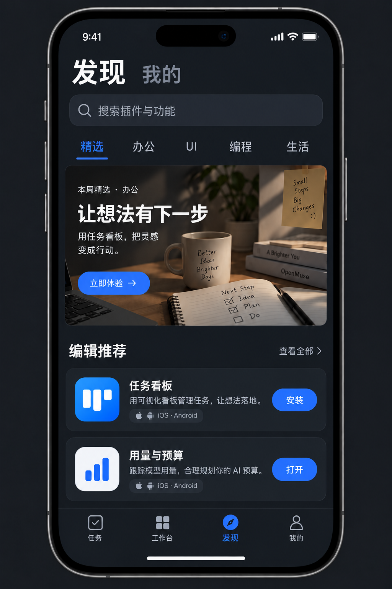
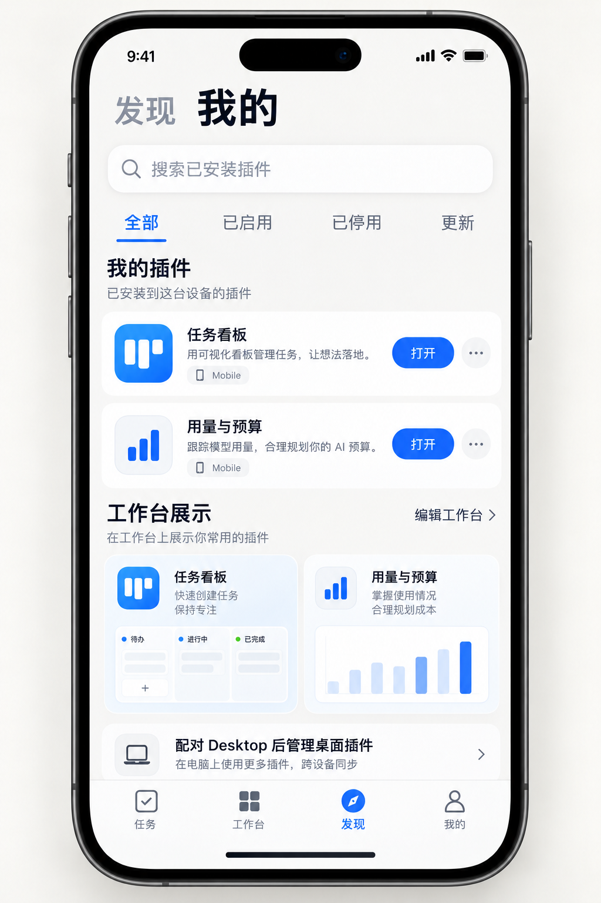
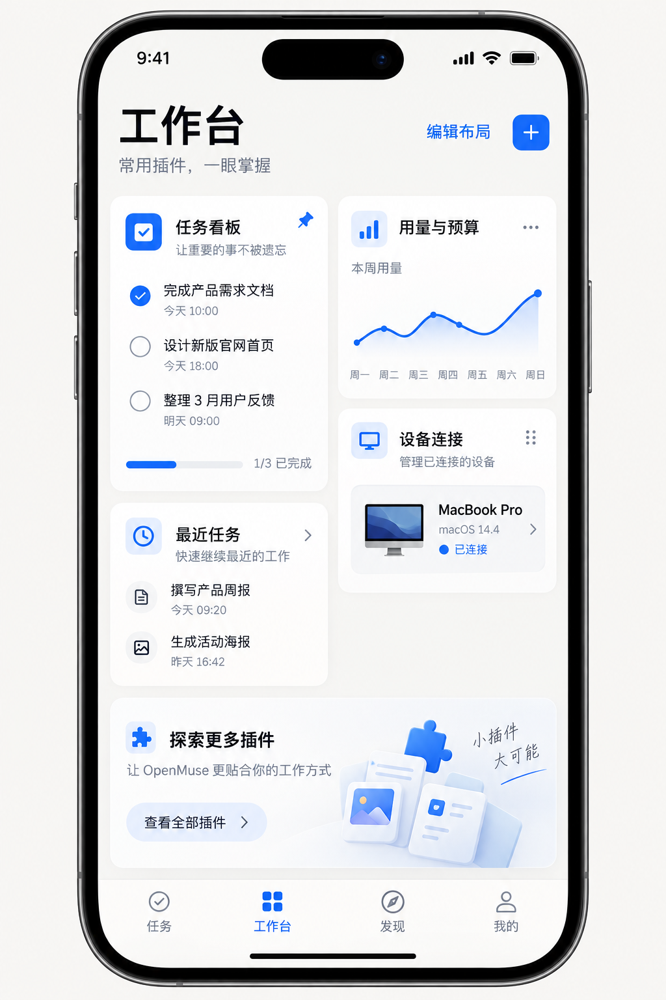
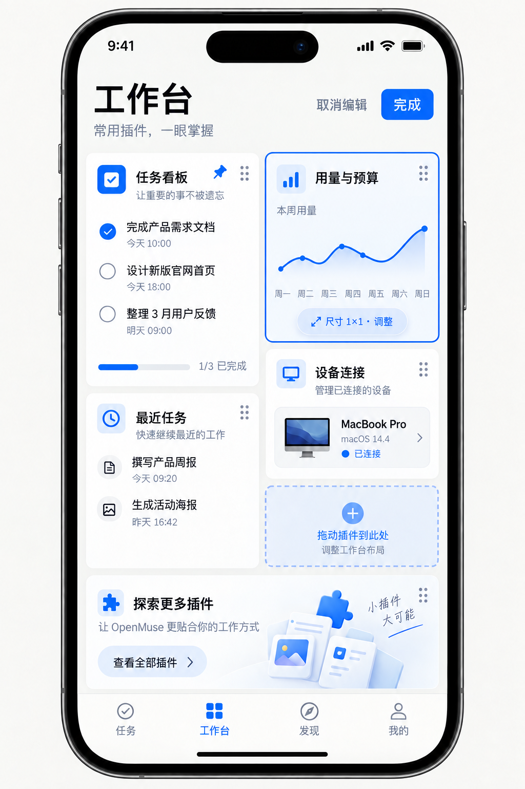
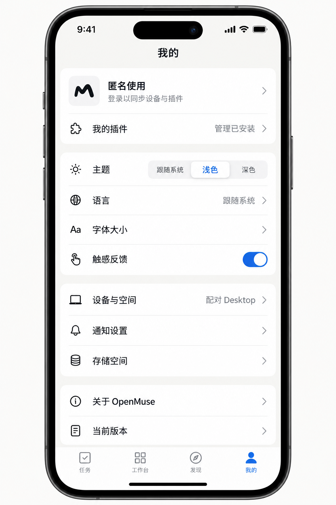
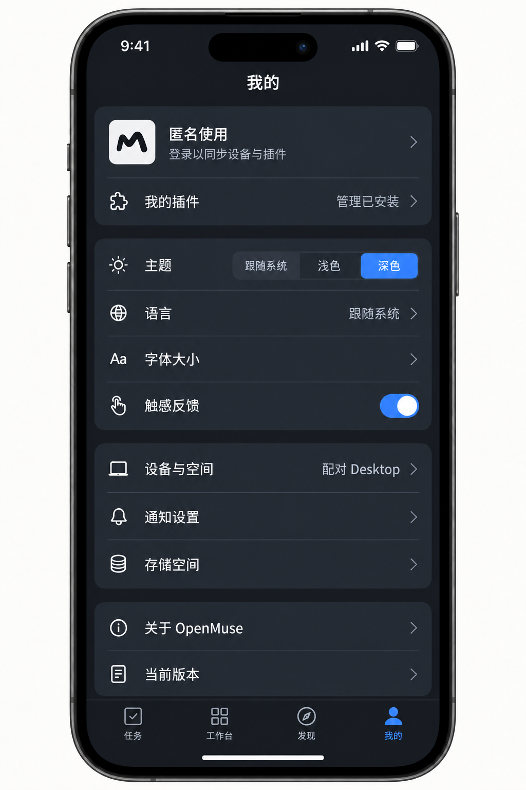
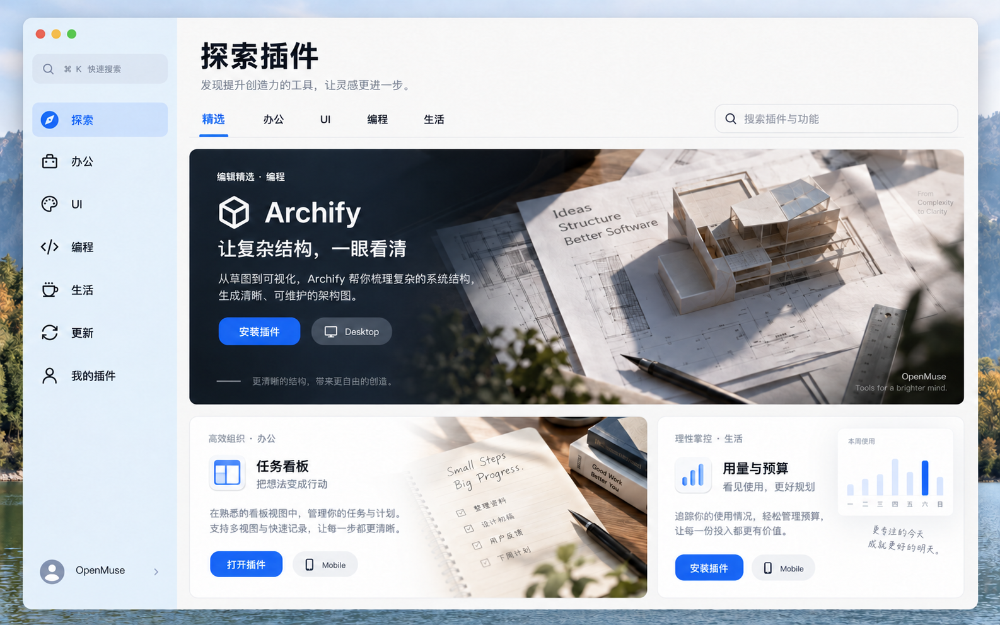

# OpenMuse 插件平台 V2：Mobile 与 Desktop 设计方案

状态：**已批准的设计基线，第二阶段代码已实施**。日期：2026-10-15。架构决定与尚待真实设备验收的项目以 [实施方案](IMPLEMENTATION-PLAN.zh-CN.md)、[验收矩阵](ACCEPTANCE-MATRIX.zh-CN.md) 和 [本次 UI 对照](UI-AUDIT.zh-CN.md) 为准。平台 WebView 用于完整页面；A2UI 用于工作台卡片。

本稿以用户提供的两张截图为视觉参考：Desktop 借鉴 App Store 的侧栏、编辑精选和宽幅媒体；Mobile 借鉴简洁的「我的」设置分组。参考图只用于识别布局与视觉意图，不作为功能、文案或数据来源。本目录设计图均为概念图，不是现有 App 截图。

## 设计图

| 场景 | 设计图 | 要核对的重点 |
| --- | --- | --- |
| Mobile 商店「发现」浅色 | [查看](mobile-discover-light.png) | 顶部双 tab、搜索在类别上方、信息流、四项底栏 |
| Mobile 商店「发现」深色 | [查看](mobile-discover-dark.png) | 相同布局随全局主题切换 |
| Mobile 商店「我的」 | [查看](mobile-store-mine-light.png) | 已安装、更新、管理工作台；区别于底栏「我的」 |
| Mobile 工作台 | [查看](mobile-workbench-light.png) | 插件卡片预览、两列瀑布流、置顶 |
| Mobile 工作台编辑态 | [查看](mobile-workbench-edit-light.png) | 拖动、落点、尺寸、完成/取消 |
| Mobile 底栏「我的」 | [查看](mobile-account-light.png) | 全局主题与账户/设备/插件设置 |
| Mobile 底栏「我的」深色 | [查看](mobile-account-dark.png) | 切换主题后设置页与系统栏同步 |
| Desktop 插件市场 | [查看](desktop-market-light.png) | 侧栏、类别与搜索同一行、宽幅精选 |

> 图中海报、插件描述、任务、设备、使用量及安装状态是设计示意。正式 UI 必须读取真实目录、manifest、安装状态和用户数据。没有服务端来源的下载量、点赞数、评论数不显示。概念图中的「任务看板」和「用量与预算」标为 Mobile；Desktop 是否能直接打开，取决于实际 target 与可用设备，不由视觉稿决定。

### 视觉画廊

**Mobile 商店：发现（浅色 / 深色）**

**Mobile 商店：我的插件**

**Mobile 工作台：浏览 / 编辑**

**Mobile：我的账户与设置（浅色 / 深色）**

**Desktop：插件市场**

## 1. 信息架构

### Mobile 全局底栏

固定为四项，顺序是 **任务 / 工作台 / 发现 / 我的**。原「专家」入口更名并重组为「工作台」，「资料库」从一级底栏移除，「项目」更名并重组为「我的」。资料库与项目的已有数据及页面不能被删除：资料能力从任务或插件详情进入；项目列表从「我的 > 项目与空间」进入。是否保留旧路由由实施阶段迁移验证。

| 一级入口 | 用户目标 | 首屏内容 |
| --- | --- | --- |
| 任务 | 发起、跟进任务 | 当前任务及最近记录 |
| 工作台 | 使用已安装插件 | 可定制的插件预览卡片 |
| 发现 | 找到与管理插件 | 编辑精选、分类、搜索 |
| 我的 | 管理个人环境 | 账户、外观、设备、存储、项目与空间 |

「发现」内部另有顶部大 tab **发现 / 我的**：这里的「我的」专指**我的插件**（已安装、更新、停用、工作台管理），不是底栏的个人设置。为避免同名迷惑，顶部切换时页面辅助说明分别是「探索插件」和「已安装的插件」，无障碍名称分别为「发现插件」和「我的插件」。底栏「我的」的无障碍名称为「我的账户与设置」。

### Desktop 插件市场

保留宿主原有安装、启用、禁用、详情能力。市场采用桌面适用的 App Store 式布局：左侧导航；内容顶部标题；其下**类别在左、搜索在右**同一行；宽幅精选媒体；编辑卡片及真实目录。窄窗时侧栏可收起、搜索换行，内容改为单列。分类与 Mobile 使用同一目录分类值，展示顺序可因设备不同而变。

## 2. Mobile「发现」

### 布局和交互

1. 顶部「发现 / 我的」占同一标题区。选中项字级建议 30–32sp、字重 700；未选中项 23–24sp、字重 600、使用 `textSecondary`。切换时通过 180–220ms 缓动改变大小与颜色，保留固定点击区域，避免文字动画推动搜索框跳动。系统关闭动画时立即切换。两项始终是可识别的 tab，未选中态仍满足文字对比度目标。
2. 搜索框在顶部双 tab **下方、类别上方**，搜索范围默认当前顶部 tab。输入后可显式切换「全部插件 / 已安装」范围；返回时恢复原来的分类和滚动位置。搜索支持插件名、作者、用途关键词；结果数据以市场索引为准。
3. 类别横向滚动，首项「精选」，后接「办公 / UI / 编程 / 生活」等真实分类。类别切换保持顶栏和搜索框稳定。无结果显示明确空态和清除筛选操作。
4. 「发现」内容是连续的信息流：首位大幅编辑精选，可放图片、动图或视频海报；其后是专题卡、真实插件条目和轻量的类别导航。媒体使用统一比例与裁切规则；视频默认静音、不自动播放声音，播放按钮明确；弱网和减少动态效果时静态海报回退。图片、动图、视频的类型、来源与尺寸由目录声明，并遵守现有安全策略。
5. 条目显示名称、作者、短描述、平台能力、安装按钮/打开按钮。只有目录与目标 manifest 明确支持的端才出现 `Mobile / Desktop / Web` 标识。统计数据缺失时不显示数字，也不填零。
6. 点卡片进入插件详情；详情仍由真实媒体、权限、版本、平台和安装状态驱动。返回保留筛选与信息流位置。

顶部「我的」按 **已安装 / 可更新 / 已停用** 分段，列出来源和运行位置，提供打开、启停、移除、更新及「管理工作台」。这些操作和 Desktop 市场读取同一插件身份与发布元数据，但安装状态按设备/宿主分别记录。对仅支持 Desktop 的插件，Mobile 可以查看详情或管理已配对 Desktop 的安装；按钮须明确目标设备，不显示本机可运行的假象。

## 3. Mobile「工作台」

### 产品定义

工作台聚合**内置或已安装且声明预览能力**的插件。卡片只展示关键状态和一至两个高频动作；点卡片主体进入插件完整自定义界面。默认两列、纵向瀑布流，卡片按其实际高度接续排布。无插件时显示探索入口；插件禁用、权限撤销、离线或预览失败时显示有操作意义的状态卡。

| 行为 | 设计约束 |
| --- | --- |
| 默认大小 | 单列宽度为可用内容宽度扣除间距后的 1/2；高度用 `small / medium / large` 三档，由 Host 映射为设备适配的最小/最大高度。图中的 1×1 是栅格语义，不是固定像素。 |
| 插件请求 | 插件声明首选跨度（1 或 2 列）、高度档与最小内容要求；Host 校验并裁剪至支持范围。用户在编辑模式可覆盖偏好，超界请求回退到安全默认值。 |
| 位置 | 长按或点「编辑布局」进入编辑；拖动显示插入位置；松手后布局更新；「取消编辑」恢复进入编辑前的快照，「完成」才持久化。 |
| Pin | Pin 表示优先固定在工作台顶部区域，并在「我的插件」中保留快捷管理入口；已置顶卡仍可在置顶区域内排序。禁用插件仍保留占位及恢复入口，卸载后移除卡片。 |
| 点击 | 普通模式点卡片进入完整插件 UI；卡内按钮执行 manifest/Host 允许的 action；编辑模式优先响应拖动与尺寸调整，避免误执行。 |
| 持久化 | 以用户 + 设备 + 工作空间为布局键保存排序、尺寸、pin 状态和版本；插件更新/卸载时迁移或清理失效项。跨设备同步作为后续能力，不能直接同步像素坐标。 |

### 与 Everything is Plugin 架构的关系

卡片是插件的**第二种 presentation surface**，不是新的运行内核。新下载包使用 `openmuse-mobile-web/v1`：manifest V2 声明 `ui_runtime: web-view`、`execution_connector: none`、目标平台与 Web 页面摘要；包中附带受限 A2UI 卡片声明。Host 校验签名目录、包摘要、manifest、HTML 摘要、平台与卡片组件后，才把插件注册到统一 registry。运行时路径：`已验证的卡片声明 → 共享 A2UI/GenUI 组件目录 → Flutter 工作台 renderer`；点卡片打开平台 WebView 详情。卡片内不下载 Dart 代码，也不让插件直接创建任意 Flutter Widget。预置插件也经相同贡献接口展示。QuickJS 仅保留旧版 PPTX 等包的迁移兼容。

市场下载包的 Host 桥默认拒绝业务方法和权限请求。定时任务、Workspace 文件这类有 Desktop 权限的首批插件由预置适配器显式声明并经配对 grant 调用领域服务。第三方插件若需该类能力，必须先实现可审计的权限声明、用户授权与按插件作用域分发；不能因 HTML 可安装就自动获得 Host RPC。

预览模型建议只覆盖文本、图标、数值、轻量图表、最多两项操作和必要的状态；复杂交互进入完整插件页面。Host 控制刷新节奏：可见卡片优先、离屏暂停或快照；高频数据合并到下一帧；插件消息不得阻塞 Flutter 主线程。具体刷新预算、内存限额、后台频率及泄漏监测在实施前通过真机基准确定，不把图中的动画效果当作性能承诺。预览权限继承插件授予的权限，并遵守隐私遮罩与锁屏规则。

现有 `packages/openmuse_workbench_layout` 描述的是 Desktop pane/split 布局。Mobile 瀑布流可以复用其「版本化快照、稳定 ID、恢复」原则，但不应直接把 Desktop split tree 序列化成 Mobile 卡片布局；须定义独立的版本化 Mobile widget layout 模型。

## 4. Mobile 底栏「我的」与全局主题

「我的」首屏按阅读顺序放：身份/当前空间、外观、个人偏好、插件与设备、存储/通知/关于。图中没有照搬参考截图的积分、套餐和备案信息；只有产品真实存在且后端支持时才加入相应模块。

**主题**提供「跟随系统 / 浅色 / 深色」三选一，默认跟随系统。选择后立即影响任务、工作台、发现、详情、弹层和底栏；重启后保持。系统模式随系统亮暗变化。插件 A2UI 组件使用 Host 语义色；媒体原始颜色不强制反转。状态栏、系统导航栏图标亮暗随所在页面背景计算；键盘、底部安全区、原生弹层同样应匹配。Desktop 可有独立的外观偏好，不从 Mobile 同步设备级主题。

当前代码中 `workbuddy_theme.dart` 只有深色 token，而 `plugins/mobile-plugin-market` 对页面重新包裹 `openMuseMarketTheme()` 的浅色 `Theme`；`workbuddy_shell.dart` 又根据是否在 Discover 切底栏颜色。这解释了进入发现后亮暗割裂。实施时让 app shell 拥有唯一 `ThemeMode` 状态，市场消费当前 `ThemeData`/语义 token，不再自行强制浅色。

## 5. 视觉系统

整体采用低噪声、编辑式排版：留白承载层级，蓝色只用于当前导航与主要操作；媒体区可以有自己的色彩。Mobile 不复制 Desktop 侧栏；Desktop 不放大 Mobile 列表。图中手机外壳仅用于呈现设计，不是应用界面的一部分。

| Token | 浅色 | 深色 | 用途 |
| --- | --- | --- | --- |
| `canvas` | `#F5F4F1` | `#171B22` | 页面背景 |
| `surface` | `#FFFFFF` | `#242A34` | 卡片/搜索框 |
| `textPrimary` | `#191D25` | `#F1F3F6` | 标题/主体 |
| `textSecondary` | `#667080` | `#A9B3C1` | 描述/未选中导航 |
| `accent` | `#1765E9` | `#5B92FF` | 主按钮/焦点/当前态 |
| `divider` | `#E5E7EB` | `#3A4351` | 分组边界 |

建议排版：Mobile 页标题 30–34sp、段标题 18–22sp、正文 15–17sp、辅助文字 12–14sp；Desktop 页标题 32–40px、专题标题 24–32px、正文 14–16px。实际字体随平台回退，并验证中文/英文及大字号。Mobile 页面外边距 20–24dp，卡片间距 12–16dp，常规点击区至少 44×44dp；圆角由媒体与信息密度决定，不把所有元素做成同一种药丸。颜色对比需在实现后按真实渲染做 WCAG AA 检查。

## 6. 实施边界与设计验收

设计稿是视觉基线，不代表自动验收。实现阶段按以下顺序推进：全局导航和主题状态 → Mobile 发现及我的插件 → Mobile 工作台预览协议和布局 → Desktop 市场 → 跨端目录/安装状态核对。已完成的功能与设备证据、仍未通过的发布门槛见 [验收矩阵](ACCEPTANCE-MATRIX.zh-CN.md)。

| 编号 | 验收类型 | 可验证结果 |
| --- | --- | --- |
| IA-1 | 导航 | Mobile 底栏仅四项；旧资料库/项目数据仍可从新入口找到；深链与返回栈正确。 |
| IA-2 | 双「我的」 | 发现顶部「我的」只管理插件；底栏「我的」只承载用户环境，读屏名称明确。 |
| UI-1 | 发现 | 搜索在类别之上；顶部 tab 有大小与色彩层级，切换不使下方布局跳动；分类、媒体、空态可读。 |
| UI-2 | Desktop | 类别与搜索同一顶部行；窄窗无溢出；键盘焦点可见。 |
| UI-3 | 主题 | 系统/浅色/深色三档在所有一级页、详情、弹层及系统栏一致；重启后保持；系统模式跟随 OS。 |
| WB-1 | 工作台 | 两列瀑布流；不同高度与跨两列卡无重叠；大字号或窄屏可降为一列。 |
| WB-2 | 编辑 | 拖动、落点、pin、尺寸、完成、取消、重启恢复均可验证；编辑时不会触发卡内动作。 |
| WB-3 | 插件边界 | 无预览声明或未授权时不运行预览；离屏暂停/降频；点卡片进入正确插件 UI。 |
| DATA-1 | 真实性 | 平台徽标、安装状态、媒体与统计来自真实目录/manifest；无来源时不展示虚构数字。 |
| A11Y-1 | 可访问性 | 动态字号、读屏、减少动态效果、对比度、触控/键盘目标通过设备检查。 |

评审时优先确认四个产品决定：① 顶部「我的」是否保留此名称；② pin 是否固定顶部区域；③ 跨设备布局是否作为下一阶段能力；④ 内置插件是否与第三方插件一样显式声明 `widget_preview`。
