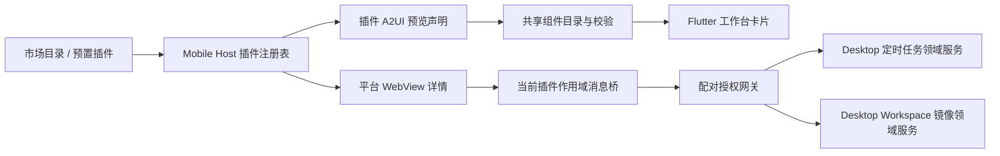

# Mobile 插件工作台实施方案

状态：第二阶段代码实施和隔离环境验证完成（2026-10-15）；真实帐号与设备发布门槛见 [验收矩阵](ACCEPTANCE-MATRIX.zh-CN.md)。以 [设计稿](DESIGN-SPEC.zh-CN.md) 为 UI 基准。

## 本阶段交付顺序

1. 定义 `openmuse-mobile-web/v1` 包：沿用签名目录和 SHA-256 校验，manifest V2 声明 WebView 详情、A2UI 工作台预览与权限清单；拒绝越权、跨平台及畸形包。
2. 市场安装、预览、启停、恢复统一接入插件 registry；下载的 Web 包以独立 WebView 显示详情，Host 桥默认拒绝所有能力，只有显式声明和授权的能力才可开放。
3. 将现有任务看板、用量与预算演示包迁移到 WebView 格式，保留 PPTX 的 QuickJS 兼容迁移通道；检查发现/我的、工作台和 Desktop 市场设计一致性。
4. 以真实 Desktop 领域服务 + 配对 HTTP 网关 + Mobile 客户端验证计划创建、到期执行、重启恢复与文件树/搜索/预览；对登录持久化、主题、窄屏和 WebView 在 Android/iOS 设备上复验。
5. 构建 Android APK 与 Desktop App；仅在安全的隔离环境自动运行设备集成测试。用户真机上已发生一次测试工具卸载与登录数据清除，最新版保留为待人工安装验收。将所有边界写入验收矩阵。

## 领域边界

| 领域 | 聚合/接口 | 责任 |
| --- | --- | --- |
| Plugin Catalog | `OpenMusePluginRegistry`、manifest V2 | 插件身份、生命周期、平台兼容性、能力声明与启停。Host 不按插件 ID 写 UI 分支。 |
| Widget Presentation | 共享 Mobile A2UI 组件目录与受限 renderer | 插件声明预览树，Host 验证组件与尺寸并渲染 Flutter 卡片；布局/pin 由用户和 Host 持有。 |
| Detail Presentation | `WebView` 文档和按插件作用域分发的消息桥 | 插件拥有详情界面，Host 掌握导航、网络、权限和资源能力；不能把任意 Host RPC 暴露给网页。 |
| Scheduled Task | Desktop 持久化任务与执行服务 | 计划、运行记录由执行端持有；Mobile 只编辑。Desktop 运行时按时触发，关闭期间积压的任务在下次启动后执行。执行中断时状态变为 `unknown`，不自动重发。 |
| Workspace Mirror | 现有配对授权及 opaque ref | Desktop 限定已授权 workspace、分页列目录、搜索及读取预览；Mobile 永远看不到绝对路径。 |
| Identity/Preferences | GoTrue session、Host ThemeMode | 登录与刷新令牌存安全存储；主题为整个 App 的单一状态，市场不得强制浅色。 |

## 运行模型

`Plugin descriptor → Host registry → workbench contribution → 共享 A2UI profile → Flutter Widget 卡片`。点卡片时打开同一插件的 `WebView` 详情。网页通过 `OpenMusePlugin` JS channel 发带 requestId 的能力请求；Host 将请求分发到当前插件的受限实现，Desktop 操作还须有当前配对 grant。两个首批跨端插件为随 App 发布的预置插件，在市场「发现 / 我的」显示。市场可安装 `openmuse-mobile-web/v1` 下载包，演示插件没有 Host 权限；QuickJS 下载包仅保留迁移期兼容。对第三方下载包开放 Host 能力之前，仍需按能力逐项设计声明、授权、撤销和审计。

Mobile 页面只持有视图状态；定时执行记录与文件系统权限由 Desktop 领域服务持有。工作台排序、置顶按账户、设备、Workspace 分域保存。预置跨端插件的详情网页随应用构建；市场下载包按签名目录、包摘要、manifest 的 Web 文档摘要、平台与卡片白名单验证，并接入同一 WebView Host。下载包的 Host 能力桥默认拒绝业务方法。

Android WebView / iOS WKWebView 作为详情页平台视图，有独立渲染成本，因此不应在瀑布流里逐卡嵌入。Flutter 官方文档也提醒平台视图的合成有性能代价；这正是卡片采用 A2UI/Flutter 的原因。[Flutter Platform Views](https://docs.flutter.dev/platform-integration/android/platform-views)、[webview_flutter](https://pub.dev/packages/webview_flutter)。iOS 发布前另需按 Apple 当前的插件/mini app 条款核对市场下发策略；技术迁移本身不构成上架保证。[Apple App Review Guidelines](https://developer.apple.com/app-store/review/guidelines/)。

## 实施阶段和验收

| 阶段 | 工作 | 验收证据 |
| --- | --- | --- |
| A | SDK 可选贡献接口、共享 A2UI 目录、WebView Host 桥 | 组件白名单、消息作用域和导航限制测试 |
| B | 四项底栏、工作台布局与「我的」、全局主题 | Widget 测试 + 亮暗实机截图 |
| C | 定时任务、Workspace 文件插件 | 持久化/执行、目录分页/搜索、内容预览的端到端测试 |
| D | 移除侧栏市场/账户入口、修复登录保持 | 重启与保留数据升级安装的会话恢复测试 |
| E | Android 与 Desktop 联调 | 配对、插件卡片、详情、计划触发、文件搜索/预览矩阵 |

## 验收矩阵

| 编号 | 类型 | 标准 |
| --- | --- | --- |
| A1 | 架构 | 新插件通过贡献接口出现在工作台；Shell 无按插件 ID 的业务分支。 |
| A2 | 安全 | A2UI 未声明组件/超限树被拒绝；WebView 禁止外域导航，桥仅分发当前插件能力。 |
| F1 | 功能 | 工作台可打开 WebView 详情；插件停用后卡片与详情入口不可执行。 |
| F2 | 功能 | 定时任务记录指定 workspace、时间、消息；重启后仍存在；到期只执行一次并记录结果。 |
| F3 | 功能 | 文件插件能列目录、分页、搜索与预览文本/图片；路径不出现在 Mobile 响应。 |
| F4 | 功能 | 同一安装的 App 重启及保留数据升级后免登录；显式退出后要求重新登录。 |
| F5 | 功能 | 侧栏无市场和账户入口；两者分别在「发现」和「我的」。 |
| U1 | UI | 设计稿的底栏、顶部 tab、搜索位置、浅色/深色主题一致。 |
| U2 | UI | 工作台两列、长内容、编辑与 pin 无溢出；大字号和窄屏可用。 |

“卸载后重新安装”与“覆盖安装”不同：Android 卸载通常删除应用数据，不能靠本地安全存储保证免登录；应以覆盖安装 `adb install -r` 验收持久会话。若产品要求卸载重装也自动恢复，需明确采用操作系统凭据/备份或服务端设备授权方案并另做安全评审。
