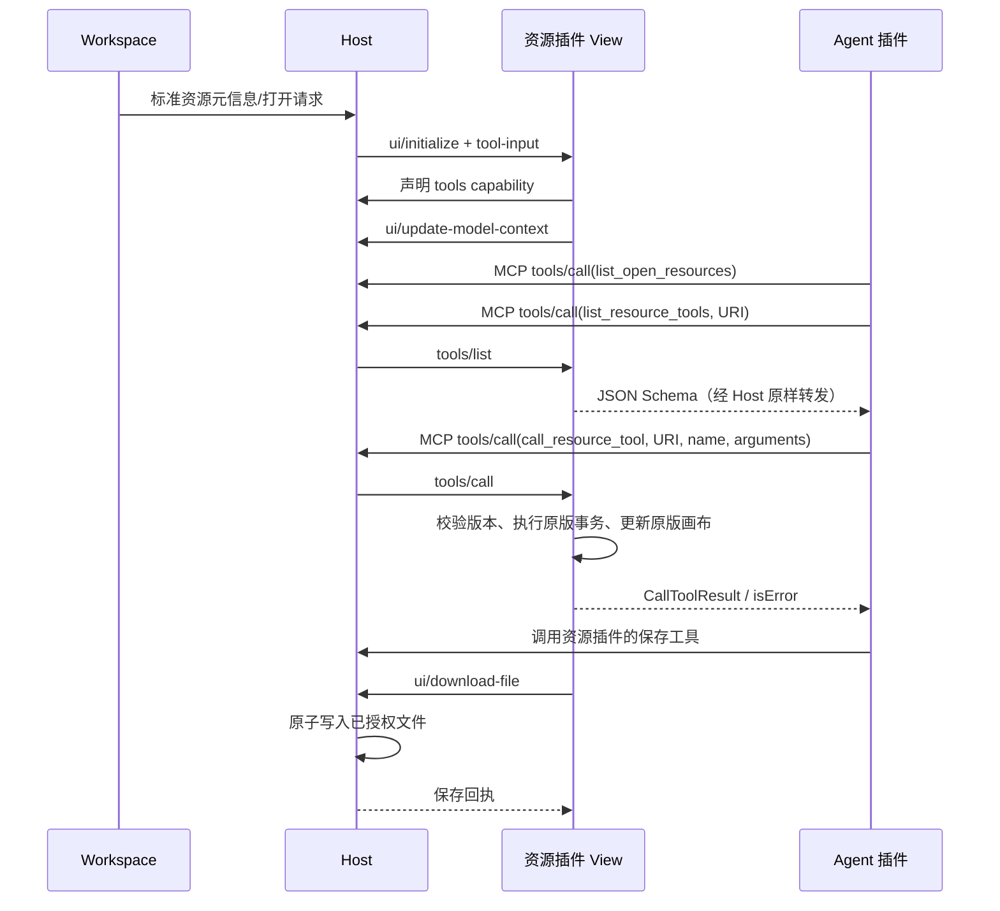

# 资源插件与 Agent 插件协作（Desktop 第一阶段）

## 目标与边界

Host 不识别 PPTX 的 slide、shape、paragraph 等业务字段。第三方资源插件不导入 Muse-Client，不调用 Electron IPC 到 Host，也不依赖 DSH 的会话字段。资源插件通过标准 MCP Apps 与 Host 交互；Agent 插件通过标准 MCP 调用 Host 的资源路由服务。

这里的 `list_open_resources`、`list_resource_tools`、`call_resource_tool` 是 OpenMuse 提供的普通 MCP 工具，**工具名不是 MCP 规范的保留方法**。传输、发现、JSON Schema、调用与结果遵循 MCP；业务工具仍由各资源插件定义。可替换的 Agent 实现只需接入这一 MCP 服务。

依据：[MCP Apps 官方概览](https://apps.extensions.modelcontextprotocol.io/api/documents/overview.html)；当前插件使用 `@modelcontextprotocol/ext-apps` 2.0.3 的 `App.onlisttools`、`App.oncalltool`、`App.sendMessage`、`App.updateModelContext`。

## 参与者

| 对象 | 责任 | 不透明数据 |
| --- | --- | --- |
| Workspace 插件 | 用户点击资源后委托 Host 的统一资源打开流程 | 文件格式和编辑操作 |
| Host 工作台 | 按 MIME/贡献能力/用户偏好选择资源插件，保留标签会话 | 插件的业务模型 |
| MCP Apps Host | 隔离 View，转发标准 RPC；保存到用户已打开的授权文件 | 插件自定义工具参数 |
| 资源 MCP 路由器 | 验证进程令牌、当前资源会话、工具是否被该 View 贡献 | PPTX/Markdown/图片等工具内容 |
| 资源插件 | 公布工具 JSON Schema、读取最新草稿、事务修改、冲突检查、撤销与导出 | Agent 的供应商与会话实现 |
| Agent 插件（本次为 DSH） | 会话、模型、对话 UI、工具发现与编排 | 文档内部编辑规则 |

## 时序

也支持资源插件通过 `ui/message` 请求 Agent；Host 选择已安装且实现 `OpenMuseAgentContributor` 的提供者。DSH 的内部会话创建、Workspace 注册和 UI 选中都收敛在 `plugins/dsh-agent` 及其 DSH bridge 中。

## 会话和授权

- 资源 URI 来自 Host 打开的标签；Agent 提交 URI 不会触发文件打开。
- 第一阶段仅允许调用**当前活动文档**；切换标签后旧 URI 被拒绝。Agent 应重新发现当前资源。
- MCP 服务仅绑定 IPv4 loopback 的随机端口，使用每次进程生成的随机 Bearer Token，拒绝带浏览器 Origin 的请求。凭证不传入资源 View。
- DSH 通过其官方 `@deepseek-ai/dsh-mcp-client` 扩展挂载服务。临时 patch 权限为 0600，停止时清理；不直接改用户 profile。
- Host 在调用前验证工具确实由该资源 View 提供；参数和结果不做 PPTX 分支处理。
- 请求体限制 1 MiB、模型上下文限制 128 KiB、View 工具调用超时 45 秒；文件仍遵守既有 64 MiB 边界。
- 关闭 View、切换账号或卸载插件后撤销会话。关闭期间未完成的请求失败，不会被路由到新的同 URI 会话。
- 工具可以声明 `readOnlyHint` 等 MCP annotations；业务插件仍必须验证输入，不能把 annotations 当授权凭证。

## 编辑一致性

资源插件拥有唯一的实时文档状态，Agent 不直接编辑正在打开的磁盘文件。读工具返回 `revision`；所有写和保存工具要求 `expectedRevision`。用户修改后版本增加，旧 Agent 调用明确返回错误，要求重新读取。Agent 修改通过与手动操作相同的原版事务和撤销栈，直接刷新当前画布，无需重载 WebView。

标签切换使用保留状态的编辑器栈；稳定键包括标签、插件 ID、插件版本。关闭标签释放编辑器，更换打开方式或插件版本重建对应会话。保留状态会占用内存；当前版本不自动淘汰未保存的编辑器。

## PPTX 扩展（全部在插件内）

`pptx_read_deck`、`pptx_edit_text`、`pptx_set_font`、`pptx_set_notes`、`pptx_undo`、`pptx_save` 由 GenOffice 插件贡献。所有幻灯片索引、元素 ID、字体字段和事务逻辑都在插件内定义。原版 AI Panel 和 AI Ribbon Group 由构建时 UI 适配层替换；原版 PPTX 解析、session-state、React 编辑器、Konva 画布均复用。

## 平台范围

本阶段接通 macOS 的原生 WKWebView ⇄ Dart Host ⇄ DSH MCP 调用链。插件 HTML 仍可在 Android 离线渲染和手动编辑；尚未接通 Agent 的 Host 不宣告 message/context 能力。Android 和 Web 后续复用协议，补各自原生通道与 Agent 适配器，不能仅宣告能力而不实现。

## 回归与验收

- `editor_session_retention_test.dart`：切换不重建，关闭释放。
- `resource_agent_broker_test.dart`：当前资源授权、关闭撤销、透明参数、HTTP 鉴权和 Origin 拒绝。
- `dsh_sidecar_test.dart`：仅接受带认证的就绪行，Cookie 交换后验证 HTTP 200。
- 设备目录测试：断连进入重试，账号刷新不重复注册，实时通道鉴权。
- 插件 `scripts/verify_web.mjs`：独立标准 Host，23 页渲染基准、View 工具发现、修改/保存/撤销、旧版本拒绝、标准 Agent 消息、移除原版聊天面板。
- 实际 DSH 对话及 macOS 应用证据随版本写入插件 `evidence/0.5.0`；自动化结果不替代尚未完成的真人或实际模型验收。
