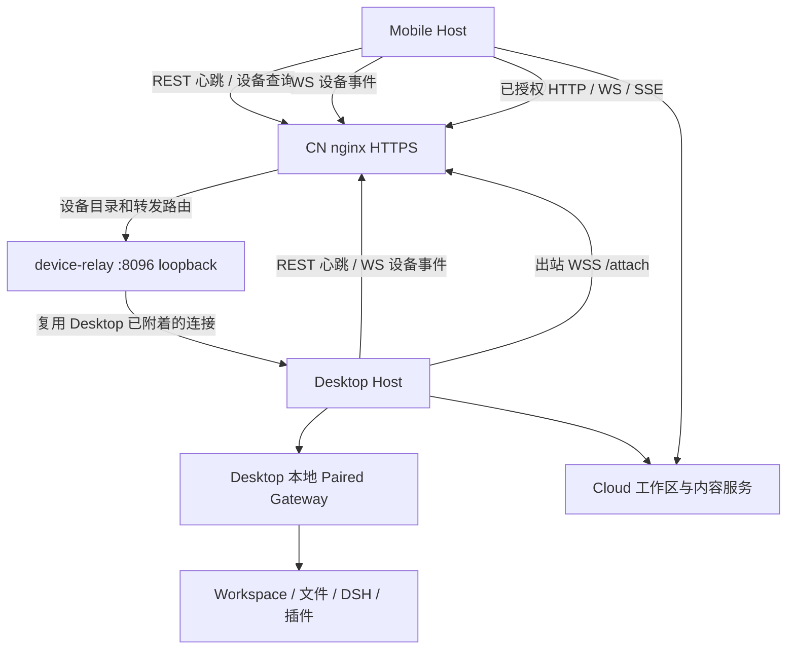

# 当前多端设备协同：架构、实现与空闲断线恢复

核对日期：2026-11-09。本文记录当前工作区实现及本次现网修复，区别于此目录中较早的方案合同；不表示所有历史规划均已落地。代码修改尚未提交 Git。

## 1. 问题与结论

本次截图呈现：设备在线、传输已就绪、公网通道已连接，但实时通道未连接。这些状态来自不同系统，不能用其中一个判断整条链路正常。

已经从本地代码和现网 `/opt/openmuse-device-relay/relay_server.py` 确认：

1. 设备事件 WebSocket 原实现只从队列发送消息，不读取对端。客户端的 Ping、Close 和 TCP EOF 无法被正常消费，闲置连接不能及时清理。
2. 客户端事件连接未设置主动 Ping。网络切换、代理/NAT 清理连接、睡眠恢复后，可能留下尚未报告断开的半开连接；连接对象非空就不会新建连接。
3. HTTP 心跳成功会发布新的快照，旧逻辑未保留“实时通道正在重连”的状态。在线绿点因此不能证明实时通道健康。
4. WebSocket 建连未使用 HTTP 接口已经具备的 401 强制刷新令牌重试策略。
5. Desktop 公网附着的令牌获取、WebSocket 建连和 hello 确认缺少完整的有界等待。服务无响应可能阻塞恢复循环。

这些是已证实的实现缺口。仅凭截图不能确定当时首先触发断线的是睡眠、令牌过期、代理还是网络切换；修复覆盖上述恢复缺口，不把未经采集的断线原因当成事实。

## 2. 三类协同的边界

| 系统 | 当前职责 | 不代表什么 |
| --- | --- | --- |
| 设备目录 / Presence | 同账号设备发现、能力、lastSeenAt、在线状态、变更通知 | 不保证 Desktop 的文件、Agent 或公网转发可用 |
| Paired Desktop 数据通道 | 远程访问在线 Desktop 的 Workspace、文件、Agent、资源与插件能力 | 不会把整个 Desktop 文件目录自动复制到手机，也不是离线备份 |
| Cloud 资源与内容协同 | 云工作区访问、资源记录/版本、内容订阅和协作 | 不使用设备目录 WS 来承载文档内容，不等于 Desktop 文件镜像 |

UI 的“实时通道”指设备目录的事件 WebSocket，不是文档 CRDT/WebSocket，也不是 `/attach` 附着。

## 3. 当前国内拓扑

本次国内构建的 runtime-defines 中，Auth 为 `https://cn.openmuseai.com/gotrue`，Cloud 和 Relay origin 均为 `https://cn.openmuseai.com`。不同服务由入口路径分发；旧文档中的 `:8443`、`link.` 是历史部署描述，不能替代当前配置。



转发服务绑定服务器回环地址，Desktop 主动连出，不要求公网入站端口，也不要求 Desktop 持有服务器部署凭据。

## 4. 从登录到手机打开文件

1. Host 通过认证控制器取得 GoTrue access token；凭据由认证实现保存，业务代码使用 provider 获取有效 token。
2. Desktop 和 Mobile 向设备目录注册 `deviceId/displayName/platform/deviceKind/capabilities/transportOrigin`，默认每 20 秒心跳并读取设备快照。
3. 服务端按认证账号返回设备列表；lastSeenAt 与在线 TTL 用于发现。当前设备目录在线 TTL 为 60 秒。
4. Desktop 启动本地 Gateway，开启出站 `/attach`，发送 `hello(protocol=1, deviceId)`，收到 `hello-ok` 后进入 attached。服务端路由按 `(account, deviceId)` 定位 Desktop。
5. Mobile 选择同账号、在线且声明 `paired-desktop.transport` 能力的 Desktop，向 `/v1/account/open` 请求授权。不同账号不能借用目录记录越权访问。
6. Gateway 验证身份及目标设备，签发有有效期的 grant。默认 grant TTL 为 30 分钟；pairing code 是另一条显式配对入口 `/v1/pair/open`。
7. Mobile 使用返回的 bootstrap/session/grant 访问已授权能力。公网 Relay 通过 grant 索引定位相应 Desktop，把请求复用到出站连接，再由 Gateway 验证有效期和权限。
8. Workspace 文件列表走 mirror API；文件内容按需读取，不因显示目录就整批下载。收到完整 bytes 后 Host 交给对应插件。
9. Markdown、文本及代码文件通过已接入的 `com.openmuse.open-file-viewer` 只读预览。Host 给插件一份私有临时文件，页面关闭过渡结束后删除；插件不直接拿到 Desktop 的任意文件路径。PDF/Office 等独立格式能力仍依赖各自插件的支持范围。

## 5. 协议与入口

| 入口 | 用途 |
| --- | --- |
| `/api/muse/devices` | 设备注册和列表 |
| `/api/muse/devices/heartbeat` | 更新设备在线时间 |
| `/api/muse/devices/events` | WS 变更提示；收到后重新拉取权威快照 |
| `/api/muse/devices/<id>/revoke` | 撤销设备 |
| `/attach` | Desktop 出站转发连接 |
| `/v1/account/open`、`/v1/pair/open` | 同账号授权 / 显式配对 |
| `/u/<grant>` | 会话 bootstrap；grant 不应进入日志或文档 |
| `/openmuse-native/` | 原生 DSH 目录、会话、流式交互 |
| `/openmuse/workspace-mirror/v1` | 目录和文件查询 |
| `/openmuse/workspace-mirror/resource/v1` | 已授权的文件 bytes |
| `/openmuse/workspace-mirror/action/v1` | 已授权目录操作 |
| `/openmuse/scheduled-tasks/v1` | Desktop 定时任务能力 |
| `/openmuse/plugin-market/v1` | Desktop 插件市场能力 |
| `/openmuse/resource-center/v1` | 资源中心能力 |
| `/openmuse/remote-surface/v1` | 远程交互表面 |
| `/openmuse/plugin-interaction/v1`、`/media/v1` | 插件交互与媒体 |

转发连接的消息包括 `hello/hello-ok`、应用层 `ping/pong`、`http.request`、`http.response.start/chunk/end`、`http.abort`、`ws.open/ready/data/close`。HTTP body/WS binary 在协议帧中编码，服务端支持流式转发；SSE 不能被 nginx 缓冲为完整响应。

必要的 nginx 条件：WS 透传 Upgrade/Connection，保留 Authorization/Cookie；流式路径禁用缓冲；明确路由 `/attach`、设备目录、`/openmuse/` 和 `/openmuse-native/`，避免进入网站语言重定向。此前两处缺失的 CN 路由已修复。

## 6. 本次恢复策略

### 6.1 设备事件连接

- 服务端同时运行发送任务与读取任务。读取任务消费 RFC 6455 控制帧并回复 Pong；Close/EOF 或任一任务退出即取消另一任务、清理订阅并关闭 socket。
- 没有设备变更时，每 20 秒发送 `device.keepalive`，避免完全空闲；它不替代设备目录的持久化在线心跳。
- 服务端约每 60 秒重新验证该 WS 建连凭据；失效后断开，客户端通过当前有效凭据重建，而不是永久信任已过期的握手身份。
- 客户端设置 15 秒 Ping 周期，缺失 Pong 由 Dart WebSocket 关闭并触发恢复。
- WS 握手遇 401 时调用强制刷新 provider，最多重试一次。刷新失败转成可恢复的目录错误，不允许未处理异常终止恢复。
- 建连 15 秒超时；超时后仍晚到的 socket 会关闭，防止漏掉悬挂连接。
- 同账号同 generation 只允许一个事件建连过程；旧 socket 的迟到回调不能清除新 socket。
- WS 重试采用指数退避与随机抖动：基础 1/2/4/8/16/30 秒，上限基础延迟为 30 秒，外加最多约 25% 抖动。
- REST 心跳成功时保留真实的 WS 状态，并在没有事件连接且没有等待重试时补建。HTTP 注册成功不再取消事件恢复所需的等待。
- `reconcile()` 放弃旧事件连接、重新登记并建立新连接。Mobile 回到前台已有调用此入口。周期性探活覆盖没有触发前台事件的后台空闲场景。

### 6.2 Desktop 公网附着

- 原有应用层 ping/pong：服务器每 15 秒探测，45 秒未收到 pong 则移除路由；仍保留。
- 新增 Desktop RFC 6455 Ping，15 秒周期；用于识别对向链路失效。
- 新增令牌 provider、WebSocket 握手的 15 秒超时；等待 `hello-ok` 也设 15 秒截止时间。
- 失败重新取得当前 token 后退避重连；不是无限等待旧连接或静默退出 unawaited loop。
- 停止期间晚到的连接会关闭；会话退出时关闭其上游 WS。

### 6.3 grant 与内容恢复的边界

grant 有独立 30 分钟生命周期；控制通道恢复不会延长 grant。`connectDevice` 对仍有超过 1 分钟有效期的相同目标复用现有连接，否则重新申请，`force: true` 强制换 grant。Relay 服务重启会清空内存路由/grant 索引，已有页面可能需要重新打开 Desktop 以取得新授权。

本次没有实现对所有已打开页面的 grant 热切换或通用未提交编辑自动恢复，不能把 WS 修复描述成这两项已完成。Cloud 内容协作的订阅、重放、outbox、冲突处理由内容域维护，不由本次设备事件修改接管。

## 7. Cloud 内容协同的实现位置

`openmuse_mobile_cloud` 实现 Cloud 工作区和 AppFlowy 访问；`muse_appflowy_transport` 承载请求；`muse_appflowy_realtime` 封装原始 WS v2、身份和消息编解码。该连接层明确把订阅、reconciliation、outbox 和重连策略交给内容域 owner，不自行缓存文档或宣称收到 RID 就已持久化。

资源中心由 `NativeResourceCenter`、`muse_resource_center`、`muse_resource_center_io`、`openmuse_resource_center` 等包承载身份、版本、来源及权限；写入通过 provider 的版本和操作 key 提交。文档类插件拥有自身内容会话。设备事件只触发设备列表更新，不应向其中塞文档编辑数据。

## 8. 代码索引

以下路径相对于 Muse-Client；Server 路径相对于仓库根目录。

| 路径 | 责任 |
| --- | --- |
| `plugins/workspace-paired/lib/src/account_device_directory.dart` | REST、WS、心跳、状态、401 刷新、恢复 |
| `plugins/workspace-paired/lib/src/desktop_outbound_relay.dart` | Desktop 附着、HTTP/WS 复用、连接超时 |
| `plugins/workspace-paired/lib/src/paired_desktop_gateway.dart` | 本地授权、grant、各能力边界与转发 |
| `plugins/workspace-paired/lib/src/paired_desktop_client.dart` | Mobile 请求配对/同账号授权，暂时不可用时有界重试 |
| `plugins/workspace-paired/lib/src/paired_desktop_plugins.dart` | Host/Mobile 生命周期、设备选择与设置状态 |
| `app/openmuse_host/lib/main.dart` | Desktop 目录/Gateway/Relay 的实际装配 |
| `app/openmuse_mobile/lib/main.dart` | Mobile 实际装配、前台 reconcile、文件插件选择 |
| `app/openmuse_mobile/lib/native_desktop_shell.dart` | 原生 Desktop Workspace 与会话目录页面 |
| `app/openmuse_mobile/lib/mobile_plugins/workspace_files_plugin.dart` | Workspace 文件交互与读取进度 |
| `app/openmuse_mobile/lib/host/mobile_file_viewer.dart` | 文件授权副本与 viewer 页面生命周期 |
| `plugins/open-file-viewer/lib/openmuse_file_viewer.dart` | Markdown、代码等文件只读预览 |
| `packages/muse_appflowy_realtime/lib/src/connection.dart` | Cloud 原始 WS v2 连接边界 |
| `Muse-Server/device-relay/relay_server.py` | 公网目录、WS 事件、按账号/设备转发 |
| `Muse-Server/device-relay/remote_install.py` | 安装服务与 nginx 路由幂等配置 |

## 9. 排障与验收

按层检查，不通过退出登录或清空数据掩盖问题：

1. 设备在线：注册/心跳/列表是否 2xx，是否使用同一个账号和国内环境。
2. 实时通道：events 是否 101、控制 Ping 是否收到 Pong；断开后有没有再次握手。
3. 公网附着：`/attach` 是否 101、hello-ok 是否成功、路由是否重新附着。
4. 本地传输：Gateway 是否监听回环端口、目标能力是否已发布。
5. 授权：grant 是否失效、Relay 重启后是否已重新申请；401 与 502 应分开判断。
6. 原生目录：`/openmuse-native/` 必须返回预期 JSON/SSE，不能返回网站 HTML/307。
7. 文件：进度停在读取/传输还是插件启动；bytes 已到达时优先检查插件匹配，不反复修改服务器转发。

测试命令：

```sh
# Muse-Client/plugins/workspace-paired
flutter test test/account_device_directory_test.dart test/desktop_outbound_relay_test.dart

# Muse-Server/device-relay
python3 -m unittest test_relay.RelayTest.test_device_events_pong_idle_keepalive_and_cleanup test_nginx_routes test_resource_stream
```

本次已通过：上述客户端 15 项、服务端 11 项，以及修改的两份 Dart 实现静态检查。服务端新增用例真实握手并发送 masked Ping，验证 Pong、无事件保活及 Close 后订阅清理。它不是对整夜休眠或所有网络切换的替代验收。

手工长期验收应包含：不操作超过代理空闲阈值、跨 access token 到期、短暂断网后恢复、电脑睡眠后唤醒、手机后台再前台、Relay 服务重启、grant 到期后重新打开。电脑真正睡眠、关机或断网期间无法服务本地文件；目标是网络/系统恢复后自动重新建立通道。

日志只记录安全错误码、状态、耗时和路由类别，禁止写入 access/refresh token、Cookie、grant 全值和用户文件内容。部署记录保存在 `dist/macos-cn/2026-11-09/device-recovery/server-deployment.json`，包含备份路径与 SHA-256；不包含部署口令。

## 10. 登录后实际设备验收（2026-11-09）

用户重新登录后，对已更新的国内桌面端及已连接的 PLP110 真机做了只读验收：

- Desktop 设置中显示：状态在线、实时通道已连接、传输已就绪、公网通道已连接；同账号 Android 设备在线。
- Android 任务页面显示已选择的 Desktop 和工作空间，任务运行设置能够读取设备及工作空间信息。
- 服务端本次访问记录确认 `/openmuse-native/v1/hello`、`/openmuse-native/v1/workspaces`、`/openmuse-native/v1/sessions` 均返回 200。
- 脱敏访问证据：`dist/macos-cn/2026-11-09/device-recovery/after-login-access.json`；验证状态记录：同目录 `verification.json`。
- 验收没有发送 Agent 消息、创建任务或修改用户文件。当前连接与目录读取已通过端到端检查；尚未进行整夜挂机、跨令牌有效期及完整睡眠唤醒实测，不能据此承诺所有长时间运行场景已经验证。
