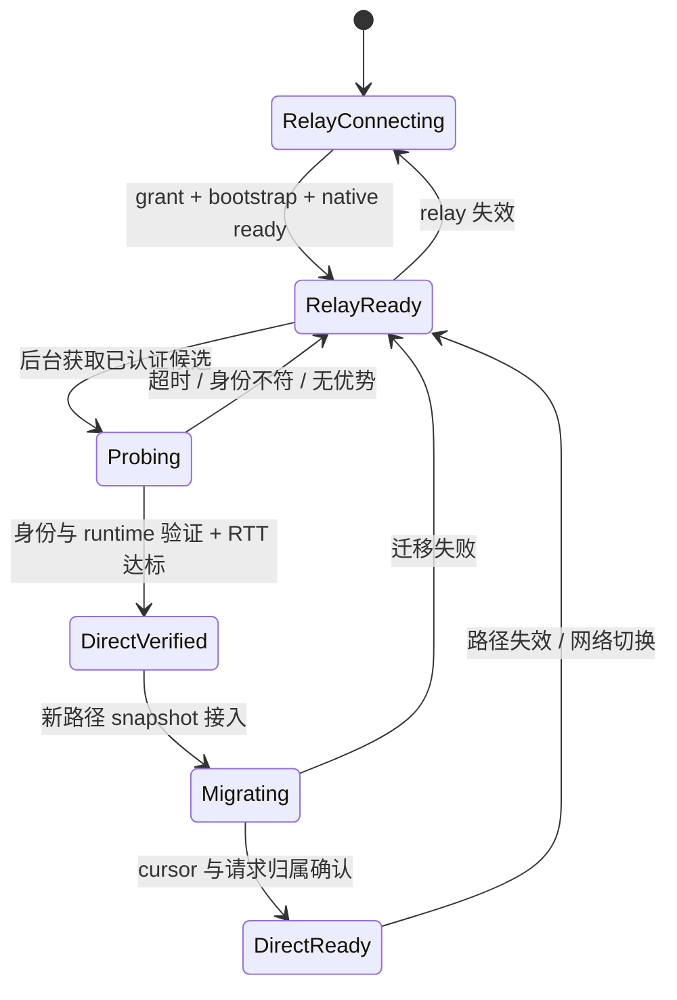

# Relay 优先、后台直连升级与连接耗时诊断

日期：2026-11-11。状态：trace 与首屏请求优化已实现；候选交换、NAT 穿透和无感路径迁移为待实现协议。本次没有宣称已开通生产 P2P。

## 1. 目标与边界

Mobile 先使用现有 relay，不能因为探测 LAN、ICE 超时而推迟授权、首屏或发送。后台探测成功后，验证设备身份和同一 DSH runtime，再决定升级；失败随时回落 relay。设备目录控制 WebSocket 与 Desktop 出站 relay 都继续常驻。页面切换不触发网络路径选择器重建。

Tailscale 的控制面/数据面分离与 relay/direct 路径提供参考，但本项目不是 WireGuard overlay。[连接类型](https://tailscale.com/docs/reference/connection-types)、[DERP discovery 协议](https://github.com/tailscale/tailscale/blob/main/derp/README.md)、[WebRTC ICE 与信令](https://webrtc.org/getting-started/peer-connections) 是设计依据，不代表已经具备这些实现。

当前设备目录只返回一个 `transportOrigin`。PairedDesktopGateway 默认 loopback，grant/cookie 与原 origin 绑定；没有签名候选集合、穿透信令或原生 follow 的 resume-cursor 参数。因此不能将 relay origin 简单替换成未经验证的 LAN IP，也不能直接把 Cookie/Bearer 发给探测地址。

## 2. 路径状态机（设计，尚未启用）



连接管理器以 `(account, requesterDevice, targetDevice, runtimeEpoch)` 为作用域，输出稳定的逻辑连接句柄，路径变化只递增 `pathEpoch`。页面只订阅逻辑连接，不随 pathEpoch 更换 Widget key 或清空 transcript。

1. 立刻建 relay，授权、缓存预览、hello/follow 照常进行；候选探测不进入首屏的 Future.wait。
2. 控制面仅在同账号已授权设备之间发送 `candidateSet`：`version`、`deviceId`、`runtimeEpoch`、`expiresAt`、`nonce`、候选类型/地址/优先级、设备签名与短期 ticket。禁止匿名扫描、任意 URL 探测和生产明文 HTTP。
3. 第一阶段支持经认证的 LAN 加密隧道；第二阶段再加入 WebRTC DataChannel + trickle ICE/STUN/TURN。使用统一隧道适配 HTTP/SSE，而非让 DSH 新开一个公网监听器。loopback DSH 不变。
4. 通过挑战应答验证设备密钥和 ticket，绑定双方设备、账号、runtimeEpoch、权限与过期时间。完成验证前不发送账号 Bearer、relay Cookie 或用户消息；直接路径取得独立的 channel-bound 授权，禁止跨 origin 复制 Cookie。
5. 初始可调预算：LAN 每候选 500ms，ICE 1500ms，最多 2 个并发候选；这些是设计参数，不是测量结论。超时保持 relay，网络变更或冷却后再试。
6. 升级门槛：连续 3 次成功探测，同一 runtime，RTT 比当前路径至少改善 20% 且 10ms；防抖 30 秒。参数需要跨网实测后调整。不能只凭 TCP connect 成功判定路径优于 relay。
7. 升级采用 make-before-break：新路径读取同一 session 的尾部 snapshot（将来支持 cursor resume），完成序号去重/缺口检查后接管 follow；旧 SSE 随后取消。迁移期间保留已有消息和已加载历史。
8. 每个请求固定到发送时的 pathEpoch。读操作可在新路径重试；prompt/create 等写操作不自动双发。写请求必须保留 requestId，待服务器提供持久化去重、accepted ack 与 operation-status 后，才能对“是否接受未知”的请求恢复发送。当前 DSH requestId 不能未经验证就视为 exactly-once 承诺。
9. 直连失效，使用仍有效的 relay 授权恢复 snapshot；不因路径切换更换整个逻辑 grant/会话页。若 runtimeEpoch 改变，丢弃旧 cursor 并重新校验授权。

### 上线阶段

| 阶段 | 交付物 | 门槛 |
|---|---|---|
| A（本次） | 分段 trace、分析脚本、减少首屏串行请求 | 关联正确、无敏感内容、缓存/消息/SSE 取消回归 |
| B | 设备目录 candidates v2、设备签名 ticket、LAN 加密隧道 | 默认关闭；同网实验；relay 从不被候选探测阻塞 |
| C | pathEpoch、双流交接、ack/status 与写请求去重 | 网络切换/失败/队列场景不丢消息、不重复执行 |
| D | ICE/DataChannel、跨 NAT、TURN fallback、地区 relay | iOS/Android/Desktop 跨网 P50/P95 与功耗验收 |

原 per-request Desktop HttpClient 池化另列后续优化：必须先把 `http.cancel` 改成单请求 abort/stream cancel；当前直接共享该 client 会让取消一个 SSE 误关闭其它请求。本次保留取消隔离，先测量它在总延迟中的占比。

## 3. 已实现的 trace

实现：`packages/muse_dsh_conversation_protocol/lib/src/connection_trace.dart`。始终保留进程内最近 512 条事件，默认不持续打印；诊断构建开启 `OPENMUSE_CONNECTION_TRACE=true` 后输出 `OMTRACE {...}` JSONL。可注入 sink 做本地收集，sink 抛错不影响 I/O。

- W3C 形式 `traceparent`：随机 32-hex traceId / 16-hex spanId，严格校验远端值；无效值创建新上下文。
- Mobile pair 的 trace 对象传入 grant 结果，再交给设备级 DSH client；每个 HTTP 请求生成独立 span 并传递 header。Desktop relay → gateway 继续嵌套关联。
- 仅输出固定 stage、phase、单调时钟 elapsedUs、tsUs、状态码、字节数、成功标记、cache hit。stage 路由使用白名单，未知 path 记为 other；不写完整 URL、query、sessionId、账号、设备 ref、消息、配对码、grant、Cookie、Bearer 或异常正文。
- 现有其它日志未在本次全部改写。导出诊断材料时优先过滤 `OMTRACE `，不要直接分享全部应用日志。

| stage | 可定位的问题 |
|---|---|
| `control.events_connect` / `control.register/list/heartbeat` | 常驻设备事件通道建连、目录登记与心跳总耗时 |
| `desktop.relay_token` / `desktop.relay_attach` | Desktop 获取 token、WebSocket 建立到 hello-ok（不把 TCP 成功当 relay ready） |
| `pair.connect` / `pair.account_open` | 总授权耗时、每次请求与重试的差别 |
| `mobile.access_token` / `pair.retry_wait` | token 获取等待、relay 退避等待 |
| `desktop.auth_validate` / `desktop.dsh_ready` | Desktop 实时账号验证或本地 DSH 冷启动 |
| `desktop.relay.<route>` | relay 到 loopback gateway 的建连、headers、首 chunk、body |
| `desktop.gateway.<route>` | gateway 到 DSH 的建连、headers、首 chunk、body |
| `dsh.bootstrap` / `http.hello` / `http.negotiate` | cookie bootstrap、契约检查、能力协商 |
| `http.sessions/workspaces/create/page/prompt/options` | 各 API 的连接等待、headers、body、decode |
| `dsh.follow_first_frame` | 建连 → headers → 首个有效 SSE frame（不以 heartbeat 假充 ready） |
| `mobile.cache_restore` | 本地缓存读取/命中 → 下一 Flutter frame |
| `mobile.transcript_first_frame` | 会话页面开始打开 → 缓存或 live 首批非空消息的下一 frame |
| `mobile.conversation_bound` | controller 已绑定到 UI 的下一 frame；不等同于首消息 |
| `prompt.approval` / `prompt.submit` | 分享确认（包含用户思考时间）与乐观上屏 → Desktop accepted |
| `conversation.assistant_observed` | 每个 follow generation 首次观察到 assistant chunk 的时间点；不是精确的每请求模型 TTFT |

HTTP 的 connected 包括客户端取连接、DNS/TCP/TLS 的综合等待。Dart HttpClient 本层无法准确分别计出 DNS、TCP、TLS；需要平台网络指标或更底层 transport 才能进一步拆解。headers 是 close()/response headers 的累计时间；body 和 decoded 也都是累计值，相减才能得到分段时间。

各进程的 wall clock 不能直接相减。用 trace/span 关联请求，用各 span 的单调时钟比较；嵌套 span 并发且互有重叠，不能把所有 total 相加。中继服务器本身不在当前仓库执行路径内，本次未给它增加 server-side span；没有该段采样时，不能把残差直接声称为“纯公网 RTT”。

## 4. 本次针对性优化

1. **已知会话省去 sessions 往返**：两种 Mobile shell 把已知 session summary 交给 NativeDshPage，省掉初始化前的完整列表请求。身份和权限仍由受保护的 follow/后续请求检查；未知入口保留列表选择行为。
2. **create 不等待目录刷新**：Desktop `session.create` 成功后，用其真实返回 sessionId 更新当前目录投影并进入会话，目录刷新转后台；不伪造 Desktop 会话。等待时如果设备/工作区已变化，保持原草稿，不自动切入错误目标。
3. **并发列表请求合并**：同一设备 client 的 4 个并发 listSessions 共享进行中的 Future，只发一次请求；完成/失败后立即清除，不增加跨时间的陈旧缓存。
4. **首个 follow 优先**：reconcile 首次等待一个原有 reconciliationInterval（默认 2 秒），避免 follow 建立同时立刻抢发 sessions/page；后续静默流恢复路径仍保留。代价：follow 已坏但未及时报错时，第一次校准最多晚一个 interval。
5. **授权总预算**：原 45 秒只约束重试间隔，单次请求的多个 15 秒等待可能越过总预算。改用 Stopwatch 和每次剩余预算，控制 connect future 的最大等待；默认仍为 45 秒，测试可配置更短。调用方取消/close 负责终止底层 I/O，不把 Future.timeout 当成 socket 已取消。

## 5. 如何采集与诊断

分别在 Mobile 与 Desktop 的 Flutter 项目诊断构建中加入：

```sh
flutter run --dart-define=OPENMUSE_CONNECTION_TRACE=true
```

按项目实际设备参数运行，保存各自日志为 `mobile.log`、`desktop.log`。重现：冷启动；热启动；切换 2/12 个会话；新会话发消息；前后台 5 秒/30 秒/5 分钟；Desktop 休眠唤醒；Wi-Fi/蜂窝切换。采集 P50/P95 至少各 30 个样本，区分成功、失败、缓存命中和无缓存。

在仓库根目录运行：

```sh
python3 scripts/analyze_connection_trace.py mobile.log desktop.log
python3 scripts/analyze_connection_trace.py mobile.log desktop.log --json
```

脚本去重同 trace/span/phase，输出各 stage/累计 phase 的 N、失败数、P50/P95/max；失败数仅 end phase 有意义。live SSE 未结束时看 headers/first_chunk/first-frame，不用 stream lifetime 评价首屏。脚本不自动推断跨进程时差或关键路径。

判断顺序：

- access_token / auth_validate 慢：账号刷新或 Desktop 校验；不能用长期缓存撤销检查来“加速”。
- dsh_ready 慢：Desktop sidecar 冷启动，不是 relay RTT。
- Mobile headers 慢，Desktop 本地 spans 很短：检查公网/relay 排队，补中继 server span后再定性。
- headers 快、first frame 慢：DSH snapshot 生成、流转发或缓冲。
- body 大/decoded 慢：窗口、projection、解析负载；不能只换网络通道。
- cache 命中仍首帧慢：Flutter build/layout/raster，再用平台 frame timeline 诊断。
- approval 慢：包含用户决策时间，不计入网络建连 SLO。

进程内可在调试器读取 `ConnectionTrace.recent`；日志开关不影响本地 ring。尚未增加用户界面上的一键导出按钮，也没有自动上传日志。

## 6. 本机受控实验与验证

复现命令（从协议包目录）：

```sh
dart run tool/connection_trace_probe.dart > /tmp/openmuse-connection-probe.jsonl
```

实验只在 loopback 假服务端注入 headers 前 20ms、body 后 30ms 延迟；预热后交替运行两个场景各 10 次，每轮新建客户端，避免把首轮 JIT 差异当优化结果。四个独立 client 对比同一 client 的四个并发调用。

| 受控场景 | 每轮实际请求数 | N | P50 | P95 |
|---|---:|---:|---:|---:|
| 独立 client | 4 | 10 | 58.283ms | 61.045ms |
| 共享进行中的列表请求 | 1 | 10 | 56.786ms | 57.779ms |

确定性收益是并发请求数下降 75%；本机端到端耗时只有小幅差异，不代表手机跨网改善比例。此实验不测 NAT、TLS、真实授权、真实 DSH，也不评价 P2P。原始 JSONL 与汇总保存在 `evidence/2026-11-11/connection-probe*`。

回归覆盖 trace header、span 嵌套、512 条上限、异常 sink、隐私字段、延迟 headers/body、并发列表合并与完成后刷新、授权总预算、create 目录更新，以及现有 SSE 取消/relay/gateway/core/mobile 测试。真机跨网耗时与直连升级成功率尚未采样；不能据此声称已经消除全部冷启动延迟。
