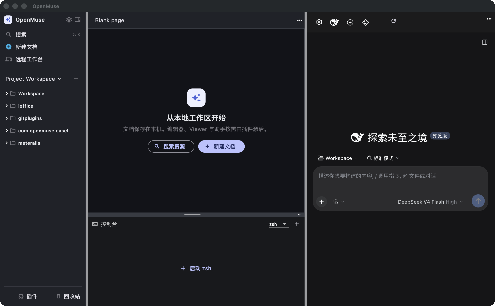
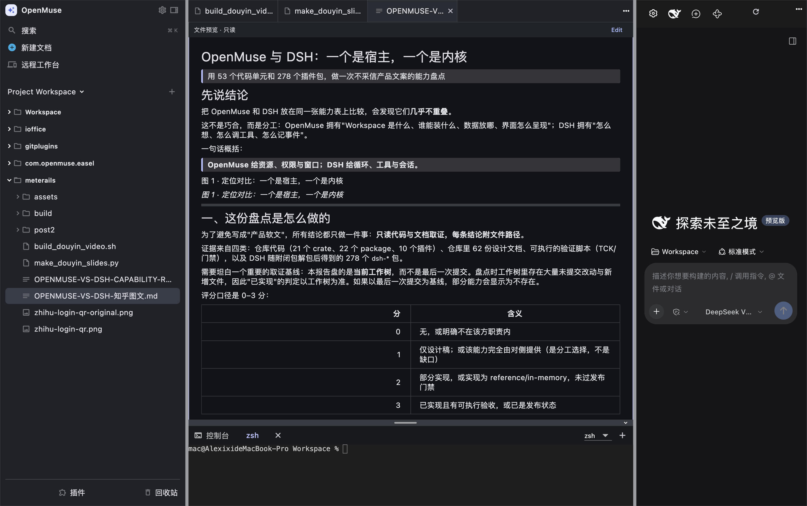
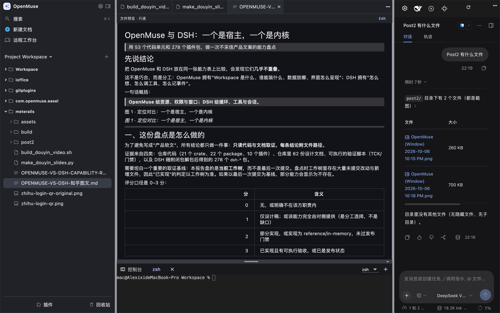
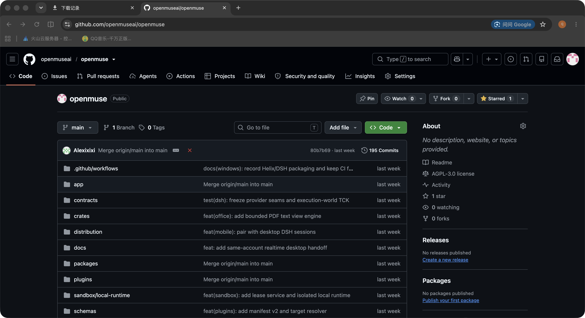

# 把 DSH 装进 Codex 中：一个内核，两种宿主

> OpenMuse 已经把 DSH 装进了自己的壳。同一套内核，也能接进 Codex——而且接缝只有两条。

## 先说结论

DSH（DeepSeek Harness）不是某个客户端的私有组件，而是一个**宿主无关的 agent 内核**：循环、工具、会话、权限、压缩、计量都在它这一侧；宿主只负责资源、窗口与数据归属。

所以"把 DSH 装进 Codex 中"并不是一次移植工程，而是**一次挂载**。真正存在的接缝只有两条：

1. **Codex hooks 桥接**：`@deepseek-ai/dsh-hooks-codex` 让 DSH 在运行时执行你已有的 Codex `hooks.json`——不用改写，五个 hook 点原样生效；
2. **Codex 子 agent 提供方**：`@deepseek-ai/dsh-subagent-codex` 走官方 app-server 协议，把 Codex 作为一次性子级拉起，与进程内、ACP、SDK、Claude Code 子级并排共存。

而"内核换宿主"这件事在工程上到底跑不跑得通，已经有一个完整样本：**OpenMuse**。下面这四张实机截图，就是这个样本的现场。



*图 1 · OpenMuse 工作台：左侧是本地工作区树，中间写着"文档保存在本机。编辑器、Viewer 与助手按需由插件激活"，底部是真实 zsh 控制台。*

---

## 一、材料与取证方式

这篇内容只有两类材料，都可复核：

- **四张 OpenMuse 桌面应用的实机窗口截图**（下文逐张解析）；
- **公开仓库** `github.com/openmuseai/openmuse`，以及 DSH 随附闭包里 **278 个包**的可执行包名。

文中出现的每一个包名、每一个命令，都能在这份闭包里直接核对——不提产品文案，只提可验证的东西。

---

## 二、逐图解析：宿主这一侧到底提供了什么

### 图 1：工作台的三个承诺

左侧工作区树（`Workspace` / `ioffice` / `gitplugins` / `meterails` …）配上中间那句文案，其实是一次产品声明：

- **文档保存在本机**——数据归属在宿主侧，内核不碰；
- **编辑器、Viewer 与助手按需由插件激活**——能力不是全量预装，而是按事件激活（仓库里 `plugins/dsh-agent/openmuse.plugin.json` 的 `activation_events` 就是这个机制）；
- **控制台是真的 PTY**——底部 `+ 启动 zsh` 起的是真实 shell 会话，对应 DSH 的 `dsh-terminal` 与 `dsh-tool-bash-persistent`。

同一个窗口右上角还能看到模型选择器（`DeepSeek V4 Flash High`）与权限档位（"标准模式"）——这两样恰好是 DSH 的模型路由与权限预设，被宿主原样透出，而不是被替换掉。

### 图 2：编辑与预览是"插件提供的表面"



*图 2 · 顶部标签是依次打开的资源，正文区是"文件预览 · 只读"。*

注意右上角的 `Edit` 与"文件预览 · 只读"并存：**默认只读、写入必须显式申请**。这不是 UI 细节，而是宿主侧的权限模型——agent 提议、宿主提交，内核不直接落盘。

### 图 3：对话与轨迹分开看



*图 3 · 右侧面板有 `对话` 与 `轨迹` 两个标签，底部是 token 计量（`18.2K tok`）与轮次统计。*

这是 DSH 才有的东西：`dsh-client-ui-trajectory` 把一次运行摊成可回放的时间线，`dsh-token-meter` 给出真实计量。宿主不重造这两件事，只是把视图挂到 slot 上。

### 图 4：仓库本身就是证据



*图 4 · 公开发布在 [github.com/openmuseai/openmuse](https://github.com/openmuseai/openmuse)。*

仓库目录就是这套架构的骨架：`app`（宿主外壳）、`contracts`（冻结契约）、`crates`、`distribution`、`docs`、`packages`、`plugins`、`sandbox/local-runtime`、`schemas`。

提交记录也很能说明问题：

| 提交 | 说明 |
|---|---|
| `test(dsh): freeze provider seams and execution-world TCK` | provider 接缝被当成合同来测，不是口头约定 |
| `feat(sandbox): add lease service and isolated local runtime` | 隔离执行面 + 资源租约 |
| `feat(plugins): add manifest v2 and target resolver` | 插件清单 v2 与目标解析 |
| `feat(mobile): pair with desktop DSH sessions` | 手机端配对桌面 DSH 会话 |
| `feat: add same-account realtime desktop handoff` | 同账号实时接管 |

---

## 三、宿主是怎么把内核"装"进去的

OpenMuse 的做法非常克制，全部动作在 `plugins/dsh-agent/lib/src/dsh_sidecar.dart` 里：

- 插件清单声明 `"runtime": "native-process"`，以 sidecar 方式拉起 `dsh web --host 127.0.0.1 --port 0 --no-open`；
- 注入一枚 32 字节随机 `OPENMUSE_DSH_BRIDGE_TOKEN` 作为桥接凭据；
- 权限只申请四项：`workspace.context.read`、`resource.open.request`、`process.sidecar`、`credentials.model.use`；
- 用 profile patch **只重写 provider row**，一行都不碰 agent-loop。

`contracts/dsh/0.1.7-rc.1.contract.json` 把这份克制写成了机器可校验的合同：

| 合同项 | 内容 |
|---|---|
| `profileRows` | `subprocess` / `sandbox` / `sandbox-policy` / `bash-sandbox` / `fs-sandbox` / `jobs` 六行 |
| `requiredPackages` | 15 个必须存在的包 |
| `forbiddenProductionPackages` | 禁止 `dsh-e2b`、`dsh-fs-e2b`、`dsh-subprocess-e2b` 进入生产闭包 |
| `capabilities` | `filesystem`/`shell`/`subprocess`/`terminal`/`jobs`/`lspTransport` 为 true，而 `lspAdapterInProductClosure` 明确为 false |

一句话：**宿主扩展的是执行面，不是 agent 本身。** 这正是"能换宿主"的前提——如果宿主去改循环，换宿主就得重写循环。

---

## 四、接缝一：把 Codex 的 hooks 装进 DSH

`@deepseek-ai/dsh-hooks-codex` 的定位是"桥接插件：在 DeepSeek Harness 的拦截接缝上运行 Codex 的 `hooks.json`"。

最小配置只有三行：

```yaml
- name: '@deepseek-ai/dsh-hooks-codex'
  config:
    configPath: ./.codex/hooks.json
    model: deepseek-v4
```

| 字段 | 默认值 | 含义 |
|---|---|---|
| `configPath` | 必填 | Codex `hooks.json` 路径 |
| `model` | 空 | 写入每个 payload 的模型名 |
| `defaultTimeoutMs` | 600000 | 单 hook 超时（与 Codex 默认一致） |
| `stderrSummaryMaxChars` | 500 | 持久化 stderr 摘要上限 |

支持的 **5 个 hook 点**，以及每个点能做的事：

| Codex hook | 触发时机 | 能做什么 |
|---|---|---|
| `SessionStart` | 会话开始 | 附加模型可见的上下文 |
| `UserPromptSubmit` | 收到提示词 | 阻塞提示词，或附加上下文 |
| `PreToolUse` | 工具执行前 | 阻塞工具 |
| `PostToolUse` | 工具执行后 | 带反馈阻塞结果，或附加上下文 |
| `Stop` | 即将停止 | 带原因强制再执行一步 |

共享规则由 `@deepseek-ai/dsh-hook-protocol` 定义：退出码 2 即"带消息阻塞"，消息会作为原因展示给模型；钩子可以附加上下文；只有 `command` 类 handler 会运行。

工程细节做得比预期扎实：

- 钩子**在你的项目目录里运行**，所以钩子里的 `pwd` 和相对路径指向项目，而不是服务器启动目录；
- 配置在进程启动时只读一次，是进程级语义；
- 配置读不出来 → 记警告、不注册任何钩子，**agent 照常启动**；
- 某个钩子崩了 → 记录后继续，不拖垮会话；
- dispose 必须"完全停稳"，脱离运行的钩子会被跟踪并排空。

对应包也在闭包里：`dsh-hooks-claude-code` 是同一套协议的另一方言——**方言不同，规则共享**。

---

## 五、接缝二：把 Codex 当子 agent 用

`@deepseek-ai/dsh-subagent-codex` 的说明是："One-shot Codex subagent provider over the official app-server protocol"——通过官方 app-server 协议提供一次性 Codex 子 agent。

`dsh-subagent` 的设计让这件事不特殊：**一个组合可以并排提供进程内、ACP、SDK、Codex、Claude Code 子级**。委派请求先对照提供方声明的能力校验，再对持久化描述符做快照，然后由提供方构建子级；父级委派调用通过审查后，**各提供方保留自己的权限系统**。

也就是说：装进 Codex 之后，你不是多了一个孤立的模式，而是多了一个**可被统一编排的异质子级**——`dsh-tool-subagent`、`dsh-tool-subagent-control`、`dsh-experimental-agent-team` 都在同一套编排面上。

---

## 六、DSH 特有的能力：宿主给不了，也不该重造

这些是内核侧的东西。宿主可以给窗口、给资源、给权限，但下面这些一旦拆到宿主实现，就再也没法换宿主了。

| 能力 | 代表包 | 为什么特别 |
|---|---|---|
| 事件溯源会话 | `dsh-session-persistence-jsonl`、`dsh-session-query-sqlite`、`dsh-session-projection` | 追加式 JSONL + Zstd，压缩后仍可用 SQLite 查询与投影 |
| 上下文压缩家族 | `dsh-compaction`、`-basic`、`-image-offload`、`-tool-result-pruner` | 不是一刀切摘要：图片、工具结果各有专门策略 |
| 权限与审批 | `dsh-permission-presets`、`dsh-user-approval` | 三档预设 + fail-closed 审批 |
| 平台级沙箱 | `dsh-sandbox-local`、`dsh-sandbox-policy`、`dsh-sandbox-windows-acl` | bwrap / landlock / Seatbelt / Windows ACL 四类 runner |
| 四种表层 | `dsh-web`、`dsh-headless`、`dsh-acp`、`dsh-sdk-jsonrpc-server` | 换宿主不是重写，是换表层 |
| 客户端热更 | `dsh-client-hmr`、`dsh-hmr` | 插件的客户端部分改动无需刷新 |
| 插件治理 | `dsh-plugin-manager`、`dsh-host-plugin-inventory` | 插件清单 v2 + 目标解析（仓库提交里也有对应项） |
| 编排四件套 | `dsh-subagent`、`dsh-workflow`、`dsh-goal`、`dsh-jobs` | 子代理、工作流、长期目标、后台作业 |
| 技能 | `dsh-skill`、`dsh-skill-office`、`dsh-tool-skill` | 能力以技能形式随会话装载 |
| MCP 接入 | `dsh-mcp-client`、`dsh-mcp-resources` | 工具命名 `mcp__<server>__<tool>`，与 Claude Code、Codex 同形态 |
| 网络 | `dsh-web-search-deepseek`、`dsh-web-fetch-http` | 搜索与抓取是内核能力，不是宿主插件 |
| 模型与凭据 | `dsh-llm-deepseek`、`dsh-llm-pi-ai`、`dsh-llm-retry`、`dsh-credentials-local` | 多提供方 + 重试 + 本地凭据 |
| 计量与保留 | `dsh-token-meter`、`dsh-session-stats`、`dsh-output-retention`、`dsh-spill` | 图 3 里那个 `18.2K tok` 就是它算出来的 |

第 13 条要单独说：**工具命名形态与 Codex / Claude Code 一致**，意味着你为一个工具写下的权限规则、在会话历史里留下的调用名字，跨宿主、跨重启都保持稳定。这是"能装进别的宿主"的隐藏前提。

---

## 七、装进去之后，你实际得到三样东西

1. **你的 Codex hooks 不用重写。** `hooks.json` 指向就行，五个 hook 点在 DSH 运行时生效，阻塞语义（退出码 2）保持不变。
2. **你的 Codex 可以成为被编排的子级。** 一次性委派、结果回传，与其他子级并排。
3. **你多了一层可迁移的会话。** 事件溯源日志、SQLite 查询、压缩策略都在内核侧——换宿主不丢历史，也不被锁死在某个 App 里。

---

## 八、边界也要说清楚

`dsh-hooks-codex` 的已知限制写得很直白，这些是**当前包的约束，不是待办**：

- Codex 目前 10 个 hook 事件里只支持 5 个；`PermissionRequest`、`PreCompact`、`PostCompact`、`SubagentStart`、`SubagentStop` 的配置会在解析时**静默丢弃**；
- `SessionStart` 的钩子是脱离运行的，附加上下文**可能错过第一个请求**；
- 只运行同步 `command` handler；`async: true` 以及 `http` / `mcp_tool` / `prompt` / `agent` 类 handler 会被跳过并给出警告；
- payload 里的 `model` 与 `permission_mode: "default"` 是**静态配置值**，不是 Codex 当时的运行时真值；
- `transcript_path` **恒为 `null`**——默认 zstd 压缩的会话日志无法被 hook 脚本读取；
- `Stop` 钩子的 `stop_hook_active` 恒为 `false`：无条件阻塞的钩子会在每一步强制继续，除非它自我限制。

把这些写进文章，是因为"能不能装进去"和"装进去之后语义是否一致"是两个问题。**接缝能通，不等于语义已经对齐**——这也是 OpenMuse 用 `TCK` 冻结 provider 接缝的原因。

---

## 九、上手

仓库地址：

<https://github.com/openmuseai/openmuse>

```bash
git clone https://github.com/openmuseai/openmuse.git
```

如果你手上已经有一份 Codex 的 `hooks.json`，把 `configPath` 指过去，就是"把 DSH 装进 Codex"最短的一条路径。

---

## 结语

把 DSH 装进 Codex，不需要重写 agent，也不需要把内核拆开。**内核不动，换的是宿主给的资源与窗口**——OpenMuse 已经用实机跑过一遍，Codex 这边只要接上两条接缝。

真正值得盯住的，不是"能不能装"，而是那条接缝上的语义是否被冻结、被测过。因为宿主可以换，接缝一旦含糊，换回来的就是"能启动但行为不一致"的隐性故障。

---

*本文基于 OpenMuse 仓库现状与 DSH 随附闭包（278 个包）的只读代码取证整理，截图为 OpenMuse 桌面应用实机窗口。*
