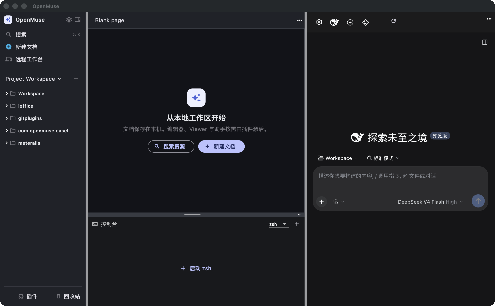
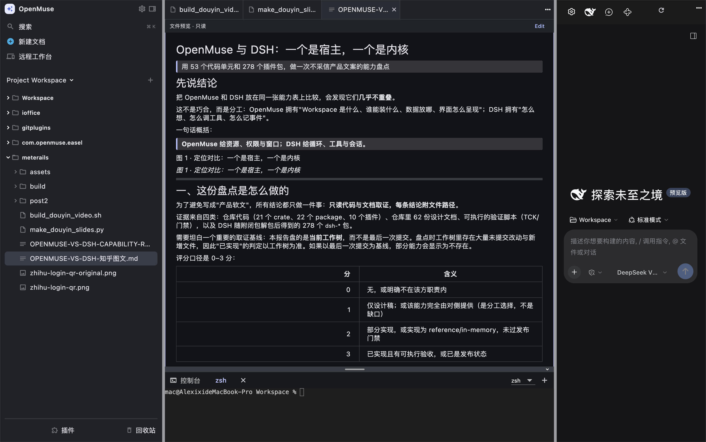
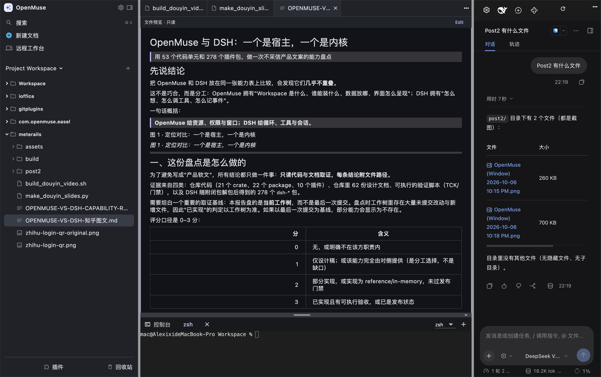
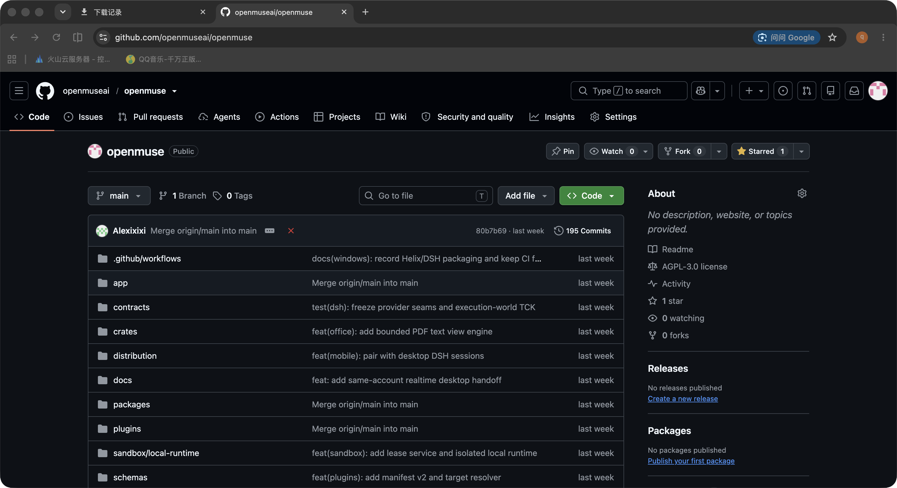

# 把 DSH 装进 Codex 中：DSH 缺的 6 样东西，谁来补？

> DSH 的短板从来不在"脑子"。它缺的是身体——身份、存储、设备、窗口，这四样它自己都说了不管。

## 先对号入座：这几个坑，你踩过几个？

- 换台电脑，会话没了，工作区还得重新配一遍？
- 手机上想看眼进度，发现那边只有一个命令行？
- 装完 DSH，模型凭据、权限、沙箱全得自己拼？
- 想把一个文件甩给同事看，对方先得来一句"你 clone 一下"？
- 手一抖升级了 DSH，插件全炸，因为版本对不上？

中两条以上，问题真不在你。这是 DSH 主动划出去的边界：**它给循环、工具、会话；账号、存储、设备、窗口，它明确不碰。**

而"把 DSH 装进宿主"这件事最值钱的地方，恰恰就是补这些洞。



*图 1 · 截图里那句"文档保存在本机。编辑器、Viewer 与助手按需由插件激活"，其实是在回答上面第 1 和第 3 个坑。*

---

## 一、丑话说在前面：DSH 到底缺什么

不看产品文案，只看可复核的事实。下面 6 条，每条都能在 DSH 随附闭包（278 个包）里对上。

| # | 缺口 | 现状（可复核） |
|---:|---|---|
| 1 | **账号与身份** | 整套身份只有 `dsh-anonymous-user-id`。没有账号体系，也就没有"我是谁、我拥有什么" |
| 2 | **存储与同步权威** | 只有本地 `storage` / `spill` / `attachment`。文件放哪、谁是权威版本，DSH 不表态 |
| 3 | **多设备与移动端** | 没有移动客户端。会话在本机，人一走开就断线 |
| 4 | **桌面宿主表面** | 有 web 与 headless 表层，但窗口、编辑器、Office 预览属于宿主，它不做 |
| 5 | **开箱门槛** | 凭据、权限、沙箱、桥接要自己配。`dsh-credentials-local` 只是"本地凭据" |
| 6 | **云端执行世界** | 控制面之外，substrate 没落地；云端进程生命周期不归它管 |

**划重点**：这 6 条不是 DSH 的 bug，是它的分工。**内核不该替宿主决定数据放哪**——这话反过来也成立：**宿主不补，谁都不会替你补。**

---

## 二、补坑的第一原则：别动内核

补洞最容易犯的错，是伸手去改 Agent Loop。改了会发生什么？你换一次宿主，就得重写一遍循环。

所以正确的姿势是：**宿主只扩展执行面。** 拿 OpenMuse 举例，全部动作就这几下（`plugins/dsh-agent/lib/src/dsh_sidecar.dart`）：

- 插件清单写一句 `"runtime": "native-process"`，用 sidecar 把 `dsh web --host 127.0.0.1 --port 0 --no-open` 拉起来；
- 塞一枚 32 字节随机的桥接令牌；
- 权限只申请 4 项：`workspace.context.read`、`resource.open.request`、`process.sidecar`、`credentials.model.use`；
- 用 profile patch **只重写 provider row**，一行都不碰 agent-loop。

这份克制还被写成了机器可校验的合同（`contracts/dsh/0.1.7-rc.1.contract.json`）：6 个 provider row、15 个必备包，外加 3 个**禁止进入生产闭包**的包（`dsh-e2b`、`dsh-fs-e2b`、`dsh-subprocess-e2b`）。

内核不动，才有后面"换宿主"的资格。

---

## 三、逐张截图看：洞是怎么被补上的

### 图 2：先给权限，再给能力



*图 2 · 注意"文件预览 · 只读"和右上角的 `Edit` 是分开的。*

默认只读、写入显式申请——这一条直接解掉了"agent 会不会手滑改我文件"的焦虑。补的是**信心**，不是功能。

### 图 3：看不见的 agent，最吓人



*图 3 · 右侧面板 `对话` 与 `轨迹` 两个标签，底部是 `18.2K tok`。*

一次运行跑完，你至少要知道三件事：它想了什么（对话）、它做了什么（轨迹）、花了多少（token）。这三样由 DSH 的 `dsh-client-ui-trajectory` 和 `dsh-token-meter` 提供，宿主负责给它们一个位置。**可观测性不是附加项，是敢把权限放出去的前提。**

### 图 4：补洞的证据，都在提交记录里



*图 4 · 仓库结构与提交记录。*

| 提交 | 补的是哪个洞 |
|---|---|
| `feat: add same-account realtime desktop handoff` | 洞 1 + 洞 3：账号打通，桌面实时接管 |
| `feat(mobile): pair with desktop DSH sessions` | 洞 3：手机配对桌面会话 |
| `feat(sandbox): add lease service and isolated local runtime` | 洞 5 + 洞 6：隔离执行面 + 资源租约 |
| `feat(plugins): add manifest v2 and target resolver` | 洞 5：插件清单 v2，装配不再靠手写 |
| `test(dsh): freeze provider seams and execution-world TCK` | 洞 6 的前置：接缝先冻结，再谈扩展 |

---

## 四、六个洞，六种补法

| 缺口 | DSH 现状 | 宿主补法（OpenMuse） | 证据 |
|---:|---|---|---|
| 1 账号与身份 | 只有匿名 ID | GoTrue 账号 + 设备配对密码学 + 同账号实时接管 | `plugins/auth-gotrue`、`docs/identity/ACCOUNT-DEVICE-PRESENCE-PAIRING.zh-CN.md` |
| 2 存储与同步 | 只有本地存储 | S3 存储 ABI + TCK + BYOS + 同步插件，资源带租约与 Revision | `crates/openmuse-storage-s3`、`openmuse-storage-tck`、`crates/openmuse-workspace-sync` |
| 3 多设备与移动端 | 无移动端 | 移动端 App + 语音输入 + 配对/远程工作台 | `packages/openmuse_mobile_core`、`plugins/speech-input`、`plugins/workspace-paired`、`plugins/remote-workbench` |
| 4 桌面宿主表面 | 只有 web / headless | 窗口 + Helix 编辑器 + Office 只读 Viewer，全部按需激活 | `packages/muse_helix_surface`、`packages/openmuse_office_viewers`、`plugins/open-file-viewer` |
| 5 开箱门槛 | 全手动 | sidecar 装 DSH + profile patch + 合同冻结权限，四步拉起 | `plugins/dsh-agent/openmuse.plugin.json`、`contracts/dsh/0.1.7-rc.1.contract.json` |
| 6 云端执行世界 | 控制面之外没落地 | 云执行运行时 + 资源权威，作为 DSH 的 remote provider | `crates/openmuse-cloud-execution-runtime`、`crates/openmuse-cloud-resource-authority`、`docs/dsh/CLOUD-EXECUTION-RUNTIME-DSH-PROVIDERS.zh-CN.md` |

这张表里最容易被忽略的是第 2 和第 3 行：**账号和存储是"无聊"的能力，但它们决定了这套东西能不能从"我一个人在电脑前玩"变成"我们团队一起用"。**

---

## 五、那"把 DSH 装进 Codex"呢？先把期待值对齐

能补的，两条真接缝：

**接缝一：你写过的 Codex hooks 不用重写。** `@deepseek-ai/dsh-hooks-codex` 直接在 DSH 运行时里跑你现成的 `hooks.json`，五个点原样生效：

| Codex hook | 触发时机 | 能干什么 |
|---|---|---|
| `SessionStart` | 会话开始 | 附加模型可见上下文 |
| `UserPromptSubmit` | 收到提示词 | 阻塞提示词，或附加上下文 |
| `PreToolUse` | 工具执行前 | 阻塞工具 |
| `PostToolUse` | 工具执行后 | 带反馈阻塞结果，或附加上下文 |
| `Stop` | 即将停止 | 带原因强制再走一步 |

配置就三行：

```yaml
- name: '@deepseek-ai/dsh-hooks-codex'
  config:
    configPath: ./.codex/hooks.json
    model: deepseek-v4
```

**接缝二：Codex 变成一个可编排的子级。** `@deepseek-ai/dsh-subagent-codex` 走官方 app-server 协议，把 Codex 作为一次性子 agent 拉起——和进程内、ACP、SDK、Claude Code 子级并排站在一起，父级审查通过后各自保留权限系统。

补不了的，也直说：**Codex 不会给你账号、存储、多设备、桌面窗口。** 它是个好脑子，但也没长身体。

所以选宿主其实是选"你要补哪几块"：

- 要补**钩子与编排** → 接 Codex，两条接缝，今天就能用；
- 要补**身份、存储、设备、窗口** → 得找一个有身体的宿主，比如已经把这 6 个洞补完并跑在实机上的 OpenMuse。

---

## 六、装之前，这 5 个坑先知道（省得回头骂人）

`dsh-hooks-codex` 的限制写得很直白，我原样搬过来：

1. **Codex 现在 10 个 hook 事件，只支持 5 个。** `PermissionRequest`、`PreCompact`、`PostCompact`、`SubagentStart`、`SubagentStop` 的配置会在解析时**静默丢弃**——不报错，直接没有。
2. **`SessionStart` 的钩子是脱离运行的**，它附加的上下文可能错过第一个请求。
3. **只跑同步 `command` handler。** `async: true`、`http`、`mcp_tool`、`prompt`、`agent` 这几类会被跳过并警告。
4. **`transcript_path` 恒为 `null`。** 会话日志默认 zstd 压缩，钩子脚本读不到。
5. **`Stop` 钩子的 `stop_hook_active` 恒为 `false`。** 无条件阻塞的钩子会在每一步强制继续，除非它自己会刹车。

再加一条非官方的：**接缝能通，不等于语义已经对齐。** 这也是为什么 OpenMuse 要用 TCK 把 provider 接缝冻起来——能启动但行为不一致，是最贵的故障。

---

## 七、上手：三步

```bash
# 1. 拉代码
git clone https://github.com/openmuseai/openmuse.git

# 2. 接上你已有的 Codex hooks
#    在 profile patch 里加一段：
#    - name: '@deepseek-ai/dsh-hooks-codex'
#      config:
#        configPath: ./.codex/hooks.json
#        model: deepseek-v4

# 3. 需要账号 / 存储 / 多设备时，去看宿主那一侧的实现
```

如果你手上已经有一份 `hooks.json`，那这就是"把 DSH 装进 Codex"最短的一条路：**不用改内核，也不用重写钩子。**

---

## 结语

DSH 缺的 6 样东西，没有一样是"再写个 Agent"能解决的。它们都需要宿主：一个愿意管身份、管数据、管设备、管窗口的宿主。

而"把 DSH 装进 Codex"的价值，是把内核接到另一套编排面上——**内核不动，换的是宿主给的资源和窗口**。

**仓库在这里，自己去看，比听我说强：**

👉 **https://github.com/openmuseai/openmuse**

---

*本文基于 OpenMuse 仓库现状与 DSH 随附闭包（278 个包）的只读代码取证整理，截图为 OpenMuse 桌面应用实机窗口。*
