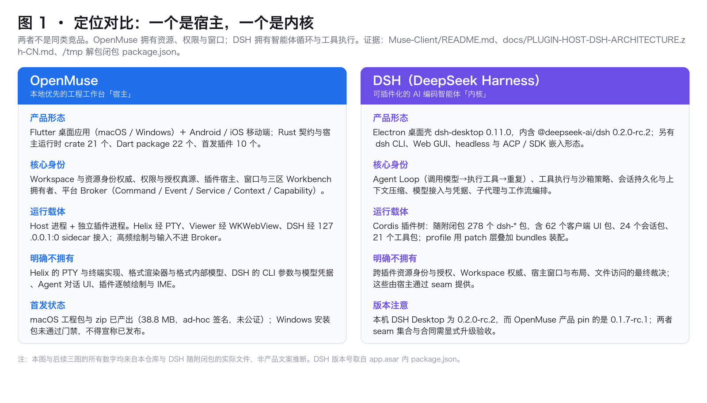
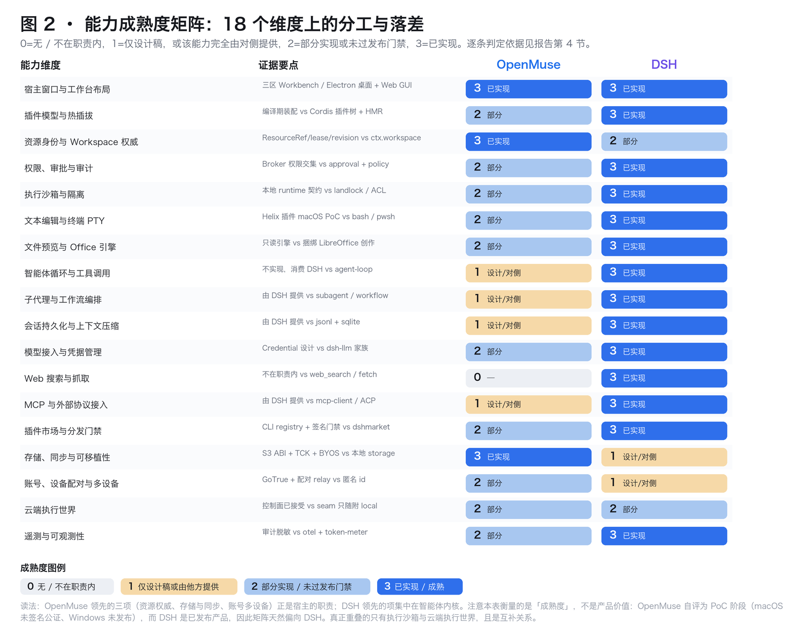
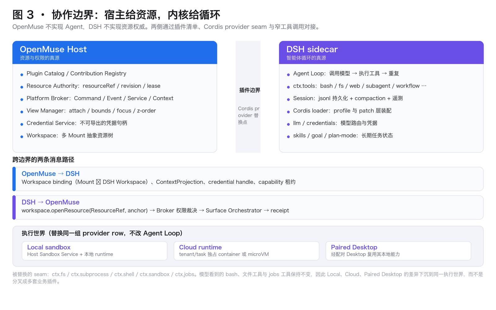
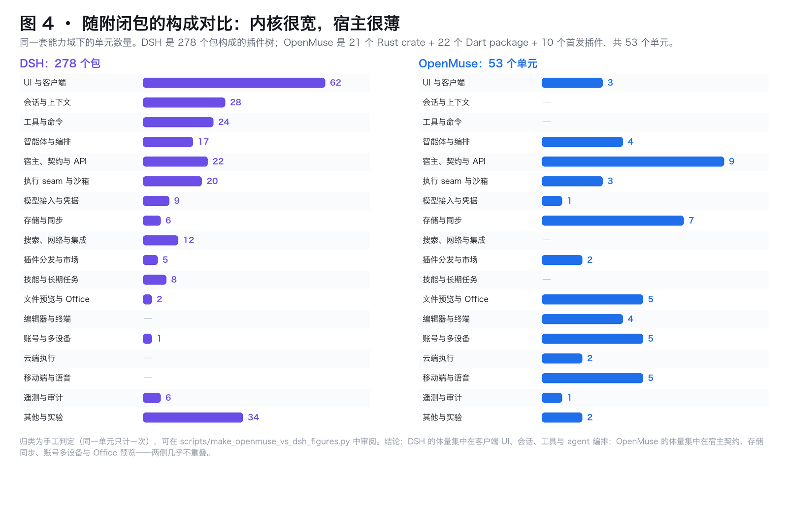

# OpenMuse 能力全景与 DSH 对比

> 状态：工程盘点报告（可复核）
> 范围：OpenMuse `Muse-Client` 仓库现状 + DSH（DeepSeek Harness）随附闭包
> 方法：只读代码与文档取证，不采信产品文案；每条结论附文件路径
> 图表：4 张，由 [`scripts/make_openmuse_vs_dsh_figures.py`](../scripts/make_openmuse_vs_dsh_figures.py) 生成

---

## 0. 一页结论

**OpenMuse 与 DSH 不是同类竞品，而是「宿主」与「内核」的分工关系。** 把两者放在一张能力表上比较，
会发现它们几乎不重叠：OpenMuse 拥有 *Workspace 是什么、谁能装什么、数据放哪、界面怎么呈现*；
DSH 拥有 *怎么想、怎么调工具、怎么记事件*。

五条核心判断：

1. **DSH 是 OpenMuse 的插件，不是依赖库。** `plugins/dsh-agent/openmuse.plugin.json` 声明
   `runtime: native-process`，以 `dsh web --host 127.0.0.1 --port 0 --no-open` 拉起独立 sidecar。
   Host 不导入 DSH 的内部状态、数据库或 React UI。
2. **两者的接缝是 Cordis provider seam，不是 API 适配层。** OpenMuse 通过 profile patch
   按**相同 row id 重写完整 provider row**（`subprocess` / `sandbox` / `fs-sandbox`），
   不改 Agent Loop，也不改模型可见的工具集。
3. **OpenMuse 的差异化在宿主侧，且是真实实现而非设计稿**：资源身份与租约、S3 存储 ABI 与 TCK、
   账号与设备配对、Office 只读引擎——这四项 DSH 不拥有或只做本地。
4. **DSH 的成熟度显著更高**：278 个 `dsh-*` 包构成的插件树、四种表层（web / headless / acp / sdk）、
   平台级沙箱 runner 与 fail-closed 审批、事件溯源会话、插件市场与客户端 HMR。
   OpenMuse 自评为 PoC 阶段（macOS ad-hoc 签名、Windows 未发布），因此成熟度矩阵天然偏向 DSH。
5. **最大的现实风险是版本漂移。** OpenMuse 把 DSH 钉在 `0.1.7-rc.1`，而本机 DSH Desktop 跑的是
   `0.2.0-rc.2`，全局 CLI 又是 `0.1.2-rc.1`。provider 合同与客户端 slot 合同都是按 `0.1.7-rc.1`
   冻结的，对齐新版必须重跑 TCK 与客户端合同。

一句话分工：

> **OpenMuse 给资源、权限与窗口；DSH 给循环、工具与会话。**

---

## 1. 方法与证据

### 1.1 证据来源

| 类别 | 具体来源 | 用途 |
|---|---|---|
| 仓库代码 | `crates/`（21）、`packages/`（22）、`plugins/`（10）、`app/` | 判断"是否真的实现了" |
| 仓库文档 | `docs/` 下 62 份设计/门禁文档 | 判断"设计意图与门禁状态" |
| 验证脚本 | `scripts/test_*.sh`、`scripts/validate_*.mjs`、`scripts/*_tck.mjs` | 判断"是否有可执行验收" |
| DSH 闭包 | `app.asar` 解包后的 278 个 `dsh-*` 包 + 打包外 patch/harness 入口 | 判断 DSH 真实能力面 |
| DSH 用户装配 | `~/Library/Application Support/dsh-desktop/harness/profiles/web/` | 判断实际生效的插件组合 |

> **取证基线（重要）**：本报告盘点的是**当前工作树**，而不是最后一次提交（`2c15cac`）。
> 盘点时工作树含大量未提交改动与新增文件（例如 `app/openmuse_host/lib/src/host/plugin_command_registry.dart`、
> `plugins/cli/`、`plugins/remote-workbench/`、`crates/openmuse-remote-surface/`、
> `packages/muse_remote_surface_core/` 等均为 untracked）。
> 因此"已实现"的判定以工作树为准；若以最后一次提交为基线，部分能力会显示为不存在。
> 本报告未修改仓库任何既有文件，仅新增本报告、4 张图与生成脚本。

**成熟度口径**（图 2 的 0–3 分）：

| 分 | 含义 |
|---:|---|
| 0 | 无，或明确不在该方职责内 |
| 1 | 仅设计稿；或该能力完全由对侧提供（是分工选择，不是缺口） |
| 2 | 部分实现，或实现为 reference/in-memory，未过发布门禁 |
| 3 | 已实现且有可执行验收，或已是发布状态 |

### 1.2 三方版本漂移（重要）

| 载体 | DSH 版本 | 证据 |
|---|---|---|
| OpenMuse 产品闭包（钉扎） | `0.1.7-rc.1` | [`third_party/dsh/package.json`](../third_party/dsh/package.json) |
| 本机 DSH Desktop | `0.2.0-rc.2` | `app.asar` 内 `package.json`（解包方法见 §1.3） |
| 本机全局 `dsh` CLI | `0.1.2-rc.1` | `~/.nvm/.../lib/node_modules/@deepseek-ai/dsh/package.json` |

三个版本不同，**任何跨版本结论都必须指明取证自哪一个闭包**。本报告中"DSh 能力"如无特别说明，
取自随附闭包（0.2.0-rc.2），而"OpenMuse 如何使用 DSH"取自 0.1.7-rc.1 的合同与代码。

### 1.3 复现

```bash
# 生成 4 张对比图
python3 scripts/make_openmuse_vs_dsh_figures.py

# 解包 DSH 闭包（只读审计用；本报告引用的 dsh-* 包与版本号都取自这里）
npx --yes @electron/asar extract \
  "/Applications/DSH Desktop.app/Contents/Resources/app.asar" /tmp/dsh-asar
ls /tmp/dsh-asar/node_modules/@deepseek-ai | grep -c '^dsh'   # 278 个 dsh-* 包

# 仓库自带的相关验收
./scripts/test_dsh_provider_contract.sh
./scripts/test_plugin_manifest_v2.sh
./scripts/test_workspace_resource_authority.sh
./scripts/test_muse_packages.sh
```

---

## 2. 图 1 · 定位对比



| 维度 | OpenMuse | DSH |
|---|---|---|
| 是什么 | 本地优先的工程工作台**宿主** | 可插件化的 AI 编码智能体**内核** |
| 形态 | Flutter 桌面（macOS/Windows）+ Android/iOS | Electron 桌面壳 + CLI + Web GUI + headless + ACP/SDK |
| 核心身份 | Workspace/资源身份权威、权限真源、插件宿主、窗口与布局 | Agent Loop、工具执行、会话与上下文、模型接入、子代理编排 |
| 运行载体 | Host 进程 + 独立插件进程（PTY / WKWebView / sidecar） | Cordis 插件树（profile + patch 分层装配） |
| 规模 | 21 crate + 22 package + 10 插件 = 53 单元 | 278 个 `dsh-*` 包 |
| 明确不拥有 | PTY 实现、格式内部模型、DSH CLI 参数与模型凭据、Agent UI | 跨插件资源身份、Workspace 权威、宿主窗口与布局、文件访问最终裁决 |

---

## 3. OpenMuse 能力全景

### 3.1 分层架构（真实名称）

```text
Host Shell（app/openmuse_host）          窗口 / 三区 Workbench / 布局 token
        │
插件 SDK 与协议                            packages/openmuse_plugin_sdk
        │                                  crates/openmuse-plugin-protocol
平台 Broker 与资源权威                     crates/openmuse-platform-runtime
        │                                  packages/muse_resource_bridge
领域 crate（21）                            storage-* / workspace-sandbox /
        │                                  cloud-execution-runtime / paired-relay /
        │                                  office-docx / office-viewers / …
产品装配层                                 distribution/openmuse_builtin_plugins
        │
插件进程                                   helix / dsh-agent / open-file-viewer /
                                           native-text-gate / cli / auth-gotrue /
                                           cloud-workspace / workspace-paired /
                                           remote-workbench / speech-input
```

> **实现与文档的偏差（已核实）**：架构文档要求 Host 只依赖 SDK 与装配层，
> 且"不直接依赖 DSH 实现包"（[`PLUGIN-HOST-DSH-ARCHITECTURE.zh-CN.md:105`](PLUGIN-HOST-DSH-ARCHITECTURE.zh-CN.md)），
> 但 [`app/openmuse_host/pubspec.yaml`](../app/openmuse_host/pubspec.yaml) 直接依赖了
> `openmuse_dsh_plugin`、`openmuse_auth_gotrue`、`openmuse_cloud_workspace_plugin`、
> `openmuse_remote_workbench`、`openmuse_workspace_paired`。
> 同时 `createOpenMuseBuiltInPlugins()` 只装配 5 个插件
> （Helix、CLI、FileViewer、DSH、NativeTextGate），其余 5 个走 Host 直连。
> 这是一处真实的架构债，报告如实记录。

### 3.2 能力清单

**工作台与编辑**

| 能力 | 成熟度 | 证据 |
|---|---|---|
| 三区 Workbench + 自由切分/移动/resize | 已实现 | [`layout.dart`](../app/openmuse_host/lib/src/host/layout/layout.dart)、`workbench_shell.dart` |
| 多 mount 资源树、标签、右键、内容寻址版本历史、统一/并排 Diff | 已实现 | `workspace_controller.dart` |
| Helix PTY + 进程池复用同进程开第二文件 | 已实现（macOS PoC） | [`helix_pty.dart`](../plugins/helix/lib/src/helix_pty.dart)、`helix_runtime.dart` |
| Helix LSP | 部分（产品闭包未含 LSP adapter） | `helix_language_servers.dart`；[`DSH-0.1.7-PROVIDER-CONTRACT-TCK.zh-CN.md`](DSH-0.1.7-PROVIDER-CONTRACT-TCK.zh-CN.md) |
| Markdown 富文本 | 设计稿 | [`WORKBENCH-PARITY-SPEC.zh-CN.md`](WORKBENCH-PARITY-SPEC.zh-CN.md) |

**文件与 Office**

| 能力 | 成熟度 | 证据 |
|---|---|---|
| 扩展名路由到插件编辑器 | 已实现 | [`open-file-viewer/openmuse.plugin.json`](../plugins/open-file-viewer/openmuse.plugin.json) |
| macOS PNG/PDF 只读 WKWebView（禁 JS、非持久化） | 已实现 | `macos/Classes/OpenMuseFileViewerPlugin.swift` |
| Windows PNG/PDF renderer | 未实现 | [`PLUGIN-HOST-DSH-ARCHITECTURE.zh-CN.md:391`](PLUGIN-HOST-DSH-ARCHITECTURE.zh-CN.md) |
| DOCX 有界解析/校验/受限导出 + C ABI | 已实现 | [`crates/openmuse-office-docx`](../crates/openmuse-office-docx/src/lib.rs) |
| XLSX/PPTX/PDF 只读兼容视图 | 已实现 | [`crates/openmuse-office-viewers`](../crates/openmuse-office-viewers/src/lib.rs) |
| Office dispatcher / worker supervisor | 已实现（reference） | [`crates/openmuse-worker-supervisor`](../crates/openmuse-worker-supervisor/src/lib.rs) |

**DSH 集成**

| 能力 | 成熟度 | 证据 |
|---|---|---|
| DSH 面板 + 真实 sidecar（动态 loopback、readiness、停止） | 已实现 | [`dsh_sidecar.dart`](../plugins/dsh-agent/lib/src/dsh_sidecar.dart)、`dsh_panel.dart`、`dsh_web_view.dart` |
| 原生 Flutter 对话流（WorkBuddy + 日志 reducer） | 已实现 | `packages/` 下 `muse_dsh_conversation_core`、`_protocol`、`_flutter` |
| DSH Provider TCK（fs/subprocess/shell/sandbox/jobs） | 已实现 | [`contracts/dsh/0.1.7-rc.1.contract.json`](../contracts/dsh/0.1.7-rc.1.contract.json)、[`scripts/dsh_provider_contract_tck.mjs`](../scripts/dsh_provider_contract_tck.mjs) |
| curated closure / credential handle / Workspace binding 全链路 | 部分（代码在，未接入） | `dsh_workspace_binding.dart`、`dsh_workspace_sync.dart` |

**沙箱与执行**

| 能力 | 成熟度 | 证据 |
|---|---|---|
| `workspace.sandbox@1` 控制面（lease/attach/quiesce/draft/release/cleanup） | 已实现 | [`crates/openmuse-workspace-sandbox`](../crates/openmuse-workspace-sandbox/src/lib.rs) |
| 本地 runtime（native / 容器隔离） | 已实现（reference，substrate 在 port 后） | `InMemorySandboxRuntime`、[`HOST-SANDBOX-SERVICE-LOCAL-RUNTIME.zh-CN.md`](HOST-SANDBOX-SERVICE-LOCAL-RUNTIME.zh-CN.md) |
| Cloud execution runtime 控制面 | 已实现（reference） | [`crates/openmuse-cloud-execution-runtime`](../crates/openmuse-cloud-execution-runtime/src/lib.rs) |
| Draft / checkpoint / quiescence | 已实现 | [`crates/openmuse-draft-transaction`](../crates/openmuse-draft-transaction/src/lib.rs) |
| 生产安全 gate（多租户等级） | 策略已实现，等级未达 | [`crates/openmuse-sandbox-security`](../crates/openmuse-sandbox-security/src/lib.rs) |

**工作区权威与权限**

| 能力 | 成熟度 | 证据 |
|---|---|---|
| `MuseWorkspaceAuthority` port（list/describe/materialize/draft/commit/subscribe） | 已实现（内存 reference） | [`authority.dart`](../packages/muse_resource_bridge/lib/src/authority.dart) |
| Manifest v2 + target resolution fail-closed | 已实现 | [`schemas/openmuse.plugin.v2.schema.json`](../schemas/openmuse.plugin.v2.schema.json)、[`validate_plugin_manifest_v2.mjs`](../scripts/validate_plugin_manifest_v2.mjs) |
| Delegation 权限交集 / handle / 审计脱敏 | 已实现（内存 sink） | [`delegation.rs`](../crates/openmuse-platform-runtime/src/delegation.rs) |

**存储、同步与可移植性**

| 能力 | 成熟度 | 证据 |
|---|---|---|
| BlobStorePort + S3 profile + TCK + fake | 已实现 | `crates/openmuse-storage-contract`、`openmuse-storage-tck` |
| AWS SDK S3 adapter / 端点与凭据安全 | 已实现 | [`crates/openmuse-storage-s3`](../crates/openmuse-storage-s3/src/lib.rs) |
| BYOS / 迁移 / 可移植导出 | 已实现 | [`crates/openmuse-storage-portability`](../crates/openmuse-storage-portability/src/lib.rs) |
| Workspace Sync 四策略 + durable cursor | 已实现（内存 state store） | [`crates/openmuse-workspace-sync`](../crates/openmuse-workspace-sync/src/lib.rs) |
| Managed rollout 资格策略 | 策略已实现 | `crates/openmuse-storage-qualification` |

**账号、多设备与移动端**

| 能力 | 成熟度 | 证据 |
|---|---|---|
| GoTrue 登录插件（client / 安全会话存储 / UI / ports） | 已实现 | `plugins/auth-gotrue/lib/src/*` |
| 配对密码学（Ed25519+X25519+HKDF+ChaCha20-Poly1305+SAS） | 已实现 | [`crates/openmuse-paired-relay`](../crates/openmuse-paired-relay/src/lib.rs) |
| 设备目录 / presence / 真实 relay | 部分（部署门禁待完成） | [`PAIRED-DESKTOP-E2E-RELAY.zh-CN.md`](PAIRED-DESKTOP-E2E-RELAY.zh-CN.md) |
| 移动端 1/2/3 槽 Window 投影 | 已实现 | [`adaptive_windows.dart`](../packages/openmuse_mobile_core/lib/src/adaptive_windows.dart) |
| 语音输入（sherpa_onnx isolate） | 已实现 | [`sherpa_worker.dart`](../plugins/speech-input/lib/src/sherpa_worker.dart) |
| iOS 构建 / Android 真机 soak | 门禁脚本 | [`IOS-UNSIGNED-BUILD-GATE.zh-CN.md`](IOS-UNSIGNED-BUILD-GATE.zh-CN.md) |

**插件分发**

| 能力 | 成熟度 | 证据 |
|---|---|---|
| CLI registry + artifact resolver | 已实现 | [`crates/openmuse-cli-registry`](../crates/openmuse-cli-registry/src/lib.rs) |
| 分发锁 / SBOM / 闭包 gate | 已实现（脚本级） | [`distribution_lock.py`](../scripts/distribution_lock.py) |
| 外部 Runtime 插件动态装载 | 未实现（built-in 仍编译期装配） | [`PLUGIN-HOST-DSH-ARCHITECTURE.zh-CN.md:140`](PLUGIN-HOST-DSH-ARCHITECTURE.zh-CN.md) |

### 3.3 关键机制

- **权限强制**：有效权限 = tenant ceiling ∩ actor ∩ caller plugin ∩ target provider ∩
  workspace classification ∩ handle ∩ command required；交集不覆盖即拒。
  `requested_permissions` 只是输入，不是授权
  （[`BROKER-DELEGATION-POLICY-AUDIT.zh-CN.md`](BROKER-DELEGATION-POLICY-AUDIT.zh-CN.md)、`delegation.rs`）。
- **委托上下文**：`DelegatedRequestContext` 显式区分 actor / caller / target_provider / scope /
  revision / handle_ref / generation / deadline（`crates/openmuse-plugin-protocol`）。
- **审计**：单调 decision ref + 字段白名单 + 防御性脱敏（path / presigned / S3 URI / token → `[redacted]`）；
  统一错误词汇 `DENIED / NOT_FOUND / CONFLICT / EXPIRED / STALE_GENERATION / INTEGRITY_FAILED`。
- **生命周期清理**：deactivate 自动注销命令/服务/订阅/context/Native View；
  `shutdown_plugin` 逐 lease cleanup，失败收敛 `Degraded` 而不 panic。
- **版本协商**：仅同 major 且 `peer.minor <= local.minor`；未知字段、未知枚举、
  receipt 不一致一律 fail-closed（[`CONTRACT-BASELINE-V1.zh-CN.md`](CONTRACT-BASELINE-V1.zh-CN.md)）。
- **TCK 体系**：storage provider、engine adapter、resource authority、DSH provider、
  manifest v2、contract baseline——共 6 套黑盒验收。

### 3.4 明确的能力边界

- **无 Web 产品**：仓库不含 web app，`README.md` 明示 "no web product"。
- **不继承旧 Workspace 格式**：无 migrator crate，迁移已取消。
- **Windows 未发布**：HWND 未真机验证、无 PNG/PDF renderer、无安装包。
- **macOS 未签名公证**：仅 ad-hoc 可验证。
- **插件不能动态装载 Dart 代码**：AOT 限制，"热插拔"仅指贡献注册与启停。
- **生产化缺口**：审计 sink、sync state store、sandbox/cloud substrate、
  账号/组织 policy、credential handle 均为内存或 reference 实现。

---

## 4. 图 2 · 能力成熟度矩阵



逐条判定依据：

| # | 维度 | OpenMuse | DSH | 判定依据 |
|---:|---|---:|---:|---|
| 1 | 宿主窗口与工作台布局 | 3 | 3 | OpenMuse 三区 Workbench 已实现；DSH 有 Electron 壳 + `dsh-client-ui-layout` + `dsh-desktop-workbenches` |
| 2 | 插件模型与热插拔 | 2 | 3 | OpenMuse 编译期装配（`createOpenMuseBuiltInPlugins()`）；DSH 是 Cordis 全插件树 + `dsh-client-hmr`，启停无需刷新 |
| 3 | 资源身份与 Workspace 权威 | 3 | 2 | OpenMuse 有 `resourceRef`/lease/revision 与 `MuseWorkspaceAuthority`；DSH 只有 `ctx.workspace`，且文档明确不让它成为数据权威 |
| 4 | 权限、审批与审计 | 2 | 3 | OpenMuse 权限交集与脱敏已实现但 sink 在内存；DSH 有 `dsh-user-approval` + `dsh-sandbox-policy` + 三档预设，fail-closed |
| 5 | 执行沙箱与隔离 | 2 | 3 | OpenMuse 控制面已实现、substrate 在 port 后；DSH 有 bwrap/landlock/Seatbelt/Windows ACL 四类 runner，`SANDBOX_UNAVAILABLE` fail-closed |
| 6 | 文本编辑与终端 PTY | 2 | 3 | OpenMuse Helix 插件 macOS PoC 通过、Windows 未验证；DSH 有 `bash`/`pwsh`/`terminal` 与持久 shell |
| 7 | 文件预览与 Office 引擎 | 2 | 3 | OpenMuse 只读引擎（DOCX/XLSX/PPTX/PDF）+ 受限导出；DSH Desktop 捆绑 `libreoffice-kit` + `dsh-skill-office` + Python 运行时，可离线创作 |
| 8 | 智能体循环与工具调用 | 1 | 3 | OpenMuse 不实现，消费 DSH；DSH 的 `dsh-agent-loop` 是核心 |
| 9 | 子代理与工作流编排 | 1 | 3 | 完全由 DSH 提供（`subagent` / `workflow` / 四种后端驱动） |
| 10 | 会话持久化与上下文压缩 | 1 | 3 | 由 DSH 提供：事件溯源追加日志、JSONL+Zstd、SQLite 查询、`compaction` |
| 11 | 模型接入与凭据管理 | 2 | 3 | OpenMuse Credential Service 是设计（V1 环境变量为 PoC）；DSH 有 `dsh-llm-*` 家族 + `dsh-credentials-local` |
| 12 | Web 搜索与抓取 | 0 | 3 | OpenMuse 明确不在职责内；DSH 有 `web_search` / `web_fetch` |
| 13 | MCP 与外部协议接入 | 1 | 3 | 由 DSH 提供：`dsh-mcp-client`、`dsh-acp`、`dsh-hooks-claude-code`/`-codex` |
| 14 | 插件市场与分发门禁 | 2 | 3 | OpenMuse 有 registry + 分发锁 + SBOM（脚本级）；DSH 有 `dshmarket` 1.45.1 + `dsh-host-plugin-inventory` |
| 15 | 存储、同步与可移植性 | 3 | 1 | OpenMuse 有 S3 ABI + TCK + BYOS + 同步插件；DSH 只有本地 `storage`/`spill`/`attachment` |
| 16 | 账号、设备配对与多设备 | 2 | 1 | OpenMuse 有 GoTrue + 配对密码学 + 移动端；DSH 只有 `dsh-anonymous-user-id`，无账号体系 |
| 17 | 云端执行世界 | 2 | 2 | 双方都停在"控制面已接受、substrate/remote provider 未全量落地" |
| 18 | 遥测与可观测性 | 2 | 3 | OpenMuse 审计脱敏已实现、sink 未持久化；DSH 有 `dsh-session-telemetry-otel` + `dsh-token-meter` |

**读法提醒**：本表衡量"成熟度"，不衡量产品价值。表中大量 OpenMuse 的 `1` 是
**分工选择**（该能力由 DSH 提供），不是缺口；而 `2` 通常意味着"已实现但未过发布门禁"。
OpenMuse 自评 PoC、DSH 已发布，因此矩阵整体偏向 DSH 是预期结果，不应被读成"OpenMuse 更弱"。

---

## 5. 图 3 · 协作边界：宿主给资源，内核给循环



### 5.1 DSH 是如何被拉起的

[`plugins/dsh-agent/lib/src/dsh_sidecar.dart`](../plugins/dsh-agent/lib/src/dsh_sidecar.dart) 中：

- `resolveDshRuntime()` 从 `Contents/Resources/openmuse/dsh/...` 解析捆绑 CLI 与 Node；
- `dshClosureRoot()` 把 cwd 设为闭包根，使 package-relative 文件可解析；
- `dshLaunchEnvironment()` 把捆绑 Node 目录前置到 PATH；
- `dshWebCommand()` 拼 `dsh web --host 127.0.0.1 --port 0 --no-open [--patch <openmuse.patch.yml>]`；
- 额外注入 `OPENMUSE_DSH_BRIDGE_TOKEN`（32 字节随机）。

插件清单声明 `runtime: native-process`，权限为 `process.sidecar`、`workspace.context.read`、
`resource.open.request`、`credentials.model.use`，贡献右侧栏面板 `dsh.agent`。

### 5.2 Provider 合同与 TCK

[`contracts/dsh/0.1.7-rc.1.contract.json`](../contracts/dsh/0.1.7-rc.1.contract.json) 冻结了：

- **6 个 provider row**：`subprocess` / `sandbox` / `sandbox-policy` / `bash-sandbox` / `fs-sandbox` / `jobs`；
- **15 个 requiredPackages**；
- **3 个 forbiddenProductionPackages**（e2b 系列，确保生产闭包不含 E2B）；
- capability 快照：`lspTransport: true` 但 `lspAdapterInProductClosure: false`
  （即"传输可行，但产品不得宣称 LSP 可用"）。

验收入口 [`scripts/test_dsh_provider_contract.sh`](../scripts/test_dsh_provider_contract.sh) 覆盖：
exact version、Base row 替换、FS↔Bash 双向可见、abort 与后台 kill、真 PTY、
LSP JSON-RPC framing、read-only 拒改与越界拒绝、jobs wait/kill。

local fixture [`contracts/dsh/providers/local/cordis.patch.yml`](../contracts/dsh/providers/local/cordis.patch.yml)
**只重写 provider row，不出现 `agent-loop`**——这正是"扩展执行面而不改 Agent"的证明。

### 5.3 执行世界不变量

[`DSH-0.1.7-PROVIDER-CONTRACT-TCK.zh-CN.md`](DSH-0.1.7-PROVIDER-CONTRACT-TCK.zh-CN.md) 要求一个可接入的
provider 组必须同时满足：

1. `ctx.fs.processPath(target)` 返回同一执行世界内 `ctx.subprocess`/`ctx.shell` 能打开的路径；
2. FS 写入后 Bash 立即可见，反之亦然；
3. subprocess 管理完整 process range，取消/超时/dispose 最终到 quiescence；
4. PTY 的分配、输入、输出、resize、前台信号与终止属于 subprocess provider；
5. jobs 只管 ownership / lifecycle / output ring，不拥有进程；
6. LSP 使用 subprocess 的 raw pipe 与 framing，但 LSP adapter 是独立 capability；
7. 同一 Context 的 service 实现唯一，重复注册必须失败。

### 5.4 领域归属（权威划分）

[`DSH-WORKSPACE-EXECUTION-PLANE-FEASIBILITY.zh-CN.md`](DSH-WORKSPACE-EXECUTION-PLANE-FEASIBILITY.zh-CN.md)
第 4.2 节给出了双方都不应越界的划分：

| 角色 | 负责 | 不负责 |
|---|---|---|
| DSH Agent | 推理、工具调度、事件记录 | 存储协议、版本权威、容器编排 |
| DSH Shell/FS consumers | Bash、PTY、LSP、结构化文件操作 | 决定 Workspace 存在哪里 |
| DSH WSR Adapter | 把 `ctx.fs`/`ctx.subprocess` 映射到同一执行世界 | Plugin 安装与 Workspace 权限真相 |
| Workspace Sandbox Runtime（OpenMuse） | hydrate、隔离、进程与 CLI worker 生命周期、draft、quiescence | 用户/组织领域策略 |
| Workspace Authority（OpenMuse） | Revision、ACL、checkpoint、冲突、审计、分享 | 执行任意进程 |
| Plugin Authority（OpenMuse） | 签名、安装状态、artifact digest、CLI contribution、版本选择 | Workspace 内容与 DSH 会话 |
| Resource/Blob Layer | 内容寻址 Blob、S3 ABI、BYOS | 路径语义与 Agent Tool |

### 5.5 双向资源联动

**DSH → Host**：对话中的文件链接 → `workspace.openResource(ResourceRef, anchor)` →
Broker 权限裁决 → Surface Orchestrator 选编辑器 → Host 激活/复用 surface → receipt 返回。

**Host → DSH**：selection/resource changed → Host 生成最小 ContextProjection →
用户显式插入或策略允许的自动投影 → DSH session 记录引用与 revision。

关键约束：**DSH 不接收任意 path、engine id 或长期 token**；Agent 动作只调用窄工具
（open/read/propose），写入必须经过 Host 的 proposal/commit 流程。

---

## 6. 图 4 · 随附闭包的构成对比



| 能力域 | DSH 包数 | OpenMuse 单元数 | 说明 |
|---|---:|---:|---|
| UI 与客户端 | 62 | 3 | DSH 的 `dsh-client-ui-*` 是全套 Web 客户端组件 |
| 会话与上下文 | 28 | 0 | 事件溯源、格式迁移、SQLite 查询、压缩、遥测 |
| 工具与命令 | 24 | 0 | 模型可见工具的注册与实现 |
| 智能体与编排 | 17 | 4 | agent-loop、goal、plan-mode、subagent、workflow |
| 宿主、契约与 API | 22 | 9 | 双方都有；OpenMuse 偏契约与资源权威 |
| 执行 seam 与沙箱 | 20 | 3 | fs/subprocess/shell/terminal/jobs/sandbox 全家 |
| 模型接入与凭据 | 9 | 1 | `dsh-llm-*` vs OpenMuse 的 Credential 设计 |
| 存储与同步 | 6 | 7 | **OpenMuse 领先**：S3 ABI、TCK、BYOS、同步 |
| 搜索、网络与集成 | 12 | 0 | web_search/fetch、MCP、hooks、webhook |
| 插件分发与市场 | 5 | 2 | `dshmarket` vs CLI registry + 分发锁 |
| 技能与长期任务 | 8 | 0 | `dsh-skill-*`、goal、schedule |
| 文件预览与 Office | 2 | 5 | DSH 走捆绑 LibreOffice；OpenMuse 走自研只读引擎 |
| 编辑器与终端 | 0 | 4 | Helix 插件与 CLI 控制台 |
| 账号与多设备 | 1 | 5 | **OpenMuse 领先**：GoTrue、配对、移动端 |
| 云端执行 | 0 | 2 | OpenMuse 的 cloud-execution / cloud-resource-authority |
| 移动端与语音 | 0 | 5 | DSH 无移动端 |
| 遥测与审计 | 6 | 1 | OTel + token-meter vs 审计脱敏 |
| 其他与实验 | 34 | 2 | 基础工具、品牌、平台适配 |

归类为手工判定（同一单元只计一次），规则写在
[`scripts/make_openmuse_vs_dsh_figures.py`](../scripts/make_openmuse_vs_dsh_figures.py) 的 `DOMAINS` 常量中，可审阅。

---

## 7. DSH 能力全景（对比参照）

### 7.1 产品形态与四种表层

DSH 的本体是 **profile 启动器 + 可组合插件树**。`dsh` CLI 描述自己为
"boot a profile — an ordered stack of plugin-bundle patch layers under your own overrides"，
支持 `--profile`、`--patch`、`--dump-config`、`plugin`（转发 pnpm 管理 profile 依赖）。

| 表层 | 说明 |
|---|---|
| `web` | 浏览器 GUI，启动打印带进程 token 的 URL；不能绑定所有网卡 |
| `headless` | 一次性任务，无端口无残留，`--json` 行事件流 + `--session-id` 续跑 |
| `acp` | 面向程序化客户端的 JSON-RPC stdio 服务器 |
| `sdk` | 嵌入形态 |
| Desktop | Electron 壳 v0.11.0，Harness 跑在 utility process（macOS TCC 责任隔离） |

### 7.2 工具面（模型可见）

`read` `write` `edit` `read_image`（`dsh-tool-fs`）、`glob` `grep`（`dsh-tool-fs-search`）、
`bash`（`dsh-tool-bash`，含后台 job 与沙箱升权）、`pwsh`（Windows 孪生）、
`web_search` `web_fetch`（`dsh-tool-web`）、`subagent`（`dsh-tool-subagent`）、
`send_message` `interrupt_agent`（`dsh-tool-subagent-control`）、`workflow`（`dsh-tool-workflow`）、
`todo_write`、`skill`、`create_goal` `get_goal` `update_goal`、
`job_output` `job_list` `job_kill`、`present`、`ask_user_question`、
`cordis_inspect_list` `cordis_inspect_query`、`load_workspace_dependencies`。
`str_replace_editor` 默认关闭，需在 profile patch 显式 insert。

### 7.3 插件、HMR 与市场

- Cordis loader + `cordis.patch.yml`：bundle 按顺序应用，**按 id 最后一次写入生效**，
  且 patch 替换整行 config 而非合并。
- 同一 Context 重复注册同名 service 会导致加载失败（这是执行世界不变量的强制手段）。
- `dsh-client-hmr`：启停普通插件**无需刷新页面或重启 Host**；代码重建会替换受影响插件。
- 打包 Electron 缺 Node 内部 loader，桌面用 `dsh-desktop-hmr-fallback` 提供配置监听子集。
- `dshmarket` 1.45.1 是插件市场，作为 web profile 的 bundle 装入。

### 7.4 沙箱与审批

- `dsh-sandbox-local` 自动选平台 runner：bwrap / landlock-run / macOS Seatbelt / Windows ACL 受限令牌；
  **无可用 runner 时以 `SANDBOX_UNAVAILABLE` fail closed**，每次执行报告 `full` 或 `partial`。
- `dsh-fs-sandbox` **只围栏写**（read-only 拒改、workspace-write 限工作区+临时根），读直通。
- 三档预设：`read-only` → ask、`workspace-write` → ask（默认）、`danger-full-access` → never。
- `dsh-user-approval`：`ask` 逐请求送一次性决定，`never` 直接拒；
  应答者缺失返回 `unavailable` 并 fail closed；每请求与结果进会话审计日志。

### 7.5 会话

事件溯源、仅追加日志；压缩只隐藏被取代条目而不删除；持久化走逐会话 JSONL
（默认带校验和的 Zstandard 帧，可关压缩，支持撕裂尾部崩溃恢复），
查询与投影走 SQLite；遥测 OTel 默认 `FEEDBACK_ONLY`。

### 7.6 DSH 的边界

DSH 不拥有：跨插件资源身份与授权、Workspace 权威、宿主窗口与布局、
文件访问的最终裁决、账号与设备体系。这些正是 OpenMuse 的领地。

---

## 8. 对比总结

### 8.1 同维度并列

| 维度 | OpenMuse | DSH |
|---|---|---|
| 产品定位 | 工作台宿主 | 智能体内核 |
| 首发平台 | macOS（Windows 未过门禁） | macOS / Windows / Linux（Electron + CLI） |
| 插件机制 | Manifest + 编译期装配 + 独立进程 | Cordis 插件树 + patch 层 + 客户端 HMR |
| 扩展方式 | 写插件、走 Broker 与资源租约 | 写 bundle、重写 provider row |
| 权限模型 | 多方权限交集 + 资源租约 | 沙箱策略 + 一次性审批 + 三档预设 |
| 资源模型 | `ResourceRef` + revision + lease | `ctx.fs` / `ctx.workspace`（不拥有权威） |
| 执行隔离 | Host Sandbox Service + 执行世界 | 平台 runner + fail-closed |
| 会话 | 不拥有（由 DSH 提供） | 事件溯源 + JSONL/SQLite + 压缩 |
| 多设备 | 配对密码学 + 移动端 + 远程 surface | 匿名 id，无账号体系 |
| 存储 | S3 ABI + TCK + BYOS | 本地 storage/spill/attachment |
| 分发 | CLI registry + 分发锁 + SBOM | dshmarket 市场 + 插件清单 |
| 成熟度自评 | PoC（macOS ad-hoc，未公证） | 已发布（Desktop v0.11.0） |

### 8.2 重叠区与互补区

**真正的重叠只有两处**，且都是"同构但互补"：

1. **执行沙箱**：DSH 提供 provider seam 与本地 runner；OpenMuse 提供 lease、隔离 substrate 与
   Cloud/Paired 执行世界。二者是"接口与实现"的关系。
2. **云端执行世界**：双方都停在控制面已接受、substrate 未全量落地；OpenMuse 提供
   `openmuse-dsh-workspace-runtime` 作为 DSH 的 remote provider 包。

**互补区**：OpenMuse 的资源权威/存储/多设备 ↔ DSH 的循环/工具/会话/模型/搜索。
把这些能力从任一侧搬到另一侧，都会违反已冻结的领域归属。

---

## 9. 差异、风险与待办

| # | 事项 | 严重度 | 说明与建议 |
|---:|---|---|---|
| 1 | **DSH 版本三方漂移** | 高 | OpenMuse 钉 `0.1.7-rc.1`，Desktop 是 `0.2.0-rc.2`。provider 合同与客户端 slot 合同都按 0.1.7 冻结；对齐新版必须显式审查合同、重跑 [`test_dsh_provider_contract.sh`](../scripts/test_dsh_provider_contract.sh) 与客户端合同 |
| 2 | **Host 直接依赖插件包** | 中 | `app/openmuse_host/pubspec.yaml` 依赖 `openmuse_dsh_plugin` 等 5 个插件，违反架构文档的边界约定；建议把这 5 个插件纳入 `distribution/openmuse_builtin_plugins`，Host 只依赖 SDK + 装配层 |
| 3 | **Windows 未发布** | 高 | HWND 未真机验证、无 PNG/PDF renderer、无安装包。文档已明确"不得宣称已发布" |
| 4 | **macOS 未签名公证** | 中 | 仅 ad-hoc；对外分发前需 Developer ID + 公证 + Gatekeeper 验证 |
| 5 | **生产化 substrate 缺口** | 中 | 审计 sink、sync state store、sandbox/cloud substrate、credential handle 均为内存或 reference |
| 6 | **外部插件不能动态装载 Dart** | 中 | 长期主路径是 External Runtime Plugin（Native View 或 WebView + IPC） |
| 7 | **LSP 不可宣称** | 低 | capability 快照显式记录 `lspAdapterInProductClosure: false`；需先纳入签名合格的 LSP artifact 并跑专属 TCK |
| 8 | **DSH 侧未验证项** | 低 | `dsh-tool-lsp` / `dsh-tool-terminal` / `dsh-tool-session-query` 的模型可见工具名未逐一核实；web GUI 具体 HTTP 路由名未枚举 |

---

## 10. 选型建议

- **要做"有本地文件、进程与强权限边界的工作台"** → OpenMuse 的定位是对的：
  资源权威、租约、审计与多设备是它的护城河，继续投入存储同步与移动端收益最高。
- **要做"能跑 agent、能编排子代理与工作流"** → 直接用 DSH，不要自研 Agent Loop。
  OpenMuse 的选择（把 DSH 当插件、通过 provider seam 扩展执行面）已经是正确范式。
- **要扩展执行环境（云、远程、配对设备）** → 走 profile patch 重写 provider row，
  不要改 Agent Loop，也不要把 Bash 塞进 Agent。
- **要对齐 DSH 新版** → 先升合同（`contracts/dsh/`），再跑 TCK，最后才改客户端 slot；
  顺序反了会出现"能启动但语义不一致"的隐性故障。

---

## 附录 A · 证据索引

| 主题 | 文件 |
|---|---|
| 架构与边界 | [`docs/PLUGIN-HOST-DSH-ARCHITECTURE.zh-CN.md`](PLUGIN-HOST-DSH-ARCHITECTURE.zh-CN.md) |
| 契约基线 | [`docs/CONTRACT-BASELINE-V1.zh-CN.md`](CONTRACT-BASELINE-V1.zh-CN.md) |
| 权限与审计 | [`docs/BROKER-DELEGATION-POLICY-AUDIT.zh-CN.md`](BROKER-DELEGATION-POLICY-AUDIT.zh-CN.md) |
| 资源权威 | [`docs/WORKSPACE-RESOURCE-AUTHORITY-V1.zh-CN.md`](WORKSPACE-RESOURCE-AUTHORITY-V1.zh-CN.md) |
| DSH provider 合同 | [`docs/DSH-0.1.7-PROVIDER-CONTRACT-TCK.zh-CN.md`](DSH-0.1.7-PROVIDER-CONTRACT-TCK.zh-CN.md) |
| DSH 集成接缝 | [`docs/DSH-PLUGIN-HOST-MIGRATION.zh-CN.md`](DSH-PLUGIN-HOST-MIGRATION.zh-CN.md) |
| 执行面领域归属 | [`docs/DSH-WORKSPACE-EXECUTION-PLANE-FEASIBILITY.zh-CN.md`](DSH-WORKSPACE-EXECUTION-PLANE-FEASIBILITY.zh-CN.md) |
| 云执行与 provider 组 | [`docs/CLOUD-EXECUTION-RUNTIME-DSH-PROVIDERS.zh-CN.md`](CLOUD-EXECUTION-RUNTIME-DSH-PROVIDERS.zh-CN.md) |
| 门禁结果 | [`docs/DESKTOP-GATE-RESULTS.zh-CN.md`](DESKTOP-GATE-RESULTS.zh-CN.md)、[`docs/POC-RESULTS.zh-CN.md`](POC-RESULTS.zh-CN.md) |
| 移动端产品 | [`docs/MOBILE-PRODUCT-PRD.zh-CN.md`](MOBILE-PRODUCT-PRD.zh-CN.md) |
| 插件清单 v2 | [`docs/PLUGIN-MANIFEST-V2.zh-CN.md`](PLUGIN-MANIFEST-V2.zh-CN.md) |
| 图表生成器 | [`scripts/make_openmuse_vs_dsh_figures.py`](../scripts/make_openmuse_vs_dsh_figures.py) |

## 附录 B · 本报告未能验证的项

1. DSH `dsh-tool-lsp` / `dsh-tool-terminal` / `dsh-tool-session-query` 的模型可见工具名与语义。
2. DSH web GUI 的具体 HTTP 路由字符串（`dsh-host-webserver` 只声明提供具名 route，
   实际 route 由各插件注册，未逐一枚举）。
3. DSH ACP 支持的具体编辑器列表。
4. `0.2.0-rc.2` 与 `0.1.7-rc.1` 之间 slot 名与工具集的逐项差异。
5. DSH Desktop `out/main/index.js`（打包产物）的 Electron 主进程行为细节。

以上均已在正文对应位置标注，不用于支撑任何结论。

## 附录 C · 图表口径

- 图 1/2/3/4 的每个数字都来自本仓库文件或 DSH 随附闭包，无产品文案推断。
- 图 2 的 0–3 评分口径见 §1.1；逐条依据见 §4 表格。
- 图 4 的能力域归类为手工判定，规则见生成脚本的 `DOMAINS` 常量。
- 生成脚本在绘制前用真实字体测量每个字符串，并对越界、溢出、裁剪做断言，
  因此四张图不存在文字溢出或截断。
