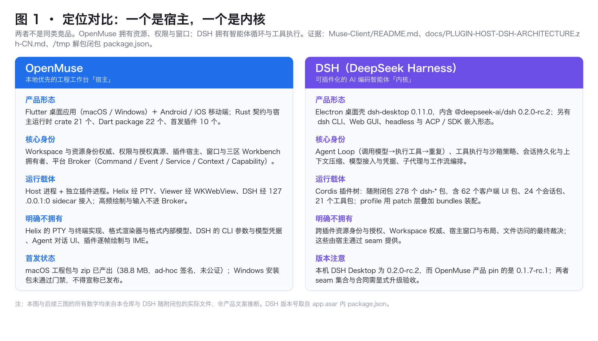
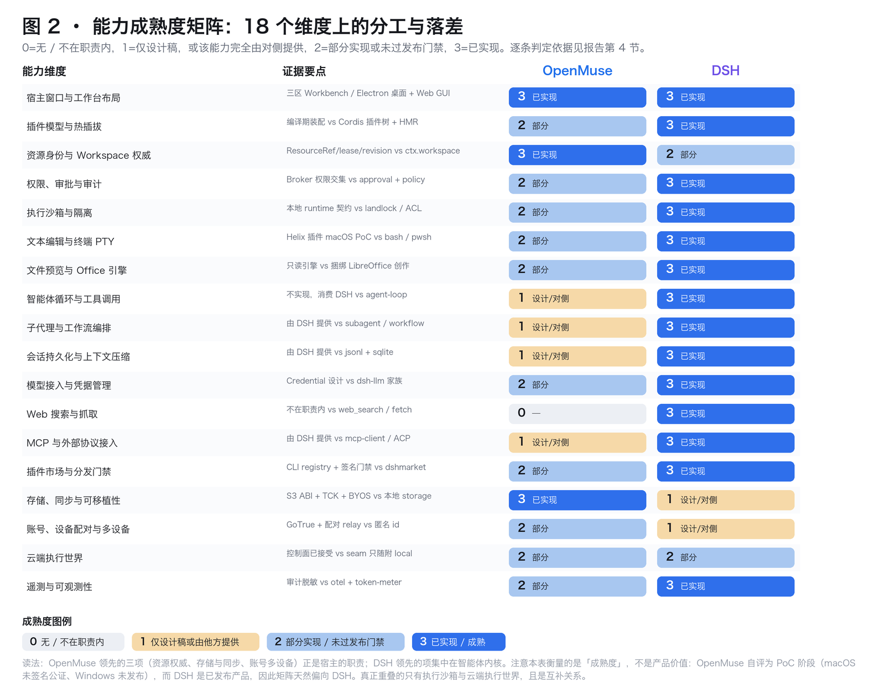
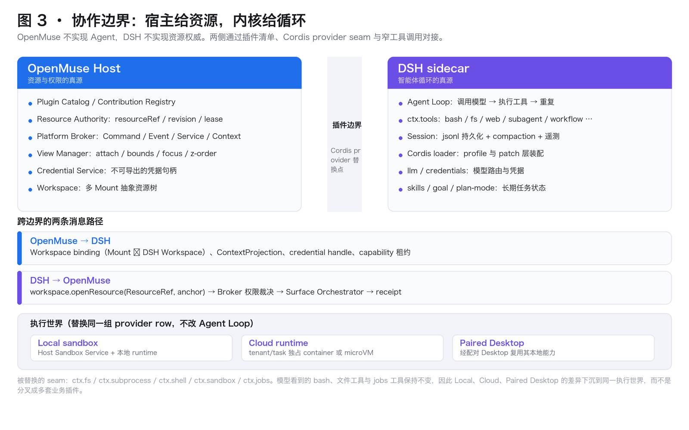
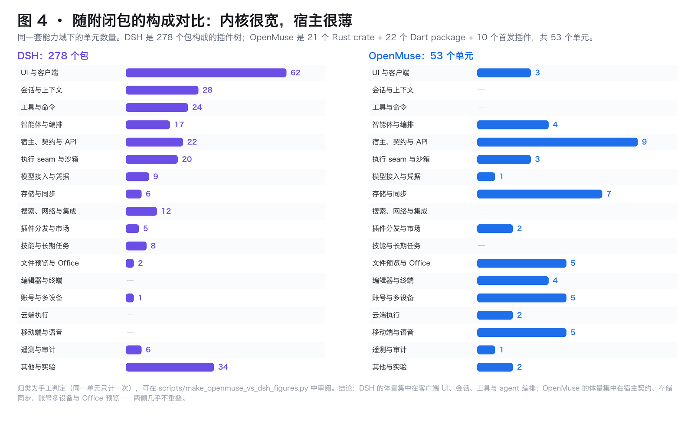

# OpenMuse 与 DSH：一个是宿主，一个是内核

> 用 53 个代码单元和 278 个插件包，做一次不采信产品文案的能力盘点

## 先说结论

把 OpenMuse 和 DSH 放在同一张能力表上比较，会发现它们**几乎不重叠**。

这不是巧合，而是分工：OpenMuse 拥有"Workspace 是什么、谁能装什么、数据放哪、界面怎么呈现"；DSH 拥有"怎么想、怎么调工具、怎么记事件"。

一句话概括：

> **OpenMuse 给资源、权限与窗口；DSH 给循环、工具与会话。**

*图 1 · 定位对比：一个是宿主，一个是内核*

---

## 一、这份盘点是怎么做的

为了避免写成"产品软文"，所有结论都只做一件事：**只读代码与文档取证，每条结论附文件路径**。

证据来自四类：仓库代码（21 个 crate、22 个 package、10 个插件）、仓库里 62 份设计文档、可执行的验证脚本（TCK/门禁），以及 DSH 随附闭包解包后得到的 278 个 `dsh-*` 包。

需要坦白一个重要的取证基线：本报告盘的是**当前工作树**，而不是最后一次提交。盘点时工作树里存在大量未提交改动与新增文件，因此"已实现"的判定以工作树为准。如果以最后一次提交为基线，部分能力会显示为不存在。

评分口径是 0–3 分：

| 分 | 含义 |
|---:|---|
| 0 | 无，或明确不在该方职责内 |
| 1 | 仅设计稿；或该能力完全由对侧提供（是分工选择，不是缺口） |
| 2 | 部分实现，或实现为 reference/in-memory，未过发布门禁 |
| 3 | 已实现且有可执行验收，或已是发布状态 |

### 一个绕不开的前提：DSH 版本三方漂移

| 载体 | DSH 版本 |
|---|---|
| OpenMuse 产品闭包（钉扎） | `0.1.7-rc.1` |
| 本机 DSH Desktop | `0.2.0-rc.2` |
| 本机全局 `dsh` CLI | `0.1.2-rc.1` |

三个版本彼此不同，所以**任何跨版本结论都必须指明取证自哪一个闭包**。

---

## 二、五条核心判断

1. **DSH 是 OpenMuse 的插件，不是依赖库。** 插件清单声明 `runtime: native-process`，以 `dsh web --host 127.0.0.1 --port 0 --no-open` 拉起独立 sidecar。Host 不导入 DSH 的内部状态、数据库或 React UI。
2. **两者的接缝是 Cordis provider seam，不是 API 适配层。** OpenMuse 通过 profile patch 按**相同 row id 重写完整 provider row**（`subprocess` / `sandbox` / `fs-sandbox`），不改 Agent Loop，也不改模型可见的工具集。
3. **OpenMuse 的差异化在宿主侧，且是真实实现而非设计稿**：资源身份与租约、S3 存储 ABI 与 TCK、账号与设备配对、Office 只读引擎。
4. **DSH 的成熟度显著更高**：278 个 `dsh-*` 包构成的插件树、四种表层（web / headless / acp / sdk）、平台级沙箱 runner 与 fail-closed 审批、事件溯源会话、插件市场与客户端 HMR。而 OpenMuse 自评为 PoC 阶段，因此成熟度矩阵天然偏向 DSH。
5. **最大的现实风险是版本漂移。** provider 合同与客户端 slot 合同都是按 `0.1.7-rc.1` 冻结的，对齐新版必须重跑 TCK 与客户端合同。

---

## 三、能力成熟度矩阵

*图 2 · 能力成熟度矩阵（0–3 分口径见上）*

18 个维度的逐条判定：

| # | 维度 | OpenMuse | DSH | 判定依据 |
|---:|---|---:|---:|---|
| 1 | 宿主窗口与工作台布局 | 3 | 3 | OpenMuse 三区 Workbench 已实现；DSH 有 Electron 壳 + 布局与 workbench 插件 |
| 2 | 插件模型与热插拔 | 2 | 3 | OpenMuse 编译期装配；DSH 是 Cordis 全插件树 + 客户端 HMR，启停无需刷新 |
| 3 | 资源身份与 Workspace 权威 | 3 | 2 | OpenMuse 有 `resourceRef`/lease/revision；DSH 只有 `ctx.workspace`，文档明确不让它成为数据权威 |
| 4 | 权限、审批与审计 | 2 | 3 | OpenMuse 权限交集与脱敏已实现但 sink 在内存；DSH 有审批 + 沙箱策略 + 三档预设，fail-closed |
| 5 | 执行沙箱与隔离 | 2 | 3 | OpenMuse 控制面已实现、substrate 在 port 后；DSH 有 bwrap/landlock/Seatbelt/Windows ACL 四类 runner |
| 6 | 文本编辑与终端 PTY | 2 | 3 | OpenMuse Helix 插件 macOS PoC 通过、Windows 未验证；DSH 有持久 shell |
| 7 | 文件预览与 Office 引擎 | 2 | 3 | OpenMuse 自研只读引擎 + 受限导出；DSH 捆绑 LibreOffice + Office skill，可离线创作 |
| 8 | 智能体循环与工具调用 | 1 | 3 | OpenMuse 不实现，消费 DSH |
| 9 | 子代理与工作流编排 | 1 | 3 | 完全由 DSH 提供 |
| 10 | 会话持久化与上下文压缩 | 1 | 3 | 由 DSH 提供：事件溯源追加日志、JSONL+Zstd、SQLite 查询 |
| 11 | 模型接入与凭据管理 | 2 | 3 | OpenMuse Credential Service 仍是设计；DSH 有完整 LLM 家族 + 本地凭据 |
| 12 | Web 搜索与抓取 | 0 | 3 | OpenMuse 明确不在职责内 |
| 13 | MCP 与外部协议接入 | 1 | 3 | 由 DSH 提供：MCP client、ACP、Claude Code / Codex hooks |
| 14 | 插件市场与分发门禁 | 2 | 3 | OpenMuse 有 registry + 分发锁 + SBOM（脚本级） |
| 15 | 存储、同步与可移植性 | 3 | 1 | **OpenMuse 领先**：S3 ABI + TCK + BYOS + 同步 |
| 16 | 账号、设备配对与多设备 | 2 | 1 | **OpenMuse 领先**：GoTrue + 配对密码学 + 移动端 |
| 17 | 云端执行世界 | 2 | 2 | 双方都停在"控制面已接受、substrate 未全量落地" |
| 18 | 遥测与可观测性 | 2 | 3 | OpenMuse 审计脱敏已实现、sink 未持久化；DSH 有 OTel + token meter |

**读法提醒（很重要）**：这张表衡量的是"成熟度"，不是"产品价值"。表中大量 OpenMuse 的 `1` 是**分工选择**（该能力本来就由 DSH 提供），不是缺口；而 `2` 通常意味着"已实现但未过发布门禁"。OpenMuse 自评 PoC、DSH 已发布，矩阵整体偏向 DSH 是预期结果，不应被读成"OpenMuse 更弱"。

---

## 四、协作边界：宿主给资源，内核给循环

*图 3 · 协作边界与执行世界*

### DSH 是怎么被拉起来的

在 `plugins/dsh-agent/lib/src/dsh_sidecar.dart` 中，整个启动链路只有五个动作：

- `resolveDshRuntime()` 从 `Contents/Resources/openmuse/dsh/...` 解析捆绑 CLI 与 Node；
- `dshClosureRoot()` 把 cwd 设为闭包根，使 package-relative 文件可解析；
- `dshLaunchEnvironment()` 把捆绑 Node 目录前置到 PATH；
- `dshWebCommand()` 拼出 `dsh web --host 127.0.0.1 --port 0 --no-open [--patch <openmuse.patch.yml>]`；
- 额外注入 `OPENMUSE_DSH_BRIDGE_TOKEN`（32 字节随机）。

插件权限声明得很克制：`process.sidecar`、`workspace.context.read`、`resource.open.request`、`credentials.model.use`。

### Provider 合同冻结了什么

`contracts/dsh/0.1.7-rc.1.contract.json` 冻结了 6 个 provider row（`subprocess` / `sandbox` / `sandbox-policy` / `bash-sandbox` / `fs-sandbox` / `jobs`）、15 个 requiredPackages，以及 3 个 forbiddenProductionPackages（确保生产闭包不含 E2B）。

最有说服力的一点：local fixture 里的 `cordis.patch.yml` **只重写 provider row，全文不出现 `agent-loop`**。这就是"扩展执行面而不改 Agent"的直接证明。

### 双方都不应越界的领域归属

| 角色 | 负责 | 不负责 |
|---|---|---|
| DSH Agent | 推理、工具调度、事件记录 | 存储协议、版本权威、容器编排 |
| DSH Shell/FS consumers | Bash、PTY、LSP、结构化文件操作 | 决定 Workspace 存在哪里 |
| Workspace Sandbox Runtime（OpenMuse） | hydrate、隔离、进程生命周期、draft、quiescence | 用户/组织领域策略 |
| Workspace Authority（OpenMuse） | Revision、ACL、checkpoint、冲突、审计、分享 | 执行任意进程 |
| Plugin Authority（OpenMuse） | 签名、安装状态、artifact digest、版本选择 | Workspace 内容与 DSH 会话 |

### 双向资源联动的关键约束

**DSH → Host**：对话里的文件链接 → Broker 权限裁决 → 选编辑器 → Host 激活 surface → receipt 返回。

**Host → DSH**：selection/resource changed → Host 生成最小 ContextProjection → 用户显式插入或策略允许的自动投影 → session 记录引用与 revision。

关键约束是：**DSH 不接收任意 path、engine id 或长期 token**；Agent 只能调用窄工具（open/read/propose），写入必须经过 Host 的 proposal/commit 流程。

---

## 五、构成对比：278 个包 vs 53 个单元

*图 4 · 随附闭包按能力域的构成对比*

| 能力域 | DSH 包数 | OpenMuse 单元数 | 说明 |
|---|---:|---:|---|
| UI 与客户端 | 62 | 3 | DSH 是全套 Web 客户端组件 |
| 会话与上下文 | 28 | 0 | 事件溯源、压缩、遥测 |
| 工具与命令 | 24 | 0 | 模型可见工具的注册与实现 |
| 智能体与编排 | 17 | 4 | agent-loop、goal、plan-mode、subagent、workflow |
| 宿主、契约与 API | 22 | 9 | 双方都有；OpenMuse 偏契约与资源权威 |
| 执行 seam 与沙箱 | 20 | 3 | fs/subprocess/shell/terminal/jobs/sandbox 全家 |
| 模型接入与凭据 | 9 | 1 | LLM 家族 vs OpenMuse 的 Credential 设计 |
| 存储与同步 | 6 | 7 | **OpenMuse 领先**：S3 ABI、TCK、BYOS、同步 |
| 搜索、网络与集成 | 12 | 0 | web_search/fetch、MCP、hooks |
| 插件分发与市场 | 5 | 2 | 市场 vs CLI registry + 分发锁 |
| 技能与长期任务 | 8 | 0 | skill、goal、schedule |
| 文件预览与 Office | 2 | 5 | DSH 走捆绑 LibreOffice；OpenMuse 走自研只读引擎 |
| 编辑器与终端 | 0 | 4 | Helix 插件与 CLI 控制台 |
| 账号与多设备 | 1 | 5 | **OpenMuse 领先**：GoTrue、配对、移动端 |
| 移动端与语音 | 0 | 5 | DSH 无移动端 |
| 云端执行 | 0 | 2 | OpenMuse 的 cloud-execution / cloud-resource-authority |
| 遥测与审计 | 6 | 1 | OTel + token-meter vs 审计脱敏 |
| 其他与实验 | 34 | 2 | 基础工具、品牌、平台适配 |

两边的"空白格"很说明问题：DSH 在存储、账号、多设备、移动端是 0～1，OpenMuse 在搜索、会话、工具、技能是 0。这不是谁抄谁的问题，而是各自选定的边界。

---

## 六、真正的重叠只有两处

1. **执行沙箱**：DSH 提供 provider seam 与本地 runner；OpenMuse 提供 lease、隔离 substrate 与 Cloud/Paired 执行世界。二者是"接口与实现"的关系。
2. **云端执行世界**：双方都停在控制面已接受、substrate 未全量落地；OpenMuse 提供 `openmuse-dsh-workspace-runtime` 作为 DSH 的 remote provider 包。

其余全是互补区：**OpenMuse 的资源权威/存储/多设备 ↔ DSH 的循环/工具/会话/模型/搜索**。把这些能力从任一侧搬到另一侧，都会违反已冻结的领域归属。

---

## 七、差异、风险与待办

| # | 事项 | 严重度 | 建议 |
|---:|---|---|---|
| 1 | **DSH 版本三方漂移** | 高 | 对齐新版必须显式审查合同、重跑 provider TCK 与客户端合同 |
| 2 | **Host 直接依赖插件包** | 中 | 架构文档要求 Host 只依赖 SDK + 装配层，实际依赖了 5 个插件包，是真实架构债 |
| 3 | **Windows 未发布** | 高 | HWND 未真机验证、无 PNG/PDF renderer、无安装包 |
| 4 | **macOS 未签名公证** | 中 | 仅 ad-hoc 签名；对外分发前需 Developer ID + 公证 |
| 5 | **生产化 substrate 缺口** | 中 | 审计 sink、sync state store、sandbox/cloud substrate、credential handle 均为内存或 reference |
| 6 | **外部插件不能动态装载 Dart** | 中 | AOT 限制，长期主路径是 External Runtime Plugin |
| 7 | **LSP 不可宣称** | 低 | capability 快照显式记录 `lspAdapterInProductClosure: false` |

---

## 八、选型建议

- **要做"有本地文件、进程与强权限边界的工作台"** → OpenMuse 的定位是对的。资源权威、租约、审计与多设备是它的护城河，继续投入存储同步与移动端收益最高。
- **要做"能跑 agent、能编排子代理与工作流"** → 直接用 DSH，不要自研 Agent Loop。把 DSH 当插件、通过 provider seam 扩展执行面，已经是正确范式。
- **要扩展执行环境（云、远程、配对设备）** → 走 profile patch 重写 provider row，不要改 Agent Loop，也不要把 Bash 塞进 Agent。
- **要对齐 DSH 新版** → 先升合同，再跑 TCK，最后才改客户端 slot。顺序反了会出现"能启动但语义不一致"的隐性故障。

---

## 结语

把两个工程放在一起看，最有价值的不是"谁更强"的结论，而是那条清晰的接缝：**宿主不该替内核思考，内核也不该替宿主决定数据放哪。**

规模差异（53 vs 278）反映的是职责宽度，不是工程水平。真正需要盯住的，是那条会让接缝失稳的变量——版本漂移。

---

*本文基于 OpenMuse `Muse-Client` 仓库现状与 DSH 随附闭包的只读代码取证整理。所有图表均由仓库内脚本按真实字体度量生成并断言无溢出。*
