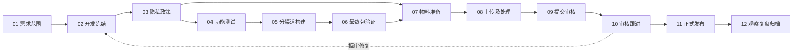

# OpenMuse 上架流水线

这是后续版本的执行入口。每个阶段有独立操作手册、前置条件和 JSON 回执；本次首发归档与可复用流程分开维护。流程规则核对日期：2026-11-04，商店要求在下次提交前重新核对。

## 分阶段执行



| 阶段 | 独立操作手册 | 主要产出 |
| --- | --- | --- |
| 01 | [需求范围](stages/01-scope.zh-CN.md) | 功能、渠道、国家、构建号、验收标准 |
| 02 | [开发冻结](stages/02-development.zh-CN.md) | 变更审查、跨仓库源码与依赖快照 |
| 03 | [隐私政策](stages/03-privacy.zh-CN.md) | 权限/SDK/数据清单、政策与平台申报 |
| 04 | [功能测试](stages/04-tests.zh-CN.md) | 单元测试、真机、多端联动、缺陷回归 |
| 05 | [分渠道构建](stages/05-build.zh-CN.md) | AAB/APK/IPA、备案签名、版本及哈希 |
| 06 | [最终包验证](stages/06-binary.zh-CN.md) | Archive/Release 验收、用途说明、FFI/签名 |
| 07 | [物料准备](stages/07-materials.zh-CN.md) | 图标、截图、指南、文案、审核说明 |
| 08 | [上传及处理](stages/08-upload.zh-CN.md) | 上传与处理回执、商店安装验证 |
| 09 | [提交审核](stages/09-submit.zh-CN.md) | 平台提交 ID、状态、发布模式 |
| 10 | [审核跟进](stages/10-review.zh-CN.md) | 反馈、修复、通过回执 |
| 11 | [正式发布](stages/11-publish.zh-CN.md) | 公开商店链接、地区安装与放量记录 |
| 12 | [观察及归档](stages/12-archive.zh-CN.md) | 监控、复盘、带完整哈希的材料快照 |

## 渠道和配套服务

- [Google Play](channels/google-play.zh-CN.md)
- [Apple App Store](channels/apple.zh-CN.md)
- [macOS：Mac App Store 与官网直发](channels/macos.zh-CN.md)
- [国内 Android 与中国区 iOS](channels/china.zh-CN.md)
- [HarmonyOS](channels/harmony.zh-CN.md)
- [Desktop、Web 与地区服务](channels/desktop-web.zh-CN.md)

## 新建下一次发布

在 Muse-Client 仓库根目录执行。下面版本号和发布 ID 是示例；构建号先检查商店已用值再分配。

```sh
python3 scripts/release/pipeline.py new \
  --run docs/release/runs/next-release \
  --id next-release --version 1.0.1 --lanes play ios-us
python3 scripts/release/pipeline.py plan --run docs/release/runs/next-release
```

生成一个主发布单、12 个独立节点回执和一份归档白名单。按各手册执行，更新对应 `stages/*.json` 的负责人、状态和证据路径。`passed` 必须有负责人及证据；未完成不能统一勾选。

```sh
# 检查文件/哈希/回执结构；此命令不代表全部阶段通过。
python3 scripts/release/pipeline.py check --run docs/release/runs/next-release
# 执行 09 节点前核验全部前置；缺少证据、源码冻结或正式制品时失败。
python3 scripts/release/pipeline.py check --run docs/release/runs/next-release --gate 09-submit
```

`--gate` 校验该节点的全部前置节点已通过，用于实际动作前复核；不会将待执行节点改为通过。人工平台动作完成后再登记该节点结果，不提前标记送审/发布成功。`--metadata-only` 只适合不持有二进制的 CI 记录检查，不能授权提审。

本机也可用独立任务入口（不会自动替你完成整条流水线）：

```sh
make -f scripts/release/release-tasks.mk test-mobile
make -f scripts/release/release-tasks.mk verify-guide
make -f scripts/release/release-tasks.mk build-play RUN=docs/release/runs/next-release VERSION=1.0.1 ANDROID_BUILD=17
make -f scripts/release/release-tasks.mk build-ios-us RUN=docs/release/runs/next-release VERSION=1.0.1 IOS_BUILD=17
```

示例构建号不是可用性承诺，先查商店。构建前提交已复核的源码和前置回执，完成所有 lane 构建后再登记构建结果，避免修改发布单导致第二条 lane 误用脏源码。普通 test 任务不自动把完整真机验收节点标为通过。

构建继续使用阶段 05 中的现有发布脚本。新建的 `.github/workflows/release-pipeline.yml` 分为流程定义、归档与关口边界测试、执行记录三个 Job，负责校验这套流程。持有最终签名制品的本机执行严格关口检查；普通 CI 使用 metadata-only，不将缺少二进制的记录校验解释为提审放行。签名、平台协议和人工审核分别保留为明确节点。

## 归档和复用

参见 [归档规范](ARCHIVE.zh-CN.md)。命令可在提审、拒审、发布等任意时点生成不同名称的快照：

```sh
python3 scripts/release/pipeline.py archive \
  --run docs/release/runs/next-release \
  --output dist/release-archives/next-release/submission-01.zip
python3 scripts/release/pipeline.py verify-archive \
  dist/release-archives/next-release/submission-01.zip
```

本工具仅校验记录与归档完整性；应用测试、隐私结论、平台审核与发布分别由相应节点证明。严格关口不会接受 `historical` 模式的旧单作为新版本放行依据。

## 本次首发实例

[2026 年 11 月海外首发执行记录](../runs/2026-11-overseas/README.zh-CN.md)：Google Play 14、Apple 16 已提交审核的历史记录；保留 iOS14/15 失败经过、源码未冻结及最终分发验收缺项，审核通过/正式上线尚无归档证据。以后复用流程和通用素材，并新建发布单。

[2026 年 11 月国内发布执行记录](../runs/2026-11-china/README.zh-CN.md)：本轮选定华为 Android 与中国区 iOS 1.0.1，保留美区既有审核；生产签名配置已上线，当前仍在正式包和材料前置检查中，尚未上传或送审。

[Mobile 文档依赖隔离版本](../runs/2026-11-mobile-isolation/README.zh-CN.md)：已启动范围与开发阶段，规划 1.0.2；SiYuan 和旧 Office 依赖隔离、SmartDocument 来源审查、最终包检查及升级迁移按独立待办推进。
