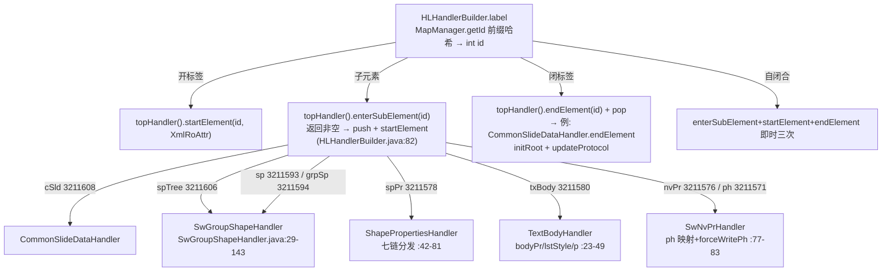
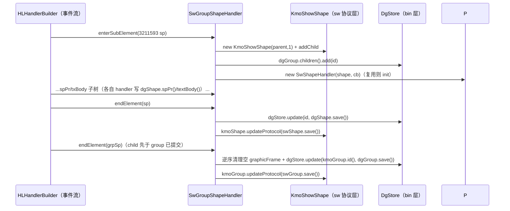
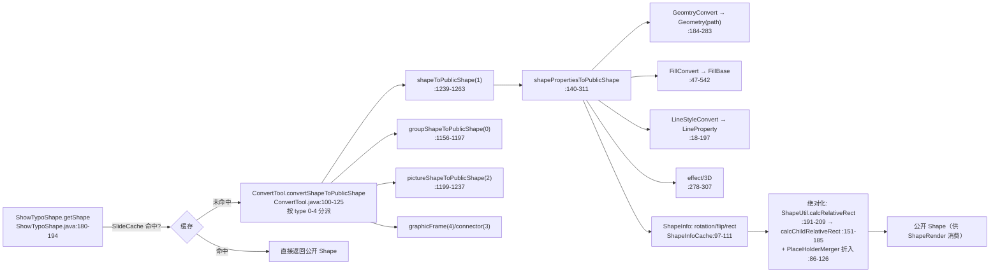
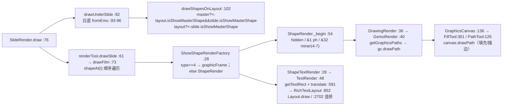
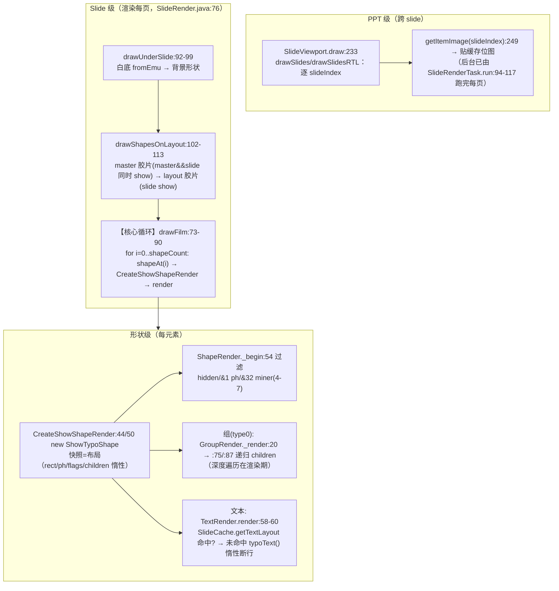
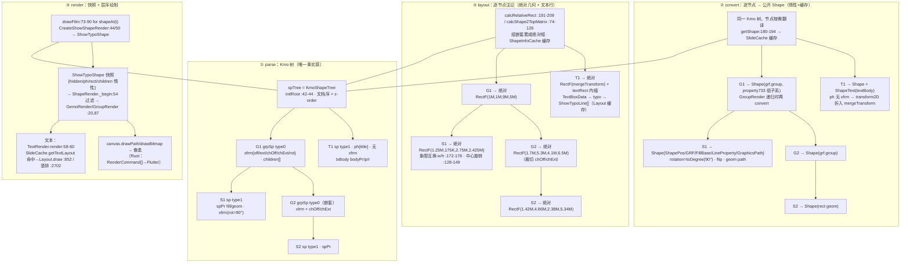

# Java 渲染管线全走查：从解压包到像素上屏

> 依据：koffice 真实源码（文件:行号 锚点，2026-09-03 实测；方法签名/R行号均来自 read/grep）
> 配套：[PIPELINE_OVERVIEW.md](./PIPELINE_OVERVIEW.md)（Rust 现状对比）· [PIPELINE_LAYOUT_RENDER_PLAN.md](./PIPELINE_LAYOUT_RENDER_PLAN.md)（S0–S6 分段）
> 本文是「Java 是怎么把一套 .pptx 变成屏幕上像素的」逐级代码走查；Rust 差异见各节 ★Rust 注记。

## 0. 总旅程（十一段，全部带类与行号）

```mermaid
flowchart LR
    A[".pptx"] --> B["PptxFilter.read<br/>PptxFilter.java:34"]
    B --> C["PptxReader.open<br/>PptxReader.java:56"]
    C --> D["OxfrPackage / OpcrPackage<br/>OpcrPackage.java:40-41<br/>ZipFile 中央目录+根 _rels"]
    D --> E["getPresPart 校验<br/>PptxReader.java:134<br/>FileDamaged/SuffixError"]
    C --> F["PptxrPresentation.open<br/>theme先于presentation.xml<br/>PptxrPresentation.java:57-98"]
    F --> G["onSlideIds→PptxrSlides<br/>PresentationHandler.java:144<br/>PptxrSlides.onSlideIds:226"]
    G --> H["UnReadSlides 阅读顺序 → open 序 master→layout→slide<br/>PptxrSlides.java:103-131"]
    H --> I["PptxrSlide.open<br/>PptxrSlide.java:53-72"]
    I --> J["UnifiedXmlReader→HLXmlReader 事件循环<br/>UnifiedXmlReader:9 · HLHandlerBuilder:37-90"]
    J --> K["handler 树 → Kmo 模型<br/>Slide→cSld→spTree→sp/grpSp→spPr/txBody<br/>SwGroupShapeHandler:29-143 等"]
    K --> L["（渲染时）ConvertTool→公开 Shape<br/>ShowTypoShape.getShape:180-194<br/>ConvertTool.java:100-125"]
    L --> M["ShapeInfoCache / ShapeUtil 绝对几何<br/>ShapeInfoCache:97-111 · ShapeUtil:191-209"]
    M --> N["ShowTextLayout→RichTextLayout.typo<br/>文本行几何"]
    N --> O["SlideRender.draw→drawFilm<br/>SlideRender.java:82-119"]
    O --> P["ShowShapeRenderFactory→ShapeRender<br/>_begin 过滤 → Canvas 绘制"]
    P --> Q["上屏：View/缓存 Bitmap → 像素"]
```

---

## 1. 打开链（解压包 → 编排）

### 1.1 入口：文件被打开

| 文件:行号 | 方法 | 语义 |
|---|---|---|
| `show/PptxFilter.java:34` | `read(KsoDocument, KsoFilterMedium, …)` | `.pptx` 主入口 filter；按 mediumType 建 `PptxReader` 并 `open()` |
| `show/PptFilter.java:34` | `read(...)` | 二进制 `.ppt` 入口；`PptReader.open` 抛 `OOXMLDecryptNotSupportException` 时以 encrypted=true 兜底改走 PptxReader（`PptFilter.java:43-44`） |

★Rust 注记：Rust 侧无 kso filter 层；`PptxReader.rs`（449 行）是编排模板，入口语义待复核。

### 1.2 PptxReader.open —— 顶层编排

`PptxReader.java:56 open()`，整体在 `synchronized(PptxReadWriteLock.sLock)` 内：

| 行 | 步骤 | 要点 |
|---|---|---|
| 61 | `PptxrFileDecrypt.decryptFile(...)` | 仅加密分支：OoxmlDecrypt 循环解到临时文件 |
| 67 | `new OxfrPackage(mRaf/mFilePath)` | **zip 解包入口**（构造即建包）；损坏时 zipFileRepair 修复重开 |
| 83 | `PptxrDocProps.readApp(appProperty, getAppPart())` | app.xml → AppProperty（在中读之前） |
| 85 | `getPresPart(mPackage)` → `PptxReader.java:134` | **校验**：officeDocument==null→`FileDamagedException("Not OOXML file")`；partName 无 `"ppt"`→`SuffixErrorException("Not pptx file")` |
| 86-87 | `new PptxrPresentation(...).open()` | 全局编排（见 1.4） |
| 90 | `readCore(coreProperty, getCorePart())` | core.xml → CoreProperty（在编排返回后） |
| 94-96 | `mOpenListener.docDidFinishReadingEverything()` → `finally close()` | 打开完成事件 + 收尾（`close`:110→`OxfrPackage.close`→`ZipFile.close`） |

### 1.3 解压包本体：ZipFile 中央目录 + part 枚举

| 文件:行号 | 方法 | 语义 |
|---|---|---|
| `kfc/opcr/OpcrPackage.java:40-41` | 构造器 | `new ZipFile(filePath)` + `new OpcrRelationships(mZipFile, "")` |
| `kfc/opcr/OpcrRelationships.java:18` | 构造器（读 `_rels/.rels`） | `OpcUtil.getRelsesName` 定位根 rels → `OxfrPackage.getInputStream` 读流 → `HLXmlReader.parser` 解析；`enterSubElement("Relationship")`（`:71`）逐条建 `OpcrRelationship` |
| `kfc/opcr/OpcrRelationship.java:57` | `getPackagePart()` | 按 Type 分派工厂：APP→OxfrAppPart、CORE→OxfrCorePart、CUSTOM→OxfrCustomPart，其余→OpcrPackagePart |
| `kfc/ooxfr/OxfrPackage.java:25` | `getOfficeDocument()` | 遍历根 mRelses 匹配 officeDocument relationship type 返回其 part |
| `kfc/xpxml/hlxml/HLElementReader.java:38` | `parser(stream, encoding)` | XML 事件循环：按字符扫 `<`，声明/DTD/注释/CDATA 走 filterInvalidLabel（:144），否则 parserElement（:104）或 parserCharacters（:130） |
| `kfc/xpxml/hlxml/HLHandlerBuilder.java:37/82` | `label(...)` / `enterSubElement` | 核心调度：`HLElementType.getType` 判开/闭/自闭合；`MapManager.getId`（前缀哈希→元素 int id）；自闭合即时 startElement+endElement；未知元素 skip（:54） |

**关键设计**：`ZipFile` 只建立**中央目录惰性索引**，entry 按需 `getInputStream` inflate——**不做全量解压**；part 枚举完全依赖 `_rels`（`[Content_Types].xml` 惰性、不参与定位）。

★Rust 注记：Rust 侧 `kfc OxfrPackage.rs`（216 行）+ wps-io OPCPackage ✓；`opc/PptxPackage.rs` 薄桥 ✗。

### 1.4 PptxrPresentation.open —— 打开顺序的"为什么"

`PptxrPresentation.java:57 open()`：

| 行 | 步骤 | 为什么 |
|---|---|---|
| 58-59 | `new PptxrSlides(mPres, presPart.getRelationships(), ...)` + `initialize()` | 建 slides reader（传 presentation.xml 的 rels 作主关系表）+ 静态 `mSlideIdMap` 归零 |
| 77-94 | `openGlobalData()`：**theme 先于 presentation.xml** | **颜色/字体的地基**：slide 的 schemeClr 没有 theme 无法落色；`PptxrThemes.open`→`PptxrTheme.open`（`PptxrPresentation.java:82`：`getInputStream + ThemeHandler + UnifiedXmlReader.read` 读 theme1.xml）→ `mPres.setTheme` |
| 95-98 | 解析 presentation.xml 本体 | `mPresPart.getInputStream()` → `UnifiedXmlReader.read(stream, handler)`；滑片 rId 列表在解析中经 `PresentationHandler` 回调产出 |
| 71-72 | `setInitialized(true)` **先于** `mSlidesReader.open()` | 先声明"打开完成"再真正读 slide（空文档分支 L61-66 建空白 KmoSlide） |
| 73-75 | `openOtherGlobalData` / `delayLoadMedias` / `priorityReadMedia` | 附录项后置 |

**rId 列表回调**（`PresentationHandler.java:144-150`）：`SlideAndMasterIdListHandler.endElement`——`sldIdLst(3211512)` 结束→`handlerCallback.onSlideIds(rids)`；`sldMasterIdLst(3211509)` 结束→`onSlideMasterIds`。转发表：`PresentationHandlerCallbackImpl.java:40` → `PptxrSlides.onSlideIds`。

### 1.5 PptxrSlides —— 建壳与阅读顺序

| 文件:行号 | 方法 | 语义 |
|---|---|---|
| `PptxrSlides.java:226` | `onSlideIds(List<String> rids)` | `createSlideCount = UnReadSlides.getCreateSlideCount(pres, rids.size())`（:545，默认 ≤10，按 actived/thumbnail/history 位移扩大窗口）；**只对前 createSlideCount 个**建 KmoSlide 壳（`setIOReading(true)`）+ PptxrSlide reader；`mSlideIdMap.put(fileName, slide.id())`；未读的 slides 留 `delayCreateSlides`（:183） |
| `PptxrSlides.java:103-131` | `open()` | `UnReadSlides`（布尔位图阅读顺序）：`slides.next(mPres)`（:437）优先 priorityList→activedSlideIndex(±1/±3/±5/±7)→thumbnail→history→顺序兜底；**每个 slide 按 master→layout→slide 顺序 open**（:110-131：`masterReader.open()`→`openLayout()`→`setLayout`→`slideReader.open()`） |
| `PptxrSlide.java:53` | `open()` | themeOverride 先开（:59）；`mPart.getInputStream()`（:69）；`new SlideHandler(mSlide, drawingStore, callback)`（:71）；`UnifiedXmlReader.read(stream, handler)`（:72）；随后 `callback.load()`/`updateFieldText`（:78-79）+ notes/comment/chart/vml/diagram 附属（:80-111） |

**元素 id 是如何变成 int 的**（贯穿全链）：`MapManager.java:29-46` 提供 ns 前缀→`XmlName2Id` 映射（r/a/p/c/dgm/mc/p14…），`HLHandlerBuilder.label` 经前缀哈希取元素 id（如 `spTree=3211606`、`sp=3211593`、`grpSp=3211594`）。

★Rust 注记：`PptxrSlides.rs`/`PptxrSlide.rs`/`PptxrPresentation.rs` 均为 9/2-9/3 **新生成**（1283/560/728 行），未点验；KmoSlide 骨架 547 todo。

---

### 1.6 本节数据模型 ↔ OOXML（打开链的产物与角色）

| OOXML 协议 | Java 数据模型 | 在管线中的位置 |
|---|---|---|
| `p:presentation` 属性（sldSz/photoAlbum/kinsoku/embeddedFont…） | `data.show.Presentation`（协议层）+ `KmoPresentation.slideSize` | ① 结束产物 → pl-01 视口（"页"的尺寸） |
| `sldIdLst / sldMasterIdLst`（rId 列表） | `PresentationHandler` 回调 → `PptxrSlides.onSlideIds:226`（建 KmoSlide 壳） | ①→⑧ 装配输入（哪些页、什么顺序） |
| `ppt/theme/theme1.xml` | `KmoTheme`（ColorMapping/lstStyle/fontScheme）+ `PptxrThemes`（partName 缓存） | ①② 颜色/字体地基（theme 先手） |
| `docProps/app.xml · core.xml` | `AppProperty / CoreProperty` | 打开期元数据（不进渲染链） |
| `p:sld`（part 本身） | `KmoSlide`（KmoSlide.java:53-56：film/presentation/bIOReading） | ① 壳 → 后续 handler 填充树 |

### 1.7 核心模型类快照（详见 §8）

- **KmoPresentation**：全 PPT 根对象（slides/theme/size/打开状态）——"整个 PPT 的对象模型"。
- **KmoSlide / KmoSlideLayout / KmoSlideMaster**：一页及其三层模板，各持一个 `KmoFilm`（`KmoSlide.java:63`）。

## 2. part XML → handler 树 → Kmo 模型

### 2.1 事件→模型的分发骨架

`HLHandlerBuilder.java:76-90`：`subHandler = topHandler().enterSubElement(element)`；非空→`mHandlers.push + startElement`；闭标签→`endElement + pop`；**自闭合**→`enterSubElement+startElement+endElement` 即时三次回调。这就是「元素 id 事件流」驱动整个 handler 树的引擎。

| 文件:行号 | handler | 分发/写入要点 |
|---|---|---|
| `slides/SlideHandler.java` | 根 part handler | startElement 写 Slide 数据；enterSubElement `3211608(cSld)`→CommonSlideDataHandler；另有 Transition/Timing/ColorMapOverride |
| `slides/CommonSlideDataHandler.java:59-62` | cSld 收尾 | **endElement**：`film.spTree().initRoot(this.shapeTree)` + `film.updateProtocol(commonSlideData.save())`；enterSubElement 四派：`3211308(bg)`→BackgroundHandler、`3211519(custDataLst)`、`3211606(spTree)`→**new SwGroupShapeHandler**、`3211607(ctl)`→ControlListHandler |
| `app/shape/KmoShapeTree.java:42-44` | `initRoot` | `this.root = spTree`，替换 KmoFilm 构造时的占位根 |
| `app/slide/KmoSlide.java:79-81` | `updateProtocol(KoBin)` | `SlideAtomData.slide.load(data)`——SlideHandler 产出的属性落 KmoSlide atom |

### 2.2 SwGroupShapeHandler —— 形状树的"双视图"建立

| 文件:行号 | 方法 | 语义 |
|---|---|---|
| `SwGroupShapeHandler.java:29-41` | `init(KmoShowShape)` | 打开同一 spid 的两个视图：`swGroup = ShowShape.open(groupShape.protocol())`（sw 协议层）+ `dgGroup = Shape.open(groupShape.drawingShape())`（DgStore bin 层）；`putType(0)`、`cNvPr.putId(id)` |
| `SwGroupShapeHandler.java:70-123` | `enterSubElement(int)` 分发表 | `3211592(grpSpPr)`→GroupShapePropertiesHandler；`3211593(sp)`→type1 SwShapeHandler；`3211594(grpSp)`→type0 **自递归**；`3211595(graphicFrame)`→type4；`3211469(pic)`→type2；`3211596(cxnSp)`→type3；`3211597(contentPart)`→空 case 跳过；`2162692(AlternateContent)`→SwShapeAlertnateContentHandler |
| `SwGroupShapeHandler.java:129-143` | `endElement(int)` | **逆序**清空 graphicFrame（type4 且 graphic==null）；随后 `dgStore.update(kmoGroup.id(), dgGroup.save())` + `kmoGroup.updateProtocol(swGroup.save())`——XML 嵌套保证 **child 先于 group 提交** |
| `KmoShowShape.java:451-456` | `addChild` | `child.parentGroup=this`、`children.add`、`getDgGroup().add(child.id())`（sw 树 + dg bin 双写入） |

**元素 id 的来历**（`DgStoreData.java:47-49`）：`spid := type<<20 | 仓内下标`——KmoShowShape 的 `type()` 就是 spid 高位（`KmoShowShape.java:544-546`：`queryType` 用 `KcBitsOp(-1048576)` 解出 0-5：0 group/1 shape/2 pic/3 cxn/4 graphicFrame/5 text）。

### 2.3 单形状：nvPr → spPr → txBody

| 文件:行号 | handler | 要点 |
|---|---|---|
| `SwShapeHandler.java:34-48` | init / startElement | 同样开 sw/dg 双视图；`3211581(useBgFill)`→`swShape.putUseBgFill` |
| `SwShapeHandler.java:66-74` | enterSubElement | `3211578(spPr)`→**ShapePropertiesHandler(dgShape.spPr(), cb)**；`3211580(txBody)`→**TextBodyHandler** |
| `SwShapeHandler.java:79-87` | endElement | GVML 时 `onConvertStyle2ShapeProps`+`deleteStyle`；`dgStore.update(id, dgShape.save())` + `kmoShape.updateProtocol(swShape.save())` |
| `nvsppr/cnv/CNvPrHandler.java:19-51` | startElement | `a:id(1114245)/p:id(3211342)`→`callback.onShapeId(tmp, cNvPr.id())` **建立 XML 原始 id→spid 映射**（`HandlerCallbackImpl.java:230-235` shapeIdMap）；name/descr/hidden/title 写入 cNvPr |
| `SwNvPrHandler.java:28-38/40-83` | startElement/enterSubElement | nvPr 元数据：`isPhoto(3211572)`/`userDrawn(3211573)`；媒体五派（1114119-1114123 putMode 0-4）；`3211571(ph)`→`ShowShape.Placeholder` + PlaceholderShapeHandler；**endElement `forceWritePh`**（:77-83） |
| `SwNvPrHandler.java:92-127` | PlaceholderShapeHandler | ph 属性落 placeholder：`idx(3211459, "4294967295"→-1)`、`orient(3211267 经 DGMap)`、`sz(3211569 经 placeholderSizeMap)`、`type(3211302 经 placeholderTypeMap)` |
| `sppr/ShapePropertiesHandler.java:31-40` | startElement | `a:bwMode(1114443)/p:bwMode(3211605)` 经 DGMap.blackWhiteModeMap → `shapePr.putBwMode` |
| `sppr/ShapePropertiesHandler.java:42-81` | enterSubElement **七链分发** | `1114148(ln)`→OutlineHandler；`1114370-1114374+3211586`(noFill/solidFill/gradFill/pattFill/grpFill/blipFill)→FillPropertiesHandler；`1114388/1114390`(effectLst/Dag)→EffectPropertiesHandler；`1114428(custGeom)`→putType(1)+CustomGeometryHandler、`1114429(prstGeom)`→putType(0)+PresetGeometryHandler；`3211589(xfrm)`→Transform2DHandler；`1114144/1114145`(scene3D/sp3d) 延迟 |
| `sppr/ShapePropertiesHandler.java:83-94` | endElement | scene3D/sp3d **仅在出现时** `save()+forceWrite*` |
| `textshape/text/TextBodyHandler.java:23-49` | enterSubElement | txBody 三层：`1114448(bodyPr)`→BodyPropertiesHandler、`1114449(lstStyle)`→TextListStyleHandler、`1114562(p)`→TextParagraph.create()+ParagraphHandler |
| `textshape/text/paragraph/ParagraphHandler.java:29-53` | enterSubElement | `1114193(r)/1114618(br)/1114619(fld)` 统一 TextRun.create() 入 runList→TextRunsHandler；`1114531(pPr)`；`1114532(endParaRPr)` |
| `ParagraphHandler.java:83-138` | TextRunsHandler（run 状态机） | `r→mode(0)`、`br→mode(1)+putLength(1)`、`fld→读 id/type 后 mode(2)`；`1114214(t)` 按 mode 派 RegularTextHandler/FieldTextHandler；`1114603(rPr)` 按 mode 选 run |
| `ParagraphHandler.java:148-151` | RegularTextHandler | `txRun.regularRun().putText(chars) + putLength(chars.length())` |
| `TextBodyHandler.java:51-59` / `ParagraphHandler.java:55-68` | endElement | `textBody.paraLst().forceWrite(paraList)` / `paragraph.textruns().write(runList)`——**段/run 一次性写回** |

### 2.4 双 bin 提交模型（贯穿 2.2/2.3）

每形状结束时写入两份：
- **dg/bin**：`DgStore.update(id, dgShape.save())` → `drawing.data.shape.*`（Shape/CNvPr/ShapePr/TextBody…）落 **DgStore 六仓**（group/shape/pic/cxn/graphic/text）；
- **sw/protocol**：`KmoShowShape.updateProtocol(swShape.save())` → `data.shape.ShowShape`（isPhoto/userDrawn/useBgFill/ph/media…）落 **Kmo 协议层**。

`KoBin/KoIntList/KoZone`（kproto/memor4j）是序列化载体；`Shape.open` 是同一 bin 的独立 KpMap 视图。

★Rust 注记：pp-01/02 的 handler 已函数级对齐（55+35 测试）；Rust 的 `spid=type<<20|下标` 与 shapeIdMap 语义待真实模型接线（G1）。

---

### 2.5 本节数据模型 ↔ OOXML（parse 产物的完整对应）

| OOXML 协议 | Java 数据模型 | 在管线中的位置 |
|---|---|---|
| `p:spTree` | **KmoShapeTree**（root + 有序 children，文档序=z-order） | ② 建树；⑤ 遍历源（drawFilm 消费） |
| `p:sp / grpSp / pic / cxnSp / graphicFrame` | **KmoShowShape**（type 0-4 六合一） | ② 建节点；③④⑤ 全部消费 |
| `p:nvPr / ph`（元数据+占位符） | sw 协议：**ShowShape**（Placeholder/Media/CustDataLst，ShowShape.java:14-16） | ② 写入；③ ph 继承依据 |
| `spPr` 七个子元素（xfrm/fill/ln/geom/effect/3D） | dg 数据：**ShapePr**（ShapePr.java:19-23） | ② 写入；③ convert 输入 |
| `txBody` | **KmoTextBody** → data/text 五模型（TextBody/TextParagraph/TextRun/…） | ② 写入；④ 文本输入 |
| 形状身份（元素 id） | **spid 编码**：`type<<20 | 下标`（DgStoreData:10-11）→ DgStore 六仓 | ② 对象身份贯穿全程 |
| 同一形状的两份存储 | **sw 协议层**（ShowShape.open :42）+ **dg 数据层**（Shape.open）双视图 | ② 提交（DgStore + updateProtocol） |

### 2.6 核心模型类快照（详见 §8）

- **KmoFilm**（KmoFilm.java:24-26：spTree/slideEventListeners/parent）：每页的"胶片容器"，持有该页形状树；
- **KmoShapeTree**（:26-31 root、:42-44 initRoot）：形状树本体；
- **KmoShowShape**（addChild:451-456、type:544-546）：形状原子；
- **ShapePr/Transform2D**：spPr/xfrm 的 dg 数据（Transform2D.java:12-13 extents/point）。
- **DgStore**：spid 分配与六仓存储（type query 见 DgStoreData:19-43）。

## 3. convert 与几何（S1 → 公开 Shape + 绝对 RectF）

> 本段是"布局/渲染的原料工厂"：把解析产物 KmoShowShape **翻译成渲染引擎可画的公开 Shape**（几何 path、
> FillBase、LineProperty、效果、旋转/翻转、绝对位置），并给出**绝对化几何**（group 嵌套累加）。

### 3.1 入口与缓存

| 文件:行号 | 方法 | 语义 |
|---|---|---|
| `show/render/ShowTypoShape.java:180-194` | `getShape()` | **渲染侧入口**：先查 `SlideCache.getShape`（:78 缓存），未命中才 `ConvertTool.convertShapeToPublicShape`（:185）并回填缓存 `addShape`（:83） |
| `show/convert/ConvertTool.java:100-125` | `convertShapeToPublicShape(KmoShowShape, InterpretCtx)` | 按 `drawable.type()` **0-4 分派**：0→groupShapeToPublicShape、1→shapeToPublicShape、2→pictureShapeToPublicShape、3→connectionShapeToPublicShape、4→shapeToGraphicFrameShape；统一 `setShapeID(id)` |

### 3.2 总装配（shapePropertiesToPublicShape，四类共用）

`ConvertTool.java:140-311`：`shapePr → 旋转/flip/property(733) 坐标 → 几何 → 填充(useBgFill/overlay) → 线条 → 效果 → 3D`。

| 行 | 装配项 | 要点 |
|---|---|---|
| 151-177 | xfrm 定位 | `pos.setRotation(ShapeUtil.toDegree(shapeInfo.rotation))`、`grf.setFlipH/V`、`Property(733)=EMU→px 绝对 RectF`、`pos.setShapeRect(coordBounds)`；再 `ShapeUtil.calcRelativeRect` 得 anchor 宽高供几何缩放 |
| 184-236 | 几何(GeomtryConvert) + 填充 | 见 3.3/3.4 |
| 238-245 | useBgFill 传播 | `fillBase.supportUseBgFill()` 时 `setUseBgFill(true)` + 写入 slide 宽高作背景填充尺寸 |
| 260-276 | 线条 | `spPr.ln()`：`fill.type()==5`（线无填充）→ lineProperty=null；否则 `LineStyleConvert` |
| 278-303 | 效果 | effectLst：outerShadow(770)/innerShadow(810)/presetShadow(833)/reflection(752)/glow(731)/softEdge(745)；角度统一 `toDegree` |
| 305-307 / 614 | 3D | `hasShape3D`（:313-325 排除 group/graphicFrame）+ convertSp3d（半径/相机/材质/光照）——MVP 不做 |

### 3.3 几何：preset/custom geometry → path

| 文件:行号 | 方法 | 语义 |
|---|---|---|
| `GeomtryConvert.java:32-36` | `convertDataToPublicShape(PresetGeometry,…)` | stGeom 转出链：`prst() → PresetShapeTypeMap.get → 名字 → ShapeType.getShapeType → type`；type==0（无运行时实现）回退 `Vertices.writeOOXMLGeometryData(名字, geometry)` 由内嵌顶点表生成 path |
| `PresetShapeTypeMap.java:3-5/8-200` | 构造 + `get(int)` | **String[265] 查找表**（LENGTH=265，手工维护约 186 个 stGeom int→OOXML dml 名字，如 1→rect、3→ellipse、226→corner、234→halfFrame）；越界返回空串 |
| `Vertices.java:17-63` | `writeOOXMLGeometryData` | **仅 30 个名字**（snip1Rect…heart）命中才 LittleEndian 解码 pVertices/pSegments + geoCordRight/Bottom 写 geometry；未命中静默返回（几何空） |
| `GeomtryConvert.java:49-55` | `setGemoryAdjust` | prstGeom.hasAvLst→FormulaParser.parseAdjust→`geometry.setGeoAdjust`（公式 parser 供后续复用） |
| `GeomtryConvert.java:58-60/79-115` | `revisePath` | corner/halfFrame 依 property 733 外框重写 vertices 与 geoCordSize（角/半框特例） |
| `GeomtryConvert.java:117-216` | `convertPath` | path 指令→Segment+顶点：type 0 close(96)、1 moveTo(64)+2、2 lnTo(0)+2、3 **arcTo(163)+4**、4 cubicBezTo(32)+6、5 quadBezTo(169)+4；路径级 noFill(170)/noStroke(171)；顶点经 `ShapeUtil.getGdValue` 公式求值 |
| `GeomtryConvert.java:218-283` | `convertDataToPublicShape(CustomGeometry,…)` | `GeometryCache.get(shapeID,w,h)` 先查缓存（:219）；avLst→adjust、gdLst→formula、`setCustGemoRect`（:250）；geoCordSize 取首个 path w/h，0 时回退画布 w/h（:254-262）；segments>50 才入缓存（:277-279） |
| `GeomtryConvert.java:193-195/64-77` | `convertPlaceHolderToPublicShape` / `covertToPublicRectShape` | **缺几何且 placeholder→默认 rect**（shapeTypeMap.get(1)+rect）；背景/表格单元格同走默认矩形 |

### 3.4 填充（FillConvert）

| 文件:行号 | 方法 | 语义 |
|---|---|---|
| `ConvertTool.java:197-214` | fill 来源 | `useBgFill`→父 background.fill() 或 bgRef→theme `fillAt(idx)+withPhColor`；否则 `spPr.fill()`；为 null 时 `getOverlayFill` 兜底（:250-253） |
| `FillConvert.java:47-61/63-85` | `convertToFillBase` | type 分派：**0 solid、2 blip、4 grad、1 pattern**；带 showShape 重载中 type==3（bgFill）回退 `parentGroup.spPr().fill()` 递归（组级 useBgFill） |
| `FillConvert.java:87-97` | `convertToSolidFill` | `ColorInterpreter.getHexRGBAValue(solidColor,ctx)`→SolidFill；alpha<255 换算 transparency |
| `FillConvert.java:99-273` | `convertToBlipFill` | embed/link→`Picture(mediaId)` 或 BlipFill；srcRect 裁剪；rotWithShape 缺省 true；tile/stretch；blip effects：duotone(174-181)/alphaModFix(183-186)/clrChange(188-195)/biLevel(197-203)/灰度(205-207)/亮度对比(209-217)；recolor(221-270) |
| `FillConvert.java:342-405` | `convertToGradFill` | `lin.ang()/60000→角度`（:348，**60000 分之一度→度**）；scaled→fillType 7 else 4；path→6/10/11/4；gsLst→GradStopList(pos+clr+alpha) |
| `FillConvert.java:407-433/435-542` | `convertToPatternFill` | bg/fg 色+透明度；prst→名字→`PatternFillUtil.prstStrMatcheToBitByte`→mediaLib.addMedia(PICTURE)；fillType=1 |

### 3.5 线条（LineStyleConvert）

`LineStyleConvert.java:18-144`：width `fromEmuX` + **min_width=12700EMU(≈1pt) 下限**、≤0.75pt 回退（:19-26）；compound→lineStyle 0-4（:28-45）；lineCap→endCapStyle 0-2（:47-58）；lineJoin.type→joinStyle（:60-71）；fill 分支 solid/pattern/grad/none（:73-96）；presetDash→dashing 0-10（:106-141）。`convetToArrow`（:146-197）：len/width/type→Arrow.setLength/setWidth/setHead（head 0-5）。

### 3.6 绝对几何与矩阵（ShapeUtil + ShapeInfoCache）

| 文件:行号 | 方法 | 语义 |
|---|---|---|
| `ShapeInfoCache.java:97-111` | `shapeInfo(showShape, out)` | transform2D 缓存（MRUIntKeyCache + latest-match 快路径 + ThreadLocal）；未命中 `ShapeInfo.reset`（:18-30：拆成 rotation/transform2DX/DY/DW/DH/isFlipHorz/isFlipVert/canRotate） |
| `KmoShowShape.java:2288-2289` | `transform2D()` | **ph 且无 xfrm 时折入 `PlaceHolderMerger.mergeTransform`**（把 layout/master 的 xfrm 写回自身；:676/722/773/844 另有写回式变体） |
| `ShapeUtil.java:191-209` | `calcRelativeRect(shape, rc, calcSelf)` | 自变换 → 有 parentGroup 则 `calcShape2TopMatrix(parent)` 自顶向下叠矩阵 + `calcChildRelativeRect` 换轴 → **绝对 anchor 矩形** |
| `ShapeUtil.java:74-126` | `calcShape2TopMatrix(shape, matrix, rotate, isText)` | 沿 parentGroup 链收集到顶层（:79-82）后自顶向下：`shapeInfoCache.shapeInfo` 取 transform2D/rotation/flip；`rotate&&canRotate→toDegree`（:101-103）；text 单轴翻转纠正（:108-110）；isParentGroup 时 `calcChildRelativeRect`（:113-115）再 `calcShapeMatrix` 叠加（:117-119） |
| `ShapeUtil.java:128-149` | `calcShapeMatrix(matrix, rcShape, rotation, flipH, flipV)` | **旋转绕自身中心**：preTranslate 到左上→半宽高→preRotate→撤回；flip 同中心 preScale(-1)（:143-147）；此处不求外接框 |
| `ShapeUtil.java:151-185` | `calcChildRelativeRect(group, rcGroup, rcChild, childRotation)` | 减 chOff 偏移 → 按 childExtents/组矩形比缩放（:161-166）→ **childRotation ∈[45,135)∪[225,315) 宽高互换**（:172-178，真代码：`if(...){width*=scaleX;height*=scaleY;}else{width*=scaleY;height*=scaleX;}`） |
| `ShapeUtil.java:223-235` | `calcShapeRect` | `calcShape2TopMatrix(rotate=false)` 后 mapPoints(0,0) 取原点 + mapRadius(w/h) 作 **AABB 近似** |
| `ShapeUtil.java:211-221` | `calcRelativeTextRect` | 文本矩形 = shape 相对矩形原点偏移后的 getTextRect |
| `ShapeUtil.java:457-463` | `toDegree / toRotation` | **EMU 60000 分之一度 ↔ 度**互转（rotation 域内全部经此换算） |

### 3.7 ph 继承（PlaceHolderMerger + ShapePr.follow）

| 文件:行号 | 方法 | 语义 |
|---|---|---|
| `PlaceHolderMerger.java:86-126` | `mergeShapePr(KmoShowShape)` | 自身 spPr→follow(layout spPr)（layout 再 follow(master spPr)）；ph 无 idx 或直属 layout 时只 follow master；非 ph 直接返回自身 |
| `ShapePr.java:360-367` | `follow(ShapePr parent)` | **惰性 follow 链**：只挂 parent 指针；各属性 getter 缺省时惰性 follow 父级——xfrm(:421-423)/geom(:469-471)/fill(:518)/ln(:566)/effect(:614)/scene3D(:662)/sp3d(:710) |
| `KmoShowShape.java:2292-2293` | `shapePr()` | type==4 返回 null；否则 `PlaceHolderMerger.mergeShapePr(this)` |

**为什么**：OOXML 模板在上层（layout/master），slide 形状只留占位符引用——**继承 = 惰性 follow 链**，
属性 getter 级缺省回退，而不是拷贝（省内存、改模板即时生效）。

★Rust 注记：ShapeUtil.rs 热路径已实现（pl-02 18/18 绿，fixture 面）且**象限互换/中心旋转语义已逐行对照**；
`calcShapeMatrix` 等 38 处 DEFERRED；ShapeInfoCache 用直读替代；ph 折入（transform2D 折入 mergeTransform）
与真实 ShapePr.follow 链未复刻（G2 相关门闩）。

### 3.8 本节数据模型 ↔ OOXML（convert 的投影关系）

| OOXML 协议（parse 落库） | convert 后（公开渲染模型） | 说明 |
|---|---|---|
| `spPr/xfrm`（off/ext EMU + rotation/60000 + flip） | `ShapePos/GRF`：rotation（toDegree）、flipH/V、**property(733) 绝对 RectF** | OOXML 相对坐标 → 渲染绝对坐标 |
| `spPr/prstGeom|custGeom` | `Geometry`（GraphicsPath[]：type 0-5 指令、vertices） | stGeom 名 → 预置 path（PresetShapeTypeMap 265 槽） |
| `spPr/fill` 六类（noFill/solid/grad/patt/grp/blip）+ overlay | `FillBase` 族（Solid/Grad/Pattern/BlipFill + Picture） | pattern/blip 经 FilterInterpretCtx 可被过滤 |
| `spPr/ln`（w/cmpd/cap/join/dash/headEnd/tailEnd） | `LineProperty`（width/lineStyle/cap/join/dashing/arrows） | width 下限 12700EMU |
| `spPr/effectLst` | shadow/reflection/glow/softEdge | 角度统一 toDegree |
| `ph` 继承（layout→master） | `PlaceHolderMerger.mergeShapePr:86-126` + `ShapePr.follow:360-367`（惰性链） | 模板复用落地为"惰性父指针" |
| `nvPr/txBody` | `ShapeText`（新 ShapeText(publicShape, textBody)） | 文本随形状一起进渲染 |

### 3.9 核心模型类快照（详见 §8）

- **公开 Shape**（ShapePos/GRF/FillBase/LineProperty/GraphicsPath）：渲染器唯一读取的只读模型；
- **ShapeInfoCache.ShapeInfo**（transform2D/rotation/flip/canRotate，ShapeInfo.java:18-30）：矩阵叠加数据源；
- **ShapeUtil 无状态工具**（calcRelativeRect 族）：绝对几何算法。

## 4. 文本框排版（KmoTextBody → TextBoxData → typo 行几何）

> 本段把 parse 落下的富文本（KmoTextBody）**归一成排版模型**（TextBoxData）并**断出逐行几何**（Layout 行缓存），
> 供 TextRender 逐行绘制。三个子层：`show/layout`（编排与归一）→ `wpslayout BaseTextLayout/RichTextLayout`（断行）→
> `WpsLayout`（Android 风格 layouter）。

### 4.1 入口与 typoRect 来源

| 文件:行号 | 方法 | 语义 |
|---|---|---|
| `show/layout/ShowTextLayout.java:40` | `layout(RectF typoRect, KmoShowShape, KmoContext, boolean forceTypo, IResizeCallback)` | 文本链入口：typoRect 的宽高**直接作为排版框**；`empty` 分支 :43 `boxData.isEmpty()` → return null；:46-51 竖排 + `presetTextWarp!=0` → `canChineseVert`；:56 `textLayout.typo(boxData, typoRect.width(), typoRect.height(), forceTypo)` |
| `show/layout/ShowTextLayout.java:24` | `layout(...)` 重载 | `forceTypo=true` |
| `show/render/util/TextTypo.java:55-70` | `layout(KmoShowShape, ISlide)` | **typoRect 来源**：`calcRelativeRect` 得 shapeRect → `ShapeUtil.calcShapeTextRect(shape,w,h)` 得文本框矩形 → 按 `mLayoutScaleX/Y` 换算 layout 单位 → `ResizeBaseCallback` 携带 shapeRect/typoRect |
| `dataaction/ShapeDataTransform.java:17-38` | `getTextOperator` | **empty 判定点**：`shape.hasTextBody()` 才取 textOperator；否则仅 `ph.type()==15` 时取；`DataTransform.convertToBoxData:84` 见 null 直接跳过建段 |

### 4.2 归一：exToInternal → TextBoxData

| 文件:行号 | 方法 | 语义 |
|---|---|---|
| `dataaction/DataTransform.java:72-81` | `final TextBoxData exToInternal(T shp, KmoContext ctx)` | 从 `LayoutSharedObjects.showTextDataPool` **对象池借** TextBoxData，`setHolder`（ShapeDataTransform:13 挂 ShapeHolder），再 `convertToBoxData` 归一 KmoTextBody；无文本体返回空 |
| `DataTransform.java:83-198` | `convertToBoxData` | **段级主循环**（`do…while textOp.next(0,false)`，:95-195）：每段一 TextData，读 TextParagraphProperties（对齐/缩进/间距/行距/断行选项；`mIsWrapText` 取 `textBoxData.isWrapTextInShape()` :163）+ `fetchSpanInfo` 的 run 几何；段收尾 `mPara.start=firstspan.mStartPos`(:187)、`adjustPos`(:188)、`addTextData`(:189)；空文本段用 textLength 修正(:190-192) |
| `DataTransform.java:756-869` | `fetchSpanInfo` | **run/span 产出**：遍历 `textOp.range(1)/text(1)/format(1,true)` 每个 run，**按字体族 char 级切分**（多字体 :789-834），`setSpanInfo`（:291-722）填充 SpanInfo（mFontName/mFontSize/mFontColor/粗斜/下划线/阴影/填充…），拼接 mSourceText；首 span 提升 mFirstSpan(:861-864) |
| `TextBoxData.java:607-644` | `processBeforeTypo(boolean)` | 排版前归一：建 SubParaSet 段索引(:610-612)；可选按 `\r\n` 再拆段(:614-621)；`mTypoText=mSourceText`(:628)、Thai 占位、**去尾空格**、mergeSpan 合并相邻样式、`Bidi.requiresBidi` 判定(:635-640) |

### 4.3 autofit / anchor / wrap 判定（归一时的框属性）

| 文件:行号 | 判定点 |
|---|---|
| `DataTransform.java:223-224` | `textWrappingType==0` → `setWrapTextInShape(false)`（**wrap**） |
| `DataTransform.java:227-232` | 默认 insets **EMU 91440/45720**（**insets** 基值） |
| `DataTransform.java:234-244` | `hasTextAutofit` → `setTextAutoFit(autofit.type())`、fontScale、lnSpcReduction（**autofit**） |
| `DataTransform.java:254-264` | `anchor→setAnchor`、`anchorCenter`、`verticalText()`（**垂直对齐/竖排**）；四边 inset EMU→layout 单位(:266-280) |
| `ShapeDataTransform.java:40-51` | **oldAutoFit/oldAnchor 原始值保留**（getOriginalAutoFit/getOriginalAnchor → resetOriginalProperty）——autofit 后回写与 resize 判定依据 |

### 4.4 断行：BaseTextLayout → RichTextLayout → WpsLayout

| 文件:行号 | 方法 | 语义 |
|---|---|---|
| `wpslayout/.../typo/BaseTextLayout.java:71-85` | `typo(TextBoxData, w, h, forceTypo)` | 排版统一入口：竖排 swap width/height(:75-79)、`mTypoRect.set(0,0,w,h)`(:81)、`setTextRect` 内缩(:82)、`doTypo`(:83)；空 TextBoxData 直接跳过(:72) |
| `BaseTextLayout.java:87-138` | `setTextRect(textBoxData, w, h)` | **insets 内缩公式**：correctInset 后 left=0+leftInset、right=width-rightInset、top=topInset、bottom=height-bottomInset(:89-111)；**单边越界 50% 衰减回退**（left>width 或 right<0 时 atten=(差值)/2 平移 :113-135） |
| `RichTextLayout.java:78-91` | `typo(...)` | super.typo 完成排版后按 `presetTextWarp` 建 ArtTransform、`checkWordArt` 二次变形(:80-89) |
| `RichTextLayout.java:93-120` | `correctInset` | 竖排按旋转角(90/270)交换 left/right/top/bottom inset（文本轴跟随） |
| `RichTextLayout.java:122-284` | `doTypo(TextBoxData, forceTypo)` | **排版主流程**：竖排 bullet 标记(:126-131)；normAutofit 预缩放(:133-139)；**段落主循环 :149-227 每段 typoOnePara(i)**；isAutoHeight 超高处理与 `...` 截断(:153-223)；forceTypo + autofit==2 且超出 mTextRect 容差 → `IResizeCallback.resize` 回写 + mTypoState=2(:229-241)；最后 getTextHeight/Width → `setTextRect(:257-260)`、`holder.setTextRect` 回写 shape(:261-277)、updateAuotfit 定 mTypoState 1/3(:279-282) |
| `RichTextLayout.java:528-657` | `typoOnePara(paraIndex, TextBoxData)` | 单段：bullet 宽高(:551-556)、首行/续行缩进 firstLead/restLead(:566-604)、`mTypoLayoutGen.getLayout(...)`(:606) 生成 Layout；产出 `mTypoCaches/List<Layout>`、`mTypoOffsets/段起点`、`mParaBottoms/段底 y`(:649-652)、`mSingleLineParaWidths`(:610) |
| `TypoLayoutGen.java:54-75` | `getLayout(rect, textPaint, data, firstLead, restLead, maxWidth)` | 断行前准备：非富文本 mTypoText；富文本 createSpannable 把 SpanInfo→CharacterStyle(:56-67)；**宽度来源 rectWidth = isAutoAdjustSize?maxWidth:rect.width()**(:72) |
| `TypoLayoutGen.java:82-100` | `createTextLayout(...)` | `layoutWidth==Float.MAX_VALUE`（自动宽）→ `textPaint.measureText` 实量(:84-87)；`new WpsLayout(...)` 进 Android 风格断行(:94) |
| `wpslayout/.../layouter/WpsLayout.java:312+` | `generate(...)` | **断行主循环**：`indexOfNewline` 定段界(:346-352)、firstWidth=outerWidth-getLeadMargin(0)/restWidth=...getLeadMargin(1)(:355-356)、`MeasuredText.setPara` 取逐字符宽度(:357)、逐 span addStyleRun 得字体度量(:388/394)、**逐字符累宽并按断字符/标点 isBreak(BREAK_PUNCTUATIONS) 折行**、tab 按 mDefTabSize(:407-421)。字体度量 = TextPaint + `TypoLayoutGen.java:538 FontHost.getFontTable()` + PaintFontHelper |
| `RichTextLayout.java:2630-2641` | `setTextRect(width, height)` | 最终文本框几何：isAutoWidth 取 mTextPos，否则 (left,top,left+width,top+height)；渲染/命中均以此为准 |

### 4.5 结果回写 shape

`ShapeDataTransform.java:62-95 ShapeHolder implements IHolder`：`setTextRect` 把 layout 单位经 `UnitsConverter.doc()↔layout()` 换算成 **doc 单位**写回 `KmoShowShape.setTextRect`（:69）；autofit 缩放走 `setFontScale(fontScale, lnSpcReduction)`（:88）。`IShowTextLayout` 门面 = `ShowRichTextLayout`（extends RichTextLayout；renderText:19 / renderBullet:23-27）。

★Rust 注记：Rust 侧 `GreedyWrap.rs`/`TextBoxGeometry.rs` 是 **MVP 贪心断行**（16/16 绿），
**刻意不做** Java `WpsLayout`（bidi/悬挂标点/autofit 连锁）——wpslayout Rust 侧 3352 个 todo! 未冒充；
`DataTransform.rs` 主链对齐但 2 处活路径 panic 待修（pl-04）。

### 4.6 本节数据模型 ↔ OOXML（文本的排版投影）

| OOXML 协议（KmoTextBody 承载） | 排版模型（导入时构造） | 说明 |
|---|---|---|
| `txBody/bodyPr`（marL/R/T/B、anchor、wrap、autofit、scene3D…） | `TextBoxData`（insets/anchor/anchorCenter/verticalText/textAutofit/presetTextWarp/isWrapTextInShape） | exToInternal 归一：DataTransform:223-282 |
| `txBody/p`（段落） | `TextData`（mSourceText/mTypoText/mPara/mFirstSpan/mOtherSpans+mBidi+mVertical） | 每段一个 |
| `txBody/p/pPr` | `ParaInfo`（对齐/缩进/间距/行距/制表位/firstLead/restLead） | 段属性 |
| `txBody/p/r + rPr`（run 富文本属性） | `SpanInfo`（mFontName/mFontSize/mFontColor/粗斜/下划线/阴影/填充…） | **按字体族 char 级切分**（fetchSpanInfo:789-834） |
| （无 OOXML 对应） | `Layout` 行缓存（WpsLayout，每段一个）+ mTypoOffsets/mParaBottoms | 断行结果，供 TextRender 逐行画 |

### 4.7 核心模型类快照（详见 §8）

- **TextBoxData / TextData / ParaInfo / SpanInfo**（wpslayout data 包）：排版引擎的**输入契约**；
- **mTypoCaches（List<Layout>）**：断行输出（行几何）。

## 5. 渲染链（SlideRender 三层胶片 → ShapeRender/TextRender → Canvas）

> 本段回答"按什么顺序、过滤什么、怎么把公开 Shape 变成 canvas 原语"。绘制器在 `show/render` +
> `show/moffice/drawing/{render,graphics}`（后一个才是真正的 canvas 调用户）。

### 5.1 入口与三层胶片

| 文件:行号 | 方法 | 语义 |
|---|---|---|
| `show/render/SlideRender.java:76-90` | `draw(Canvas, KmoSlide)` | 入口：`!isPartChange()` 时先 `drawUnderSlide` 画背景胶片，再 `mSlideContext.reset(slide, slideDrawFlags)` 并用 `renderTool.drawSlide` 画本页胶片（:86）；`renderTool` 是 SlideRenderBase 的 protected 字段（`SlideRenderBase.java:12`，类型 `util.SlideRenderTool`） |
| `SlideRender.java:92-99` | `drawUnderSlide` | `UnitsConverter.render().fromEmuX/Y(slide.slideWidth/Height)` 换算像素（:93-94）→ `drawSlideWhiteBackground`（:96）→ `mSlideContext.reset` + `drawBackgroundShape`（:98）→ `drawShapesOnLayout`（:99） |
| `SlideRender.java:102-113` | `drawShapesOnLayout` | **master 胶片条件**（:104-108）：`layout.isShowMasterShape() && slide.isShowMasterShape()` → 以 followerDrawFlags 画 master film；**layout 胶片条件**（:110-113）：`slide.isShowMasterShape()` → 画 layout film。三层=白底/背景层 → layout/master 层 → slide 主层 |
| `util/SlideRenderTool.java:37-39` | `drawSlideWhiteBackground` | `canvas.drawRect(0,0,width,height,WHITE_PAINT)`（static 白 Paint） |
| `SlideRenderTool.java:41-53` | `drawBackgroundShape` | `slideContext.mSlide.background()`；borrow 池（typoBackground/shapeEnv/backgroundRender）→ `BackgroundShapeRender.render` |
| `SlideRenderTool.java:61-90` | `drawSlide` → `drawFilm` | `spTree().shapeCount()`；`start = isPartChange()?mChangeIndex:0`；**for i 顺序** `CreateShowShapeRender(shapeTree.shapeAt(i), ...)` + `shapeRender.render(canvas)`（:80-86，GlCache 开关包裹） |

### 5.2 形状渲染器分派

| 文件:行号 | 方法 | 语义 |
|---|---|---|
| `render/util/ShowShapeRenderFactory.java:28-39` | `CreateShowShapeRender` | `typoShape.type()==4` → `CreateGraphicFrameRender`（type 0=Chart/1=Table/2=SmartArt/3=Ole/4=Model3D，:58-76）；default → `new ShapeRender(shapeEnv, typoShape, drawFlags)`（:81-83） |
| `render/ShapeRender.java:54-63` | `_begin()` **过滤** | ① `isHidden()`→false（:55-56）；② `drawFlags&1(NOT_DRAW_PLACEHOLDER)` 且 isPlaceholder→false（:57）；③ `drawFlags&32(NOT_DRAW_PLACEHOLDER_MINOR)` 且 `isMinerPlaceHolder(placeholderType 4/5/6/7)`→false（:59）；④ 模块化默认图条件（:62） |
| `render/ShapeRender.java:99-105` | `_render()` | `DrawingRender.render((ITypoShape)mTypoShape)` 交付 fill/line/geom（:104）；`drawFlags&4(DRAW_PLACEHOLDER_DASH_FRAME)` 且占位符无线属性 → 虚线框装饰（:108-117，`canvas.drawLine` :197-200 / `drawRect` :245/282） |
| `show/moffice/drawing/render/DrawingRender.java:36-51` | `render(ITypoShape)` | renderMode==2 仅文字、==1 仅 shape、默认 shape.render+renderText+renderDecor；`shape.render` 即 ShowTypoShape.render |
| `show/render/ShowTypoShape.java:96-105` | `render(ShapeEnv)` | type==4 → factory 分支；否则 `moffice ShapeRenderFactory.createShapeRender(shape).render(env, this)` |
| `moffice/drawing/render/ShapeRenderFactory.java:8-39` | `createShapeRender(Shape)` | grf.isGroup→GroupRender；isArtText→WordArtRender；isChartShape→ChartRender；shapeType 202/203→GemoRender/GroupRender；default→**GemoRender** |
| `moffice/drawing/render/GemoRender.java:40-53` | `_render` | 三级：drawDiagram(bitmap)/drawInk/drawShape；`drawShape`（:161-173）→ drawFill+drawStroke |

### 5.3 真正的 canvas 原语（fill/line/path）

| 文件:行号 | 方法 | 语义 |
|---|---|---|
| `GemoRender.java:232-272` | `drawFill` | `shape.getGraphicsPaths(w,h)` 取**预置几何 GraphicsPath[]**（:236，来自 convert 层的 Geometry）；逐 path `needFill`：`FillBase`→`gc.setFill(fill)` + `gc.drawPath(path, rotation, rectF)`（:312-317） |
| `GemoRender.java:274-296` | `drawStroke` | 逐 `needStroke` path：`LineProperty`→`gc.setStroke` + `gc.drawPath`（:287-289） |
| `moffice/drawing/graphics/GraphicsCanvas.java:136-155` | `drawPath` | `pathTool.tranPath` 转换到 Path → `draw()`（:153） |
| `GraphicsCanvas.java:116-120` | `draw(Path, RectF, int)` | `fillTool.fill(path, rectF, fillType)` → **`GraphicsFillTool.java:301 canvas.drawPath(path, fillPaint)`**（填充原语；`canvas.drawColor(-1)` :238；渐变 `drawRect` :924）；随后 `pathTool.draw(path, rectF)` → **`GraphicsPathTool.java:126 canvas.drawPath`**（描边原语；箭头 :199） |

### 5.4 文本绘制（typo 行 → canvas）

| 文件:行号 | 方法 | 语义 |
|---|---|---|
| `render/ShapeTextRender.java:28-78` | `_render(ITypoShape)` | 过滤：`DrawFlags.drawPHolderText(mDrawFlags)||!isPlaceHolder`（:32，`drawPHolderText=(drawFlags&16)==0`）；`flipH^flipV` 时 `canvas.scale(-1,1,center)` 镜像（:48-53）；`renderModel.getTextRect(w,h)` 得 rcTxt（:54）→ `mTextRender.render`（:62/:68） |
| `render/TextRender.java:48-105` | `render(Canvas, rcShape, typoRect, typoShape, shapeText, drawFlags)` | `canvas.scale(UnitsConverter.layoutRenderScaleX/Y)`（:68）+ rotateCanvas（:69）；有字且非 drawLayout → `drawBullets + drawText(canvas, textLayout, mTypoRect)`（:75） |
| `TextRender.java:591-596` | `drawText(...)` | `canvas.translate(typoRect.left, top)` → `textLayout.renderText(canvas)`（:594）；局部渲染版 :598-603（首/末段偏移+TimingInfo） |
| `wpslayout/.../typo/layout/ShowRichTextLayout.java:19-21` | `renderText(Canvas,...)` | 委托 `RichTextLayout.renderText` |
| `wpslayout/.../typo/RichTextLayout.java:748-884` | `renderText(...)` | `clipRect` 裁剪（:776）；逐段落 `canvas.translate(tx,ty)` + `((Layout)mTypoCaches.get(i)).draw(canvas,null,null,0)`（:851-852，**android.text.Layout 逐 run 框架内 drawText**）；竖排逐字 `canvas.drawText` :2702/2705（drawChineseVertText :2643-2712） |

**DrawFlags 位语义**（`show/util/DrawFlags.java:4-29`）：`1=NOT_DRAW_PLACEHOLDER`、`32=NOT_DRAW_PLACEHOLDER_MINOR`（type 4/5/6/7）、`16=NOT_DRAW_PLACEHOLDER_TEXT`、`4=DRAW_PLACEHOLDER_DASH_FRAME`、`2097152=DRAW_PIC_PLACEHOLDER_ICON`、`16777216=NOT_DRAW_MODULAR_GROUP_PIC_PLACEHOLDER`。

★Rust 注记：pr-01 `begin_filter` 已接线（消费 ShowTypoShape 过滤）；pr-02/03（RenderCommand 指令化）spec；
Rust 内核不移植 `android.text.Layout`/Canvas——以 DrawRect/DrawPath/DrawText 指令 + Flutter 消费（对齐 writer）。

### 5.5 遍历起点与顺序（树的三个层次 + 顺序规则）

> PPT **没有独立的 layout pass**：元素树（`KmoShapeTree`：root KmoShowShape + 有序 children，**文档序 = z-order**）
> 的遍历分三个层次，layout 散落在"每形状快照 + 文本惰性 typo"上，深度递归发生在渲染期。

**树的生产链路（parse 期）**：`SwGroupShapeHandler` 分发建节点（`KmoShowShape.addChild:451-456`：parentGroup + children +
dgGroup 双写）→ 每页收尾 `CommonSlideDataHandler.endElement:59-62` → `KmoShapeTree.initRoot:42-44` 替换根
（`KmoShapeTree.java:26-31` 构造时预建占位根）。渲染/布局用 `shapeTree.shapeCount()/shapeAt(i)` 按 root children 顺序迭代。

| 层 | 遍历起点 | 顺序 | 依据（文件:行号） |
|---|---|---|---|
| **PPT 级**（跨 slide） | `SlideViewport.draw` → `drawSlides/drawSlidesRTL` 逐 slideIndex | 视图层逐页；每页取缓存位图贴图，后台已由 `SlideRenderTask` 跑完 | `SlideViewport.java:233/249-268`、`SlideListAdapter.getItemImage:98` |
| **Slide 级**（每页） | `SlideRender.draw(canvas, KmoSlide)` → `drawUnderSlide`（白底 fromEmu :93-96 + 背景形状 :98）→ `drawShapesOnLayout`（**master 胶片** :104-108 条件 `layout.isShowMasterShape && slide.isShowMasterShape`、**layout 胶片** :110-113 条件 `slide.isShowMasterShape`）→ 本页 `drawFilm` | **白底/背景 → master 胶片 → layout 胶片 → slide 主胶片** | `SlideRender.java:76-113` |
| **形状级**（页内） | 【核心循环】`SlideRenderTool.drawFilm:73-90`：`for (i=start; i<shapeCount; i++) shapeAt(i) → CreateShowShapeRender → render` | **spTree 文档序 = z-order（先=底、后=顶，后画盖先）** | `SlideRenderTool.java:73-90`（start = partChange?mChangeIndex:0） |
| **组内**（深度） | `ShowShapeRenderFactory` type==0 → GroupRender | 组整体占父层一个 z 位，组内按自身 children 序**渲染期递归**（`GroupRender._render:20` → `:75/:87 childShape.render(env)`）；ShowTypoShape 的 children/getChild 惰性缓存 | `ShowShapeRenderFactory.java:28-83`、`GroupRender.java:20-87` |
| **每形状内部** | `CreateShowShapeRender:44/50` 的 `new ShowTypoShape(...)`（快照=布局：rect/ph/flags/children）→ `ShapeRender._begin:54` 过滤 → 绘制；文本 typo 在 `TextRender.render:58-60`（`SlideCache.getTextLayout` 命中？未命中 `typoText()` 惰性断行） | 快照 → 过滤 → 绘制（文本按需排） | `ShowShapeRenderFactory.java:44/50`、`TextRender.java:48-60` |

**顺序规则一句话**：跨页逐 slideIndex；页内"白底/背景 → master → layout → slide"三层胶片；页内元素按
**spTree 文档序（z-order 底→顶）**逐个"快照布局 → 过滤 → 绘制"；组在父层占一个 z 位、组内递归；
文本 typo 挂在渲染循环的 cache-miss 点上（无独立 layout pass）。

★Rust 注记：页循环 = pr-01（`drawFilm`/`begin_filter` **已接线**）；Rust 侧整条遍历的 demo 驱动 =
`pptx_mvp.rs`（925 行，zip→handler→layout_shape 树→pl→pr-01）；树本体在 Rust 侧为 `layout_shape.rs`
fixture（真实 `app/shape` 桩未接 = 门闩 G1），遍历目前跑在 fixture 树上。

### 5.6 同一棵树在 parse / convert / layout / render 四阶段的形态变化

> **树只有一个**（parse 建的 KmoShapeTree，唯一事实源），后三个阶段不重建树，而是**逐节点挂"视图/注记"**：
> convert 挂"渲染 Shape"、layout 挂"绝对几何与文本行"、render 挂"快照+层序"。下面的例子沿用
> PIPELINE_OVERVIEW 附录 A 的树（G1 组 → {S1 90°、G2 → S2}、T1 title ph）。

| 阶段 | 树的形态（节点承载） | 触发时机 | 树是否重建 | 关键输出/缓存 |
|---|---|---|---|---|
| ① parse | KmoShowShape 六合一（type/xfrm/spPr/txBody/ph/父子）+ sw 协议 + dg bin | 文件打开时逐 part 建树 | **建树** | KmoShapeTree（唯一事实源）；DgStore |
| ② convert | 节点 → 公开 Shape（Geometry/Fill/Line/ShapeText） | **惰性**（`getShape:180-194`） | 否（挂视图） | SlideCache（shape 缓存） |
| ③ layout | 节点 + 绝对 RectF + ph 合并样式 + TextBoxData/ShowTypoLine[] | 惰性（快照时/`TextRender:58-60` cache-miss） | 否（挂注记） | ShapeInfoCache / ShapeTextLayoutCache / Layout 行缓存 |
| ④ render | 节点 → ShowTypoShape 快照（hidden/ph/rect/children） | 每帧每页 `drawFilm` | 否（只读快照） | canvas 原语 /（Rust）RenderCommand[] |

**一句话**：一棵树四形态——parse **建**、convert **视图化**、layout **注记化**、render **快照化+排序绘制**；
始终不重建树，节点越走"越薄"（从六合一原子 → 渲染所需的最小只读快照）。

### 5.7 本节数据模型 ↔ OOXML（渲染期的投影与协议决定的层序）

| OOXML 协议 | 渲染期模型 | 在管线中的位置 |
|---|---|---|
| `p:spTree`（master/layout/slide 三个 part 各一棵树） | 三层胶片 = **协议决定的层叠**：master 树 → layout 树 → slide 树（`isShowMasterShape` 开关 → data.slides.Slide 的 showMasterSp/showMasterPhAnim，SlideHandler 写入） | ⑤ 层序 |
| 单形状（KmoShowShape） | **ShowTypoShape 快照**（isHidden/isPlaceholder/placeholderType/getShapeRect/children 惰性） | ⑤ 过滤 + 绘制输入（说明：快照是 convert+layout 的只读投影，OOXML 无直接对应） |
| （无对应：平台语义） | `DrawFlags` 位掩码（1/4/16/32/2097152/16777216） | 场景过滤（read/thumb 各取位组合） |
| （无对应：平台语义） | `SlideRenderContext`（mSlide/mDrawFlags/mChangeIndex + isPartChange 部分重绘） | ⑤ 状态 |
| （无对应：平台绘制目标） | `GraphicsCanvas`（fillTool+pathTool → canvas.drawPath） | ⑤ 原语出口 |

### 5.8 核心模型类快照（详见 §8）

- **ShowTypoShape**（ShowTypoShape.java:28-55）：渲染最小只读快照；
- **ShowShapeEnv/DrawFlags**：环境与场景位。

## 6. 上屏（两条路径：屏幕直绘 + 后台缓存贴图）

> 真机"像素上屏"有两条路径，都在本仓库（core + `presentation/ppt-sdk` 独立 UI 模块）：

### 6.1 路径 A：屏幕直绘（真机屏幕 Canvas → SlideRender.draw）

| 文件:行号 | 方法 | 语义 |
|---|---|---|
| `core/.../uil/read/slidelayer/ScrollbarUil.java:412` | `DragPreview.onDraw(Canvas)` | DragPreview extends View（PopupWindow 内容视图，滚动条拖拽预览）：drawBackground + **drawSlide** + drawBorder + 页码 |
| `ScrollbarUil.java:432/438` | `drawSlide(Canvas)` | **软件画布且 !isIOReading** → `this.getRender().draw(canvas, slide)`（:438，**屏幕 Canvas 直绘**）；硬件加速或 IO 未读完 → 贴缓存位图 :441-443 |
| `ScrollbarUil.java:497` | `getRender()` | `SlideRender.getOrAllocThumbSlideRender()`（直绘实例，不走任务池） |
| `render/SlideRender.java:117→76→86` | `draw(Canvas, ISlide)` → `draw(Canvas, KmoSlide)` → `renderTool.drawSlide` | 内核矢量绘制直接落到屏幕 Canvas |

另：`show/util/ShapeUtil.java:906-925` `slideSnapshot`（`Bitmap.createBitmap + new Canvas` 同步快照，裁剪/导出用）与 `show/print/ShowPrintTask.java:31`（打印直绘）为离屏变体。

### 6.2 路径 B：后台缓存 → 上屏贴图（主路径）

| 文件:行号 | 方法 | 语义 |
|---|---|---|
| `ppt-sdk/.../shell/view/SlideListView.java:425-437` | `onDraw(Canvas)` | 主视图（`extends View implements SlideView`, :48）→ `mViewport.draw(canvas)` |
| `ppt-sdk/.../shell/viewport/SlideViewport.java:249` | `draw(Canvas)` | **主路径不直调 SlideRender**：`IDevice imgDev = mView.getListAdapter().getItemImage(slideIndex)`（取缓存位图设备）|
| `SlideViewport.java:268` | | `imgDev.draw(canvas)` → `KBitmapDev.draw` → **`canvas.drawBitmap`** |
| `ppt-sdk/.../adapter/SlideListAdapter.java:191` | `updateImage(KmoSlide)` | 缓存渲染请求入口（后台路径上游）：`mSlideImgMgr.updateImage(slide, w, h, this)` |
| `core/.../cache/SlideImageManager.java:155/252` | `updateImage / beforeExecute` | isInvalid 过滤后 createTask + 渲染线程上 `mDevicePool.obtainOrAlloc` 借 `KBitmapDev` |
| `cache/task/RenderTaskPool.java:12/78` | `obtainSlideRenderTask / obtainSlideRender` | 从 `cache/SharedObjects.slideRenderTaskPool`（对象池）借任务；渲染器从 `render/cache/SharedObjects` 各池借 |
| `cache/IdleTaskExecutor.java:56` | `queueIdle()` | DrawThread（`SlideImages.java:37` 装配：RenderThread + Read(4)/Thumb(6)/Edit(3) manager + 共享图片池）空闲时执行任务 |
| `cache/task/SlideRenderTask.java:94-117` | `run()` | `Canvas canvas = this.mDevice.begin()`（:99）→ `slideRender.draw(canvas, this.mSlide)`（**:115 内核绘制到离屏位图**）→ reuseSlideRender 归还 |
| `cache/device/KBitmapDev.java:26-59` | `begin()` | **`Bitmap.createBitmap(w,h,config)`（:39）+ `new Canvas(this.mBmp)`（:59）**——位图设备（RGB_565/ARGB_8888，OOM 降级） |
| `cache/SlideImageManager.java:293-339` | `afterExecute` | `mLruCache.put(slide, device)`（:339）——`KLruCache<ISlide, IDevice>` 缓存本体；LRU 淘汰时 mDevicePool.reuse 回收（:136） |
| `cache/device/KBitmapDev.java:72-82` | `draw(Canvas, Rect)` | **上屏贴图核心：`canvas.drawBitmap(this.mBmp, 0F, 0F, mPaint)`（:80/:82）** |

### 6.3 SharedObjects 的角色（两个池家族）

- `render/cache/SharedObjects.java:51`：**渲染器对象池**（SlideRender/LayoutRender/BackSlideRender/MasterSlideRender/ShowShapeEnv/ShowTypoBackground/TableFillRender/BackgroundShapeRender/ShapeInfo）——借出→draw→归还，避免每帧 new；
- `cache/SharedObjects.java:9`：**渲染任务池**（SlideRenderTask/NoteTextRenderTask）——任务借出→passivate reset；
- **位图本身不进池**：由 `KBitmapDev`(IDevice) 持有，设备池 `KDeviceFixedPool`（read/edit/thumb 各自 mDevPool + 共享 mSharePicPool），LRU 缓存 slide→device 映射。

```mermaid
flowchart TB
    subgraph A["路径 A 屏幕直绘（软件画布/预览）"]
        A1["ScrollbarUil$DragPreview.onDraw :412"]
        A2["getRender().draw(canvas, slide) :438<br/>（屏幕 Canvas）"]
        A3["SlideRender.draw :117→76 → renderTool.drawSlide :86"]
        A1 --> A2 --> A3
    end
    subgraph B["路径 B 后台缓存 → 贴图（主路径）"]
        B1["SlideListAdapter.updateImage :191"]
        B2["SlideImageManager.updateImage :155<br/>+ beforeExecute 借 KBitmapDev :252"]
        B3["IdleTaskExecutor.queueIdle（DrawThread）:56<br/>→ SlideRenderTask.run :94"]
        B4["canvas = KBitmapDev.begin() :99<br/>Bitmap.createBitmap:39 + new Canvas:59"]
        B5["slideRender.draw(canvas, mSlide) :115<br/>→ 离屏位图渲染"]
        B6["afterExecute: mLruCache.put :339"]
        B7["SlideListView.onDraw :437 → SlideViewport.draw :268<br/>imgDev.draw(canvas) → canvas.drawBitmap (KBitmapDev:82)"]
        B1 --> B2 --> B3 --> B4 --> B5 --> B6 --> B7
    end
```

★Rust 注记：Rust 侧对应 pr-04（RenderCommand[] → Flutter/平台 painter）——**没有 Bitmap/Canvas 模型**，
Rust 内核的终点是 `RenderCommand[]` 指令 JSON；`SlideRender/ShapeRender/TextRender` 的 Canvas 语义只做指令投影（pr-02/03 spec）。

---

### 6.4 本节数据模型 ↔ OOXML（上屏层——OOXML 管不到的地方）

| 层 | 数据模型 | 说明 |
|---|---|---|
| 渲染任务 | `SlideRenderTask`（cache/task）+ `RenderTaskPool` + `cache/SharedObjects`（任务池） | 每页一次后台渲染的载体（OOXML 无对应） |
| 像素目标 | `IDevice/KBitmapDev`（Bitmap + Canvas，KBitmapDev.java:26-59） | 位图设备 = 上屏/缓存中间载体 |
| 页缓存 | `KLruCache<ISlide, IDevice>`（SlideImageManager.mLruCache） | slide→位图设备 LRU（视图层贴图来源） |
| 环境池 | `render/cache/SharedObjects`（sliderRenderPool/showShapeEnvPool…） | 对象池复用（性能层） |

> 上屏三段的"数据模型"都是**平台/性能层**，与 OOXML 协议无对应——OOXML 只管到"Kmo 树（②结束）"，
> 之后 convert/layout/render/上屏是把协议语义投影成可画模型的过程。

## 7. 代码地图（附录，随各节补全后汇总）

| 类 | 文件 | 行号锚点 | 职责 |
|---|---|---|---|
| PptxFilter / PptFilter | `show/PptxFilter.java` / `PptFilter.java` | :34 | 打开入口（.pptx/.ppt 兜底） |
| PptxReader | `show/pptxr/PptxReader.java` | :56,67,83-96,110,134 | 顶层编排 + getPresPart 校验 + close |
| OpcrPackage / OpcrRelationships | `kfc/opcr/*.java` | :40-41 / :18,71 | zip 中央目录 + _rels 解析 |
| HLXmlReader / HLElementReader / HLHandlerBuilder | `kfc/xpxml/hlxml/*.java` | :76 / :38,104 / :37,82 | XML 事件引擎（label→int id 分发） |
| PptxrPresentation / PptxrSlides / PptxrSlide | `show/pptxr/ppt/**` | :57-98 / :103-131,226,437 / :53-72 | 打开顺序 / 阅读顺序 / part 解析 |
| PresentationHandler | `show/pptxr/handler/PresentationHandler.java` | :144-150 | sldIdLst→onSlideIds 回调 |
| SwGroupShapeHandler / SwShapeHandler / SwNvPrHandler | `show/pptxr/handler/shape/*.java` | :29-143 / :34-87 / :28-127 | spTree 分发 / 单形状 / nvPr·ph |
| ShapePropertiesHandler | `drawing/dmlr/handler/shape/sppr/ShapePropertiesHandler.java` | :31-94 | spPr 七链分发 |
| TextBodyHandler / ParagraphHandler | `drawing/dmlr/handler/shape/textshape/...` | :23-59 / :29-151 | txBody→段落/run |
| KmoShowShape / KmoShapeTree / KmoSlide | `show/app/shape|slide/*.java` | :108-112,451-456,544-546 / :42-44 / :79-81 | Kmo 模型与双 bin |
| ConvertTool / GeomtryConvert / FillConvert / LineStyleConvert / PresetShapeTypeMap / Vertices | `show/convert/*.java` | :100-125,140-311 / :32-36,117-216,218-283 / :47-97,99-273,342-542 / :18-197 / :3-200 | KmoShowShape→公开 Shape（path/fill/line/effect） |
| ShapeInfoCache / ShapeInfo | `show/render/cache/*.java` | :97-111 / :18-30 | transform2D/rotation/flip 缓存 |
| ShapeUtil / PlaceHolderMerger / ShapePr.follow | `show/util/ShapeUtil.java` / `show/app/shape/PlaceHolderMerger.java` / `drawing/data/shape/ShapePr.java` | :74-235,457-463 / :86-126 / :360-367 | 绝对几何 / ph 继承（惰性 follow 链） |
| ShowTextLayout / ShapeDataTransform / DataTransform / ShowRichTextLayout / RichTextLayout / BaseTextLayout / TypoLayoutGen / WpsLayout | `show/layout/**`、`show/layout/dataaction/`、`show/text/layout/typo/layout/`、`core-libs/wpslayout/src/cn/wps/text/layout/typo/`、`.../layouter/WpsLayout.java` | :24/:40 / :17-38 / :72-198,756-869 / :15-129 / :78-284,528-657,748-884,2630 / :71-138 / :54-100 / :312+ | 文本框排版（归一→断行→Layout 缓存） |
| SlideRender / SlideRenderTool / ShapeRender / ShapeTextRender / TextRender / ShowTypoShape / ShowShapeRenderFactory / GemoRender / GraphicsCanvas | `show/render/*.java`、`show/render/util/`、`show/moffice/drawing/{render,graphics}/*.java` | :76-113 / :37-90 / :54-117 / :28-78 / :48-105,591-596 / :96-105,180-194 / :28-83 / :40-296 / :116-155 | 三层胶片 + canvas 原语（drawPath/drawBitmap） |
| SlideView(接口) / SlideListView(ppt-sdk) / SlideViewport / SlideListAdapter / SlideRenderTask / KBitmapDev / SlideImageManager / ScrollbarUil / SharedObjects | `show/shell/slide/`、`presentation/ppt-sdk/.../shell/`、`show/cache/task/`、`show/cache/device/`、`show/cache/`、`show/uil/read/slidelayer/`、`show/render/cache/` | 接口 :7 / :425-437 / :249-268 / :191 / :94-117 / :26-82 / :155-339 / :412-499 / render:51·cache:9 | 上屏：屏幕直绘 + 后台缓存贴图 |

（全文完成：S0 总旅程 + S1 打开链 + S2 handler→模型 + S3 convert/几何 + S4 文本排版 + S5 渲染链 + S6 上屏；行号均为 2026-09-03 实测）

---

## 8. 核心数据模型类详解

> 十二个贯穿管线的核心类：**OOXML 对应 → 管线位置 → 字段 → 行为 → 为什么 → Rust 现状**。

### 8.1 KmoPresentation —— 全 PPT 对象模型的根

| 项 | 内容 |
|---|---|
| 位置 | `show/app/KmoPresentation.java`（Java）；`show/app/KmoPresentation.rs` 2182 行 |
| OOXML 对应 | `p:presentation`（整包打开的会话状态 + 文档树根） |
| 管线角色 | ① 编排产物终点（§1）；pl-01 视口（slideSize）；打开/关闭状态 |
| 关键字段（:85-104） | handoutMaster / noteMaster / selection(+ReadMode) / presentationOp / tableStyleLst / transaction / cryptInfo / clipboard / brush / oleManager / saveTip / fontLib / **canvas(DgCanvas=spid 分配器)** |
| 关键行为 | open/close、setInitialized、setFileFormat(32)、setTheme、docDidFinishReadingEverything |
| 为什么 | **整个演示的"句柄"**：页列表、主题、选择态、撤消散、剪贴板、口令全部挂在这里——提交流程的单一入口 |
| Rust 现状 | 2182 行 0 stub，但 slideWidth/Height/type **返回 0 字面量壳**、protocol 桩（pl-01/pp-06 审计） |

### 8.2 KmoSlide（+KmoSlideLayout/KmoSlideMaster）—— 页与三层模板

| 项 | 内容 |
|---|---|
| 位置 | `show/app/slide/KmoSlide.java`（:53-56）；Layout:23-26；Master |
| OOXML 对应 | `p:sld` / `p:sldLayout` / `p:sldMaster`（三层映射：slide↦layout↦master） |
| 管线角色 | ① 装配（PptxrSlides.onSlideIds 建壳）；② 树宿主；⑤ isShowMasterShape 决定胶片 |
| 关键字段 | film（**KmoFilm=树的持主**）、presentation、textStyleManager、**bIOReading**（部分读取标志）、slideTags/structureTags |
| 关键方法 | id/film/protocol/**updateProtocol:79-81**（Slide 属性落 atom）/theme/hasTheme/eventListeners |
| 为什么 | 每页独立持树 + 惰性 reading 标志：**支持阅读顺序的部分加载**（未读页先建壳，delayCreateSlides 续） |
| Rust 现状 | KmoSlide.rs **547 处 TODO_RUST_CODE 骨架**（门闩 G1）；Layout/Master 为 todo!() 壳 |

### 8.3 KmoFilm —— 每页的"胶片容器"（树+事件）

| 项 | 内容 |
|---|---|
| 位置 | `show/app/slide/KmoFilm.java`（:24-26） |
| OOXML 对应 | `p:spTree` 的宿主（对应"一页里所有形状"的作用域） |
| 管线角色 | ② 页级收尾：`CommonSlideDataHandler.endElement` 写 `film.spTree()`；⑤ 遍历源 |
| 关键字段 | **spTree（KmoShapeTree）** / slideEventListeners / parent(ISlide) / mOldBackground |
| 关键行为 | `copyFrom`（模板克隆）、updateProtocol、事件（onSlideContentsChanged/onShapeContentsChanged/onAddInkShape…） |
| 为什么 | **"胶片"= 页的形状树 + 变更通知**的聚合体：渲染/编辑都通过它拿到树并订阅变化，解耦 UI 与模型 |
| Rust 现状 | 无独立 Rust 文件（对应物：layout_shape 的 KmoSlide host 持树） |

### 8.4 KmoShapeTree —— 形状树本体（文档序 = z-order）

| 项 | 内容 |
|---|---|
| 位置 | `show/app/shape/KmoShapeTree.java`（:26-31 root、:42-44 initRoot、:46-47 getRoot） |
| OOXML 对应 | `p:spTree`（**子元素顺序即 z-order**） |
| 管线角色 | ② 建树/挂根；⑤ `drawFilm` 的 `shapeCount()/shapeAt(i)` 遍历源 |
| 关键字段 | root（KmoShowShape；构造预建占位根 = group store 一条记录） |
| 关键行为 | initRoot 换根（cSld 收尾）；protocol/updateProtocol 委托 root |
| 为什么 | 树根即"组计数 0 假组"包装：**z-order 语义只用一棵有序链表表达**，重排/插入都在链表上 |
| Rust 现状 | `KmoShapeTree.rs` **14 行 no-op**（shapeCount=0）；layout 用 layout_shape fixture host |

### 8.5 KmoShowShape —— 形状原子（六合一）

| 项 | 内容 |
|---|---|
| 位置 | `show/app/shape/KmoShowShape.java`（ctor:108-112、addChild:451-456、type:544-546、transform2D:2288-2289、shapePr:2292-2293、phType:571） |
| OOXML 对应 | `p:sp / grpSp / pic / cxnSp / graphicFrame`（type 0-4） |
| 管线角色 | **枢纽**：② 建（SwGroupShapeHandler）；③ convert 输入；⑤ 快照源；持有 spid |
| 关键字段 | ShowShapeAtomData（rawData）：parentGroup / children(=KmoUndoableList) / dgShapeId(spid) / type / protocol；视图：swShape / dgShape |
| 关键行为 | addChild 双写（sw + dg children）；`transform2D()` 无 xfrm+ph → 折入 mergeTransform；`shapePr()` type4→null 否则 mergeShapePr；canRotate/parentGroup 条件语义 |
| 为什么 | **把"协议层（sw）+ 数据层（dg）+ 树关系"合成一个可遍历原子**：handler 只对一个对象读写，ph 折入在访问器里做（惰性） |
| Rust 现状 | **42 行 12 stub 桩**（门闩 G1 核心）；layout 全部用 layout_shape fixture |

### 8.6 ShowShape —— sw 协议层视图

| 项 | 内容 |
|---|---|
| 位置 | `show/data/shape/ShowShape.java`（:14-19 字段；open:42 / create:38） |
| OOXML 对应 | `p:nvSpPr/nvPr`、`ph`、media、custDataLst（**"这一形状说了什么"的协议面**） |
| 管线角色 | ② `SwShapeHandler`/`SwNvPrHandler` 写入；③ ph 判定依据；sw 侧 updateProtocol |
| 关键字段 | Placeholder ph / Media / CustDataLst / KoBinBox + KpMap / parent |
| 关键行为 | open(bin) / load / save |
| 为什么 | **sw = 协议（人可读语义），dg = 数据（bin 存储）**：二分让"形状是什么"与"怎么存"解耦（kproto/memor4j） |
| Rust 现状 | Rust 侧 data/shape/ShowShape？——**无独立转写**（sw 层语义并入 layout_shape 模型） |

### 8.7 Shape + ShapePr + Transform2D —— dg 数据层（bin）

| 项 | 内容 |
|---|---|
| 位置 | `drawing/data/shape/ShapePr.java`（:19-23 字段、follow:360-367）；`drawing/data/basic/Transform2D.java`（:12-17） |
| OOXML 对应 | `spPr`（xfrm/geom/fill/ln/effect）+ 子属性；`a:xfrm`（off/ext/rot/chOff/chExt） |
| 管线角色 | ② handler 写入目标（ShapePropertiesHandler/Transform2DHandler）；③ convert 输入；**ShapePr.follow 惰性父指针 = ph 继承落地** |
| 关键字段 | ShapePr：xfrm / geom / fill / ln / effect(+3D) / parent；Transform2D：extents(PositiveSize2D) / point(Point2D) / flip 位 / parent |
| 关键行为 | follow(parent) 只挂父指针；各 getter 缺省时惰性 follow（xfrm:421/geom:469/fill:518/ln:566/effect:614）；save/load |
| 为什么 | **惰性 follow 而非拷贝**：模板继承零拷贝、改模板即时生效、省内存 |
| Rust 现状 | ShapePr.rs 1300 行在场（22 stub）、Transform2D/GroupTransform2D（keep，gated）；**写入端未对齐**（pp-10 写 layout_shape 轻模型） |

### 8.8 KmoTextBody + data/text 五模型 —— 文本数据

| 项 | 内容 |
|---|---|
| 位置 | `drawing/app/text/KmoTextBody.java`（:84-96 textListStyle/textBodyProperties/paragraphList）；`drawing/data/text/{TextBody,TextParagraph,TextRun,TextCharacterProperties,TextBodyProperties,TextParagraphProperties}` |
| OOXML 对应 | `txBody`（bodyPr/lstStyle/p → r/rPr/br/fld） |
| 管线角色 | ② TextBodyHandler 写入（:51-59 forceWrite）；④ exToInternal 输入 |
| 关键行为 | update/updateProtocol/copy/clear；paraLst().forceWrite；textruns().write |
| 为什么 | **原文富文本树（para→run）+ 属性五件套**：parse 落"原文+属性"，排版再翻译（解析表示≠排版表示） |
| Rust 现状 | KmoTextBody.rs 5748 行 **1709 stub**；data/text 五模型 put* 面在场（16535 行）但列表 API 桩 |

### 8.9 公开 Shape（convert 产物）—— 渲染只读模型

| 项 | 内容 |
|---|---|
| 位置 | `cn.wps.moffice.drawing.Shape`（ShapePos/GRF/FillBase/LineProperty/GraphicsPath；ConvertTool:100-125 装配） |
| OOXML 对应 | spPr 的**渲染投影**（相对坐标→property733 绝对框；prstGeom→path；fill 六类→FillBase；ln→LineProperty） |
| 管线角色 | ③ 产物；⑤ GemoRender 只读消费（getGraphicsPaths → drawPath）；SlideCache 缓存 |
| 为什么 | **渲染器只认"画什么"**（path/fill/line），不认"协议长什么样"——一次 convert，多次绘制，性能与解耦双收 |
| Rust 现状 | Rust 侧无该中间体——**指令化（RenderCommand）跳过**：convert 语义子集拆进 pl-02/pr-02 |

### 8.10 TextBoxData 族 —— 排版引擎的输入契约

| 项 | 内容 |
|---|---|
| 位置 | wpslayout `data/{TextBoxData,TextData,ParaInfo,SpanInfo}.java` |
| OOXML 对应 | txBody 的**排版投影**（p→TextData、pPr→ParaInfo、r+rPr→SpanInfo、bodyPr→insets/anchor/wrap/autofit） |
| 管线角色 | ④ 归一产物（exToInternal:72）；doTypo/typoOnePara 消费；ShapeTextLayoutCache 缓存 |
| 关键行为 | processBeforeTypo（\r\n 拆段/去尾空格/mergeSpan/bidi :607-644）；isEmpty;setHolder 回写 |
| 为什么 | **解析表示(KmoTextBody) ≠ 排版表示(TextBoxData)**：排版引擎只认归一模型，导入源解耦 |
| Rust 现状 | wpslayout data 部分对齐；**setIHolder 丢值**（pl-04 注记）；Rust 自带 GreedyWrap/ShowTypoLine（新类） |

### 8.11 ShowTypoShape —— 渲染最小只读快照

| 项 | 内容 |
|---|---|
| 位置 | `show/render/ShowTypoShape.java`（:28-55 字段；getShape:180-194；getShapeRect:119-139；render:96-105） |
| OOXML 对应 | 无直接对应（convert+layout 的投影；type 沿袭 spTree 语义） |
| 管线角色 | ⑤ 每形状入口（CreateShowShapeRender 构造）；_begin 过滤输入；children 惰性 |
| 关键字段 | shapeBase / shape(惰性 getShape) / geometry / children(惰性) / isHidden / isPlaceholder(+type) / getShapeRect |
| 为什么 | **快照隔离**：render 不碰 Kmo 模型，只读快照；惰性 children=不画的树不展开；缓存可复用 |
| Rust 现状 | ShowTypoShape.rs 428 行 ✓（15/15 绿）；getShapeRect 冻结 vs 重算语义注记 |

### 8.12 DgStore —— spid 分配与六仓存储（对象身份）

| 项 | 内容 |
|---|---|
| 位置 | `drawing/app/DgStore.java` + `DgStoreData.java`（$spt/$spid :10-11；queryType:19 等） |
| OOXML 对应 | （无直接对应——**内核对象身份层**）：spid = `type<<20 | 仓内下标` |
| 管线角色 | ② 元素 id 分配与六仓（group/shape/pic/cxn/graphic/text）存储；KmoShowShape.ctor 调 `canvas().addEmptyShape(type)` |
| 为什么 | **类型+序号压进一个 int**：O(1) 定位、跨层引用（rels/chart 反查）、bin 坐标系稳定 |
| Rust 现状 | DgStore.rs 135 行（3 stub）；spid 语义待真实模型接线 |

### 数据模型全景（一句话）

**OOXML 文档树 → Kmo 树（parse 建，sw 协议 + dg 数据双视图）→ 公开 Shape（convert，惰性）→
TextBoxData/Layout（排版，惰性）→ ShowTypoShape 快照（render）→ canvas 原语 / RenderCommand[]（上屏）**——
每一层都是"上一层的只读投影 + 本层注记"，树从不重建。