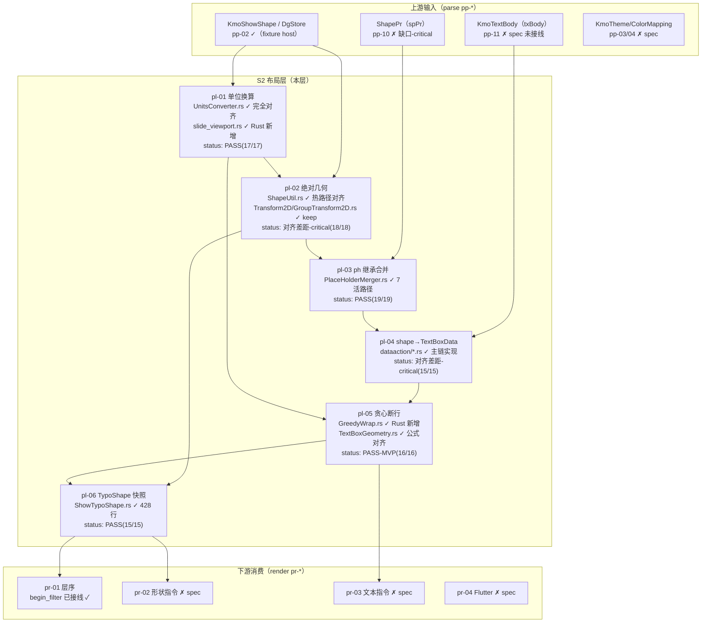

# PPTX layout（S2 布局层）管线：Java ↔ Rust 对齐蓝皮书

> 顶层对比（layout 全量 6 feature：pl-01..pl-06）
> 依据：各 feature `STRUCTURE_ANALYSIS.md`（2026-09，实测 cargo test）+ `PIPELINE_LAYOUT_RENDER_PLAN.md` §1-S2
> ⚠ **状态基线：2026-09-02**（layout 函数级 100 测试全绿仍有效）。parse 侧 9/2-9/3 有增量（pptxr/ppt 新生成、事件引擎就位、handler 入模块树），总管线现状见 [PIPELINE_OVERVIEW.md](./PIPELINE_OVERVIEW.md)（9/3 快照）。

## 0. 总览与一句话结论

S2 布局层把 parse（S0/S1）产出的 `KmoShowShape` 变成可渲染的几何与文本：

```text
上游（parse/S1）                S2 布局层                          下游（render/S3-S6）
pp-02 KmoShowShape/DgStore ─┐
pp-10 spPr→ShapePr ─────────┤→ pl-01 单位 → pl-02 绝对几何 → pl-06 快照 → pr-01 层序 → pr-02 形状指令
pp-11 txBody→KmoTextBody ───┘   pl-03 ph 继承 ↗        pl-04 文本框 → pl-05 断行 → pr-03 文本指令
                                                                          pr-04 Flutter
```

**一句话结论**：layout 是三层（parse/layout/render）中 **Rust 完成度最高**的一层——6 个
feature 函数级实现全部存在且 **实测 100 个测试全绿**（pl-01 17、pl-02 18、pl-03 19、
pl-04 15、pl-05 16、pl-06 15），签名全部可跑；**但都跑在 `util/layout_shape.rs`
fixture 编译面上**——真实 parse 模型（`app/shape/KmoShowShape.rs` 42 行 stub、
`KmoShapeTree.rs` 14 行 no-op）未接线，闭环轨（真 pptx → 画）断在接入点；
**产品捷径轨（fixture shape → 画一页矩形+文字）函数级已通**。

## 1. 管线定位图（泳道：上下游 + Java↔Rust 现状）



依赖链（manifest 级）：`pl-01 → pl-02 → pl-03（依赖 pp-02/pl-02）→ pl-04（依赖 pp-11/pl-03）→
pl-05（依赖 pl-04/pl-01）→ pl-06（依赖 pl-02/pl-05）`；pl-02 的 ph-merge 折入（无 xfrm 时
`transform2D()` 折进 `PlaceHolderMerger.mergeTransform`）意味着 pl-03 是 pl-02 语义的前置。

## 2. 逐 feature 裁决表（实测 cargo test + 源码审计）

| feature | 键类（Rust 目标） | 实测测试 | 对齐程度 | 声称 vs 实测 | 结论 |
|---|---|---|---|---|---|
| pl-01-units-view | UnitsConverter / UnitConverter / Emu·Pixel·Point·TwipConverter / slide_viewport | 17/17 绿 | 换算引擎**完全对齐**；`KmoPresentation.slideWidth` **壳·stub**（返回 0） | functions.csv pass=实测相符；**manifest spec 陈旧** | **PASS**（函数级）；链路级缺 sldSz 数据源链 |
| pl-02-xfrm-geometry | ShapeUtil / ShapeInfoCache(壳) / Transform2D / GroupTransform2D / Shape | 18/18 绿 | 热路径（calcRelativeRect 族+group 子级）**部分对齐-真实**；38 处 DEFERRED 已标注 | pass=实测相符；manifest spec 陈旧 | **对齐差距-critical**（全模型 KmoShowShape accessor 全 todo 且 gated） |
| pl-03-ph-merge | PlaceHolderMerger（1319 行） | 19/19 绿 | 7 活路径方法**完全对齐**（含 phType 委托语义）；16 个 defer 已标注 | pass 与实测相符 | **PASS**（仅 fixture 编译面；真实 app/slide 三层树/Placeholder 模型缺失） |
| pl-04-text-box | DataTransform(2395) / ShapeDataTransform / DefineConverter / AutoNumTransform(壳) | 15/15 绿 | 主链 exToInternal **部分对齐**；**2 处活路径 todo! panic**（convertBullet/getTextSpacing）；虚分派丢失 | pass「部分相符」 | **对齐差距-critical**（夹具轨可画；真实输入轨不可作依赖） |
| pl-05-text-typo | GreedyWrap（Rust 新增）/ TextBoxGeometry / ShowTypoLine | 16/16 绿 | setTextRect 公式**完全对齐**（含 atten 均衡）；贪心断行为 Rust 新增不冒充 Java | pass=实测相符 | **PASS（MVP 口径）**；3 处语义注记待钉死（anchor 1/2 互换等） |
| pl-06-typo-shape | ShowTypoShape（428 行）/ ITypoShape(壳) | 15/15 绿 | 热路径（flags 冻结/rect 换算缓存/children 惰性）**部分对齐-真实**；11 个 defer 已标注 | pass=实测相符 | **PASS**；feature 级部分对齐，不阻塞 pr-01 过滤 |

## 3. 对齐热点（跨 feature 审计发现）

1. **状态文档大面积陈旧**：manifest.csv / layout README「全部 spec、loop 未开始」vs
   functions.csv 已 pass（pl-01/05）+ 实测全绿（pl-01/02/03/05/06）——文档未随功能落地同步。
2. **所有实现跑在 `util/layout_shape.rs` fixture 编译面**：真实 `app/shape/KmoShowShape.rs`
   （42 行 todo 桩）、`KmoShapeTree.rs`（14 行 no-op：shapeCount=0）、`show/app` 模块 gated
   ——这是**闭环轨统一的接入点断链**：函数级对 Java 语义再对齐也无法被真实 parse 产物调用。
3. **pl-04 活路径 panic**：`convertBullet`（bullettype≠-1 即炸）、`getTextSpacing`（有 spcBef/
   spcAft 即炸）——FEATURE 声明的 stub 应为最小落值而非 panic，属 must 项未实现。
4. **语义分歧注记（转正前必须钉死）**：
   - pl-05 `apply_anchor`：Rust 1=bottom/2=center 与 Java `modifyTextBoxAlign`（1=center/2=bottom）**相反**；
   - pl-05 advance 缺省隐式 0（FUNCTION.md 要求显式 fallback）；`\r` 实现为过滤 vs 段内切段；
   - pl-02 `canRotate()` Java 递归语义 vs Rust bool 字段；`parentGroup()` 条件式返回 vs 无条件 clone；
   - pl-03 Placeholder 模型 `type()` Java 缺省 8 vs Rust 默认 0；
   - pl-06 `getShapeRect` Java 覆盖式重算 vs Rust 冻结上游几何；
   - pl-01 负值舍入：Java `Math.round`（floor(x+0.5)）vs Rust `f32::round`（half-away-from-zero）。
5. **值得注意的 Rust 新增（无 Java 对应，设计内）**：`slide_viewport.rs`、`GreedyWrap.rs`、
   `ShowTypoLine`、`layout_shape.rs` host——其中 GreedyWrap 守住红线「MVP 贪心 ≠ Java
   wpslayout 断行」（wpslayout Rust 侧 3352 个 todo! 未冒充）。
6. **唯一跨真实模型沿用**：`RectF`（core-libs util，真实重写已接线）+ `UnitsConverter.rs`
   （592 行完全对齐）——pl-01 的换算引擎可直接被下游真实链消费。

## 4. 结论

- **产品捷径轨（fixture 可画一页）——函数级已通**：pl-01→pl-02→pl-06 全绿、
  `pr-01` 的 `begin_filter` 已接线消费 `ShowTypoShape` 快照；再接 pr-02/pr-03/pr-04
  即可出矩形+文字；pl-05 的 3 处语义注记在接 pr-03 前必须钉死。
- **产品闭环轨（真 pptx → 画）——阻塞在接入点**：需先补真实模型
  （KmoShowShape accessor / KmoShapeTree / Placeholder / show/app 解 gated）与
  上游 pp-10（ShapePr 写入，缺口-critical）、pp-11（KmoTextBody → pl-04 活路径 + panic 修复）。
- **建议动作**：① 同步 manifest/README 状态；② pl-04 修 2 处活路径 panic 并接虚分派；
  ③ 钉死 pl-05/pl-02/pl-03/pl-06 语义注记；④ 真实模型接线作为 pl-02/03/06 的
  review 门闩。