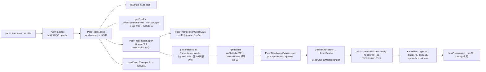
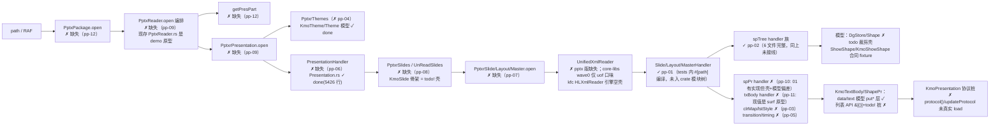

# PPTX parse 管线：Java ↔ Rust 对比蓝皮书

> 顶层管线对比（parser 全量 12 feature + render/layout 概述）
> 依据：各 feature `STRUCTURE_ANALYSIS.md`（2026-09）+ `PIPELINE.md` + `MVP.md`
> ⚠ **状态基线：2026-09-01**。仓库随后推进：`pptxr/ppt/*` 编排类（PptxrPresentation/PptxrSlides/PptxrSlide/PptxrMaster/PptxrLayout/PptxrThemes/PptxrTheme + CallbackImpl 族）已于 9/2-9/3 新生成、kfc HLXmlReader 与 UnifiedXmlReader 已就位、handler 已挂 crate 模块树。**本文逐 feature 表保留 9/1 结论，当前权威状态见 [PIPELINE_OVERVIEW.md](./PIPELINE_OVERVIEW.md)（9/3 快照）。**

## 0. 总览

PPT 内核改写对齐 writer（word-core）：Java 完整实现（2199 文件）在
`koffice/presentation/core/cn/wps/`，Rust 改写在 `libs/ppt-core/src/cn/wps/`
（404 文件 + 33 测试）。三层管线：

```text
.pptx
  → [parse pp-*]  KmoPresentation / KmoSlide / KmoShowShape / DgStore / Theme
  → [layout pl-*] 几何 RectF + TextBox 排版结果（ShowTypoShape / IShowTextLayout）
  → [emit   pr-*]  RenderCommand[]（禁止 Canvas 进内核）
  → [paint  pr-04] Flutter / 平台 painter
```

**Java 侧**：完整。`PptxReader.open`（pp-09）→ OPC 包（pp-12）→ part open
（pp-07）→ handler 分发（pp-01/02/03/05/10/11）→ 模型。
**Rust 侧**：只完成 parse 前两层 handler（pp-01、pp-02 函数级 pass）；pp-03..12 全部
未动工或仅原型；layout/render 全部 spec。**整体结论：parse 层的"词汇/分发/部分写入"
已就绪，但"真实文件 → part 流 → 事件引擎 → handler"的输入链与 package 编排是硬门闩，
当前无法闭环打开一份 .pptx。**

## 1. Java 热路径（完整）



各 feature 在 Java 链上的位置：

| feature | Java 锚点 | 在链中 |
|---|---|---|
| pp-01 | SWReaderMap / HandlerCallback / nvPr+cSld+sld+layout+master handler | 词汇层 + part XML 装配 |
| pp-02 | spTree handler 族（SwShape/SwGroupShape/SwPicture/SwConnectorShape…） | shape 树 → DgStore 行 |
| pp-03 | ColorMapHandler / TextListStyleHandler | a:clrMap / a:lstStyle 原子样式槽 |
| pp-04 | ThemeHandler / PptxrThemes / PptxrTheme | theme part→KmoTheme（openGlobalData） |
| pp-05 | TransitionHandler / TimingHandler | p:transition / p:timing 列表 |
| pp-06 | PresentationHandler + 12 nested | p:presentation 根 XML + rId 回调 |
| pp-07 | UnifiedXmlReader / callback.load / PptxrSlide·Layout·Master.open | part 流 → 事件 → 模型 |
| pp-08 | PptxrSlides / UnReadSlides / changeLayout | rId 装配 + 阅读顺序 |
| pp-09 | PptxReader（open/close/getPresPart） | package 编排 |
| pp-10 | ShapePropertiesHandler（xfrm/fill/ln/geom） | spPr → ShapePr（渲染阻塞） |
| pp-11 | TextBodyHandler 族（bodyPr/lstStyle/p/rPr） | txBody → KmoTextBody |
| pp-12 | OxfrPackage / PptxReader.getPresPart | path/RAF → wps-io OPCPackage 桥 |

## 2. Rust 现状接线图（带缺口标记）



## 3. 逐 feature 裁决表（来自各 STRUCTURE_ANALYSIS.md）

| feature | 状态 | 键类（Rust 目标） | Rust 现状 | 结论 |
|---|---|---|---|---|
| pp-01-pptx-parse | pass | SWReaderMap / HandlerCallback / SwNvPrHandler / CommonSlideDataHandler / Slide(Layout·Master)Handler | 7/7 function pass；handler 源码完整、coverage 82.9–100%；tests 内 #[path] 编译，**未入 crate 模块树** | **PASS**（crate 装配为壳-非critical） |
| pp-02-shape-tree-parse | pass | SwShape/SwGroupShape/SwPicture/SwConnectorShape/SwShapeAlertnateContent/SwNvPrHandler | 6 handler 完整转写、5 [[test]] 35 tests 绿；生产 shape/mod.rs 注释掉模块、真实模型 contract | **壳-非critical**（语义 PASS，接线断点已标注） |
| pp-03-dml-style | spec | ColorMapHandler / TextListStyleHandler / SchemeColorHandler / ColorHandlerFactory | 全缺；DGMap.schemeColorMap（17 key）未建；TextListStyle 22 处 todo! | spec-未动工（模型层 ColorMapping/TextListStyle/Color 已 done） |
| pp-04-theme-part | spec | ThemeHandler / PptxrTheme / PptxrThemes | 全缺（style/ 注释占位）；模型层 KmoTheme/Theme/PptFileCache 已 done | spec-未动工 |
| pp-05-timing-transition | spec | TransitionHandler / TimingHandler / BuildListHandler / TimeNodeListHandler | handler 模块不存在；模型仅 .rs.bak；DGMap.orientationMap 缺 | spec-未动工（首屏可不做） |
| pp-06-presentation-xml | spec | PresentationHandler + 12 nested / PresentationHandlerCallback | handler 全缺（#[cfg(feature="full")] 门控）；Presentation.rs(5426 行)/SWReaderMap done；KmoPresentation 协议桩 | spec-未动工（handler 层） |
| pp-07-part-open | spec | UnifiedXmlReader / HandlerCallbackImpl / PptxrSlide·Layout·Master | 未动工；kfc HLXmlReader 引擎空壳 = **输入链硬门闩**；MapManager 未接线 | spec-未动工（不可作下游依据） |
| pp-08-slides-walk | spec | PptxrSlides / UnReadSlides / PresentationHandlerCallbackImpl | show/pptxr/ppt/ 目录整体不存在；KmoSlide 549 行 TODO 骨架 | spec-未动工（上游 pp-06/07 未接线） |
| pp-09-pptx-open | spec | PptxReader / PptxrPresentation / PptxrDocProps | 全缺；现存 PptxReader.rs 是 **unregistered demo 原型**；functions.csv 04 误标 pass | spec-未动工（编排不可用） |
| pp-10-dml-sppr | spec→缺口 | ShapePropertiesHandler / Transform2DHandler / FillPropertiesHandler / OutlineHandler / Preset·CustomGeometryHandler | 01 有实现（5/5 绿）但写轻模型 layout_shape 而非 ShapePr.rs、ln/geom 子分发 NamedHandler 壳、callback 透传被删；02/03/04 全缺 | **缺口-critical**：不可作 pl-02/pr-02 依赖 |
| pp-11-dml-txbody | spec | TextBodyHandler / ParagraphHandler / TextRunsHandler / TextCharacterPropertiesHandler | 现值 TextBodyHandler 是 TextBodySurf **演示原型**（非 Java 语义）；paragraph/run/rPr handler 已删/缺失；DGMap 8 张文本 map 缺；列表 API 桩 | spec-未动工（须 template 重做，不可增量） |
| pp-12-opc-package | spec | PptxPackage（opc/） | 整模块缺失；wps-io OPCPackage/PackagePart wave0 **已 pass 可复用**；getPresPart 双异常载体缺；from_path/from_raf panic→Err 待裁决 | spec-未动工（薄桥接层） |

## 4. 关键缺口（跨 feature，按断链顺序）

1. **输入链硬门闩**：`path/RAF → OPCPackage → part 流 → UnifiedXmlReader/HLXmlReader 引擎`
   缺失——kfc HLXmlReader 解析引擎空壳（pp-07）、opc part/rels 模型缺（pp-12）。所有
   handler 目前只能吃内存事件 fixture。
2. **handler 未入 crate 模块树**：pp-01/pp-02 的 handler 源码完整但只在测试内
   `#[path]` 编译，生产 `src` 的 mod.rs 注释关闭 → pp-07 无法引用。
3. **渲染阻塞断点**：pp-10 spPr（02 fill 子族 / 03 ln / 04 geometry 全缺 + 01 模型偏差）、
   pp-11 txBody（4 个 handler 均未按 Java 语义接线）→ pl-02/pl-04/pr-02/pr-03 无原料。
4. **模型层壳**：DgStore/Shape/ShowShape 生产模型为 todo! 裁剪 stub；KmoSlide 549 行
   TODO 骨架；data/text 列表 API `&[()] + todo!()`；KmoPresentation 协议桩。
5. **查表缺口**：DGMap 仅 blackWhiteModeMap 一张，schemeColorMap（17 key）/
   orientationMap / 8 张文本 map 未建；Rust 侧枚举映射未齐。
6. **编排缺口**：PptxReader 编排类无转写；现存同名文件是 demo 原型（且与 pp-09
   function 04 测试重名冲突）；AppProperty/CoreProperty audit=delete 与写入需求冲突。
7. **CSV 状态过期**：pp-01 审计"35 stubs"已过期；pp-09 functions.csv 04 误标 pass；
   若干"delete"裁决与 parse 需求冲突（需人工复核）。

## 5. render/layout 概述（管线级，未逐 feature 深析）

| 层 | feature | I → O（锁死） | Java 锚点 | Rust 现状 |
|---|---|---|---|---|
| layout | pl-01-units-view | slideWidth/Height EMU + 缩放 → 布局/绘制单位 | `UnitsConverter.layout/render/doc` | spec（loop 未开始） |
| layout | pl-02-xfrm-geometry | `Transform2D` + 父 group → 绝对 `RectF` | `spPr.xfrm`；group child | spec（**阻塞于 pp-10**） |
| layout | pl-03-ph-merge | placeholder + layout/master 树 → 合并 xfrm/fill/ln/style | `PlaceHolderMerger` | spec |
| layout | pl-04-text-box | `KmoShowShape` + `KmoContext` → `TextBoxData` | `ShapeDataTransform.exToInternal` | spec（**阻塞于 pp-11**） |
| layout | pl-05-text-typo | `TextBoxData` + 框宽高 → 行框列表（贪心） | `ShowTextLayout.layout`（MVP ≠ Java） | spec |
| layout | pl-06-typo-shape | shape + geometry + flags → `ShowTypoShape` | `ShowTypoShape` ctor | spec |
| render | pr-01-slide-layers | slide+layout+master+flags → 有序 `ShowTypoShape` 列表 | `SlideRender.drawUnderSlide`/`drawFilm` | spec |
| render | pr-02-shape-command | TypoShape 几何+fill/ln → RenderCommand | `ShapeRender._begin` | spec（**阻塞于 pp-10**） |
| render | pr-03-text-command | IShowTextLayout 行 → DrawText | `TextRender`/`ITextRenderModel` | spec（**阻塞于 pp-11**） |
| render | pr-04-ffi-flutter | commands → 屏幕 | 不进 ppt-core 热路径 | spec（可手工 fixture 先行） |

## 6. 顶层结论

- **可作为下游消费的**：pp-01、pp-02 的函数级语义（handler 逻辑与 Java 逐一对齐、
  swNvPr 双 feature 共用等）；wave0 core-libs（OPC/XML 引擎、wps-io OPCPackage）；
  模型层 put* 面（Presentation.rs、KmoTheme/Theme、ColorMapping/TextListStyle/Color、
  data/text 五模型）。
- **不可作为下游依赖的**：pp-07（输入链门闩）、pp-09（编排缺失 + 原型混淆）、
  pp-10（缺口-critical，渲染阻塞）、pp-11（须重做）；pp-03/04/05/06/08/12 为
  spec-未动工（计划内），但 pp-07/09 真链依赖其中的 pp-04/06/08/12 先 pass。
- **最短可画一页路径**：手工 `KmoShowShape` fixture（xfrm+fill+一段字）→ pl-* →
  pr-*（不与 PptxReader 挂钩）；闭环路径需先补 pp-12（薄桥）+ pp-07（引擎 + handler
  入模块树）+ pp-10/11（渲染阻塞写入）。