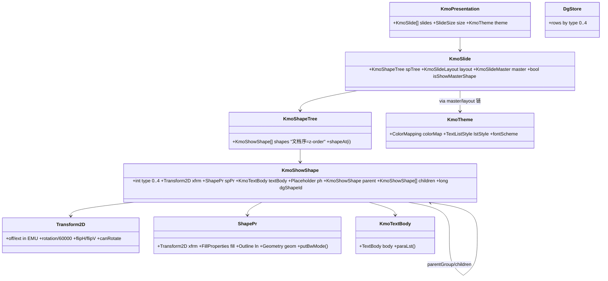

# parse → layout 交接契约与布局算法深解

> 回答：parse 阶段最终交付什么给 layout；layout 如何初始化（坐标系/“分页”）；如何利用产物给不同元素
> 定**大小、位置、z-order**。
> 依据：Java 实读（`ShapeUtil.java` 1170 行、`SlideRender.java`、`KmoShowShape.java`、`PlaceHolderMerger.java`）
> + pl-01..06 `STRUCTURE_ANALYSIS.md` + `PIPELINE_LAYOUT_RENDER_PLAN.md`（S1/S2）+ `PIPELINE_OVERVIEW.md`（9/3 快照）。

## 0. 一句话

**parse 交付的是"一棵内容有语义、坐标相对父容器、顺序即层叠"的 Kmo 模型树**（`KmoPresentation → KmoSlide →
KmoShapeTree → KmoShowShape（type 0-4，含 xfrm/spPr/txBody/ph/父子链）`，外加 `ShapePr`、`KmoTextBody`、
`KmoTheme`、`DgStore` 索引）；**layout 把它变成"每个形状在 slide 绝对坐标系（EMU，左上原点）里的矩形与
层叠序"**，再补上 ph 继承的样式，抽出可排文本断出文本行，最后打包成 `ShowTypoShape` 快照交给 render。
**大小**来自 xfrm.ext / ph 继承 / 内容自适应；**位置**来自 xfrm.off 经 group 递归合并；**z-order** = spTree
文档序（底→顶），跨 slide 再叠 master→layout→slide 三层胶片。

---

## 1. parse 交付物（layout 的输入契约）

### 1.1 交付清单

| # | 产物 | 数据结构与字段语义 | 写入者（pp-*） | layout 怎么用 |
|---|---|---|---|---|
| P1 | **KmoPresentation** | `slides[]`、`slideSize(cx,cy EMU)`、`theme` | pp-09 编排 / pp-06 sldSz / pp-04 theme | pl-01 建视口（白底矩形）；pl-03 顶层继承源 |
| P2 | **KmoSlide** | `spTree`、`layout`/`master` 三层引用、`isShowMasterShape` flags | pp-08 装配 / pp-01 (05) | 图层决策（3.1）；遍历入口 |
| P3 | **KmoShapeTree** | **有序** `KmoShowShape[]`（文档序 = z-order） | pp-02 spTree | `shapeAt(i)` 顺序遍历 = 绘制顺序 |
| P4 | **KmoShowShape** | `type 0-4`（group/shape/picture/connector/graphicFrame）、`Transform2D`（off/ext EMU + rotation/60000 + flip + canRotate）、`ShapePr`、`KmoTextBody`、`ph{hasType,type,hasIdx,idx}`、`parent/children`、`dgShapeId`、nvPr 标志 | pp-02 / pp-10 (spPr) / pp-11 (txBody) / pp-01 (03 nvPr) | pl-02 几何、pl-03 继承、pl-04/05 文本、pl-06 快照 |
| P5 | **ShapePr** | 七链聚合：bwMode / xfrm / fill(六类) / ln / geom(prst/cust) / effect / 3D | pp-10 | pl-03 合并样式；pr-02 画 fill/ln/geometry |
| P6 | **KmoTextBody** | `TextBody → Paragraph[] → Run[]` + 富文本属性（rPr/bodyPr） | pp-11 | pl-04 exToInternal 归一成排版模型 |
| P7 | **KmoTheme** | `ColorMapping`(12 槽)、`lstStyle`(10 槽)、字体 scheme | pp-04 / pp-03 | pl-03 ph 样式回填；pr-02 色解析 |
| P8 | **DgStore 行** | type 0-4 的扁平行记录（id/父子/媒体） | pp-02 | 索引/缓存（`dgShapeId` 全局唯一） |

### 1.2 parse 承诺 layout 的不可变约定（“契约面”）

1. **坐标相对父容器、单位 EMU**（整数）；绝对化是 layout 的职责。
2. **rotation 单位 60000 分之一度**，layout 只在 `toDegree` 处换算一次。
3. **`type` 语义固定**（0=group 允许 children；1=shape；2=picture；3=connector；4=graphicFrame）。
4. **spTree 文档序 = z-order**（先出现的在底层），layout/render 不得重排。
5. **ph 标识**（`hasType/type/hasIdx/idx`）是模板匹配键；缺 xfrm 时由 layout 折入 ph 继承。
6. **父子链完整**（`parentGroup()` 条件式：顶层组直子无父映射）；组内坐标相对组。

### 1.3 交接模型类图



---

## 2. layout 初始化

### 2.1 坐标系建立

- **单位**：一律 **EMU**（整数，914400 EMU/英寸）；layout 算法面用单精度 `f32` 承载，矩形为 `RectF`。
- **原点与方向**：左上角原点，+x 向右、+y 向下（屏幕约定）；slide 内容区 = `(0,0,slideWidth,slideHeight)`，
  默认 16:9 = **12192000×6858000 EMU**（sldSz 未写时用 `addDefaultProperty` 默认）。
- **三档换算**：`UnitsConverter.doc()/layout()/render()`——协议档（EMU）、布局档（整数缩放）、渲染档（像素，
  受 zoom 缩放）。layout 内部**不换单位**，只在输出给 render 时 `fromEmuX/Y`。
- **“分页”语义（PPT 与 word 的关键差异）**：**没有流式分页**。每个 slide 是一个**独立画布**；
  “页”= 该 slide 的视口矩形（sldSz）。layout 不做 word 式重排/分页——所有元素绝对定位。
  分页/重排只在 writer（word-core wr-02 ViewEnv + 正文流）存在。

### 2.2 初始化序列（layout 进入前的准备）

```text
① 取 sldSz（KmoPresentation.slideSize，缺省 12192000×6858000）→ 建 slide 视口（pl-01）
② 建 ShapeInfoCache（transform2D / rotation / flip / shapeRect 缓存，按 dgShapeId 惰性填）——Rust 侧设计为直读替代
③ 三层结构可达性：slide.layout() / layout.master() 解析（pl-03 继承要扫描的链）
④ 逐 shapeAt(i)：pl-02 几何 →（缺 xfrm 时折入 pl-03）→ pl-04 文本 → pl-05 断行 → pl-06 快照
```

---

## 3. 布局算法：z-order / 大小 / 位置

### 3.1 z-order（层叠序，三层规则）

1. **slide 内：spTree 文档序 = 底→顶**。`drawFilm` 按 `shapeAt(i)` 顺序绘制，后画的盖先画的；
   group（type 0）以整体占父层一个 z 位，组内 children 再按自身序递归。
2. **跨 slide：三层胶片（master → layout → slide）**，实读 `SlideRender.drawShapesOnLayout`：
   - `layout.isShowMasterShape && slide.isShowMasterShape` → 先画 **master film**（母版形状是"最底图"）；
   - `slide.isShowMasterShape` → 再画 **layout film**（版式形状是第二层底图）；
   - 最后画 **slide film**（slide 自身形状，最顶层）。
   控制开关是 `isShowMasterShape`（slide/layout 各自是否参与父层）。
3. **不可重排**：契约面第 4 条——layout 不排序，只按序产出；render 按序画。

### 3.2 位置与大小（几何）

**基准**：每个形状的坐标是**相对父容器**的 `Transform2D`：`off(x,y)` 是相对父容器左上角的偏移，
`ext(cx,cy)` 是自身尺寸（EMU）。

**绝对化递归**（`ShapeUtil.calcRelativeRect(shape, rc)`，实读签名三态）：

```text
calcRelativeRect(shape, rc, calcSelf):
  parent = shape.parentGroup()
  if parent == null:            # 顶层形状
      rc = (shape.xfrm.off; shape.xfrm.ext)      # 自身相对 slide（即绝对）
  else:                         # 组内形状
      rcGroup = calcShape2TopMatrix(parent, null)           # 先求组绝对框
      rotation = toDegree(shapeInfo.rotation)
      calcChildRelativeRect(parent, rcGroup, rc, rotation)  # 再合并到 slide 绝对
```

**`calcChildRelativeRect(group, rcGroup, rcChild, childRotation)` 公式**（Java 语义钉死）：

```text
相对组局部 → 绝对：
  ① 平移抵消：rcChild -= group.xfrm.chOff          # 组"裁剪原点"对齐
  ② 比例缩放：scale = group.childExtents() / group.xfrm.ext（chExt vs ext）
     rcChild 以组中心为中心等比缩放                 # 组缩放作用于子级
  ③ 翻转：flipH/flipV 镜像
  ④ 象限宽高互换：当 childRotation ∈ [45°,135°) ∪ [225°,315°)，宽高互换（旋转 90°/270°）
  ⑤ 平移回组绝对：rcChild += rcGroup.left/top
子级自身 rotation 在几何上用 toDegree/toRotation 处理，绘制时再按 90° 网格。
```

**缺 xfrm 的补全（ph 继承）**：`KmoShowShape.transform2D()` 对「无 xfrm 且是 ph」**折入
`PlaceHolderMerger.mergeTransform`**——四级查找：自身 → layout 同 idx/type ph → master 扫描
（title/body）→ `findMasterPhShape` → 自身兜底；样式同理 `mergeShapePr` 走 own→layout→master
**follow 链**（fill/ln/lstStyle 逐层补）。这样 ph 形状"多大在哪"由模板决定。

**形状"多大"的三个来源**（按优先级）：
| 来源 | 规则 |
|---|---|
| ① ext 显式 | spPr.xfrm.ext（绝大多数形状；文本也可能换行后超过 ext → autofit） |
| ② ph 继承 | 缺 xfrm 时继承 layout/master 里同 idx/type 形状的 ext/off（3.2 折入） |
| ③ 内容自适应 | 文本框 autofit（shrink font / resize shape）；图片无 ext 时按自然尺寸（@96dpi，media 依赖；MVP 占位矩形） |

**文本框文本区**（pl-04/05）：由 `bodyPr` 的 insets（marL/marR/marT/marB，EMU）向内收缩 ext 得
`textRect`；`anchor`（t/m/b）决定文本在框内垂直位置；`wrap=off` 不折行。pl-05 断行的**可用宽 =
textRect.right - textRect.left**，行高取行内最大字号（贪心：advance 累计超宽强折）。

**旋转/翻转对"框"的影响**：`ShapeUtil.calcShapeMatrix(matrix, rcShape, rotation, flipH, flipV)` 产出
旋转矩阵；渲染框 = 形状的**旋转后外接框**（旋转时不丢 1/60000 度精度，绘制按 90° 网格）；另有
`calcShapeRect`（rotate=false 变体）用于不旋转语义的场景。

### 3.3 逐形状处理链（pl-01..06 接力）

| 步 | 输入 | 算法 | 输出 | 消费 |
|---|---|---|---|---|
| pl-01 | sldSz | 单位换算 + 视口矩形 | slide 视口（EMU/layout 档） | 全链坐标基准 |
| pl-02 | KmoShowShape.xfrm（+父链） | calcRelativeRect 递归 + calcChildRelativeRect | **绝对 RectF**（EMU） | pl-06 / pr-02 |
| pl-03 | ph + 三层树 | mergeTransform / mergeShapePr（idx/type 匹配） | **合并 Transform2D / ShapePr** | pl-04 / pr-02（fill/ln） |
| pl-04 | KmoShowShape + KmoTextBody | exToInternal（para/run → TextBoxData, insets/anchor/wrap/autofit） | **TextBoxData** | pl-05 |
| pl-05 | TextBoxData + 框宽高 | insets 内缩 → 贪心断行 | **RectF 文本区 + Vec\<ShowTypoLine\>** | pr-03 / pl-06 |
| pl-06 | shape + 绝对 RectF + 合并样式 | 快照打包（isHidden/ph/isTextBox/rect/children 惰性） | **ShowTypoShape** | pr-01 过滤 → pr-02/03 |

---

## 4. 例子走一遍（尺寸×位置×z-order 数值语义）

> 完整"嵌套组+90°旋转+ph 文本框"的 **XML 事件→KmoShowShape→绝对 RectF 逐步数值推演**与
> **calcChildRelativeRect 象限互换几何图解**见 [PIPELINE_OVERVIEW.md](./PIPELINE_OVERVIEW.md) 附录 A/B。

fixture slide（16:9 = 12192000×6858000 EMU）：

```text
① master 背景形状（矩形，ext=全屏）：keep 无 xfrm → mergeTransform 取 master 自身（同层兜底）
   → 绝对 RectF(0,0,12192000,6858000)。z: master film 最先画（底）。
② slide 上 group（type 0）：xfrm.off=<1000000,800000> ext=<8000000,4000000>，chOff=<1000000,800000>
   chExt=<6000000,3000000>（组裁剪区比 ext 小：内容被裁剪）。
   z: group 在 slide film 的第 1 位。
③ group 内子形状 A（type 1）：off=<0,0> ext=<3000000,2000000>（相对组），子级 rotation=90°。
   calcRelativeRect：
     rcGroup = calcShape2TopMatrix(group) → (1000000,800000,8000000,4000000)
     calcChildRelativeRect：rcChild(0,0,3000000,2000000) - chOff(1000000,800000) → (-1000000,-800000,…)
       → childExtents 比例(6000000/8000000, 3000000/4000000) 中心缩放 → 90°∈[45,135) → 宽高互换
       → + rcGroup.left/top → 绝对 RectF
   z: 组内第 1 位（组整体盖过 master 背景，仍低于后续 slide 形状）。
④ slide 上文本框 ph（type=1, ph.title）：无 xfrm → transform2D() 折入 mergeTransform：
   layout 找到同 title idx 的 ph（继承其 off/ext）→ 绝对 RectF 成立。
   bodyPr marL=91440… → textRect 内缩 → 贪心断 2 行 → ShowTypoLine[2]。
   z: slide film 第 2 位（最顶层）。drawFlags 按场景过滤装饰。
```

---

## 5. Java ↔ Rust 现状（这一段怎么对齐、缺什么）

| 算法锚点（Java） | Rust（2026-09-03） | 状态 |
|---|---|---|
| `ShapeUtil.calcRelativeRect` 递归 | `show/util/ShapeUtil.rs` 热路径已实现（pl-02：18/18 绿，fixture 面） | ✅ 函数级（缺真实模型输入） |
| `calcChildRelativeRect`（chOff/chExt 比例、象限互换） | 同上，逐行对照 + 镜像测试 | ✅（语义注记：canRotate 递归 vs bool、parentGroup 条件式待钉） |
| `transform2D()` 折入 `PlaceHolderMerger.mergeTransform` | pl-02 用 layout_shape fixture **直读字段**（无 ph 折入） | ⚠ 折入未复刻 → ph 无 xfrm 得 (0,0,0,0) |
| `PlaceHolderMerger.mergeTransform/mergeShapePr` | `show/layout/PlaceHolderMerger.rs`（7 活路径，19/19 绿） | ✅（值语义：下游必须读返回值，不能读原模型） |
| `ShapeInfoCache`（transform2D/rotation/flip 缓存） | 死文件 stub → **设计为直读替代** | ⚠ 非 critical（fixture 有效） |
| `SlideRender.drawShapesOnLayout` 三层胶片 | `pr-01` spec；`begin_filter` 已接线 | ⚠ 层序常量待锁定 |
| 文本：insets/anchor/wrap/断行 | pl-04/05（31 测试）；2 活路径 panic；贪心≠Java wpslayout | ✅ 函数级 / ⚠ 语义注记 |
| **输入侧**（真实 KmoShowShape） | `app/shape/KmoShowShape.rs` 42 行桩 + show/app gated | ❌ **G1**：真实链未通，layout 全靠 `layout_shape.rs` fixture |

**段内门闩**：G1（真实模型）→ 缺 xfrm ph 折入的复刻（3.2 折入）→ spPr 写入端（pp-10）→ txBody（pp-11）。

---

## 6. 设计动机小结（为什么这样定）

| 规则 | 为什么 |
|---|---|
| 相对坐标 + EMU | OOXML 协议即相对坐标；整数 EMU 无精度损失，绝对化推迟到 layout 一次性做 |
| spTree 文档序 = z-order | 协议语义即层叠；parse 不承担排序，render 按序画就是对的 |
| 三层胶片 + isShowMasterShape | 模板形状是"底图"；slide 可声明"不继承某层"，避免母版形状盖到正文 |
| group 递归合并 | 一组即一个坐标系；子级只存相对值，嵌套深度任意 |
| 缺 xfrm 折入 ph 继承 | 模板复用是协议规定；不补全则无数 ph 形状落在 (0,0,0,0) |
| 快照隔离 | render 只读 ShowTypoShape，不碰 parse 模型（缓存/过滤/惰性 children） |
| layout 不做分页 | PPT 是绝对定位画布（无正文流），"页"= 视口；分页是 writer（word）的职责 |

## 文档索引

- 状态图：[PIPELINE_OVERVIEW.md](./PIPELINE_OVERVIEW.md) · 设计全解：[RENDER_PIPELINE_DESIGN.md](./RENDER_PIPELINE_DESIGN.md)
- 深读：`layout/features/pl-01..06/STRUCTURE_ANALYSIS.md` · `parser/features/pp-01/02/10/11/STRUCTURE_ANALYSIS.md`
- Java 实读点：`show/util/ShapeUtil.java`（1170 行）· `show/render/SlideRender.java` · `show/app/shape/KmoShowShape.java` · `show/app/shape/PlaceHolderMerger.java`