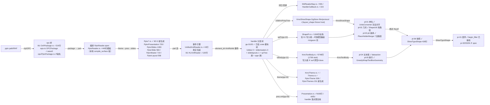
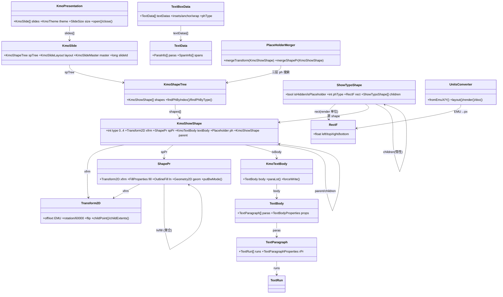
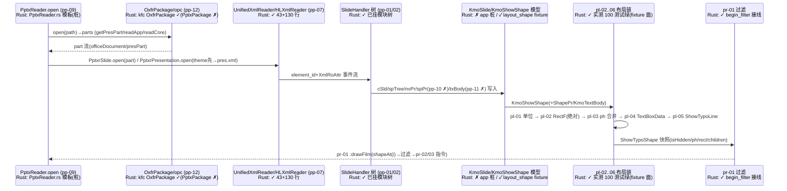
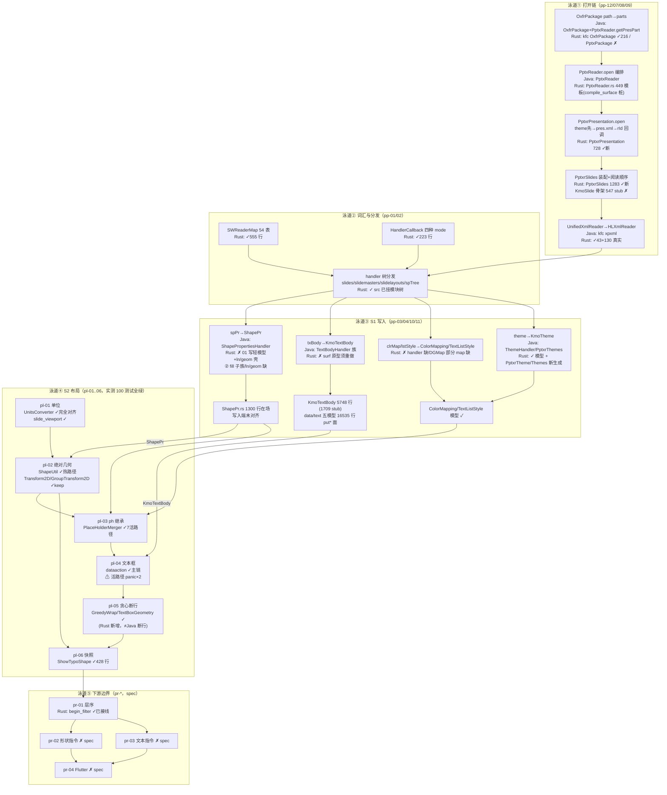
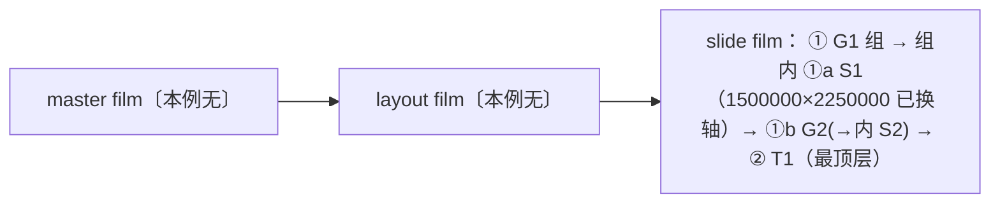

# libs/ppt-core 总管线纵览：parse + layout

> **快照日期：2026-09-03 10:45**（仓库并行推进中，请以本文件为当前权威状态图）
> 深读基线：各 feature `STRUCTURE_ANALYSIS.md`（parser 9/1 / layout 9/2）；分层对比：[PARSER_JAVA_RUST_PIPELINE.md](./PARSER_JAVA_RUST_PIPELINE.md) · [LAYOUT_JAVA_RUST_PIPELINE.md](./LAYOUT_JAVA_RUST_PIPELINE.md)
> 主控：[PIPELINE_LAYOUT_RENDER_PLAN.md](./PIPELINE_LAYOUT_RENDER_PLAN.md) §1-S0..S2 · [MVP.md](./MVP.md)
> 行数/stub 计数均为本快照实测（`wc -l` + `grep -c 'todo!\|TODO_RUST_CODE\|unimplemented!'`）。

## 0. 总览

```text
.pptx
  → [S0 打开链]  OPC 桥(pp-12) → PptxReader.open(pp-09) → theme/presentation 读序 → rId 装配(pp-08)
  → [S0 词汇/分发] SWReaderMap·HandlerCallback(pp-01) + handler 树(pp-01/02) + 查表(pp-03/05)
  → [S1 写入]  spPr→ShapePr(pp-10) / txBody→KmoTextBody(pp-11) / clrMap·lstStyle(pp-03) / theme(pp-04)
  → [S2 布局]  pl-01 单位 → pl-02 绝对几何 → pl-03 ph 继承 → pl-04 文本框 → pl-05 断行 → pl-06 快照
  → [S3+ 边界] pr-01 层序(已接线) → pr-02 形状指令 / pr-03 文本指令 → pr-04 Flutter（均 spec）
```

**一句话现状（2026-09-03）**：Rust 侧**函数级能力大面积就位**——词汇/分发（pp-01/02）
与布局全链（pl-01..06，实测 100 测试全绿）、kfc 事件引擎与 UnifiedXmlReader、以及
9/1 之后新生成的 `pptxr/ppt/*` 编排类（PptxrPresentation/PptxrSlides/PptxrSlide/
PptxrMaster/PptxrLayout/PptxrThemes/PptxrTheme + CallbackImpl 族）；
**但真实数据链仍未闭合**：parse 模型（app/shape KmoShowShape 42 行桩、KmoShapeTree
14 行 no-op、show/app gated）与 DML 写入端（pp-10 spPr 偏差、pp-11 txBody surf 原型）
是两道门闩，layout 目前全跑在 `util/layout_shape.rs` fixture 编译面上。



## 1. 核心数据模型

### 1.1 数据模型总表（按管线角色分组）

| 组 | 数据模型 | Java（包） | Rust 路径 / 行数 / stub | 生产者 | 消费者 | 状态 |
|---|---|---|---|---|---|---|
| A 呈现模型 | KmoPresentation | `show.app.KmoPresentation` | `show/app/KmoPresentation.rs` 2182 / 0 | pp-09 编排 | pl-01 视口、pr-* | **壳/部分**（slideWidth/Height/type 返回 0 字面量桩；protocol 桩） |
| A | KmoSlide | `show.app.slide.KmoSlide` | `show/app/slide/KmoSlide.rs` 1934 / **547** | pp-08 装配 | pl-*/pr-* | 骨架（大量 todo） |
| A | KmoShapeTree | `show.app.shape.KmoShapeTree` | `show/app/shape/KmoShapeTree.rs` 14 / 0 | pp-02 spTree | pl-03 ph 搜索 | **no-op 壳**（shapeCount=0） |
| A | KmoShowShape | `show.app.shape.KmoShowShape` | `show/app/shape/KmoShowShape.rs` 42 / 12 | pp-02/10/11 | pl-02/04/06 | **桩**；布局侧用 `util/layout_shape.rs` fixture host（~820 行） |
| A | DgStore / DgStoreData | `drawing.app.DgStore` | `drawing/app/DgStore.rs` 135 / 3 | pp-02 行写入 | pl-04 读取 | 部分（行模型） |
| B DML | ShapePr | `drawing.data.shape.ShapePr` | `drawing/data/shape/ShapePr.rs` 1300 / 22 | **应接 pp-10**（当前写 layout_shape 轻版） | pl-03/06、pr-02 | 在场；**写入端未对齐** |
| B | Transform2D / GroupTransform2D | `drawing.data.basic.*` | `drawing/data/basic/` 687/3 · 510/3 | pp-10 xfrm / pp-02 group | pl-02 几何 | keep 完全对齐（gated） |
| B | Shape（公开渲染模型） | `drawing.data.shape.Shape` | `drawing/data/shape/Shape.rs` ~2975（keep） | S1 convert（未建） | pl-06/pr-02 | keep（gated） |
| C 文本 | KmoTextBody | `drawing.app.text.KmoTextBody` | `drawing/app/text/KmoTextBody.rs` 5748 / **1709** | **应接 pp-11** | pl-04 | 大模型多 stub |
| C | data/text 五模型（TextBody/TextParagraph/TextRun/TextCharacterProperties/TextBodyProperties/TextParagraphProperties） | `drawing.data.text.*` | `drawing/data/text/` 合计 16535 行 | pp-11 写入 put* | pl-04 读取 | put* 面在场；列表 API 桩 |
| C | TextBoxData/TextData/ParaInfo/SpanInfo | core-libs wpslayout | wpslayout data | pl-04 | pl-05 | 部分（setIHolder 丢值） |
| D 样式/主题 | KmoTheme / Theme / ColorMapping / TextListStyle | `show.app.theme` / `drawing.data.style` | `show/app/theme/KmoTheme.rs`、`drawing/data/style/Theme.rs` 等 | pp-04 / pp-03 | pl-03 继承、pr-02 填充 | 模型层 ✓（pp-03 部分 map 缺） |
| D | Presentation（+SlideSize） | `show.data.Presentation` | `show/data/Presentation.rs` 5426 / 0 | pp-06 pres.xml | pl-01 视口 | ✓（源码，gated） |
| E 布局/渲染 | RectF | android.graphics（语义源） | `core-libs/util/.../graphics/RectF.rs` | — | pl-02/05/06、pr-* | ✓ 真实重写已接线（唯一跨真实链） |
| E | UnitsConverter/UnitConverter + 4 converter | `base.converter` | `drawing/app/util/UnitsConverter.rs` 等 5 文件 | — | pl-01 | ✓ 完全对齐 |
| E | ShowTypoShape / ITypoShape | `show.render.ShowTypoShape` | `show/render/ShowTypoShape.rs` 428 / 11（ITypoShape 壳） | pl-06 | pr-01 过滤 | ✓ 热路径真实 |
| E | ShowTypoLine / slide_viewport / GreedyWrap / layout_shape host | —（**Rust 新增**） | `show/layout/typo/*`、`show/layout/slide_viewport.rs`、`show/util/layout_shape.rs` | pl-05/01/— | pr-03/pr-01 | 设计内新增 |
| F 打开态 | PptxrPresentation / PptxrSlides / PptxrSlide / PptxrMaster / PptxrLayout / PptxrThemes / PptxrTheme + CallbackImpl 族 | `show.pptxr.ppt.*` | `show/pptxr/ppt/**`（728/1283/560/719/558/231/309 行等） | pp-06/07/08/09 | 编排链 | **9/2-3 新生成**，状态未点验（需复核） |

### 1.2 模型关系类图



## 2. 管线接口

### 2.1 接口总表（生产者 → 数据 → 消费者）

| 接口 | 生产者 feature | 传输数据 | 消费者 | Java 侧 | Rust 现状（2026-09-03） |
|---|---|---|---|---|---|
| I1 OPC 桥 | pp-12 | .pptx path/RAF → part 名→流 | pp-07/09 | `OxfrPackage` + `PptxReader.getPresPart` | kfc `OxfrPackage.rs` 216 行(1 stub) + wps-io OPCPackage ✓；**opc/PptxPackage.rs ✗缺失** |
| I2 编排 | pp-09 | package → KmoPresentation 打开顺序 | pl-*/pr-* | `PptxReader.open`/close | `PptxReader.rs` 449 行 **模板**（本地 compile_surface 桩未激活）；`PptxrPresentation.rs` 728 行新生成 |
| I3 事件引擎 | pp-07 | part 流 → element_id+XmlRoAttr 事件 | 全部 handler | `UnifiedXmlReader`→`HLXmlReader` | **✓ 已就位**：UnifiedXmlReader.rs 43 行真实包装 + kfc HLXmlReader 130 行（9/1「空壳」判定已过时） |
| I4 词汇/回调 | pp-01 | attr 字符串 → enum i32；mode → 回调策略 | 全部 handler | `SWReaderMap`/`HandlerCallback` | ✓ SWReaderMap 555 / HandlerCallback 223（54 表、四种 mode） |
| I5 handler 分发 | pp-01/02 | element id → 真实命名 handler 树 | 模型写入 | 全部 handler 类 | **✓ 源码在 src 且已挂 crate 模块树**（pptxr/mod.rs）；spTree 族 6 handler 完整 |
| I6 cSld/film/protocol | pp-01 (04) | cSld 事件 → film root + protocol save | pp-02/05-07 | `CommonSlideDataHandler` | ✓（fixture 面；`initRoot`+`updateProtocol` 钉死） |
| I7 spPr→ShapePr | pp-10 | spPr 子树 → ShapePr（xfrm/fill/ln/geom） | pl-02/03、pr-02 | `ShapePropertiesHandler` | **✗ 缺口**：01 写 layout_shape 轻模型 ≠ ShapePr.rs；02/03/04 fill/ln/geom 缺 |
| I8 txBody→KmoTextBody | pp-11 | txBody → TextBody/para/run | pl-04 | `TextBodyHandler` 族 | **✗ 需重做**：现值 TextBodySurf 原型（pptx_mvp 驱动用）≠ Java 语义 |
| I9 theme→KmoTheme | pp-04 | theme XML → KmoTheme + partName 缓存 | pl-03、pr-02 | `ThemeHandler`/`PptxrThemes` | 模型 ✓；**PptxrTheme/Themes 新生成**（309/231 行），ThemeHandler src 待复核 |
| I10 presentation.xml | pp-06 | pres 属性 + sldSz + 四 rId 列表 | pp-08、pl-01 | `PresentationHandler` | Presentation.rs ✓ 5426 行；handler 落点待复核（9/1 判缺失） |
| I11 rId 装配 | pp-08 | rId → KmoSlide/KmoSlideMaster 壳 + 打开顺序 | pp-09、pl-* | `PptxrSlides`/`UnReadSlides` | **PptxrSlides.rs 1283 行新生成**（9/1 判缺失已过时） |
| L1 单位换算 | pl-01 | slide EMU+缩放 → layout/render 单位 | pl-02/05、pr-01/02 | `UnitsConverter` 三档 | ✓ 完全对齐；`slide_viewport.rs` ✓（Rust 新增） |
| L2 绝对几何 | pl-02 | KmoShowShape(Transform2D) → 绝对/组局部 RectF | pl-06、pr-02 | `ShapeInfoCache`/`ShapeUtil.calcRelativeRect` | ✓ 热路径（ShapeUtil.rs；18/18 测试绿，fixture 面） |
| L3 ph 继承 | pl-03 | ph shape + layout/master 树 → 合并 Transform2D/ShapePr | pl-04/06、pr-02 | `PlaceHolderMerger` | ✓ 7 活路径（19/19 绿） |
| L4 shape→TextBoxData | pl-04 | KmoShowShape+txBody → TextBoxData | pl-05 | `ShapeDataTransform.exToInternal` | ✓ 主链（15/15 绿）；**2 处活路径 panic**（convertBullet/getTextSpacing） |
| L5 断行 | pl-05 | TextBoxData+框 → ShowTypoLine[] | pr-03、pl-06 | `RichTextLayout.typo`（对照）/`getTextRect` | ✓（16/16 绿；GreedyWrap/TextBoxGeometry 为 Rust 新增） |
| L6 快照 | pl-06 | shape+geometry → ShowTypoShape(flags/rect/children) | pr-01/02/03 | `ShowTypoShape` ctor | ✓（15/15 绿；pr-01 begin_filter 已接线消费） |

### 2.2 关键握手时序（打开 → 解析 → 模型 → 布局 → 快照 → 渲染边界）



## 3. 泳道图（总管线，Java↔Rust 同框）



## 4. Java↔Rust 对齐总账与门闩

### 4.1 两级对齐汇总

| 级别 | 对齐程度 | 明细 |
|---|---|---|
| 词汇/回调 | **完全对齐** | SWReaderMap 54 表、HandlerCallback 四 mode（pp-01 7/7） |
| 事件引擎 | **已就位** | UnifiedXmlReader + kfc HLXmlReader（9/1 之后补齐） |
| handler 分发 | **函数级对齐** | pp-01/02 全部 handler 源码与 Java 逐一对照（55+35 测试）；已挂 crate 模块树 |
| S1 写入 | **缺口** | pp-10（轻模型偏差+ln/geom 壳+02/03/04 缺）、pp-11（surf 原型）、pp-03（handler 缺） |
| 编排/打开链 | **模板+新生成** | PptxReader.rs 模板（桩）、Pptxr*.rs 新生成（未点验）、opc PptxPackage 缺 |
| 布局 S2 | **函数级全绿/fixture 面** | 100 测试绿；语义注记 6 处待钉死 |
| 真实模型接线 | **未闭合** | app/shape 桩 + show/app gated；layout 靠 layout_shape fixture host |

### 4.2 门闩清单（2026-09-03）

1. **G1 真实模型接线**：`KmoShowShape.rs`（42 行桩）、`KmoShapeTree.rs`（14 行 no-op）、
   `show/app` gated → parse→layout 真实数据链未通；**最优先**。
2. **G2 pp-10 spPr**：01 写 `layout_shape` 轻模型而非 `data/shape/ShapePr.rs`，ln/geom 子分发
   壳，fill 子族/ln/geometry 02/03/04 缺 → 渲染阻塞（pl-02/03、pr-02 依赖）。
3. **G3 pp-11 txBody**：现值 TextBodyHandler 走 `TextBodySurf` 原型（`pptx_mvp.rs` 在用），
   非 Java 语义 → 有字必断（pl-04 依赖）。
4. **G4 桩未激活**：`PptxReader.rs` 本地 compile_surface 桩（File/RandomAccessFile/
   AppProperty/CoreProperty/KmoPresOpenEventListener/PresentationReader…）+ `opc/PptxPackage.rs`
   缺失 → 编排模板不可执行。
5. **G5 新生成未点验**：`pptxr/ppt/*`（9/2-3 写入，含 PptxrTheme/PptxrThemes/
   PptxrPresentation/PptxrSlides/PptxrSlide/PptxrMaster/PptxrLayout + CallbackImpl 族）
   的语义完整性未做深读（CallbackImpl 族 stub 15-25 处不等，PresentationHandlerCallbackImpl
   35 行 25 stub）→ 标注**需复核**。
6. **G6 语义注记**（转正前须钉死）：pl-05 anchor 1/2 与 Java 相反、pl-02 canRotate 递归 vs
   bool/parentGroup 条件式、pl-03 Placeholder type 缺省 8 vs 0、pl-01 负值舍入
   Java round vs Rust round、pl-06 getShapeRect 冻结 vs 重算、pl-04 活路径 panic×2。
7. **G7 状态文档漂移**：manifest/README 标 spec vs functions.csv pass（pl-01/05 等）；
   PARSER/LAYOUT 分层文档为 9/1-9/2 快照，本文件为 9/3 当前状态。

## 5. 9/1 → 9/3 增量（相对各 feature STRUCTURE_ANALYSIS.md）

| 项 | 9/1 深读结论 | 9/3 实测 | 影响 |
|---|---|---|---|
| `pptxr/mod.rs` 模块树 | handler 未入 crate 模块树 | **已挂**（util/handler/pptx_mvp/PptxReader/ppt/docprops） | pp-01「crate 装配壳」已解除 |
| `UnifiedXmlReader`（pp-07） | 未创建 | ✓ 43 行真实包装（读流/路径/偏移三入口） | 输入链第一门闩**已开** |
| kfc HLXmlReader 引擎 | 空壳 | ✓ 130 行 0 stub | 输入链第二门闩**已开**（依赖 kfc_kfc_alpha） |
| `PptxReader.rs`（pp-09） | demo 原型（zip 直读） | 449 行 Java 编排**模板**（本地 compile_surface 桩） | 语义仍需复核，非 demo |
| `pptxr/ppt/*`（pp-04/06/07/08/09 键类） | 全部缺失 | **9/2-3 新生成 19+ 文件**（PptxrPresentation/PptxrSlides/PptxrSlide/PptxrMaster/PptxrLayout/PptxrThemes/PptxrTheme + CallbackImpl + 移出 MVP 的 notes/chart/vml/media/tags 等） | pp-04/06/07/08/09 文档需刷新 |
| kfc `OxfrPackage`（pp-12 关联） | todo! 壳 | 216 行 1 stub | pp-12 部分就位（PptxPackage 仍缺） |
| `pptx_mvp.rs` 驱动 | （不存在） | 925 行 0 stub：zip/quick_xml + OxfrPackage + sppr/txbody 真实 handler + layout_shape 模型串联 | 闭环 demo 驱动已存在（fixture 级） |

## 6. 结论与建议

- **当前能力**：词汇/分发（pp-01/02）与布局全链（pl-01..06）函数级就绪（155 测试绿）；
  事件引擎与部分编排类已补齐；`pptx_mvp.rs` 提供了从 zip → 真实 handler → fixture 模型的
  可运行驱动路径。
- **要跑通真实 .pptx 的最小链**：① 接真实模型（G1：KmoShowShape/KmoShapeTree/app 解 gated）；
  ② 对齐写入端（G2 spPr、G3 txBody）；③ 激活打开链（G4：opc/PptxPackage + PptxReader 桩替换）；
  ④ 点验 G5 新生成类。
- **建议动作**（按优先级）：**(a)** 对 `pptxr/ppt/*` 新生成类做一轮深读复核（补 pp-04/06/07/08/09
  的 STRUCTURE_ANALYSIS 刷新）；**(b)** 修 pp-10 写入端（改接 ShapePr.rs + 补 ln/geom）；
  **(c)** 修 pp-11（template 重做 TextBodyHandler，弃 surf 原型）；**(d)** 钉死 G6 六处语义注记；
  **(e)** 同步 manifest/README 状态。

## 附录 A：复杂组数值推演（XML 事件 → KmoShowShape → 绝对 RectF）

> 场景：slide 16:9（12192000×6858000 EMU，左上原点、+y 向下）。
> 元素 id 依据 pp-02 §1.7（spTree 分发：**3211593→sp、3211594→grpSp**）；属性 id 依据 pp-10
> （off=1114200、ext=1114197、rot=1114201、chOff=1114204、chExt=1114205、solidFill=1114371）。

### A.1 形状树

```text
spTree (3211606)
├─ G1  p:grpSp (3211594)         type 0   dgShapeId=1   无父（顶层组）
│   └─ 内嵌 spTree
│       ├─ S1  p:sp (3211593)    type 1   dgShapeId=2   父=G1（rot 90°）
│       └─ G2  p:grpSp (3211594) type 0   dgShapeId=3   父=G1（嵌套组，带裁切）
│           └─ 内嵌 spTree
│               └─ S2  p:sp (3211593) type 1 dgShapeId=4 父=G2
└─ T1  p:sp (3211593)             type 1   dgShapeId=5   无父；ph{type=title}，**无 spPr.xfrm**
```

### A.2 XML 事件 → handler → KmoShowShape 字段（写入顺序 = z 序）

| 步骤 | 事件（element id → handler） | 关键 attr（id → 值） | 写入 KmoShowShape |
|---|---|---|---|
| 1 | 3211594 → SwGroupShapeHandler（G1） | cNvPr.id=1 | `putType(0)`、id=1、parent=null |
| 2 | 3211592 → GroupShapePropertiesHandler（G1.grpSpPr.xfrm） | off(1114200)=1_000_000,1_000_000；ext(1114197)=8_000_000,4_000_000；chOff(1114204)=1_000_000,1_000_000；chExt(1114205)=6_000_000,3_000_000；rot(1114201)=0 | G1: xfrm{off,ext,chOff,chExt,rot} |
| 3 | 3211593 → SwShapeHandler（S1） | xfrm off=(500_000,300_000) ext=(3_000_000,2_000_000) **rot=5_400_000（90°）**；solidFill(1114371)→srgbClr | S1: type1、id=2、parent=G1、xfrm、fill |
| 4 | 3211594 → SwGroupShapeHandler **自递归**（G2） | xfrm off=(500_000,4_500_000) ext=(4_000_000,2_000_000) chOff=(600_000,600_000) chExt=(2_400_000,1_200_000) rot=0 | G2: type0、id=3、parent=G1、xfrm |
| 5 | 3211593 → SwShapeHandler（S2） | xfrm off=(0,0) ext=(1_600_000,800_000) rot=0 | S2: type1、id=4、parent=G2 |
| 6 | 3211593 → SwShapeHandler（T1） | nvPr→SwNvPrHandler：ph type=title；**无 spPr.xfrm**；txBody bodyPr(1114448) marL=marR=457_200、marT=marB=228_600、anchor=t | T1: type1、id=5、ph{title}、txBody；xfrm 缺省 |

### A.3 calcRelativeRect 逐形状推演（EMU，数值）

**G1（顶层，无父）**：rc = off/ext → `abs G1 = (1_000_000, 1_000_000, 9_000_000, 5_000_000)`（left,top,right,bottom）

**S1（G1 子，rot 90°）**：rcGroup(G1)=上面；rcChild 局部=(500_000,300_000,3_500_000,2_300_000)

| 步 | 算子 | 结果（left,top,right,bottom） |
|---|---|---|
| ① | −chOff(1_000_000,1_000_000) | (−500_000, −700_000, 2_500_000, 1_300_000) |
| ② | 缩放 s=(chExt/ext)=(6M/8M, 3M/4M)=(0.75,**0.75**) 以中心(1_000_000,300_000) | (−125_000, −450_000, 2_125_000, 1_050_000) |
| ③ | flipH/flipV | 无 |
| ④ | **rot 90° ∈ [45°,135°) → 宽高互换**（中心不变） | (250_000, −825_000, 1_750_000, 1_425_000) |
| ⑤ | +rcGroup.left/top(1_000_000,1_000_000) | **abs S1 = (1_250_000, 175_000, 2_750_000, 2_425_000)**（w=1.5M, h=2.25M，已互换） |

**G2（G1 子，rot 0）**：rcChild 局部=(500_000,4_500_000,4_500_000,6_500_000)

| 步 | 算子 | 结果 |
|---|---|---|
| ① | −chOff(600_000,600_000) | (−100_000, 3_900_000, 3_900_000, 5_900_000) |
| ② | s=(2.4M/4M, 1.2M/2M)=(0.6,0.6) 以中心(1_900_000,4_900_000) | (700_000, 4_300_000, 3_100_000, 5_500_000) |
| ③④ | flip 无；rot 0 → **不换** | 同② |
| ⑤ | +rcGroup(1_000_000,1_000_000) | **abs G2 = (1_700_000, 5_300_000, 4_100_000, 6_500_000)** |

**S2（G2 子，rot 0）**：rcGroup(G2)=上面；rcChild=(0,0,1_600_000,800_000)

| 步 | 算子 | 结果 |
|---|---|---|
| ① | −chOff(G2)(600_000,600_000) | (−600_000, −600_000, 1_000_000, 200_000) |
| ② | s=(0.6,0.6) 以中心(200_000,−200_000) | (−280_000, −440_000, 680_000, 40_000) |
| ③④ | 无 flip；rot 0 → 不换 | 同② |
| ⑤ | +rcGroup(1_700_000,5_300_000) | **abs S2 = (1_420_000, 4_860_000, 2_380_000, 5_340_000)** |

**T1（title ph，无 xfrm → 折入 ph 继承）**：自身无 → layout title ph 无 → **master title ph**：
off=(571_500,342_900)、ext=(10_668_000,1_524_000) → 继承。

| 步 | 算子 | 结果 |
|---|---|---|
| mergeTransform | 继承 master title | **abs T1 = (571_500, 342_900, 11_239_500, 1_866_900)** |
| 文本区 | bodyPr insets 内缩 | textRect=(1_028_700, 571_500, 10_782_300, 1_638_300)；可用宽=9_753_600 |
| 断行 | "Hello PPT" 贪心（advance 累计） | 1 行 ShowTypoLine；行高≈字号 |
| mergeShapePr | own 无 fill → master title fill | T1 获得 fill/ln 样式 |

### A.4 z-order 汇总与输出



| shape | type | 绝对 RectF（EMU） | 来源 | z 序（底→顶） |
|---|---|---|---|---|
| G1 | 0 | (1_000_000,1_000_000,9_000_000,5_000_000) | 自身 off/ext | ① |
| S1 | 1 | (1_250_000,175_000,2_750_000,2_425_000) | calcChildRelativeRect（90°互换） | ①a |
| G2 | 0 | (1_700_000,5_300_000,4_100_000,6_500_000) | calcChildRelativeRect（裁切 chOff/chExt） | ①b |
| S2 | 1 | (1_420_000,4_860_000,2_380_000,5_340_000) | 两级递归（G2 内） | ①b′ |
| T1 | 1 | (571_500,342_900,11_239_500,1_866_900) | mergeTransform 继承 master | ② |

## 附录 B：calcChildRelativeRect 象限互换几何图解

### B.1 规则

子级有效旋转角 φ（rotation 经 toDegree/toRotation 换算，含 flip 折合）：

```text
φ ∈ [0°,45°) ∪ [135°,225°) ∪ [315°,360°)  → 不换（主轴近似水平/垂直：0°,180°）
φ ∈ [45°,135°) ∪ [225°,315°)              → 宽高互换（主轴近似垂直：90°,270°）
```

**互换以矩形中心为不动点**（Java 中心旋转语义，不是左上角）。

### B.2 几何示意

```text
组局部（x→, y↓）                          子级旋转 90°（rot=5400000）后的包围框

  G1 组外框 ext=8000000×4000000
  ┌────────────────────┐                S1 3000000×2000000 --90°--> 包围框 w=1500000(原高) h=2250000(原宽)
  │  chExt 6000000×3000000 │
  │   ┌──────────────┐  │                     ┌──┐    ┌──────────────┐
  │   │   child      │  │                     │  │    │              │
  │   │ 3000000×2000000 │  │        ====>      │  │    │  (中心不变,   │
  │   │  中心(1000k,300k) │  │                     │  │    │   宽高互换)  │
  │   └──────────────┘  │                     └──┘    └──────────────┘
  └────────────────────┘
```

步骤（对照附录 A S1 的数值）：

```text
① 平移 -chOff   ──►  子级与组"裁剪原点"对齐（组局部坐标系归零）
② chExt/ext 比例 ──►  组缩放作用于子级（中心缩放，本例均质 0.75）
③ flipH/flipV   ──►  镜像（本例无）
④ 象限互换      ──►  90°/270° 主轴旋转 → 包围框宽高互换（中心不动）
⑤ +组绝对左上角 ──►  回到 slide 绝对坐标
```

### B.3 为什么用象限近似而不是精确旋转

- layout 阶段只需要**轴对齐包围框**（命中/裁剪/层叠判定用的矩形），精确旋转矩阵由 render 阶段
  `ShapeUtil.calcShapeMatrix(matrix, rcShape, rotation, flipH, flipV)` 完成；
- 90°±45° 的象限判据对应"主轴从水平翻到垂直"的区间，即 bbox 宽高互换的判据；
  非直角（如 30°）的 bbox 会略大于菱形投影，像素级一致后移（非 MVP 门闩）；
- **代价/收益**：layout 零三角函数、纯四则运算；几何一致靠指令 JSON 对齐，不做光栅 CI。

## 文档索引

- 分层对比：[PARSER_JAVA_RUST_PIPELINE.md](./PARSER_JAVA_RUST_PIPELINE.md)（9/1 基线）· [LAYOUT_JAVA_RUST_PIPELINE.md](./LAYOUT_JAVA_RUST_PIPELINE.md)（9/2）
- 深读（逐 feature）：`parser/features/pp-*/STRUCTURE_ANALYSIS.md` · `layout/features/pl-*/STRUCTURE_ANALYSIS.md`
- 主控：`PIPELINE_LAYOUT_RENDER_PLAN.md` · `MVP.md` · `RUST_REWRITE_PLAN.md`