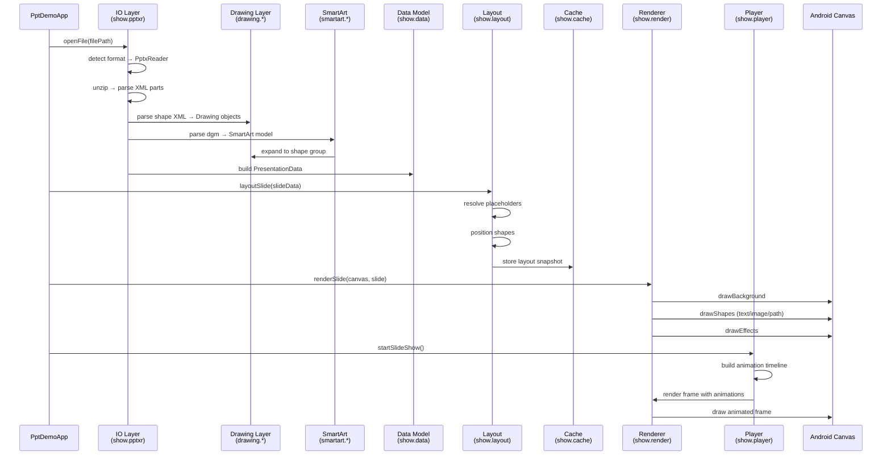

# PPT 渲染管线完整追踪

从 PPTX 文件打开到幻灯片渲染的完整数据流。

---

## 1. 文件打开入口

```
PptController.openFile(filePath)
  → show.shell.PptShell.open(filePath)
    → show.app.PptApplication (演示文稿句柄)
```

### 关键类
- `cn.wps.show.shell.PptShell` — Shell 入口
- `cn.wps.show.app.PptApplication` — 应用逻辑层
- `cn.wps.show.app.SlideModel` — 幻灯片模型管理

---

## 2. IO 层：文件解析

```
PptShell.open()
  → 检测文件格式 (PPTX/PPT/HTML)
  → [PPTX] show.pptxr.PptxReader
    → zip 解压 → 读取 [Content_Types].xml
    → ppt/presentation.xml → 演示文稿结构
    → ppt/slideMasters/*.xml → 母版
    → ppt/slideLayouts/*.xml → 版式
    → ppt/slides/*.xml → 幻灯片
      → 形状解析 → drawing.* (DML 绘图对象)
      → 动画解析 → show.player (动画时间线)
    → ppt/noteSlides/*.xml → 备注
    → ppt/theme*.xml → 主题
  → [PPT] show.pptr.PptReader
    → 二进制记录解析 → show.hslf.* (HSLF 基础)
    → drawing.ddf.* (Escher/DDF 二进制绘图)
```

### 关键类（PPTX 路径）

| 类/包 | 文件数 | 职责 |
|-------|-------:|------|
| `show.pptxr.slide.*` | ~40 | 幻灯片 XML 解析 |
| `show.pptxr.master.*` | ~20 | 母版/版式解析 |
| `show.pptxr.theme.*` | ~15 | 主题解析 |
| `show.pptxr.animation.*` | ~20 | 动画 XML 解析 |
| `show.hslf.*` | 98 | PPT 二进制基础 |
| `show.pptr.*` | 74 | PPT 二进制读取 |

---

## 3. 绘图对象层

```
XML 形状节点 → drawing.*
  drawing.dml.* → DrawingML 形状解析
    → 几何（预设/自定义形状路径）
    → 填充（实色/渐变/图案/图片）
    → 线条
    → 效果（阴影/反射/发光/柔化）
    → 文本框（段落/运行/字体/对齐）
  drawing.ddf.* → Escher 二进制格式
    → DDF 容器/原子记录
    → 二进制形状属性
```

### 关键类（394 文件）
- `drawing.dml.ShapeReader` — DML 形状读取
- `drawing.dml.GeometryReader` — 几何路径解析
- `drawing.dml.FillReader` — 填充解析
- `drawing.dml.TextBody` — 文本框解析
- `drawing.ddf.DdfReader` — Escher 记录解析

---

## 4. SmartArt 层

```
SmartArt 节点 → smartart.*
  smartart.SmartArtReader → 读取 dgm 关系
  smartart.model.* → 数据模型（节点/连接/约束）
  smartart.layout.* → 布局算法（层次/流程/矩阵/金字塔）
  smartart → 展开为 drawing 形状组
```

### 关键类（139 文件）
- `smartart.SmartArtReader` — SmartArt 数据读取
- `smartart.model.SmartArtModel` — 逻辑数据模型
- `smartart.layout.SmartArtLayouter` — 布局算法

---

## 5. 数据模型层

```
解析完成 → 内存数据模型
  show.data.PresentationData
    → show.data.SlideData (幻灯片数据)
      → 形状列表 (drawing 对象)
      → 动画序列
      → 备注
    → show.data.MasterData (母版)
    → show.data.LayoutData (版式)
    → show.data.ThemeData (主题)
```

### 关键类
- `show.data.PresentationData` — 演示文稿数据
- `show.data.SlideData` — 单张幻灯片数据
- `show.model.SlideModel` — 幻灯片模型接口
- `show.app.PptApplication` — 全局应用状态

---

## 6. 布局层

```
幻灯片数据 → 布局
  show.layout.SlideLayouter
    → 解析占位符（从母版/版式继承）
    → 形状定位（绝对坐标/偏移）
    → 文本自动缩放
    → 表格布局
```

### 关键类（9 文件）
- `show.layout.SlideLayouter` — 布局计算
- `show.layout.PlaceholderResolver` — 占位符继承

---

## 7. 缓存层

```
布局结果 → 缓存
  show.cache.SlideCache
    → 幻灯片位图缓存
    → 缩略图缓存
    → 布局快照
```

### 关键类（37 文件）
- `show.cache.SlideCache` — 缓存管理
- `show.cache.ThumbnailCache` — 缩略图

---

## 8. 渲染层

```
缓存/布局 → Canvas 渲染
  show.render.SlideRenderer.draw(canvas, slide)
    → 绘制背景（母版背景）
    → 遍历形状列表
      → 文本框渲染（段落/运行/排版）
      → 图片渲染
      → 自绘形状渲染（路径/几何）
      → 表格渲染
      → 图表渲染
      → SmartArt 渲染
    → 效果渲染（阴影/反射/发光）
```

### 关键类（64 文件）
- `show.render.SlideRenderer` — 幻灯片渲染分发
- `show.render.ShapeRenderer` — 形状渲染
- `show.render.TextRenderer` — 文本渲染
- `show.render.EffectRenderer` — 效果渲染

---

## 9. 放映播放层

```
用户点击播放 → player.*
  show.player.SlideShowPlayer
    → 初始化动画时间线
    → 幻灯片切换动画（淡入/推入/覆盖等）
    → 形状动画（进入/退出/强调/路径）
    → 点击触发器
    → 自动推进定时器
```

### 关键类（140 文件）
- `show.player.SlideShowPlayer` — 放映控制器
- `show.player.AnimationEngine` — 动画引擎
- `show.player.TransitionEngine` — 切换动画

---

## 10. 完整数据流（Mermaid）



---

## 文档日期
- **编写日期**: 2026-04-30
