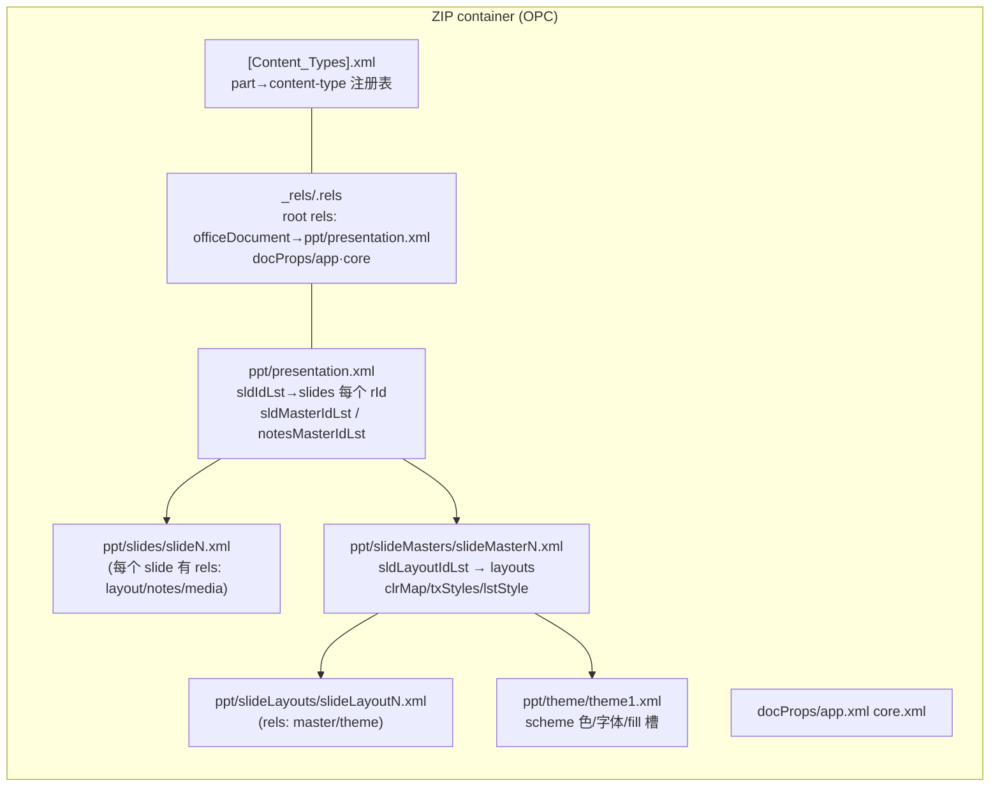

# PPT 渲染管线设计全解：OOXML 协议 → 数据模型 → 每一步的"为什么"

> 目标：让你彻底弄懂一张 .pptx 从字节到像素的**每一步**——功能、数据结构、设计逻辑、为何这样设计，
> 以及 Java（完整）与 Rust（改写中）在每段的差异与缺失。
> 快照：2026-09-03。依据：`PIPELINE_LAYOUT_RENDER_PLAN.md`（S0–S6）、`PIPELINE_OVERVIEW.md`、
> 各 feature `STRUCTURE_ANALYSIS.md` §0.5 设计动机、及对 kfc/dmlw/模型的实读。
> 对应关系：`wc-*`(writer) ↔ `pp-*`(parse) / `pl-*`(layout) / `pr-*`(render)；Java 读侧 `dmlr`、写侧 `dmlw`。

## 0. 思维模型：一条 .pptx 的十步旅程

```text
 ① 文件容器    .pptx = ZIP + OPC 约定（part/rels/content-type）…… pp-12
 ② 打开编排    PptxReader.open：theme 先于 presentation.xml，close 收尾 …… pp-09
 ③ 事件引擎    任意 part 流 → HLXmlReader：XML 字符串 → 数字 element-id + XmlRoAttr …… pp-07
 ④ 词汇/回调   SWReaderMap 54 张表（attr 字符串→enum）；HandlerCallback 四种 mode …… pp-01
 ⑤ 分发树      Slide/Layout/MasterHandler → cSld → nvPr/spTree；子 handler 逐元素写模型 …… pp-01/02
 ⑥ S1 写入     spPr→ShapePr、txBody→KmoTextBody、clrMap/lstStyle→样式槽、theme→KmoTheme …… pp-10/11/03/04
 ⑦ 单位与几何  EMU→三档单位（pl-01）；KmoShowShape.xfrm → 绝对 RectF（pl-02）；ph 继承补齐（pl-03）
 ⑧ 文本框      KmoTextBody → TextBoxData（exToInternal 归一）（pl-04）→ 贪心断行 → 行几何（pl-05）
 ⑨ 快照        ShowTypoShape：flags/rect/children 打包（pl-06），供渲染只读消费
 ⑩ 渲染指令    pr-01 层序+过滤 → pr-02 形状指令 / pr-03 文本指令 → pr-04 Flutter
```

每一段下面按「协议/功能 → 数据结构 → 为什么 → Java / Rust 现状 → 缺失」展开。

---

## 1. OOXML 协议与保存格式层（第 ①② 步的地基）

### 1.1 .pptx 是什么

`.pptx` 是 **ZIP 容器 + OPC 约定**的包：



关键机制：
- **part**：包内每个 XML 流（slideN.xml、theme1.xml…）是一个 part，靠 `[Content_Types].xml` 声明类型，
  靠每个 part 的 `_rels/*.rels` 表达"它引用了谁"；引用用 **rId**（"rId1"）解引用。
- **关系链**：`presentation.xml → sldIdLst(rId) → slide part`；slide 又经自身 rels 挂 layout；
  layout 挂 master；master 挂 theme。**theme 是"先手"**——任何颜色/字体都要先有 scheme 才能解析。
- **保存格式**：WPS 保存就是按同一棵树**反向序列化**——模型 → `dmlw` 标签 writer 族
  （`FillPropertiesWriter`/`EffectWriter`/`ColorWriter`/`TextWriter`…）→ OOXML part → zip。
  读侧 `dmlr`（reader）与写侧 `dmlw`（writer）在 `drawing/dmlr` / `drawing/dmlw` 对称存在。

### 1.2 为什么这样设计

| 协议事实 | 设计动机 |
|---|---|
| part 化 + 引用（rId） | **按需载入、跨 part 复用**：theme/layout 被许多 slide 共享，且打开时可惰性加载；不把整包塞进内存 |
| rels 与 content-type 分离 | 解耦"类型声明"与"引用解析"，part 可独立增删、链接不改名 |
| theme 先手 | 颜色/字体的解析依赖 scheme：**没有 theme，slide 的 spPr 里的 schemeClr 无法落色**（所以 pp-04 排在渲染阻塞里） |
| 数字 element-id 字典 | 见 2.1：解析热路径把字符串标签编译成整型 |
| 保存 = 反向 dmlw | 读写共享同一模型（Kmo*），writer 只是模型的投影——**模型是唯一事实源** |

### 1.3 Java ↔ Rust

| 项 | Java | Rust（2026-09-03） | 缺失/差异 |
|---|---|---|---|
| OPC 容器本体 | wps-io OPC + kfc `OxfrPackage`（私有封装：presPart 定位/FileDamaged/SuffixError） | wps-io OPCPackage ✓（wave0）+ kfc `OxfrPackage.rs` 216 行(1 stub) | `opc/PptxPackage.rs` 薄桥 ✗缺失；getPresPart 双异常载体缺 |
| 打开编排 | `PptxReader.open`（synchronized+读写锁；readApp→getPresPart→PptxrPresentation.open→readCore→close） | `PptxReader.rs` 449 行**模板**（本地 compile_surface 桩未激活） | 桩替换/激活未完成；`PptxrPresentation.rs` 728 行新生成未点验 |
| **保存/写回** | `dmlw` writer 族 + kso filter 链（完整） | **无**（内核只做读侧 parse/layout/render） | **整个写回侧缺失**——MVP 定义为单向渲染路径 |

---

## 2. 解析层（S0/S1）设计逻辑

### 2.1 事件引擎与数字 element-id（第③步）

**功能**：任意 part 流（`<p:presentation …>` 等）被流式解析成事件：`startElement(elementId, XmlRoAttr)` /
`enterSubElement(elementId)` / `endElement(elementId)`。

**数据结构**：`XmlRoAttr`（只读属性视图，`getByName(int)` 按 **attr id** 取属性）；element id 是**字典编译产物**——
kfc `xsd/pml/P.java`/`PMap.java` 静态表把字符串标签编译成 int（`presentation=3211535`、`spTree=3211606`、
`sppr` 子树 `a:` 空间 1114xxx）；Rust 侧对应 `XmlName2Id.rs`。

**为什么**：
1. **性能**：解析热路径最贵的是字符串；把标签/属性名在构建期编译成 int，运行期全部是整型比较/哈希；
2. **跨端一致**：int 是唯一常量，两个语言客户端（Java/Rust）对同一 XML 产生同一 id 流；
3. **低内存**：流式事件 + 只读属性视图，不建 DOM。

**Java/Rust**：Java 完整（kfc HLXmlReader + 字典）；Rust **已就位**——`kfc_kfc_alpha` `HLXmlReader.rs` 130 行
0 stub + `util/UnifiedXmlReader.rs` 43 行真实包装（9/1「空壳」判定已过时）。

### 2.2 handler 树与回调（第⑤步）

**功能**：每个元素一段 handler；`enterSubElement` 返回**子 handler**继续消费子树事件；`endElement` 统一
`save()`+`forceWrite*` 落模型。

**数据结构**：`ElementHandler` trait（startElement/enterSubElement/endElement）；handler 持有**写入目标模型引用**
（如 `ShapePropertiesHandler(ShapePr, HandlerCallback)`）；`HandlerCallback` 封装四种 parser mode 与默认回调策略。

**为什么**：handler 模式 = **流式前进 + 写入位置耦合**——不在内存建树，事件一到立刻写模型；
子元素分发天然递归（cSld→spTree→spPr→fill→color），每个 handler 只管自己一段语义；
callback 把"模型外的副作用"（媒体/颜色/超链接回调）与解析主链解耦。

**Java/Rust**：pp-01/02 **函数级完全对齐**（55+35 测试）；handler 源码已挂 crate 模块树（9/3）。

### 2.3 SWReaderMap 枚举化（第④步）

**功能**：把 XML 里的字符串枚举（layout type、slide size、placeholder 类型、transition…）映射成稳定 i32。
**为什么**：模型层不存字符串——一旦落模型，所有下游（layout/render）用 int 比对；54 张表是**全局归一化字典**，
避免魔法数散落（`layout type miss→23`、`idx 4294967295→-1` 等哨兵在同表内钉死）。
**Java/Rust**：完全对齐（SWReaderMap.rs 555 行；`DGMap` 部分表——blackWhiteMode 有、schemeColorMap/orientationMap/
文本 8 map——仍在补）。

### 2.4 模型写入与 film/protocol（第⑥步的骨架）

**功能**：解析产出「film（形状树/结构）+ protocol（每 part 的属性协议）」；`initRoot` + `updateProtocol(save())`
提交到 Kmo 模型。
**为什么**：解析与模型**分层提交**——part 可重读、protocol 是"这一 part 说了什么"的位图式快照，
后续部分读取（pp-08 阅读顺序）可增量更新；Kmo* 树是**唯一事实源**，layout/render 只读它。
**Java/Rust**：pp-01（04）✓ fixture 面钉死。

### 2.5 S1 写入：spPr / txBody / clrMap·lstStyle / theme（第⑥步）

| 写入 | 数据结构 | 为什么 | Java | Rust 现状 |
|---|---|---|---|---|
| spPr→ShapePr | `ShapePr` 聚合（xfrm/fill/ln/geom/effect/3D 七链） | spPr 是形状"全部可绘制属性"的聚合体，convert 一次翻译成公开 Shape | `ShapePropertiesHandler` 按子元素 id 分发七链 | **✗ 缺口**：01 写 `layout_shape` 轻模型而非 `data/shape/ShapePr.rs`(1300 行在场)；ln/geom 子分发壳；02 fill 子族/03 ln/04 geom 缺 → **渲染阻塞** |
| txBody→KmoTextBody | `KmoTextBody`→`TextBody`→`Paragraph`→`Run`+富文本属性 | 文本是 para/run 富文本树，解析侧先落"原文+属性"，排版再翻译 | `TextBodyHandler`/`ParagraphHandler`（mode 0/1/2 run 状态机；bodyPr 分发） | **✗ 需重做**：现值 `TextBodySurf` 原型（pptx_mvp 驱动在用）≠ Java 语义；data/text 五模型 put* 面在场但列表 API 桩 |
| clrMap/lstStyle | `ColorMapping`(12 槽)/`TextListStyle`(10 槽) | 颜色/文本样式的**槽位寻址**：scheme 色按 name 索引、文本样式按层级 id | `ColorMapHandler`/`TextListStyleHandler`（子元素 id 1114533–1114542） | **✗ handler 缺**；模型层 ColorMapping/TextListStyle/Color ✓；DGMap schemeColorMap 缺 |
| theme→KmoTheme | `KmoTheme`(scheme/font/fill 槽) + `PptxrThemes`(partName 缓存) | theme 跨 part 共享，**按 partName 缓存**同一实例；"theme 先手"决定打开顺序 | `ThemeHandler` + `PptxrTheme.open`（rid→mediaId 回写；Throwable 吞） | 模型 ✓ + `PptxrTheme/Themes.rs` **9/3 新生成**（309/231 行）；ThemeHandler 落点待复核 |

---

## 3. 布局层（S2）设计逻辑

### 3.1 单位系统（pl-01）

**协议**：OOXML 全程 **EMU**（English Metric Unit，**1 英寸 = 914400 EMU**；12700 EMU = 1pt；9525 = 1px@96dpi）。
默认 slide 16:9 = **12192000×6858000 EMU**（13.33″×7.5″）。
**为什么三档**（`UnitsConverter.doc/layout/render`）：EMU 是协议单位，但布局算法与绘制需要不同精度档
（doc=纸面、layout=整数运算、render=像素），**档与档之间只差系数**，集中在一个转换器避免散落换算。
**Java/Rust**：完全对齐（UnitsConverter/UnitConverter/4 converter ✓；slide_viewport.rb… slide_viewport.rs ✓）；
注记：负值舍入 Java `Math.round`(floor(x+0.5)) vs Rust `f32::round`(half-away-from-zero)。

### 3.2 几何：xfrm 与 group 子级（pl-02）

**数据结构**：`Transform2D`（off(x,y)+ext(cx,cy)+rotation+flip+type）；`GroupTransform2D` 派生子级比例
（`childPoint`/`childExtents`）；输出绝对/组局部 `RectF`。
**协议细节**：rotation 单位 **60000 分之一度**（90°=5400000）；group 子级公式
`offset(-chOff) → chExt 比例缩放 → 中心缩放 → 象限宽高互换`（子级旋转 90° 换宽高）。
**为什么**：EMU 坐标是**相对父容器**的，group 一层层套；要画必须**递归合并到 slide 绝对坐标**；
旋转要按文档语义（不丢 1/60000 度精度）但绘制只取 90° 网格——两套表示分离。
**Java/Rust**：ShapeUtil.rs 热路径 ✓（18/18 绿，fixture 面）；注记：`canRotate()`Java 递归语义 vs Rust bool、
`parentGroup()` 条件式 vs 无条件 clone。

### 3.3 placeholder 继承（pl-03）

**功能**：slide 上占位符形状**没有 xfrm/fill/style 时**，按 ph idx/type 从 **layout→master** 逐层补：
`mergeTransform`（自身→layout→master 扫描→兜底）、`mergeShapePr`（own→layout→master follow 链）。
**为什么**：OOXML 版式（layout/master）把"形状模板"放上层，slide 只留占位符引用——**继承是协议规定的
补全机制**；idx/type（title=0/1、body…）是匹配键；footer/date/slideNum（ph 4/5/6）还要看 master HeaderFooter 开关。
**Java/Rust**：PlaceHolderMerger.rs ✓（7 活路径，19/19 绿）；注记：Placeholder `type()` 缺省 8(Java) vs 0(Rust)。

### 3.4 文本框内部模型 TextBoxData（pl-04）

**功能**：`ShapeDataTransform.exToInternal` 把 parse 侧 `KmoTextBody`（富文本原文）**归一**成排版模型
`TextBoxData→TextData→ParaInfo→SpanInfo`（含 insets/anchor/wrap/autofit 判定）。
**为什么**：**解析表示 ≠ 排版表示**。排版引擎（wpslayout 的 typo）只认 TextBoxData，不关心 RST 语系；
归一化把"读取了什么"与"怎么排"解耦，也统一了不同导入源（docx/pptx/手输）。
**Java/Rust**：dataaction 主链 ✓（15/15 绿）；**2 处活路径 panic**（convertBullet/getTextSpacing）；虚分派丢失
（ff 覆写不可达）；wpslayout TextBoxData setIHolder 丢值。

### 3.5 断行：MVP 贪心 vs Java RichTextLayout（pl-05）

**为什么差别**：Java `RichTextLayout`（core-libs wpslayout）是**全功能排版引擎**（bidi/autofit/连字符/段界…），
Rust 侧 wpslayout 还有 **3352 个 todo!**——整块移植风险最高。MVP 采用**贪心断行**（按 advance 累计、超宽强折），
语义对标"断点层"而非"排版一致"；这是**刻意的设计取舍**（先画、后对齐，同 writer 的 M1）。
**Rust 新增**：GreedyWrap/TextBoxGeometry/ShowTypoLine 无 Java 类对应（Java 用 Android Layout 对位）；
注记：anchor 1/2 与 Java `modifyTextBoxAlign` **相反**；advance 缺省隐式 0；`\r` 过滤而非切段。

### 3.6 ShowTypoShape 快照（pl-06）

**功能**：把布局结果打包成 `ShowTypoShape`：isHidden / isPlaceholder / placeholderType / isTextBox +
render 单位 rect + type==0 group 子级**惰性缓存**列表。
**为什么**：**快照隔离**——render 层不再触碰解析模型，只读快照；isHidden/&1 ph/&32 miner(4-7) 过滤在
快照层完成（align pr-01 `begin_filter`）；group 子级惰性 = 不画的树不展开。
**Java/Rust**：ShowTypoShape.rs ✓（15/15 绿）；注记：getShapeRect Java 覆盖式重算 vs Rust 冻结上游几何。

---

## 4. 渲染层（S3–S6）设计逻辑

### 4.1 三层胶片与 drawFlags（pr-01）

**功能**：`drawUnderSlide`：白底（slide EMU→render px）→ 背景形状 → **master film → layout film → slide film**
（`isShowMasterShape` 开关控制父层是否参与）→ `drawFilm` 遍历 spTree.shapeAt(i) → 过滤 → 逐形状渲染。
**为什么**：**版式继承是"画在下面的底图"**——母版/版式形状必须比 slide 形状先画，否则被盖/盖错；
drawFlags 是**按场景（read/thumb/print/back）的位掩码**，控制装饰绘制（ph 文本/占位框/布局框…）开关，
避免把编辑装饰画进打印/缩略图。
**Java/Rust**：pr-01 spec；`begin_filter`（ShapeRender.RS）已接线消费 ShowTypoShape（✓）；drawFlags 常量
（slideDrawFlags=21505154 等）待锁定。

### 4.2 RenderCommand 指令化（pr-02/03/04）

**功能**：把"画什么"投影成指令序列 `DrawRect/DrawPath/DrawText`（fill/line/预置几何/文本行）；
pr-04 由 Flutter/平台消费。
**为什么**：**内核禁止 Android Canvas 语义外泄**——指令 JSON 可跨端（Flutter）、可测（脱离像素）、
像素级一致后移（对齐 writer）；绘制引擎（DrawingRender/FillConvert 等）只取 MVP 子集。
**Java/Rust**：pr-02/03/04 全 spec；依赖上游 pl-06（pr-01 输入）已 PASS。

---

## 5. Java ↔ Rust 差异 / 缺失矩阵（按十步）

| 步 | Java（完整） | Rust（2026-09-03） | 差异/缺失 | 影响 |
|---|---|---|---|---|
| ① 容器/opc | OxfrPackage + getPresPart | kfc OxfrPackage ✓；**PptxPackage ✗** | 薄桥缺失；双异常载体缺 | 真实文件打不开（demo/fixture 绕开） |
| ② 编排 | PptxReader.open 全流程 | **模板+compile_surface 桩**；PptxrPresentation 728 新生成 | 桩未激活；close/readApp/readCore 未跑通 | 不点验不能当 pass |
| ③ 事件引擎 | kfc HLXmlReader + 字典 | **✓ 130 行 + UnifiedXmlReader 43 行** | （9/1 判定过时） | ✅ 已开 |
| ④ 词汇/回调 | SWReaderMap 54 表、四 mode | **✓ 完全对齐** | DGMap 部分表缺 | pp-03/05/10 枚举 miss |
| ⑤ 分发树 | handler 全家 | **✓ 函数级对齐、已挂模块树** | spTree 族 6 handler ✓ | ✅ |
| ⑥a spPr | ShapePropertiesHandler 七链 | **✗ 轻模型偏差 + ln/geom 壳 + 02/03/04 缺** | 写入端不对齐 | **渲染阻塞**（G2） |
| ⑥b txBody | TextBodyHandler 族（状态机） | **✗ surf 原型须重做** | 语义偏差（RST 语系） | 有字必断（G3） |
| ⑥c 样式/theme | ColorMap/TextListStyle/ThemeHandler | **✗ handler 缺**；模型 ✓；PptxrTheme/Themes 新生成 | 查表/分发表未齐 | 颜色/样式槽缺（G5 未点验） |
| ⑦ 单位/几何/ph | UnitsConverter/ShapeInfoCache/PlaceHolderMerger | **✓ 函数级全绿（57 测试）** | 6 处语义注记待钉死；真实模型未接 | fixture 面可跑（G1） |
| ⑧ 文本框/断行 | ShapeDataTransform/RichTextLayout | **✓ 函数级（31 测试）** | 2 活路径 panic；贪心≠Java；新类无 Java 对应 | 夹具可排；真实文本断（G3） |
| ⑨ 快照 | ShowTypoShape | **✓（15 测试）** | getShapeRect 语义注记 | pr-01 过滤已接线 |
| ⑩ 渲染指令 | SlideRender/ShapeRender/TextRender/Canvas | pr-01 begin_filter ✓；**pr-02/03/04 ✗ spec** | 整段未建 | 无像素输出 |
| 写回/保存 | dmlw writer 族 + kso filter | **无** | 整侧缺失 | 只读内核，无保存能力 |

**总缺口**：G1 真实模型接线 → G2 spPr 写入端 → G3 txBody 重做 → G4 编排桩/opc 桥 → G5 新生成未点验 →
G6 六处语义注记 → G7（新增）**dmlw 写回侧整体缺失**。

---

## 6. 设计动机总表（结构矛盾 → 主数据结构 → 关键手段）

| 管线段 | 结构矛盾 | 主数据结构 | 关键手段 | “为什么”一句话 |
|---|---|---|---|---|
| 文件 | 整包太大、跨 part 复用 | OPC part/rels | 按需载入 + rId 引用 + theme 先手 | 打开只读该读的，theme 是颜色/字体的地基 |
| 解析 | XML 字符串最贵 | 数字 id 字典 + XmlRoAttr | 构建期编译标签→int | 热路径零字符串比较 |
| 分发 | 元素树深、写入位置耦合 | ElementHandler 树 | 流式 + enterSubElement 递归 | 事件一到就写模型，不建 DOM |
| 枚举 | handler 间魔法数散落 | SWReaderMap 54 表 | 全局归一化查表 | 模型只存 int，哨兵同表钉死 |
| 提交 | 解析侧与模型侧解耦 | film + protocol + updateProtocol | 分层 save/提交 | 可重读、增量、单一事实源 |
| spPr | 七条属性链同树 | ShapePr 聚合 | 按子元素 id 分发七链 | convert 一次翻译成公开 Shape |
| 文本 | 解析表示≠排版表示 | TextBoxData/TextData/ParaInfo/SpanInfo | exToInternal 归一 | 排版引擎只认归一模型 |
| 断行 | 全功能排版引擎风险高 | Vec<ShowTypoLine>（贪心） | MVP 贪心、Java 一致后置 | 先画、后对齐（同 writer M1） |
| 几何 | 相对坐标嵌套 | Transform2D/GroupTransform2D→RectF | 递归合并到绝对 + 象限宽高互换 | 画之前先有绝对框 |
| ph 继承 | 模板在上层、slide 留引用 | PlaceHolderMerger | idx/type 三层扫描 + follow 链 | 协议规定模板补全机制 |
| 快照 | render 不该碰解析模型 | ShowTypoShape | flags/rect/children 打包 + 惰性 | 快照隔离 + 不画的树不展开 |
| 层序 | 版式继承是底图 | 三层 film + drawFlags | master→layout→slide + 场景掩码 | 防盖错层、装饰不进打印 |
| 指令 | 内核不该依赖平台绘制 | RenderCommand[]（DrawRect/Path/Text） | 指令 JSON 出内核 | 跨端 Flutter、像素门闩后移 |
| 写回 | 读写共享模型 | dmlw writer 族 | 模型→OOXML 投影 | 模型是唯一事实源（Rust 未建） |

---

## 7. 结论：最小链路与"读懂"路径

**读一张 PPT（Java）的十步**已在上文细化；**Rust 当前能走通的**是
`zip/fixture → 事件引擎 ✓ → handler 分发 ✓ → layout_shape fixture → pl-01..06 ✓ → pr-01 过滤 ✓`，
**真实文件闭环还差**：opc 桥（①）→ 编排激活（②）→ 真实模型接线（G1）→ spPr/txBody 写入端对齐（G2/G3）。

**建议深读顺序**（如果目标是"彻底弄懂每一步"）：
1. 本文件十步总览 → 2. `PIPELINE_LAYOUT_RENDER_PLAN.md` 每段断点 → 3. 对应 feature `STRUCTURE_ANALYSIS.md`
   的 §0.5/§1/§2（类图+流程图）→ 4. Java 源码（koffice/presentation/core/cn/wps 或 core-libs/kfc/drawing）。

## 文档索引

- 当前状态图：[PIPELINE_OVERVIEW.md](./PIPELINE_OVERVIEW.md)（9/3 快照）
- 分层对比：[PARSER_JAVA_RUST_PIPELINE.md](./PARSER_JAVA_RUST_PIPELINE.md) · [LAYOUT_JAVA_RUST_PIPELINE.md](./LAYOUT_JAVA_RUST_PIPELINE.md)
- 逐 feature 深读：`parser/features/pp-*/STRUCTURE_ANALYSIS.md` · `layout/features/pl-*/STRUCTURE_ANALYSIS.md`
- Java 字典/引擎：`koffice/core-libs/kfc/kfc_alpha/src/cn/wps/kfc/xsd/pml/P.java` `PMap.java` · `xpxml/reader/`
- 写侧证据：`koffice/presentation/core/cn/wps/drawing/dmlw/`（label writer 族）