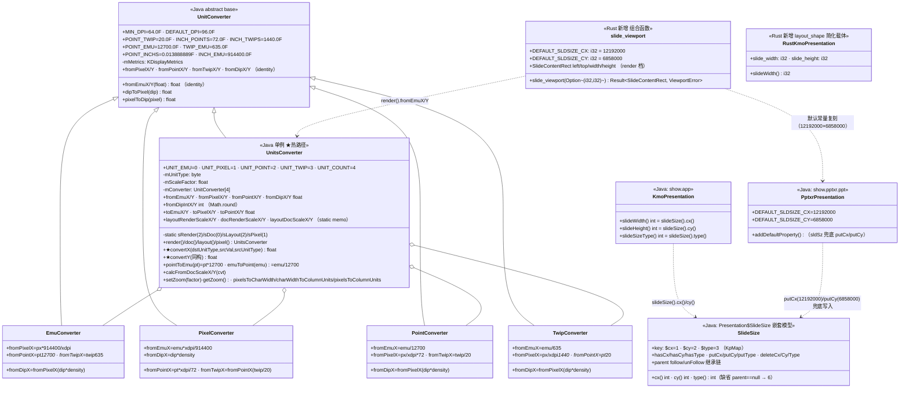
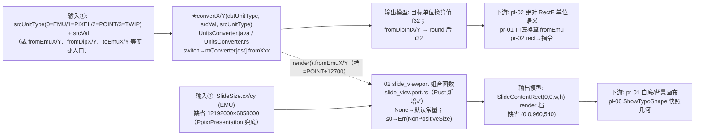
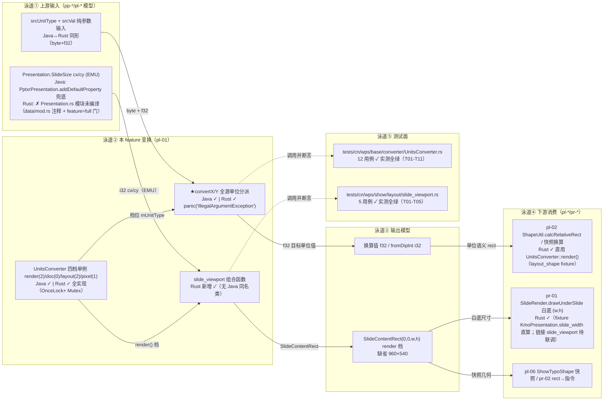
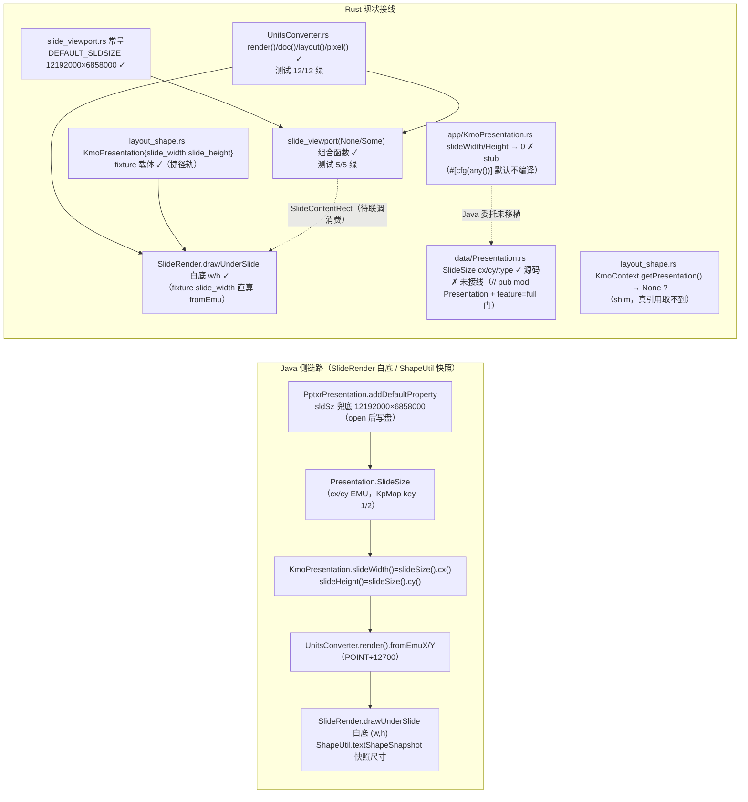

# pl-01-units-view — EMU 与 slide 视口（键类/流程/泳道/依赖/Java↔Rust 对齐）

> 分析日期：2026-09-01（实测）
> 分析依据：feature FEATURE.md / FUNCTIONS.md / functions.csv + Java 源码（真读：`koffice/presentation/core/cn/wps/base/converter/*.java`、`show/data/Presentation.java`、`show/app/KmoPresentation.java`、`show/pptxr/ppt/PptxrPresentation.java`）+ Rust 现状（真读 src/tests/.codeTrees：`libs/ppt-core/src/cn/wps/base/converter/*.rs`、`show/layout/slide_viewport.rs`、`show/data/Presentation.rs`、`show/app/KmoPresentation.rs`、`show/util/layout_shape.rs`、tests 镜像）
> 管线：S2 布局层（上游 pp-* parse / pl-* 链式依赖；下游 pr-* render），主控文档 `libs/ppt-core/PIPELINE_LAYOUT_RENDER_PLAN.md`
> 实测命令：`cargo test --manifest-path libs/ppt-core/Cargo.toml --test 01_function_emu_convert --test 02_function_slide_viewport` → **17/17 全绿**（12 + 5，exit 0，实测于本次分析）

## 0. Feature 目标与管线位置

**一句话目标**：把已 keep 的 Java 换算引擎（`UnitsConverter`/`UnitConverter` 及其子类）以 layout 层契约形式钉死（稳定 API + 数值对拍测试），并用它把 `Presentation.SlideSize`（EMU）投影成 **slide 内容区/白底视口矩形**（render/POINT 档）。

- **depends_on**：无（manifest `depends_on_feature` 为空；FUNCTION.md 也写「前置 feature：无」，与 pl-02 并行）。
- **被谁依赖（下游）**：`pl-02-xfrm-geometry`（depends_on = pl-01-units-view，manifest 明文）；`pl-05-text-typo`（depends_on 含 pl-01）；pr-01（白底尺寸）、pr-02（rect→指令）消费 `render().fromEmuX/Y`。
- **在 S2 布局层中的角色**：**几何基准**（第 0 段）——先定坐标系（EMU↔POINT/PIXEL/TWIP 换算 + slide 内容矩形），再让 pl-02 算框、pl-06 出快照、pr-01 出白底。断行/占位符继承/文本框不在此 feature。
- **范围外**：形状 xfrm（pl-02）、placeholder 继承（pl-03）、文本排版、`android.graphics.Canvas`/Paint 语义、设备密度运行时探测、`doc()` 的页面/notes 尺寸消费者（notesSize 6858000×914400 属 PptxrPresentation 的另一个默认，本 feature 不消费）。

## 0.5 设计动机与心智模型

**心智模型（一句话）**：本层把「EMU 世界坐标」投影到消费侧单位（render/layout=POINT、doc=EMU、pixel=PIXEL），并给 slide 内容区定义一个白底矩形——**先定坐标系，再算框**。

本 feature 解决的四组矛盾：

| 矛盾 | 主数据结构 | 关键手段 |
|---|---|---|
| 「换算引擎早已 keep」vs「feature 必须有产出」 | `UnitsConverter` 四档单例 + `mConverter[4]` 分派表 | 不重写引擎：只契约化 + 数值对拍测试 + 把单位常量钉死在 layout 层（FUNCTION.md：**禁改** UnitsConverter.rs/UnitConverter.rs 语义与 Java 注释锚点） |
| 「Java 真链：KmoPresentation → Presentation.SlideSize → fromEmu 白底」vs「MVP 捷径：fixture 可画」 | `slide_viewport.rs` 组合函数（`Option<(i32,i32)>` 直通常量/fixture） | 拆出**无 Java 同名类的组合函数**：None→默认 12192000×6858000，Some→fromEmu 换算，绕开未接线/未编译的 SlideSize 模型；真 sldSz 来源留给 pp-06（打开链） |
| 「zoom 看起来像缩放」vs「Java 语义 convertX 不含 zoom」 | `mScaleFactor`（= scaledDensity × factor，仅状态） | 锁死：`convertX/Y` 一律不乘 zoom；T11/T03 用例断言 zoom 变更后换算结果全同 |
| 「static 惰性 memo 的跨单例读改写」vs「Rust 无 static mut」 | `OnceLock<Mutex<f32>>` × 6 + `OnceLock<Mutex<UnitsConverter>>` × 4 | Rust 侧不引 async、锁粒度可控（FUNCTIONS.md §6 注）；memo「首算一次、二调同值」由 T09 钉死 |

结构角色速查：四档单例（本 feature 变换入口）→ 4 个 `XxxConverter`（逐单位公式，**系数必须取自 Java 字面量**）→ `SlideSize`（Java 数据源，Rust 未接线）→ `slide_viewport`（Rust 新增组合函数，本 feature 对 02 的产出）。

## 1. 键类分析（类图）

### 键类逐类表（Java 侧命名；★=MVP 热路径，来自真实源码）

| 类 | Java 位置 / Rust 状态 | 关键字段（名:类型→作用） | 关键方法（签名→1 行逻辑） |
|---|---|---|---|
| **UnitsConverter**（★核心） | `koffice/presentation/core/cn/wps/base/converter/UnitsConverter.java`（258 行）/ Rust `src/cn/wps/base/converter/UnitsConverter.rs`（**592 行，全实现**，形态=OnceLock<Mutex> 单例，无 stub） | `mUnitType:byte`→档位；`mScaleFactor:float`→zoom 状态（=scaledDensity×factor）；`mConverter:UnitConverter[4]`→[0]=Emu/[1]=Pixel/[2]=Point/[3]=Twip；static `sRender=new UnitsConverter(2)`/`sDoc=(0)`/`sLayout=(2)`/`sPixel=(1)`（**四档单位类型 Java 字面量**）；6 个 static float memo 系数 | ★`convertX(byte dst,float srcVal,byte src)`→switch(src){0:fromEmuX;1:fromPixelX;2:fromPointX;3:fromTwipX;default:throw IllegalArgumentException}（Rust `panic!("IllegalArgumentException")`）；★`convertY` 同构（Y 轴）；`fromEmuX/Y…fromDipX/Y`→`mConverter[mUnitType].fromXxx`；`fromDipIntX/Y`→`Math.round`(Rust `v.round() as i32`)；`toEmuX=convertX(0,…)`/`toPixelX=(1)`/`toPointX=(2)`；`pointToEmu=pt*12700.0F`、`emuToPoint=emu/12700.0F`；`layoutRenderScaleX`→memo{render().convertX(layout(),1.0F)}（Y 同构；doc/layout 档 pair 同理）；`setZoom`→`mScaleFactor=scaledDensity*factor`、`getZoom`→`mScaleFactor`（**convertX 不乘 zoom**）；`pixelsToCharWidth=(int)((w-5)/cw*100+0.5)*0.01F`（表列宽，壳级） |
| **UnitConverter**（基类） | `…/UnitConverter.java`（82 行）/ Rust `UnitConverter.rs`（148 行，**全实现**） | `mMetrics:KDisplayMetrics`（xdpi/ydpi/density/scaledDensity） | 常量 `POINT_EMU=12700.0F`/`TWIP_EMU=635.0F`/`INCH_EMU=914400.0F`/`POINT_TWIP=20.0F`/`INCH_POINTS=72.0F`/`INCH_TWIPS=1440.0F`/`POINT_INCHS=0.013888889F`/`MIN_DPI=64.0F`/`DEFAULT_DPI=96.0F`；ctor 密度钳制：`xdpi = xdpi>64 ? xdpi : 96`，`|xdpi-ydpi|/xdpi>=0.2 → ydpi=xdpi`；`dipToPixel=dip*density`、`pixelToDip=pixel/density`；from 族全部 identity |
| **EmuConverter / PixelConverter / PointConverter / TwipConverter** | 各 `…/*.java`（各 35 行）/ Rust 同名 `.rs`（各 74 行，Deref→`super_` 基类，**全实现**） | 继承 UnitConverter，无自有字段 | Emu：fromPixelX=`px*914400/xdpi`、fromPointX=`pt*12700`、fromTwipX=`twip*635`、fromDipX=`fromPixelX(dip*density)`；Pixel：fromEmuX=`emu*xdpi/914400`、fromPointX=`pt*xdpi/72`、fromTwipX=`fromPointX(twip/20)`、fromDipX=`dip*density`；Point：fromEmuX=`emu/12700`、fromPixelX=`px/xdpi*72`、fromDipX=`fromPixelX(dip*density)`、fromTwipX=`twip/20`；Twip：fromEmuX=`emu/635`、fromPixelX=`px/xdpi*1440`、fromDipX=`fromPixelX(dip*density)`、fromPointX=`pt*20`（**全部系数 Java 字面量，Rust 逐字复刻**） |
| **Presentation$SlideSize** | `…/show/data/Presentation.java` 2938 行起（嵌套静态类）/ Rust `src/cn/wps/show/data/Presentation.rs` 180 行 struct + 4460 行起 impl（**cx/cy/type/has/put/delete 全实现，但模块未接线**，见 §3/§6） | KpMap 键 `$cx=1/$cy=2/$type=3`；`box`/`parent`（follow 继承链） | `cx()`→`map.has(1)? Decode.toInt(byKey(1)) : (parent==null?0:parent.cx())`；`cy()` 同构（key 2）；`type()`→`map.has(3)? toInt : (parent==null ? **6** : parent.type())`；`putCx/putCy/putType`（Encode.from） |
| **KmoPresentation** | `…/show/app/KmoPresentation.java` 722 行起 / Rust `src/cn/wps/show/app/KmoPresentation.rs` 1246 行起（**壳·stub**） | —（委托 `PresentationAtomData.presentation`） | Java：`slideWidth()=slideSize().cx()`、`slideHeight()=slideSize().cy()`、`slideSizeType()=slideSize().type()`、`slideSize()` 直取；**Rust：`slideWidth()→0`、`slideHeight()→0`、`slideSizeType()→0`、`setSlideSize` 空体（Java 注释保留，逻辑未移植）** |
| **PptxrPresentation** | `…/show/pptxr/ppt/PptxrPresentation.java` 28-30、102-119 行 | `DEFAULT_SLDSIZE_CX=12192000`、`DEFAULT_SLDSIZE_CY=6858000`（private static final） | `addDefaultProperty()`→`Presentation.open(protocol)` 后若无 `hasSlideSize()`：`new SlideSize().putCx(12192000).putCy(6858000).save()` + `writeSlideSize`；无 `hasNotesSize()`：putCx(6858000)/putCy(9144000)。**属 pp-06 parse 领域，layout 侧只消费结果** |
| **slide_viewport**（Rust 新增） | 无 Java 同名类；`src/cn/wps/show/layout/slide_viewport.rs`（42 行，**全实现**，`layout/mod.rs` 已 `pub mod`） | `DEFAULT_SLDSIZE_CX=i32=12192000`、`DEFAULT_SLDSIZE_CY=i32=6858000`（复刻 PptxrPresentation 常量）；`SlideContentRect{left,top,width,height:f32}`；`ViewportError::NonPositiveSize` | `slide_viewport(size: Option<(i32,i32)>) -> Result<SlideContentRect,ViewportError>`→None 用默认；Some 且 cx≤0/cy≤0→Err；否则 `render().fromEmuX/Y` 输出 `(0,0,fromEmu(cx),fromEmu(cy))` |
| **layout_shape::KmoPresentation**（Rust 新增） | 无 Java 同名类；`src/cn/wps/show/util/layout_shape.rs` 727-742 行 | `slide_width:i32`、`slide_height:i32`（纯字段 fixture 载体） | `slideWidth()=self.slide_width`、`slideHeight()=self.slide_height`（**无 EMU↔render 换算语义，由调用方 `UnitsConverter::render().fromEmuX` 承担**）；`KmoContext.getPresentation()→None`（shim，捷径轨占位） |

> 方法/字段/系数全部取自上述 Java/Rust 真实源码字面量；`at 档位与常量（12700/635/914400/20/72/1440/0.013888889/64/96）与 Java 逐字一致`，未编造。

## 2. 流程图与泳道图（依据 I/O 与上下游）

### 2.1 流程图（I/O 端点 → 变换 → 输出模型 → 消费方）

### 2.2 泳道图（上游输入 / 本 feature 变换 / 输出模型 / 下游消费 / 测试面）

## 3. 依赖关系与改写状态（对齐情况核心）

### 3.1 Java↔Rust 逐类映射表

| Java 类（完整路径） | Rust 路径 | 对齐程度 | 备注（缺口/现状） |
|---|---|---|---|
| `cn.wps.base.converter.UnitsConverter` | `src/cn/wps/base/converter/UnitsConverter.rs` | **完全对齐** | 逐方法对照（含 convertX/Y、四档单例、memo 系数、zoom、列宽换算）；唯一偏差：Java `Math.round`（floor(x+0.5)）vs Rust `f32::round()`（half-away-from-zero），负值 dip 舍入口径差异，**需人工确认**（测试只覆盖正值） |
| `cn.wps.base.converter.UnitConverter` | `src/cn/wps/base/converter/UnitConverter.rs` | **完全对齐** | 常量与密度钳制逻辑逐字复刻；`Platform::getDisplayMetrics()` 返回 Option，None 时回退默认 KDisplayMetrics（Java 静态平台度量） |
| `cn.wps.base.converter.EmuConverter` | `src/cn/wps/base/converter/EmuConverter.rs` | **完全对齐** | 公式逐字；Deref→`super_` 模拟继承 |
| `cn.wps.base.converter.PixelConverter` | `src/cn/wps/base/converter/PixelConverter.rs` | **完全对齐** | 同上 |
| `cn.wps.base.converter.PointConverter` | `src/cn/wps/base/converter/PointConverter.rs` | **完全对齐** | 同上 |
| `cn.wps.base.converter.TwipConverter` | `src/cn/wps/base/converter/TwipConverter.rs` | **完全对齐** | 同上 |
| `cn.wps.show.data.Presentation$SlideSize` | `src/cn/wps/show/data/Presentation.rs`（`SlideSize` struct + impl） | **完全对齐** | 方法（cx/cy/type/has/put/delete/follow 链）逐字对照；**但模块未接线**：`show/data/mod.rs` 第 17 行 `// pub mod Presentation;` 注释掉，且 `show/mod.rs` 的 `pub mod data` 挂 `#[cfg(feature="full")]`（默认 feature=[] 不编译）→ 源码存在、默认构建不可达 |
| `cn.wps.show.app.KmoPresentation`（slideWidth/slideHeight/slideSizeType） | `src/cn/wps/show/app/KmoPresentation.rs`（1246-1269 行） | **壳·stub** | `slideWidth()→0`、`slideHeight()→0`、`slideSizeType()→0`、`setSlideSize` 空体（Java 注释保留，委托链 `PresentationAtomData→presentation.slideSize().cx()` 未移植）；且 `app/mod.rs` 的 `pub mod KmoPresentation;` 挂 `#[cfg(any())]`（永不编译）。**「已实现」声称与实测不符**（见 §3.2） |
| `cn.wps.show.pptxr.ppt.PptxrPresentation`（sldSz 默认+写入） | 无同名 Rust 文件；常量复刻于 `show/layout/slide_viewport.rs`（`DEFAULT_SLDSIZE_CX/CY`） | **缺失**（布局侧按常量等价） | 默认值 12192000×6858000 已在 slide_viewport.rs 复刻 ✓；`addDefaultProperty()` 的 writeSlideSize 写盘属 **pp-06**（parse）未动工（布局侧 fixture/常量驱动，FUNCTION.md §1.7「暂缓/不走 pp-06」已披露） |
| —（无 Java 对应） | `src/cn/wps/show/layout/slide_viewport.rs`（`slide_viewport`/`SlideContentRect`/`ViewportError`） | **Rust 新增** | 组合函数：None→默认、Some→fromEmu、≤0→Err；`layout/mod.rs` 已 `pub mod slide_viewport`（默认构建编译）✓ |
| —（无 Java 对应） | `src/cn/wps/show/util/layout_shape.rs`（`KmoPresentation{slide_width,slide_height}` + `KmoContext`） | **Rust 新增** | 捷径轨 fixture 载体（白底/快照的 slide 尺寸来源），EMU 语义由调用方 `UnitsConverter::render().fromEmuX` 提供 |

### 3.2 functions.csv 声称状态 vs 实测核对

| function | functions.csv 声称 | 实测（本次） | 一致性结论 |
|---|---|---|---|
| 01 emu_convert | **pass** | `cargo test --test 01_function_emu_convert` **12/12 绿**（T01-T11 全过；`should_panic` 钉死非法源单位）；src 全实现、无 todo!/unimplemented! | ✅ 声称-实测一致（引擎完全对齐） |
| 02 slide_viewport | **pass** | `cargo test --test 02_function_slide_viewport` **5/5 绿**（缺省 960×540、显式 fromEmu、zoom 无关、None 默认、≤0 拒绝） | ✅ 函数自身声称-实测一致；**但是**其 Java 锚点链「KmoPresentation.slideWidth/Height 已实现」（FUNCTION.md 02 §1.7）**实测为壳**（返回 0）→ 依赖项「声称-实测不符」，已标 §3.1 |
| pl-01-units-view（feature 级） | manifest.csv = **spec**；FEATURE.md 头 = **pass** | 两 function 均实测绿、测试文件存在、Cargo.toml `[[test]]` 已声明 | ⚠ manifest 与 FEATURE.md 冲突（**manifest 陈旧**：layout/README 亦写「全部 spec，loop 未开始」，但 FUNCTION.md 覆盖率报告日期 2026-08-30 证明 loop 已跑）；以实测 + functions.csv 为准 |

## 4. 最小 feature-critical 改写范围

### 4.1 三栏清单

| 档位 | 条目 | 依据 |
|---|---|---|
| **must（对齐缺口必修）** | ① `convertX/Y` 四个 src 分支 + default 错义（Rust 已 panic `IllegalArgumentException`，✅ 无缺）；② 四档单例单位类型绑定（render=2/layout=2/doc=0/pixel=1，✅）；③ `slide_viewport` 组合函数 + 默认常量（✅ 已实现已接线）；④ 与 pl-02/pr-01 的 fromEmu 消费契约（✅ ShapeUtil/SlideRender/ShowTypoShape 已直用 `UnitsConverter::render()`）——**引擎侧无 must 改写项**（FUNCTION.md：本 function 不重写引擎，只契约化+测试） | 实测 + FUNCTION.md §2.2 |
| **stub 已标注** | ① `setZoom/getZoom`：✅ 已实现（Java 语义 `mScaleFactor=scaledDensity*factor`，不参与换算），核对即可；② `pixelsToCharWidth/charWidthToColumnUnits/pixelsToColumnUnits`：已实现（✓），无消费方不单测；③ `KmoPresentation.slideWidth/slideHeight/slideSizeType/setSlideSize`：**壳（返回 0/空体）**，Java 锚点链未移植——需接线才能支撑真 sldSz 链路（见 §6） | FEATURE.md「壳」+ 真读 |
| **defer（Java 语义未对齐可接受）** | ① dip/density 设备探测（MVP 固定 96dpi 常量，不引 Android）；② `doc()` 其它消费者（页面尺寸、notesSize 6858000×914400）；③ pp-06 sldSz 真写盘（`addDefaultProperty` 属 parse）；④ `PptxrPresentation` 的 bSldSz/notesSize 全面等价（布局侧只消费默认值） | FEATURE.md「延后」+ FUNCTION.md |

### 4.2 当前进度（每 function 实测状态）

| order | function_id | 实测状态 | 证据 |
|---|---|---|---|
| 1 | 01_function_emu_convert | **PASS（实测）** | 12/12 测试绿；`UnitsConverter.rs`/`UnitConverter.rs`/4 个 converter `.rs` 全实现、无 todo!/unimplemented!（grep 仅命中两处预期 `panic!("IllegalArgumentException")`）；`.codeTrees/` 有 4 个 converter 的 typeoracle 产物（java2rust 流程已跑） |
| 2 | 02_function_slide_viewport | **PASS（函数级，实测）** | 5/5 测试绿；`slide_viewport.rs` 16/16 行全覆盖（FUNCTION.md §3.7 覆盖率 100%）；但上游数据源链 `KmoPresentation.slideWidth→Presentation.SlideSize` 壳/未接线（依赖项缺口，不阻塞函数自身） |

## 5. 验收口径（钉死值）

> 全部取自 Java 源码字面量与 FUNCTION.md 用例；本 feature 不涉及断行/内缩几何判据（属 pl-05/pl-04）与 ph idx/type 继承规则（属 pl-03），此处不展开。

| 钉死项 | 值（来源） | Rust 现状 |
|---|---|---|
| 默认 slide 尺寸 | `DEFAULT_SLDSIZE_CX=12192000`、`DEFAULT_SLDSIZE_CY=6858000`（PptxrPresentation.java 28-29 行） | `slide_viewport.rs` 常量同值 ✓ |
| 单位常量 | `UNIT_EMU=0/PIXEL=1/POINT=2/TWIP=3/COUNT=4`；`POINT_EMU=12700.0`、`TWIP_EMU=635.0`、`INCH_EMU=914400.0`、`POINT_TWIP=20.0`、`INCH_POINTS=72.0`、`INCH_TWIPS=1440.0`、`POINT_INCHS=0.013888889`、`MIN_DPI=64.0`、`DEFAULT_DPI=96.0`（UnitConverter.java/UnitsConverter.java 字面量） | Rust 常量逐字复刻 ✓（T01-T11 断言） |
| 四档单例单位类型 | render()=**2**(POINT)、layout()=**2**(POINT)、doc()=**0**(EMU)、pixel()=**1**(PIXEL)（ctor 实参） | `get_singleton(&sRender,UNIT_POINT)` 等 ✓ |
| EMU→render 系数 | `render().fromEmuX(12192000) = 12192000/12700 = 960.0`；`fromEmuX = emu/12700`（PointConverter） | T01 断言 960.0 精确 ✓ |
| PIXEL 档 EMU 换算 | `pixel().fromEmuX(emu) = emu*xdpi/914400`；xdpi=96 → 1px=9525.0 EMU（PixelConverter） | T04 断言 9525.0 ✓ |
| 默认视口 | sldSz 缺省 → `(0,0,960,540)`（render 档）；显式 sldSz → `(0,0,fromEmu(cx),fromEmu(cy))` | T01/T02 ✓ |
| 非法源单位 | `switch default → IllegalArgumentException`（convertX/Y） | Rust `panic!("IllegalArgumentException")` + `#[should_panic]`（T05）✓ |
| SlideSize.type 缺省值 | 无 parent 且无 key3 → **6**（Presentation.java 3158 行字面量） | Presentation.rs `r#type()` 同式（`parent==null ? 6`）✓（未编译） |
| zoom 语义 | `setZoom(factor)` 仅写 `mScaleFactor = scaledDensity×factor`；**convertX 不乘 zoom** | T11（01）/T03（02）断言 zoom 前后换算全同 ✓ |
| fromDipIntX 舍入 | Java `Math.round`；用例 `fromDipIntX(1.6)=1` | Rust `v.round() as i32`；正值用例 ✓；**负值口径（floor(x+0.5) vs half-away-from-zero）需人工确认** |
| 失败语义（02） | `cx/cy≤0` Java 未防御；Rust 断言拒绝（panic/Err 二选一钉死） | `ViewportError::NonPositiveSize` Err（T05）✓；`None`→默认（T04）✓ |

## 6. Java↔Rust 管线对比与对齐审计

### 6.1 Java 侧链路 vs Rust 现状接线图

### 6.2 对齐差距表

| 类/链路 | 影响 | 阻塞哪个下游 |
|---|---|---|
| `app/KmoPresentation.rs` slideWidth/slideHeight/slideSizeType 返回 0（壳；文件默认不编译） | 真 pptx 的 sldSz 取不到；若被调用则得到 0 而非 12192000×6858000 | **闭环轨**（真 pptx 打开 → pr-01 白底尺寸、pl-06 快照）；捷径轨不受影响（layout_shape fixture） |
| `data/Presentation.rs::SlideSize` 模块未接线（`// pub mod Presentation;` + `#[cfg(feature="full")]`） | SlideSize 模型不可达，KmoPresentation 无法委托；仅有 fixture 载体 | 同上（真链依赖）；函数级（slide_viewport 自身）不阻塞 |
| `slide_viewport` 当前无消费方（仅自身测试） | 产出未被 SlideRender/ShapeUtil 调用（白底在 SlideRender 内用 fixture 值直算） | 无阻塞（函数就绪；pl-06/pr-01 联调时决定接线方式）——**接线点待定，需人工确认** |
| manifest.csv spec vs functions.csv pass / FEATURE.md pass | 状态台账不一致（layout README 亦陈旧） | 无（文档治理） |
| `Math.round` vs `f32::round()` 负值口径 | fromDipIntX(-1.5) 语义可能偏差（Java floor(x+0.5)=-1，Rust round=-2） | 无现行消费方（dip 恒正）；**需人工确认** |

### 6.3 结论

**函数级 PASS**：01（12/12）与 02（5/5）的声称 pass 经**实测 cargo test 核实成立**（共 17 用例全绿）；换算引擎（UnitsConverter/UnitConverter/4 converter）完全对齐、无 stub/todo!；slide_viewport 组合函数含默认常量、错误语义、zoom 无关性，均钉死。**链路级**：捷径轨（fixture KmoPresentation + UnitsConverter 直算）已接线可画白底；闭环轨的 Java 数据源链（`KmoPresentation.slideWidth → Presentation.SlideSize`）在 Rust 为 **壳/未编译**——`KmoPresentation.rs`「已实现」声称**实测不符**（返回 0），`Presentation.rs::SlideSize` 源码对齐但模块未启用。不阻塞 pl-02（换算依赖完整、测试绿），但**阻塞「真 pptx → 白底尺寸」闭环轨**的 sldSz 数据源（pp-06 打开链 + app/data 接线）。