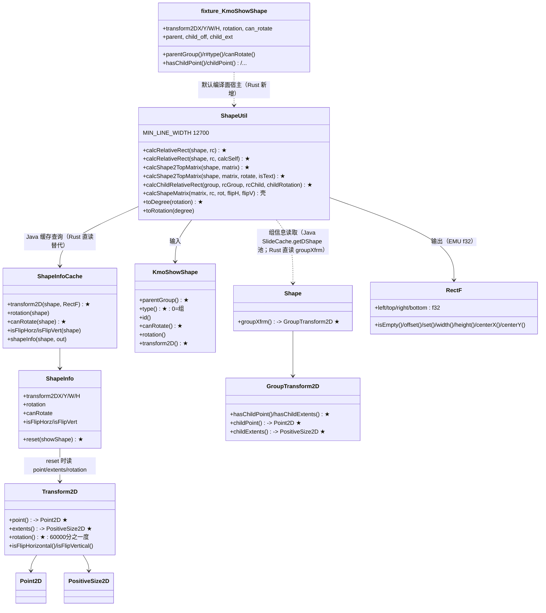
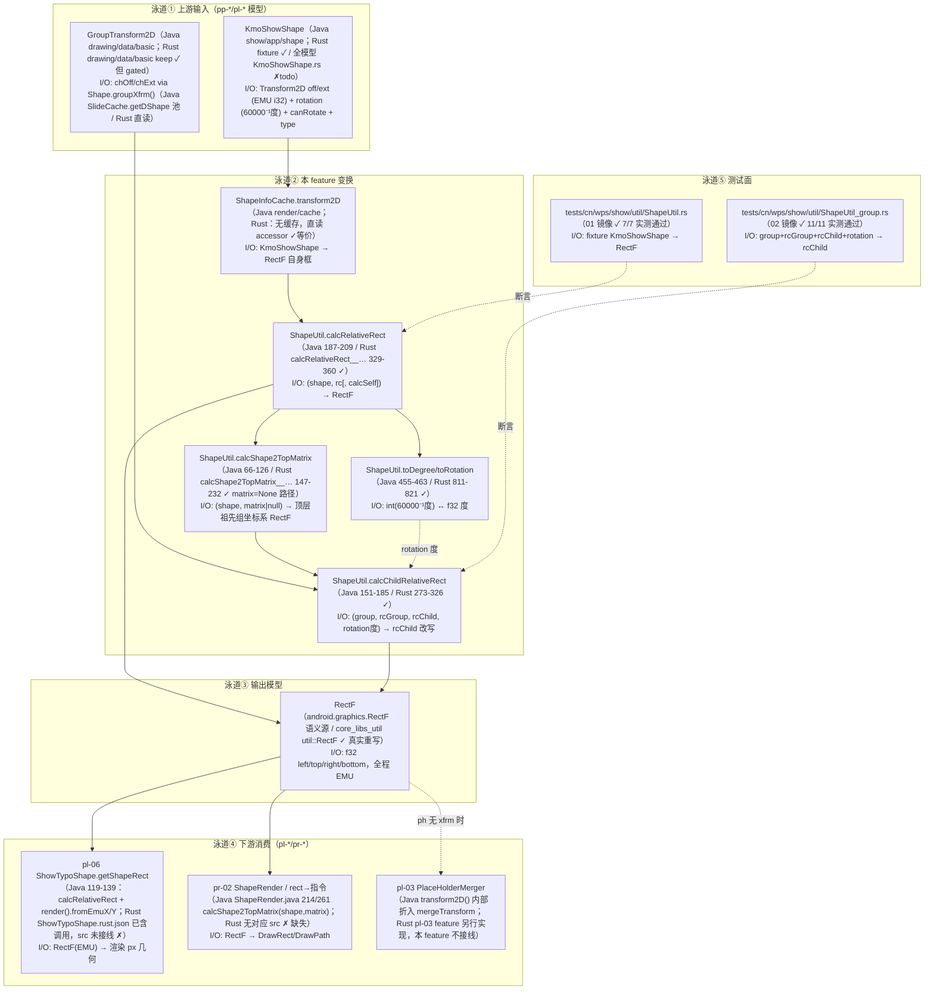
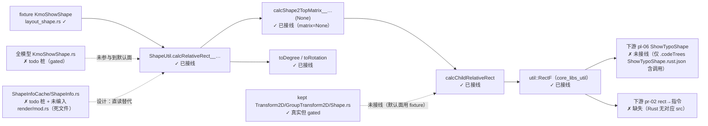

# pl-02-xfrm-geometry — 形状绝对几何（键类/流程/泳道/依赖/Java↔Rust 对齐）

> 分析依据：feature FEATURE.md / FUNCTIONS.md / functions.csv + Java 源码（真读）+ Rust 现状（真读 src/tests/.codeTrees，实测 `cargo test`）
> 管线：S2 布局层（上游 pp-* parse / pl-* 链式依赖；下游 pr-* render），主控文档 libs/ppt-core/PIPELINE_LAYOUT_RENDER_PLAN.md
> 分析日期：2026-09（实测基准：src 文件 2026-08-30/09-01 快照；`cargo test --test 01_function_shape_absolute_rect --test 02_function_group_child_rect` 实测 18/18 通过）

## 0. Feature 目标与管线位置

**一句话目标**：把每个 `KmoShowShape` 的 `Transform2D`（`off`+`ext`+`rotation`，EMU）变成 **slide 上的绝对 EMU 矩形**（`calcRelativeRect`），group 子级经 `calcShape2TopMatrix` + `calcChildRelativeRect`（`chOff/chExt` 比例 + 子级 rotation 象限宽高互换）递归映射进组局部渲染尺寸空间——回答「画在哪儿」。

- **depends_on**：`pl-01-units-view`（单位语义，manifest.csv）；不强依赖其它（捷径轨可 fixture `Transform2D`，FEATURE.md §依赖）。
- **被谁依赖（manifest.csv）**：`pl-03-ph-merge`（depends_on 含 `pl-02-xfrm-geometry`）、`pl-06-typo-shape`（depends_on 含 `pl-02-xfrm-geometry`）；functions.csv 另列下游 `02;pl-06;pr-02;pp-13:03`（`pp-13` 不在当前 manifest，按 CSV 原样记录）。
- **S2 布局层角色**：环节①「几何（绝对 rect）」（PIPELINE doc §S2）；纯数值变换链，输出 `RectF`（EMU，f32），不输出绘制矩阵。
- **范围外**：单位换算（pl-01 的 `UnitsConverter.render().fromEmuX/Y`，到 S6 前不换算）、placeholder 继承（pl-03 `PlaceHolderMerger`，Java 的 `KmoShowShape.transform2D()` 会把 ph-merge 折进返回值，见 §5/§6 差距）、文本框排版（pl-04/05）、任何 `android.graphics.Canvas/Paint` 语义、flip/rotation 的矩阵绘制（`calcShapeMatrix` 壳）。

**状态声明核对点（实测结论先置顶）**：
- `functions.csv` **两行 status 均为 `pass`**（非空白）；`manifest.csv` pl-02 状态 = **`spec`**；FEATURE.md / FUNCTIONS.md / 两个 FUNCTION.md 均自称 **`pass`**。→ manifest 与 feature 文档存在状态漂移（spec vs pass）。
- 实测：两个 function 的 Rust 源码为**真实实现（非 todo 壳）**，镜像测试存在且 `cargo test` **18/18 通过**（01=7/7，02=11/11）→ function 级「声称 pass」与实测**相符**；但 feature 级「pass」不完备（全模型 `KmoShowShape` accessor 仍 todo 桩，见 §3/§4/§6）。

## 0.5 设计动机与心智模型

**心智模型一句**：本层把「形状的局部 `off/ext` + 组的 `chOff/chExt` 比例 + 子级 rotation（60000 分之一度）象限互换」投影成「slide 上的轴对齐 EMU 矩形（`RectF`）」，输出是**数值**不是绘制；矩阵（rotate/flip 到 Canvas）不是 MVP 输出主体。

**设计矛盾表**：

| 矛盾 | 主数据结构 | 关键手段 |
|---|---|---|
| Java 的 `ShapeInfoCache`（MRU + ThreadLocal + ShapeInfo 池）是性能缓存层，形状几何真正语义是 `ShapeInfo.reset` 即 `transform2D().point()/extents()/rotation()` 的直读 | `ShapeInfo`（transform2DX/Y/W/H、rotation、canRotate、isFlip*） | Rust 首版**直读模型**：`KmoShowShape` accessor 直接出字段，`ShapeInfoCache/ShapeInfo` 不搬（壳 stub，死文件） |
| 全量 `KmoShowShape`（show/app）依赖 kproto/atom 存储且仍 gated、`transform2D()/canRotate()/parentGroup()/type()` 全 `todo!()`；默认 feature 需要可编译面 | `layout_shape.rs` 的 fixture `KmoShowShape`（Rust 新增，无 Java 对应类） | fixture 提供 `transform2DX/Y/W/H`、`rotation`、`can_rotate`、`parent`、`child_off/child_ext` 直读字段 → pl-02 在默认面即可编译/测试/被下游调用；全模型接入属后续「full 面展开」 |
| Java `calcShapeMatrix`（`preTranslate/preRotate/preScale` 组合 android.Matrix）MVP 不需要 | — | `matrix==None` 路径完整实现；`matrix!=None` 路径 `todo!("DEFERRED_NON_FUNCTION")` 壳 |
| `RectF`（android）不可移植 | core_libs_util `RectF`（f32 left/top/right/bottom，真实 java2rust rewrite） | pl-02 全程用 `util::RectF`，`isEmpty/offset/set/width/height/centerX/centerY` 与 Java 同名同语义 |

**特有「为什么」**：① Java `parentGroup()`（KmoShowShape.java:422-428）返回**条件式**（见 §1 与 §6 差距栏——其字面语义是「组的父容器为空时返回 null」，与 Rust fixture 无条件 `parent.clone()` 不同，已标需人工确认）；② group 子级映射**不叠加组位置**（`calcChildRelativeRect` 只用 `rcGroup.width()/height()`，Java 151-185 查证）——这是 Java 语义而非笔误，测试 T02（组 (1000,2000) 但子结果不叠加偏移）已验证；③ rotation 参与 `calcChildRelativeRect` 的是**子级自身**的 rotation（`canRotate` 判定），半开区间 `[45,135)∪[225,315)` 换挡，边界 45 含 / 135 不含、225 含 / 315 不含（Java 172 行）。

## 1. 键类分析（类图）



**逐类表格**（方法签名→1 行逻辑，★=热路径；来自真实源码）：

| 类 | Java 位置 | 关键字段（名:类型→作用） | 关键方法（签名→1 行逻辑） |
|---|---|---|---|
| `ShapeUtil` | `koffice/presentation/core/cn/wps/show/util/ShapeUtil.java`（1170 行） | `MIN_LINE_WIDTH=12700`（行 64，EMU=1pt 线宽下限） | ★`calcRelativeRect(KmoShowShape, RectF[, boolean calcSelf])`（187-209）：`calcSelf||rc.isEmpty()` 时经 `transform2D(shape, rc)` 读自身框；`parentGroup()!=null` → `rotation=canRotate?toDegree(rotation):0`，`rcGroup=calcShape2TopMatrix(parent,null)`，`calcChildRelativeRect(parent,rcGroup,rc,(float)(int)rotation)`。★`calcShape2TopMatrix(shape, matrix[,rotate,isText])`（66-126）：收集 `shapeLink`（shape→顶层组），自顶向下逐层读 transform2D 框；上一层是组（`type()==0`，`isParentGroup`）→ `calcChildRelativeRect(tmpShape.parentGroup(), rcGroupShape, rcShape, rotation)`；`matrix!=null` → `calcShapeMatrix(...)`；返回顶层祖先组坐标系矩形。★`calcChildRelativeRect(group, rcGroup, rcChild, childRotation)`（151-185）：`hasChildPoint&&hasChildExtents` 时 `rcChild.offset(-chOff)` → `scaleX=cx==0?1.0:rcGroup.width()/cx` → `centerX=rcChild.centerX()*scaleX` → `rotation%360;<0→+360` → `[45,135)∪[225,315)` 内 `width*=scaleY;height*=scaleX` 否则 `width*=scaleX;height*=scaleY` → `rcChild.set(centerX-w/2, centerY-h/2, …)`。`calcShapeMatrix(matrix,rc,rot,flipH,flipV)`（128-149）：preTranslate 半宽半高→preRotate(归一化 deg)→preScale(flip ±1)——**MVP 壳**。`toDegree(int)=rotation/60000.0F`、`toRotation(float)=(int)(degree*60000.0F)`（457-463）。 |
| `ShapeInfoCache` | `render/cache/ShapeInfoCache.java`（165 行） | `mShapeInfoCache: MRUIntKeyCache<ShapeInfo>`、`mLocalShapeInfo: ThreadLocal<ShapeInfo>`、`mLatestMatchId/Info`（MRU 性能设施） | ★`transform2D(KmoShowShape, RectF)`（113-133）：`left=transform2DX; top=transform2DY; right=left+W; bottom=top+H`（缓存未命中→`add`→`reset`）。`rotation`（33-47）/`canRotate`（49-63）/`isFlipHorz/Vert`（65-95）：MRU 命中取，否则 `add(showShape,id)`。`shapeInfo(shape, out)`（97-111）：`copyFrom`。→ **Rust 不搬缓存**（`ShapeInfo.reset` 语义直读，FEATURE.md/FUNCTIONS.md 双重查证）。 |
| `ShapeInfo` | `render/cache/ShapeInfo.java`（49 行） | `canRotate/isFlipHorz/isFlipVert: boolean; rotation; transform2DX/Y/W/H: int` | ★`reset(KmoShowShape)`（16-30）：`transform2D=showShape.transform2D(); canRotate=showShape.canRotate(); rotation=transform2D.rotation(); point→X/Y; extents→W/H; isFlip*=transform2D`。`copyFrom`/`reset()` 空。→ Rust 语义内联进 accessor 直读。 |
| `KmoShowShape` | `show/app/shape/KmoShowShape.java`（2829 行） | `dgShapeId`、atom `ShowShapeAtomData.parentGroup` | ★`parentGroup()`（422-428）：**条件语义**——自身 parentGroup 为 null 返回 null；否则查父的 parentGroup，父的为 null 也返回 null，否则返回父组（字面语义=「组的父容器为空时视作不在组」，且此怪癖与「直子是否进映射」有关，**需人工确认**；Rust fixture 为无条件 `parent.clone()`）。★`type()`（544-546）`=DgStore.queryType(dgShapeId)`（0=组）。★`canRotate()`（2261-2278）：type 0→全部子级可旋转；type 4→false；default→true（**递归语义**，fixture 简化为 bool 字段）。`transform2D()`（2288-2290）：`!hasTransform2D && isPlaceHolder` 时走 `PlaceHolderMerger.mergeTransform(this)`（**ph 继承折进 transform2D**——pl-03 依赖点）。`rotation()`（2280-2282）`=transform2D().rotation()`。`getSlideCache()`（414-416）。 |
| `Transform2D` | `drawing/data/basic/Transform2D.java`（406 行） | kproto `map: KpMap`（键 1=flipH/2=flipV/3=rotation/4=extents/5=point）、`parent`（follow 链） | ★`point()`（356-370）：map→`Point2D` 懒解析；★`extents()`（305-319）：map→`PositiveSize2D`；★`rotation()`（284-291）：`map.has(3)?Decode.toInt:parent==null?0:parent.rotation()`（**60000 分之一度 int**）；`isFlipHorizontal/Vertical()`（242-282）。→ Rust `drawing/data/basic/Transform2D.rs`（keep，687 行真实 java2rust，kproto 语义保留；**gated 于 full 面**，pl-02 默认面用 `layout_shape` fixture `Transform2D`）。 |
| `GroupTransform2D` | `drawing/data/basic/GroupTransform2D.java`（310 行） | kproto `map`（键 1=childExtents/2=childPoint）、`parent` | ★`childPoint()`（260-274）/`childExtents()`（209-223）：map 懒解析或 follow parent；★`hasChildPoint/hasChildExtents`（276-278/225-227）。→ Rust `GroupTransform2D.rs`（keep，510 行真实，`has*` 已实现；gated）。 |
| `Shape` | `drawing/data/shape/Shape`（kproto） | `groupXfrm` 字段（$13） | ★`groupXfrm()` → Rust `Shape.rs`（keep，2975 行；1451-1471 真实实现，含懒解析/父链；gated）。Java 侧经 `SlideCache.getDShape()` 池借临时 Shape（`dgGroup.load(group.drawingShape())`；`dgGroup.close()` 归还于 if 分支内）——**Rust 免池直读**。 |
| `RectF` | android.graphics.RectF（语义源） | `left/top/right/bottom: float` | `isEmpty()=left>=right\|\|top>=bottom`；`offset(dx,dy)`；`set(l,t,r,b)`；`width()/height()`；`centerX()=(l+r)*0.5F`。→ Rust `core_libs_util/util/src/cn/wps/graphics/RectF.rs`（**真实重写**，594 行；pl-02 的输出载体）。 |
| fixture `KmoShowShape` | **Rust 新增（无 Java 对应类）** | `transform2DX/Y/W/H: i32`、`rotation: i32`、`can_rotate: bool`、`parent: Option<Rc>`、`child_off/child_ext: Option<(i32,i32)>`、`shape_type`（0=组）… | `parentGroup()=parent.clone()`（无条件，见差距）、`r#type()=shape_type`、`canRotate()=can_rotate`、`rotation()=rotation`、`hasChildPoint=child_off.is_some()`、`childPoint()=(i32,i32)`（元组，非 Point2D）。→ `layout_shape.rs`（820 行），pl-02 默认编译面宿主。 |

## 2. 流程图与泳道图（依据 I/O 与上下游）

### 2.1 流程图（I/O 端点 → 变换 → 输出模型 → 消费方）

```mermaid
flowchart LR
    A["KmoShowShape<br/>Transform2D off/ext (EMU i32)<br/>rotation 60000⁻¹度"] --> B["calc_relative_rect<br/>(Java calcRelativeRect 187-209<br/>Rust 329-360 ✓)"]
    B --> C{"parentGroup 非空?"}
    C -- "否" --> O1["RectF = 自身 transform2D 框<br/>(left,top,left+W,top+H)<br/>无父 = slide 绝对"]
    C -- "是" --> D["rotation = canRotate ? toDegree(r) : 0<br/>(÷60000，Java 457-459 / Rust 812-815 ✓)"]
    D --> E["calc_shape2_top_matrix(parent, None)<br/>→ rcGroup 组绝对框<br/>(Java 66-126 / Rust 147-232 ✓)"]
    E --> F["calc_child_relative_rect(parent, rcGroup, rc, (int)rot)<br/>(Java 151-185 / Rust 273-326 ✓) ★核心五步"]
    F --> O1
    O1 --> G["下游消费<br/>pl-06 ShowTypoShape.getShapeRect<br/>pr-02 rect→DrawRect 指令<br/>(Java 119-139 / Rust 未接线)"]
    subgraph 02 内部五步 [calc_child_relative_rect 五步]
        H["hasChildPoint && hasChildExtents?<br/>否 → rcChild 原样"] -->|"是"| I["rcChild.offset(-chOff.x, -chOff.y)"]
        I --> J["scaleX = cx==0 ? 1.0 : rcGroup.width()/cx<br/>scaleY 同理"]
        J --> K["centerX = rcChild.centerX()*scaleX<br/>centerY 同理"]
        K --> L["rotation %= 360; <0 → +360<br/>[45,135)∪[225,315) → 宽高互换"]
        L --> M["rcChild.set(centerX-w/2, centerY-h/2, …)"]
    end
    F -.-> H
```



### 2.2 泳道图（必含，边标注 I/O 数据类型，节点标注 Java 类名 + Rust 状态）



## 3. 依赖关系与改写状态（对齐情况核心）

**Java↔Rust 逐类映射表**（第四列取值固定为五档之一）：

| Java 类（完整路径） | Rust 路径 | 对齐程度 | 备注/差距 |
|---|---|---|---|
| `cn.wps.show.util.ShapeUtil` | `src/cn/wps/show/util/ShapeUtil.rs`（2105 行） | **部分对齐** | ★热路径 4 方法 + `toDegree/toRotation` 与 Java 逐行对齐（fixture 编译面，实测 green）；但①依赖的 `KmoShowShape` accessor 语义未对齐（`canRotate` 递归/`transform2D` 隐含 ph-merge/`parentGroup` 条件式，见 §6）；②38 处 `todo!("DEFERRED_NON_FUNCTION")` 壳（`calcShapeMatrix`/文本 rect 族/snapshot 族等）。 |
| `cn.wps.show.render.cache.ShapeInfoCache` | `src/cn/wps/show/render/cache/ShapeInfoCache.rs`（21 行） | **壳·stub** | 全 `todo!()` 自动桩，且 `render/mod.rs` **未声明 `cache` 模块**（死文件，不编译）。按设计（MRU 性能层不搬，FUNCTION.md §1.7）**直读替代**→ 壳已标注、非 critical。 |
| `cn.wps.show.render.cache.ShapeInfo` | `src/cn/wps/show/render/cache/ShapeInfo.rs`（14 行） | **壳·stub** | 同上：全 `todo!()`，死文件；语义以 `transform2D()` 直读等价（`reset` 语义）。 |
| `cn.wps.drawing.data.basic.Transform2D` | `src/cn/wps/drawing/data/basic/Transform2D.rs`（687 行） | **完全对齐** | keep，真实 java2rust（kproto `KpMap`/`KoBin` decode、follow 父链、`point/extents/rotation/isFlip*`）；但 `drawing/data` gated 于 `feature="full"`，pl-02 默认面实际用 `layout_shape` fixture `Transform2D` → **未接线到 pl-02 编译面**。 |
| `cn.wps.drawing.data.basic.GroupTransform2D` | `src/cn/wps/drawing/data/basic/GroupTransform2D.rs`（510 行） | **完全对齐** | keep，`childPoint/childExtents/hasChild*` 已实现；同样 gated（未接线默认面；fixture 的 `child_off/child_ext` 承担直读）。 |
| `cn.wps.show.app.shape.KmoShowShape` | `src/cn/wps/show/app/shape/KmoShowShape.rs`（42 行） | **壳·stub** | 全 `todo!()`（`transform2D/canRotate/getType` 等），且 `show/app` gated（`feature="full"`）。**这是完整模型接线的硬缺口**——pl-02 当前只能吃 fixture。 |
| `cn.wps.drawing.data.shape.Shape` | `src/cn/wps/drawing/data/shape/Shape.rs`（2975 行） | **完全对齐** | keep，`groupXfrm()`（1451-1471）真实实现；gated。 |
| `cn.wps.drawing.data.basic.Point2D / PositiveSize2D` | `src/cn/wps/drawing/data/basic/Point2D.rs / PositiveSize2D.rs` | **完全对齐** | keep（`x()/y()`、`cx()/cy()`）；gated；fixture 面以 `(i32,i32)` 元组替代（`childPoint()/childExtents()` 返回元组）。 |
| `android.graphics.RectF`（语义源） | `libs/core-libs/util/util/src/cn/wps/graphics/RectF.rs`（594 行） | **完全对齐** | 真实重写（`isEmpty/offset/set/width/height/centerX/centerY`），pl-02 输出载体，**已接线**（ShapeUtil.rs 与测试均引用）。 |
| `cn.wps.show.app.shape.PlaceHolderMerger`（`mergeTransform`） | （pl-03 feature 范围） | **缺失** | Java `KmoShowShape.transform2D()`（2288-2290）对「无 xfrm 且是 ph」折入 `mergeTransform`；Rust 侧归属 pl-03，**本 feature 不接线** → pl-02 在真实模型上依赖 pl-03 先行合并或全模型 accessor 复刻该折入逻辑。 |
| —（无 Java 对应类） | `src/cn/wps/show/util/layout_shape.rs`（fixture `KmoShowShape` 等，820 行） | **Rust 新增** | 默认编译面宿主：`parentGroup/r#type/canRotate/rotation/hasChildPoint/childPoint/childExtents` 直读；`r#type()==0` 表示组（与 Java `type()==0` 一致）。 |

**functions.csv 声称状态 vs 实测核对**：

| function_id | functions.csv status | FUNCTION.md 声称 | 实测（源码+测试） | 一致性 |
|---|---|---|---|---|
| `01_function_shape_absolute_rect` | pass | pass（7 用例，coverage 102/196 行 52.0%） | `calc_relative_rect`(2/3 参) + `to_degree/to_rotation` 真实实现；镜像测试 7/7 `cargo test` 通过 | **属实**（fixture 面）；但 FUNCTION.md 覆盖率报告基于 196 行快照，当前文件 2105 行 → 报告数据陈旧 |
| `02_function_group_child_rect` | pass | pass（11 用例，coverage 107/196 行 54.6%） | `calc_child_relative_rect` + `calc_shape2_top_matrix`(matrix=None) 真实实现；镜像测试 11/11 通过 | **属实**（fixture 面）；覆盖率报告同样陈旧 |
| feature 级 | manifest.csv=**spec** | FEATURE.md/FUNCTIONS.md=**pass** | 全模型 accessor（`KmoShowShape.rs`）仍全 `todo!()` | **声称 pass 与 manifest spec 漂移**；function 级 pass 有效，feature 级 pass 需「全模型接线」后成立 |

## 4. 最小 feature-critical 改写范围

| 栏 | 内容 |
|---|---|
| **must（对齐缺口必修）** | ① `calc_relative_rect` 全语义（含 `calcSelf` 参数、`parentGroup` 分支、rotation `to_degree` 换算）——**已实现，实测 7/7**；② `calc_child_relative_rect` 五步全语义（offset→scale→center→rotation 象限互换，`hasChild*` 缺失原样、`cx==0→1.0`）——**已实现，实测 11/11**；③ `calc_shape2_top_matrix`（`matrix=None` 路径）——**已实现**；④ 全模型 `KmoShowShape` 的 `transform2D()/canRotate()/parentGroup()/type()` accessor 从 `todo!()` 补为真实实现（`show/app` 展开 + `full` 面），并复刻 Java 语义（`canRotate` 递归、`parentGroup` 条件式、`transform2D` 的 ph-merge 折入）——**未做，阻塞闭环轨**（捷径轨不受阻）。 |
| **stub 已标注** | `calcShapeMatrix`、`calcRelativeTextRect`、`calcShapeRect`、`calcShapeTextRect`(2 参)、`getGdValue`×2、`getPresetValue`、`calcShapeFlipEx/calcShapeFlip`、`calcShapeRotation`、`extendShapeRect`、`getTable`、`shapeSnapshot`×2、`textShapeSnapshot`×2/`textShapeSnapshotWithRelativeInfo`、`slideSnapshot`×3、`adjustCanvas`、`setGlCachEnable`、`invertCoordFor3dShape`、`isGifShape`、`isTable`、`calVirtualGroupRect/Bound`、`degree2Radian`、`isSameArrayShape`、`RoundCornerCLipSizeType`——全部 `todo!("DEFERRED_NON_FUNCTION")`（38 处），均已标注，不经过 MVP 热路径。`ShapeInfoCache/ShapeInfo` 自动 todo 桩（死文件，设计上直读替代）。 |
| **defer（Java 语义未对齐可接受）** | ① `calcShapeMatrix`/`matrix!=null` 路径（pr-02 旋转绘制需要时再开）；② `calcShape2TopMatrix` 的 `isText` flip 修正分支（文本 flip 修正，pl-05）；③ `extendShapeRect`（线宽膨胀 101600 EMU 下限，pr-02）；④ MRU/ThreadLocal 缓存设施（Rust 直读模型，不做缓存）；⑤ Java `parentGroup()` 条件返回怪癖的对齐（等真实模型展开时一起核对，需人工确认）；⑥ 覆盖率报告刷新（FUNCTION.md §3.7 数据基于旧快照）。 |

**当前进度（每 function 实测状态）**：`01_function_shape_absolute_rect` **实测 PASS**（源码真实 + 镜像测试 7/7 绿）；`02_function_group_child_rect` **实测 PASS**（11/11 绿）；`calc_shape2_top_matrix` 属 02 一并绿。feature 级剩余 = 全模型 `KmoShowShape` accessor 补桩（blocked 于 `show/app` 展开与 `full` 面，非本 feature 内可独立完成）。

## 5. 验收口径（钉死值）

| 项 | 值 | 依据（源码） |
|---|---|---|
| rotation 系数 | `toDegree(int r)=r/60000.0F`；`toRotation(float d)=(int)(d*60000.0F)` | ShapeUtil.java:457-463（Rust ShapeUtil.rs:811-821 同） |
| 单 shape 框 | `left=transform2DX, top=transform2DY, right=left+transform2DW, bottom=top+transform2DH`；无 xfrm → `(0,0,0,0)` | ShapeInfoCache.java:113-133；ShapeUtil.java:191-195 |
| `calcSelf` 语义 | `if (calcSelf \|\| rcShape.isEmpty()) transform2D(shape, rc)` | ShapeUtil.java:192 |
| 组判定 | `type()==0` 为组（`isParentGroup=tmpShape.type()==0`） | ShapeUtil.java:121；KmoShowShape.java:544-546 |
| `canRotate` | type 0=所有子级可旋转；type 4=false；default=true | KmoShowShape.java:2261-2278 |
| 组缩放 | `scaleX = cx==0 ? 1.0F : rcGroup.width()/(float)cx`；`scaleY` 同理 | ShapeUtil.java:161-162 |
| rotation 归一化 | `childRotation %= 360.0F; if (<0) += 360.0F` | ShapeUtil.java:167-170 |
| 象限换挡（半开区间） | `[45,135) ∪ [225,315)` → `width*=scaleY; height*=scaleX`；否则 `width*=scaleX; height*=scaleY` | ShapeUtil.java:172-178（45 含 / 135 不含，225 含 / 315 不含） |
| 组位置不叠加 | `calcChildRelativeRect` 只用 `rcGroup.width()/height()`（centerX/centerY 缩放），从不加 `rcGroup.left/top` | ShapeUtil.java:151-185（实测 T02 已锁） |
| 验收样例 | `off=(100,200) ext=(300,400)` → `(100,200,400,600)`；1:1 组直子 `(0,0,300,300)`→`(0,0,300,300)`；`chExt=(600,600)`/rcGroup 300（scale 0.5）→ `(0,0,150,150)`；`900000→15°` 不换挡、`2700000→45°` 换挡 | FEATURE.md §验收 + 镜像测试 T01-T07/T01-T11 |
| slide 默认尺寸 | `12192000 × 6858000` EMU（16:9；EMU 精确值：`PresentationHandler.java`/`PptxrPresentation.java` 的 sldSz 默认；pl-01 文档口径，Java 端 default 实现需人工确认） | PIPELINE_LAYOUT_RENDER_PLAN §2.2 `pl-01 slide_viewport`；koffice presentation pptxr PresentationHandler |
| EMU→px | `fromEmu = EMU×dpi/914400`（render 档 `UnitsConverter.render()`，Rust `base/converter/EmuConverter.rs:14-21` 反向 `px*914400/xdpi` 查证）；**S6 前不换算**，`ShowTypoShape.getShapeRect` 在 snapshot 时才 `fromEmuX/Y` | ShowTypoShape.java:119-139；FEATURE.md §验收 6 |
| 相关常理 | `MIN_LINE_WIDTH=12700`（ShapeUtil.java:64）；`extendShapeRect` 线宽下限 `101600` EMU（ShapeUtil.java:467） | ShapeUtil.java |
| ph idx/type 规则 | **pl-02 范围内不判定**（归属 pl-03）；仅注明 Java `transform2D()` 对「无 xfrm + isPlaceHolder」形状先走 `PlaceHolderMerger.mergeTransform`（KmoShowShape.java:2288-2290）→ ph 无 xfrm 时 pl-02 的输入其实是 merge 后的框 | KmoShowShape.java:2288-2290（需人工确认折入点） |

## 6. Java↔Rust 管线对比与对齐审计

### 6.1 Java 侧链路（含上游输入与下游消费）

```text
上游（parse/S1 模型）：KmoShowShape（Transform2D off/ext/rotation + canRotate/type/parentGroup）
  → ShapeInfoCache.transform2D / shapeInfo（MRU+ThreadLocal 缓存，ShapeInfo.reset = point/extents/rotation 直读）
  → ShapeUtil.calcRelativeRect（单 shape 自身框；parentGroup 分支）
      ├─ rotation: canRotate() ? toDegree(rotation) : 0        （60000 分之一度 → 度）
      ├─ rcGroup = calcShape2TopMatrix(parent, null)           （自顶向下 shapeLink + 递归映射）
      └─ calcChildRelativeRect(parent, rcGroup, rc, (float)(int)rotation)
  → RectF（EMU，f32）
下游消费：ShowTypoShape.getShapeRect（calcRelativeRect → UnitsConverter.render().fromEmuX/Y → mGeometry）
        ；ShapeRender（calcShape2TopMatrix(shape, matrix) → rcShape 绘制 / matrix 变换）
表驱动：SlideCache.getDShape() 池借临时 Shape 读 GroupTransform2D（组信息），Rust 免池直读
```

### 6.2 Rust 侧现状接线



### 6.3 对齐差距表（类 / 影响 / 阻塞哪个下游）

| 类 | 差距 | 影响 | 阻塞哪个下游 |
|---|---|---|---|
| `KmoShowShape.rs`（show/app） | `transform2D/canRotate/parentGroup/type` 全 `todo!()`；`show/app` gated `full` | pl-02 只能在 fixture 面上成立；真实 parse 出的模型无法喂给几何链（fixture 字段 ≠ kproto 模型） | **产品闭环轨**（真实 pptx 渲染）整链；pl-06/pr-02 的真实输入；捷径轨不受阻 |
| `KmoShowShape.transform2D()` 语义 | Java 折入 `PlaceHolderMerger.mergeTransform`（ph 无 xfrm 时）；Rust fixture 直接读字段 | ph 形状无 xfrm 时 Rust 得 `(0,0,0,0)`，Java 得继承变换框 | pl-03（真实模型上必须先行/同步） |
| `KmoShowShape.canRotate()` 语义 | Java：组=递归全子、type4=false、default=true；Rust fixture：bool 字段 | 组内部分不可旋转子级在 Rust 会被误判可旋转 → rotation 换挡误触发 | pr-02 旋转绘制；嵌套组旋转 |
| `parentGroup()` 条件语义 | Java 422-428：父容器为 null 时返回 null（字面语义：顶层组直子不进映射分支）；Rust fixture：无条件返回 parent | 顶层组直子是否应做 `calcChildRelativeRect` 映射，Java/Rust 行为可能不同（1:1 与 0 旋转下数值恰好一致，现有测试无法区分） | **需人工确认**；影响嵌套组与顶层组行为一致性 |
| 下游接线 | pl-06 `ShowTypoShape`、pr-02 `ShapeRender` 的 Rust src 未调用 `ShapeUtil`（仅 .codeTrees 预留） | 几何链产出尚无人消费 | pl-06/pr-02（属各自 feature，非本 feature 内） |
| 状态漂移 | manifest=spec vs FEATURE/FUNCTIONS/functions.csv=pass | 发布口径不一致 | 无（仅文档） |

### 6.4 结论

**对齐差距-critical（附 function 级 PASS）**：
- **实测**：`cargo test --test 01_function_shape_absolute_rect --test 02_function_group_child_rect` **18/18 通过**（7+11），两个 function 源码均为真实实现（`calcRelativeRect` 族、`calcShape2TopMatrix`（None 路径）、`calcChildRelativeRect`、`toDegree/toRotation`），镜像测试与 FUNCTION.md §3.2 覆盖矩阵一致 → functions.csv「pass」**实测属实**，非「声称-实测不符」。
- **critical 缺口**：全模型 `KmoShowShape.rs` accessor 全 `todo!()`（gated，show/app 未展开）→ pl-02 当前能力**只在 fixture 编译面成立**；真实 parse 模型的几何链未通（闭环轨断在接入点，属上游 show/app 展开阻塞）。Java 侧三处 accessor 语义（`transform2D` 的 ph-merge 折入、`canRotate` 递归、`parentGroup` 条件式）在 fixture 中被简化/未复刻——其中 `parentGroup` 一项字面语义存疑，**需人工确认**。
- **壳-非critical**：`calcShapeMatrix` 等 38 处 `DEFERRED_NON_FUNCTION` 已标注、不经过 MVP 热路径；`ShapeInfoCache/ShapeInfo` todo 桩为死文件且设计上直读替代（FUNCTION.md §1.7 已标注）。
- **建议**：两个 function 视为**可作下游依赖（fixture 面）**；在 `show/app` 展开时同步补 `KmoShowShape` 四 accessor 并复刻 Java 语义（含 ph-merge 折入点与 `parentGroup` 条件式），随后刷新 FUNCTION.md 覆盖率报告（基于旧 196 行快照）与 manifest 状态（spec→pass 需 feature 级闭环验证后）。