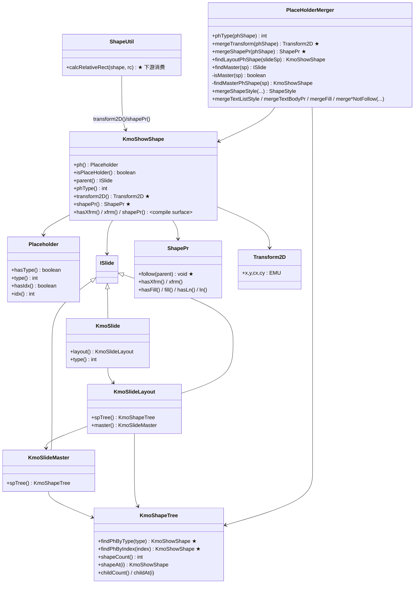
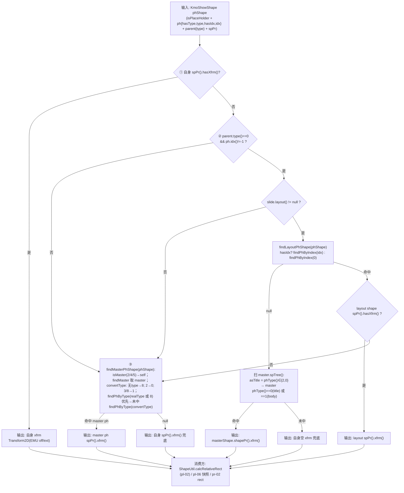
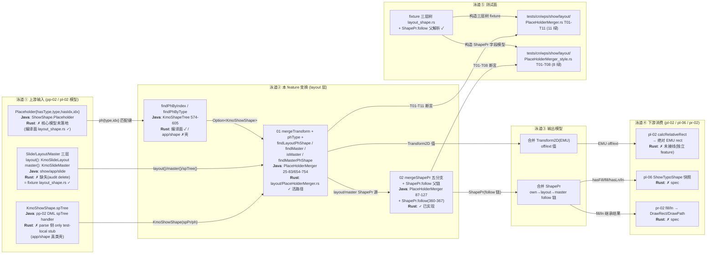
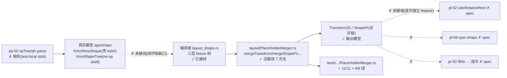

# pl-03-ph-merge — placeholder 继承合并（键类/流程/泳道/依赖/Java↔Rust 对齐）

> 分析依据：feature FEATURE.md / FUNCTIONS.md / functions.csv + Java 源码（真读）+ Rust 现状（真读 src/tests/.codeTrees）
> 管线：S2 布局层（上游 pp-* parse / pl-* 链式依赖；下游 pr-* render），主控文档 libs/ppt-core/PIPELINE_LAYOUT_RENDER_PLAN.md
> 分析日期：2026-09-01（实测：`cargo test --test 01_function_ph_merge_transform --test 02_function_ph_merge_style` 19/19 通过）

---

## 0. Feature 目标与管线位置

**一句话目标**：slide 上缺 `xfrm` 或缺 fill/style 的 **placeholder 形状**，按 OOXML 继承链 **slide → layout → master** 补齐（`ph.idx`/`ph.type` 匹配），使每个 ph 形状在绘制前拥有「真实位置 + 完整样式继承」。

**依赖与被依赖（functions.csv / FUNCTIONS.md）**：

| 方向 | feature/function | 说明 |
|---|---|---|
| 上游 depends_on | `pp-02-shape-tree-parse`（spTree/KmoShowShape/ph 进模型）；`pl-02-xfrm-geometry`（`calcRelativeRect` 消费合并后的 xfrm） | manifest/依赖节 |
| 内部 | 01 `ph_merge_transform` → 02 `ph_merge_style`（共享 `findLayoutPhShape/findMasterPhShape/phType` helper；02 不依赖 01 结果，无环） | FUNCTIONS.md §2 |
| 下游 | `pl-06-typo-shape`（打包合并结果）；`pr-02-shape-command`（消费 02 的 fill/ln → DrawRect/DrawPath）；`pp-13:03` 行 | functions.csv downstream 列 |

**在 S2 布局层中的角色**：S2 环节 ②「占位符继承」——位于几何计算（pl-02）**之前**的数据补齐段；非 ph 形状 identity 直通（自身 xfrm/spPr，不查三层）。本 feature 是「占位符继承」这一步，不包含：形状自身几何计算（pl-02）、文本框排版（pl-04/05）、绘制（pr-02/03）、非 ph 处理。

**范围外**：`KmoPropertiesMerger`/Android 主题解释（pp-03/04）；`mergeTextListStyle` bullet 连锁（pl-04/05 有字才开）；master/layout 形状「复制进 slide」（编辑语义）；3D/notes 分支。

---

## 0.5 设计动机与心智模型

**心智模型一句话**：本 feature 把「三棵树（slide/layout/master spTree）上的 ph 形状按 idx/type 对齐」投影成「每个 ph 形状的最终位置（Transform2D）与最终样式（ShapePr follow 链）」。

**设计矛盾表**：

| 矛盾 | 主数据结构 | 关键手段 |
|---|---|---|
| slide 的 ph 形状常只写 `<p:ph>` 标记、不写 `xfrm` → 位置退化为 (0,0,0,0) 不可画 | `Transform2D`（EMU off/ext） | `mergeTransform` 四级查找：自身 xfrm → layout ph（按 idx）→ master title/body 扫描（按 phType）→ `findMasterPhShape`（按 type 转换表）→ 自身兜底（PlaceHolderMerger.java 53-83） |
| slide/layout ph 的 `spPr` 缺 fill/ln/geom 等字段，值其实在 master/layout 里 | `ShapePr` + 父引用（follow） | `mergeShapePr` 五分支：own→layout→master 逐级 `follow`，缺失字段经父引用解析（87-127 行 + ShapePr.follow） |
| Java 侧 `Shape.open()` 用**池化对象**，`follow` 写 parent 引用、副作用持久（本次合并会改写 pool 里的对象，后续直接读）；Rust 无池、值语义 | Rust 按次返回**合并后的值**（`mergeShapePr -> ShapePr` 返回值带链） | 每条调用重建 follow 链，不写回原始模型——语义等价但「后续读原对象的继承结果」在 Rust 里不存在（下游必须用返回值） |
| 真实 parse 模型（`ShowShape/Placeholder` 核心模型）未落地（pp-01/02 以 test-local stub 通过），但测试要可断言 | `show/util/layout_shape.rs` 编译面 fixture 三层树（`KmoShowShape/Placeholder/KmoSlide/Layout/Master/KmoShapeTree/ShapePr` 全量可查询） | pl-03 逻辑全跑在 compile surface 上；真实 `app/shape/*` 类（`KmoShapeTree.rs` 14 行 no-op shell、`KmoShowShape.rs` accessor `todo!()`）暂不参与——见 §3/§4 缺口 |
| 「MVP 可画」要求 ph 查找链在 fixture 下可验，但 `ShapePr.rs`（drawing/data）字段 getter 的 follow-parent 懒加载是 `todo!` | 编译面 `layout_shape.rs::ShapePr` 自带父链解析（`hasFill/fill/hasLn/ln` 递归 parent） | 02 loop 在编译面补齐父解析，不提前修 drawing/data 的 `ShapePr.rs` |

**结构角色速查**：`mergeTransform/phType/findLayoutPhShape/findMaster/isMaster/findMasterPhShape` 解决「位置从哪来」（01）；`mergeShapePr` + `ShapePr.follow` 解决「样式从哪来」（02）；`KmoShapeTree.findPhByIndex/findPhByType` 是两路查找的公共索引，`Placeholder{hasType,type,hasIdx,idx}` 是匹配键。测试面 = fixture 三层树 + 冻结矩阵（FUNCTION.md §3.2）。

---

## 1. 键类分析（类图）



**逐类表**（方法签名→1 行逻辑，★热路径；均来自真实源码）：

| 类 | Java 位置（koffice） | Rust 位置（libs/ppt-core） | 关键字段（名:类型→作用） | 关键方法（签名→1 行逻辑） |
|---|---|---|---|---|
| `PlaceHolderMerger` | `presentation/core/cn/wps/show/app/shape/PlaceHolderMerger.java`（754 行，全 static 工具类，无字段） | `show/layout/PlaceHolderMerger.rs`（1319 行：活路径 7 方法 + 16 个 `todo!("DEFERRED_NON_FUNCTION")` 注释保留） | （无实例字段） | ★`mergeTransform(KmoShowShape)→Transform2D`：四级查找（自身 xfrm→layout ph→master title/body 扫描→findMasterPhShape→自身兜底），53-83 行；★`mergeShapePr(KmoShowShape)→ShapePr`：非 ph 直通 / slide 按 idx 分三级 follow / layout 直连 master / 其它直通，87-127 行；`phType(KmoShowShape)→int`：自身 type→layout ph type→master ph type 三级，25-50 行；`findLayoutPhShape(KmoShowShape)→KmoShowShape`：isPh+parent=slide+layout 可达，hasIdx?findPhByIndex(idx):findPhByIndex(0)，654-686 行；`findMaster(KmoShowShape)→ISlide`：parent 0→layout.master / 1→KmoSlideLayout.master / 3→noteMaster（Rust 写死 None），689-711 行；`isMaster(KmoShowShape)→boolean`：parent.type∈{2,4,5}，714-720 行；`findMasterPhShape(KmoShowShape)→KmoShowShape`：isMaster 自返，否则 master.spTree 按 realType/8 优先、convertType(2→0；3/8→1) 兜底，722-753 行 |
| `KmoShowShape`（Java 侧消费锚点） | `show/app/shape/KmoShowShape.java`（2829 行） | 编译面 `show/util/layout_shape.rs::KmoShowShape`（完整）；真实类 `show/app/shape/KmoShowShape.rs`（`isPlaceHolder(){ todo!() }` 壳） | `parent: ISlide`；`ph`/`spPr` 由 `ShowShapeAtomData` 持有 | ★`transform2D()`：`!dgShape.hasTransform2D() && isPlaceHolder() ? PlaceHolderMerger.mergeTransform(this) : dgShape.transform2D()`（2288-2290）——**mergeTransform 的消费闸门**；★`shapePr()`：`type()==4 ? null : PlaceHolderMerger.mergeShapePr(this)`（2292-2294）；`phType()`：`return PlaceHolderMerger.phType(this)`（570-571）——**mergeTransform 内部 `phShape.phType()` 即本静态方法，Rust 译成 `Self::phType` 正确对齐**；`ph()/isPlaceHolder()` 552-568 |
| `ShowShape.Placeholder` | `show/data/shape/ShowShape.java` 583-885（KoBin 序列化 bean） | 编译面 `layout_shape.rs::Placeholder`（`has_type/type_/has_idx/idx` 四字段 + 4 accessor） | 私有 `map`（property map）：$idx=2、$type=5 | `type()`：map 无 key→parent.type() all null→**8**（obj 默认），865-872；`hasType()`：map 有 5 或 parent，874-876；`idx()`：无 key→parent.idx()→**0**（默认），802-809；`hasIdx()`：map 有 2 或 parent，811-812；`putIdx/putType` 由 SwNvPrHandler/PlaceholderShapeHandler 写 |
| `KmoShapeTree` | `show/app/shape/KmoShapeTree.java`（727 行） | 编译面 `layout_shape.rs::KmoShapeTree`（children Vec，find* 已实现）；真实类 `show/app/shape/KmoShapeTree.rs`（14 行 no-op shell：`shapeCount()=0`、无 find*） | `root`（DgGroup） | ★`findPhByType(int)`：type<0→null；遍历 childAt(i)，`isPlaceHolder() && ph().type()==type` 首中即返，574-589；★`findPhByIndex(int)`：index<0→null；`isPlaceHolder() && ph().idx()==index` 首中即返，591-606；`shapeCount()/shapeAt(i)` 550-558（master 扫描循环用） |
| `ISlide` / `KmoSlide` / `KmoSlideLayout` / `KmoSlideMaster` | `show/app/slide/`（KmoSlide: `layout()`；KmoSlideLayout: `spTree()/master()`；KmoSlideMaster: `spTree()`） | 编译面 `layout_shape.rs`（`KmoSlide.layout/type`、`KmoSlideLayout.spTree/master`、`KmoSlideMaster.spTree` 全部可查询）；`app/slide/` 无对应（audit delete，layout 层重建） | `KmoSlideLayout.sp_tree: Option<Rc<KmoShapeTree>>`；`KmoSlideMaster.sp_tree: Rc<KmoShapeTree>` | `type()` 语义：0=slide、1=layout、2/4/5=master 系（`isMaster` 用）、3=notes |
| `ShapePr` | `drawing/data/shape/ShapePr.java`（750 行） | 编译面 `layout_shape.rs::ShapePr`（`follow(Option<ShapePr>)` + hasFill/fill/hasLn/ln 父链解析 ✅）；`drawing/data/shape/ShapePr.rs`（1300 行，`follow(&mut self, Option<Box<ShapePr>>)` 654 行已实现；字段 getter follow-parent 分支 758/836/914/992/1070 `todo!`） | `parent: ShapePr`；property map | `follow(ShapePr parent)`：parent≠null 时 set parent（360-367）；`xfrm()` 415-426（含懒 follow 父 xfrm）；`hasXfrm()` 428-430（含 parent 链） |
| `Transform2D` | `drawing/data/basic/Transform2D.java` | `layout_shape.rs::Transform2D`（x/y/cx/cy/flipH/flipV/rotation） | x,y,cx,cy: i32（EMU） | off/ext 值拷贝语义；rotation 单位 60000 分之一度（属于 pl-02 消费） |
| `ShapeUtil`（下游消费） | `show/util/ShapeUtil.java`（`calcRelativeRect`，420/449 行 `tmpShape.transform2D()`） | pl-02 feature（本 feature 不实现） | — | `calcRelativeRect(KmoShowShape, RectF)`：经 `KmoShowShape.transform2D()` 取 ph 合并后的 xfrm 算相对 EMU 框 |

> 注意「两个 KmoShapeTree/两个 ShapePr」：pl-03 活路径 import 的是 **`show/util/layout_shape.rs`**（编译面），不是 `app/shape/KmoShapeTree.rs`（壳）也不是 `drawing/data/shape/ShapePr.rs`（follow 懒加载 todo）。这是 FEATURE.md 「layout_shape.rs 三层 fixture 树」的落位，也是 §6 对齐审计的核心事实。

---

## 2. 流程图与泳道图（依据 I/O 与上下游）

### 2.1 流程图：mergeTransform 四级查找（I/O 端点→变换→输出模型→消费方）



### 2.2 泳道图（必含；每边标 I/O 数据类型，节点标 Java 类名 + Rust 状态）



---

## 3. 依赖关系与改写状态（对齐情况核心）

### 3.1 Java↔Rust 逐类映射表

| Java 类（完整路径） | Rust 路径 | 对齐程度 | 说明 |
|---|---|---|---|
| `cn.wps.show.app.shape.PlaceHolderMerger` | `libs/ppt-core/src/cn/wps/show/layout/PlaceHolderMerger.rs` | **完全对齐** | 7 个活路径方法（`phType/mergeTransform/mergeShapePr/findLayoutPhShape/findMaster/isMaster/findMasterPhShape`）逐方法对照 Java 真码；16 个 defer 方法以 `todo!("DEFERRED_NON_FUNCTION")` + 块注释保留 Java 与伪 Rust（对齐标注见 §3.2）；`.codeTrees/PlaceHolderMerger.typeoracle.rs` 已生成 |
| `cn.wps.show.app.shape.KmoShapeTree`（`findPhByType/findPhByIndex` 574-605） | 编译面 `cn.wps.show.util.layout_shape::KmoShapeTree`（find* 完整） | **完全对齐** | 编译面上 `type<0→None`、`idx<0→None`、首中即返、`children` 遍历——与 Java 逐分支一致；**真实类** `show/app/shape/KmoShapeTree.rs` **壳·stub**（14 行 no-op：`shapeCount()=0`、无 find*）——pl-03 的活路径不 import 它 |
| `cn.wps.show.data.shape.ShowShape$Placeholder`（`hasType/type/hasIdx/idx`） | 编译面 `layout_shape.rs::Placeholder`（4 字段 + 4 accessor） | **部分对齐** | accessor 逐一对上；但 Java `type()` 缺省 **8**（obj）、`idx()` 缺省 **0** 且支持 parent 链，Rust 结构默认 `type_=0`/`idx=0` 且无 parent 链——`hasType=false` 且三层全 miss 时 `phType` 末路返回值 Java=8 vs Rust=0（**需人工确认**：parse 侧接线时由写入方钉死，见 §5/§6） |
| `cn.wps.drawing.data.shape.ShapePr`（`follow` 360-367、`hasXfrm/xfrm/hasFill/fill/hasLn/ln`） | 编译面 `layout_shape.rs::ShapePr`（follow + 父链 getter） | **完全对齐** | 02 用的编译面 ShapePr 的 hasFill/fill/hasLn/ln 均递归 parent，对齐 Java 父链语义；`drawing/data/shape/ShapePr.rs`（keep）`follow` 已实现但字段 getter follow-parent 分支 758/836/914/992/1070 仍 `todo!`——**pl-03 不途经**（不 import 它），不阻塞 |
| `cn.wps.drawing.data.basic.Transform2D` | `layout_shape.rs::Transform2D` | **完全对齐** | 值拷贝的 off/ext（x/y/cx/cy）；`putX/putY/putCx/putCy` 写回 |
| `cn.wps.show.app.slide.KmoSlide/KmoSlideLayout/KmoSlideMaster`（`layout()/spTree()/master()`） | 编译面 `layout_shape.rs`（三档 Rc 树） | **完全对齐** | 编译面可查询（01/02 与测试共用）；真实 `app/slide/` 无对应 → 另列 **缺失**（audit delete，layout 层重建，见下） |
| `cn.wps.show.app.slide.KmoSlideLayout`/`KmoSlideMaster`（真类） | `libs/ppt-core/src/cn/wps/show/app/slide/` | **缺失** | 目录无对应文件（audit 标 delete，layout 层重建可查询三层树或接线 parse 模型）——闭环轨缺口 |
| `cn.wps.show.app.shape.KmoShowShape`（`ph/isPlaceHolder/parent/phType/transform2D/shapePr` 552-573/2288-2294） | 编译面 `layout_shape.rs::KmoShowShape` ✓；真实 `show/app/shape/KmoShowShape.rs` | **壳·stub** | 真实类 `pub fn isPlaceHolder(&self) -> bool { todo!() }`（keep_refactor 壳）；`ph()/parent()` 等缺失——pl-03 不在真实面上跑 |
| `cn.wps.show.pptxr.handler.shape.SwNvPrHandler`（ph 解析 75-128） | parse 侧（pp-01/02） | **缺失** | `"4294967295"→putIdx(-1)` 语义 Java 98-104 行已核实；Rust parse 侧以 test-local stub 过 pp-01/02，`Placeholder` 写入未落地 |
| `cn.wps.show.pptxr.util.SWReaderMap.placeholderTypeMap`（148-166） | parse 侧 | **缺失** | type 常量表（title=0…pic=15）本 feature 只读不写，Rust 侧需 parse 接线时携带（见 §5 钉死表） |
| —（无 Java 对应） | `libs/ppt-core/src/cn/wps/show/util/layout_shape.rs` | **Rust 新增** | 编译面宿主：三层 fixture 树 + `ShapePr` 父链 + `KmoShapeTree.find*`；pl-03 活路径与测试的唯一依赖底座（.codeTrees 有 `ShapeUtil.typeoracle.rs` 对应物） |

### 3.2 functions.csv 声称状态 vs 实测核对

| function | functions.csv 声称 | 实测 src | 实测 tests | 结论 |
|---|---|---|---|---|
| `01_function_ph_merge_transform` | **pass** | `layout/PlaceHolderMerger.rs` 活路径（mergeTransform/phType/find*）为真实逻辑（非壳/非模板占位），仅 16 个非本 function 方法 DEFERRED | `tests/cn/wps/show/layout/PlaceHolderMerger.rs` 存在，T01-T11 **11/11 绿**（实测运行） | **声称-实测相符** |
| `02_function_ph_merge_style` | **pass** | `mergeShapePr` 五分支真实实现 + 编译面 `ShapePr.follow` 父链 | `tests/cn/wps/show/layout/PlaceHolderMerger_style.rs` 存在，T01-T08 **8/8 绿**（实测运行） | **声称-实测相符** |

> 说明：1319 行中活路径 ≈380 行（7 方法），其余为 16 个 `todo!("DEFERRED_NON_FUNCTION")` 壳（**均有明确标注、与 FEATURE.md「壳」清单一一对应**，非裸 `todo!()` 空体，Java 注释 + 伪 Rust 保留在块注释里）。无 `TODO_RUST_CODE`/`unimplemented!` 残留（grep 核实）。另：PIPELINE_LAYOUT_RENDER_PLAN.md §2.1 表 pl-03 行仍写 **spec**——该表日期 2026-08-29，早于 08-30 loop pass，属**陈旧状态声明**，以 feature 目录 pass + 实测为准。

---

## 4. 最小 feature-critical 改写范围

### must（对齐缺口必修）

| 缺口 | 位置 | 现状 | 影响 |
|---|---|---|---|
| `KmoShapeTree.findPhByIndex/findPhByType`（真类） | `show/app/shape/KmoShapeTree.rs`（14 行 shell） | 编译面已补；**真类仍是 no-op**（`shapeCount()=0`） | 闭环轨（真实 parse 模型接线）时 layout/master `spTree()` 无处可查——阻塞 pl-03 脱离 fixture |
| `KmoShowShape.ph()/isPlaceHolder()/parent()/hasXfrm()/xfrm()/shapePr()` accessor（真类） | `show/app/shape/KmoShowShape.rs` | `isPlaceHolder(){todo!()}` 等壳 | 同上，pl-03 活路径需要这些只读 accessor 才能跑在真实模型上 |
| `ShowShape.Placeholder` 核心模型（含 `"4294967295"→-1`、缺省 0/8 语义） | `show/data/shape/` Rust 侧 | 未落地（parse 以 test-local stub 通过） | pl-03 拿到真实 ph 数据的前置；`type()` 缺省 8 vs Rust 默认 0 需在此钉死 |
| mergeShapePr 的 follow 链副作用语义 | `layout/PlaceHolderMerger.rs` 155-237 | 已实现（值语义） | 与 Java 池化对象副作用不等价：Java 改写的 `layoutSp.spPr()` 后续读也带链，Rust 必须把返回值一路传递——下游 pl-06/pr-02 需确认拿的是返回值 |

### stub 已标注（不阻塞本 feature，16 个 DEFERRED_NON_FUNCTION 与 FEATURE.md 壳清单一一对应）

`mergeShapeStyle`（ShapeStyle 继承）、`mergeTextListStyle/filterTextListStyle/writeTextListStyle/writeTextListProperties/followTextListStyle/followTextParagraphProperties`（文本列表连锁，pl-04/05 有字才开）、`mergeTextBodyPr`、`getTextListStyleInMaster`、`mergeFill`（分层 follow 变体）、`mergeFillNotFollow/mergeLnNotFollow/mergeEffectNotFollow/mergeGeomNotFollow/mergeScene3DNotFollow/mergeShape3DNotFollow`（not-follow 取值族，视 pr-02 需要打开，3D 不做）。

### defer（Java 语义未对齐可接受）

- `findMaster` case 3（notes parent → `noteMaster()`）：Rust 直接 `master = None`（FEATURE.md 延后 notes/handout）；
- `Placeholder.type()` 缺省 8 / parent 链语义：等 parse 侧写入方统一（fixture 内手工构造绕开）；
- 3D（`mergeScene3DNotFollow/mergeShape3DNotFollow` 正文就是 defer）。

### 当前进度（每 function 实测状态）

| function | 状态 | 实测 | 改写顺序建议 |
|---|---|---|---|
| 01 `ph_merge_transform` | **pass** | T01-T11 11/11 绿；活路径 60.6% line / 69.1% region（FUNCTION.md §3.7） | 已闭环（编译面）；真类 accessor 补齐属后续闭环轨前置 |
| 02 `ph_merge_style` | **pass** | T01-T08 8/8 绿；本节 44.8% line / 53.4% region + layout_shape.rs 67.9% line（§3.7） | 已闭环（编译面）；`ShapePr.follow` 父链在编译面完成，不需要动 drawing/data 的 `ShapePr.rs` |

---

## 5. 验收口径（钉死值，取自 Java 源码与 FUNCTION.md）

| 项 | 钉死值 | 来源 |
|---|---|---|
| 默认 slide 尺寸 | **12192000×6858000 EMU**（4:3 标准） | PIPELINE_LAYOUT_RENDER_PLAN.md §2.2 pl-01 `slide_viewport` |
| EMU 系数 | `INCH_EMU=914400`；`PT_EMU=12700`；`DEGREE_ANGLE=60000`（rotation 60 万分之一度）；`INCH_CM=2.54` | `UnitsConverter.java`（presentation/drawing/app/util）与 Rust `UnitsConverter.rs`（`INCH_EMU=914400` `PT_EMU=12700`）字面量一致；EMU→render px 系数（96dpi 下 9525）归 **pl-01**（本 feature 不触碰，需人工确认以 pl-01 为准） |
| 输出单位 | 合并后 `Transform2D` 的 off/ext 仍为 **EMU** 整数（`Transform2D{x,y,cx,cy: i32}`） | PlaceHolderMerger.java 53-83 / layout_shape.rs |
| ph type 常量表（`SWReaderMap.placeholderTypeMap` 148-166） | title=**0**、body=**1**、ctrTitle=**2**、subTitle=**3**、dt=**4**、sldNum=**5**、ftr=**6**、hdr=**7**、obj=**8**、chart=**9**、tbl=**10**、clipArt=**11**、dgm=**12**、media=**13**、sldImg=**14**、pic=**15** | SWReaderMap.java（真读） |
| idx 语义 | XML `idx="4294967295"` → `putIdx(-1)`；无 idx 属性 → 不 put（`hasIdx=false`，`idx()` 缺省 **0**） | SwNvPrHandler.java 98-104 + ShowShape.java 802-812 |
| type 缺省 | 无 type 属性且无父链 → `type()` = **8**（obj）；`hasType=false` | ShowShape.java 865-876 |
| mergeTransform 查找顺序 | ①自身 `spPr().hasXfrm()` → 自身；②`parent.type==0 && idx!=-1`：layout ph（hasIdx? findPhByIndex(idx) : findPhByIndex(0)）命中且有 xfrm → layout；layout ph null → 扫 master spTree：`asTitle = phType()==2||phType()==0`，命中 `masterShape.phType()==0`（title）/`==1`（body）取其 `shapePr().xfrm()`；③`findMasterPhShape`（转换表：无 type→8；2→0；3/8→1；`hasType? findPhByType(realType) : findPhByType(8)`，未中再 `findPhByType(convertType)`）；④全程未中 → 自身 `spPr().xfrm()` | PlaceHolderMerger.java 53-83、654-754（逐分支真读） |
| phType 三级 | `ph.hasType()` → 自身 type；否则 parent==slide && idx!=-1 → layout ph type；再否则 master ph type；全 null → `ph.type()`（Java 缺省 8） | PlaceHolderMerger.java 25-50 |
| mergeShapePr 分支 | 非 ph → 自身；slide（parent.type==0）且 idx!=-1 → `own.follow(layout)`（layoutShape null → 自身返），再 `layout.follow(findMasterPhShape(layoutShape))`；slide idx==-1 → `own.follow(master(phShape))`；layout（parent.type==1）→ `own.follow(master(phShape))`；其它 → 自身 | PlaceHolderMerger.java 87-127 |
| isMaster | `parent.type()∈{2,4,5}`（2=master、4/5=master 系 JSON 母版） | PlaceHolderMerger.java 717-720 |
| 分支失效语义 | `parent.type≠0` → 跳 ② 直入 ③；`layout()==null` → 跳 ②；`findMasterPhShape` 未中 → 自身兜底（可能空 xfrm）；`layout.master()` null → Java NPE / Rust `expect` panic（行为一致） | Java 57-61 / Rust `layout.master().expect(...)` |
| 对拍口径 | 同一 ph fixture 下 `phType` 与 `mergeTransform` 结果与 Java 一致；测试期望值由 Java 53-83 手算冻结（T01-T11） | FUNCTION.md §3.2/§4 |

---

## 6. Java↔Rust 管线对比与对齐审计

### 6.1 Java 侧链路（含上游输入与下游消费）

```text
pp-02 spTree parse（ph 进 KmoShowShape，SwNvPrHandler 写 idx/type）
  → KmoShowShape 装配（slide spTree + layout()/master() 三层可达）
  → ★ KmoShowShape.transform2D() —— ph 且无 xfrm → PlaceHolderMerger.mergeTransform(this)
  → ★ KmoShowShape.shapePr()   —— type≠4 → PlaceHolderMerger.mergeShapePr(this)
  → ShapeUtil.calcRelativeRect（transform2D() 产物 → 绝对 EMU rect，pl-02 环节）
  → ShapePr（fill/ln/geom 继承结果）→ S1 convert → pr-02 填充/线绘制
  → pl-06 ShowTypoShape 快照打包（pr-01 的输入）
```

### 6.2 Rust 侧现状接线



### 6.3 对齐差距表

| 类 | 差距类型 | 影响 | 阻塞哪个下游 |
|---|---|---|---|
| `app/shape/KmoShapeTree.rs`（真类） | 壳·stub（no-op shell，find* 缺） | 真实 layout/master `spTree().findPh*` 不可用 | **pl-03 闭环轨**（真实 parse 模型接线后必断）；编译面/测试面不受影响 |
| `app/shape/KmoShowShape.rs`（真类） | 壳·stub（`isPlaceHolder(){todo!()}` 等） | ph/父链 accessor 缺 | 同上；pl-02 共用同一 accessor 面 |
| `ShowShape.Placeholder` 核心模型 + SwNvPrHandler 写入 | 缺失（parse 侧） | ph{type,idx,hasType,hasIdx} 无真实来源；`type()` 缺省 8 语义未定 | pp-02 下游整体（pl-03 输入闸门） |
| `app/slide/KmoSlide{Layout,Master}` | 缺失（audit delete） | 无真三层树 | 闭环轨 pl-03/pl-04 |
| `drawing/data/shape/ShapePr.rs` 字段 getter follow-parent（758/836/914/992/1070） | 壳·stub（`todo!`） | 仅影响 drawing 模型自己的取值 | 不阻塞 pl-03（编译面 ShapePr 已覆盖）；潜在影响 pr-02 若走 drawing 模型（需人工确认 pr-02 输入面） |
| `findMaster` case 3（notes） | 部分对齐（Rust 写死 `None`） | noteMaster 分支缺失 | 延后（notes 渲染不在 MVP）；不阻塞 |
| `Placeholder.type()` 缺省 8 / parent 链 | 部分对齐（Rust 结构默认 0，无 parent 链） | `hasType=false` 且三层 miss 时 `phType` 返回值 Java=8 vs Rust=0 | 语义漂移风险点，parse 写入方需钉死（需人工确认） |
| 下游 pl-02/pl-06/pr-02 接线 | 缺失（各自 feature） | 合并结果无消费方 | 管线层面（非本 feature 责任） |

### 6.4 结论

**PASS（feature 活路径齐全）＋ 附跨 feature 缺口两条**：

1. 实测核实：`PlaceHolderMerger.rs` 1319 行中，7 个活路径方法（`phType/mergeTransform/mergeShapePr/findLayoutPhShape/findMaster/isMaster/findMasterPhShape`）为**真实逻辑**（逐方法对照 Java 真码，含 `asTitle` 判定经 `KmoShowShape.phType()`→`PlaceHolderMerger.phType` 的委托语义核对），16 个 defer 方法全部为**已标注** `todo!("DEFERRED_NON_FUNCTION")`（与 FEATURE.md 壳清单一一对应，无裸空体/无 `TODO_RUST_CODE` 残留）；`cargo test` 实测 **01 模块 11/11、02 模块 8/8 绿**。functions.csv「pass」声明**与实测相符**，不是「声称-pass-实测不符」。（注：PIPELINE_LAYOUT_RENDER_PLAN.md pl-03 行仍标 spec，是 08-29 旧表的陈旧声明。）
2. 但 pass 成立的前提是**编译面 fixture（layout_shape.rs）**：真实 `app/shape` 类（`KmoShapeTree` no-op shell、`KmoShowShape` accessor `todo!()`）、`ShowShape.Placeholder` 模型、`app/slide` 三层树在 Rust 侧仍壳/缺失 → pl-03 目前无法跑在**真实 parse 模型**上。这是**跨 feature 缺口**（pp-02/pp-10 模型接线），不阻塞本 feature 测试面；产品闭环轨依赖它，产品捷径轨（fixture）不依赖。
3. 主要运行时风险（相对 Java 语义）：
   - `mergeShapePr` 的值语义 vs Java 池化对象副作用（Java 合并后原 spPr 也带链；Rust 必须传返回值）——需下游 pl-06/pr-02 拿「合并后返回值」而非原模型；
   - `Placeholder.type()` 缺省 8 在 Rust 结构默认 0——等 parse 写入方钉死；
   - `ShapePr.rs`（drawing/data）follow-parent 懒加载 todo 被 pl-03 绕开，但 pr-02 若直接读 drawing 模型会踩到（建议 pr-02 也走编译面 ShapePr 或先补父解析）。