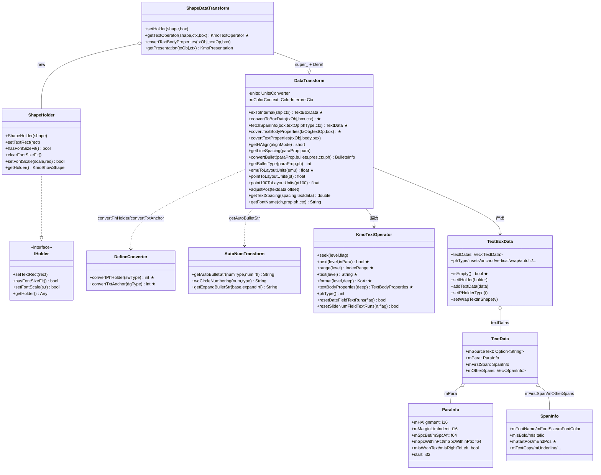
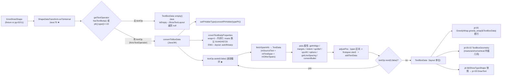
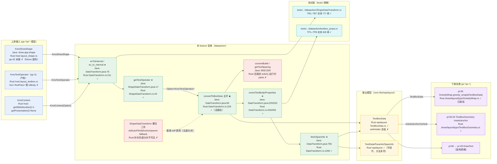
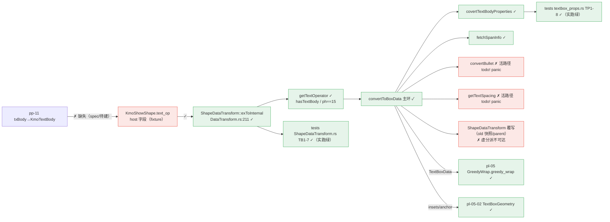

# pl-04-text-box — shape → TextBoxData（键类/流程/泳道/依赖/Java↔Rust 对齐）

> 分析依据：feature FEATURE.md / FUNCTIONS.md / functions.csv + Java 源码（真读：`ShapeDataTransform.java` 96 行、`DataTransform.java` 1432 行、`DefineConverter.java` 80 行、`ShowTextLayout.java` 139 行、`Presentation/core/base/converter/*.java`）+ Rust 现状（真读 src/tests/.codeTrees：`DataTransform.rs` 2395 行、`ShapeDataTransform.rs` 195 行、`DefineConverter.rs` 141 行、`AutoNumTransform.rs` 14 行、host `layout_textbox.rs` 880 行/`layout_shape.rs` 820 行、`UnitsConverter.rs`、wpslayout `TextBoxData/TextData/ParaInfo/SpanInfo`）
> 管线：S2 布局层（上游 pp-* parse / pl-* 链式依赖；下游 pr-* render），主控文档 libs/ppt-core/PIPELINE_LAYOUT_RENDER_PLAN.md
> 实测核对：`cargo test --test 01_function_shape_to_textbox --test 02_function_textbox_props` 于分析当日实跑，**15/15 通过**（TB1–TB7 + TP1–TP8）；FUNCTION.md §3.7 覆盖报告基线已过期（DataTransform.rs 报告 730 行 vs 现文件 2395 行）
> 分析日期：2026-08-30（与特征源码同日快照）

---

## 0. Feature 目标与管线位置

**一句话目标：** 把 `KmoShowShape`（含 txBody / spPr）经 `ShapeDataTransform.exToInternal`（Java `DataTransform.java:75`，final）翻成内部排版输入 `TextBoxData`——每段一个 `TextData`（`mSourceText` + `ParaInfo` + `SpanInfo[]`），外加文本框级属性（insets/anchor/vertical/wrap/autofit）与 `phType`；只产可排数据、**不断行**。

- **depends_on：** pp-11-dml-txbody（txBody → KmoTextBody，状态 spec/待建）、pl-03-ph-merge（spec，fixture 可绕）、pl-01-units-view（layout 单位档）；fixture 捷径可绕全部上游（`PIPELINE_LAYOUT_RENDER_PLAN.md` §2.3）。
- **被谁依赖：** 02_function_textbox_props（同 feature 内）、pl-05-text-typo（GreedyWrap.greedy_wrap 已真读 `&TextBoxData` 消费）、pl-06-typo-shape（间接）、pr-03-text-command（画字）。
- **S2 布局层角色：** 文本框（text box）一档——承接上游 pp 模型，产出 pl-05 断行与 pl-05-02「文本区内缩几何」的输入；**不负责**几何 rect（pl-02）、占位符继承（pl-03）、断行（pl-05）、快照（pl-06）。
- **范围外：** 表格 cell（`CellDataTransform`）、graphicFrame/SmartArt 文本、Canvas；竖排排版语义 / autofit 缩放连锁 / 字体效果复杂分支；行列表（属于 pl-05）；`ShapeHolder.setTextRect` 回写 shape 缓存（MVP 只留字段）。

## 0.5 设计动机与心智模型

| 矛盾 | 主数据结构 | 关键手段 |
|---|---|---|
| MVP「只产可排数据」vs Java wpslayout「排版+绘制」一体 | `TextBoxData`（wpslayout 产品模型） | 只做 `exToInternal` 段/run→模型，把断行整体甩给 pl-05 贪心断行（`PIPELINE_LAYOUT_RENDER_PLAN.md` §S2 风险 1：wpslayout 3352 个 todo!，MVP 用贪心绕开） |
| fixture 可画 vs 真链依赖（pp-11 未建） | host `KmoTextOperator`（`layout_textbox.rs` 880 行，`Vec<TextPara>`） | 「产品捷径轨」：手工 `KmoShowShape` + `text_op` 字段直喂，`hasTextBody()/getTextOperator()` 为 host 字段方法，不依赖 pp-11（`MVP.md` 两条验收轨） |
| Java 继承/虚分派 vs Rust 组合 | `DataTransform { super_ }` + `Deref` 模拟继承 | 模板引擎用 `super_` 组合模拟 extends，但**虚分派丢失**：`ShapeDataTransform` 的 `covertTextBodyProperties/getPresentation/setHolder` 覆写在 `exToInternal` 主链上不可达（详见 §6） |
| 「标 pass」与「全量语义」 | functions.csv / FUNCTION.md | 声称 pass 以**夹具测试通过**为口径（TB/TP 实测 15 绿），但热路径存在 `todo!` 运行时 panic 占位与静默丢值（§3/§6），属于「夹具口径 pass、语义未全对齐」 |

**一句话心智模型：** 本层把「shape 的 XML 文本树」**投影**成「pl-05 可排的纯数据模型」，投影规则（行列映射、单位换算、布尔开关）逐条取自 Java `DataTransform` 字面量，删掉一切排版/效果分支。

## 1. 键类分析（类图）



### 逐类表（★=热路径，来自真实源码）

| 类 | Java 位置 / Rust 状态 | 关键字段（名:类型→作用） | 关键方法（签名→1 行逻辑，★热路径） |
|---|---|---|---|
| `DataTransform<T>`（基类） | `presentation/core/cn/wps/show/layout/dataaction/DataTransform.java`；Rust `DataTransform.rs`（2395 行，模板生成 + 实写混合） | `units:UnitsConverter = UnitsConverter.layout()`（Rust `new(2)`=UNIT_POINT，`DataTransform.rs:161`）→ emu/layout 换算；`mColorContext:ColorInterpretCtx` → 颜色解释上下文 | ★`exToInternal(shp,ctx)`（Java:72）final：借对象→`updateColorConvContext`→`setHolder`→`convertToBoxData`，`null` shape 也返回对象；Rust `Option<&KmoShowShape>` 版。★`convertToBoxData`（Java:84）：取 textOp→`convertPhHolder`→`covertTextBodyProperties`→`seek(0,false)` 逐段 `fetchSpanInfo`+para 属性+`convertBullet`→`addTextData`，`next(0,false)` 循环。★`fetchSpanInfo`（Java:756）：`textOp.range(1)/text(1)/format(1)` 逐 run 产 `SpanInfo`，多 font 时按字符拆 span（`getFontName` 变化点切段），单 font 整 run 一段；`mOtherSpans[0]` 提为 `mFirstSpan`；拼 `mSourceText`。`covertTextBodyProperties`（Java:220）：wrap==0→`setWrapTextInShape(false)`；insets 默认 91440/45720 EMU→layout；autofit type/fontScale(仅 type==1)/lnSpcReduction；prstWarp。`covertTextProperties`（Java:252）：anchor→`convertTxtAnchor`、anchorCenter、verticalText、四边显式 inset 覆盖。`getHAlign`（Java:871）：0/1/2/3/4 → 1/2/3/5/7。`getLineSpacing`（Java:1218）：spcPct→`mSpcWithinPct`(+Ori)，spcPts→`point100ToLayoutUnits`→`mSpcWithinPts`。`emuToLayoutUnits`（Java:1266）=`units.fromEmuY`（layout 档 = point，`emu/12700.0`）。`convertBullet`/`getBulletType`/`setBulletContent`/`fetchBullet*`（Java:893–1036）：bullet 类型 -1/1/2/3 + 内容。`adjustPos`（Java:1245）：所有 span 区间 `-=offset`。`getTextSpacing`（Java:1200）：spcPts→point100→layout；spcPct→`max(mFirstSpan..mOtherSpans).mFontSize * spcPct * 1.2F` |
| `ShapeDataTransform extends DataTransform<KmoShowShape>` | `.../dataaction/ShapeDataTransform.java`；Rust `ShapeDataTransform.rs`（195 行） | `super_: DataTransform`（Rust 组合，Deref 模拟继承） | ★`getTextOperator`（Java:17）：`hasTextBody()`→`shape.getTextOperator()`；`parent().type()!=0` 时 `resetDateFieldTextRuns(false)`/`resetSlideNumFieldTextRuns(slideNumber-1,false)` 决定 `canRenderCache`；否则 `ph().type()==15`（note）也取。`setHolder`（Java:13）：`setIHolder(new ShapeHolder(shape))`。`covertTextBodyProperties`（Java:40）：super 后若 `getOriginalAutoFit()/getOriginalAnchor() != -1` 写 `setOldTextAutoFit/OldAnchor`，再 `resetOriginalProperty()`。`getPresentation`（Java:53）：super 为 null 时回退 `parent().getPresentation()` |
| `ShapeHolder implements IHolder`（嵌套） | `ShapeDataTransform.java:62`；Rust `ShapeDataTransform.rs:29` | `mShape: KmoShowShape` | `setTextRect`（Java:69）：doc→layout `convertX/Y` 后 `shape.setTextRect(rect)`；`hasFontSizeFit/clearFontSizeFit/setFontScale/getHolder` 委托 mShape（autofit 回写，MVP 全 DEFERRED） |
| `DefineConverter` | `.../dataaction/DefineConverter.java`；Rust `DefineConverter.rs`（141 行） | —（全静态） | ★`convertPhHolder(int)`（Java:4）：0..15 恒等、default 1；★`convertTxtAnchor(int)`（Java:59）：0..4 恒等、default 0。双端字面量逐 case 一致 |
| `AutoNumTransform` | `.../dataaction/AutoNumTransform.java`（168 行）；Rust `AutoNumTransform.rs`（14 行全 `todo!`，且**未被 mod.rs 声明**，死文件） | 无 | `getAutoBulletStr/wdCircleNumbering/getExpandBulletStr`（Java:11 起，Wingdings 圈号/扩展串）/ RTL |——Rust 全 todo!，宿主另有 `layout_textbox::AutoNumTransform` 空 struct 承接 import |
| `KmoTextOperator` | Java `cn.wps.show.app.text.KmoTextOperator`（pp-11 产物）；Rust **host** `layout_textbox.rs:672` | `paras: Vec<TextPara>`（`TextRun{text,start,end,ch_prop}`）、`para_i/run_i` 游标、`ph_type`、`body_pr` | ★`seek(0)/next(0)/next(1,true)/range(1)/text(1)/format(0|1)`：对 Vec 游标迭代（fixture 语义，**非 pp-11 真实 txBody**）；`resetDateFieldTextRuns/resetSlideNumFieldTextRuns` 恒 `false` → `canRenderCache` 恒 true（FEATURE 声明的 stub 语义成立） |
| `TextBoxData` | `core-libs/wpslayout/.../data/TextBoxData.java`；Rust `wpslayout/.../TextBoxData.rs`（211 行） | `textDatas:Vec<TextData>`、`phType=-1`、insets=0、`anchor=0`、`isWrapTextInShape=true`、`oldTextautofit/oldAnchor=-1`、`fontScale=1.0`、`canRenderCache=true`、`mTextLength`、`mMinTextSize` | ★`isEmpty()`（Java:176）=`textDatas.isEmpty()`；Rust 另加 `isEmptyText/hasVisibleText`（空/`" "`/`"\r"`）；`setIHolder` **丢值**（Rust:159 `fn setIHolder<H>(&mut self,_h:H){}`）；`addTextData/addTextLength/createTextData` 齐 |
| `TextData / ParaInfo / SpanInfo` | 同包 Java；Rust 同路径（TextData 699 行 / ParaInfo 281 行 / SpanInfo 585 行） | 见类图 | `TextData.new/createSpan/minFontSize`；`SpanInfo.adjustPos()`；字段级产品模型已 keep，方法多为模板壳 |
| `ShowTextLayout`（编排，不在本波） | `presentation/core/cn/wps/show/layout/ShowTextLayout.java`（139 行）；Rust **缺失**（无 `ShowTextLayout.rs`） | | `layout(typoRect,shape,ctx,forceTypo,cb)`（Java:40）：`exToInternal`→`isEmpty()`→**null**；否则 `new ShowRichTextLayout().typo(boxData,w,h,forceTypo)`（交 pl-05）；`canChineseVert`（Java:105）/`toDegree`（Java:136，rotation/60000） |

## 2. 流程图与泳道图（依据 I/O 与上下游）

### 2.1 流程图（I/O 端点 → 变换 → 输出模型 → 消费方）



### 2.2 泳道图（必含；节点标注 Java 类名 + Rust 状态，边标注 I/O 类型）



## 3. 依赖关系与改写状态（对齐情况核心）

### 3.1 Java↔Rust 逐类映射表

| Java 类（完整路径） | Rust 路径 | 对齐程度 | 实测核对 |
|---|---|---|---|
| `cn.wps.show.layout.dataaction.DataTransform<KmoShowShape>` | `libs/ppt-core/src/cn/wps/show/layout/dataaction/DataTransform.rs` | **部分对齐** | 主链真实现（exToInternal/convertToBoxData/fetchSpanInfo/covert*/getHAlign/getLineSpacing/adjustPos/emu 三件套/getFontName）；**活路径 panic 占位**：`convertBullet`（1528 行 `todo!("no align strategy matched")` 实参，bullettype≠-1 即炸）、`getTextSpacing`（2036 `todo!("DEFERRED_NON_FUNCTION")`，有 spcBef/spcAft 即炸）；**静默丢值**：`setHolder`→`setIHolder(())`（166）、`updateColorConvContext` 空实现（532）、`getColorAlpha` 恒 1.0（2274）、`fetchHyperLink` 空返回（1776）；DEFERRED：getParaDirection/getPrstShdwAttr/fetchBulletColor/Font/Size/setBulletContent/getColor×2/getGradientFill/convertToBitmap/getLangID |
| `cn.wps.show.layout.dataaction.ShapeDataTransform` | `ShapeDataTransform.rs` | **部分对齐** | `getTextOperator`/`setHolder`/`covertTextBodyProperties`/`getPresentation` 实写且与 Java 逐行对应；**但经 `exToInternal` 主链不可达**（Rust 无虚分派，基类 `self.covertTextBodyProperties/getPresentation/setHolder` 调的是基类自身）→ oldAutoFit/oldAnchor 快照与 parent-fallback 在管线路径上不生效；`ShapeHolder` 全部 5 方法 `todo!("DEFERRED_NON_FUNCTION")` |
| `ShapeDataTransform.ShapeHolder`（嵌套） | `ShapeDataTransform.rs:29 ShapeHolder` | **壳·stub** | 构造函数在；setTextRect/hasFontSizeFit/clearFontSizeFit/setFontScale/getHolder 全 todo!；且因基类 setHolder 丢 IHolder，**从未被构造/接线** |
| `cn.wps.show.layout.dataaction.DefineConverter` | `DefineConverter.rs` | **完全对齐** | `convertPhHolder`（0..15 恒等/default 1）与 `convertTxtAnchor`（0..4 恒等/default 0）与 Java 字面量逐 case 一致；测试 TB5/TP3 覆盖 |
| `cn.wps.show.layout.dataaction.DataTransform.BulletNumberItem` | `DataTransform.rs:145` | **完全对齐** | index/type/level/startAt/isEmptyParagraphText 全套访问器与 Java:1385 一致 |
| `cn.wps.show.layout.dataaction.AutoNumTransform` | `AutoNumTransform.rs`（14 行） | **壳·stub** | 全 `todo!()`；**且不在 mod.rs 声明、引用的 `WingdingsType` 不存在**——死文件；DataTransform.rs 实际 import host `layout_textbox::AutoNumTransform`（空 struct） |
| `cn.wps.text.layout.data.TextBoxData/TextData/ParaInfo/SpanInfo`（wpslayout） | `libs/core-libs/wpslayout/src/cn/wps/text/layout/data/*.rs` | **部分对齐** | 字段级产品模型 keep 齐（SpanInfo 585 行/TextData 699 行/ParaInfo 281 行）；`setIHolder` 丢值 stub（TextBoxData.rs:159）；isEmpty/isEmptyText/hasVisibleText/span adjustPos 可用 |
| `cn.wps.show.layout.ShowTextLayout` | **缺失**（无 `ShowTextLayout.rs`） | **缺失** | Java:40 的 `isEmpty→null` 编排语义只在测试断言里体现；`ShowRichTextLayout.typo` 由 pl-05 GreedyWrap 替代 |
| `cn.wps.show.app.text.KmoTextOperator`（pp-11 产物） | host `util/layout_textbox.rs:672` | **Rust 新增（无 Java 对应实现）** | host fixture 游标实现 seek/next/range/text/format；**非 pp-11 真实 txBody**；`resetDate*` 恒 false |
| `cn.wps.show.app.shape.KmoShowShape`（pp-02 产物） | host `util/layout_shape.rs:9` | **Rust 新增（无 Java 对应实现）** | `has_text_body/text_op` 字段方法版；`resetOriginalProperty` 空实现（163） |
| `cn.wps.base.converter.UnitsConverter/PointConverter` | `base/converter/UnitsConverter.rs` + `PointConverter.rs` | **完全对齐**（系数字面量一致） | Java PointConverter.fromEmuY=`emu/12700.0F`；Rust 相同；`layout()`=UNIT_POINT 双端一致（Java `base/converter/UnitsConverter.java` 已真读） |
| host 工具：`FontHelper/ColorInterpreter/SymbolConverter/TextUtils/PaintFontHelper` | `util/layout_textbox.rs:761–880` | **Rust 新增（host 桩）** | `getCoreFontName`→font_name 或 "Arial"（Java 按 latin/ea/cs+phType 解析缺失）；`getHexRGBAValue` 恒 -16777216；`convertToSymbol` 恒等（Wingdings 转换缺失）；`TextUtils.equals` 恒 true（isFullTypeface 恒 true）——均**静默偏差**，不进 todo! 台账 |

### 3.2 functions.csv 声称状态 vs 实测核对

| function_id | csv 声称 | 实测测试 | 实测源码 | 核对结论 |
|---|---|---|---|---|
| `01_function_shape_to_textbox` | pass | TB1–TB7 **7/7 通过**（实跑） | 段/run→TextData 路径真实现；但 bullet 默认路径（phType 0–9 且无 buNone）→ `convertBullet` 活路径 `todo!` panic；spcBef/spcAft → `getTextSpacing` panic；span 字体的 latin/ea/cs 解析与 Symbol 转换缺失 | **声称-部分相符**：夹具口径 pass 成立；对真实段落（带 bullet/spacing）**会 panic**；报告基线过期（FUNCTION.md §3.7 记 DataTransform.rs 730 行，现文件 2395 行） |
| `02_function_textbox_props` | pass | TP1–TP8 **8/8 通过**（实跑） | insets/anchor/wrap/vertical/autofit/warp 字段落值真实；但测试**直调** `ShapeDataTransform::covertTextBodyProperties`，`exToInternal`→`convertToBoxData` 主链调用基类版 → oldAutoFit/oldAnchor 快照（TP7 语义）在管线路径上**不落**；读取端绑定 host `TextBodyProperties`（非 FUNCTIONS.md §6 声称的 drawing/data/text 3209 行版） | **声称-部分相符**：直调映射 pass；管线接线有缺口 |

## 4. 最小 feature-critical 改写范围

### must（对齐缺口必修）

| 缺口 | 位置 | 说明 |
|---|---|---|
| `convertBullet` 跌落到「只落 buNone/buChar 类型号与布尔」的 FEATURE 声明 stub，而非 panic | `DataTransform.rs:1509–1547`、`1528` | FEATURE.md「stub：bullet 只落 buNone/buChar 布尔与类型号」；现实现 bullettype≠-1 时 `getParaDirection`（todo!）+ `setBulletContent` todo! 实参**双 panic**。必修为不 panic 的最小落值 |
| `getTextSpacing` 恢复实现（FEATURE must 含 `mSpcBef/mSpcAft`） | `DataTransform.rs:2035` | 段距在 must 清单；现 todo! → 任何带 spcBef/spcAft 的段 panic。Java:1200 公式（spcPts→`point100ToLayoutUnits`；spcPct→`maxFontSize*spcPct*1.2F`）已在注释块 |
| 02 快照语义在主链生效 | `ShapeDataTransform.rs:82` + `DataTransform.rs:443` | Rust 无虚分派：把 oldAutoFit/oldAnchor/resetOriginalProperty 逻辑合入 `DataTransform::covertTextBodyProperties` 或让 `convertToBoxData` 显式调用子类覆写，否则 02 契约 #5 在管线路径永远不满足 |
| 上游接线（阻塞性外因） | pp-11 `KmoTextBody`/`KmoTextOperator`、pp-02 shape | 无真实 txBody 输入（`text_op: Option<KmoTextOperator>` host 字段），pl-04 无法消费真实文件（对应「缺失断点：pp-11 没有 txBody → 恒空」，PIPELINE §3.2） |

### stub（已标注，可接受）

- bullet 全量（buAutonum 编号/buBlip 图片/颜色字体大小 follow 链）：`fetchBulletColor/Font/Size`、`setBulletContent`、`getLangID`、`AutoNumTransform` 全量 `todo!("DEFERRED_NON_FUNCTION")` — 与 FEATURE 一致，但需保证**不进活路径 panic**（见上）。
- 域重置（`resetDateFieldTextRuns/resetSlideNumFieldTextRuns` 恒 false → `canRenderCache` 恒 true）：与 FEATURE 声明一致。
- `ShapeHolder.setTextRect/hasFontSizeFit/clearFontSizeFit/setFontScale/getHolder`：`todo!("DEFERRED_NON_FUNCTION")`（autofit 回写，MVP 不做）——注意 `setIHolder` 丢值使 IHolder 从未被消费。
- span 效果分支（outline/fill/effect/reflection）：`#[cfg(feature="span_effects")]` 默认关闭即跳过——可接受；**但开启后内含 4 处 `todo!("no align strategy matched")`（725/835/848/1031）会 panic**，需标注不可开启。
- `updateColorConvContext`/`getColorAlpha`/`fetchHyperLink`/`getColor×2`/`getGradientFill`/`convertToBitmap`：todo! 或静默恒值——效果/颜色类，MVP 可接受但要进台账。

### defer（Java 语义未对齐可接受）

- 表格 `CellDataTransform`、竖排排版语义、autofit 缩放连锁、Wingdings/Symbol 转换、字体效果复杂分支、`ShowTextLayout.canChineseVert`/竖排 warp 判定、池化复用（`LayoutSharedObjects.showTextDataPool`/`DataObjectPool`）、`mSpcWithinPctOri` 双份等。

### 当前进度（每 function 实测状态）

| function | 状态 | 实测 | 阻塞 |
|---|---|---|---|
| 01 shape_to_textbox | 声称 pass（夹具口径） | TB1–TB7 绿；主链真实 | bullet/spcBef 活路径 panic；pp-11 未接 |
| 02 textbox_props | 声称 pass（直调口径） | TP1–TP8 绿；字段落值真实 | 主链虚分派缺口（old 快照不落） |

## 5. 验收口径

钉死值（均来自真实源码字面量，标注出处）：

- **默认 slide 尺寸**：12192000 × 6858000 EMU（`PIPELINE_LAYOUT_RENDER_PLAN.md` §2.2 pl-01 `slide_viewport`；Java presentation.xml 默认 sldSz）。
- **EMU→layout 系数**：`emuToLayoutUnits(emu) = UnitsConverter.layout().fromEmuY(emu)`；layout 档=UNIT_POINT（Rust `UnitsConverter.rs:237` `layout()`→UNIT_POINT；Java `UnitsConverter.java:48` 同单例约定）；`PointConverter.fromEmuY = emu/12700.0F`（Java `presentation/core/cn/wps/base/converter/PointConverter.java:8-10` 与 Rust `PointConverter.rs` 字面量一致）。→ 默认 inset：left/right 91440 EMU = **7.2**；top/bottom 45720 EMU = **3.6**（layout 单位，点）。px 换算（96dpi、density=1.0 测试环境）：1pt=96/72px，91440→9.6px、45720→4.8px；EMU→px 链 = emu/914400*96（EmuConverter/PixelConverter 字面量推得）。
- **行距/字号**：`pointToLayoutUnits(pt)`=恒等于点（layout 档 fromPointY 恒等，`UnitConverter.rs:107-110` `return pt`）；`point100ToLayoutUnits(p100)=fromPointY(p100/100)`；Java 默认字号 40.0F（SpanInfo::new）；spcPct 行距为系数（默认 `mSpcWithinPct=1.0`）。
- **断行/内缩几何判据**（pl-04 产数据、pl-05 断行）：`isWrapTextInShape=false` 仅当 `hasTextWrappingType() && textWrappingType()==0`（`DataTransform.java:223`）；内缩几何输入=四 inset（layout）+ anchor + `isAnchorCenter` + `textVerticalType`，pl-05-02 `TextBoxGeometry` 消费；**pl-04 不产行**（`mIsWrapText=textBoxData.isWrapTextInShape()` 逐段回填在 Java:163，Rust:355 已对齐）。
- **ph idx/type 规则**：`ph().type()==15`（note）无 body 也可排（`ShapeDataTransform.java:33`）；`convertPhHolder` 0..15 恒等、default **1**（`DefineConverter.java:4`）；ph idx 不参与 pl-04（属 pl-03 merge）；`parent().type()!=0` 才做域重置判定（Java:21）。
- **anchor/hAlign 映射**：`convertTxtAnchor`：0/1/2/3/4 → 0/1/2/3/4、default 0；`getHAlign`：0/1/2/3/4 → **1/2/3/5/7**（Java:871 字面量，Rust:1470 同）。
- **empty 语义**：`exToInternal` 对无 body/无 note ph 返回（已建对象但）`textDatas.is_empty()`；`ShowTextLayout.layout` 对 `isEmpty()` 返回 **null**（Java:44，本 feature 用例 TB2/TB3 覆盖；Rust 侧无 ShowTextLayout，由测试断言等价语义）。
- **几何谓词**：span 区间 `[mStartPos,mEndPos)` 连续覆盖 `mSourceText` 不重不漏；跨段 `adjustPos` 以段首 offset 归零（Java:1245）。

## 6. Java↔Rust 管线对比与对齐审计

### 6.1 Java 侧链路（含上游输入与下游消费）

```text
pp-02 spTree → KmoShowShape（含 KmoTextBody）
pp-11 txBody → KmoTextBody（每段 para/run）
  → ShowTextLayout.layout(typoRect, shape, ctx, forceTypo, cb)      [Java:40]
      → ShapeDataTransform.exToInternal(shape, ctx)                  [DataTransform.java:75 final]
          → updateColorConvContext(ctx)
          → setHolder(shape, boxData)                                 // ShapeHolder(textRect/autofit 回写)
          → convertToBoxData: getTextOperator → convertPhHolder
              → covertTextBodyProperties（wrap/insets 默认/autofit/warp）
              → 逐段 seek(0)/next(0,false)：fetchSpanInfo + para 属性 + convertBullet
          → (ShapeDataTransform 覆写层：oldAutoFit/oldAnchor/resetOriginalProperty、parent getPresentation)
      → boxData.isEmpty() ? null : new ShowRichTextLayout().typo(boxData,w,h,forceTypo)  // pl-05
  → IShowTextLayout（行/Span 几何）→ ShapeTextRender/TextRender（pr-03 画字）
```

### 6.2 Rust 侧现状接线图



断点按输入→解析→回调顺序：**输入链硬门闩在 pp-11**（`text_op` 是 host 字段，无 `KmoTextBody` 可喂——与 PIPELINE §3.2「pp-11 没有 txBody → pl-04 恒空」一致）；**变换链软门闩在 `convertBullet`/`getTextSpacing` 的活路径 `todo!`**（真实段落必炸）；**接线缺口在虚分派**（02 快照不落）+ **`setIHolder` 丢值**（IHolder 链全断，但因 MVP 不回写 shape，影响低）。

### 6.3 对齐差距表

| 类/点 | 影响 | 阻塞哪个下游 |
|---|---|---|
| `convertBullet` 活路径 panic（1528） | 带默认 bullet 的段（phType 0–9 无 buNone）`exToInternal` 直接 panic | pl-05（真实 shape 必触发） |
| `getTextSpacing` todo!（2036） | 带 spcBef/spcAft 的段 panic | pl-05 行距/段距缺失 |
| 虚分派丢失（oldAutoFit/oldAnchor/parent getPresentation） | 02 契约 #5 在管线路径不满足；Java 的 `ShapeDataTransform` 覆写层全失效 | TextBoxGeometry/autofit 连锁（pl-05-02） |
| `setIHolder`/`setHolder` 丢值 | `ShapeHolder` 永不接线，`setTextRect`/autofit 回写不可达（MVP 接受） | pl-05 autofit 缩放（defer） |
| pp-11 输入缺失（text_op host 字段） | pl-04 无法消费真实文件文本 | pl-05/pr-03 闭环（产品闭环轨） |
| host `FontHelper.getCoreFontName`/`SymbolConverter`/`ColorInterpreter` 静默桩 | 字体解析（latin/ea/cs、phType 回退）、Wingdings 转换、scheme 色全缺失 | 画字（pr-03）字体/颜色偏差 |
| `getColorAlpha` 恒 1.0 / `fetchHyperLink` 空 | span 透明度/超链接色缺失 | pr-03 绘制细节（defer 可接受） |
| FUNCTIONS.md §6 声称的 drawing/data/text 3209 行 `TextBodyProperties` 未接线 | 02 读取端实际绑定 host 版；真 drawing 类另存未用 | 文档-实现漂移，需修正 FUNCTIONS.md |

### 6.4 结论

**对齐差距-critical（在夹具口径下通过，真实输入口径下不可作下游依赖）。**

- functions.csv 标 pass、FUNCTION.md 标 pass 与**实测测试**一致（TB1–TB7、TP1–TP8 实跑 15/15 绿）；但属**声称 pass-实测部分不符**的三处：① 活路径 `convertBullet`/`getTextSpacing` 为运行时 panic 占位（FEATURE 声明的 stub 应为最小落值而非 panic，must 段距未实现）；② 虚分派缺口使 02 关键快照语义在主链不生效；③ FUNCTION.md §3.7 覆盖报告基线过期（730 vs 2395 行）且 §6 的 02 读取端声明与实际 host 绑定不符。
- 简言之：**夹具轨（产品捷径）pl-04 可标 pass 并支撑 pl-05 贪心断行**；**真实文件轨（产品闭环）必须等 pp-11 且需先修 bullet/spcBef 两处活路径 panic**。pl-04 自身改写面（§4 must 三件）小而集中，不涉及整文件移植（符合 FEATURE「不过扩展」）。

---

*本文件为结构分析快照（只读，不改任何源码/文档/csv）；改写依据以 Java 源码行号为锚，系数以 Node 字面量为准。*