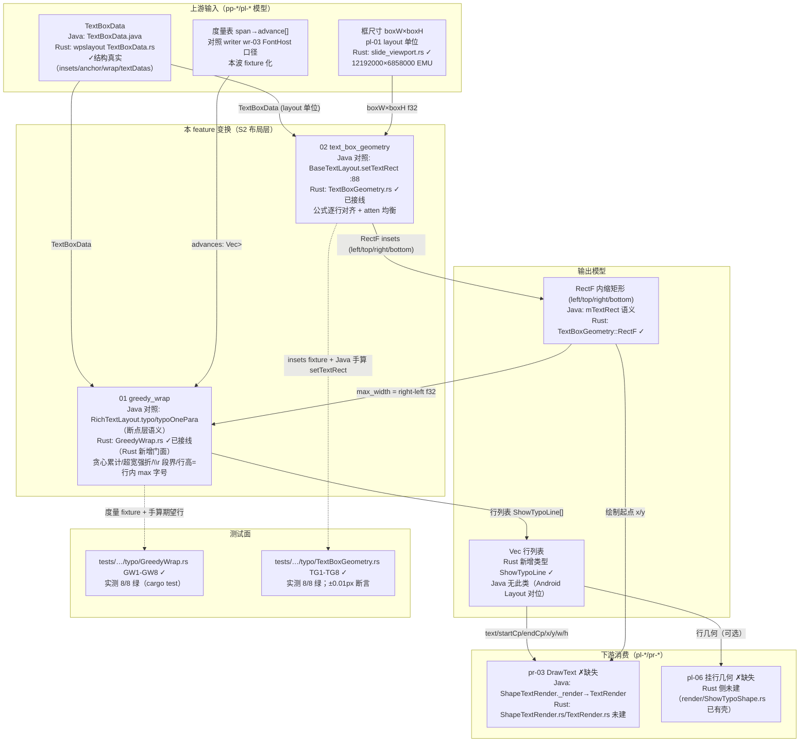
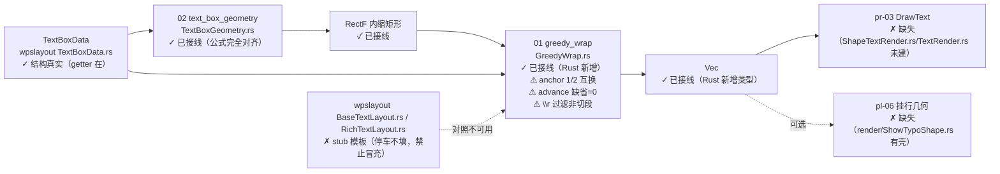

# pl-05-text-typo — 框内贪心断行（键类/流程/泳道/依赖/Java↔Rust 对齐）

> 分析依据：feature FEATURE.md / FUNCTIONS.md / functions.csv + Java 源码（真读 koffice，含 wpslayout 与 presentation 跨包）+ Rust 现状（真读 src/tests/.codeTrees）
> 管线：S2 布局层（上游 pp-* parse / pl-* 链式依赖；下游 pr-* render），主控文档 libs/ppt-core/PIPELINE_LAYOUT_RENDER_PLAN.md
> 分析日期：2026-08-30（实测：`cargo test --test 01_function_greedy_wrap --test 02_function_text_box_geometry` 16/16 绿）

## 0. Feature 目标与管线位置

**一句话目标**：给定框宽高，把 pl-04 的 `TextBoxData`（段文本 + `SpanInfo[]` + insets/anchor/wrap）切成「行列表 `[{text, startCp, endCp, x, y, w, h}]`」+ 产出文本区内缩矩形，使 pr-03 `DrawText` 能直接画字。MVP 用**贪心断行**绕开 wpslayout 排版引擎，**不冒充** Java `RichTextLayout` 一致断行（设计内差异，见 §0.5）。

- **depends_on（上游）**：pl-04-text-box（`TextBoxData` 输入，wpslayout crate）、pl-01-units-view（layout 单位语义）；度量表口径对齐 writer wr-03（FontHost 注入口径，本波 fixture 化）。function 级：02 由 01 依赖（可用宽唯一来源）。
- **被谁依赖（下游）**：pl-06-typo-shape（可选挂行几何，manifest 中 pl-06 依赖 pl-02+pl-05）、pr-03-text-command（`DrawText` 原料，manifest 中 pr-03 依赖 pl-05+pr-01）。
- **S2 布局层角色**：本 feature = 「断行（01 greedy_wrap）+ 文本区几何（02 text_box_geometry）」两件套；是「文本可排、可画」的最小门。manifest 状态：pl-05 **spec**（§2.1），function 清单 functions.csv **2/2 pass**（见 §3 实测核对）。
- **范围外**：Java `RichTextLayout` 一致断行（另开 feature）、竖排 vertical/correctInset 交换、warp/autofit 连锁、`\u000b` 软换行、kinsoku/标点挤压、bidi 重排、textAutofit 缩放、bullet 复杂、表格 cell 文本、prompt 文本。

## 0.5 设计动机与心智模型

**心智模型一句话**：本层把「文本框 + 段落富文本（TextBoxData）」投影成两个纯函数产物——「文本区内缩矩形」与「行列表」；断行只切 cp 区间、不切 SpanInfo，pr-03 拿到行即可逐 run 画字。

**设计矛盾表**：

| 矛盾 | 主数据结构 | 关键手段 |
|---|---|---|
| MVP「先画、后对齐」vs Java wpslayout 引擎未移植（`RichTextLayout.rs` 5346 行模板、178 文件 plan 期记 3352 个 todo!） | `Vec<ShowTypoLine>`（新行类型） | Rust 新增 `GreedyWrap` 门面，**禁止冒充、禁止填 wpslayout 模板**；Java 一致断行另开 feature |
| 断行要「可画」但不能用假宽度假装正确 | `advances: &[Vec<f32>]` 注入度量表 | 度量表只要 `span → advance[]`；宽度必须来自 02 或显式 fixture（功能红线） |
| 文本区几何可以**精确对齐** Java（02），断行在 MVP 只能对齐「语义子集」（01） | `RectF`（mTextRect 语义） | 02 逐行复刻 `BaseTextLayout.setTextRect`（含 atten 均衡 4 分支，`±0.01px`）；01 只对齐「行 = 放得下的字符区间 + 行宽/行高」层 |
| 输入是 wpslayout crate 的 `TextBoxData`，但不同意把整类搬进 ppt-core | `wpslayout::…::TextBoxData` 只读字段 | 02/01 门面放 ppt-core（`layout/typo/`），wpslayout 车身（`BaseTextLayout.rs` 76 行模板 / `RichTextLayout.rs`）**停车不填** |

**各结构角色速查**：

| 结构 | 解决什么矛盾 | 关键机制 | 谁消费 |
|---|---|---|---|
| `GreedyWrap`（Rust 新增） | 绕开 wpslayout 引擎而可画 | CJK 单字/拉丁词贪心累计、超宽 token 强制折、`\r` 段界、行高=行内最大字号 | pr-03 `DrawText`；pl-06 挂行几何 |
| `ShowTypoLine`（Rust 新增） | 行几何需要一个不混淆 writer `TypoTextLine` 的命名 | `{text,startCp,endCp,x,y,w,h}`，标注 `// java` 行类型名待 pr-03 确认 | pr-03 |
| `TextBoxGeometry`（Rust 门面） | 文本区可用宽/绘制起点必须与 Java 一致 | 复刻 `setTextRect` 公式 + atten 均衡 | 01（`max_width = right-left`）、pr-03 起点 |
| `wpslayout::TextBoxData/TextData/SpanInfo` | 输入模型复用、禁止第二套文本类型 | 结构真实（getter 已在），方法多空 | 01/02 只读字段 |

**本 feature 特有「为什么」**：① 01 行 `h` 用「行内最大字号」（`span_height_at`）是明确 MVP 简化——Java 精确行高是 `Layout.getLineBottom(j)-getLineTop(j)`（`RichTextLayout.java:644/692`），逐行对齐另开；② 垂直 anchor 三态 y 平移是 stub，但**当前实现把 anchor 1/2 与 Java `modifyTextBoxAlign` 互换**（详见 §4/§5，需人工确认）；③ `\r` 在 Java 里默认**不**段内切分（`forceProcessCrlf()` 恒 false，`RichTextLayout` 未 override），MVP 把 `\r` 直接过滤——与 FUNCTION.md「`\r` 段切分」表述存在差异，见 §6 差距表。

## 1. 键类分析（类图）

```mermaid
classDiagram
    direction LR

    class RichTextLayout_Java {
        +typo(textBoxData,w,h,forceTypo) @78
        +correctInset() @93 竖排inset交换
        +doTypo() @122
        +typoOnePara(paraIndex) @528★
        +modifyTextBoxAlign() @1046
        mTypoCaches: Layout[] (Android)
    }
    class BaseTextLayout_Java {
        +typo() @71
        +setTextRect() @87★公式源
        +getTextRect() @149
        +forceProcessCrlf() false
        mTextRect: RectF
    }
    class ShowRichTextLayout_Java {
        +renderText/renderBullet
    }
    class ShowTextLayout_Java {
        +layout(typoRect,shape,ctx,forceTypo,cb) @40★
    }
    class TextBoxData_Java {
        +leftInset/rightInset/topInset/bottomInset @285-309
        +isWrapTextInShape @317
        +anchor @499
        +isEmpty @176
        +processBeforeTypo @607
    }
    class ShapeTextRender_Java {
        +_render(typoShape) @28★
        +getTextRect(env,typoShape) @130
    }
    class Shape_Java {
        +getTextRect(w,h) @948
    }
    class DataCal_Java {
        +getTextRect(w,h) @55
    }

    class GreedyWrap_Rust_新增 {
        +greedy_wrap(data,textRect,advances) Vec~ShowTypoLine~★
        -wrap_one_para()
        -apply_anchor()
        -span_height_at()
        -tokenize() / is_cjk()
    }
    class ShowTypoLine_Rust_新增 {
        +text startCp endCp x y w h
    }
    class TextBoxGeometry_Rust_门面 {
        +text_box_geometry(data,w,h) RectF★
        +BaseTextLayout.setTextRect() 逐行对齐Java
        +getTextRect() correctInset() 真实
        ~13方法 DEFERRED_NON_FUNCTION
    }
    class RectF_Rust_新增 {
        +left top right bottom
    }
    class wpslayout_TextBoxData_Rust {
        +getAnchor/isWrapTextInShape/addTextData/isEmpty
        mSourceText mFirstSpan mOtherSpans
    }

    ShowRichTextLayout_Java --|> RichTextLayout_Java
    RichTextLayout_Java --|> BaseTextLayout_Java
    ShowRichTextLayout_Java ..> ShapeTextRender_Java : renderText 消费
    ShowTextLayout_Java ..> ShowRichTextLayout_Java : typo @:56
    ShowTextLayout_Java ..> TextBoxData_Java : exToInternal 产物
    RichTextLayout_Java ..> TextBoxData_Java : anchor/insets/wrap 读取
    BaseTextLayout_Java ..> TextBoxData_Java : setTextRect 读 insets
    ShapeTextRender_Java ..> Shape_Java : renderModel.getTextRect
    Shape_Java ..> DataCal_Java : getDataCal().getTextRect

    GreedyWrap_Rust_新增 ..> wpslayout_TextBoxData_Rust : 只读字段+getter
    TextBoxGeometry_Rust_门面 ..> wpslayout_TextBoxData_Rust : insets 只读
    GreedyWrap_Rust_新增 ..> RectF_Rust_新增 : text_rect 输入
    TextBoxGeometry_Rust_门面 ..> RectF_Rust_新增 : 输出内缩矩形
    GreedyWrap_Rust_新增 ..> ShowTypoLine_Rust_新增 : 产出行
```

> 备注：上方为「Java 对照锚点 + Rust 现状」两类节点共存图；Java 锚点（`RichTextLayout`/`ShowRichTextLayout`/`ShowTextLayout`/`ShapeTextRender`/`Shape`/`DataCal`）**不是移植目标**（01 只对照断点层语义、02 只复刻 `setTextRect` 公式、绘制侧 pr-03 另建）。

### 键类逐类表（签名 → 1 行逻辑；★热路径；全部来自真实源码）

| 类 | Java 位置 / Rust 现状 | 关键字段（名:类型→作用） | 关键方法（签名→1 行逻辑） |
|---|---|---|---|
| `RichTextLayout` | `koffice/core-libs/wpslayout/src/cn/wps/text/layout/typo/RichTextLayout.java`（2900 行）——**对照锚点，非移植** | `mTypoCaches: List<Layout>`→每段 Android Layout 行几何；`mTypoOffsets: List<PointF>`→段内偏移；`mParaBottoms/singleLineParaWidths/mLayouts/mRotDegrees` | `typo(textBoxData,w,h,forceTypo)` @78→`super.typo` + presetTextWarp/WordArt 分支；`correctInset` @93→仅竖排交换 insets（90°: L/T/R/B←T/B/R/L，否则 L/R 互换）；`doTypo` @122→循环 `typoOnePara`+ellipsis 截断+`tryTypoNormalAutoFit`；`typoOnePara(paraIndex)` @528★→bullets/indent/margin 计算后 `mTypoLayoutGen.getLayout(mTextRect, mTextPaint, data, firstLead, restLead, mTypoMaxWidth)` 产 Android `Layout`；`modifyTextBoxAlign` @1046→anchor 0/1/2/3/4 → offy 0 / (h-t)/2 / h-t（**anchor 权威语义**） |
| `ShowRichTextLayout` | `koffice/presentation/core/cn/wps/text/layout/typo/layout/ShowRichTextLayout.java`（129 行）——**缺失于 Rust** | `mBulletDrawer; mTimLayout` | extends `RichTextLayout` implements `IShowTextLayout`；`renderText/renderBullet`（绘制侧）；timing 动画——pr-03 前不需要 |
| `ShowTextLayout` | `koffice/presentation/core/cn/wps/show/layout/ShowTextLayout.java`（139 行）——**缺失于 Rust（编排层）** | `dataTransform: ShapeDataTransform; cellDataTransform` | `layout(typoRect, KmoShowShape, ctx, forceTypo, cb)` @40★→`ShapeDataTransform.exToInternal`→`TextBoxData`；`isEmpty()`→null；`new ShowRichTextLayout().typo(boxData, typoRect.width(), typoRect.height(), forceTypo)` @56；`state()==1` 时把 `txObj.getTextRect()` 按 doc/layout 单位换算 offset |
| `BaseTextLayout` | `koffice/core-libs/wpslayout/src/cn/wps/text/layout/typo/BaseTextLayout.java`（195 行）；Rust 复刻于 `libs/ppt-core/src/cn/wps/show/layout/typo/TextBoxGeometry.rs` | `mTextRect/mTypoRect: RectF`（25-26 行）；`mTypoMaxWidth/Height`；`mTypoState`；常量 `NONE=0/DOC=1/DOCX=2/ID_BASE=MIN_VALUE/ITALIC_MARGIN_FACTOR=0.2/VOICE_KEY_WORD/VOICE_STR` | `setTextRect(textBoxData,w,h)` @87★（02 公式源）→correctInset → left=0/top=0/right=w/bottom=h → 四边 inset 加减与夹紧 → 4 个 atten 均衡（详见 §5）→ `mTextRect.set(left,top,right,bottom)` @137；`typo` @71→非空时 processBeforeTypo→竖排宽高交换→setTextRect→doTypo；`getTextRect()` @149；`forceProcessCrlf()` false；`correctInset` false（非竖排） |
| `TextBoxData` | `koffice/core-libs/wpslayout/src/cn/wps/text/layout/data/TextBoxData.java`（1092 行）；Rust `libs/core-libs/wpslayout/src/cn/wps/text/layout/data/TextBoxData.rs`（结构真实，getter 在，processBeforeTypo 等未实现） | `leftInset/rightInset/topInset/bottomInset/isWrapTextInShape/anchor/phType/textDatas` | `leftInset()`@285/`rightInset()`@293/`topInset()`@301/`bottomInset()`@309；`isWrapTextInShape()`@317；`anchor()`@499；`isEmpty()`@176=`textDatas.isEmpty()`；`isVerticalCenter()`@495=`anchor==1`；`processBeforeTypo(force)`@607→`mTypoText=mSourceText`；force=true 时按正则 `"\r(\n)|\n"` `splitDataBySeparator` 切段；`removeTrailingSpace`/`mergeSpan`/bidi 探测 |
| `ShapeTextRender` | `koffice/presentation/core/cn/wps/show/render/ShapeTextRender.java`（186 行）——**缺失于 Rust（pr-03）** | `mTextRender: TextRender` | `_render(typoShape)` @28★→`DrawFlags.drawPHolderText` 过滤 → `rcShape=typoShape.getShapeRect()` → `typoRect=renderModel.getTextRect(typoRect.width(), typoRect.height())` @54 替换 → `TextRender.render(...)` 画字；`getTextRect(env,typoShape)` @130 |
| `Shape.getTextRect` | `koffice/core-libs/drawing/src/cn/wps/moffice/drawing/Shape.java:948`；Rust `libs/core-libs/drawing/src/cn/wps/moffice/drawing/Shape.rs:1520`（已实现） | `mWidth/mHeight/mDataCalRef` | `getTextRect(w,h)` @948→`this.mWidth=w; mHeight=h; return getDataCal().getTextRect(w,h)` |
| `DataCal.getTextRect` | `koffice/core-libs/drawing/src/cn/wps/moffice/drawing/smartshape/DataCal.java:55`；Rust `libs/core-libs/drawing/src/cn/wps/moffice/drawing/smartshape/DataCal.rs`（存在） | `pathData: PathData` | `getTextRect(w,h)` @55→预置形状 `useTextRect()` ? `pathData.getTextBoxRect()` : `(0,0,w,h)`；普通形状取 `geometry.getGeoTextRect()` 缩放；MVP 按普通形状/文本框处理（insets 由 02 承载） |
| `GreedyWrap` | **Rust 新增**（无 Java 双子）`libs/ppt-core/src/cn/wps/show/layout/typo/GreedyWrap.rs`（210 行，真实逻辑约 196 行，**无 todo!/unimplemented!/TODO_RUST_CODE**） | —（纯函数门面，无字段） | `greedy_wrap(data:&TextBoxData, text_rect:RectF, advances:&[Vec<f32>]) -> Vec<ShowTypoLine>`★→isEmpty 早退 → `max_width=right-left` → 逐 TextData `wrap_one_para` 产行 → `apply_anchor` 平移 y；`wrap_one_para`→滤 `\r`→token 化贪心累计（超宽折行/超宽 token 强制单行）；`apply_anchor`→`anchor: 1=>avail-total_h, 2=>(avail-total_h)/2, _=>0`（⚠ 与 Java 1=ctr/2=b 相反，见 §4/§5）；`span_height_at(cp)`→span 区间内 max `mFontSize`，无命中回退 `mFirstSpan.mFontSize`；`tokenize`/`is_cjk`（0x3400-0x4DBF/0x4E00-0x9FFF/0xF900-0xFAFF/0x3040-0x30FF/0xAC00-0xD7AF） |
| `ShowTypoLine` | **Rust 新增**（Java 无此类；writer 有 `TypoTextLine`，FUNCTION.md 明令不混淆命名） | `text:String; startCp:i32; endCp:i32; x/y/w/h:f32` | Rust-only 输出行类型；字段名「待 loop 确认（对齐 pr-03 消费）」；`// java public class ShowTypoLine` 注释属模板注释（Java 无对应类名，注记） |
| `TextBoxGeometry`（门面） | **Rust 新增门面** `libs/ppt-core/src/cn/wps/show/layout/typo/TextBoxGeometry.rs`（452 行） | `RectF{left,top,right,bottom}`；`BaseTextLayout` 结构（mID/mTypoOffsets/mTextPaint/mTextBoxData/mTextRect/mTypoRect/mTypoMaxWidth/mTypoMaxHeight/mTypoState） | `text_box_geometry(data,w,h)->RectF`★→`new BaseTextLayout` → `setTextRect` → `getTextRect`；`BaseTextLayout::setTextRect`（223-300 行）**逐行对齐 Java**（含 atten 均衡 4 分支）；`getTextRect` 真实；`correctInset` 实现为返回 false（非竖排语义正确）；其余 13 方法（getSingleAudio/isShape/id/forceProcessCrlf/typo×2/destroy/getTextBoxData/clear/state/setTextAlignment/isAutoWidth/isAutoHeight/calcHorizAlign/calcVertAlign/doTypo）＝ `todo!("DEFERRED_NON_FUNCTION")`（16 处，与 02 FUNCTION.md §3.9 对齐报告一致，非热路径） |

## 2. 流程图与泳道图（依据 I/O 与上下游）

### 2.1 流程图

```mermaid
flowchart LR
    subgraph Java 锚点链（对照，非移植）
        J1[ShowTextLayout.layout<br/>ShowTextLayout.java:40]
        J2[ShapeDataTransform.exToInternal<br/>→ TextBoxData]
        J3[ShowRichTextLayout.typo :56<br/>→ RichTextLayout.typo :78<br/>→ BaseTextLayout.typo :71]
        J4[processBeforeTypo :74<br/>\\r 切分/trailing space/bidi]
        J5[setTextRect :82 → mTextRect]
        J6[doTypo → typoOnePara :528<br/>TypoLayoutGen → Android Layout]
        J7[ShapeTextRender._render :28<br/>renderModel.getTextRect<br/>Text:209→Shape:948→DataCal:55]
        J1-->J2-->J3-->J4-->J5-->J6
        J5 -.-> J7
    end

    subgraph Rust MVP 链（本 feature）
        I1[TextBoxData<br/>wpslayout TextBoxData.rs ✓结构]
        I2[advances 度量表<br/>span→advance[] fixture/FontHost]
        I3[boxW × boxH layout 单位]
        G2[02 text_box_geometry<br/>TextBoxGeometry.rs ✓<br/>setTextRect 公式完全对齐]
        O2[RectF 内缩矩形<br/>left/top/right/bottom<br/>㎡ max_width=right-left]
        G1[01 greedy_wrap<br/>GreedyWrap.rs ✓ 196 逻辑行<br/>无 todo!]
        O1[Vec ShowTypoLine<br/>text/startCp/endCp/x/y/w/h]
        D1[pr-03 DrawText ✗未建]
        D2[pl-06 挂行几何 ✗未建]
        I1 --> G2
        I3 --> G2
        G2 --> O2
        I1 --> G1
        I2 --> G1
        O2 --> G1
        G1 --> O1
        O1 --> D1
        O1 -.可选.-> D2
    end
```

### 2.2 泳道图（必含）



## 3. 依赖关系与改写状态（对齐情况核心）

### 3.1 Java↔Rust 逐类映射表

| Java 类（完整路径） | Rust 路径 | 对齐程度 | 说明（缺口注明） |
|---|---|---|---|
| `koffice/core-libs/wpslayout/…/typo/BaseTextLayout.java`（195 行） | `libs/ppt-core/src/cn/wps/show/layout/typo/TextBoxGeometry.rs`（门面 452 行） | **部分对齐** | `setTextRect`/`getTextRect`/`correctInset` + `text_box_geometry` 门面**逐行完全对齐**（含 atten 均衡）；其余 13 方法 `todo!("DEFERRED_NON_FUNCTION")`（签名在、体是注释，非热路径）；wpslayout 车身 `BaseTextLayout.rs`（76 行模板）未填（停车，符合 FUNCTIONS.md） |
| `koffice/core-libs/wpslayout/…/typo/RichTextLayout.java`（2900 行） | `GreedyWrap.rs`（Rust 新增门面）；wpslayout `RichTextLayout.rs`（5346 行模板） | **部分对齐** | 01 只对齐「断点层语义子集」（行=放得下的 cp 区间+行宽/行高）；Java 一致断行另开 feature；`RichTextLayout.rs` 模板 2000 条 `// Java:` 注释、struct 全空壳（如 `struct TextBoxData;`），**不可用，禁止填** |
| `koffice/presentation/core/cn/wps/text/layout/typo/layout/ShowRichTextLayout.java`（129 行） | — | **缺失** | 编排/绘制侧类；本波不移植（pr-03 另建 `DrawText`） |
| `koffice/presentation/core/cn/wps/show/layout/ShowTextLayout.java`（139 行） | — | **缺失** | S2 编排入口（exToInternal→typo）；Rust 侧编排待 pl-04/pl-06 承接，01/02 以纯函数门面直出 |
| `koffice/core-libs/wpslayout/…/data/TextBoxData.java`（1092 行） | `libs/core-libs/wpslayout/src/cn/wps/text/layout/data/TextBoxData.rs` | **部分对齐** | 结构+getter 真实（`isEmpty`/`isWrapTextInShape`/`setWrapTextInShape`/`getAnchor`/`addTextData`/insets）；`processBeforeTypo`/`mergeSpan`/bidi 等未实现（本 feature 不需） |
| `…/data/TextData.java`、`SpanInfo.java`、`ParaInfo.java` | wpslayout `TextData.rs`/`SpanInfo.rs`/`ParaInfo.rs` | **部分对齐** | `mFirstSpan`/`mOtherSpans`/`mSourceText`/`mFontSize` 真实；01 只读所需字段 |
| `koffice/presentation/core/cn/wps/show/render/ShapeTextRender.java`（186 行） | — | **缺失** | pr-03 未建（`ShapeTextRender.rs`/`TextRender.rs` 不存在；仅 `TextRenderModel.rs`/`ITextRenderModel.rs` 存在） |
| `koffice/core-libs/drawing/…/Shape.java:948`、`Text.java:209`、`smartshape/DataCal.java:55` | `libs/core-libs/drawing/…/Shape.rs:1520`、`Text.rs:368`、`DataCal.rs` | **部分对齐** | `Shape.rs:1520 getTextRect` 已实现；`Text.rs:368` 有「LLM No Rust equivalent: mShape is Element」占位（绘制侧）；MVP 按普通形状 `(0,0,w,h)`（FEATURE.md 既定），预置几何 inset 待 pl-02/pr-02 确认 |
| （无 Java 双子） | `GreedyWrap.rs`、`ShowTypoLine` | **Rust 新增** | 01 门面与行类型；`ShowTypoLine` 命名标注「待 loop 确认（对齐 pr-03 消费）」 |
| `DefineConverter.convertTxtAnchor`（identity 0..4） | ppt-core `layout/dataaction/DefineConverter.rs` | **完全对齐** | t=0/ctr=1/b=2 直通（OOXML ST_TextAnchoringType） |

### 3.2 functions.csv 声称状态 vs 实测核对

| function | csv 声称 | 实测源码 | 实测测试 | 结论 |
|---|---|---|---|---|
| `01_function_greedy_wrap` | pass | `GreedyWrap.rs` 真实 196 逻辑行；**无** todo!/unimplemented!/TODO_RUST_CODE；非壳 | `tests/…/GreedyWrap.rs` GW1-GW8 存在；`cargo test` **8/8 绿**；FUNCTION.md 记录覆盖率 97.0% | **声称 pass 属实（测试级）**；但有 3 处语义注记（anchor 1/2 互换、advance 缺省=0、`\r` 过滤而非段切）见 §6 差距表——非壳、非缺失，按 MVP 口径成立 |
| `02_function_text_box_geometry` | pass | `TextBoxGeometry.rs` 门面真实：`setTextRect` 公式逐行对齐 Java（含 atten 均衡）、`getTextRect`/`correctInset` 真实；16 处 `todo!("DEFERRED_NON_FUNCTION")` 全在非热路径方法，已标注 | `tests/…/TextBoxGeometry.rs` TG1-TG8 存在；`cargo test` **8/8 绿**；±0.01px 断言；FUNCTION.md 记录覆盖率 60.7%（DEFERRED 方法未覆盖） | **声称 pass 属实（测试级）**；02 对齐报告（§3.9）与源码一致（implemented 列表 = 实际真实方法） |

> 状态声明核对：**functions.csv 2/2 pass 与实测一致**（两测试 target 全绿、核心源码真实非壳）；但 **manifest（PIPELINE_LAYOUT_RENDER_PLAN.md §2.1）与 FEATURE.md 头部仍标 spec**——功能已落地、文档状态未同步，属文档漂移而非「声称-实测不符」。一致性红线成立：Rust 侧没有任何代码冒充 `RichTextLayout` 一致断行（wpslayout 模板原样未动）。

## 4. 最小 feature-critical 改写范围

### must（对齐缺口必修）

| 项 | 归属 | 现状 | 缺口 |
|---|---|---|---|
| 贪心断行（CJK 单字/拉丁词/超宽 token 强制折） | 01 | ✓ 已实现（`tokenize`+`wrap_one_para`） | — |
| `\r` 段切分（段落内） | 01 | ⚠ 实现为「过滤 `\r` 字符」而非切段 | FUNCTION.md 契约写「`\r` 段切分 → 段界专行」；当前依赖 `getTextDatas()` 多段输入（GW4 用 2 个 TextData 验证），单 TextData 含 `\r`（如 `"A\rB"`）会合成一行 `"AB"` 语义 → **需人工确认口径**（真实 Java 默认 `forceProcessCrlf=false` 也不切段） |
| 行 w = 行内 advance 累计、行 h = 行内最大字号、行 x 左对齐、y 从 topInset 计、输出 startCp/endCp | 01 | ✓ 已实现 | — |
| `setTextRect` 公式逐行对齐 Java（含 atten 均衡 4 分支顺序） | 02 | ✓ 完全对齐（TextBoxGeometry.rs:223-300 ↔ BaseTextLayout.java:87-138） | — |
| 输出内缩矩形（`text_box_geometry` 门面） | 02 | ✓ 已实现 | — |

### stub（已标注，可接受）

| 项 | 归属 | 现状 | 注记 |
|---|---|---|---|
| 垂直 anchor t/b/ctr 三态 y 平移 | 01 | ⚠ 已实现但**枚举 1/2 与 Java 相反**：Rust `1=>bottom, 2=>center`；Java `modifyTextBoxAlign`（RichTextLayout.java:1050-1062）`1=>center, 2/3/4=>bottom`；OOXML/`DefineConverter` 也是 t=0/ctr=1/b=2 | GW8 测试冻结的是 Rust 自身语义（anchor=1→底部 y=90）。**需人工确认/修复（1↔2 对调）**；不阻塞 fixture 画字，但垂直 anchor 是 stub 承诺内必须正确的一项 |
| wrap=false → 整段单行 | 01 | ✓ 已实现（`GW5` 验证） | — |
| 两端对齐、tab | 01 | ✗ 未做 | 明确不在 MVP（Java `calcHorizAlign` base 返回 0） |
| `correctInset` 非竖排分支 | 02 | ✓ 返回 false（与 Java 一致） | 竖排交换 defer |

### defer（Java 语义未对齐可接受，另开/停车）

| 项 | 归属 | 原因 |
|---|---|---|
| Java `RichTextLayout` 断行一致（逐位断点/kinsoku/标点挤压/bidi） | 01 | 依赖 wpslayout 引擎（5346 行模板未实现），另开 feature；本波禁止冒充 |
| 竖排 vertical/`correctInset` 交换、warp/autofit 连锁、textAutofit 缩放 | 01/02 | 明确范围外（FEATURE.md 不过扩展） |
| `\u000b` 软换行、行高精确（getLineBottom-getLineTop） | 01 | MVP 简化口径（行高=max 字号）待 loop 确认 |
| 真实字体度量（TTF） | 01 | 禁止在 ppt-core 内做度量；FontHost 真实度量 post-MVP |
| advance 缺省 fallback（fontSize CMS 经验宽） | 01 | FUNCTION.md 1.1 说 fallback「待 loop 确认」；当前实现**隐式 0**（`advances.get(i).copied().unwrap_or(0.0)`），与「fallback 也须显式」不符 → 需修复或显式标注 |
| pr-03 `DrawText` / pl-06 挂行几何接线 | 下游 | `ShowTypoLine` 字段名待 pr-03 确认后再冻结 |

### 当前进度（每 function 实测状态）

| function | src 状态 | tests 镜像 | 实测 | 结论 |
|---|---|---|---|---|
| 01 | 真实实现（196 逻辑行；0 处 todo） | `tests/cn/wps/show/layout/typo/GreedyWrap.rs` ✓ | cargo test 8/8 绿；覆盖 97.0% | **pass（测试级）**；3 处语义注记（anchor/advance/`\r`）待人工确认 |
| 02 | 门面真实（公式完全对齐）；13 方法 DEFERRED | `tests/cn/wps/show/layout/typo/TextBoxGeometry.rs` ✓ | cargo test 8/8 绿；覆盖 60.7% | **pass（测试级）**；DEFERRED 均非热路径 |

## 5. 验收口径

**钉死值（全部取自真实源码 / FUNCTION.md 冻结矩阵）**：

- **默认 slide 尺寸**：`DEFAULT_SLDSIZE_CX = 12192000`、`DEFAULT_SLDSIZE_CY = 6858000`（EMU，16:9 13.33×7.5in）——Java `PptxrPresentation.DEFAULT_SLDSIZE_*`，Rust `slide_viewport.rs:7-9`（pl-01，本 feature 的上游单位基准）。
- **EMU→px 系数**：`INCH_EMU = 914400`（Java `UnitsConverter.java:4`，Rust `UnitConverter.rs:25`）；`DEFAULT_DPI = 96.0`（Rust `UnitConverter.rs:11`）→ 96dpi 下 `px = emu/9525`；`POINT_EMU = 12700`（pt→EMU）。pl-05 全链路用 **layout 单位**（与 pl-04 insets 同源），矩形容差 `±0.01px`（TG 测试 eps）。
- **02 setTextRect 公式（分支顺序锁死，BaseTextLayout.java:87-138 ↔ TextBoxGeometry.rs:223-300）**：
  1. `left=0, top=0, right=width, bottom=height`；
  2. `left += leftInset`；`left > width → right = left`；
  3. `right -= rightInset`；`right < left → left = right`；
  4. `top += topInset`；`top > height → bottom = top`；
  5. `bottom -= bottomInset`；`bottom < top → top = bottom`；
  6. atten 均衡（四个独立 if，非 else-if）：
     - `left > width`：`atten=(left-width)/2; left-=atten; right-=atten`；
     - `right < 0`：`atten=-right/2; left+=atten; right+=atten`；
     - `top > height`：`atten=(top-height)/2; top-=atten; bottom-=atten`；
     - `bottom < 0`：`atten=-bottom/2; top+=atten; bottom+=atten`；
  7. `mTextRect.set(left, top, right, bottom)`。
  输出恒有 `left ≤ right`、`top ≤ bottom`；`boxW/boxH ≤ 0` 走退化 clamp（TG8：w=-10 → (−2.5,0,−2.5,500)，四个 if 顺序执行）。
- **01 断行判据**：`max_width = textRect.right - textRect.left`；行 `w ≤ max_width`（超宽单 token 独立行 `w=自身宽` 除外）；行 `h = max(mFontSize over [startCp,endCp))`、空行 `h = mFirstSpan.mFontSize`（`span_height_at` 去 `\r` 后 cp 上查 span）；`x = textRect.left`（左对齐）、`y = textRect.top + Σ前行高`；`endCp > startCp`（空行除外）、跨行 cp 连续不重叠、不断 SpanInfo；wrap=false → 整段单行；空 box → 空列表（`data.isEmpty()`），空段 → 空行占行高。
- **垂直 anchor（需人工确认项）**：Java `modifyTextBoxAlign`（RichTextLayout.java:1050-1062）`0→offy=0`；`1→boxHeight*0.5 - typoHeight*0.5`；`2/3/4→boxHeight - typoHeight`；`TextBoxData.isVerticalCenter()==(anchor==1)`；`DefineConverter.convertTxtAnchor` 为 identity（t=0/ctr=1/b=2）。**Rust `apply_anchor` 现为 `1→bottom, 2→center`，与上相反** —— 验收前必须对调或书面确认（GW8 冻结 Rust 自身语义，不是 Java 语义）。
- **`\r` 段界**：Java 默认 `forceProcessCrlf()=false`（BaseTextLayout，RichTextLayout 未 override）→ 真实管线不段内切分；force=true 时按 `"\r(\n)|\n"` 切。MVP 01 过滤 `\r` 且依赖多 TextData 分段 —— cp 空间基于滤 `\r` 后字符（含 `\r` 段落内 span 位置会偏移），**需人工确认**。
- **ph idx/type 规则（pl-03 上下文，本 feature 只消费其产出）**：`PlaceHolderMerger` 按 `ph.idx`/`phType`（title=0/1）从 layout→master 继承 xfrm/fill（PIPELINE_LAYOUT_RENDER_PLAN §1-S2 ②）；`TextBoxData.phType`：`minFontScale` 0/2→0.9、其余→0.25（TextBoxData.java:646-658）；`isPhTitle()=phType==0||phType==2`（:660）。MVP 绘制侧 `DrawFlags.drawPHolderText` 过滤在 pr-01/pr-03，不在本 feature。
- **禁止项（验收红线）**：① 任何声称与 Java `RichTextLayout` 断行一致（平衡断言不允许）；② 用假宽度（如「每行等宽」）冒充度量；③ 改 writer wr-04 `Wrap.rs`；④ 顺手做竖排/autofit。

## 6. Java↔Rust 管线对比与对齐审计

### 6.1 Java 侧链路（含上游输入与下游消费）

```mermaid
flowchart LR
    U1["pp-11 txBody → KmoTextBody<br/>（上游 parse）"]
    U2["ShapeDataTransform.exToInternal<br/>KmoTextBody → TextBoxData"]
    J1["ShowTextLayout.layout :40<br/>（S2 编排）"]
    J2["ShowRichTextLayout.typo :56<br/>→ RichTextLayout.typo :78<br/>→ BaseTextLayout.typo :71"]
    J3["processBeforeTypo :74<br/>mTypoText=mSourceText<br/>trailing space/bidi/mergeSpan"]
    J4["setTextRect :82 → mTextRect<br/>（文本区内缩矩形）"]
    J5["doTypo → typoOnePara :528<br/>TypoLayoutGen.getLayout → Android Layout<br/>getLineStart/End/Width/Bottom/Top"]
    J6["IShowTextLayout<br/>（行/Span 几何 + typo cache）"]
    D1["S5 ShapeTextRender._render :28<br/>renderModel.getTextRect(w,h)<br/>Text.getTextRect→Shape:948→DataCal:55"]
    D2["TextRender.render<br/>逐 run 画字"]
    U1 --> U2 --> J1 --> J2 --> J3 --> J4 --> J5 --> J6
    J6 --> D1 --> D2
```



### 6.2 Rust 侧现状接线



### 6.3 对齐差距表

| # | 类 / 环节 | 差距类型 | 影响 | 阻塞哪个下游 | 建议 |
|---|---|---|---|---|---|
| 1 | `GreedyWrap.apply_anchor` | 语义相反（非壳） | anchor=1/2 时 y 偏移 bottom↔center 互换，与 Java `modifyTextBoxAlign` 和 OOXML（ctr=1/b=2）相反 | pr-03 画字 y（垂直 anchor 形状） | 1↔2 对调或书面确认；GW8 期望同步改 |
| 2 | 01 advance 缺省 | 隐性 fallback=0 | FUNCTION.md 契约「fallback 也须显式（fontSize 经验宽待确认）」被绕过为 0 | 度量缺失时断行过密（fixture 全覆盖则无感） | 显式 fallback 数值或标注「缺 advance=0 为 MVP 取舍」 |
| 3 | 01 `\r` 段内切分 | 语义偏差（过滤而非切段） | 单 TextData 含 `\r` 时行数与 Java（force=true 切段）不同；cp 空间偏移 | 少见输入；GW4 走多 TextData 路径不受影响 | 明确口径（对齐真实 forceProcessCrlf=false 语义或实现切段） |
| 4 | 01 trailing space / bidi | 未实现（defer） | 尾随空格保留（Java removeTrailingSpace 删除）、RTL 不重排 | 文本画质差异（MVP 接受） | defer 记录 |
| 5 | 02 非门面方法 13 个 | 壳·stub（已标注） | `todo!("DEFERRED_NON_FUNCTION")` 16 处，签名在、体注释 | 不阻塞（非 02 热路径） | 保持标注；`isAutoHeight` 注释体内 `width()` 应为 `height()`——注释态小错，转正时修 |
| 6 | `ShowTextLayout`/`ShowRichTextLayout` 编排层 | 缺失 | 无 S2 编排门面；01/02 以纯函数直出 | pl-06/pl-04 编排 | 另见 pl-04/pl-06 feature |
| 7 | `ShapeTextRender`/`TextRender`（pr-03） | 缺失 | 行几何无消费方 | **pr-03 本体（有字时）** | pr-03 建 `DrawText` 时冻结 `ShowTypoLine` 字段名 |
| 8 | `DataCal.getTextRect` 预置几何 | 部分对齐（MVP 简化） | 预置形状按 `(0,0,w,h)`，`getTextBoxRect()` 未用 | 预置几何文本区 inset | 待 pl-02/pr-02 确认（FEATURE.md 已注明） |
| 9 | wpslayout `RichTextLayout.rs`/`BaseTextLayout.rs` | 壳·stub 模板 | 2000 条 `// Java:` 注释、struct 空壳；不可用 | Java 一致断行 feature（另开） | 按红线禁止填写冒充 |

### 6.4 结论

**PASS（MVP 口径）＋ 3 处语义注记需人工确认（anchor 1/2、advance fallback、`\r` 段切分）——非壳、非缺失、不阻塞 fixture 画字。**

- **实测核对**：`cargo test --test 01_function_greedy_wrap --test 02_function_text_box_geometry`（本分析实测）**16/16 绿**；`GreedyWrap.rs` 真实 196 逻辑行、0 处 `todo!`；`TextBoxGeometry.rs` 门面路径（`setTextRect`/`getTextRect`/`correctInset`/`text_box_geometry`）真实且公式逐行对齐 Java；16 处 `todo!("DEFERRED_NON_FUNCTION")` 全部落在非热路径并已标注；测试镜像（GW1-8/TG1-8）与 FUNCTION.md 冻结矩阵一一对应。
- **functions.csv「pass」** 与实测一致（非「声称-实测不符」）；manifest/FEATURE.md 仍标 **spec** 属文档状态未同步（功能已落地）。
- **核心红线上**：无任何代码冒充 Java `RichTextLayout` 一致断行；无假宽度；未改 writer `Wrap.rs`；测试 01 用显式 advance 度量、02 用 Java 手算期望 `±0.01px`。
- **必办清单**（转 pr-03 前）：anchor 1/2 对调（或书面确认）、advance 缺省显式化、`\r` 段切分口径确认；`ShowTypoLine` 字段名与 pr-03 冻结。