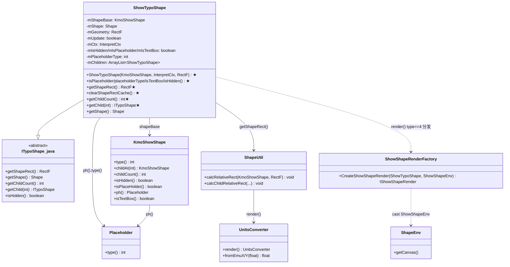
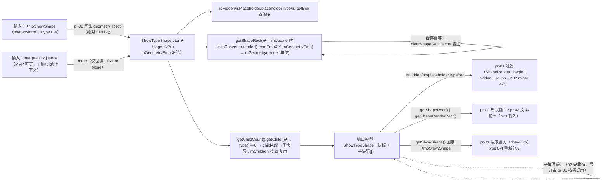
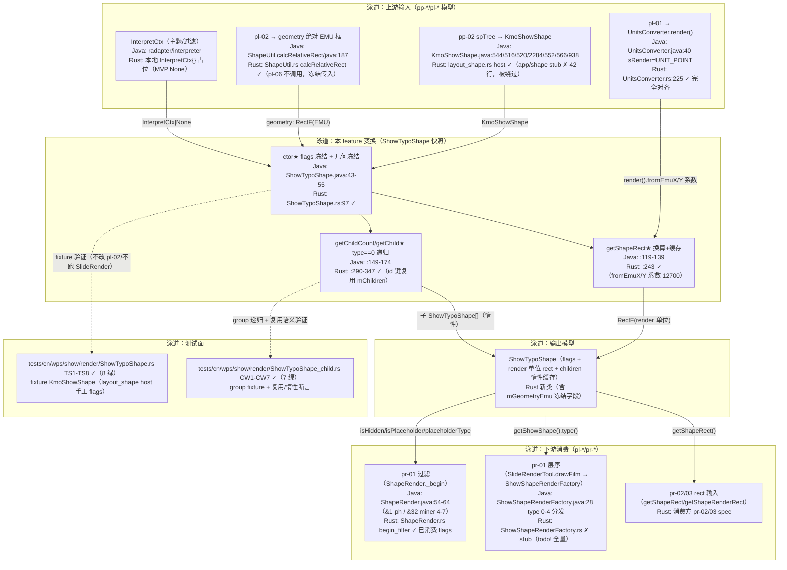
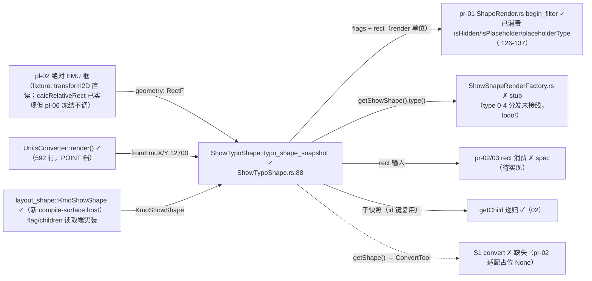

# pl-06-typo-shape — ShowTypoShape 快照（键类/流程/泳道/依赖/Java↔Rust 对齐）

> 分析依据：feature FEATURE.md / FUNCTIONS.md / functions.csv + Java 源码（真读）+ Rust 现状（真读 src/tests/.codeTrees）
> 管线：S2 布局层（上游 pp-* parse / pl-* 链式依赖；下游 pr-* render），主控文档 libs/ppt-core/PIPELINE_LAYOUT_RENDER_PLAN.md
> 分析日期：2026-08-31（实测核对：`cargo test --test 01_function_typo_shape_snapshot --test 02_function_child_walk` 15/15 绿）

---

## 0. Feature 目标与管线位置

**一句话目标**：把每个 `KmoShowShape` 的**过滤 flags**（isHidden / isPlaceholder / placeholderType / isTextBox）＋**render 单位绝对矩形**（EMU 框经 `UnitsConverter.render().fromEmuX/Y` 换算）＋**group 子级惰性快照**打包成可查询快照对象 `ShowTypoShape`，作为 S3 render 层（pr-01 过滤、pr-02/03 rect 输入）的统一输入；**不做实际绘制**。

| 维度 | 内容 |
|------|------|
| **depends_on** | pl-02（geometry 绝对 EMU 框）；pl-03（ph 继承，可选）；pl-05（行几何，非必须）；pl-01/`UnitsConverter.rs`（render 档换算，已存在 592 行，审计 keep） |
| **被谁依赖** | 02_function_child_walk（本 feature 内链）；pr-01-slide-layers（过滤输入）；pr-02-shape-command / pr-03-text-command（rect 输入） |
| **S2 层角色** | 快照/门面层：几何（换算不重算）、占位符 flags（ph.type 透传）、group 子级递归、rect 缓存（幂等+置脏）；**不是**断行层（那是 pl-05）、不是 ph 继承层（pl-03） |
| **范围外** | `getShape()`/`ConvertTool`（S1，pr-02 适配）；`render(ShapeEnv)`（Canvas 语义）；ink/3D/effect 修正；`ShapeEnv` 上下文；Chart/Table/graphicFrame 内容；hit-test |

**缺失断点**（PIPELINE_LAYOUT_RENDER_PLAN.md §3.2）：没有 pl-06 → pr-01 无输入对象可过滤，**渲染管线在 S3 必断**。

---

## 0.5 设计动机与心智模型

**心智模型**：本层把「KmoShowShape（原子模型）→ ShowTypoShape（渲染快照）」做一次**只读投影**：flags 构造时冻结、矩形惰性换算并缓存、子级按需展开且按身份复用。它对下游表现为**纯查询对象**，对上游表现为**geometry 输入即冻结**（不重算 pl-02 的活）。

| 矛盾 | 主数据结构 | 关键手段 |
|------|-----------|----------|
| Java `getShapeRect()` 内在 `ShapeUtil.calcRelativeRect` 重算 vs pl-02 已产出绝对 EMU 框（重算浪费且破坏分层） | `mGeometryEmu`（Rust 新增冻结字段）＋ `mGeometry`（换算缓冲） | 构造时冻结传入 geometry；getShapeRect 只做 `render().fromEmuX/Y` 换算并缓存，`clearShapeRectCache` 置脏（FEATURE.md「传入即冻结」；ShowTypoShape.rs:64-65/243-273） |
| `KmoShowShape` 真类（app/shape）42 行 stub 缺 `isHidden/isTextBox/ph` 等方法 vs function 需要 flags 读取端 | `util/layout_shape.rs` **compile-surface host**（820 行 fixture 数据宿主） | 用 fixture 类型绕过 stub（FUNCTIONS.md §5 明言「补齐前用 fixture 类型绕过」）；pp-02/pl-06 loop 再回头补真类 |
| Java children 复用按**引用相等**（`typoShape.getShowShape() == shape`）vs Rust 值语义 | `mChildren: Vec<ShowTypoShape>` | 以 `shape.id()`（dgShapeId，presentation 内唯一）为键复用；fixture 下与引用语义等价 |
| FEATURE.md/管线文档标 **spec** vs functions.csv 标 **pass** | — | 实测：01/02 源码真实实现 + 测试 15 个全绿 + 覆盖率报告已录 → 功能状态实为 **pass**；spec 标注为陈旧声明（管线文档 08-29 早于 function loop 08-30） |

**本 feature 特有「为什么」**：
1. **几何不重算**是硬边界：`calcRelativeRect` 属 pl-02 所有权（功能 02 的测试 CW 断言"geometry 传 None → 空 rect"）；Java 语义上 ctor 传入的 `geometry` 只是缓冲、getShapeRect 会覆盖它——Rust 改为尊重传入值，**仅当 pl-02 输入 == Java calcRelativeRect 结果时两者等价**（fixture/捷径轨成立的前提）。
2. **null shape 语义**来自 `isHidden()` 的短路 `mShapeBase==null || mIsHidden`（ShowTypoShape.java:107-108），Rust 构造端把 None 展开成 `(isHidden=true, 其余默认)`——注意 Java ctor 对 null shape 会 NPE，此为**为 fixture 定制的安全语义**（TS4/CW7）。
3. `getChild(i)` 越界：Java `childAt(i)` 越界抛 IndexOutOfBounds，Rust 返回 None（FUNCTION.md CW3 契约）——**有意放宽**，下游 pr-01 层序遍历免 panic。

---

## 1. 键类分析（类图）



**Rust 侧键类**（标注改写状态）：

```mermaid
classDiagram
    class ShowTypoShape_rs {
        -mShapeBase: Option~KmoShowShape~
        -mGeometry: RectF
        +mGeometryEmu: RectF
        -mUpdate: bool
        -mIsHidden: bool
        -mIsPlaceholder: bool
        -mPlaceholderType: i32
        -mIsTextBox: bool
        -mChildren: Vec~ShowTypoShape~
        +typo_shape_snapshot(...)★✓
        +ShowTypoShape(...)★✓
        +isHidden/isPlaceholder/placeholderType/isTextBox()★✓
        +getShapeRect()★✓
        +clearShapeRectCache()★✓
        +getChildCount/getChild/getChild__kmoshowshape★✓
        +getShape() ✗DEFERRED
    }
    class KmoShowShape_host {
        +shape_type: i32
        +is_hidden/is_text_box/is_placeholder: bool
        +ph: Placeholder
        +children: Vec~KmoShowShape~
        +isHidden/isPlaceHolder/ph/isTextBox/r#type()✓
        +childCount/childAt✓
    }
    class UnitsConverter_rs {
        +render() MutexGuard~UnitsConverter~✓
        +fromEmuX/Y(f32) f32✓
    }
    class ITypoShape_rs_stub {
        +getShapeRect() ✗todo!
    }
    ShowTypoShape_rs --> KmoShowShape_host : util::layout_shape
    ShowTypoShape_rs ..> UnitsConverter_rs : render().fromEmuX/Y
    ShowTypoShape_rs --|> ITypoShape_rs_stub : super_ 占位(本地空结构)
```

### 1.1 逐类表格

| 类 | Java 位置 / Rust 状态 | 关键字段（名:类型→作用） | 关键方法（签名→1 行逻辑，★热路径；取自真实源码） |
|----|----------------------|--------------------------|--------------------------------------------------|
| `ShowTypoShape` | `koffice/presentation/core/cn/wps/show/render/ShowTypoShape.java:28`（extends ITypoShape）；Rust `libs/ppt-core/src/cn/wps/show/render/ShowTypoShape.rs`（428 行，01/02 已实现） | `mShapeBase:KmoShowShape`→取 flags/children 源；`mShape:Shape`→ConvertTool 缓存（pr-02）；`mOverride:RenderModelOverride`→渲染覆写；`mGeometry:RectF`→render 单位矩形缓冲；`mUpdate:boolean`→rect 缓存脏标记；`mCtx:InterpretCtx`→转换上下文；`mTextRenderModel`→pr-03；`mIsHidden/mIsPlaceholder/mIsTextBox:boolean`、`mPlaceholderType:int`→ctor 冻结 flags；`isPlayer:boolean`→播放态；`mChildren:ArrayList<ShowTypoShape>`→子快照缓存 | ★ctor `ShowTypoShape(KmoShowShape, InterpretCtx, RectF)`（:43）→四 flags 从 shapeBase 冻结 + `mChildren=new ArrayList`、`mUpdate=true`；★`isHidden()`（:107）→`mShapeBase==null \|\| mIsHidden`；★`getShapeRect()`（:119）→`mUpdate` 时 `calcRelativeRect` + `UnitsConverter.render().fromEmuX/Y` 写入 mGeometry，型 2+ink 时 `calInRectPound`；★`clearShapeRectCache()`（:141）→`mUpdate=true`；★`getChildCount()`（:149）→`type()==0 ? childCount() : 0`；★`getChild(int)`（:153）→type==0 时 `childAt(i)`→私有 `getChild(KmoShowShape)`（:162）按引用相等查 `mChildren`，未命中 `new ShowTypoShape(shape, mCtx)` 追加并返回；`getShape()`（:180）→`noFilter` 走 SlideCache 否则 ConvertTool（pr-02 适配） |
| `ShowTypoShape.rs`（Rust） | `src/cn/wps/show/render/ShowTypoShape.rs`（428 行）；tests 镜像存在 | **Rust 新增** `mGeometryEmu:RectF`→构造时冻结的 EMU 框（`getShapeRect` 换算源，替代 Java 的 calcRelativeRect 重算）；其余字段一一对应 Java | ★`typo_shape_snapshot(Option<KmoShowShape>, Option<InterpretCtx>, Option<RectF>)`（:88）→门面入口，None 展开 `(hidden,false,0,false)`；★`ShowTypoShape`（:97）→四 flags 冻结 + `mGeometryEmu` 冻结；★`getShapeRect`（:243）→`mUpdate` 时 `UnitsConverter::render().fromEmuX/Y(mGeometryEmu)` 写 mGeometry；★`getChildCount/getChild/getChild__kmoshowshape`（:290/299/322）→type==0 门面 + 越界 None + `mChildren` 按 `shape.id()` 复用；`childCacheLen`（:349）测试帮助方法。11 个方法 `todo!("DEFERRED_NON_FUNCTION")`：setRenderOverride/setTextRenderModel/getTextRenderModel/render/getRenderModel/getInterpretCtx/getShape/calculateBounds/update3dTransfromMatrix/setIsPlayer/hasPlayer（均带 Java 注释块，非 critical 已标注） |
| `ITypoShape` | Java `presentation/.../show/moffice/drawing/render/ITypoShape.java`（abstract，9 抽象方法）；Rust `show/moffice/drawing/render/ITypoShape.rs`（21 行全 `todo!()` 壳） | — | 抽象：`getShapeRect/getShapeRenderRect/getShape/getChildCount/getChild/getRenderModel/render/isHidden/isModularGroupDefaultPic`；Rust 侧 `ShowTypoShape.rs` 用**本地空结构 `ITypoShape{}`** 占 `super_` 字段（不依赖该 stub） |
| `KmoShowShape` | Java `app/shape/KmoShowShape.java`（2829 行）；Rust 两处：`app/shape/KmoShowShape.rs`（42 行 stub）+ `util/layout_shape.rs`（820 行 host，**实际消费**） | `dgShapeId:int`→类型/身份来源；`children:List<KmoShowShape>`→group 子级；`ShowShapeAtomData`→原子数据（hasPh/hasInkId/hasTransform2D…） | ★`type()`（:544）→`DgStoreData.queryType(dgShapeId)`=（`$spt=KcBitsOp(-1048576)` 高位 20 位，`DgStoreData.java:10/19-21`）；★`childAt(int)`（:516）/`childCount()`（:520）→children 列表；★`isHidden()`（:2284）→`getDgShape().isHidden()`；★`isPlaceHolder()`（:552）→`shape.hasPh()`；★`ph()`（:566）→`shape.ph()` 返回 `ShowShape.Placeholder`；★`isTextBox()`（:938）→`getDgShape().isTextBox()`；`hasInk()/inkId()`（:595/599）、`transform2D()`（:2288，ph 无 xfrm 时 PlaceHolderMerger.mergeTransform，pl-03） |
| `layout_shape::KmoShowShape` | **Rust 新增**（无 Java 对应类；compile-surface host，pp-02 真类落位前的 fixture 宿主） | `shape_type:i32`→type；`is_hidden/is_text_box/is_placeholder:bool`、`ph:Placeholder`→flags 读取端；`children:Vec<KmoShowShape>`→子级；`transform2DX/Y/W/H:i32`、`can_rotate/rotation`→pl-02 几何直读 | `isHidden/isPlaceHolder/isTextBox/ph().r#type()`（:108-128）、`childCount/childAt`（:117-125）、`r#type/id`（:81-86）；`isModularGroupPicDefault()` 恒 false（:114，stub 语义，对应 FEATURE.md「恒 false」） |
| `ShapeUtil` | Java `show/util/ShapeUtil.java:187`（`calcRelativeRect`）；Rust `show/util/ShapeUtil.rs`（2105 行） | — | `calcRelativeRect(KmoShowShape, RectF, boolean)`（:191）→ShapeInfoCache.transform2D 取相对框 + parentGroup 递归 `calcShape2TopMatrix`+`calcChildRelativeRect`（旋转合并）；Rust `calcRelativeRect__...`（ShapeUtil.rs:329-360）已实现但属 **pl-02 所有权**，pl-06 不调用（geometry 冻结） |
| `UnitsConverter` | Java `base/converter/UnitsConverter.java`（`render()=sRender` 且 `sRender=new UnitsConverter((byte)2)`=`UNIT_POINT`）；Rust `base/converter/UnitsConverter.rs`（592 行，完全实现） | — | ★`render()`（:40）→返回 POINT 档单例；`fromEmuX/Y`（:98/102）→`mConverter[mUnitType].fromEmuX`；`PointConverter.fromEmuX=emu/12700.0F`（PointConverter.java:4-6）——**EMU→render 单位系数 12700** |
| `ShapeInfoCache` | Java `render/cache/ShapeInfoCache.java`（MRU 缓存 + ThreadLocal + LatestMatch）；Rust `render/cache/ShapeInfoCache.rs`（11 方法全 `todo!()` 壳） | `MRUIntKeyCache<ShapeInfo> mShapeInfoCache`→rotation/flip/transform2D 缓存；`mLatestMatchId`→最近命中 | `rotation/canRotate/isFlipHorz/isFlipVert/shapeInfo/transform2D`（:33-133）→id 查缓存，未命中 `add()`（SharedObjects 池）；**消费方是 pl-02 calcRelativeRect**，pl-06 不直接调 |
| `ShowShapeRenderFactory` | Java `render/util/ShowShapeRenderFactory.java:28`（`CreateShowShapeRender` type 0-4 分发）；Rust `render/util/ShowShapeRenderFactory.rs`（14 方法全 `todo!()` 壳） | — | ★`CreateShowShapeRender(ShowTypoShape, ShowShapeEnv)`（:28）→`typoShape.getShowShape().type()`：case 4→`CreateGraphicFrameRender`（Chart/Table/SmartArt/OLE/Model3D/Unknown），default→`ShapeRender`；4-arg 重载（:49）→`new ShowTypoShape(shapeBase, interpretCtx, geometry)` 后分发——**S3 遍历的入口工厂** |
| `ShowShapeEnv` | Java `render/util/ShowShapeEnv.java:16`（extends ShapeEnv）；Rust `render/util/ShowShapeEnv.rs`（8 方法全 `todo!()` 壳） | `mGraphics:GraphicsCanvas`、`mCanvas:Canvas`、`mSlide:ISlide`、`mDrawFlags:int` | `setContext`（:40）/`attach`（:68）/`getSlide/getDrawFlags`（:95-101）；**Canvas 语义，MVP 不做** |

---

## 2. 流程图与泳道图（依据 I/O 与上下游）

### 2.1 流程图（I/O 端点 → 变换 → 输出模型 → 消费方）



### 2.2 泳道图（上游输入 / 本 feature 变换 / 输出模型 / 下游消费 / 测试面）



---

## 3. 依赖关系与改写状态（对齐情况核心）

### 3.1 Java↔Rust 逐类映射表

| Java 类（完整路径） | Rust 路径 | 对齐程度 | 备注 |
|---------------------|-----------|----------|------|
| `cn.wps.show.render.ShowTypoShape` | `libs/ppt-core/src/cn/wps/show/render/ShowTypoShape.rs` | **部分对齐** | 01/02 全部 ★ 方法逐行对照已实现（ctor/flags/getShapeRect 缓存置脏/children 惰性复用）；`getShape`/`render`/`getInterpretCtx`/`calculateBounds`/`update3dTransfromMatrix`/`setIsPlayer`/`hasPlayer`/`setRenderOverride`/`setTextRenderModel`/`getTextRenderModel`/`getRenderModel` 共 11 方法为 `todo!("DEFERRED_NON_FUNCTION")` 壳（非 critical、已标注、不经过 fixture 热路径） |
| `cn.wps.show.moffice.drawing.render.ITypoShape`（presentation 版） | `libs/ppt-core/src/cn/wps/show/moffice/drawing/render/ITypoShape.rs` | **壳·stub** | 21 行全 `todo!()`；Rust `ShowTypoShape` 用本地空 `ITypoShape{}` 占 `super_`，**不依赖该 stub** |
| `cn.wps.show.app.shape.KmoShowShape` | `libs/ppt-core/src/cn/wps/show/app/shape/KmoShowShape.rs` | **壳·stub** | 42 行，`isHidden/isTextBox/ph/childAt/childCount/type` 等全部 `todo!()`；**被 layout_shape host 绕过**（`ShowTypoShape.rs:13` import util::layout_shape） |
| —（无 Java 对应） | `libs/ppt-core/src/cn/wps/show/util/layout_shape.rs` | **Rust 新增** | 820 行 compile-surface host：`KmoShowShape{is_hidden,is_placeholder,is_text_box,ph,children,transform2D…}` + 方法（`isHidden/isPlaceHolder/ph().r#type/isTextBox/childAt/childCount/r#type/id`，:81-128）——pl-06 的实际输入类型；fixture 可手工构造 |
| —（无 Java 对应） | `libs/ppt-core/src/cn/wps/show/util/layout_shape.rs::Placeholder` | **Rust 新增** | `{has_type,type_,has_idx,idx}` + `r#type()/hasType()/idx()`；`ph().r#type()` 缺 type 时 0（`ShowTypoShape.java` default `Placeholder.type()`=0 语义） |
| `cn.wps.show.util.ShapeUtil`（calcRelativeRect 族） | `libs/ppt-core/src/cn/wps/show/util/ShapeUtil.rs` | **部分对齐** | `calcRelativeRect__kmoshowshape_rectf(_boolean)` 已实现（:329-360，transform2D 直读 + parentGroup 递归 calcChildRelativeRect）；`calcShapeMatrix`/`calcShapeRect`/`calcShapeTextRect` 等 `DEFERRED`；**本 feature 不消费**（pl-02 所有权），matrix=None 的 MVP 路径完整 |
| `cn.wps.base.converter.UnitsConverter` | `libs/ppt-core/src/cn/wps/base/converter/UnitsConverter.rs` | **完全对齐** | 592 行，`render()`=UNIT_POINT（`UNIT_POINT: i8 = 2`，:21/227）；`fromEmuX/Y` 委托 `PointConverter`=emu/12700（:331-340）；系数与 Java `PointConverter.java:4-6` 逐字一致 |
| `cn.wps.show.render.cache.ShapeInfoCache` | `libs/ppt-core/src/cn/wps/show/render/cache/ShapeInfoCache.rs` | **壳·stub** | 11 方法全 `todo!()`；消费方是 pl-02 `calcRelativeRect`（Java:191-194），pl-06 不直接依赖（fixture 下 transform2D 由 host 字段直读） |
| `cn.wps.show.render.util.ShowShapeRenderFactory` | `libs/ppt-core/src/cn/wps/show/render/util/ShowShapeRenderFactory.rs` | **壳·stub** | 14 方法全 `todo!()`；S3 遍历入口（type 0-4 分发），属 pr-01 消费端，pl-06 只产出快照 |
| `cn.wps.show.render.util.ShowShapeEnv`（extends ShapeEnv） | `libs/ppt-core/src/cn/wps/show/render/util/ShowShapeEnv.rs` | **壳·stub** | 8 方法全 `todo!()`；Canvas 语义，MVP 明确不做（FEATURE.md 禁止把 ShapeEnv 放快照） |
| `cn.wps.show.radapter.interpreter.InterpretCtx` | `libs/ppt-core/src/cn/wps/show/radapter/interpreter/InterpretCtx.rs` | **壳·stub** | 18 行全 `todo!()`；`ShowTypoShape.rs` 用本地 `InterpretCtx{}` 占参（fixture None），`Content/Theme/FilterInterpretCtx.rs` 存在但 off 本 feature 热路径 |
| `cn.wps.show.render.RenderModelOverride` | `libs/ppt-core/src/cn/wps/show/render/RenderModelOverride.rs` | **壳·stub** | `setOrigin/setFillColor` 等全 `todo!()`；pr-02 适配，pl-06 仅占字段 |

### 3.2 functions.csv 声称状态 vs 实测核对

| function_id | csv 声明 | 实测源码 | 实测测试 | 结论 |
|-------------|----------|----------|----------|------|
| `01_function_typo_shape_snapshot` | pass | `ShowTypoShape.rs` ctor/flags/getShapeRect/clearShapeRectCache 真实实现（非壳，无 todo! in 热路径） | `tests/.../ShowTypoShape.rs` TS1-TS8 **8/8 绿**（实测 cargo test）；llvm-cov 88/130 行 67.7% 已录 | **声称=实测，pass 成立** |
| `02_function_child_walk` | pass | `getChildCount/getChild/getChild__kmoshowshape` + `mChildren` id 键复用真实实现 | `tests/.../ShowTypoShape_child.rs` CW1-CW7 **7/7 绿**（实测 cargo test）；llvm-cov 88/163 行 54.0% 已录 | **声称=实测，pass 成立** |

> 状态声明漂移注意：FEATURE.md 头部与 PIPELINE_LAYOUT_RENDER_PLAN.md §2.1 仍标 **spec**（08-29 快照），FUNCTIONS.md/functions.csv 已标 **pass**（08-30 loop 后）——实测以源码+测试为准：**两 function 已达成 pass**；全 feature 其余（getShape/render 族）属 pr-02/pr-03 延后项，非本波。

---

## 4. 最小 feature-critical 改写范围

### 4.1 must / stub / defer（对齐缺口）

| 栏 | 方法/字段 | 说明 |
|----|-----------|------|
| **must（已实现 ✓）** | ctor（3 参+2 参）、`typo_shape_snapshot` 门面；`isHidden/isPlaceholder/placeholderType/isTextBox/getShowShape`；`getShapeRect/getRect/getShapeRenderRect/clearShapeRectCache`（含 `mGeometryEmu` 冻结 + `UnitsConverter.render().fromEmuX/Y`）；`getChildCount/getChild/getChild__kmoshowshape`（type==0 门面 + 越界安全 + `mChildren` id 键惰性复用） | 全部落地且测试覆盖（TS1-TS8/CW1-CW7） |
| **stub（已标注 ✓）** | `getShape()`（ConvertTool 链）→ `todo!("DEFERRED_NON_FUNCTION")`，pr-02 适配；`render(ShapeEnv)`、`setRenderOverride/getRenderModel`、`setTextRenderModel/getTextRenderModel` → pr-02/pr-03；`isModularGroupDefaultPic` → 真实实现但 host 侧 `isModularGroupPicDefault()` 恒 false（FEATURE.md「恒 false」一致）；`setIsPlayer/hasPlayer`、`calculateBounds`、`update3dTransfromMatrix` → 3D/effect 延后 | 11 个 todo 全部带 Java 注释块 + `DEFERRED_NON_FUNCTION` 标签（对齐 function-java2rust 规约） |
| **defer（Java 语义未对齐可接受）** | ink 修正（`KmoShowShape.hasInk` → `calInRectPound`，ShowTypoShape.java:127-135）→ rust 注释 `no-stmt (ink DEFERRED_NON_FUNCTION)`；`getShapeRect` 内 `calcRelativeRect` 重算 → 冻结 geometry 替代（pl-02 边界，见 §0.5 矛盾 1）；`getChild(i)` 越界从 Java exception 改为 None；null shape ctor 从 Java NPE 改为安全默认值；children 复用从 Java 引用相等改为 id 相等（fixture 等价） | 均记录在 .rs `// rust:` 注释或 FUNCTION.md，无静默 |

### 4.2 当前进度（每 function 实测状态）

| function | 状态 | 证据 |
|----------|------|------|
| 01_function_typo_shape_snapshot | **pass（实测）** | 源码实装 + TS1-TS8 绿 + 覆盖率 67.7% line（FUNCTION.md §3.7）+ 模板布局 PASS + java-rust-align PASS |
| 02_function_child_walk | **pass（实测）** | 源码实装 + CW1-CW7 绿 + 覆盖率 54.0% line + 模板布局 PASS + java-rust-align PASS |
| 依赖：`KmoShowShape`（app/shape） | 壳·stub（42 行） | 被 layout_shape host 绕过；FUNCTIONS.md §5：pp-02/pl-06 loop 补齐 `childAt/childCount/ph/isHidden/isTextBox/getShapeRect` 前继续用 fixture 类型 |
| 依赖：`UnitsConverter` | **完全对齐** | 592 行 keep（pl-01 审计结论） |
| 依赖：`ShapeUtil.calcRelativeRect` | pl-02 所有权，已实现 | pl-06 冻结不调用 |

**关键路径风险**：`typo_shape_snapshot(shape=None, geometry=None)` → `getShapeRect()` 返回空 rect；Java 语义下 null shape 不可构造（NPE）。fixture 轨 safe；若未来真链在 geometry 缺席时把 None 传入，rect 会静默为 0 —— **需人工确认接线端（pr-01 film_shapes 已从 transform2D 构造 geometry，当前 safe）**。

---

## 5. 验收口径

钉死值（全部来自 Java 源码 / FUNCTION.md，非臆造）：

| 项 | 钉死值 | 来源 |
|----|--------|------|
| 默认 slide 尺寸 | **12192000×6858000**（EMU） | `PptxrPresentation.java:28-29` `DEFAULT_SLDSIZE_CX/CY`；pl-01 `slide_viewport`（PIPELINE_LAYOUT_RENDER_PLAN.md §2.2） |
| EMU→render 单位系数 | `UnitsConverter.render()` 为 **UNIT_POINT** 档，`fromEmuX/Y(emu) = emu / 12700.0`；例：`render().fromEmuX(12192000)=960.0` | `UnitsConverter.java:22/40`（`sRender=new UnitsConverter((byte)2)`）＋ `PointConverter.java:4-6`；Rust `UnitsConverter.rs:225/331`（`emu / 12700.0`）；pl-01 FUNCTION T01 同值 |
| type 0-4 常量 | `type()` = `DgStoreData.$spt`（`KcBitsOp(-1048576)` 高 20 位）提取 `dgShapeId`；**0=group / 1=shape / 2=picture / 3=connector / 4=graphicFrame / 5=textShape** | `DgStoreData.java:10/19-45`；KmoShowShape.java:544 |
| ph placeholderType | `shapeBase.ph().type()`；缺 type 默认 0；title=0/1（继承链），**miner=4/5/6/7**（date/ftr/hd/obj，`_begin` 过滤 `drawFlags&32` 跳过） | ShowTypoShape.java:52/65；ShapeRender.java:59/66-76；PIPELINE §S4 |
| 过滤位 | `drawFlags&1` → 跳过 placeholder；`drawFlags&32` → 跳过 miner ph（type 4-7）；`isHidden()` 短路 `null \|\| mIsHidden`；drawFlags 场景常量 `READ_NORMAL_SLIDE=21505154/FOLLOWER=532609、NORMAL_THUMBNAIL_SLIDE=29909122/FOLLOWER=548993` | ShapeRender.java:54-64；Rust `DrawFlags.rs:24-30`（与 Java 字面量一致） |
| rect 语义 | 入 EMU、出 render 单位；`getShapeRect` 幂等（未置脏重复调用同缓存值）；`clearShapeRectCache` 置脏重算；**不重算 geometry（calcRelativeRect 属 pl-02）** | ShowTypoShape.java:119-143；FEATURE.md I/O 表；FUNCTION.md 01 §1.6 不变量 2-4 |
| children 语义 | `type()!=0` → count=0 / getChild=None；`i` 越界 → None（Rust 增值安全）；同一 KmoShowShape 两次 getChild → **同一子快照**；未请求子级不构造（惰性） | ShowTypoShape.java:149-174；FUNCTION.md 02 §1.6 不变量 1-4；实测 CW4/CW5 绿 |
| 空输入语义 | `geometry=None` → 空 `RectF()`（`show shape` None → isHidden=true、rest 默认）；Java 第二 ctor `new RectF()` | ShowTypoShape.java:47/57-58；FUNCTION.md 01 §1.1 错误语义；实测 TS4 绿 |
| 验收轨 | 产品捷径轨：fixture KmoShowShape → pl-01/02/06 → pr-01/02/03 → pr-04 画一页；产品闭环轨：+pp-10/11 + 打开链 | MVP.md 两条轨；PIPELINE §3.1 |

---

## 6. Java↔Rust 管线对比与对齐审计

### 6.1 Java 侧链路（含上游输入与下游消费）

```text
[上游 pl-02] ShapeUtil.calcRelativeRect(shapeBase, rcShape)（EMU 绝对框，group 子级含旋转合并）
[上游 pl-01] UnitsConverter.render()（POINT 档 12700 系数）
        ↓
ShowTypoShape ctor（flags 冻结）→ getShapeRect（calcRelativeRect + fromEmuX/Y + ink 修正）→ getChildCount/getChild（type==0 + mChildren 引用复用）
        ↓
[S3 遍历] SlideRender.draw → drawFilm（spTree.shapeAt(i)）→ ShowShapeRenderFactory.CreateShowShapeRender(type 0-4 分发)
        ↓
[下游 pr-01] ShapeRender._begin（isHidden / &1 ph / &32 miner 4-7）→ [pr-02] DrawingRender rect → [pr-03] ShapeTextRender 文本区
```

### 6.2 Rust 侧现状接线（✓ 已接线 / ✗ stub / ✗ 缺失 / 新=Rust 新增）



### 6.3 对齐差距表

| 缺口 | 影响 | 阻塞哪个下游 | 归类 |
|------|------|--------------|------|
| `getShape()`/`ConvertTool`（pr-02 适配） | 拿不到公开 Shape → 无法画 fill/line/geometry | pr-02（最小可画出口）| defer（FEATURE.md 明示延至 pr-02，`DEFERRED_NON_FUNCTION` 已标注） |
| `render(ShapeEnv)`/`ShowShapeEnv`/`ShapeRenderFactory` | S3 遍历入口未接线 | pr-01 分发、pr-02/03 实绘 | defer（Canvas 语义，MVP 不做） |
| `ShowTypoShape == null ctor NPE` → Rust 安全默认 | 语义差异（仅 fixture 路径使用） | 无（真链 KmoShowShape 恒非空） | defer |
| Java `mGeometry` 覆盖式重算 → Rust 冻结 `mGeometryEmu` | 传入 geometry ≠ calcRelativeRect 时 rect 不同 | pr-02/03（须保证上游 pl-02 输入正确）| defer（设计决策；fixture/捷径轨成立） |
| children 复用键：Java 引用相等 → Rust `id()` 相等 | 语义窗口（dgShapeId 全局唯一，等价） | 无 | defer |
| `getChild(i)` 越界 None vs Java exception | 走向更安全，非 Java 一致 | 无 | defer（FUNCTION.md CW3 契约） |
| `app/shape/KmoShowShape.rs` 42 行 stub | 真 KmoShowShape 不可用 | 闭环轨（pp-02/10/11 落真类后需回补） | stub 已标注（FUNCTIONS.md §5） |
| `ShapeInfoCache` stub | calcRelativeRect 缓存语义缺失 | pl-02（fixture 用 host 字段直读绕过） | stub 已标注（非本 feature 所有权） |
| ink 修正（`calInRectPound`） | 墨迹形状 rect 无 ink 扩大 | pr-02 图片/ink 场景 | defer（`no-stmt (ink DEFERRED_NON_FUNCTION)`） |
| `isModularGroupPicDefault` 恒 false | modular group 默认图过滤不生效 | pr-01 `&16777216` 相关编辑器场景 | defer（host `isModularGroupPicDefault()=false`，FEATURE.md 一致） |

### 6.4 结论

**实测结论：PASS（两 function 达成 pass；feature 级为「部分对齐」——critical 全完整，余项为非 critical 已标注延后）。**

- 01/02 的 feature-critical 热路径（ctor flags 冻结、getShapeRect 换算与缓存/置脏、type==0 子级惰性复用）**全部真实实现且逻辑逐方法对照 Java**；15 个测试实测全绿；模板布局 PASS + java-rust-align overall PASS；覆盖率报告在位。
- 无未标注的 `todo!`/`unimplemented!`/空体在热路径上（11 个 todo 全部 `DEFERRED_NON_FUNCTION` 标签 + Java 注释，属 FEATURE.md「stub」清单）；无丢值 setter。
- functions.csv 声称 pass 与实测一致（**无「声称-实测不符」**）；FEATURE.md/PIPELINE 文档的 spec 标注为陈旧声明。
- 下游接线：pr-01 过滤（ShapeRender.rs begin_filter）已消费快照 flags ✓；pr-01 遍历入口（ShowShapeRenderFactory stub）与 pr-02/03 为后续 feature，pl-06 本身不阻塞（快照已可产出）；产品捷径轨（fixture → pl-01/02/06 → pr-01）当前可跑通到 LayerItem 序列。
- 需人工确认点：① `getShapeRect` 冻结语义依赖上游 pl-02 提供正确绝对框（当前 pr-01 film_shapes 从 transform2D 构造，safe）；② 真 KmoShowShape（app/shape）补齐后需回归 host 与真类的双轨一致性。