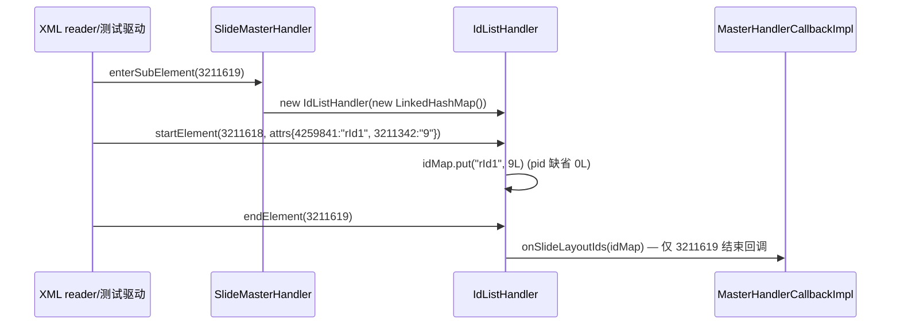
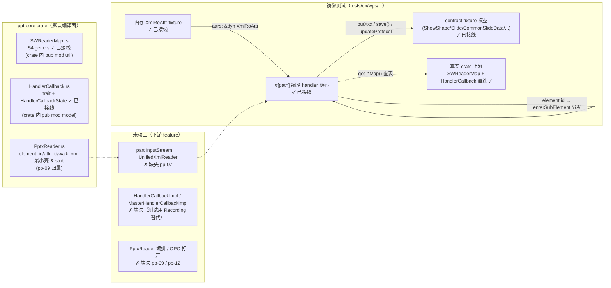

# pp-01-pptx-parse — PPTX parser 基础契约与 slide XML 装配（键类/流程/依赖/Java↔Rust 对比）

> 分析依据：feature FEATURE.md / FUNCTIONS.md / functions.csv + Java 源码（真读）+ Rust 现状（已实现，镜像测试验收）
> 管线：parse→layout→render（见 `libs/ppt-core/PARSER_JAVA_RUST_PIPELINE.md` 顶层对比；ppt 侧对应 `parser/features/PIPELINE.md`）
> 分析日期：2026-09（基于 2026-08-28/29 的 function 验收快照 + 当日源码复核；`cargo check`（默认 feature）当日通过 exit 0）

## 0. Feature 目标与管线位置

**一句话目标**：把 PPTX 词汇层的「OOXML 属性字符串 → 稳定枚举 id」与 part XML 装配层的
`p:nvPr` / `p:cSld` / `p:sld` / `p:sldLayout` / `p:sldMaster` 内存 XML 事件，分别写入
`ShowShape` 元数据与 film/protocol，锁定 parser mode 与回调默认策略——它是
`pptx bytes → KmoPresentation` 的**第一层**，不打开 ZIP/OPC、不打开 part、不编排整个 PPTX。

- **上游**：manifest `depends_on_feature` 为空（`parser/features/manifest.csv` 复核：`pp-01-pptx-parse,,,pass`）。
- **下游**：pp-02 shape-tree-parse（03/04 的子 handler 与 spTree 构造）；pp-03/pp-05（clrMap/lstStyle/txStyles/timing/transition 子树分发）；pp-06..09（presentation.xml / part-open / slides-walk / PptxReader）；`functions.csv` 中 05/06/07 的 downstream 标 `pp-07-part-open`。
- **本层回答的问题**（来自 FEATURE.md I/O 表与范围外说明）：
  1. `01`：54 张 token→enum 映射表如何建、如何查（纯查表，不遍历 XML、不写模型）。
  2. `02`：四种 parser mode（0/1/2/3）如何互斥判定；基类未覆写 hook 的默认语义（identity / `-1` / `None` / no-op）。
  3. `03`：`p:nvPr` 的 attrs/sub-events 如何写 `ShowShape`（flags、media mode、placeholder、custData）。
  4. `04`：`p:cSld` 如何建 film 根（`KmoShowShape(type=0)` + `spTree().initRoot` + `updateProtocol(save)`）并把 name/bg/custData/control/spTree 分发给真实命名子 handler。
  5. `05–07`：`p:sld` / `p:sldLayout` / `p:sldMaster` 按 element id 分发真实子 handler 并写 protocol（不启动 slide part reader）。
- **范围外（明确不答）**：part open（pp-07）、theme part（pp-04）、presentation.xml（pp-06）、rId 装配（pp-08）、`PptxReader` 编排（pp-09）、timing/transition 子树业务体（pp-05）。

## 0.5 设计动机与心智模型

1. **词汇层与装配层分离**：`SWReaderMap` 把"属性字符串 → 枚举 int"的映射集中为 54 张只读表，
   使各 handler 落值时 `map.get(tag)` 即可、未知 tag 走默认分支——解决"魔法数散落、枚举不可对齐"
   的矛盾。`HandlerCallback` 同理把"解析器 mode 判定"与"回调默认策略"做成基类（Rust 为
   object-safe trait），解决"handler 行为随打开方式（PPTX/PPT14/GVml/ArtTable）漂移"的矛盾。
2. **XML reader 与 handler 解耦**：所有 handler 只消费"内存 XML 事件"（element id + `XmlRoAttr`），
   不拥有 reader/OPC/media 资源——这样 03 可被 pp-02 leaf handler 复用（同一份 `SwNvPrHandler.rs`），
   04 的后半段（`3211606` spTree）可把解析交给 pp-02 的 `SwGroupShapeHandler`（本层只构造）。
3. **模型写入走"protocol save"契约**：`Slide/SlideLayout/SlideMaster/CommonSlideData` 的
   `Xxx.create()/save()` 是内存字节协议契约；本层只负责"事件 → putXxx → save → updateProtocol"，
   默认编译面按 MVP 队列收敛（`full` opt-in 才进完整模型树）——解决"模型树巨大、feature 无法独立
   编译验收"的矛盾。
4. **构造契约 fixture（kind 锁定）**：对未到期的子 handler（timing/transition/clrMap/txStyles/
   fill/effect/media/custData），本层只验证"按 element id 构造出**真实命名 handler**"（`kind()` 锁定），
   业务体留给 pp-03/pp-05/DML feature——保证分发逻辑先验收、子树内容后验收。

## 1. 键类分析（类图）

```mermaid
classDiagram
    class DefaultElementHandler {
        <<kfc 基类 (Java)>>
        +startElement(int, XmlRoAttr) void
        +endElement(int) void
        +enterSubElement(int) ElementHandler
    }
    class ElementHandler {
        <<interface>>
        +startElement(int, XmlRoAttr) void
        +endElement(int) void
        +characters(String) void
        +enterSubElement(int) ElementHandler
    }
    class XmlRoAttr {
        <<interface>>
        +getByName(int) XmlRoAttr
        +getAttrAt(int) XmlRoAttr
        +count() int
        +getName() int
        +toBoolean() boolean
        +toInt() int
        +toLong() long
        +toString() String
    }
    class HandlerCallback {
        <<abstract>>
        -int mode = 0
        +HandlerCallback()
        +HandlerCallback(int mode)
        +isPPTX() boolean
        +isPPT14Slides() boolean
        +isGVml() boolean
        +isArtTable() boolean
        +getCoreShapeId(Integer) Integer
        +onOleObject(String) int
        +onInk(String, FileManager) int
        +getChartMap() Map
        +getDiagramPairs() Map
        +多个默认 no-op hook
    }
    class SWReaderMap {
        <<静态查表层>>
        +54 张 Map~String,Integer~ 静态字段
    }
    class SwNvPrHandler {
        -ShowShape sp
        -HandlerCallback handlerCallback
        -ShowShape.Placeholder placeholder
        +startElement(int, XmlRoAttr) void
        +enterSubElement(int) ElementHandler
        +endElement(int) void
    }
    class PlaceholderShapeHandler {
        -ShowShape.Placeholder placeholder
        +startElement(int, XmlRoAttr) void
    }
    class CommonSlideDataHandler {
        -KmoFilm film
        -CommonSlideData commonSlideData
        -DgStore dgStore
        -KmoShowShape shapeTree
        +startElement(int, XmlRoAttr) void
        +enterSubElement(int) ElementHandler
        +endElement(int) void
    }
    class BackgroundHandler {
        -Background backgroudShape
        -HandlerCallback handlerCallback
        +startElement(int, XmlRoAttr) void
        +enterSubElement(int) ElementHandler
    }
    class BackgroundPropertiesHandler {
        +startElement(int, XmlRoAttr) void
        +enterSubElement(int) ElementHandler
    }
    class ControlListHandler {
        -KmoShowShape shapeTree
        -DgStore dgStore
        -HandlerCallback callback
        +enterSubElement(int) ElementHandler
    }
    class ControllerHandler {
        -KmoShowShape picture
        -int imageW
        -int imageH
        +startElement(int, XmlRoAttr) void
        +enterSubElement(int) ElementHandler
    }
    class AlternateContentHandler {
        +enterSubElement(int) ElementHandler
    }
    class FallBackHandler {
        +enterSubElement(int) ElementHandler
    }
    class SlideHandler {
        -KmoSlide mSlide
        -Slide slideData
        -DgStore dgStore
        +startElement(int, XmlRoAttr) void
        +enterSubElement(int) ElementHandler
        +endElement(int) void
    }
    class ColorMapOverrideHandler {
        -ColorMapping colorMapping
        +enterSubElement(int) ElementHandler
    }
    class SlideLayoutHandler {
        -KmoSlideLayout mLayout
        -SlideLayout layoutData
        -DgStore mDgStore
        +startElement(int, XmlRoAttr) void
        +enterSubElement(int) ElementHandler
        +endElement(int) void
    }
    class SlideMasterHandler {
        -KmoSlideMaster mMaster
        -SlideMaster masterData
        -MasterHandlerCallbackImpl handlerCallback
        +startElement(int, XmlRoAttr) void
        +enterSubElement(int) ElementHandler
        +endElement(int) void
    }
    class IdListHandler {
        -Map~String,Long~ idMap
        +startElement(int, XmlRoAttr) void
        +endElement(int) void
        +enterSubElement(int) ElementHandler
    }
    class TextStylesHandler {
        -SlideMaster mMasterData
        -HandlerCallback mHandler
        +enterSubElement(int) ElementHandler
    }
    class HeaderFooterHandler {
        -HeaderFooter headerFooter
        +startElement(int, XmlRoAttr) void
    }

    DefaultElementHandler <|-- SwNvPrHandler
    DefaultElementHandler <|-- CommonSlideDataHandler
    DefaultElementHandler <|-- BackgroundHandler
    DefaultElementHandler <|-- ControlListHandler
    DefaultElementHandler <|-- SlideHandler
    DefaultElementHandler <|-- ColorMapOverrideHandler
    DefaultElementHandler <|-- SlideLayoutHandler
    DefaultElementHandler <|-- SlideMasterHandler
    DefaultElementHandler <|-- TextStylesHandler
    DefaultElementHandler <|-- HeaderFooterHandler
    ElementHandler <|-- DefaultElementHandler
    SwNvPrHandler "1" o-- "1" PlaceholderShapeHandler
    CommonSlideDataHandler "1" o-- "1" BackgroundHandler
    CommonSlideDataHandler "1" o-- "1" ControlListHandler
    BackgroundHandler "1" o-- "1" BackgroundPropertiesHandler
    ControlListHandler "1" o-- "1" ControllerHandler
    ControlListHandler "1" o-- "1" AlternateContentHandler
    AlternateContentHandler "1" o-- "1" FallBackHandler
    SlideMasterHandler "1" o-- "1" IdListHandler
    SlideMasterHandler "1" o-- "1" TextStylesHandler
    SwNvPrHandler ..> SWReaderMap : placeholderSize/TypeMap
    SwNvPrHandler ..> HandlerCallback : 传给媒体子 handler
    SlideLayoutHandler ..> SWReaderMap : slideLayoutTypeMap
    SlideHandler ..> CommonSlideDataHandler : 3211608
    SlideLayoutHandler ..> CommonSlideDataHandler : 3211608
    SlideMasterHandler ..> CommonSlideDataHandler : 3211608
    SlideHandler ..> ColorMapOverrideHandler : 3211599
    SlideLayoutHandler ..> ColorMapOverrideHandler : 3211599
    SlideMasterHandler ..> HeaderFooterHandler : 3211611
    SlideLayoutHandler ..> HeaderFooterHandler : 3211611
```



### 1.1 逐类明细（签名来自真实 Java 源码）

#### `show.pptxr.util.SWReaderMap`（01）
- 继承/实现：无（纯静态查表层）。
- 关键字段：54 个 `public static final Map<String, Integer>` 实例初始化块字段（conformanceClassMap…oleObjectFollowColorSchemeMap），字段名即映射名。
- 关键方法：**无方法**——Java 侧全部是字段（627 行）；Rust 侧以 `pub struct SWReaderMap;` + 54 个 `pub fn get_<map>() -> &'static HashMap<&'static str, i32>` getter 暴露（555 行，`OnceLock` 惰性初始化 + `make_map!` 宏建表），字段→getter 的结构性适配。
- ★ 热路径读取约定（由调用方如 03/06 使用）：`SWReaderMap::get_<map>().get(tag)`，未命中走调用方默认分支。

#### `drawing.dmlr.model.HandlerCallback`（02）
- 继承/实现：`public abstract class HandlerCallback`（119 行 Java）。
- 关键字段：`private int mode = 0;`（构造器注入，默认 0）。
- 关键方法（全部真实签名）：
  - `HandlerCallback()` / `HandlerCallback(int mode)` → mode 赋值。
  - ★ `boolean isGVml()`→`mode==2`；`boolean isPPTX()`→`mode==0`；`boolean isPPT14Slides()`→`mode==1`；`boolean isArtTable()`→`mode==3`。
  - `void load()` → 空实现；`void onTags(String, CustDataLst.TagLst)` 等 16 个 typed hook → 空实现（可覆写）。
  - ★ `Integer getCoreShapeId(Integer originShapeId)` → 原样返回（identity）。
  - ★ `int onOleObject(String rId)` → `-1`（未解析关系默认）；`int onInk(String rId, FileManager)` → `-1`。
  - ★ `Map<String,Shape> getChartMap()` / `Map<Integer,DiagramPair> getDiagramPairs()` → `null`（未提供 collector 默认）。
- Rust 现状：`HandlerCallbackState{mode:i32}` + 两个自由构造函数 + `pub trait HandlerCallback`（15 个 associated type 承接模型类型；`fn callback_state(&self) -> &HandlerCallbackState` 暴露 mode）；四个 mode predicate、identity/`-1`/`None` 默认与全 no-op hook 均落实，且不依赖 01。

#### `show.pptxr.handler.shape.SwNvPrHandler`（03）
- 继承/实现：`extends DefaultElementHandler`（129 行 Java）。
- 关键字段：`ShowShape sp`；`HandlerCallback handlerCallback`；`ShowShape.Placeholder placeholder`（可空，子元素 3211571 时创建）。
- 关键方法：
  - ctor `SwNvPrHandler(ShowShape, HandlerCallback)`。
  - ★ `void startElement(int element, XmlRoAttr attrsNotCopy)`：`getByName(3211572)`→`sp.putIsPhoto(toBoolean)`；`getByName(3211573)`→`sp.putUserDrawn(toBoolean)`。
  - ★ `ElementHandler enterSubElement(int subElement)`：7 个 case —— `1114119`→`media().putMode(0)`+`AudioCDHandler(media.audioCD())`；`1114120`→mode 1+`EmbeddedWAVAudioFileHandler`；`1114121`→mode 2+`AudioFileHandler`；`1114122`→mode 3+`VideoFileHandler`；`1114123`→mode 4+`QuickTimeFileHandler`；`3211295`→`MediaExtLstHandler(media, callback)`；`3211519`→`CustDataLstHandler(sp.custDataLst(), callback)`；`3211571`→`placeholder=Placeholder.create()` + `PlaceholderShapeHandler(placeholder)`。
  - ★ `void endElement(int element)`：`placeholder != null` 时 `placeholder.save()` + `sp.forceWritePh(placeholder)`。
- 嵌套类 `private class PlaceholderShapeHandler extends DefaultElementHandler`：
  - ★ `void startElement(int, XmlRoAttr)`：`3211570`→`putHasCustomPrompt`；`3211459`→`"4294967295"` 归一 `putIdx(-1)` 否则 `putIdx(toInt)`；`3211267`→`DGMap.orientationMap` 命中才 `putOrient`；`3211569`→`SWReaderMap.placeholderSizeMap` 命中才 `putSize`；`3211302`→`SWReaderMap.placeholderTypeMap` 命中才 `putType`。
- Rust：`SwNvPrHandler<C: HandlerCallback>`（`Rc<RefCell<ShowShape>>` + `Option<Rc<RefCell<C>>>`），逻辑逐条对齐（含 4294967295→-1、DGMap.orientation 查表），`impl ElementHandlerContract` 完成接线。与 pp-02 `01_function_nonvisual_shape_props` 共用同一源码与镜像测试。

#### `show.pptxr.handler.slides.CommonSlideDataHandler`（04）
- 继承/实现：`extends DefaultElementHandler`（63 行 Java）。
- 关键字段：`KmoFilm film`；`CommonSlideData commonSlideData`；`HandlerCallback handlerCallback`；`DgStore dgStore`；`KmoShowShape shapeTree`。
- 关键方法：
  - ctor `CommonSlideDataHandler(KmoFilm film, DgStore dgStore, HandlerCallback handlerCallback)`：`shapeTree = new KmoShowShape(film.parent(), 0)`（type=0 根）；`commonSlideData = CommonSlideData.create()`。
  - ★ `void startElement(int, XmlRoAttr)`：`getByName(3211449)`→`commonSlideData.putName(toString)`。
  - ★ `ElementHandler enterSubElement(int subElement)`：`3211308`→`BackgroundHandler(background(), callback)`；`3211519`→`CustDataLstHandler(custDataLst(), callback)`；`3211606`→`SwGroupShapeHandler(shapeTree, callback)`（pp-02 构造，本层不展开 spTree）；`3211607`→`ControlListHandler(shapeTree, dgStore, callback)`；`3211295` 与 default→空（不构造）。
  - ★ `void endElement(int element)`：`film.spTree().initRoot(shapeTree)` + `film.updateProtocol(commonSlideData.save())`（必发生一次）。

#### `.../slides/BackgroundHandler`（04，包私有）
- 继承/实现：`extends DefaultElementHandler`（76 行 Java）。
- 关键字段：`Background backgroudShape`；`HandlerCallback handlerCallback`。
- 关键方法：ctor `BackgroundHandler(Background, HandlerCallback)`；
  - ★ `void startElement(int, XmlRoAttr)`：`getByName(1114443) || getByName(3211605)` 命中其一 → `DGMap.blackWhiteModeMap.get(toString)` 命中才 `backgroudShape.putBwMode`。
  - ★ `ElementHandler enterSubElement(int)`：`3211603`→`new BackgroundPropertiesHandler()`；`3211604`→`StyleMatrixReferenceHandler(backgroudShape.bgRef(), callback, 3211604)`。
  - 嵌套 `private class BackgroundPropertiesHandler`：★ startElement `3211602`→`putShadeToTitle`；★ enterSubElement `1114370..73/3211586`→`(new FillPropertiesHandler(fill(), callback)).enterSubElement(subElement)` 转派；`1114389/1114390`→`(new EffectPropertiesHandler(effect(), callback)).enterSubElement(subElement)`。

#### `.../slides/ControlListHandler`（04，包私有）
- 继承/实现：`extends DefaultElementHandler`（98 行 Java）。
- 关键字段：`KmoShowShape shapeTree`；`HandlerCallback callback`；`DgStore dgStore`。
- 关键方法：ctor `ControlListHandler(KmoShowShape, DgStore, HandlerCallback)`；★ `enterSubElement`：`2162692`→`AlternateContentHandler()`；`3211472`→`ControllerHandler()`。
  - 嵌套 `ControllerHandler`：字段 `picture`/`imageW`/`imageH`；startElement `3211464`→imageH、`3211463`→imageW；★ enterSubElement `3211469`→`picture = new KmoShowShape(shapeTree.parent(), 2)`、`shapeTree.addChild(picture)`、`SwPictureHandler(picture, callback)`。
  - 嵌套 `AlternateContentHandler`：★ enterSubElement `2162695`→`FallBackHandler()`（`2162693` Choice 落 default、不进 Fallback）；`FallBackHandler` enterSubElement `3211472`→`new ControllerHandler()`。

#### `.../slides/SlideHandler`（05）
- 继承/实现：`extends DefaultElementHandler`（75 行 Java）。
- 关键字段：`KmoSlide mSlide`；`HandlerCallback handlerCallback`；`Slide slideData`（ctor 后非 null）；`DgStore dgStore`。
- 关键方法：ctor `SlideHandler(KmoSlide, DgStore, HandlerCallback)`：`slideData = Slide.create()`；
  - ★ `void startElement(int, XmlRoAttr)`：`count()`+`getAttrAt(i)` 循环（**不是 getByName**），switch `3211600`→`putShowMasterSp`、`3211601`→`putShowMasterPhAnim`、`3211610`→`putShow`。
  - ★ `ElementHandler enterSubElement(int)`：`2162692`→`TransitionAlternateContentHandler(timing(), transition(), callback)`；`3211295`→`null`；`3211402`→`TransitionHandler(transition(), callback)`；`3211599`→`ColorMapOverrideHandler(clrMap())`；`3211608`→`CommonSlideDataHandler(mSlide.film(), dgStore, callback)`；`3211609`→`TimingHandler(timing(), callback)`；default→`null`。
  - ★ `void endElement(int)`：`slideData != null` 时 `mSlide.updateProtocol(slideData.save())`。

#### `.../slides/ColorMapOverrideHandler`（05）
- 继承/实现：`extends DefaultElementHandler`（25 行 Java）。
- 关键字段：`ColorMapping colorMapping`。
- 关键方法：ctor `ColorMapOverrideHandler(ColorMapping)`；★ `ElementHandler enterSubElement(int)`：`1114457`→`null`；`1114458`→`ColorMapHandler(colorMapping)`；default→`null`。

#### `.../slidelayouts/SlideLayoutHandler`（06）
- 继承/实现：`extends DefaultElementHandler`（88 行 Java）。
- 关键字段：`KmoSlideLayout mLayout`；`SlideLayout layoutData`；`DgStore mDgStore`；`HandlerCallback handlerCallback`。
- 关键方法：ctor `SlideLayoutHandler(KmoSlideLayout, DgStore, HandlerCallback)`：`layoutData = SlideLayout.create()`；
  - ★ `ElementHandler enterSubElement(int)`：同 05 的 6 个 case + `3211611`→`HeaderFooterHandler(layoutData.hf())`。
  - ★ `void startElement(int, XmlRoAttr)`：循环 `getAttrAt(i)`，`3211302`→`type = SWReaderMap.slideLayoutTypeMap.get(...)`，`putType(type == null ? 23 : type)`（**未命中写 23**）；`3211573`→`putUserDraw`；`3211600`→`putShowMasterSp`；`3211601`→`putShowMasterPhAnim`；`3211612`→`putMatchingName`；`3211613`→`putPreserve`。
  - ★ `void endElement(int)`：无条件 `mLayout.updateProtocol(layoutData.save())`。

#### `.../slidemasters/SlideMasterHandler`（07）
- 继承/实现：`extends DefaultElementHandler`（103 行 Java）。
- 关键字段：`KmoSlideMaster mMaster`；`SlideMaster masterData`；`DgStore mDgStore`；`MasterHandlerCallbackImpl handlerCallback`（`onSlideLayoutIds` 在此回调）。
- 关键方法：ctor `SlideMasterHandler(KmoSlideMaster, DgStore, MasterHandlerCallbackImpl)`：`masterData = SlideMaster.open(mMaster.protocol())`（与 05/06 的 create 不同——open 已有 protocol）；
  - ★ `void startElement(int, XmlRoAttr)`：`getByName(3211613)`→`putPreserve`。
  - ★ `ElementHandler enterSubElement(int)`：`2162692` alt；`3211295`→null；`3211402`→TransitionHandler；`3211598`→`ColorMapHandler(masterData.clrMap())`（注意不是 ColorMapOverride）；`3211608`→cSld；`3211609`→TimingHandler；`3211611`→HeaderFooterHandler；`3211619`→`new IdListHandler(new LinkedHashMap())`；`3211620`→`TextStylesHandler(masterData, callback)`。
  - ★ `void endElement(int)`：`mMaster.updateProtocol(masterData.save())`。
- 嵌套 `private class IdListHandler extends DefaultElementHandler`：
  - 字段 `Map<String, Long> idMap`；ctor `IdListHandler(Map)`；`enterSubElement`→返回 `this`（自吞）；★ `void endElement(int)`：`element == 3211619` 时 `handlerCallback.onSlideLayoutIds(idMap)`（仅 list 结束回调）；★ `void startElement(int, XmlRoAttr)`：`element == 3211618` 时 `getByName(4259841)`（r:id）→rid；`pid = 0L`；`getByName(3211342)`（pid）→`pid = toLong`；`idMap.put(rid, pid)`（rid 缺则不 put）。

#### `.../slidemasters/TextStylesHandler`（07）
- 继承/实现：`extends DefaultElementHandler`，`public final`（30 行 Java）。
- 关键字段：`SlideMaster mMasterData`；`HandlerCallback mHandler`。
- 关键方法：ctor `TextStylesHandler(SlideMaster, HandlerCallback)`；★ `ElementHandler enterSubElement(int)`：`3211615`→`TextListStyleHandler(titleStyle(), mHandler)`；`3211616`→bodyStyle；`3211617`→otherStyle；default→null。

#### `.../slidemasters/HeaderFooterHandler`（07）
- 继承/实现：`extends DefaultElementHandler`（46 行 Java）。
- 关键字段：`HeaderFooter headerFooter`。
- 关键方法：★ ctor `HeaderFooterHandler(HeaderFooter)`：`headerFooter != null` 时**一次性默认全 true**：`putDateTime(true)`、`putHeader(true)`、`putFooter(true)`、`putSlideNum(true)`；★ `void startElement(int, XmlRoAttr)`：循环 `getAttrAt(i)`，`3211458`→`putDateTime`、`3211566`→`putSlideNum`、`3211567`→`putHeader`、`3211568`→`putFooter`（覆盖默认）。

## 2. 流程图（依据 I/O）

### 2.1 主分发链路（XML 事件 → handler → 模型写入）

```mermaid
flowchart TD
    A["输入端点:（内存）XML 事件流<br/>element id: i32 + XmlRoAttr attrs<br/>（真实链: part InputStream → UnifiedXmlReader → startElement/enterSubElement/endElement — pp-07）"] --> B{"根 part handler"}
    B -->|"p:sld"| C1[SlideHandler<br/>ctor: KmoSlide + DgStore + HandlerCallback]
    B -->|"p:sldLayout"| C2[SlideLayoutHandler<br/>ctor: KmoSlideLayout + DgStore + HandlerCallback]
    B -->|"p:sldMaster"| C3[SlideMasterHandler<br/>ctor: KmoSlideMaster + DgStore + MasterHandlerCallbackImpl]
    C1 --> D1["startElement: attrs 3211600/3211601/3211610<br/>→ Slide.putShowMasterSp/putShowMasterPhAnim/putShow"]
    C2 --> D2["startElement: attrs 3211302(type 查 SWReaderMap 未命中→23)/3211573/3211600/3211601/3211612/3211613<br/>→ SlideLayout.putType/putUserDraw/.../putPreserve"]
    C3 --> D3["startElement: attr 3211613<br/>→ SlideMaster.putPreserve"]
    D1 --> E1["enterSubElement(element id)"]
    D2 --> E1
    D3 --> E1
    E1 -->|"3211608 cSld"| F[CommonSlideDataHandler<br/>ctor: film + DgStore + callback<br/>shapeTree = KmoShowShape(parent, 0); CommonSlideData.create]
    F --> F1["startElement: 3211449 → putName"]
    F --> F2["enterSubElement: 3211308 bg / 3211519 custDataLst / 3211606 spTree / 3211607 ctl"]
    F2 -->|"3211308"| G1[BackgroundHandler<br/>bwMode 查 DGMap.blackWhiteModeMap<br/>bgPr→Fill/EffectPropertiesHandler 转派<br/>bgRef→StyleMatrixReferenceHandler]
    F2 -->|"3211606"| G2[SwGroupShapeHandler 构造<br/>pp-02 消费, 本层不展开]
    F2 -->|"3211607"| G3[ControlListHandler<br/>2162692→AlternateContent→FallBack<br/>3211472→ControllerHandler→3211469 pic→SwPictureHandler]
    F --> F3["endElement: film.spTree().initRoot(shapeTree)<br/>film.updateProtocol(commonSlideData.save())"]
    E1 -->|"3211402 transition / 3211609 timing / 2162692 alt"| H[TransitionHandler / TimingHandler / TransitionAlternateContentHandler<br/>仅构造 → pp-05 业务体]
    E1 -->|"3211598 clrMap (master) / 3211599 clrMapOvr (sld, layout)"| I[ColorMapHandler / ColorMapOverrideHandler<br/>1114457→null; 1114458→ColorMapHandler]
    E1 -->|"3211611 hf"| J[HeaderFooterHandler<br/>ctor 全默认 true + 属性覆盖]
    E1 -->|"3211619 sldLayoutIdLst (master)"| K[IdListHandler<br/>3211618: rId(4259841)→pid(3211342)<br/>list endElement→handlerCallback.onSlideLayoutIds]
    E1 -->|"3211620 txStyles (master)"| L[TextStylesHandler<br/>3211615/16/17→TextListStyleHandler ×3]
    E1 -->|"3211295 ext / unknown"| M["null（不构造）"]
    C1 --> N1["endElement: slideData!=null → mSlide.updateProtocol(slideData.save())"]
    C2 --> N2["endElement: mLayout.updateProtocol(layoutData.save()) 无条件"]
    C3 --> N3["endElement: mMaster.updateProtocol(masterData.save()) 无条件"]
```

### 2.2 cSld 装配时序（04）

```mermaid
sequenceDiagram
    participant R as XML reader/测试驱动<br/>(in-memory events)
    participant C as CommonSlideDataHandler
    participant M as KmoFilm/CommonSlideData<br/>(model contract)
    participant B as BackgroundHandler
    participant G as SwGroupShapeHandler (pp-02)
    participant P as ControlListHandler

    R->>C: ctor(film, dgStore, callback)
    C->>C: shapeTree = KmoShowShape(film.parent(), 0); CommonSlideData.create()
    R->>C: startElement(cSld, attrs{3211449:"Title"})
    C->>M: commonSlideData.putName("Title")
    R->>C: enterSubElement(3211308)
    C->>B: new BackgroundHandler(background(), callback)
    R->>C: enterSubElement(3211606)
    C->>G: new SwGroupShapeHandler(shapeTree, callback)
    R->>C: enterSubElement(3211607)
    C->>P: new ControlListHandler(shapeTree, dgStore, callback)
    R->>C: endElement(cSld)
    C->>M: film.spTree().initRoot(shapeTree)
    C->>M: film.updateProtocol(commonSlideData.save())
```

### 2.3 master 的 sldLayoutIdLst 回调时序（07）



## 3. 依赖关系与改写状态

### 3.1 类间依赖表（本 feature 键类 → 依赖）

| 类 | 直接依赖（Java） | 依赖性质 |
|---|---|---|
| SWReaderMap | （无） | 纯静态表 |
| HandlerCallback | DiagramPair/Blip/Color/Hyperlink/Media/Shape/ShapePr/ShapeStyle/TextRun/Model3D/CustDataLst/FileManager | 回调参数类型（模型，合约 fixture） |
| SwNvPrHandler | ShowShape；HandlerCallback；DGMap.orientationMap；SWReaderMap.placeholderSizeMap/placeholderTypeMap；AudioCD/AudioFile/EmbeddedWAV/QuickTime/Video/MediaExtLst/CustDataLst handler | 03 消费 01+02；媒体子 handler 仅构造 |
| CommonSlideDataHandler | KmoFilm/KmoShowShape/CommonSlideData/DgStore；BackgroundHandler/CustDataLstHandler/SwGroupShapeHandler/ControlListHandler | 04 消费 02 + pp-02 构造 |
| BackgroundHandler | Background；DGMap.blackWhiteModeMap；Fill/EffectPropertiesHandler；StyleMatrixReferenceHandler | 转派 DML；构造 fixture |
| ControlListHandler | KmoShowShape/SwPictureHandler | 3211469 pic 子树的构造入口 |
| SlideHandler | KmoSlide/Slide/DgStore；Transition/Timing/TransitionAlternateContent/ColorMapOverride/CommonSlideDataHandler | 05 消费 02+04 |
| ColorMapOverrideHandler | ColorMapping；ColorMapHandler | 1114457→null/1114458→ColorMap |
| SlideLayoutHandler | KmoSlideLayout/SlideLayout/DgStore；SWReaderMap.slideLayoutTypeMap；HeaderFooterHandler；04 相关 | 06 消费 01+02+04 |
| SlideMasterHandler | KmoSlideMaster/SlideMaster/DgStore；MasterHandlerCallbackImpl；ColorMapHandler；HeaderFooter/TextStyles/IdListHandler | 07 消费 02+04 |
| IdListHandler | LinkedHashMap；onSlideLayoutIds | 内嵌，回调 |
| TextStylesHandler | SlideMaster；TextListStyleHandler | txStyles 三槽转派 |
| HeaderFooterHandler | HeaderFooter | ctor 默认全 true + 覆盖 |

### 3.2 Java↔Rust 路径映射与改写状态

| java_path | rust_path | 状态（依据） |
|---|---|---|
| `show/pptxr/util/SWReaderMap.java` | `src/cn/wps/show/pptxr/util/SWReaderMap.rs` | **done/pass**（01：55 tests，line/region 100%；audit `keep`"no stubs"；crate 内真实编译、镜像测试直连 crate） |
| `drawing/dmlr/model/HandlerCallback.java` | `src/cn/wps/drawing/dmlr/model/HandlerCallback.rs` | **done/pass**（02：4 tests，100%；audit `keep_refactor`"callback base faithful; FileManager stubbed"——当前实现已用 associated type 承接 FileManager，不引入壳 struct，FUNCTION.md §3.8 确认"FileManager 空壳已删除"） |
| `show/pptxr/handler/shape/SwNvPrHandler.java` | `src/cn/wps/show/pptxr/handler/shape/SwNvPrHandler.rs` | **done/pass**（03：8 tests，95.2%；与 pp-02 共用；audit `keep_refactor` 标注"35 stubs"为**过期快照**——当前源码 299 行无任何 `todo!/unimplemented!/DEFERRED`，逻辑逐条对齐） |
| `show/pptxr/handler/slides/CommonSlideDataHandler.java` | `.../handler/slides/CommonSlideDataHandler.rs` | **done/pass**（04：12 tests，91.6%） |
| `show/pptxr/handler/slides/BackgroundHandler.java` | `.../handler/slides/BackgroundHandler.rs` | **done/pass**（04 同组；91.2%） |
| `show/pptxr/handler/slides/ControlListHandler.java` | `.../handler/slides/ControlListHandler.rs` | **done/pass**（04 同组；94.3%） |
| `show/pptxr/handler/slides/SlideHandler.java` | `.../handler/slides/SlideHandler.rs` | **done/pass**（05：5 tests，88.3%） |
| `show/pptxr/handler/slides/ColorMapOverrideHandler.java` | `.../handler/slides/ColorMapOverrideHandler.rs` | **done/pass**（05 同组；100%） |
| `show/pptxr/handler/slidelayouts/SlideLayoutHandler.java` | `.../handler/slidelayouts/SlideLayoutHandler.rs` | **done/pass**（06：6 tests，89.8%） |
| `show/pptxr/handler/slidemasters/SlideMasterHandler.java` | `.../handler/slidemasters/SlideMasterHandler.rs` | **done/pass**（07：8 tests，83.1%） |
| `show/pptxr/handler/slidemasters/TextStylesHandler.java` | `.../handler/slidemasters/TextStylesHandler.rs` | **done/pass**（07 同组；100%） |
| `show/pptxr/handler/slidemasters/HeaderFooterHandler.java` | `.../handler/slidemasters/HeaderFooterHandler.rs` | **done/pass**（07 同组；68.9%——未覆盖分支为 null-hf 跳默认与部分覆盖组合） |
| `show/pptxr/PptxReader.java` | `src/cn/wps/show/pptxr/PptxReader.rs` | 移出（pp-09）；现有 Rust 为最小 `element_id/attr_id/walk_xml/open_pptx_bytes` 壳（347 行），不驱动本 feature 的 slide handler |

状态说明：`rewriting_files.csv` 只登记模型/app 类（pptxr 仅出现 `PptxrFileDecrypt`），parser handler 的改写状态由 `ppt_core_mvp_audit.csv` + `functions/` 目录登记；"pass" 有 FUNCTION.md 的 coverage/layout/alignment 报告背书。镜像测试 7 件齐全：`tests/cn/wps/drawing/dmlr/model/HandlerCallback.rs`、`tests/cn/wps/show/pptxr/util/SWReaderMap.rs`、`tests/cn/wps/show/pptxr/handler/{shape/SwNvPrHandler, slides/CommonSlideDataHandler, slides/SlideHandler, slidelayouts/SlideLayoutHandler, slidemasters/SlideMasterHandler}.rs`；`Cargo.toml` 7 个 `[[test]]`（01–07）全部存在。

## 4. 最小 feature-critical 改写范围

### 4.1 Must-write（feature 关键类与方法，已全部完成并验收）

| function | 必须写 | 完成度 |
|---|---|---|
| 01 | 54 张映射表（54 个 getter + `make_map!` 宏） | 100%（line/region 100%） |
| 02 | 两个构造入口、四个 mode predicate、`getCoreShapeId`/`onOleObject`/`getChartMap`/`getDiagramPairs`/`onInk` 默认 + 全部 no-op hook；object-safe trait seam | 100%（100%） |
| 03 | outer ctor/`startElement`/`enterSubElement`/`endElement`；nested `PlaceholderShapeHandler` ctor/`startElement`；idx sentinel、orient/size/type 查表、`save`+`forceWritePh` | 95.2%（未覆盖：极少数边界分支） |
| 04 | `CommonSlideDataHandler` ctor/`startElement`/`enterSubElement`/`endElement`；`BackgroundHandler` ctor/start/enter + `BackgroundPropertiesHandler`；`ControlListHandler` enter + `ControllerHandler`/`AlternateContentHandler`/`FallBackHandler`；`initRoot`+`updateProtocol` | 91.6% |
| 05 | `SlideHandler` ctor/`startElement`（count+getAttrAt 循环）/`enterSubElement`/`endElement`；`ColorMapOverrideHandler` ctor/`enterSubElement` | 88.3% |
| 06 | `SlideLayoutHandler` ctor/`startElement`（type 查表 miss→23）/`enterSubElement`/`endElement` | 89.8% |
| 07 | `SlideMasterHandler` ctor（`SlideMaster.open`，与 05/06 的 create 不同）/`startElement`/`enterSubElement`/`endElement`；`IdListHandler` 三方法（rId→pid、list end 才回调）；`HeaderFooterHandler` ctor 默认全 true + `startElement`；`TextStylesHandler` `enterSubElement` | 82.9% |

### 4.2 可 stub（非 feature-critical，允许 constructor fixture，kind() 锁定）

- timing/transition 子树（`TimingHandler`/`TransitionHandler`/`TransitionAlternateContentHandler`）——本层只验证按 element id 构造；业务体 pp-05。
- clrMap（`ColorMapHandler`）与 lstStyle/txStyles（`TextListStyleHandler`）——构造即交付；属性写入 pp-03。
- fill/effect/styleRef（`FillPropertiesHandler`/`EffectPropertiesHandler`/`StyleMatrixReferenceHandler`）——背景子树转派结果，DML feature 期。
- `CustDataLstHandler`、媒体子 handler（AudioCD/AudioFile/VideoFile/QuickTime/EmbeddedWAV/MediaExtLst）——构造 fixture（测试同名 constructor fixture，禁止用 `None` 假装支持已知 id）。

### 4.3 可 defer（下游 feature）

- part open（InputStream → `UnifiedXmlReader` → `callback.load`）→ pp-07。
- theme part → pp-04；presentation.xml → pp-06；rId 装配与阅读顺序 → pp-08；`PptxReader` 编排 → pp-09。
- `MasterHandlerCallbackImpl`/`HandlerCallbackImpl` 具体实现 → pptxr slide/package feature（测试用 Recording 实现验证覆写契约）。

### 4.4 当前进度小结（pass feature）

7/7 functions pass；每 function 有真实镜像测试 + llvm-cov 报告 + 模板布局校验 PASS + java-rust-align PASS；`cargo check`（默认 feature）当日通过。剩余未覆盖行集中在 null 分支/异常组合（如 HeaderFooterHandler 68.9% 的 null-hf 与覆盖组合），属测试面取舍而非逻辑缺口。

## 5. 验收口径（数字/枚举/哨兵值钉死）

1. **01：54 张映射表**——`SWReaderMap.java` 54 个 `public static final Map` 字段 ↔ Rust 54 个 `get_*` getter（实测 `grep -c` 两侧均为 54）；`tests/.../SWReaderMap.rs` 以 `[MapGetter; 54]` 清单 + 每表逐对断言 + `len` 断言 + `__no_such_tag__` 未知键断言 + `ptr::eq` 幂等断言锁定。大表：`behaviorAttributeNameMap` 117 条；`diagramBuildMap` 17 个唯一键（Java 重复 `put("cw",7)`，Rust 侧收敛为唯一键 ×1）。
2. **02：四种 mode 互斥**——`mode==0→isPPTX`、`1→isPPT14Slides`、`2→isGVml`、`3→isArtTable`；其它（-1/4）四者全 false；默认 ctor mode=0。哨兵：`getCoreShapeId`→identity；`onOleObject`/`onInk`→`-1`；`getChartMap`/`getDiagramPairs`→`None`（Java null）；其余 typed hook→no-op；02 不依赖 01 输出。
3. **03 哨兵**：placeholder `idx="4294967295"` → `putIdx(-1)`（测试 T06 验证 -1/0/42 三分支）；orient 走 `DGMap.orientationMap`、size/type 走 01 表（未知 token 保持默认）；media child `1114119..1114123` → mode 0..4。
4. **04 装配**：ctor `shapeTree = KmoShowShape(film.parent(), 0)`（type=0）；`endElement` 必发生 `film.spTree().initRoot(shapeTree)` + `film.updateProtocol(commonSlideData.save())` 各一次（测试 T05 断言 protocol_save_count=1）；`3211606` 只构造 `SwGroupShapeHandler`（kind 锁定），`3211295`→None。
5. **05**：三属性 3211600/3211601/3211610 精确写；`3211599`→ColorMapOverride，`1114457`→null、`1114458`→ColorMapHandler；`endElement` 在 slideData!=null 时 save 一次。
6. **06**：type 查 `SWReaderMap.slideLayoutTypeMap`**未命中写 23**（测试 T02；T04 空 attrs 验证"未写 type 不产生写入"）；七个子元素 id（含 `3211611` hf）正确分发；end 无条件 save。
7. **07**：preserve=3211613；`sldLayoutIdLst` 元素 3211618 的 rId（4259841）→pid（3211342，缺省 0L）收集进 `LinkedHashMap`，**list endElement（3211619）才回调** `onSlideLayoutIds`（测试 T04–T06）；hf ctor 默认四开关全 true 再被 3211458/3211566/3211567/3211568 覆盖；txStyles 3211615/16/17 → 三个 title/body/other 槽。
8. **编译面**：默认 Cargo 构建不含 `picparser` 与完整模型树（`full` opt-in）；handler 源码经镜像测试 `#[path]` 编译验收。

## 6. Java↔Rust 管线对比与缺口审计

### 6.1 Rust 端接线图（关键链路：输入端点 → 分发 → handler → 模型写入）



断点报告（按 输入→解析→回调 顺序）：
1. **输入链硬门闩在 pp-07**：真实 part InputStream → `UnifiedXmlReader` → root handler 的桥未实现；本 feature 的"输入端点"是内存 XML 事件（测试 fixture），`PptxReader.walk_xml` 只认得 spPr/txBody 的少量 element id，**不会**驱动 sld/layout/master 的完整分发。
2. **解析链已完整**：05–07 根 handler + 03/04 子 handler 分发逻辑全部实现，无 `todo!/unimplemented!/panic!`（当日 grep 0 命中）。
3. **回调链到 protocol 已完整**：`updateProtocol(save)` 在 endElement 落实；`onSlideLayoutIds` 经 trait seam 由测试 Recording 实现验证；真实 `MasterHandlerCallbackImpl` 缺失（非本 feature 职责）。

### 6.2 完整链路对比

**Java 侧完整链路**：`PptxReader.open`（pp-09）→ 打开 part（`OpcrPackagePart`，pp-07）→ `PptxrSlide/PptxrLayout/PptxrMaster.open` 装配 `KmoSlide/KmoSlideLayout/KmoSlideMaster` + `HandlerCallbackImpl`/`MasterHandlerCallbackImpl` → `UnifiedXmlReader.read` 事件流驱动根 handler（`SlideHandler`/`SlideLayoutHandler`/`SlideMasterHandler`）→ element id 分发子 handler（cSld/bg/ctl/transition/timing/clrMap/hf/txStyles/sldLayoutIdLst）→ 模型 putXxx → `save()` → `updateProtocol` 写 Kmo* 协议 → `requestUpdate` 等渲染入口。

**Rust 侧现状**：词汇层（01）与 callback 策略层（02）为 crate 内真实模块，被镜像测试直连消费；装配层（03–07）源码全部改写完成、经 `#[path]` 镜像测试验收（无 stub 标注），但 **handler 模块未挂进 crate 模块树**（`pptxr/handler/mod.rs` 只挂 custdatas+shape，且 shape 下的 handler 文件被注释；`slides/slidelayouts/slidemasters` 目录无 mod 声明）——这是 FEATURE.md "默认编译面按 MVP 队列收敛" 的刻意设计，也意味着下游 pp-07 必须在 crate 内把它们接进模块树才能被 `PptxReader` 使用。

### 6.3 缺口表

| 类/环节 | Rust 现状 | 影响 | 阻塞哪个下游 feature |
|---|---|---|---|
| handler 模块（slides/slidelayouts/slidemasters）未入 crate 模块树 | ✗ stub（测试内编译，crate 不可见） | `PptxReader`/pp-07 无法引用这些 handler | pp-07-part-open（直接）；pp-08/pp-09 间接 |
| `UnifiedXmlReader` + part InputStream 桥 | ✗ 缺失 | 无真实 XML 输入 | pp-07-part-open |
| `HandlerCallbackImpl` / `MasterHandlerCallbackImpl` | ✗ 缺失（trait seam 就绪，测试用 Recording） | 运行时回调行为（含 `onSlideLayoutIds` 真实实现）未定 | pp-06/pp-07 |
| `PptxReader` 编排 | ✗ stub（最小 walk_xml，只认 spPr/txBody id） | 不能打开真实 pptx | pp-09-pptx-open；pp-12-opc-package |
| timing/transition/clrMap/txStyles 子树业务体 | 空（本层只构造） | 属性写入缺失 | pp-03-dml-style；pp-05-timing-transition |
| `FileManager`（onInk 参数） | 空（associated type 占位，无壳 struct） | ink 关系默认 -1 | 后续媒体 feature（非 MVP 阻塞） |

非 critical 说明：审计 CSV 对 `SwNvPrHandler.rs` 标注"35 stubs"、`HandlerCallback.rs` 标注"FileManager stubbed"为**过期快照**——当前源码已无 stub 标记（当日 grep 复核），FUNCTION.md 3.8/3.9 均 PASS；唯一"壳"是刻意保留的：`PptxReader`（pp-09）与子树的 constructor fixture（可 stub，kind() 锁定）。

### 6.4 结论

**PASS（feature 内函数级全完整；crate 装配为非 critical 壳）——可作下游 handler 源码与分发契约的稳定依赖。**

- 7/7 function 验收：镜像测试存在且运行、coverage 82.9%–100%、layout/alignment PASS、`cargo check`（默认 feature）退出码 0；feature-critical 代码（03–07 分发 + 01 查表 + 02 策略）无 `todo!/unimplemented!/panic!`。
- 唯一缺口是**输入链**——真实 part 打开与 crate 内 handler 挂载属 pp-07/pp-09 范围（本 feature 明确范围外，FEATURE.md 已声明）；结论按 skill 分级为"壳-非critical + PASS 函数级"，**不阻塞本 feature 已验收交付，阻塞下游 pp-07 的『真实 part → handler』接线**。