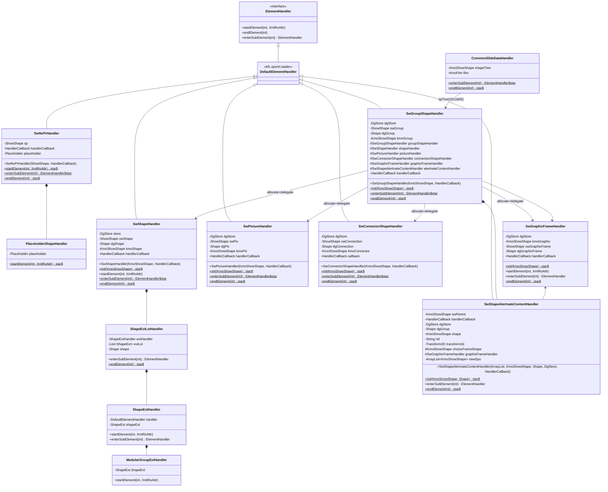
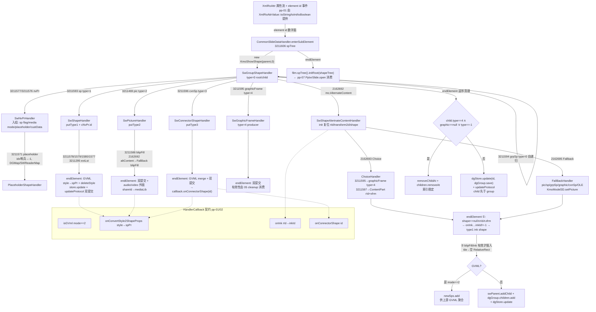

# pp-02-shape-tree-parse — Slide shape tree 解析（键类/流程/依赖/Java↔Rust 对比）

> 分析依据：feature FEATURE.md / FUNCTIONS.md / functions.csv + Java 源码（真读）+ Rust 现状（已实现，pass）
> 分析日期：2026-08-29（cargo test 五个 function 镜像实测全绿：01=8 / 02=10 / 03=8 / 04=7 / 05=11，共 35 tests）
> 管线：parse→layout→render（见 `libs/ppt-core/parser/features/PIPELINE.md` 顶层裁决；master 文档 `libs/ppt-core/PIPELINE_LAYOUT_RENDER_PLAN.md` §1-S0）

## 0. Feature 目标与管线位置

**一句话目标**：把 pp-01 已产生的 `p:spTree` element/attribute 事件解析成**有序**的 `KmoShowShape`/`DgStore` 树——01 写 nvPr 元数据、02/03/04 三种并行 leaf committer（`p:sp`/`p:pic`/`p:cxnSp`）各锁一行 DgStore（type 1/2/3）、05 唯一编排（按 XML 顺序收 child、递归 group、调停 `mc:AlternateContent` 的 Choice/Fallback/ink、无效 graphic 逆序清理后提交 group）。

**上下游**：`depends_on_feature = pp-01-pptx-parse`（`SWReaderMap` placeholder size/type 查表、`HandlerCallback`、`XmlRoAttr`/element id 事件面）；下游 `pp-07-part-open` 的 `PptxrSlide.open` 只消费本 feature 输出的 root shape tree（`film.spTree().initRoot(shapeTree)`，见 `CommonSlideDataHandler.endElement`），`pp-10-dml-sppr`/`pp-11-dml-txbody` 以本 feature 的 spPr/txBody 分发面为渲染输入。

**本 feature 回答的问题**（来自 FEATURE.md I/O 表与范围外说明）：
- 输入：`p:nvPr`/`p:sp`/`p:pic`/`p:cxnSp`/`p:spTree`/`mc:AlternateContent` 的 element id（哈希 int）+ 属性字符串流（`XmlRoAttr`）+ preallocated `KmoShowShape` + `HandlerCallback`（GVML 模式/媒体/ink/connector 通知）。
- 输出：flags/media mode/placeholder/custData 写入 `ShowShape`；`DgStore[id]` 行 type=1/2/3（+group type=0）；有序递归 child tree；connector 通知 `onConnectorShape(id)`；外链媒体 share id 写入（"KSO_CLOUD_RESOURCE_LINK_SID"）。
- 明确不做：ZIP/OPC/`OpcrPackagePart` 打开、slide/master/layout 装配（pp-07 起）、渲染、ink 文件解析、theme/timing/presentation.xml（pp-03–pp-06）。

## 0.5 设计动机与心智模型

1. **心智模型一句话**：本层把「XML 元素 id 事件流（pp-01 的哈希数字面）」投影成「`KmoShowShape` 对象树（show 侧协议）+ `DgStore` 行（drawing 侧数据），两棵树靠同一 `id` 与 `children()` 顺序互锁」。
2. **设计矛盾 → 主数据结构 → 关键手段**：
   - 矛盾①「一个形状有两张脸」：`SwShapeHandler` 同时持有 `show.data.shape.ShowShape`（协议/flags/media）与 `drawing.data.shape.Shape`（几何/填充/样式），提交时双写——`store.update(id, dgShape.save())` 与 `kmoShowShape.updateProtocol(swShape.save())`。
   - 矛盾②「XML 顺序 = 绘制顺序，但 handler 要复用」：group 的 6 个 child handler 字段（shapeHandler/pictureHandler/connectionShapeHandler/groupShapeHandler/graphicFrameHandler/alertnateContentHandler）首次 `new`、之后 `init()` 复用，`init` 负责清状态（防旧 id/ext/state 泄漏）；child id 与对象必须同序 `add`。
   - 矛盾③「`mc:AlternateContent` 的 Choice 可能不被本端支持」：Choice 只保留 graphicFrame（type=4），ContentPart 只取 rId+transform，真正内容走 Fallback；Fallback 的 `endElement` 里做**六条件状态机**（rId/inkId/shape/transform/choiceFrameShape/blipFill 组合）决定 insert 还是 drop。
   - 矛盾④「GVML 与 PPTX 模式不同」：`HandlerCallback.isGVml()`（mode==2）切换——GVML 下 txSp 走 `TxSpHandler`、style 合并进 spPr 并 `deleteStyle()`、Fallback 产出进 `newSps` 列表而非父树。
3. **各结构角色速查**：`SwNvPrHandler`（01）＝唯一 nvPr 元数据写入者，被 02/03/04/group 共用（Java 同一文件、Rust 同一文件，pp-01 的 03 与 pp-02 的 01 共用该源码）；`SwGroupShapeHandler`（05）＝唯一编排者与自递归点（group→group 是 05 自递归，CSV 不写环）；`SwShapeAlertnateContentHandler`（05）＝AlternateContent 调停器（持有 `newSps`、`choiceFrameShape` 两个跨子 handler 状态）；`SwGraphicFrameHandler`＝type=4 的 producer 契约（有效性/cleanup 在 05 消费，业务解析 defer）。
4. **本 feature 特有的「为什么」**：`idx="4294967295"`（32 位无符号 -1）归一为 `-1` 是 OOXML placeholder 哨兵；connector `endElement` **无条件**调 `onConnectorShape`（Java 里 callback 为 null 会 NPE，Rust `.expect("Java contract requires callback at connector end")` 复刻该失败语义，不静默吞通知）；无效 graphic cleanup 必须**逆序** remove 保持索引稳定；blip tile-like（fillMode type==1 且无 stretch）要显式补空 `RelativeRect`（`forceWriteFillRect`）——均被测试逐条锁死。

## 1. 键类分析（类图）



### 1.1 SwNvPrHandler（01，extends DefaultElementHandler）

| 项 | 值 |
|---|---|
| 关键字段 | `ShowShape sp`→元数据目标；`HandlerCallback handlerCallback`→媒体/占位回调；`ShowShape.Placeholder placeholder`→本次 nvPr 内创建的占位 |
| 关键方法 | `SwNvPrHandler(ShowShape sp, HandlerCallback handlerCallback)`→存两个引用。**★`startElement(int, XmlRoAttr attrsNotCopy)`**→属性 3211572→`sp.putIsPhoto(toBoolean())`、3211573→`sp.putUserDrawn(...)`。**★`enterSubElement(int subElement)`→**switch 8 分支：1114119/1120/1121/1122/1123→`sp.media().putMode(0..4)` 并 new `AudioCDHandler/EmbeddedWAVAudioFileHandler/AudioFileHandler/VideoFileHandler/QuickTimeFileHandler`（含 callback）；3211295→`MediaExtLstHandler`；3211519→`CustDataLstHandler`；3211571→`placeholder = Placeholder.create()` + `new PlaceholderShapeHandler(placeholder)`；其余返回 null。**★`endElement(int element)`**→placeholder 非空则 `save()` + `sp.forceWritePh(placeholder)` |

### 1.2 PlaceholderShapeHandler（01 nested，extends DefaultElementHandler）

| 项 | 值 |
|---|---|
| 关键字段 | `ShowShape.Placeholder placeholder` |
| 关键方法 | **★`startElement(int, XmlRoAttr attrsNotCopy)`**→3211570→`putHasCustomPrompt`；3211459→`toString().equals("4294967295")` ? `putIdx(-1)` : `putIdx(toInt())`；3211267→`DGMap.orientationMap.get` 命中才 `putOrient`；3211569→`SWReaderMap.placeholderSizeMap.get` 命中才 `putSize`；3211302→`SWReaderMap.placeholderTypeMap.get` 命中才 `putType`（未知枚举保持默认） |

### 1.3 SwShapeHandler（02，extends DefaultElementHandler）

| 项 | 值 |
|---|---|
| 关键字段 | `DgStore store`（`shape.parent().getPresentation().drawingStore()`）；`ShowShape swShape`；`Shape dgShape`；`KmoShowShape kmoShape`；`HandlerCallback handlerCallback` |
| 关键方法 | `SwShapeHandler(KmoShowShape shape, HandlerCallback)`→取 store 后调 `init`。**★`init(KmoShowShape shape)`**→`ShowShape.open(shape.protocol())`、`Shape.open(shape.drawingShape())`、`dgShape.putType(1)`、`dgShape.cNvPr().putId(shape.id())`。`startElement`→3211581→`swShape.putUseBgFill`。**★`enterSubElement(int)`**→1114276：仅 `handlerCallback.isGVml()` 时 `new TxSpHandler(dgShape.textShape().textBody(), cb)`，否则 null；3211295→`ShapeExtLstHandler(dgShape)`；3211577→`NonVisualShapePropertiesHandler()`；3211578→`ShapePropertiesHandler(dgShape.spPr(), cb)`；3211579→`ShapeStyleHandler(dgShape.style(), cb)`；3211580→`TextBodyHandler(...textBody(), cb)`。**★`endElement(int)`**→GVML：`cb.onConvertStyle2ShapeProps(dgShape.style(), dgShape.spPr())` + `dgShape.deleteStyle()`；随后 `store.update(kmoShape.id(), dgShape.save())` + `kmoShape.updateProtocol(swShape.save())`（双提交，顺序锁死） |

### 1.4 SwShapeHandler 的 nested handlers（02）

| 类（嵌套） | 关键方法 |
|---|---|
| `NonVisualShapePropertiesHandler`（private） | `enterSubElement`：3211574→`CNvPrHandler(dgShape.cNvPr(), cb)`；3211575→`CNvSpPrHandler(dgShape)`；3211576→**`SwNvPrHandler(swShape, cb)`**（复用 01 源码） |
| `ShapeExtLstHandler`（public static） | 字段 `ShapeExtHandler extHandler`、`List<ShapeExt> extLst`、`Shape shape`。`enterSubElement`：3211447 且 extHandler==null 才 new `ShapeExtHandler`（防重复）。**★`endElement`**：extLst 非空则逐个 `ext.save()` 后 `shape.extLst().forceWrite(extLst)` |
| `ShapeExtHandler`（inner） | `startElement`：3211446 uri→`ShapeExt.create()+putUri` 入 extLst；`enterSubElement`：4325377→`ModularGroupExtHandler`；`endElement`：shapeExt.save() |
| `ModularGroupExtHandler`（inner） | `startElement`：4325378→putType、4325379→putIndex、4325380→putIsDefault |

### 1.5 SwPictureHandler（03，extends DefaultElementHandler）

| 项 | 值 |
|---|---|
| 关键字段 | `DgStore dgStore`；`ShowShape swPic`；`Shape dgPic`；`KmoShowShape kmoPic`；`HandlerCallback handlerCallback` |
| 关键方法 | **★`init(KmoShowShape picture)`**→open protocol/drawing、`dgPic.cNvPr().putId(picture.id())`、`dgPic.putType(2)`。**★`enterSubElement(int)`**→2162692→`AlternateContentHandler`；3211295→`ShapeExtLstHandler(dgPic)`（复用 02 输出能力）；3211578→`ShapePropertiesHandler`；3211579→`ShapeStyleHandler`；3211585→`NonVisualPicturePropertiesHandler`；3211586→`BlipFillHandler(dgPic.blipFill().blipFill(), cb)`。**★`endElement(int)`**→GVML style merge/delete；`kmoPic.updateProtocol(swPic.save())`；`dgStore.update(kmoPic.id(), dgPic.save())`；若 `hasAudio()||hasVideo()`：`mediaId = audioMediaId()>=0 ? audio : video`，`mediaLib().getMediaData(mediaId)`，且 `isExternalMedia() && hasCustDataLst()` 时从 `shapeTagMap().get("KSO_CLOUD_RESOURCE_LINK_SID")` 取非空 shareId→`mediaData.setShareId(shareId)` |

nested：`NonVisualPicturePropertiesHandler.enterSubElement`：3211574→CNvPrHandler、3211576→**SwNvPrHandler(swPic, cb)**、3211584→CNvPicPrHandler。`AlternateContentHandler.enterSubElement`：2162695→`FallBackHandler`（2162693 Choice 落入 default 返回 null，即 pic 的 AlternateContent 只吃 Fallback 的 blipFill）。`FallBackHandler.enterSubElement`：3211586→`BlipFillHandler(...)`。

### 1.6 SwConnectorShapeHandler（04，extends DefaultElementHandler）

| 项 | 值 |
|---|---|
| 关键字段 | `DgStore dgStore`；`ShowShape swConnection`；`Shape dgConnection`；`KmoShowShape kmoConnector`；`HandlerCallback callback` |
| 关键方法 | **★`init(KmoShowShape connectionShape)`**→open、`putType(3)`、`cNvPr().putId`。**★`enterSubElement(int)`**→3211295（extLst）break 返回 null（Java 明确忽略）；3211578→`ShapePropertiesHandler`；3211579→`ShapeStyleHandler`；3211583→`NonVisualConnectionShapePropertiesHandler`。**★`endElement(int)`**→GVML merge/delete；`dgStore.update`+`updateProtocol`；随后**无条件** `callback.onConnectorShape(kmoConnector.id())`（Java 空 callback 即 NPE；Rust `.expect("Java contract requires callback at connector end")` 锁定失败语义，不静默吞通知） |

nested：`NonVisualConnectionShapePropertiesHandler.enterSubElement`：3211574→CNvPrHandler、3211576→**SwNvPrHandler**、3211582→CNvCxnSpPrHandler。

### 1.7 SwGroupShapeHandler（05，extends DefaultElementHandler）

| 项 | 值 |
|---|---|
| 关键字段 | `DgStore dgStore`；`ShowShape swGroup`；`Shape dgGroup`；`KmoShowShape kmoGroup`；protected 复用句柄 `groupShapeHandler/shapeHandler/pictureHandler/connectionShapeHandler/graphicFrameHandler/alertnateContentHandler`（首次 `new`、复用 `init`）；`HandlerCallback handlerCallback` |
| 关键方法 | **★`init(KmoShowShape groupShape)`**→open、`putType(0)`、`cNvPr().putId`。**★`enterSubElement(int)`**→2162692→altContent（`alertnateContentHandler==null ? new : init(kmoGroup, dgGroup)` 后返回该 handler）；3211295→`ShapeExtLstHandler(dgGroup)`；3211469→**pic**：`new KmoShowShape(parent, 2)` → `dgGroup.children().add(id)` → `kmoGroup.addChild(pic)` → pictureHandler new/init → 返回（**先加 id 再加对象，顺序一致**）；3211591→`NonVisualGroupShapePropertiesHandler`；3211592→`GroupShapePropertiesHandler(dgGroup, cb)`；3211593→**sp**（type 1，同款 allocate+delegate）；3211594→**grpSp**（type 0，**自递归** new/init 子 `SwGroupShapeHandler`）；3211595→**graphicFrame**（type 4，SwGraphicFrameHandler）；3211596→**cxnSp**（type 3）；3211597→落到 switch 尾返回 null。**★`endElement(int)`**→**逆序**遍历 `kmoGroup.childCount()-1 → 0`：child.type()==4 且 `graphic==null || graphic.type()==-1` → `kmoGroup.removeChildAt(i)` + `dgGroup.children().removeAt(i)`（索引稳定）；随后 `dgStore.update(kmoGroup.id(), dgGroup.save())` + `kmoGroup.updateProtocol(swGroup.save())`（child 已于各自 end 先提交，**child 先于 group**） |

nested：`NonVisualGroupShapePropertiesHandler.enterSubElement`：3211574→CNvPrHandler、3211576→SwNvPrHandler、3211590→CNvGrpSpPrHandler。

### 1.8 SwShapeAlertnateContentHandler（05，extends DefaultElementHandler）

| 项 | 值 |
|---|---|
| 关键字段 | `KmoShowShape swParent`；`HandlerCallback handlerCallback`；`DgStore dgStore`；`Shape dgGroup`；`KmoShowShape shape`（Fallback 选中体）；`String rId`；`Transform2D transform2d`；protected `KmoShowShape choiceFrameShape`、`SwGraphicFrameHandler graphicFrameHandler`；`ArrayList<KmoShowShape> newSps`（GVML 汇聚列表） |
| 关键方法 | 两个 ctor（null/带 newSps）。**★`init(KmoShowShape swParent, Shape dgGroup)`**→复位 `rId/transform2d/shape = null`。`enterSubElement`：2162693→`ChoiceHandler`、2162695→`FallBackHandler`。**★`endElement(int)`**→ink 路径：`shape==null && rId!=null && transform2d!=null` → `cb.onInk(rId, FileManager)`，`inkId != -1` 则 `new KmoShowShape(parent, 1)`、`putInkId`、`spPr().geom().putType(0)`、`writeXfrm`，GVML(newSps)或 addChild+children.add，`dgStore.update` |

nested 四件套（全部继承 DefaultElementHandler）：

| 类 | 关键方法 |
|---|---|
| `ChoiceHandler` | `enterSubElement`：3211595→`choiceFrameShape = new KmoShowShape(parent, 4)`，`dgGroup.children().add` + `swParent.addChild`，graphicFrameHandler new/init 后返回；3211597→`ContentPartHandler` |
| `ContentPartHandler` | `startElement`：4259841（r:id）→`rId = temp.toString()`；`enterSubElement`：3276837（xfrm）→`transform2d = Transform2D.create()` + `Transform2DHandler` |
| `FallBackHandler` | **★`enterSubElement`**：3211469→pic（type 2；若 `choiceFrameShape.graphic() instanceof KmoModel3D` 则 `((KmoModel3D)...).setPicture(shape)`）+ SwPictureHandler；3211471→`OleObjectHandler`；3211593→sp（type 1）；3211594→grpSp（type 0）；3211595→graphicFrame（type 4）；3211596→cxnSp（type 3）。**★`endElement`**：① rId!=null→onInk，inkId!=-1 且 shape!=null→putInkId、（transform!=null 时 save+writeXfrm+store.update）；② `shape!=null && choiceFrameShape==null`：按 shape.type() 取 blipFill（1：`spPr().fill()` 且 fill.type()==2；2/4：`blipFill().blipFill()`；3：无），tile 归一（`fillMode().type()==1 && !hasStretch()`→`RelativeRect.create()` + `stretch().forceWriteFillRect`），`blipFill!=null || shape.hasInk()` 才 GVML(newSps)或 addChild+children.add + `store.update` |
| `OleObjectHandler` | `enterSubElement`：3211469→`new KmoShowShape(parent, 2)`、`swParent.addChild(picture)`、`SwPictureHandler`；3211467 落 default 返回 null |

### 1.9 SwGraphicFrameHandler（05 显式依赖，extends DefaultElementHandler）

| 项 | 值 |
|---|---|
| 关键字段 | `DgStore dgStore`；`KmoShowShape kmoGraphic`；`ShowShape swGraphicFrame`；`Shape dgGraphicFrame`；`HandlerCallback handlerCallback` |
| 关键方法 | **★`init(KmoShowShape graphicFrame)`**→open、`putType(4)`、`cNvPr().putId`。`startElement`：3211605（bwMode）→`DGMap.blackWhiteModeMap.get` 命中才 `putBwMode`。`enterSubElement`：1114259→`SwGraphicHandler`、3211588→`NonVisualGraphicFrameProperties`、3211589→`Transform2DHandler(...spPr().xfrm())`。**★`endElement`**→`dgStore.update` + `updateProtocol` |
| 备注 | 本 feature 只消费其 producer 契约（allocate/init/validity），业务解析（graphic/ole/model3D 子树）defer 到 graphic-frame feature；Rust 侧以 contract fixture 模拟 |

### 1.10 CommonSlideDataHandler（上游 caller，slides 包）

| 项 | 值 |
|---|---|
| 关键字段 | `KmoFilm film`；`CommonSlideData commonSlideData`；`DgStore dgStore`；`KmoShowShape shapeTree = new KmoShowShape(film.parent(), 0)` |
| 关键方法 | **★`enterSubElement(int)`**：3211606（spTree）→`new SwGroupShapeHandler(shapeTree, handlerCallback)`；3211519→CustDataLstHandler；3211308→BackgroundHandler；3211607→ControlListHandler。**★`endElement(int)`**→`film.spTree().initRoot(shapeTree)` + `film.updateProtocol(commonSlideData.save())`——即 pp-07 消费 root tree 的接缝 |

## 2. 流程图（依据 I/O）



handler 回调时序（单个 `p:sp` leaf）：

```mermaid
sequenceDiagram
    participant R as XML reader (kfc, pp-07 接线)
    participant G as SwGroupShapeHandler
    participant H as SwShapeHandler
    participant N as SwNvPrHandler
    participant S as DgStore/KmoShowShape
    R->>G: enterSubElement(3211593)
    G->>G: new KmoShowShape(parent,1); children.add+addChild
    G->>H: new SwShapeHandler(shape, cb) / init(shape)
    R->>H: startElement(3211581, attrs)
    R->>H: enterSubElement(3211577)
    H->>N: new SwNvPrHandler(swShape, cb)
    R->>N: enterSubElement(3211571) → PlaceholderShapeHandler
    N->>N: endElement: placeholder.save + forceWritePh
    R->>H: enterSubElement(3211578/1579/1580) → spPr/style/txBody handlers
    R->>H: endElement
    H->>S: GVML? onConvertStyle2ShapeProps + deleteStyle
    H->>S: store.update(id, dgShape.save)
    H->>S: kmoShape.updateProtocol(swShape.save)
```

## 3. 依赖关系与改写状态

### 3.1 类间依赖表

| 依赖方 | 被依赖方 | 依赖内容 |
|---|---|---|
| SwShapeHandler / SwPictureHandler / SwConnectorShapeHandler / SwGroupShapeHandler | SwNvPrHandler | 3211576 nvPr→元数据写入（01 输出，02/03/04/05 共用同一源码） |
| SwPictureHandler / SwGroupShapeHandler | ShapeExtLstHandler（SwShapeHandler 内） | 3211295 extLst（02 声明能力，03/05 复用） |
| SwGroupShapeHandler | SwShapeHandler / SwPictureHandler / SwConnectorShapeHandler / SwGraphicFrameHandler / SwShapeAlertnateContentHandler / 自身 | leaf 委托 + 自递归 + altContent 调停（05） |
| SwShapeAlertnateContentHandler | SwShapeHandler / SwPictureHandler / SwConnectorShapeHandler / SwGroupShapeHandler / SwGraphicFrameHandler | Fallback 五类形状委托（05） |
| SwGroupShapeHandler.endElement | GraphicObject（child.graphic） | type-4 有效性判定（graphic==null ∨ type()==-1） |
| 全部 leaf | DgStore / KmoShowShape / ShowShape / Shape | `update/open/save/updateProtocol/putType/putId/children`（model 契约） |
| SwNvPrHandler / SwGraphicFrameHandler | DGMap / SWReaderMap | orientationMap / placeholderSizeMap / placeholderTypeMap / blackWhiteModeMap 查表（call-only，不改） |
| 01–05 全部 | HandlerCallback | isGVml / onConvertStyle2ShapeProps / onInk / onConnectorShape（pp-01/02 契约，D） |
| CommonSlideDataHandler | SwGroupShapeHandler | spTree(3211606) 入口（上游 caller，属 pp-01 侧） |

### 3.2 Java↔Rust 路径映射表（Java 根 `koffice/presentation/core/cn/wps/`；Rust 根 `libs/ppt-core/src/cn/wps/`）

| java_path | rust_path | 状态 | 证据 |
|---|---|---|---|
| `show/pptxr/handler/shape/SwNvPrHandler.java` | `show/pptxr/handler/shape/SwNvPrHandler.rs` | **done** | 完整实现；8 tests（`01_function_nonvisual_shape_props`）；95.2% lines；91 条 `// Java:` 锚点 align PASS |
| `show/pptxr/handler/shape/SwShapeHandler.java` | `show/pptxr/handler/shape/SwShapeHandler.rs` | **done**（含 ShapeExtLstHandler/ShapeExtHandler/ModularGroupExtHandler） | 10 tests（`02_function_auto_shape`）；92.5% lines；139 锚点 PASS |
| `show/pptxr/handler/shape/SwPictureHandler.java` | `show/pptxr/handler/shape/SwPictureHandler.rs` | **done**（含 NonVisualPicturePropertiesHandler/AlternateContentHandler/FallBackHandler） | 8 tests（`03_function_picture_shape`）；95.8% lines；100 锚点 PASS |
| `show/pptxr/handler/shape/SwConnectorShapeHandler.java` | `show/pptxr/handler/shape/SwConnectorShapeHandler.rs` | **done**（含 NonVisualConnectionShapePropertiesHandler） | 7 tests（`04_function_connector_shape`）；95.9% lines；65 锚点 PASS；callback 缺失 `.expect(...)` 锁定 Java 失败语义 |
| `show/pptxr/handler/shape/SwGroupShapeHandler.java` | `show/pptxr/handler/shape/SwGroupShapeHandler.rs` | **done** | 05 入口；11 tests；78.9% lines；130 锚点 PASS；raw-pointer nested-owner 已改 `Rc<RefCell<State>>`，无 unsafe |
| `show/pptxr/handler/shape/SwShapeAlertnateContentHandler.java` | `show/pptxr/handler/shape/SwShapeAlertnateContentHandler.rs` | **done**（含 Choice/ContentPart/FallBack/OleObject） | 05 辅助；77.9% lines；184 锚点 PASS；`AlternateState` 共享状态替代 Java 内部类闭包捕获 |
| `show/pptxr/handler/shape/graphicframe/SwGraphicFrameHandler.java` | `show/pptxr/handler/shape/graphicframe/`（mod.rs 为空） | **未开始（业务）/契约 ✅** | 05 测试提供同名 producer contract fixture；业务解析 defer graphic-frame feature |
| `show/pptxr/handler/slides/CommonSlideDataHandler.java` | `show/pptxr/handler/slides/CommonSlideDataHandler.rs` | done（pp-01/07 侧，非本 feature 改写范围） | 上游调用方，仅引用 |

状态旁注：`ppt_core_mvp_audit.csv`（行 627–632）把这 6 个文件标为 `keep_refactor/rewrite`，是 **function-loop 之前的旧快照**；当前权威状态以 5 份 FUNCTION.md 的 `java-rust-align: PASS` + 实测 `cargo test` 全绿为准（2026-08-28/29）。

## 4. 最小 feature-critical 改写范围

| 栏 | 内容 | 当前状态 |
|---|---|---|
| **must-write（feature 关键）** | 01：outer ctor/startElement/enterSubElement/endElement + `PlaceholderShapeHandler.startElement`；02：ctor/init/startElement/enterSubElement/endElement + `NonVisualShapePropertiesHandler` + `ShapeExtLstHandler/ShapeExtHandler/ModularGroupExtHandler` 全方法；03：ctor/init/enterSubElement/endElement + `NonVisualPicturePropertiesHandler/AlternateContentHandler/FallBackHandler` 全方法；04：ctor/init/enterSubElement/endElement + `NonVisualConnectionShapePropertiesHandler.enterSubElement`；05：`SwGroupShapeHandler` 全方法 + `SwShapeAlertnateContentHandler` 两 ctor/init/enter/end + Choice/ContentPart/FallBack/OleObject 全方法 | **全部完成**：5 个 function 均 pass，35 tests 绿（本轮实测），覆盖率 95.2/92.5/95.8/95.9/78.3%，模板布局 + Java↔Rust 结构对齐 PASS |
| **可 stub（已标注）** | media/custData/ink 业务体（AudioCDHandler 等 7 个 child id 的 constructor contract fixture，业务由各自 feature 实现）；`GroupShapePropertiesHandler`（DML transform，Rust 被裁剪，不伪造 transform）；真实 XML reader 事件分发（contract fixture，等 pp-07 接线）；`TxSpHandler`（GVML，测试 fixture） | 完成（以 fixture 形式在 tests 内提供同名 contract，src 不造假） |
| **可 defer** | `SwGraphicFrameHandler` 业务解析（有效性/cleanup 已覆盖，业务体归 graphic-frame feature）；恢复被裁剪的 `ShowShape`/`KmoShowShape`/`DgStore`/`Shape` 模型及 `KoBin`/`KpMap` 图（model feature）；GVML `newSps` 上游聚合消费 | 未动（符合「不过扩展」：不恢复模型/媒体业务体） |

**每 function 完成度**：01 `pass` / 02 `pass` / 03 `pass` / 04 `pass` / 05 `pass`（functions.csv status 列 + FUNCTION.md 各节；05 是本 feature 唯一编排入口，最重要，`pass`）。

**已知问题**：Rust 生产 `src/cn/wps/show/pptxr/handler/shape/mod.rs` 将 6 个 handler 的 `pub mod` 全部注释（`// LLM: template has Java syntax` / `// temporarily disabled`），即**默认 crate 编译面不含这些模块**；五个 `[[test]]` 以 `#[path]` 拉同一份 src 在 fixture 树内编译执行。故当前接线是「tests 内真源码 + contract 环境」，等 model/reader 恢复时换接线即可，源码 I/O 语义无需改（FUNCTIONS.md §3.3 已声明）。

## 5. 验收口径

**数字/枚举/哨兵值钉死**（均来自 Java 字面量，真读）：

| 口径 | 值 |
|---|---|
| placeholder idx 哨兵 | `"4294967295"`→`-1`；`0/42` 原样（`toInt`） |
| media mode | 0=AudioCD、1=EmbeddedWAVAudioFile、2=AudioFile、3=VideoFile、4=QuickTimeFile（element 1114119–1114123）|
| placeholder orientation（DGMap.orientationMap） | `horz=0`、`vert=1`（未知 token 保持默认） |
| placeholder size（SWReaderMap.placeholderSizeMap） | `full=0`、`half=1`、`quarter=2` |
| placeholder type（SWReaderMap.placeholderTypeMap） | `title=0 body=1 ctrTitle=2 subTitle=3 dt=4 sldNum=5 ftr=6 hdr=7 obj=8 chart=9 tbl=10 clipArt=11 dgm=12 media=13 sldImg=14 pic=15`（16 项） |
| shape type（DgStore 行） | 0=group、1=sp、2=pic、3=cxnSp、4=graphicFrame |
| graphic 有效性 | `graphic==null ∨ graphic.type()==-1` → 逆序 removeChildAt + children.removeAt |
| ink 哨兵 | `onInk` 返回 `-1`=失败（不创建/不插入假 shape） |
| connector 通知 | `endElement` 末尾无条件 `onConnectorShape(id)`；callback 缺失=明确失败（Rust `.expect`，Java NPE） |
| GVML 模式 | `HandlerCallback.isGVml() == (mode==2)`；GVML 下 style→spPr merge + `deleteStyle`、txSp→TxSpHandler、Fallback/newSps 聚合 |
| 外链媒体 | `shapeTagMap["KSO_CLOUD_RESOURCE_LINK_SID"]` 非空才 `mediaData.setShareId`；仅 `isExternalMedia` |
| tile 归一 | `fillMode().type()==1 && !hasStretch()` → `RelativeRect.create()` + `forceWriteFillRect`；其它 fill 不改 |
| ext 链 | 3211447 仅首个 `ShapeExtHandler`；3211446 uri→putUri；4325378/79/80→type/index/isDefault |
| 提交顺序 | leaf：store.update → updateProtocol（02/03/04）；group：child 先于 group；`onConnectorShape` 在双提交之后 |
| 测试门 | `cargo test --manifest-path libs/ppt-core/Cargo.toml --test 01_function_nonvisual_shape_props`（同理 02/03/04/05 五个 `[[test]]`，Cargo.toml 行 57–78 已声明）；本轮实测 35 tests 全绿 |

**FEATURE.md 验收条件**：①01 内存 attrs/events→可消费的 ShowShape metadata；②02/03/04 只消费 preallocated shape + 01 输出，分别锁 type、store commit、callback；③05 用 leaf fixture/producer 编排 XML 顺序、递归 group、AlternateContent 与 cleanup，不启动 slide/package reader；④pp-07 `PptxrSlide.open` 只消费 05 输出的 root shape tree（不重跑 leaf 解析）。

## 6. Java↔Rust 管线对比与缺口审计

### 6.1 Java 完整链路（真实源码走读）

```text
[输入端点] OpcrPackagePart 流 → kfc UnifiedXmlReader（pp-07 域，本 feature 不打开）
  → element id 数字面 + XmlRoAttr 属性字符串（pp-01 的哈希 id 事件面）
  → CommonSlideDataHandler.enterSubElement(3211606 spTree)
      → new SwGroupShapeHandler(shapeTree=KmoShowShape(type=0), handlerCallback)
      → SwGroupShapeHandler.enterSubElement 分发（3211593/1469/1594/1595/1596/2162692/3211591/3211592）
        → KmoShowShape 分配 + dgGroup.children().add(id) + kmoGroup.addChild(shape)（同序）
        → leaf delegate：SwShapeHandler(type1)/SwPictureHandler(type2)/SwConnectorShapeHandler(type3)/SwGraphicFrameHandler(type4)/自递归 group/AlternateContent
          → 每个 leaf 内 NonVisual*Handler.enterSubElement(3211576) → SwNvPrHandler
            → PlaceholderShapeHandler（idx 哨兵、DGMap/SWReaderMap 查表）
          → leaf endElement：GVML merge/delete → store.update(id, save) + kmoShape.updateProtocol(save)
            → cxnSp 额外 callback.onConnectorShape(id)
            → pic 额外外链 shareId→mediaLib
        → AlternateContent：Choice(only graphicFrame/contentPart) / Fallback(五类 + ink 调停 + tile 归一)
      → SwGroupShapeHandler.endElement：type-4 无效 graphic 逆序清理 → 双提交
  → CommonSlideDataHandler.endElement：film.spTree().initRoot(shapeTree)  ← pp-07 消费点
```

### 6.2 Rust 现状接线图

```mermaid
flowchart LR
    subgraph INPUT[输入端点（Rust）]
        XR[UnifiedXmlReader/XmlReader<br/>✗ 缺失（kfc 未接线，等 pp-07）]
        EV2[测试: 内存 RecordingXmlRoAttr + 事件序列<br/>✓ 已接线（5 个 [[test]]）]
    end
    XR -.->|"生产接线未通"| H
    EV2 -->|"#[path] 编译同一份 src"| H

    subgraph SRC[production src 6 文件]
        H[SwShapeHandler.rs<br/>✓ 已接线<br/>SwNvPrHandler.rs ✓<br/>SwPictureHandler.rs ✓<br/>SwConnectorShapeHandler.rs ✓<br/>SwGroupShapeHandler.rs ✓<br/>SwShapeAlertnateContentHandler.rs ✓]
        MOD[shape/mod.rs<br/>✗ 注释掉全部 pub mod<br/>默认 crate 不编译 handler]
    end
    H -->|"依赖（tests 内 fixture）"| FIX
    subgraph FIX[contract fixture（tests 层）]
        M1[ShowShape/KmoShowShape/DgStore/Shape 同名模型<br/>✓ fixture（生产模型 todo! stub）]
        M2[SwGraphicFrameHandler producer<br/>✓ fixture（业务 defer）]
        M3[GroupShapePropertiesHandler/TxSpHandler/media/custData handler<br/>✓ constructor fixture]
        CB[HandlerCallback<br/>✓ 真实 trait re-export（crate 已 pass）]
    end
    XR --> PP7[pp-07-part-open<br/>spec 未动工]
    H -->|"root tree 消费"| PP7
```

### 6.3 核心类 + 依赖审计表

| 类 | critical? | rust_path | 状态 | stub 类型 | 影响 | 修复建议 |
|---|---|---|---|---|---|---|
| SwNvPrHandler | 是（01 种子） | `.../shape/SwNvPrHandler.rs` | done（实测 pass） | 无（media/custData child 以 constructor fixture 注入，已显式标注） | — | — |
| SwShapeHandler（含 ext 三件套） | 是（02 种子） | `.../shape/SwShapeHandler.rs` | done | 无 | — | — |
| SwPictureHandler（含 altContent/FallBack） | 是（03 种子） | `.../shape/SwPictureHandler.rs` | done | 无 | — | — |
| SwConnectorShapeHandler | 是（04 种子） | `.../shape/SwConnectorShapeHandler.rs` | done | 无（callback 缺失 `.expect` 复刻 Java 明确失败） | — | — |
| SwGroupShapeHandler | 是（05 种子，唯一编排） | `.../shape/SwGroupShapeHandler.rs` | done | 无（递归经 `allocate()` 同序加 id/对象；无 raw pointer） | — | — |
| SwShapeAlertnateContentHandler | 是（05 种子） | `.../shape/SwShapeAlertnateContentHandler.rs` | done | 无 | — | — |
| SwGraphicFrameHandler | 否（05 显式依赖，业务 defer） | `.../graphicframe/mod.rs` 空 | 未开始（仅 producer contract） | DEFERRED_NONFEATURE（有效性/cleanup 由 05 消费，业务归 graphic-frame feature） | type-4 的 graphic/OLE/model3D 子树真实解析缺失 | graphic-frame feature 恢复 |
| GroupShapePropertiesHandler | 否（DML transform） | `.../sppr/` 无此文件 | 未开始（测试 fixture） | COMPILE_SHELL（Rust 被裁剪，不伪造 transform，已标注） | grpSpPr 的变换不写入 | DML transform function |
| ShowShape / Shape / KmoShowShape / DgStore | 否（model 契约） | `show/data/shape/ShowShape.rs` 等 | 壳（生产 `todo!()`）；测试同名 fixture 完整 | DEFERRED_NONFEATURE（模型 feature，KoBin/KpMap 图） | 默认 crate 内 handler 无法被生产代码调用 | model feature 恢复后替换接线 |
| kfc XmlRoAttr/ElementHandler | 否（XML seam） | `kfc/xpxml/reader/` | 部分（trait 存在；parser dispatch 未接线） | COMPILE_SHELL（事件 seam，pp-07 接线） | 真实文件→事件链断，输入门闩 | pp-07-part-open |
| HandlerCallback | 否（pp-01/02 依赖） | `drawing/dmlr/model/HandlerCallback.rs` | done（真实 trait，测试 re-export） | 无（onInk/onConvertStyle2ShapeProps 默认实现与 Java 默认一致） | — | — |
| CommonSlideDataHandler | 否（上游 caller） | `.../slides/CommonSlideDataHandler.rs` | done | — | — | — |

### 6.4 结论

**壳-非critical（feature 本体 PASS / 生产输入链待接线）**：
- **handler 层完整性 PASS**：6 个 feature-critical Rust 文件全部转写完整——★方法签名/逻辑与 Java 对齐（模板布局 91/139/100/65/130/184 锚点 + java-rust-align 均 PASS）、无 `todo!`/`unimplemented!`/空壳/丢值（35 个真实断言测试实测全绿，含哨兵 idx=-1、media mode 0–4、KSO_CLOUD_RESOURCE_LINK_SID、逆序 cleanup、onConnectorShape 失败语义、tile 归一、GVML newSps 聚合等关键不变量）。
- **断点不在 handler，而在输入/模型两端（均非本 feature 责任，且已显式标注）**：①生产 `shape/mod.rs` 注释掉 handler 模块、默认 crate 不编译（FUNCTIONS.md §3 已声明「正式 model/reader feature 恢复时只需替换 contract 接线」）；②真实 XML reader 事件分发缺（kfc，pp-07 接线）；③`ShowShape/KmoShowShape/DgStore/Shape` 生产模型为裁剪 stub（model feature）；④`SwGraphicFrameHandler` 业务解析 defer（graphic-frame feature）。这些是**已标注的壳**，不经过本 feature 热路径逻辑，故评级「壳-非critical」而非「缺口-critical」。
- **下游阻塞关系**：pp-07 `PptxrSlide.open` 要消费 05 的 root tree，还需「真实 XML reader + 真实模型」两端接通；本 feature 的源码与测试可直接复用（I/O 语义不变），无返工风险。渲染侧 pp-10/pp-11 依赖本 feature 的 spPr/txBody 分发面，已由 02/03 的 3211578/3211580 分支就位。