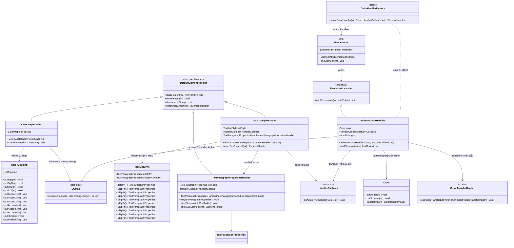
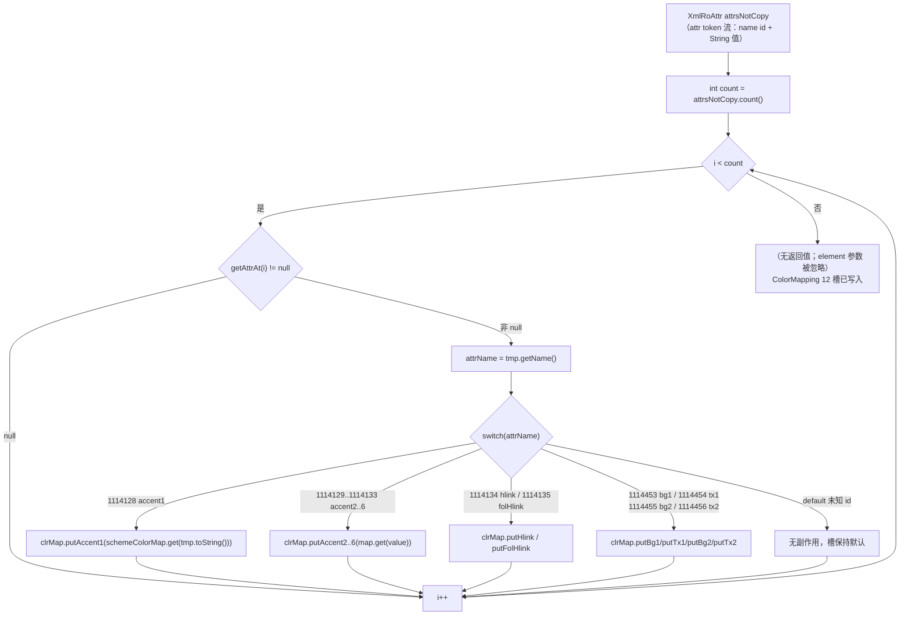
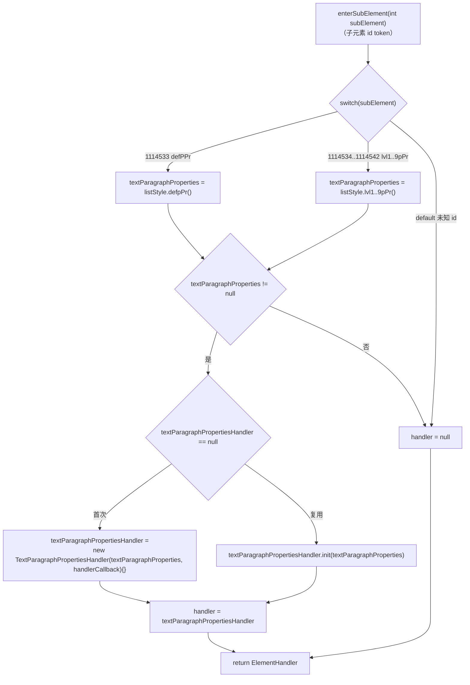
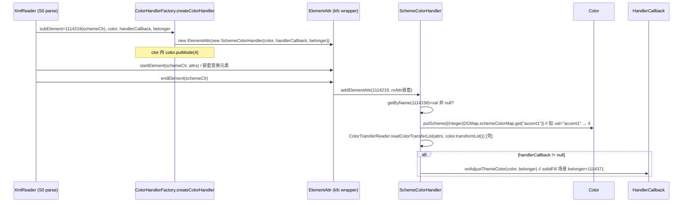

# pp-03-dml-style — DML clrMap 与 lstStyle（键类/流程/依赖/Java↔Rust 对比）

> 分析依据：feature FEATURE.md / FUNCTIONS.md / functions.csv + Java 源码（真读）+ Rust 现状（spec 未 loop）
> 管线：parse→layout→render（见 libs/ppt-core/PARSER_JAVA_RUST_PIPELINE.md 顶层对比）
> 状态：**spec**（split 完成，loop 未开始）｜ 分析日期：2026-09 根目录快照

## 0. Feature 目标与管线位置

**一句话目标**：实现 DML 层三个原子样式槽——`ColorMapHandler` 把 `a:clrMap` 的 12 个配色槽名写入 `ColorMapping`，`TextListStyleHandler` 把 `a:lstStyle` 的 defPPr+lvl1-9pPr 10 个子元素分发到段落属性 handler，`SchemeColorHandler`（+ `ColorHandlerFactory` 的 1114219 分支）把 `a:schemeClr val` 写成 `Color` 的 scheme 索引并回调 `onAdjustThemeColor`。

**上下游**：

```text
upstream:  pp-01-pptx-parse（构造方：SlideMasterHandler 3211598 → ColorMapHandler；
           TextStylesHandler 3211615/16/17 → TextListStyleHandler；HandlerCallback 透传）
本 feature: a:clrMap attrs → ColorMapping；a:lstStyle 子树 → TextListStyle 槽；
           a:schemeClr val → Color(putMode(4)+putScheme) + onAdjustThemeColor
downstream: pp-04 theme（clrScheme RGB 查表依赖本层 scheme 索引）；
           pp-07 part open（不再用 kind fixture 假装 clrMap/txStyles）；
           pp-10:02 solidFill（schemeClr 引用，belonger=1114371）
```

**本 feature 回答的问题**（来自 FEATURE.md 的 I/O 表与范围外说明）：

| 问 | 答 |
|---|---|
| clrMap 元素怎么变成配色数据？ | `ColorMapHandler.startElement` 逐 attr（12 个 name id switch），attr 值字符串经 `DGMap.schemeColorMap` 17 key 表转 scheme 索引，写入构造方传入的 `ColorMapping` 引用（无返回值、无 part I/O） |
| lstStyle 子树怎么落到 TextListStyle？ | `TextListStyleHandler.enterSubElement` 按 10 个子元素 id（1114533-1114542）取 `listStyle.defpPr()/lvl1-9pPr()` 槽，槽非空 → 复用单个 `TextParagraphPropertiesHandler` 实例（首 new、其后 init） |
| schemeClr 怎么变成「主题色」？ | `ColorHandlerFactory.createColorHandler` subElement==1114219 → `ElementAttr` 包装 `SchemeColorHandler`；`addElementAttr` 取 val(1114158) → `color.putScheme(map.get(token))`，ctor 已 `putMode(4)`，callback 非 null 时调 `onAdjustThemeColor(color, mBelonger)` 0/1 次 |
| 不做哪些？ | theme part 打开（pp-04）、spTree（pp-02）、`TextParagraphPropertiesHandler` 方法体、hsl/sys/prst 色模型、DGMap 全文件 |

## 0.5 设计动机与心智模型

1. **心智模型**：本层把「XML 元素/attr 名字 id（i32 常量）」投影成「模型槽（ColorMapping/TextListStyle/Color）」——所有 handler 都是**无 part I/O 的纯写入端点**，模型对象由构造方注入（`ColorMapping clrMap` 引用 / `TextListStyle listStyle` / `Color color`），本层零创建、零查询。
2. **设计矛盾 ①：改名不换值 → 双表结构**。`a:clrMap` 的 attr 名（accent1…tx2）与 attr 的值（也是 scheme 槽名，如 `bg1`）都来自同一个 17 key 词表 `DGMap.schemeColorMap`，但**语义不同**：attr 名 id 决定写 ColorMapping 的哪个槽（12 case），attr 值只决定写入的索引。矛盾：同一词表两处用途 → 手段：kfc 常量 id switch（12 case）+ 词表查值（`(Integer)schemeColorMap.get(...)`）。
3. **设计矛盾 ②：十级样式共享一个解析器 → 单实例复用**。`TextListStyle` 有 10 个槽但解析逻辑只有一套 `TextParagraphPropertiesHandler`：Java 字段 `textParagraphPropertiesHandler` 只建一次，后续槽用 `init(textParagraphProperties)` 换目标对象（匿名子类空体）。矛盾：槽多实例少 → 手段：首次 new / 其后 init 复用。
4. **设计矛盾 ③：schemeClr 是叶子但属性要累积 + 回调联动** → `ElementAttr` 栈式收集子元素 attr（含变换元素），`endElement` 时才一次性 `addElementAttr`；`SchemeColorHandler` 把「token→scheme 索引」与「主题色调整回调」钉在一起（belonger 透传，callback 判空）。
5. **本 feature 特有「为什么」**：`putMode(4)` 在 **ctor** 而不是 addElementAttr（构造即锁定 mode）；`SchemeColorHandler` 的 `mBelonger` 由 factory 分发时透传（solidFill 场景 belonger=1114371）；`ColorMapHandler.startElement` 的 `element` 参数被忽略（只用 attrs）；未知 attr name id → switch default 无副作用（槽保持默认）。

## 1. 键类分析（类图）



### 键类表（方法签名与逻辑全部来自真实 Java 源码）

| 类 | 继承/实现 | 关键字段（名:类型→作用） | 关键方法（签名→1 行逻辑） |
|---|---|---|---|
| `ColorMapHandler` | extends `DefaultElementHandler` | `clrMap: ColorMapping` → 构造方注入的配色目标（引用，只写不建） | `ColorMapHandler(ColorMapping clrMap)` → 保存引用；★`public void startElement(int element, XmlRoAttr attrsNotCopy)` → `count()` 循环取 `getAttrAt(i)`（null 跳过），`tmp.getName()` 进 12-case switch（1114128-1114135/1114453-1114456），每 case `clrMap.putXxx((Integer)DGMap.schemeColorMap.get(tmp.toString()))`；**无 endElement override** |
| `TextListStyleHandler` | extends `DefaultElementHandler` | `listStyle: TextListStyle` → 槽目标；`handlerCallback: HandlerCallback` → 透传；`textParagraphPropertiesHandler: TextParagraphPropertiesHandler` → 单实例复用（首 new 后 init） | `TextListStyleHandler(TextListStyle listStyle, HandlerCallback handlerCallback)` → 保存两字段；★`public ElementHandler enterSubElement(int subElement)` → 10-case switch（1114533 defPPr / 1114534-1114542 lvl1-9）取 `listStyle.defpPr()/lvlNpPr()` 槽，槽非 null → handler 首次 `new TextParagraphPropertiesHandler(...){}`（匿名子类空体）、其后 `init(textParagraphProperties)`，返回该 handler；default/null 槽 → 返回 null |
| `SchemeColorHandler` | implements `ElementAttrHandler` | `color: Color` → 写入目标（ctor 已 putMode(4)）；`handlerCallback: HandlerCallback` → 可为 null；`mBelonger: int` → 回调 belonger 透传（solidFill=1114371） | `SchemeColorHandler(Color color, HandlerCallback handlerCallback, int belonger)` → **ctor 内 `color.putMode(4)`** + 存字段；★`public void addElementAttr(int element, XmlRoAttr attrsNotCopy)` → `getByName(1114158)`（val）非 null 则 `color.putScheme((Integer)DGMap.schemeColorMap.get(tmp.toString()))`；`ColorTransferReader.readColorTransferList(attrsNotCopy, color.transformLst())`（MVP 壳）；`null != handlerCallback` → `handlerCallback.onAdjustThemeColor(this.color, this.mBelonger)` |
| `ColorHandlerFactory` | 纯 static 工厂 | 无字段 | ★`public static ElementHandler createColorHandler(int subElement, Color color, HandlerCallback handlerCallback, int belonger)` → switch：1114215→`ElementAttr(new RgbColorModelPercentageHandler(color))`、1114216→RgbColorModelHex、1114217→Hsl、1114218→System、**1114219→`ElementAttr(new SchemeColorHandler(color, handlerCallback, belonger))`**、1114220→Preset、default→`null` |

### 关键依赖类（非种子，直接依赖）

| 类 | 继承/实现 | 关键字段 | 关键方法 |
|---|---|---|---|
| `ColorMapping`（drawing/data/style，536 行） | implements `KoAr, KoClosable` | `map: KpMap`（槽 1-12 编码：bg1=1, bg2=2, tx1=3, tx2=4, accent1=5…accent6=10, hlink=11, folHlink=12） | ★`putBg1/putBg2/putTx1/putTx2(int)`（1-4）、★`putAccent1..putAccent6(int)`（5-10）、★`putHlink/putFolHlink(int)`（11-12）→ 均 `map.put(key, KoBin.Encode.from(value, zone))`；读侧 `bg1()…folHlink()` 带 parent 回退 |
| `TextListStyle`（drawing/data/text，934 行） | implements `KoAr, KoClosable` | `defpPr, lvl1pPr…lvl9pPr: TextParagraphProperties`（懒缓存）；`map: KpMap`（1-10） | ★`defpPr()/lvl1pPr()…lvl9pPr()` → 懒加载 getter：map.has(key)→decode / parent 回退 / 空 bin 兜底，**对已知 id 恒非 null**；写侧 `writeLvlNpPr/forceWriteLvlNpPr` |
| `Color`（drawing/data/color，1548 行） | implements `KoAr, KoClosable` | `map: KpMap`（mode=1, scheme=7, transformLst=9） | ★`putMode(int)`（line 354，`map.put(1, …)`）；★`putScheme(int)`（line 600，`map.put(7, …)`）；`transformLst()`（line 625 懒加载） |
| `HandlerCallback`（drawing/dmlr/model，119 行） | abstract class（mode 0/1/2/3） | `mode: int` | `public void onAdjustThemeColor(Color color, int belonger)` → 空默认实现，子类 override（pp-01 pass） |
| `DGMap`（drawing/dmlr/util，1018 行） | 纯 static map 容器 | `schemeColorMap: Map<String,Integer>`（17 key，见 §5） | 静态初始化 `put("accent1", 4) … put("tx2", 16)`——**本 feature 只读该表**，不改 DGMap 全文件 |
| `TextParagraphPropertiesHandler`（textshape/text/paragraph，277 行） | extends `DefaultElementHandler` | `textProp: TextParagraphProperties`、`handlerCallback` | ctor 调 `init`；`startElement` 11 attr switch（1114328 alignment/1114476-77 margins/1114611-17 lvl/indent/…）；`enterSubElement` 1114563-1114610 bullet/lnSpc/tab/defRPr——**方法体本 feature 只引用（按 FEATURE.md「stub」裁决，不展开）** |
| `ElementAttr`（kfc xpxml.reader） | implements `ElementHandler` | `mHandler: ElementAttrHandler`；`mRoAttrStack: Stack<XmlRoAttr>` | ★`endElement(int)` → pop 后栈空时 `mHandler.addElementAttr(element, roAttr)`（嵌套变换累计进 nest）；`enterSubElement` 返回自身 |
| `DefaultElementHandler`（kfc） | implements `ElementHandler` | — | 空 startElement/endElement/characters；`enterSubElement` → null（默认不分发） |
| `ColorTransferReader`（handler/color） | 纯 static | — | `readColorTransferList(XmlRoAttr, Color.ColorTransformList)` → 逐 attr 建 `ColorTransform`（tint/shade/alpha…）——**MVP 壳**（FEATURE.md stub 裁决） |

### 构造方（pp-01/pp-07，真读确认）

| 构造方 | case | 构造 |
|---|---|---|
| `SlideMasterHandler.enterSubElement` | **3211598**（sldMaster 命名空间的 clrMap） | `new ColorMapHandler(this.masterData.clrMap())` |
| `ColorMapOverrideHandler.enterSubElement` | 1114457→null；**1114458**（overrideClrMapping） | `new ColorMapHandler(this.colorMapping)` |
| `TextStylesHandler.enterSubElement` | **3211615/3211616/3211617**（titleStyle/bodyStyle/otherStyle） | `new TextListStyleHandler(masterData.titleStyle()/bodyStyle()/otherStyle(), mHandler)` |
| （pp-04 移出）| 1114459（clrMap）→ `ThemeHandler` | 本 feature 不开 theme part |

## 2. 流程图（依据 I/O）

### 2.1 01 热路径：clrMap attrs → ColorMapping（ColorMapHandler.startElement）



I/O 数据类型：输入 `XmlRoAttr`（`count()/getAttrAt(i)/getName()/toString()`，attrc 值 → String）；输出 `ColorMapping` 槽（i32 scheme 索引）side effect；`DGMap.schemeColorMap: Map<String,Integer>` 查表（17 key）。

### 2.2 02 热路径：lstStyle 子树分发（TextListStyleHandler.enterSubElement）



**关键 CP**：Java `defpPr()/lvlNpPr()` 是 lazy getter，对已知 id 恒非 null → 10 个已知 case 必返回 handler；未知 id 无任何状态变化 → `None`。

### 2.3 03 热路径：schemeClr → Color+回调（ColorHandlerFactory → ElementAttr → SchemeColorHandler）



## 3. 依赖关系与改写状态

### 3.1 类间依赖表（feature 内）

| 依赖方 | 被依赖方 | 用途 | 归属 |
|---|---|---|---|
| ColorMapHandler | ColorMapping | 12 槽写入目标（引用注入） | model（Rust 已有） |
| ColorMapHandler | DGMap.schemeColorMap | attr 值 → scheme 索引查表 | util（Rust 未建，测试字面量替代） |
| ColorMapHandler | XmlRoAttr / DefaultElementHandler | attr 读取 / 空实现基类 | kfc（既有 crate） |
| TextListStyleHandler | TextListStyle | defpPr/lvl1-9pPr 槽（懒加载） | model（Rust 已有，22 stubs） |
| TextListStyleHandler | TextParagraphPropertiesHandler | 单实例复用（new→init） | handler（Rust 无，方法体 stub） |
| TextListStyleHandler | HandlerCallback | 透传给段落属性 handler | model（Rust 已有 trait） |
| SchemeColorHandler | Color / HandlerCallback / DGMap | putMode(4)+putScheme / 回调 / 查表 | model+util |
| SchemeColorHandler | ColorTransferReader | 变换链（MVP 壳） | handler（Rust 无） |
| ColorHandlerFactory | ElementAttr + 6 色 handler | 1114219 分支分发 | kfc + handler |
| 构造方（pp-01/pp-07） | ColorMapHandler / TextListStyleHandler | SlideMasterHandler 3211598；TextStylesHandler 3211615-17；ColorMapOverrideHandler 1114458 | show/pptxr |

### 3.2 Java↔Rust 路径映射表

| java_path（koffice/presentation/core/cn/wps/...） | rust_path（libs/ppt-core/src/cn/wps/...） | 状态 |
|---|---|---|
| `drawing/dmlr/handler/style/ColorMapHandler.java` | `drawing/dmlr/handler/style/ColorMapHandler.rs` | **未开始**（style/ 仅注释占位 mod.rs） |
| `drawing/dmlr/handler/shape/textshape/text/TextListStyleHandler.java` | `.../handler/shape/textshape/text/TextListStyleHandler.rs` | **未开始**（text/ 有 TextBodyHandler.rs，无本类） |
| `drawing/dmlr/handler/color/SchemeColorHandler.java` | `.../handler/color/SchemeColorHandler.rs` | **未开始**（color/mod.rs 空） |
| `drawing/dmlr/handler/color/ColorHandlerFactory.java` | `.../handler/color/ColorHandlerFactory.rs` | **未开始**（audit row 205 曾记「rewrite, local stub handlers」的旧文件已删） |
| `drawing/dmlr/handler/color/ColorHandler.java` | `.../handler/color/ColorHandler.rs` | **未开始**（audit row 204：旧模板文件已删） |
| `drawing/dmlr/handler/color/ColorTransferReader.java` | `.../handler/color/ColorTransferReader.rs` | **未开始**（stub 裁决：只留调用点） |
| `drawing/data/style/ColorMapping.java` | `drawing/data/style/ColorMapping.rs` | **done**（audit：keep「theme color mapping, faithful」；put* 12 方法 @546-942 完整） |
| `drawing/data/text/TextListStyle.java` | `drawing/data/text/TextListStyle.rs` | **壳**（audit：keep_refactor「list style, 22 stubs」：defpPr/lvl1-9pPr 访问器存在 @762-1554，但 write*/forceWrite*/delete* 及 parent 回退分支 `todo!()`） |
| `drawing/data/color/Color.java` | `drawing/data/color/Color.rs` | **done**（putMode @595 / putScheme @981 / scheme @953 真实实现，map key 7） |
| `drawing/dmlr/model/HandlerCallback.java` | `drawing/dmlr/model/HandlerCallback.rs` | **done**（trait，`onAdjustThemeColor(&mut self, _color, _belonger){}` 默认空实现；tests/ 有镜像测试） |
| `drawing/dmlr/util/DGMap.java` | `drawing/dmlr/util/DGMap.rs` | **壳**（audit row 266：delete「empty shell; static maps must rebuild」；现仅有 blackWhiteModeMap，**schemeColorMap 未建**） |
| `show/pptxr/handler/slidemasters/SlideMasterHandler.java` | `show/pptxr/handler/slidemasters/SlideMasterHandler.rs` | **done（接线态）**：3211598 → `ColorMapHandler::new(masterData.borrow().clrMap())`——**引用的模块尚不存在**（编译面在测试 fixture 中，见 §6） |
| `show/pptxr/handler/slidemasters/TextStylesHandler.java` | `.../slidemasters/TextStylesHandler.rs` | **done（接线态）**：3211615-17 → `TextListStyleHandler::new(title/body/otherStyle(), cb, "title"/"body"/"other")`——多传了 Java 没有的 slot 字符串参数（fixture 时代残留，替换真实类型时须回退签名） |
| `show/pptxr/handler/slides/ColorMapOverrideHandler.java` | `.../slides/ColorMapOverrideHandler.rs` | **done（接线态）**：1114458 → `ColorMapHandler::new(colorMapping.clone())` |

## 4. 最小 feature-critical 改写范围

### must-write（feature 关键类与方法）

| 文件（Rust 新建） | 关键方法（与 Java 对齐） | 说明 |
|---|---|---|
| `src/cn/wps/drawing/dmlr/handler/style/ColorMapHandler.rs` | `new(clrMap)`；★`startElement(element, attrs)`：count 循环 + null skip + **12 case 数值钉死**（§5） | 01 全部 |
| `src/cn/wps/drawing/dmlr/handler/shape/textshape/text/TextListStyleHandler.rs` | `new(listStyle, handlerCallback)`；★`enterSubElement(subElement)`：**10 case 数值钉死**（§5）+ 单实例复用（new→init） | 02 全部 |
| `src/cn/wps/drawing/dmlr/handler/color/SchemeColorHandler.rs` | ctor（**`putMode(4)` 在 ctor**）；★`addElementAttr`：val(1114158)→putScheme + callback 判空 | 03 主体 |
| `src/cn/wps/drawing/dmlr/handler/color/ColorHandlerFactory.rs` | ★`createColorHandler`：**1114219 分支** → ElementAttr(SchemeColorHandler)；其它 case 可停车 | 03 分发 |
| （测试侧）`tests/cn/wps/drawing/dmlr/handler/style/ColorMapHandler.rs`、`.../text/TextListStyleHandler.rs`、`.../color/SchemeColorHandler.rs` | 对应 `[[test]]`（01/02/03） | L2 接线后落 |
| （替换）pp-01 测试 fixture：`tests/cn/wps/show/pptxr/handler/slidemasters/SlideMasterHandler.rs`、`.../slidelayouts/SlideLayoutHandler.rs` 内的 `ColorMapHandler`/`TextListStyleHandler` 影子模块 | 换成真实类型，断言 kind 保持绿 | §4 验收第 4 条 |

### 可 stub

| 项 | 裁决依据 |
|---|---|
| `TextParagraphPropertiesHandler` 方法体 | FEATURE.md「stub」；02 只构造与 `init` 复用，不展开 |
| `ColorTransferReader` 变换链 | FEATURE.md「stub」；03 有调用点即可（记一次调用） |
| `ColorHandlerFactory` 其它 5 个色 handler（1114215/16/17/18/20） | 03 FUNCTION.md：「不把 hsl/sys/prst 塞进本 function 必测」，case 可停车 |

### 可 defer

| 项 | 归属 |
|---|---|
| theme part 打开、clrScheme RGB 查表 | pp-04（ThemeHandler 1114459 移出） |
| spTree 解析 | pp-02 |
| DGMap 全文件恢复、其它 static map | 本 feature 只读 schemeColorMap 字面量（改测试用字面量/既有表） |
| schemeColorMap 缺 token 的 NPE vs 静默 skip 语义 | loop 钉死（01 T03 / 03 T02 对齐） |

### 当前进度（spec：拆分完成，loop 未开始）

| function | 状态 | 计划 |
|---|---|---|
| 01_function_color_map | spec | ctor + startElement 12 case；C01-C04 覆盖矩阵已定；loop 顺序 01 |
| 02_function_text_list_style | spec | ctor + enterSubElement 10 case + 单实例复用；loop 顺序 02（§5 推荐 01→03→02） |
| 03_function_scheme_color | spec | ctor putMode(4) + addElementAttr + factory 1114219；loop 顺序 03 |

## 5. 验收口径

FEATURE.md「FUNCTIONS.md §4 四条串联验收。四条全绿才可 spec → pass」；数值/枚举/哨兵值钉死如下（**均来自 Java 源码 + kfc dml/A.java 真读**）：

**① 12 个 clrMap attr name id（kfc `dml/A.java` 常量 = Java switch case）**

| 槽 | id | 槽 | id |
|---|---|---|---|
| accent1 | 1114128 | accent4 | 1114131 |
| accent2 | 1114129 | accent5 | 1114132 |
| accent3 | 1114130 | accent6 | 1114133 |
| hlink | 1114134 | bg1 | 1114453 |
| folHlink | 1114135 | tx1 | 1114454 |
| bg2 | 1114455 | tx2 | 1114456 |

**② `DGMap.schemeColorMap` 17 key → i32（值写进 ColorMapping 槽 / Color.scheme）**

accent1=4, accent2=5, accent3=6, accent4=7, accent5=8, accent6=9, bg1=12, bg2=13, dk1=0, dk2=2, folHlink=11, hlink=10, lt1=1, lt2=3, phClr=14, tx1=15, tx2=16

**③ 10 个 lstStyle 子元素 id（kfc dml/A.java = TextListStyleHandler switch case）**

defPPr=1114533；lvl1pPr=1114534、lvl2pPr=1114535、lvl3pPr=1114536、lvl4pPr=1114537、lvl5pPr=1114538、lvl6pPr=1114539、lvl7pPr=1114540、lvl8pPr=1114541、lvl9pPr=1114542

**④ 03 关键数值**

- `val` attr id = **1114158**；`schemeClr` 元素 id = **1114219**（`ColorHandlerFactory` 分发 case）
- `Color.putMode(4)` 在 ctor；scheme 槽在 `Color.map` 中 key=**7**
- callback 判空：`null != this.handlerCallback` → 调 `onAdjustThemeColor(color, mBelonger)` **0 或 1 次**
- solidFill 场景 belonger=**1114371**（kfc 常量，pp-10:02 T06 校验点）

**⑤ ColorMapping 槽存储 key**：bg1=1, bg2=2, tx1=3, tx2=4, accent1=5…accent6=10, hlink=11, folHlink=12（`$bg1..$folHlink` 常量）

**⑥ 行为哨兵**

- 未知 attr name id → switch default **无副作用**（槽保持默认）；`getAttrAt(i)==null` → **跳过不 panic**
- 未知 lstStyle 子 id / 槽查询 null → 返回 **None**，listStyle/handlerCallback 不变
- 已知 id 但 attr 值不在 schemeColorMap → Java 在 `(Integer)` unbox 处抛 **NPE**；Rust 复刻 panic 或静默 skip **待 loop 钉死**（01 T03 / 03 T02 对齐）
- `element` 参数在 ColorMapHandler.startElement **被忽略**；TextListStyleHandler 无 endElement 契约

## 6. Java↔Rust 管线对比与缺口审计

### 6.1 Java 侧完整链路

```text
PptxReader (S0 parse) ──> part 流 ──> XmlReader.startElement/enterSubElement 事件分发
  ├─ slideMaster.xml ── SlideMasterHandler.enterSubElement
  │     ├─ 3211598(clrMap) → ColorMapHandler.startElement ──> ColorMapping.put* ×12（masterData.clrMap() 引用）
  │     └─ 3211620(txStyles) → TextStylesHandler ──> 3211615/16/17(title/body/other) → TextListStyleHandler.enterSubElement
  │           └─ 1114533-1114542 → listStyle.defpPr()/lvlNpPr() → TextParagraphPropertiesHandler（new→init 复用）
  ├─ slideLayout.xml ── ColorMapOverrideHandler ──> 1114458 → ColorMapHandler（colorMapping 引用）
  └─ 形状填充 ──> ColorHandler(enterSubElement) ──> ColorHandlerFactory.createColorHandler
        └─ 1114219 → ElementAttr(SchemeColorHandler) ── addElementAttr ──> Color.putMode(4)+putScheme + onAdjustThemeColor
```

### 6.2 Rust 侧现状（mermaid 标注）

```mermaid
flowchart LR
    subgraph Rust-已存在
        CM["ColorMapping.rs<br/>put* ×12 ✓"]
        TLS["TextListStyle.rs<br/>defpPr/lvlNpPr ✓（22 todo! stubs ⚠）"]
        CL["Color.rs<br/>putMode/putScheme ✓"]
        CB["HandlerCallback.rs<br/>onAdjustThemeColor 空默认 ✓"]
    end
    subgraph Rust-缺失（pp-03 待写）
        CMH["ColorMapHandler.rs ✗缺失"]
        TLSH["TextListStyleHandler.rs ✗缺失"]
        SCH["SchemeColorHandler.rs ✗缺失"]
        CHF["ColorHandlerFactory.rs ✗缺失"]
        DGM["DGMap.rs schemeColorMap ✗缺失<br/>（仅 blackWhiteModeMap）"]
    end
    subgraph Rust-接线态（pp-01，测试 fixture 编译面）
        SMH["SlideMasterHandler.rs<br/>3211598 → ColorMapHandler::new(...)<br/>引用缺失模块"]
        TST["TextStylesHandler.rs<br/>3211615-17 → TextListStyleHandler::new(...,slot)<br/>引用缺失模块，多余 slot 参数"]
        COM["ColorMapOverrideHandler.rs<br/>1114458 → ColorMapHandler::new(...)"]
    end
    subgraph Rust-测试 fixture（pp-01 测试内影子模块）
        F1["ColorMapHandler 壳 fixture<br/>kind='ColorMapHandler'"]
        F2["TextListStyleHandler 壳 fixture<br/>kind='...:title/body/other'"]
    end

    SMH -.→ CMH
    TST -.→ TLSH
    COM -.→ CMH
    CMH --> CM
    TLSH --> TLS
    SCH --> CL
    SCH -.-> DGM
    SMH --> F1
    TST --> F2
```

**关键事实（真读确认）**：
- `handler/style/`、`handler/color/` 下三个 handler + factory 的 Rust 文件**全部不存在**（style/mod.rs 仅注释占位、color/mod.rs 空）→ 本 feature **未动工**。
- pp-01 已改写的 `SlideMasterHandler.rs`/`TextStylesHandler.rs`/`ColorMapOverrideHandler.rs` **提前引用了不存在的模块**（`use ...ColorMapHandler::ColorMapHandler;`）；这些源文件不在默认 lib 编译面（`show/pptxr/handler` 的 mod.rs 为空、handler 层靠测试 `#[path]` 引入）——`cargo check --lib` 通过（0 错误）即因为 handler 层不在编译面。
- pp-01 测试（`tests/.../slidemasters/SlideMasterHandler.rs` 等）用**测试内影子 fixture** 顶替：`ColorMapHandler` 壳（`struct { _m: Rc<RefCell<ColorMapping>> }`，kind()="ColorMapHandler"）、`TextListStyleHandler` 壳（槽参是 `&'static str` 而非 `TextListStyle`，kind()="TextListStyleHandler:title/body/other"）、`ColorMapping` 空 struct。断言 `(3211598, Some("ColorMapHandler"))` / `3211615→"TextListStyleHandler:title"` 等。
- `TextStylesHandler.rs` 对 `TextListStyleHandler::new` 多传 `"title"/"body"/"other"` 字符串（Java 无此参数）——**fixture 时代残留签名，替换真实类型时必须回退**（真实签名应为 `new(listStyle, callback)`，且真实 `SlideMaster.titleStyle()` 返回 `&mut TextListStyle`，Rust 侧引用/生命周期写法待施工定）。
- 依赖闭包中 Rust 已存在：`ColorMapping`（put* 完整）、`TextListStyle`（访问器可用但 22 处 todo!，其中 **parent 回退分支是 todo!()**——单槽无 parent 场景可用）、`Color`（putMode/putScheme 完整）、`HandlerCallback`（trait 空默认回调）。
- `DGMap.rs` 仅 blackWhiteModeMap；**schemeColorMap 未建** → 01/03 查表依赖测试字面量或补建（FUNCTION.md 裁决：测试用 Java 字面量/既有表，不改 DGMap 全文件）。

### 6.3 缺口表

| 类 | 影响 | 阻塞哪个下游 feature |
|---|---|---|
| `ColorMapHandler.rs`（✗缺失） | master/layout/theme 的 clrMap 配色重映射不生效；pp-01 SlideMasterHandler 3211598 / ColorMapOverrideHandler 1114458 分发到空 | pp-01:05/07（fixture 替换）；pp-07 part open |
| `TextListStyleHandler.rs`（✗缺失） | lstStyle 的 defPPr+lvl1-9 无解析入口；pp-01:07 TextStylesHandler title/body/other 仍是 fixture kind | pp-01 07（构造方回归）；pp-06 defaultTextStyle（1114449）；pp-02 spTree 文本 |
| `SchemeColorHandler.rs` + `ColorHandlerFactory.rs` 1114219（✗缺失） | schemeClr 引用无法落成 Color.scheme（mode=4），真实 pptx 填充/字色全是 scheme 引用 → 只能画默认黑/空心 | **pp-10:02 solidFill**；pp-04 theme RGB 消费侧 |
| `DGMap.rs schemeColorMap`（✗缺失） | 01/03 查表无来源（可测试字面量绕过，但生产查表未接线） | pp-03 自身（loop 内裁决）+ 后续所有 scheme 色消费 |
| `ColorTransferReader.rs`（✗缺失，stub 裁决） | 变换链（tint/shade）不解析 | 可 defer（非 critical） |
| `TextListStyle.rs` 22 处 todo!（⚠壳） | write*/forceWrite*/delete*/parent 回退未实现 | 02 单槽读取场景可用；多父链回退场景阻塞，判非 critical per FEATURE.md |
| `TextStylesHandler.rs` 多余 slot 参数（⚠接线残留） | 与真实 TextListStyleHandler 签名冲突 | pp-03 loop 内替换 fixture 时一并回退 |

### 6.4 结论

**spec-未动工**：pp-03 三个 function 的 Rust 目标文件（ColorMapHandler / TextListStyleHandler / SchemeColorHandler + ColorHandlerFactory 1114219）全部未开始，`DGMap.schemeColorMap` 未建；pp-01 已改写的构造方源文件与测试 fixture 提前引用了这些缺失模块（测试内影子 fixture 编译面成立、默认 lib 编译面不含 handler 层）。依据 FEATURE.md：状态 spec，loop 未开始，Rust 不在本阶段验收面——**不构成 PASS 也非缺口-critical（计划内未动工）**；loop 启动后按 `01 → 03 → 02` 顺序，完成第 4 条回归（pp-01 fixture 换真实类型仍绿，含 `TextStylesHandler` slot 参数回退）即可 `spec → pass`。