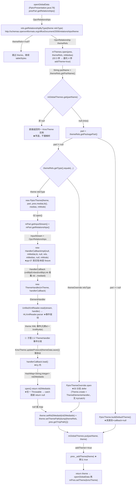
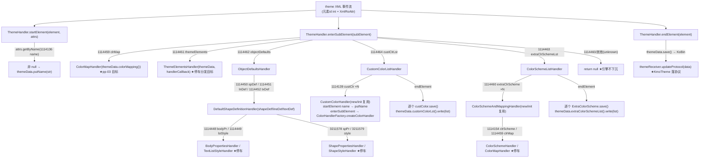
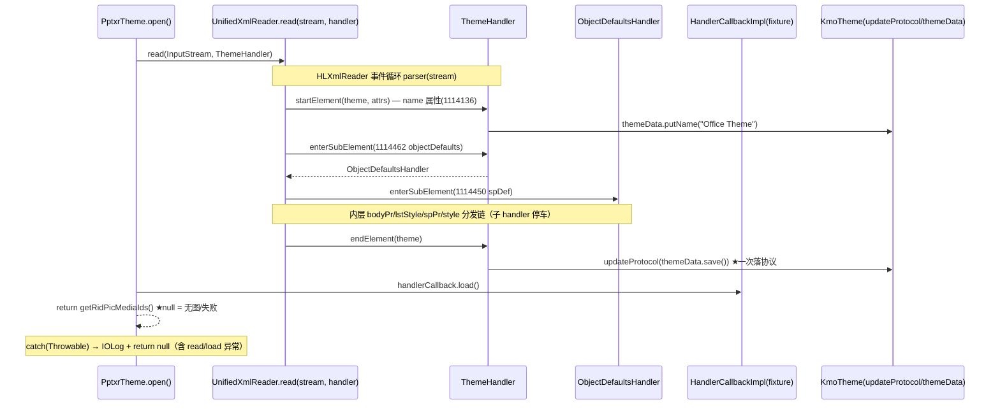
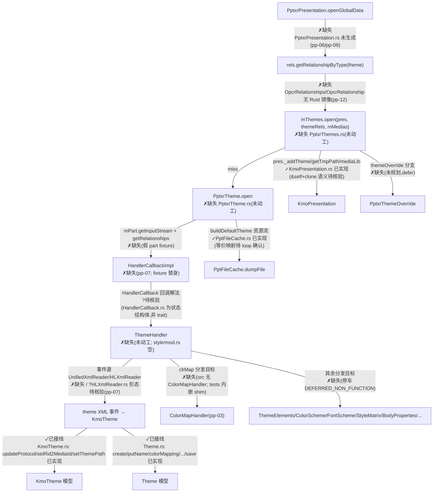

# pp-04-theme-part — theme/themeOverride part（键类/流程/依赖/Java↔Rust 对比）

> 分析依据：feature FEATURE.md / FUNCTIONS.md / functions.csv + Java 源码（真读）+ Rust 现状（如已实现）
> 管线：parse→layout→render（见 libs/ppt-core/PARSER_JAVA_RUST_PIPELINE.md 顶层对比）
> 分析日期：2026-02-13 ｜ feature 状态：**spec**（拆分完成，loop 未开始）｜ Rust 侧：**未动工**

## 0. Feature 目标与管线位置

**一句话目标**：与 Java `PptxrPresentation.openGlobalData` 对齐——在解析 `presentation.xml` **之前**，经 presentation rels 的 `theme` 类型关系取 `themeRels`，`PptxrThemes.open(partName 缓存)` → miss 时 `PptxrTheme.open` 用 `UnifiedXmlReader` + `ThemeHandler` 解析 theme.xml 填充 `KmoTheme`，解析回调收集的 `rid→mediaId` 图片映射经 `KmoTheme.setRid2MediaId` 写回；slide/layout 的 themeOverride 复用同一缓存（`mGlobalThemes`）。

- **上游 depends_on_feature**：`pp-01-pptx-parse`（关系/part 抽象与解析器基础契约、`SWReaderMap`）；`pp-03-dml-style`（`ColorMapHandler` 等 DML 分发目标）。
- **下游**：`pp-07-part-open`（slide/layout/master part 读入复用 themeOverride 缓存；`HandlerCallbackImpl`/`UnifiedXmlReader` 真实实现）；`pp-09-pptx-open`（`PptxReader` 编排整链）。
- **本 feature 回答的问题**（FEATURE.md I/O 表与范围外说明）：
  1. theme XML 事件 → `KmoTheme` 模型字段写入与 5 路子元素分发（01）；
  2. part stream + callback → `rid→mediaId` map（02，null 表示无图/失败）；
  3. partName → cache hit 返回**同一实例** / miss 新开并入缓存（03）。
  **范围外**：`presentation.xml` 解析与 `openGlobalData` 编排（pp-06/pp-09）；slide/layout themeOverride 复用接线（pp-07）；`HandlerCallbackImpl`/`UnifiedXmlReader`/`PptxReader` 整链（pp-07/pp-09）。

## 0.5 设计动机与心智模型

1. **心智模型**：theme part 是一个「全局一次、四处引用」的共享资源——本 layer 把「theme rel partName」投影成「缓存命中/未命中的 `KmoTheme` 实例」，把「theme XML 事件流」投影成「`Theme` 模型（`KmoTheme` 的 protocol 数据）」。同一心智模型贯穿 01（事件→模型）、02（part→模型+rid 映射）、03（partName→实例）。
2. **设计矛盾表**：
   | 矛盾 | 主数据结构 | 关键手段 |
   |---|---|---|
   | 同一 theme 被 pres/slide/layout/master 多次引用，重复解析浪费且实例不一致 | `mGlobalThemes: Map<String, KmoTheme>` | 以 `getPartName()` 为键，hit 早退返回同一指针 |
   | XML 流式回调需要把属性写进 `KmoTheme` 的协议数据 | `Theme themeData`（`Theme.create()`）+ `KmoTheme.updateProtocol(KoBin)` | handler `endElement` 时 `themeReceiver.updateProtocol(themeData.save())` 一次性落协议 |
   | 解析失败不能中断整个 pptx 打开 | `null` 语义（`open()` 返回 null / Throwable 吞掉） | 03 中 `theme.setRid2MediaId(null)` 照常执行，`buildDefaultTheme` 兜底 |
   | 图片 rid 需要在 theme 解析期收集给媒体层 | `mRidPicMediaIds: HashMap<String, Integer>`（HandlerCallbackImpl） | `onBlipEmbed`/`onBlipLink` 时经 `relationships.getRelationship(rId)` + `mMedias.openMedia` 落地，`getRidPicMediaIds()` 返回 |
   | theme.xml 子元素是深层嵌套的 DML 子树 | `ElementHandler` 分发表链 | `enterSubElement` 返回子 handler（`ObjectDefaultsHandler`→`DefaultShapeDefinitionHandler`→`BodyPropertiesHandler`/…），列表子树先积累后 `endElement` 批量 `save()+write` 回模型 |
3. **各结构角色速查**：`PptxrThemes`（缓存门面，03 唯一入口）→ `PptxrTheme`（单 part 打开，02）→ `ThemeHandler`（事件消费，01）→ `KmoTheme`/`Theme`（模型，库内既有）。`HandlerCallbackImpl` 是 rid→mediaId 的搬运工（pp-07 真实现；本层 fixture 只断言键值）。
4. **本 feature 特有的「为什么」**：
   - **cache key 是 `partName` 而非 rId**：同一 theme part 可能被多个关系引用（master 有自己的 theme rel），以 rId 缓存会重复解析；Java 源码 `PptxrThemes.open` 第 29 行 `String partName = themeRels.getPartName();` 起键。
   - **`addTheme` 默认 true 且 3 参 overload 委托 4 参**：`open(pres, themeRels, medias)` → `open(pres, themeRels, medias, true)`（PptxrThemes.java:24-26），所以 presentation 全局 theme 打开必然 `pres._addTheme(theme)`，同时 `openGlobalData` 再 `mPres.setTheme(kmoTheme)`（PptxrPresentation.java:82-83）——两个动作都要保持。
   - **解析失败吞 Throwable 在 02 而非 03**：`PptxrTheme.open` 把 `getInputStream/read/load/getRidPicMediaIds` 全包进 `try{...}catch(Throwable){return null}`；03 拿到 null 后**照常** `setRid2MediaId(null)`（不判空，Java 源码 PptxrThemes.java:42）。Rust 侧必须复刻「吞异常返回 None」而不是把错误上抛。
   - **`buildDefaultTheme` 与 `open` 的错误语义相反**：`open` 吞一切；`buildDefaultTheme` **不 catch**，资源流 null → `FileNotFoundException("The resources is not exist.")`，解析失败 IOException 上抛，且 `finally { stream.close() }` 必须关流（PptxrTheme.java:56-73）。
   - **themeOverride 与 theme 是同构分支但不是同类**：03 的 `else if themeRels.getType().equals(OxfPptRelations.themeOverride().getRelsType())` 分派到 `PptxrThemeOverride.open`（无 try/catch 的对照实现，直接 `ThemeElementsHandler`），本 feature 明示延后，循环需裁决是否并入 02。

## 1. 键类分析（类图）

```mermaid
classDiagram
    class ElementHandler {
        <<interface>>
        +startElement(int element, XmlRoAttr attrsNotCopy)
        +endElement(int element)
        +characters(String chars)
        +enterSubElement(int subElement) ElementHandler
    }
    class DefaultElementHandler {
        <<abstract 空实现>>
        +enterSubElement(int) ElementHandler
    }
    class ThemeHandler {
        -KmoProtocol themeReceiver
        -HandlerCallback handlerCallback
        -Theme themeData
        +ThemeHandler(KmoProtocol, HandlerCallback)
        +startElement(int, XmlRoAttr)★
        +enterSubElement(int) ElementHandler★
        +endElement(int)★
    }
    class ObjectDefaultsHandler {
        +enterSubElement(int) ElementHandler★
    }
    class DefaultShapeDefinitionHandler {
        -Theme.DefaultShapeDefinition defaultObj
        +DefaultShapeDefinitionHandler(DefaultShapeDefinition)
        +enterSubElement(int) ElementHandler★
    }
    class CustomColorListHandler {
        -List~CustomColor~ customColors
        -CustomColorHandler customColorHandler
        +enterSubElement(int) ElementHandler★
        +endElement(int)★
    }
    class CustomColorHandler {
        -CustomColor customColor
        +init(CustomColor)
        +startElement(int, XmlRoAttr)★
        +enterSubElement(int) ElementHandler★
    }
    class ColorSchemeListHandler {
        -List~Theme.ExtraColorScheme~ extraColorSchemes
        -ColorSchemeAndMappingHandler colorSchemeAndMappingHandler
        +enterSubElement(int) ElementHandler★
        +endElement(int)★
    }
    class ColorSchemeAndMappingHandler {
        -Theme.ExtraColorScheme extraColorScheme
        +init(Theme.ExtraColorScheme)
        +enterSubElement(int) ElementHandler★
    }
    class KmoProtocol {
        <<interface>>
        +updateProtocol(KoBin data)
    }
    class KmoTheme {
        +String mThemePath
        +Map~String,Integer~ mRid2MediaId
        +updateProtocol(KoBin)★
        +setThemePath(String)★
        +setRid2MediaId(Map~String,Integer~)★
        +getThemePath()
        +getRid2MediaId()
    }
    class Theme {
        +static Theme create()★
        +putName(String)★
        +colorMapping() ColorMapping★
        +shapeDef() DefaultShapeDefinition
        +lineDef() DefaultShapeDefinition
        +textDef() DefaultShapeDefinition
        +customColorLst() CustomColorLst
        +extraColorSchemeList() ExtraColorSchemeLst
        +save() KoBin★
    }
    class PptxrTheme {
        -KmoTheme mTheme
        -OpcrPackagePart mPart
        -KmoMediaLib mMediaLib
        -PptxrMedias mMedias
        -int mMode
        +PptxrTheme(KmoTheme, OpcrPackagePart, KmoMediaLib, PptxrMedias, int)
        +open() HashMap~String,Integer~★
        +static buildDefaultTheme() KmoTheme★
    }
    class PptxrThemes {
        -Map~String,KmoTheme~ mGlobalThemes★
        -Map~String,String~ mGlobalThemesPath★
        -int mMode
        +PptxrThemes(int mode)
        +open(pres, themeRels, medias) KmoTheme★
        +open(pres, themeRels, medias, boolean addTheme) KmoTheme★
        +dump(themeRels, pptRootTmpDir) String★
    }
    class HandlerCallback {
        <<abstract>>
        +load()
        +onBlipEmbed(String embed, Blip blip)★
        +onBlipLink(String link, Blip blip)★
        +getRidPicMediaIds() Map~String,Integer~
    }
    class HandlerCallbackImpl {
        -HashMap~String,Integer~ mRidPicMediaIds★
        +HandlerCallbackImpl(DgStore, KmoMediaLib, KmoInkLib, OpcrRelationships, PptxrMedias, PptxrSlides, int)
        +load()★
        +onBlipEmbed(String, Blip)★
        +onBlipLink(String, Blip)★
        +getRidPicMediaIds() HashMap★
    }
    class UnifiedXmlReader {
        +static read(InputStream stream, ElementHandler handler)★
    }

    DefaultElementHandler ..|> ElementHandler
    ThemeHandler --|> DefaultElementHandler
    ThemeHandler o-- KmoTheme : themeReceiver (KmoProtocol)
    ThemeHandler o-- Theme : themeData
    ThemeHandler o-- HandlerCallback : handlerCallback (nullable)
    ObjectDefaultsHandler --|> DefaultElementHandler
    DefaultShapeDefinitionHandler --|> DefaultElementHandler
    CustomColorListHandler --|> DefaultElementHandler
    CustomColorHandler --|> DefaultElementHandler
    ColorSchemeListHandler --|> DefaultElementHandler
    ColorSchemeAndMappingHandler --|> DefaultElementHandler
    KmoTheme ..|> KmoProtocol
    ThemeHandler ..> PptxrTheme : 01 复用
    PptxrTheme ..> ThemeHandler : new(mTheme, callback)
    PptxrTheme ..> KmoTheme : mTheme
    PptxrTheme ..> HandlerCallbackImpl : local ctor
    PptxrTheme ..> UnifiedXmlReader : static read()
    PptxrThemes ..> PptxrTheme : theme 类型分支
    PptxrThemes ..> PptxrThemeOverride : themeOverride 类型分支(defer)
    PptxrThemes o-- KmoTheme : mGlobalThemes 缓存
    PptxrThemeOverride --|> ElementHandler 依赖 : ThemeElementsHandler
    HandlerCallbackImpl --|> HandlerCallback
    KmoTheme ..> Theme : protocol 数据 (ThemeAtomData.theme)
```



### 类表

| 类 | 继承/实现 | 关键字段（名:类型→作用） | 关键方法（签名→1 行逻辑，★热路径） |
|---|---|---|---|
| `ThemeHandler`（01 核心，Java 219 行含 6 嵌套类） | `extends DefaultElementHandler`（`implements ElementHandler`） | `themeReceiver:KmoProtocol`→模型回写目标（`KmoTheme`）；`handlerCallback:HandlerCallback`→媒体回调（可 null，`buildDefaultTheme` 路径为 null）；`themeData:Theme`→ctor 中 `Theme.create()` 的解析现场 | `ThemeHandler(KmoProtocol, HandlerCallback)`→存两字段 + `Theme.create()`；★`startElement(int element, XmlRoAttr attrsNotCopy)`→`attrsNotCopy.getByName(1114136)`（name）非 null 则 `themeData.putName(tmp.toString())`；★`enterSubElement(int subElement)`→switch 分发表：`1114459→ColorMapHandler(themeData.colorMapping())`、`1114461→ThemeElementsHandler(themeData, handlerCallback)`、`1114462→ObjectDefaultsHandler()`、`1114463→ColorSchemeListHandler()`、`1114464→CustomColorListHandler()`，其余（含 `1114460`）`return null`；★`endElement(int element)`→`themeReceiver.updateProtocol(themeData.save())` |
| `ObjectDefaultsHandler`（ThemeHandler 嵌套） | `extends DefaultElementHandler` | —（无状态） | ★`enterSubElement(int)`→`1114450(spDef)→DefaultShapeDefinitionHandler(themeData.shapeDef())`、`1114451(lnDef)→lineDef()`、`1114452(txDef)→textDef()`，默认 null |
| `DefaultShapeDefinitionHandler`（嵌套） | `extends DefaultElementHandler` | `defaultObj:Theme.DefaultShapeDefinition`→目标默认形状定义 | `DefaultShapeDefinitionHandler(Theme.DefaultShapeDefinition)`；★`enterSubElement(int)`→`1114448(bodyPr)→BodyPropertiesHandler(defaultObj.bodyPr(), handlerCallback)`、`1114449(lstStyle)→TextListStyleHandler(defaultObj.textListStyle(), handlerCallback)`、`3211578(spPr)→ShapePropertiesHandler(defaultObj.shapePr(), handlerCallback)`、`3211579(style)→ShapeStyleHandler(defaultObj.shapeStyle(), handlerCallback)`，默认 null |
| `CustomColorListHandler`（嵌套） | `extends DefaultElementHandler` | `customColors:List<CustomColor>`→惰性建表；`customColorHandler:CustomColorHandler`→复用 handler | ★`enterSubElement(int)`→`1114139(custClr)`：首次建 `ArrayList`，`CustomColor.create()` 入表，handler 空则 `new CustomColorHandler(customColor)` 否则 `init(customColor)`，返回该 handler；默认 null；★`endElement(int)`→表非空时逐个 `customColor.save()` 后 `themeData.customColorLst().write(customColors)` |
| `CustomColorHandler`（嵌套） | `extends DefaultElementHandler` | `customColor:CustomColor`→当前颜色 | ctor 调 `init`；`init(CustomColor)`→换目标；★`startElement(int, XmlRoAttr)`→`getByName(1114136)`（name）→`customColor.putName(...)`；★`enterSubElement(int)`→`ColorHandlerFactory.createColorHandler(subElement, customColor.color(), handlerCallback, 1114139)` |
| `ColorSchemeListHandler`（嵌套） | `extends DefaultElementHandler` | `extraColorSchemes:List<Theme.ExtraColorScheme>`→惰性建表；`colorSchemeAndMappingHandler`→复用 handler | ★`enterSubElement(int)`→`1114460(extraClrScheme)`：建表 + `Theme.ExtraColorScheme.create()` + new/`init` 复用，返回 handler；★`endElement(int)`→逐个 `save()` 后 `themeData.extraColorSchemeList().write(...)` |
| `ColorSchemeAndMappingHandler`（嵌套） | `extends DefaultElementHandler` | `extraColorScheme:Theme.ExtraColorScheme` | ctor/`init(Theme.ExtraColorScheme)`；★`enterSubElement(int)`→`1114154(clrScheme)→ColorSchemeHandler(extraColorScheme.colorScheme(), handlerCallback)`、`1114459(clrMap)→ColorMapHandler(extraColorScheme.colorMapping())`，默认 null |
| `PptxrTheme`（02 核心，Java 71 行） | 普通类 | `mTheme:KmoTheme`→目标模型；`mPart:OpcrPackagePart`→主题 part；`mMediaLib:KmoMediaLib`→媒体库；`mMedias:PptxrMedias`→媒体集；`mMode:int`→打开模式 | `PptxrTheme(KmoTheme, OpcrPackagePart, KmoMediaLib, PptxrMedias, int)`；★`open() throws IOException → HashMap<String,Integer>`→`mPart == null` 直接 `return null`（不进 try）；否则 `try{ stream=mPart.getInputStream(); handlerCallback=new HandlerCallbackImpl(null, mMediaLib, null, mPart.getRelationships(), mMedias, null, mMode); handler=new ThemeHandler(mTheme, handlerCallback); UnifiedXmlReader.read(stream, handler); handlerCallback.load(); return handlerCallback.getRidPicMediaIds(); }catch(Throwable e){ IOLog.d(TAG,"Throwable",e); return null; }`；★`static buildDefaultTheme() throws IOException → KmoTheme`→`PptResourceFactory.getResPrivider().getTheme()` 流 null 则 `throw new FileNotFoundException("The resources is not exist.")`；`new KmoTheme()` + `ThemeHandler(theme, null)` + `try{ UnifiedXmlReader.read(stream, handler) } finally { stream.close() }`（**无 catch**）+ `theme.setThemePath(getResPrivider().getThemePath())` |
| `PptxrThemes`（03 核心，Java 77 行，final） | 普通类 | `mGlobalThemes:Map<String,KmoTheme>`→partName 缓存（★特征字段）；`mGlobalThemesPath:Map<String,String>`→partName→落盘路径缓存；`mMode:int` | `PptxrThemes(int mode)`；★`open(pres, themeRels, medias) throws IOException → KmoTheme`→委托 `open(pres, themeRels, medias, true)`；★`open(pres, themeRels, medias, boolean addTheme)`→`partName=themeRels.getPartName()`；`mGlobalThemes.get(partName)` 非 null **早退返回同一实例**；miss：`part=themeRels.getPackagePart()`；`part != null` → `new KmoTheme()`，`themeRels.getType().equals(OxfPptRelations.theme().getRelsType())` → `themeReader.open()` + `setRid2MediaId(rid2MediaIds)` + `setThemePath(dump(themeRels, pres.getTmpPath()))`；else if themeOverride 类型 → `PptxrThemeOverride` 同构（defer）；`part == null` → `PptxrTheme.buildDefaultTheme()`；随后 `mGlobalThemes.put(partName, theme)`；`addTheme` 为 true → `pres._addTheme(theme)`；★`dump(themeRels, pptRootTmpDir) throws IOException → String`→`IOAssert.assertNotNull(themeRels)`；`mGlobalThemesPath.get(partName)` 命中则返回；miss：`PptFileCache.dumpFile(part, pptRootTmpDir)` 落盘 + `put` + 返回路径 |
| `PptxrThemeOverride`（defer 参照，Java 47 行） | 普通类 | 与 `PptxrTheme` 同构（mTheme/mPart/mMediaLib/mMedias/mMode） | `open()`→`mPart==null` 返回 null；无 try/catch；`Theme.create()` + `ThemeElementsHandler(themeData, handlerCallback)` 直接 `read`，`mTheme.updateProtocol(themeData.save())`，`handlerCallback.load()`，返回 `getRidPicMediaIds()` |
| `KmoTheme`（模型，库内已有） | `extends KmoAtom` `implements KmoProtocol` | `mThemePath:String`→主题落盘路径；`mRid2MediaId:Map<String,Integer>`→rid→mediaId；`mThemePathUpdater/mThemePathIsOld`→路径刷新；`mId`→`IdGenerator.createId()` | ★`updateProtocol(KoBin data)`→`theme.load(data)` 并重建 `mFills/mBackgroundFills/mOutlines/effectStyleLst/minorFonts/majorFonts` 等缓存列表；★`setThemePath(String)`→写 `mThemePath`；★`setRid2MediaId(Map)`→写 `mRid2MediaId`；`getThemePath()/getRid2MediaId()` |
| `Theme`（模型，库内已有） | 数据模型（KoAr） | `colorMapping/shapeDef/lineDef/textDef/customColorLst/extraColorSchemeList` 各字段 + 嵌套 `DefaultShapeDefinition`/`ExtraColorScheme`/`CustomColorLst`/`ExtraColorSchemeLst` | ★`static create()`；★`putName(String)`；★`colorMapping():ColorMapping`；`shapeDef()/lineDef()/textDef():DefaultShapeDefinition`；`customColorLst():CustomColorLst`；`extraColorSchemeList():ExtraColorSchemeLst`；★`save():KoBin`（供 `updateProtocol`） |
| `HandlerCallback`（依赖） | 抽象类（dmlr/model） | `mode:int`（基类） | `load()` 空实现；`onBlipEmbed(String embed, Blip)`/`onBlipLink(String link, Blip)` 空实现；`getRidPicMediaIds()` 空返回 null（pp-07 覆写） |
| `HandlerCallbackImpl`（pp-07 真实实现，本层 fixture 参照） | `extends HandlerCallback` | `mRidPicMediaIds:HashMap<String,Integer>`★；`relationships:OpcrRelationships`；`mediaLib/mMedias` | ctor 7 参；★`onBlipEmbed(String embed, Blip)`→`relationships.getRelationship(embed)` 非 null 时 `mMedias.openMedia(mediaLib, relationship)` → `blip.putEmbedMediaID(mediaId)` + `mRidPicMediaIds.put(relationship.getId(), mediaId)`；★`onBlipLink` 同构（`putLinkMediaID`）；★`getRidPicMediaIds()`→返回 `mRidPicMediaIds`；`load()`→`updateConnectorSite()` |
| `UnifiedXmlReader`（pp-07，本层注入 fixture） | 工具类 | — | ★`static read(InputStream stream, ElementHandler handler) throws IOException`→`new HLXmlReader(MapManager.getInstance(), handler).parser(stream)` |

## 2. 流程图（依据 I/O）

### 2.1 03→02→01 打开主链路（输入端点 → 分发 → 模型写入）



### 2.2 ThemeHandler 事件分发（输入端点 → handler → 模型 / 子 handler）



### 2.3 handler 回调时序（02 open 内 UnifiedXmlReader → ThemeHandler 驱动的时序）



## 3. 依赖关系与改写状态

### 3.1 类间依赖表

| 依赖方 | 被依赖方 | 用途 | 归属 |
|---|---|---|---|
| `PptxrPresentation.openGlobalData` | `PptxrThemes.open`、`OxfPptRelations.theme().getRelsType()`、`KmoPresentation.setTheme` | 上游编排（pp-06/pp-09 范围） | pp-06/pp-09 |
| `PptxrThemes` | `PptxrTheme`（theme 分支）、`PptxrThemeOverride`（themeOverride 分支，defer）、`KmoPresentation._addTheme/getTmpPath/mediaLib`、`PptFileCache.dumpFile`、`IOAssert.assertNotNull`、`OxfPptRelations` | 03 主实现 | 本 feature + 复用 |
| `PptxrTheme` | `ThemeHandler`、`HandlerCallbackImpl`、`UnifiedXmlReader`、`KmoTheme`、`PptResourceFactory.getResPrivider`、`IOLog` | 02 主实现 | 本 feature + pp-07（fixture） |
| `ThemeHandler` | `Theme`（create/putName/colorMapping/shapeDef/lineDef/textDef/customColorLst/extraColorSchemeList/save）、`KmoProtocol.updateProtocol`、`HandlerCallback` | 01 主实现 | 本 feature |
| `ThemeHandler` 分发表 | `ColorMapHandler`（pp-03）、`ThemeElementsHandler`、`ObjectDefaultsHandler` 族、`ColorSchemeListHandler` 族 | 分发目标（停车/随子 handler） | pp-03/随各子 handler |
| `CustomColorHandler` | `ColorHandlerFactory`、`CustomColor` | 颜色解析 | ColorHandlerFactory（停车） |
| `HandlerCallbackImpl` | `OpcrRelationships.getRelationship`、`PptxrMedias.openMedia`、`KmoMediaLib`、`DgStore` | rid→mediaId 搬运 | pp-07 |
| `KmoTheme`/`Theme` | `KoBin/KmoAtom/ThemeAtomData` | 模型协议 | 库内已有（不改） |
| `UnifiedXmlReader` | `HLXmlReader`、`MapManager` | 事件源驱动 | pp-07 |

### 3.2 Java↔Rust 路径映射表（状态判据：ppt_core_mvp_audit.csv / rewriting_files.csv / 实际源码存在性）

| Java 路径 | Rust 路径 | 状态 |
|---|---|---|
| `koffice/presentation/core/cn/wps/drawing/dmlr/handler/style/ThemeHandler.java` | `libs/ppt-core/src/cn/wps/drawing/dmlr/handler/style/ThemeHandler.rs` | **未开始**（`style/mod.rs` 仅一行注释 `// pub mod StyleMatrixReferenceHandler;`，无任何模块声明；rewriting_files.csv 无该行） |
| `koffice/presentation/core/cn/wps/show/pptxr/ppt/theme/PptxrTheme.java` | `libs/ppt-core/src/cn/wps/show/pptxr/ppt/theme/PptxrTheme.rs` | **未开始**（`show/pptxr/ppt/theme/` 目录不存在；`show/pptxr/` 下仅有 `handler/util/PptxReader`） |
| `koffice/presentation/core/cn/wps/show/pptxr/ppt/theme/PptxrThemes.java` | `libs/ppt-core/src/cn/wps/show/pptxr/ppt/theme/PptxrThemes.rs` | **未开始**（同上） |
| `koffice/presentation/core/cn/wps/show/pptxr/ppt/theme/PptxrThemeOverride.java` | 未规划 | **未开始**（FEATURE.md 明示延后） |
| `koffice/presentation/core/cn/wps/show/pptxr/ppt/slides/HandlerCallbackImpl.java` | `…/show/pptxr/ppt/slides/HandlerCallbackImpl.rs` | **未开始**（pp-07 归属；本层 fixture） |
| `koffice/presentation/core/cn/wps/show/pptxr/util/UnifiedXmlReader.java` | `…/show/pptxr/util/UnifiedXmlReader.rs` | **未开始**（pp-07 归属；02 用注入式 read fixture） |
| `koffice/presentation/core/cn/wps/show/app/theme/KmoTheme.java` | `libs/ppt-core/src/cn/wps/show/app/theme/KmoTheme.rs` | **done**（461 行；audit `keep_refactor`："theme holder needed; fill/outline disconn. stubbed"；`updateProtocol/setThemePath/setRid2MediaId` 已实现；`updateThemePath` 内 Updater 调用被 defer） |
| `koffice/presentation/core/cn/wps/drawing/data/style/Theme.java` | `libs/ppt-core/src/cn/wps/drawing/data/style/Theme.rs` | **done**（2932 行；audit `keep` "core theme model, faithful"；`create/putName/colorMapping/shapeDef/lineDef/textDef/customColorLst/extraColorSchemeList/save/write` 均在） |
| `koffice/presentation/core/cn/wps/drawing/data/color/CustomColor.java` | `libs/ppt-core/src/cn/wps/drawing/data/color/CustomColor.rs` | **done**（425 行；audit `keep` "theme custom colors, faithful"） |
| `koffice/presentation/core/cn/wps/drawing/data/style/ColorMapping.java` | `libs/ppt-core/src/cn/wps/drawing/data/style/ColorMapping.rs` | **done**（957 行；audit `keep` "theme color mapping, faithful"） |
| `koffice/presentation/core/cn/wps/drawing/dmlr/model/HandlerCallback.java` | `libs/ppt-core/src/cn/wps/drawing/dmlr/model/HandlerCallback.rs` | **存在但形态待核验**（Rust 侧是 `HandlerCallbackState` 结构体 + 自由函数，非 trait；pptxr handler 以 trait bound 引用，回调解法需 loop 时确认） |
| `koffice/presentation/core/cn/wps/show/PptFileCache.java` | `libs/ppt-core/src/cn/wps/show/PptFileCache.rs` | **done**（`dumpFile(OpcrPackagePart, String)→String` 对应 `dumpFile_part_to_dir(&OpcrPackagePart, &str)→io::Result<String>`，等价映射待 loop 确认） |
| `koffice/presentation/core/cn/wps/show/app/KmoPresentation.java` | `libs/ppt-core/src/cn/wps/show/app/KmoPresentation.rs` | **done**（`_addTheme`/`getTmpPath`/`mediaLib` 已实现，rewriting_files.csv state=fail 需注意；Rust `_addTheme(&self, …)` 内部 clone 语义待核验） |
| `koffice/presentation/core/cn/wps/drawing/dmlr/handler/style/ColorMapHandler.java` | `libs/ppt-core/src/cn/wps/drawing/dmlr/handler/style/ColorMapHandler.rs` | **缺失**（src 下无该文件；tests 内有内嵌 shim；`SlideMasterHandler.rs` 的 `use …style::ColorMapHandler` 仅 `#[cfg(feature="full")]` 可见） |
| `koffice/presentation/core/cn/wps/drawing/dmlr/handler/style/ThemeElementsHandler.java` 等分发目标 | 对应 `.rs` | **未开始**（01 停车项） |
| `kfc …/kfc/xsd/dml/A.java`（元素 id 常量） | `kfc_kfc_alpha …/xsd/dml/A.rs`（存在与否待查；FUNCTION.md 以字面量断言） | 复用/常量 |
| `kfc …/kfc/xpxml/reader/ElementHandler.java` | `libs/core-libs/kfc/kfc_alpha/src/cn/wps/kfc/xpxml/reader/ElementHandler.rs` | **done**（trait：`startElement(&self,i32,&dyn XmlRoAttr)`/`endElement`/`characters`/`enterSubElement→Option<Box<dyn…>>`；**注意与 ppt-core 本地 `drawing/dmlr/handler/mod.rs` 的 `ElementHandler`（`&mut self` + `kind()` + `&XmlRoAttrList`）是两套 trait**） |
| `kfc …/kfc/opcr/OpcrPackagePart.java` / `OpcrRelationship.java` | Rust 镜像 | **缺失**（libs 下未搜到 struct；pp-12-opc-package spec 未动工；本层用 fixture 替身） |
| `kfc …/kfc/ooxfr/OxfPptRelationsImpl` | 字符串常量 | **未改写**（relsType URI 以字符串常量/fixture 提供） |
| `kfc …/kfc/xpxml/hlxml/HLXmlReader.java` | `libs/core-libs/kfc/kfc_alpha/src/cn/wps/kfc/xpxml/hlxml/HLXmlReader.rs` | **存在但形态待核验**（文件内出现 `pub struct ln`，与 Java 类名不对齐，需 loop 确认） |

## 4. 最小 feature-critical 改写范围

### must-write（feature 关键类与方法）

| 编号 | 类 | 必须覆盖的方法 | 备注 |
|---|---|---|---|
| 01 | `ThemeHandler` 全类（含 6 嵌套类） | ctor、★`startElement`（name=1114136→putName）、★`enterSubElement`（5 路分发表，unknown→None）、★`endElement`（updateProtocol(save())）；`ObjectDefaultsHandler.enterSubElement`（spDef/lnDef/txDef）；`DefaultShapeDefinitionHandler.enterSubElement`（bodyPr/lstStyle/spPr/style）；`CustomColorListHandler.enterSubElement/endElement`（惰性建表+save+write）；`CustomColorHandler`（init/startElement/enterSubElement）；`ColorSchemeListHandler.enterSubElement/endElement`；`ColorSchemeAndMappingHandler`（clrScheme/clrMap） | `ThemeHandler.rs` + `style/mod.rs` 声明；回调契约对齐 ppt-core 本地 `ElementHandler` trait 或 kfc trait（**需人工确认**，见 §6.3） |
| 02 | `PptxrTheme` 全类 | ctor、★`open`（null part→null 不进 try；`try{…}catch(Throwable){return null}` 覆盖 getInputStream/read/load/getRidPicMediaIds；finally 无关——Java 无 finally，Rust 靠 RAII 关流）、★`static buildDefaultTheme`（资源流 null→Err(FileNotFound 等价)；`try{read}finally{close}` 无 catch；`setThemePath`） | `PptxrTheme.rs`（`build_default_theme` 重命名避关键字） |
| 03 | `PptxrThemes` 全类 | ctor、★`open` 3 参（委托 addTheme=true）、★`open` 4 参（partName 键；hit 早退同一实例；miss 分派 theme/themeOverride 两 relsType 分支；part==null→buildDefaultTheme；put；addTheme→`pres._addTheme`）、★`dump`（assertNotNull、mGlobalThemesPath 缓存、PptFileCache 落盘） | `PptxrThemes.rs` |
| 接线 | `style/mod.rs`（及 handler 模块树） | `pub mod ThemeHandler;` 声明 | 现状只有注释行 |

### 可 stub

| 项 | stub 内容 | 注解 |
|---|---|---|
| `rid→mediaId` 媒体搬运 | `onBlipEmbed`/`onBlipLink` 的 `mMedias.openMedia` 落地逻辑依赖 pp-07 `HandlerCallbackImpl`；本层 fixture callback 只记录/断言 rid→id 键值 | FEATURE.md must/stub 拆分 |
| theme scheme 全表子 handler | `clrScheme`/`fontScheme`/`fmtScheme` 内部子元素解析随各子 handler（pp-03 等）；本 feature 只保障 `ThemeHandler` 分发命中，子 handler 实现以 `todo!("DEFERRED_NON_FUNCTION")` 停车，仅保证 `enterSubElement` 返回类型存在 | FEATURE.md「不过扩展」 |
| `OpcrRelationship`/`OpcrPackagePart`（Rust 无镜像） | fixture/字符串常量替身（03 可编程假 rel：`getPartName/getType/getPackagePart`） | FUNCTION.md 03 §2.2 |
| `UnifiedXmlReader` | 注入式 `read` fixture（02 不依赖 pp-07） | FUNCTION.md 02 §2.2 |
| `IOLog.d` | API 层日志可空实现，不影响返回 null 语义 | FUNCTION.md 02 §2.1 |

### 可 defer

| 项 | 理由 |
|---|---|
| `PptxrThemeOverride.open`（03 themeOverride 类型分支） | 02 同构；未裁决并入 02 或另开，loop 前 `todo!("DEFERRED_NON_FUNCTION")` |
| slide/layout master 侧 themeOverride 复用接线 | pp-07（`PptxrLayout.java:70-74`、`PptxrSlide.java:59-61` 均经 `mThemes.open` 走同一缓存，属编排） |
| `PptxrPresentation.openGlobalData` 编排 / `mPres.setTheme` | pp-06/pp-09 |

### 当前进度（spec：拆分完成，loop 未开始；每 function 完成度 0/未开始）

| function | 状态 | 完成度 | 改写顺序 |
|---|---|---|---|
| `01_function_theme_handler` | spec | 0%（无 src、无 test；模板未生成） | 1（先给 02 提供事件消费端） |
| `02_function_pptx_theme_open` | spec | 0% | 2（依赖 01） |
| `03_function_themes_cache` | spec | 0% | 3（依赖 02；themeOverride 分支待裁决） |

## 5. 验收口径

FEATURE.md「验收」三条 + FUNCTIONS.md §4 三条锁死，钉死如下：

1. **ThemeHandler 对已知 theme 子元素返回非 None kind**：
   - 已知分发恒表：`1114459(clrMap) / 1114461(themeElements) / 1114462(objectDefaults) / 1114463(extraClrSchemeLst) / 1114464(custClrLst)` → 非 None；
   - unknown（含 `1114460(extraClrScheme)`、`1114465(theme)`、`1114466(themeOverride)`、`1114468(lnL)` 等）→ **None（Java null）**；
   - 恒表来源：`ThemeHandler.java:38-52` + `kfc/xsd/dml/A.java`（name=1114136、custClr=1114139、clrScheme=1114154、fontScheme=1114155、fmtScheme=1114156、bodyPr=1114448、lstStyle=1114449、spDef=1114450、lnDef=1114451、txDef=1114452、clrMap=1114459、extraClrScheme=1114460、themeElements=1114461、objectDefaults=1114462、extraClrSchemeLst=1114463、custClrLst=1114464、spPr=3211578、style=3211579，已逐条核实）。
2. **PptxrTheme.open**：`mPart == null → null`（方法第一行，不进 try）；其余任何异常（parse/IO/`handlerCallback.load()`）→ catch(Throwable) → **null**（Java `PptxrTheme.java:38-52`；方法声明 `throws IOException` 但运行时吞）。
3. **PptxrThemes 缓存**：同一 `partName` 连续两次 `open` → **同一实例（`ptr::eq`）**；不同 `partName` → 两个实例；`addTheme` 默认 **true**（3 参委托 4 参）；`part == null` → `buildDefaultTheme` 且仍 `put` 缓存；`dump` 重复同 partName 走 `mGlobalThemesPath` 缓存（part 不再被读）。
4. **relsType 常量**（`OxfPptRelationsImpl.java:180-194` 核实）：theme = `http://schemas.openxmlformats.org/officeDocument/2006/relationships/theme`；themeOverride = `http://schemas.openxmlformats.org/officeDocument/2006/relationships/themeOverride`；分派用 `equals`，大小写敏感。
5. **错误语义对照钉死**：`open` 吞 Throwable→null；`buildDefaultTheme` 资源流 null → `FileNotFoundException("The resources is not exist.")`（Rust 侧 `io::Error` 等价），**无 catch**，`finally` 必关流（Rust RAII 等价）；03 对 02 的 null 结果**不判空**继续 `setRid2MediaId(null)`；`dump` 起始 `IOAssert.assertNotNull(themeRels)`（null → 断言失败；Rust `debug_assert` 等价）。
6. **模式哨兵**：`HandlerCallback.mode`：0=PPTX（isPPTX）、1=PPT14Slides、2=GVml、3=ArtTable（`HandlerCallback.java:27-41`）；`mMode` 透传 02/03 ctor。
7. **KmoTheme 消费面锁死**（feature 只消费不改模型）：`setRid2MediaId(HashMap<String,Integer>)`、`setThemePath(String)`、`updateProtocol(KoBin)`；`KmoPresentation._addTheme(KmoTheme)`（`KmoPresentation.java:289-291` → `themes.add(theme)`）。

## 6. Java↔Rust 管线对比与缺口审计

### 6.1 Java 完整链路（真读对齐）

```
PptxrPresentation.open()                       (PptxrPresentation.java:57-76)
 └─ openGlobalData()  (78-101)  ← 在 presentation.xml 解析之前
     ├─ relses = mPresPart.getRelationships()                    → OpcrRelationships
     ├─ themeRels = relses.getRelationshipByType(OxfPptRelations.theme().getRelsType())
     ├─ kmoTheme = mThemes.open(pres, themeRels, mMedias)        → PptxrThemes(03)
     │    ├─ partName = themeRels.getPartName()                  → 缓存键
     │    ├─ mGlobalThemes.get(partName) → hit 早退同一实例
     │    ├─ miss: part = themeRels.getPackagePart()
     │    │    ├─ part != null:
     │    │    │    ├─ theme 类型 → PptxrTheme.open (02)
     │    │    │    │    ├─ mPart.getInputStream() + getRelationships()
     │    │    │    │    ├─ new HandlerCallbackImpl(null, mMediaLib, null, rels, mMedias, null, mMode)
     │    │    │    │    ├─ new ThemeHandler(mTheme, handlerCallback)  → 01
     │    │    │    │    ├─ UnifiedXmlReader.read(stream, handler)     → HLXmlReader.parser 事件循环
     │    │    │    │    │    ├─ startElement: name(1114136) → themeData.putName()
     │    │    │    │    │    ├─ enterSubElement: 5 路分发 + 嵌套列表 handler
     │    │    │    │    │    └─ endElement: themeReceiver.updateProtocol(themeData.save())
     │    │    │    │    ├─ handlerCallback.load()                       ← try 内
     │    │    │    │    └─ return handlerCallback.getRidPicMediaIds()   ← rid→mediaId
     │    │    │    ├─ themeOverride 类型 → PptxrThemeOverride.open (defer)
     │    │    ├─ part == null → PptxrTheme.buildDefaultTheme()
     │    │    ├─ mGlobalThemes.put(partName, theme)
     │    │    └─ addTheme(true) → pres._addTheme(theme)
     │    └─ setThemePath(dump(themeRels, pres.getTmpPath()))   → PptFileCache.dumpFile + mGlobalThemesPath
     └─ mPres.setTheme(kmoTheme)   (82-83)
下游复用：PptxrMaster.java:68、PptxrLayout.java:70-74、PptxrSlide.java:59-61、PptxrNotesMaster.java:50
         → 同一 mThemes.open 缓存（themeOverride 复用 same cache）
```

### 6.2 Rust 现状（真读核实）

- **零改写**：`ThemeHandler.rs`、`PptxrTheme.rs`、`PptxrThemes.rs` 均不存在；`style/mod.rs` 只有注释；`show/pptxr/ppt/theme/` 目录不存在。
- **模型层已就位**：`KmoTheme.rs`（done）、`Theme.rs`（done）、`CustomColor.rs`（done）、`ColorMapping.rs`（done）、`PptFileCache.rs`（done）、`KmoPresentation.rs`（done，`_addTheme/getTmpPath/mediaLib` 在）。
- **基础设施半就位**：kfc 镜像 `ElementHandler`/`XmlRoAttr`/`XmlRoAttrList`（含 `get_by_name(i32)→Option<&XmlRoAttrLeaf>`、`to_string()`）存在；ppt-core 本地 `drawing/dmlr/handler/mod.rs` 有**另一套** `ElementHandler` trait（`&mut self` + `kind()` + `&XmlRoAttrList`）——两套 trait 并存，ThemeHandler 实现哪套、`UnifiedXmlReader` fixture 驱动哪套，**需人工确认**。
- **周边缺失**：`OpcrRelationship`/`OpcrPackagePart` 无 Rust 镜像（pp-12-opc-package 未动工）；`UnifiedXmlReader`/`HandlerCallbackImpl`（pp-07 未动工）；`ColorMapHandler` src 缺失（pp-03，tests 仅有内嵌 shim）；`HLXmlReader.rs` 形态异常（`pub struct ln`）。
- **编译现状实证**：默认 `cargo check`（libs/ppt-core）**通过**（exit 0）——因为 `show/pptxr/handler` 子树在 `#[cfg(feature="full")]` 之后才编译，ThemeHandler 相关引用当前不可达；`--features full` 在第三方 `picparser` 处编译失败（10 errors，与 theme 无关）。

### 6.3 Rust 端接线图（关键链路，实际状态标注）



### 6.4 核心类与依赖审计表

| 类 | critical? | Rust 现状 | 状态 | stub 类型 | 影响 | 修复建议 |
|---|---|---|---|---|---|---|
| `ThemeHandler` | 是（种子） | 未生成 | 未开始 | — | 01 全断：theme XML 无分发、`KmoTheme` 无数据来源 → S1/S4 之外画色断 | loop 01 全量改写 + `style/mod.rs` 注册 |
| `PptxrTheme` | 是（种子） | 未生成 | 未开始 | — | 02 全断：part 打不开 → `KmoTheme` 无来源（`buildDefaultTheme` 兜底亦在类内） | loop 02 改写；错误语义（吞 Throwable / finally 关流）照 Java 锁死 |
| `PptxrThemes` | 是（种子） | 未生成 | 未开始 | — | 03 全断：partName 缓存不存在 → 每处引用重开 part、结果不进 `KmoPresentation` | loop 03 改写；hit 同一实例用 `ptr::eq` 断言 |
| `PptxrThemeOverride` | 否（defer） | 未规划 | 未开始 | — | themeOverride 类型分支（03 else-if）停摆；slide/layout 主题覆写缺（PPT 常见） | 与 02 同构裁决后并入 02 或另开 |
| `HandlerCallbackImpl` | 否（pp-07） | 未生成 | 未开始 | 本层 fixture | rid→mediaId 真媒体落地断（画图图片引用 theme 媒体） | pp-07 真实现；本层 fixture 断言键值 |
| `UnifiedXmlReader` | 否（pp-07） | 未生成 | 未开始 | 注入式 read fixture | 02/03 无事件源驱动 | pp-07；本层注入 fixture |
| `OpcrRelationship`/`OpcrPackagePart` | 否（pp-12） | 无 Rust 镜像 | 未开始 | fixture/常量 | 03 part/rel 抽象不可用 → 阻塞 pp-09 真链 | pp-12-opc-package；本层 fixture |
| `ColorMapHandler` | 否（pp-03 交付） | src 缺失（tests 内嵌 shim） | 缺失 | inline shim | ThemeHandler `clrMap` 分支返回类型不可用；`--features full` 下 `SlideMasterHandler` 等 import 悬空 | pp-03 loop 补 src 实现 |
| `KmoTheme` | 是（模型） | 已实现 | done | `updateThemePath` Updater 调用被 defer；audit: fill/outline disconn. stubbed | 模型主体可用；updater/媒体明细非本 feature 热路径 | 本 feature 只消费 `setRid2MediaId/setThemePath/updateProtocol`，不改 |
| `Theme` | 是（模型） | 已实现 | done | 无 | 完整 | 复用不改 |
| `PptFileCache` | 否（03 依赖） | 已实现 | done | `dumpFile_part_to_dir` 与 Java `dumpFile(part, rootDir)` 等价映射待 loop 确认 | 03 `dump` 落盘 | loop 03 时对照确认 |
| `KmoPresentation` | 否（03 依赖） | 已实现 | done（rewriting_files.csv state=fail） | Rust `_addTheme(&self, …)` 内部 clone；Java `themes.add` | 03 `_addTheme` 语义 | 核验内部可变性/克隆语义 |
| `ElementHandler` trait（本地 vs kfc 两套） | 是（01 接线） | 两套并存 | 待核验 | — | ThemeHandler 实现哪套、fixture 驱动哪套未定 | loop 01 前裁决 |

### 6.5 结论

**spec-未动工**（本 feature Rust 全量未改写，依赖闭包部分就位）：

- Java 链路完整且已真读对齐（openGlobalData → PptxrThemes → PptxrTheme → ThemeHandler → KmoTheme，含 rid→mediaId 回写与 themeOverride 分支）。
- Rust 侧三个种子类（`ThemeHandler`/`PptxrTheme`/`PptxrThemes`）全部**未生成**；模型层（`KmoTheme`/`Theme`/`CustomColor`/`ColorMapping`/`PptFileCache`/`KmoPresentation`）done，可作为改写依赖。
- 关键接线断点依次为：① `ThemeHandler.rs` 缺失（含 `style/mod.rs` 空）→ ② `PptxrTheme.rs`/`PptxrThemes.rs` 缺失 → ③ 事件源 `UnifiedXmlReader`/`HandlerCallbackImpl`（pp-07）与 `OpcrRelationship`/`OpcrPackagePart`（pp-12）均缺，本层以 fixture 替身，不阻塞 01/02/03 独立 loop，但阻塞 pp-07/pp-09 真链。
- 改写前置待裁决项：**两套 `ElementHandler` trait 的接线**（ppt-core 本地 `kind()`/`&mut self` vs kfc 镜像 `&self`）；`HandlerCallback` 的 Rust 形态（状态结构体 vs trait）；`ColorMapHandler`（pp-03）src 缺失需先补。
- 对下游：本 feature 未动工不阻塞 pp-01/pp-02（已 pass），但 pp-07（依赖本 feature 缓存）与 pp-09（依赖 theme 打开）在 01→02→03 全部 pass 前不可作为真链验收。

**下一步**：按 `01 → 02 → 03` loop 顺序启动 feature-function；每 function 以 FUNCTION.md 覆盖矩阵（01 的 C01-C08 / 02 的 C01-C07 / 03 的 C01-C07）为测试面，测试隔离在 `tests/` 镜像（`[[test]] 01_function_theme_handler / 02_function_pptx_theme_open / 03_function_themes_cache`），事件驱动用内存 fixture，不跑 `PptxReader`（pp-09 编排项）。