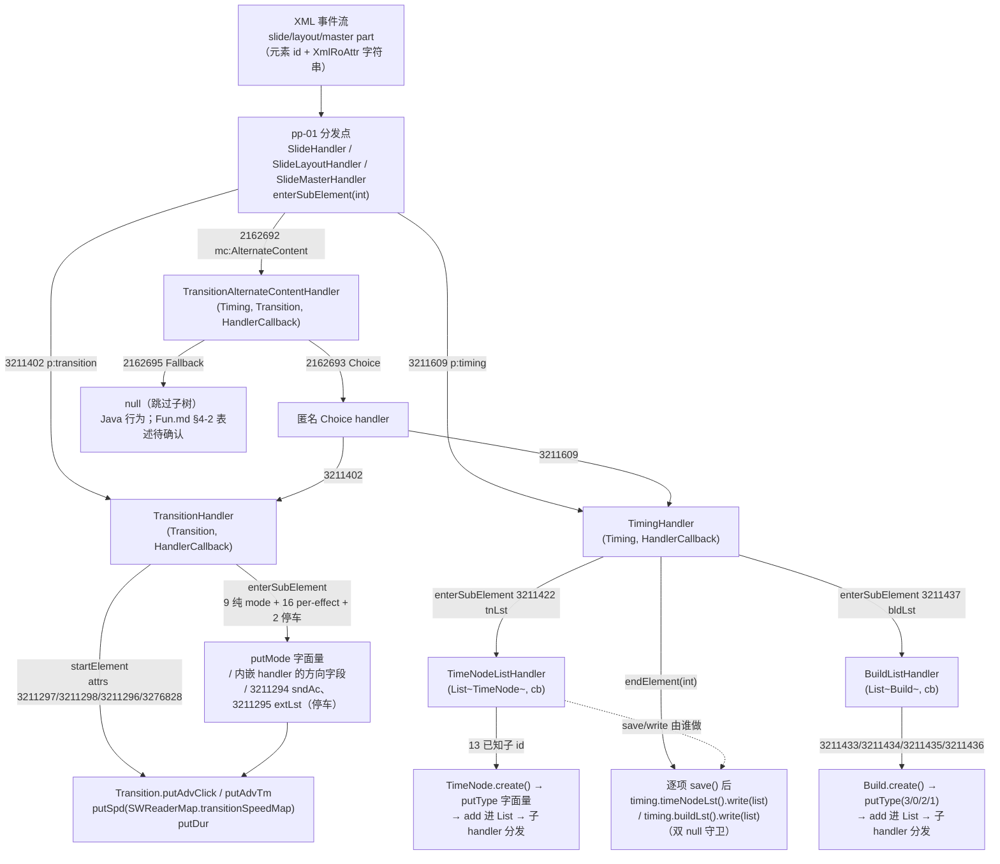
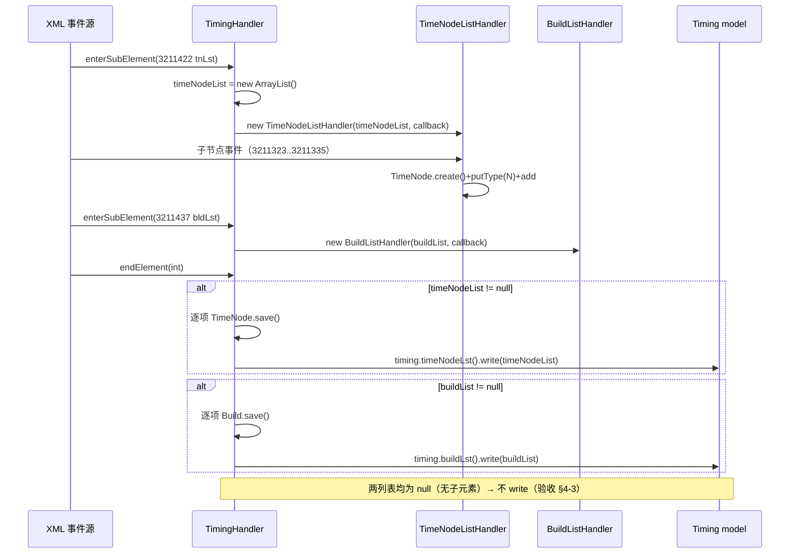
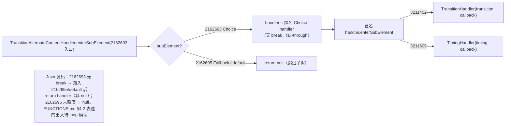
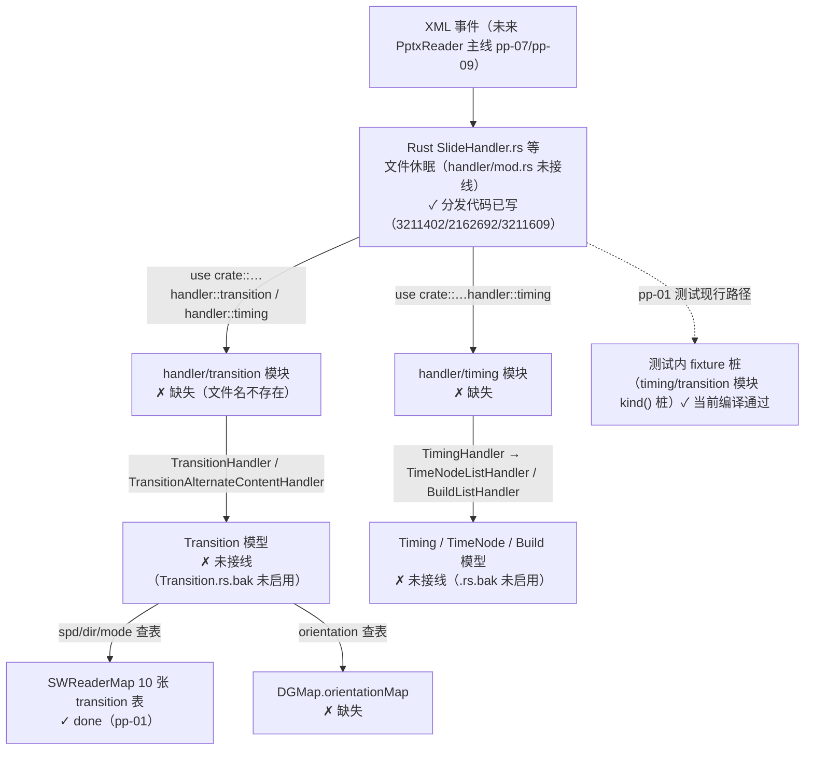

# pp-05-timing-transition — p:transition 与 p:timing 列表（键类/流程/依赖/Java↔Rust 对比）

> 分析依据：feature FEATURE.md / FUNCTIONS.md / functions.csv + Java 源码（真读：TransitionHandler.java 616 行、TransitionAlternateContentHandler.java 44 行、TimingHandler.java 56 行、BuildListHandler.java 346 行、TimeNodeListHandler.java 197 行、SWReaderMap.java、DGMap.java、Transition/Timing/TimeNode/Build 模型、SlideHandler/SlideLayoutHandler/SlideMasterHandler 分发）+ Rust 现状（SWReaderMap.rs / DGMap.rs / HandlerCallback.rs / kfc_alpha 基础设施 / .rs.bak 数据模型快照 / pp-01 测试 fixture）
> 管线：parse→layout→render（顶层对比见 `libs/ppt-core/PIPELINE_LAYOUT_RENDER_PLAN.md` §0 与 §1-S0；feature 状态：**spec**，loop 未开始）
> 分析日期：2026-08-30

## 0. Feature 目标与管线位置

**一句话目标**：把 pp-01（05/06/07 三个 slide 系 handler）中已按 element id 写出的三个分发点位——`3211402`→`TransitionHandler`、`2162692`→`TransitionAlternateContentHandler`、`3211609`→`TimingHandler`——落到真实 Java 等价 handler：`p:transition` 属性/效果 mode 写进 `Transition` 模型，`p:timing` 的 tnLst/bldLst 列表容器在 `TimingHandler.endElement` 统一 save+write 进 `Timing` 模型。**MVP 锁定 transition 属性与 timing 列表容器**，动画行为树 21 类（`Animate*BehaviorHandler` 等）移出本 feature。

- **上游（depends_on_feature）**：`pp-01-pptx-parse`（pass）。供给：3211402/2162692/3211609 分发点（Java `SlideHandler`/`SlideLayoutHandler`/`SlideMasterHandler`；Rust 侧对应文件已写 `use crate::…::handler::transition::…` / `handler::timing::TimingHandler`，但模块未建）；`SWReaderMap` 10 张 transition 枚举表（Rust 已实现）；`HandlerCallback`（Rust trait 已存在）。
- **下游**：`pp-07-part-open`（slide part 读入、handler 树实际接线）、`pp-09-pptx-open`（PptxReader 主线按 element id 构造 handler）；post-MVP 动画树（消费 `TimeNode` 列表）。本 feature 明确 **does not depend** pp-07/pp-09，只交付 handler 与模型写回，不跑 slide part。
- **管线位置**：S0 parse。数据流向 `Slide.Transition`/`Slide.Timing` → `SlideHandler.endElement` 的 `slideData.save()` → `mSlide.updateProtocol(…)`（Java 侧下游装配，Rust 侧不在本 feature 范围）。
- **本 feature 回答的问题**（FEATURE.md I/O 表 + 范围外说明）：① transition attrs 4 项（3211297 advClick / 3211298 advTm / 3211296 spd / 3276828 dur）如何查表写入；② 子元素 mode 写回（9 个纯 mode 字面量 + 16 个 per-effect handler 的方向字段）；③ `mc:AlternateContent` 的 Choice(2162693)/Fallback(2162695) 分发语义（2162695 与 FUNCTIONS.md §4-2 表述有出入，见 §5）；④ timing 的 tnLst(3211422)/bldLst(3211437) 容器与 endElement 的 save+write（null 守卫）；⑤ tnLst 13 个已知子节点按 putType 字面量就地累积 `List<TimeNode>`。

## 0.5 设计动机与心智模型

1. **心智模型**：本层把「OOXML 平铺的 XML 子元素 id 流」投影成「**就地累积的模型可变状态**」——handler 不是返回值的纯函数，而是持模型引用、在 `startElement`/`enterSubElement` 回调里反复 `put*` 的累积器；最终副作用点是 `endElement`（写回/保存）。
2. **矛盾一：XML 树深 vs 扁平事件流**。解析器只给 `startElement(int elementId, XmlRoAttr)` / `enterSubElement(int)` / `endElement(int)` 三回调，无栈信息。解法：**handler 组合即解析栈**——每个子元素返回一个子 `ElementHandler`（或 null 表示跳过子树），解析器压栈；父子共同的模型写入目标（`mTransition` / `timeNodeList`）通过构造参数传入，内嵌私有类直接写外层字段。
3. **矛盾二：属性值与枚举 token 都是字符串、模型要 int 字面量**。解法：集中查表 `SWReaderMap` 10 张 transition 表 + `DGMap.orientationMap`（Rust 已具备前 10 张，orientationMap 缺失）；`spd`/`prst`/`dir` 等 token 查表得到 int mode/direction。查表缺失时 Java 走 primitive 解包 NPE 路径（`putSpd((Integer)map.get(token))`），是本 feature 唯一的「脏数据」风险点（验收 §4-1「未知 token 不写脏」）。
4. **矛盾三：动画树巨大但 MVP 不需要**。`p:timing` → tnLst → `TimeNode` 下挂 10 个 anim 行为子树、bldLst 下挂 9 个 build 项子树。解法：**容器层全收、内容层停车**——`TimeNodeListHandler`/`BuildListHandler` 只做 `create+putType+add+分发`，分发目标（`Animate*BehaviorHandler` 10 个、build 项 9 类）用 stub/fixture/`todo!` 承接；三兄弟 `TimeNodeParallel/Sequence/ExclusiveHandler` 用 constructor fixture。顺序是 `01 → 02 → 03`（01 无内依赖，02 依赖 03 的 `TimeNodeListHandler` ctor，03 依赖 02 传入的 List）。
5. **结构角色速查**：`TransitionHandler`=transition 属性/效果累积器（含 16 内嵌 per-effect 子累积器）；`TransitionAlternateContentHandler`=AlternateContent 分流器（Choice 内再分流 3211402/3211609）；`TimingHandler`=timing 容器 + **唯一副作用写回点**（endElement）；`TimeNodeListHandler`/`BuildListHandler`=列表就地累积器（无 endElement，写回归 TimingHandler）。

## 1. 键类分析（类图）

```mermaid
classDiagram
    class ElementHandler {
        <<kfc.xpxml.reader 接口>>
        +startElement(int, XmlRoAttr)
        +endElement(int)
        +enterSubElement(int) ElementHandler
    }
    class DefaultElementHandler {
        <<kfc.xpxml.reader 默认空实现>>
    }
    class HandlerCallback {
        <<dmlr.model 抽象类>>
        +getCoreShapeId(Integer) Integer
    }
    DefaultElementHandler ..|> ElementHandler

    class TransitionHandler {
        -mTransition: Transition
        -callback: HandlerCallback
        +startElement(int, XmlRoAttr) ★
        +enterSubElement(int) ElementHandler ★
    }
    DefaultElementHandler <|-- TransitionHandler
    TransitionHandler *-- PresetTransitionHandler
    TransitionHandler *-- ShredTransitionHandler
    TransitionHandler *-- RippleTransitionHandler
    TransitionHandler *-- RevealTransitionHandler
    TransitionHandler *-- PrismTransitionHandler
    TransitionHandler *-- GlitterTransitionHandler
    TransitionHandler *-- FlyThroughTransitionHandler
    TransitionHandler *-- LeftRightDirectionTransitionHandler
    TransitionHandler *-- OrientationTransitionHandler
    TransitionHandler *-- EightDirectionTransitionHandler
    TransitionHandler *-- CornerDirectionTransitionHandler
    TransitionHandler *-- SideDirectionTransitionHandler
    TransitionHandler *-- InOutTransitionHandler
    TransitionHandler *-- SplitTransitionHandler
    TransitionHandler *-- WheelTransitionHandler
    TransitionHandler *-- OptinalBlackTransitionHandler
    TransitionHandler ..> SWReaderMap
    TransitionHandler ..> DGMap
    TransitionHandler ..> Transition
    TransitionHandler ..> HandlerCallback

    class TransitionAlternateContentHandler {
        -timing: Timing
        -transition: Transition
        -callback: HandlerCallback
        +enterSubElement(int) ElementHandler ★
    }
    DefaultElementHandler <|-- TransitionAlternateContentHandler
    TransitionAlternateContentHandler ..> TransitionHandler
    TransitionAlternateContentHandler ..> TimingHandler
    TransitionAlternateContentHandler ..> Timing

    class TimingHandler {
        -timing: Timing
        -callback: HandlerCallback
        -timeNodeList: List~TimeNode~
        -buildList: List~Build~
        +enterSubElement(int) ElementHandler ★
        +endElement(int) ★
    }
    DefaultElementHandler <|-- TimingHandler
    TimingHandler ..> TimeNodeListHandler
    TimingHandler ..> BuildListHandler
    TimingHandler ..> Timing
    TimingHandler ..> TimeNode
    TimingHandler ..> Build

    class TimeNodeListHandler {
        -timeNodeList: List~TimeNode~
        -callback: HandlerCallback
        +enterSubElement(int) ElementHandler ★
        +ExtLstHandler~ExtHandler~DataModelExt（内嵌链）
    }
    DefaultElementHandler <|-- TimeNodeListHandler
    TimeNodeListHandler ..> TimeNode
    TimeNodeListHandler ..> HandlerCallback
    TimeNodeListHandler ..> TimeNodeParallelHandler
    TimeNodeListHandler ..> TimeNodeSequenceHandler
    TimeNodeListHandler ..> TimeNodeExclusiveHandler

    class BuildListHandler {
        -buildList: List~Build~
        -callback: HandlerCallback
        +enterSubElement(int) ElementHandler ★
        +BuildParagraphHandler~TemplateListHandler~TemplateHanlder（内嵌）
        +BuildDiagramHandler
        +OleChartBuildHandler
        +GraphicalObjectBuildHandler（内嵌链）
    }
    DefaultElementHandler <|-- BuildListHandler
    BuildListHandler ..> Build
    BuildListHandler ..> SWReaderMap
    BuildListHandler ..> TimeNodeListHandler
    BuildListHandler ..> HandlerCallback

    class SWReaderMap {
        <<pptxr.util 静态表>>
        +transitionSpeedMap / transitionSideDirectionMap / transitionCornerDirectionMap / transitionEightDirMap / transitionInOutDirectionMap / transitionLeftRightDirectionMap / transitionCornerAndCenterDirectionMap / transitionPatternMap / transitionShredPatternMap / presetTransitionMap
    }
    class DGMap {
        <<dmlr.util 静态表>>
        +orientationMap
    }
    class Transition {
        <<data.transition 模型>>
        +putAdvClick/putAdvTm/putSpd/putDur/putMode/put*Direction...
    }
    class Timing {
        <<data.timing 模型>>
        +timeNodeLst() TimeNodeList
        +buildLst() BuildList
    }
    class TimeNode {
        <<data.timing.timenode 模型>>
        +create() TimeNode
        +putType(int)
        +parallelTimeNode()/sequenceTimeNode()/exclusive()/animate()...
    }
    class Build {
        <<data.timing 模型>>
        +create() Build
        +putType(int)
        +buildParagraph()/buildDiagram()/buildEmbeddedChart()/buildGraphics()
    }
```



### 1.1 `TransitionHandler`（Java `show/pptxr/handler/transition/TransitionHandler.java`，616 行）

| 项 | 内容 |
|---|---|
| 继承 | `extends DefaultElementHandler`（kfc.xpxml.reader） |
| 关键字段 | `mTransition:Transition`（写回目标）；`callback:HandlerCallback`（仅透传给子/停车 handler，自身不用） |
| 方法 | 逻辑 |

**`startElement(int element, XmlRoAttr attrsNotCopy)`** — ★ 热路径，4 个 attr 逐个 `getByName` 判空后写回：

| attr id | 含义 | 转换 | 写回 |
|---|---|---|---|
| 3211297 | advClick | `tmp.toBoolean()` | `putAdvClick` |
| 3211298 | advTm | `tmp.toInt()` | `putAdvTm` |
| 3211296 | spd | `(Integer)SWReaderMap.transitionSpeedMap.get(tmp.toString())`（slow=0/med=1/fast=2） | `putSpd` |
| 3276828 | dur | `tmp.toInt()` | `putDur` |

**`enterSubElement(int subElement)`** — ★ 热路径，全量 switch（无 `endElement` 覆盖），三类动作：
1. **纯 mode 写回（9 个）**，不建子 handler：`3211275→putMode(27)`、`3211276→5`、`3211280→17`、`3211282→22`、`3211283→18`、`3211286→1`、`3211290→19`、`3276806→108`、`3276821→103`。
2. **mode + 子 handler**：`3211288→putMode(13)+SplitTransitionHandler`、`3211289→putMode(9)+CornerDirectionTransitionHandler`、`3276805→putMode(112)+RippleTransitionHandler`、`3276809→putMode(110)+PrismTransitionHandler`、`3276817→putMode(107)+GlitterTransitionHandler`、`3276820→putMode(105)+FlyThroughTransitionHandler`、`3276822→putMode(113)+ShredTransitionHandler`、`3276824→putMode(111)+RevealTransitionHandler`；其余族 mode 由内嵌 handler 的 `startElement` 按元素 id 决定（见下表）。
3. **停车/扩展分发**：`3211294→new TransitionSoundActionHandler(mTransition.soundAction(), callback)`、`3211295→new ExtLstHandler(mTransition, callback)`、`3342340→new PresetTransitionHandler(mTransition)`（preset 表 `fallOver=201…origami=212` 共 12 项）。

**16 个内嵌 per-effect handler**（私有内部类，`extends DefaultElementHandler`；`TransitionHandler.this.mTransition` 直写外层字段；除 Preset 外均无 `enterSubElement`/`endElement` 覆盖）：

| 内嵌 handler | 触发元素 id（mode） | attrs（id：转换） | Transition 方向字段写回 |
|---|---|---|---|
| PresetTransitionHandler | 3342340（无 mode，prst 查表） | 3342337 prst→`presetTransitionMap`；3342338 invX(toBoolean)；3342339 invY(toBoolean) | `putMode`(preset)/`putInvX`/`putInvY` |
| ShredTransitionHandler | 3276822（mode 113 在 enterSubElement） | 默认 pattern=1、dir=1；3276816 pattern→`transitionShredPatternMap`(strip=1/rectangle=0)；3276801 dir→`transitionInOutDirectionMap`(out=0/in=1) | `putShredPattern`/`putShredDirection` |
| RippleTransitionHandler | 3276805 | 3276801 dir→`transitionCornerAndCenterDirectionMap`(center=0/lu=2/ru=4/rd=3/ld=1) | `putRippleDirection` |
| RevealTransitionHandler | 3276824 | 3276823 thruBlk(toBoolean)；3276801 dir→`transitionLeftRightDirectionMap`(l=0/r=1) | `putRevealThruBlk`/`putRevealDirection` |
| PrismTransitionHandler | 3276809 | 3276807 isContent、3276808 isInverted（toBoolean）；3276801 dir→`transitionSideDirectionMap`(l=0/u=1/r=2/d=3) | `putPrismIsContent`/`putPrismIsInverted`/`putPrismDirection` |
| GlitterTransitionHandler | 3276817 | 默认 pattern=1、dir=0；3276816 pattern→`transitionPatternMap`(diamond=1/hexagon=0)；3276801 dir→`transitionSideDirectionMap` | `putGlitterPattern`/`putGlitterDirection` |
| FlyThroughTransitionHandler | 3276820 | 默认 dir=1；3276818 hasBounce(toBoolean)；3276801 dir→`transitionInOutDirectionMap` | `putFlythroughDirection`/`putFlythroughHasBounce` |
| LeftRightDirectionTransitionHandler | 3276803/3276804/3276812/3276813/3276814（mode 114/104/102/106/100） | 3276801 dir→`transitionLeftRightDirectionMap` | mode 按元素 id switch；dir 按 id：`putSwitchDirection`(3276803)/`putFlipDirection`(3276804)/`putFerrisDirection`(3276812)/`putGalleryDirection`(3276813)/`putConveyorDirection`(3276814)。⚠ 3276804 两处 switch 均 **无 break**：`putMode(104)` 与 `putFlipDirection(dir)` 都执行后经空 case 落到 `default: break`（FUNCTION.md §3.1 笔记与之矛盾，见 §5「需人工确认」） |
| OrientationTransitionHandler | 3211273/3211274/3211277/3211287/3276810/3276811（mode 2/3/21/8/101/118） | 3211265 或 3276801 dir→`DGMap.orientationMap`(horz=0/vert=1) | `putBlindsDirection`(3211273)/`putCheckerDirection`(3211274)/`putCombDirection`(3211277)/`putRandomBarDirection`(3211287)/`putDoorsDirection`(3276810)/`putWindowDirection`(3276811) |
| EightDirectionTransitionHandler | 3211278/3211284（`putMode(element==3211278 ? 4 : 7)`） | 3211265 dir→`transitionEightDirMap`(l=0/u=1/r=2/d=3/lu=4/ru=5/rd=7/ld=6) | `putCoverDirection`(3211278)/`putPullDirection`(3211284) |
| CornerDirectionTransitionHandler | 3211289 | 3211265 dir→`transitionCornerDirectionMap`(lu=4/ru=5/rd=7/ld=6) | `putStripsDirection` |
| SideDirectionTransitionHandler | 3211285/3211292/3276802/3276815（mode 20/10/115/109） | 3211265 或 3276801 dir→`transitionSideDirectionMap` | `putPushDirection`(3211285)/`putWipeDirection`(3211292)/`putVortexDirection`(3276802)/`putPanDirection`(3276815) |
| InOutTransitionHandler | 3211293/3276819（mode 11/116） | 3211265 或 3276801 dir→`transitionInOutDirectionMap` | `putZoomDirection`(3211293)/`putWarpDirection`(3276819) |
| SplitTransitionHandler | 3211288 | 3211265 dir→`transitionInOutDirectionMap`；3211267 orient→`DGMap.orientationMap` | `putSplitInOutDirection`/`putSplitOrientationDirection` |
| WheelTransitionHandler | 3211291/3276827（`putMode(26/117)`） | 3211291：3211268 spokes(toInt)→`putWheelSpokes`；3276827：3276882 revereSpokes(toInt)→`putWheelRevereSpokes` | `putWheelSpokes`/`putWheelRevereSpokes` |
| OptinalBlackTransitionHandler | 3211279/3211281（`putMode(element==3211279 ? 0 : 6)`） | 3211266：3211279→`putCutOptionalBlackTransition(toInt)`；3211281→`putFadeOptionalBlackTransition(toBoolean)` | `putCutOptionalBlackTransition`/`putFadeOptionalBlackTransition` |

（全部 16 内嵌的 mode/方向字面量已逐行核对 Java 源码；FUNCTION.md §2.1 表与源码一致，仅 LeftRightDirection 的 break 语义注释有出入。）

### 1.2 `TransitionAlternateContentHandler`（44 行）

| 项 | 内容 |
|---|---|
| 继承 | `extends DefaultElementHandler` |
| 关键字段 | `timing:Timing`；`transition:Transition`；`callback:HandlerCallback` |
| `TransitionAlternateContentHandler(Timing, Transition, HandlerCallback)` | 存三字段 |
| `★ enterSubElement(int)` | `case 2162693`（Choice）：`handler = new DefaultElementHandler(){…}` 匿名 handler，其 `enterSubElement` 内 `3211402→new TransitionHandler(transition, callback)`、`3211609→new TimingHandler(timing, callback)`——**Java 无 break**，fall-through 到 `case 2162695:`/`default:` 后 `return handler`，故 Choice 分支生效并返回匿名 handler；`case 2162695`（Fallback）**未赋值** → 返回 `null`（跳过子树）；default → `null` |

### 1.3 `TimingHandler`（56 行）

| 项 | 内容 |
|---|---|
| 继承 | `extends DefaultElementHandler` |
| 关键字段 | `timing:Timing`；`callback:HandlerCallback`；`timeNodeList:List<TimeNode>`（初始 null）；`buildList:List<Build>`（初始 null） |
| `TimingHandler(Timing, HandlerCallback)` | 存字段 |
| `★ enterSubElement(int)` | `3211422`(tnLst)：`timeNodeList = new ArrayList()`；`handler = new TimeNodeListHandler(timeNodeList, callback)`；`3211437`(bldLst)：`buildList = new ArrayList()`；`handler = new BuildListHandler(buildList, callback)`；default → null。无 `startElement` 覆盖 |
| `★ endElement(int)` | 唯一副作用点：`if (timeNodeList != null)` 逐项 `TimeNode.save()` 后 `timing.timeNodeLst().write(timeNodeList)`；`if (buildList != null)` 逐项 `Build.save()` 后 `timing.buildLst().write(buildList)`——**双 null 守卫**，无子元素时两个列表均为 null，不 write |

### 1.4 `BuildListHandler`（346 行，容器层 + 内嵌 build 项链）

| 项 | 内容 |
|---|---|
| 继承 | `extends DefaultElementHandler` |
| 关键字段 | `buildList:List<Build>`；`callback:HandlerCallback` |
| `★ enterSubElement(int)` | `3211433`(bldP)：`Build.create()`+`putType(3)`+add→`BuildParagraphHandler(build.buildParagraph())`；`3211434`(bldDgm)：`putType(0)`→`BuildDiagramHandler(build.buildDiagram())`；`3211435`(bldChart)：`putType(2)`→`OleChartBuildHandler(build.buildEmbeddedChart())`；`3211436`(bldGraphic)：`putType(1)`→`GraphicalObjectBuildHandler(build.buildGraphics())`；default → null。注意 3211436 无 break（落到 return handler 生效） |
| 内嵌链（本 feature **停车/延后**） | `BuildParagraphHandler`（attrs 3211304 via `callback.getCoreShapeId`、3211360、3211421、3211425 paraBuildMap、3211359、3211426、3211427、3211428、3211429；3211424 tmplLst→`TemplateListHandler`→3211423→`TemplateHanlder`，其内 3211422 又建 `TimeNodeListHandler`，endElement 写 templateLst）；`BuildDiagramHandler`（3211430 diagramBuildMap）；`OleChartBuildHandler`（3211430 oleChartBuildMap、3211426）；`GraphicalObjectBuildHandler`（3211431→putBuildType(0)、3211432→putBuildType(1)+`AnimationGraphicalObjectBuildPropertiesHandler`→1114267/1114268→`AnimationDgmBuildPropertiesHandler`(1114265 animationDgmBuildMap、3211428)/`AnimationChartBuildPropertiesHandler`(1114265 animationChartBuildMap、3211426)）——共 9 类子 handler |

### 1.5 `TimeNodeListHandler`（197 行）

| 项 | 内容 |
|---|---|
| 继承 | `extends DefaultElementHandler` |
| 关键字段 | `timeNodeList:List<TimeNode>`（由 02 的 `TimingHandler` 传入）；`callback:HandlerCallback` |
| `★ enterSubElement(int)` | 13 个已知子 id 统一动作：`TimeNode timeNode = TimeNode.create(); timeNodeList.add(timeNode); timeNode.putType(N);` 然后构造子 handler（见下表）；`3211295`(extLst)→内嵌 `ExtLstHandler`（**无 break**，落到 default 后 return 非 null handler）；default（3211296–3211322 及未列 id）→ null。无 `endElement` 覆盖（save/write 归 02 的 `TimingHandler.endElement`） |

| 子 id | putType 字面量 | 子 handler 构造 |
|---|---|---|
| 3211323 par | 0 | `TimeNodeParallelHandler(timeNode.parallelTimeNode(), callback)`（壳） |
| 3211324 seq | 1 | `TimeNodeSequenceHandler(timeNode.sequenceTimeNode(), callback)`（壳） |
| 3211325 excl | 8 | `TimeNodeExclusiveHandler(timeNode.exclusive(), callback)`（壳） |
| 3211326 anim | 9 | `AnimateBehaviorHandler(timeNode.animate(), callback)`（停车） |
| 3211327 animClr | 10 | `AnimateColorBehaviorHandler(timeNode.animateColorBehavior(), callback)`（停车） |
| 3211328 animEffect | 2 | `AnimateEffectBehaviorHandler(timeNode.animateEffect(), callback)`（停车） |
| 3211329 animMotion | 6 | `AnimateMotionBehaviorHandler(timeNode.animateMotion(), callback)`（停车） |
| 3211330 animRot | 11 | `AnimateRotationBehaviorHandler(timeNode.animateRotation(), callback)`（停车） |
| 3211331 animScale | 5 | `AnimateScaleBehaviorHandler(timeNode.animateScale(), callback)`（停车） |
| 3211332 cmd | 7 | `CommandBehaviorHandler(timeNode.command(), callback)`（停车） |
| 3211333 set | 3 | `SetBehaviorHandler(timeNode.setTimeNodeBehavior(), callback)`（停车） |
| 3211334 audio | 4 | `MediaNodeAudioHandler(timeNode.audio(), callback)`（停车） |
| 3211335 video | 12 | `MediaNodeVideoHandler(timeNode.video(), callback)`（停车，无 break） |
| 3211295 extLst | — | 内嵌 `ExtLstHandler`：`3211447 ext`（单例守卫 `if (extHandler == null)`）→`ExtHandler`：`6619137`（守卫 `if (dataModelExt == null)`）→`DataModelExt`：内部 `3211326` 同样 `create+add+putType(9)+AnimateBehaviorHandler` |

### 1.6 关键依赖类（支撑）

| 类 | 说明 |
|---|---|
| `SWReaderMap`（pptxr.util，静态表） | 本 feature 用到 10 张：`transitionSpeedMap`(3)、`presetTransitionMap`(12)、`transitionSideDirectionMap`(4)、`transitionCornerDirectionMap`(4)、`transitionEightDirMap`(8)、`transitionInOutDirectionMap`(2)、`transitionLeftRightDirectionMap`(2)、`transitionCornerAndCenterDirectionMap`(5)、`transitionPatternMap`(2)、`transitionShredPatternMap`(2)；另 BuildListHandler 内嵌链用 `paraBuildMap/diagramBuildMap/oleChartBuildMap/animationDgmBuildMap/animationChartBuildMap`（延后）。Rust `SWReaderMap.rs` 10 张已实现（见 §3） |
| `DGMap`（drawing.dmlr.util） | 本 feature 只用 `orientationMap`（horz=0/vert=1）；Rust `DGMap.rs` **缺失该表**（仅 blackWhiteModeMap，见 §6） |
| `HandlerCallback`（drawing.dmlr.model，抽象类） | `getCoreShapeId(Integer)→Integer`（默认 identity）。本 feature 的 TransitionHandler 自身不用，仅透传；BuildListHandler 内嵌 BuildParagraph 等用它 |
| `Transition`（data.transition，`implements KoAr, KoClosable`） | 40+ 个 `put*`（advClick/advTm/spd/dur/mode + 各方向字段），`soundAction()`（供 3211294 停车 handler 构造）；就地可变累积 |
| `Timing`（data.timing） | `create()/open()`；`timeNodeLst()`/`buildLst()`，内嵌静态类 `TimeNodeList`/`BuildList` 提供 `write(Iterable<TimeNode>)`/`write(Iterable<Build>)` |
| `TimeNode`（data.timing.timenode） | 静态 `create()`；`putType(int)` → `map.put(14, KoBin.Encode.from(value))`；`parallelTimeNode()/sequenceTimeNode()/exclusive()/animate()/…` 懒加载子模型；`save()` |
| `Build`（data.timing） | 静态 `create()`；`putType(int)`；`buildParagraph()/buildDiagram()/buildEmbeddedChart()/buildGraphics()` |
| `DefaultElementHandler`/`ElementHandler`/`XmlRoAttr`（kfc.xpxml.reader） | 三回调协议 + attrs 读取（`getByName/toBoolean/toInt/toString`）；Rust 等价在 `core-libs/kfc/kfc_alpha`（§3） |

## 2. 流程图（依据 I/O）

### 2.1 分发与写回总图



（I/O 数据类型：输入均为「元素 id:int + XmlRoAttr 字符串 attrs」事件；输出为 `Transition`/`Timing` 模型字段与列表，均为就地可变累积；唯一返回对象是 `ElementHandler` 子 handler（或 null 跳过子树）。）

### 2.2 `TimingHandler.endElement` 写回时序



### 2.3 `mc:AlternateContent` 分流（含 Java fall-through 语义）



## 3. 依赖关系与改写状态

### 3.1 类间依赖表（Java）

| 类 | 直接依赖 | 性质 |
|---|---|---|
| `TransitionHandler` | DefaultElementHandler(kfc)、Transition(data.transition)、HandlerCallback(dmlr)、SWReaderMap(pptxr.util)、DGMap(dmlr.util)、TransitionSoundActionHandler、ExtLstHandler | 本 feature 核心（01） |
| 16 个内嵌 per-effect | 均为 TransitionHandler 私有内部类；依赖外层 `mTransition`、SWReaderMap、DGMap | 01（同文件） |
| `TransitionAlternateContentHandler` | DefaultElementHandler、Timing(data.timing)、Transition、TimingHandler(transition 包内的 timing 包)、HandlerCallback | 01 |
| `TimingHandler` | DefaultElementHandler、TimeNodeListHandler、BuildListHandler、Timing、TimeNode、Build、HandlerCallback | 02 |
| `BuildListHandler` | DefaultElementHandler、Build、BuildParagraph、BuildDiagram、BuildEmbeddedChart、BuildGraphics、TemplateEffects、TimeNode、SWReaderMap(5 张 build 表)、HandlerCallback、TimeNodeListHandler（TemplateHanlder 内引用） | 02（容器层 must；内嵌 9 类 defer） |
| `TimeNodeListHandler` | DefaultElementHandler、TimeNode、HandlerCallback、TimeNodeParallel/Sequence/ExclusiveHandler（壳）、Animate\* 10 分发目标（停车） | 03 |
| 数据模型 | Transition/Timing/TimeNode/Build —— 全部 `implements KoAr, KoClosable`（KoBin 序列化底座） | 支撑 |

### 3.2 Java↔Rust 路径映射与改写状态

| Java 路径 | Rust 路径 | 状态 |
|---|---|---|
| `koffice/…/show/pptxr/handler/transition/TransitionHandler.java` | `libs/ppt-core/src/cn/wps/show/pptxr/handler/transition/TransitionHandler.rs` | **未动工**（文件不存在） |
| `…/transition/TransitionAlternateContentHandler.java` | `…/handler/transition/TransitionAlternateContentHandler.rs` | 未动工 |
| `…/handler/timing/TimingHandler.java` | `…/handler/timing/TimingHandler.rs` | 未动工 |
| `…/handler/timing/BuildListHandler.java` | `…/handler/timing/BuildListHandler.rs` | 未动工 |
| `…/handler/timing/TimeNodeListHandler.java` | `…/handler/timing/TimeNodeListHandler.rs` | 未动工 |
| `…/show/pptxr/util/SWReaderMap.java`（transition 10 张表） | `libs/ppt-core/src/cn/wps/show/pptxr/util/SWReaderMap.rs` | **done**（pp-01）：10 张表 `OnceLock<HashMap<&str,i32>>` + `get_*` 访问器，值已核对（slow=0/med=1/fast=2、preset 201–212 等）✓ |
| `…/drawing/dmlr/util/DGMap.java`（orientationMap） | `libs/ppt-core/src/cn/wps/drawing/dmlr/util/DGMap.rs` | **缺失**：仅 blackWhiteModeMap，**无 orientationMap**（Orientation/Split 内嵌 handler 需要）✗ |
| `…/drawing/dmlr/model/HandlerCallback.java` | `libs/ppt-core/src/cn/wps/drawing/dmlr/model/HandlerCallback.rs` | done：trait + `getCoreShapeId(Option<i32>)→Option<i32>` ✓ |
| `…/kfc/xpxml/reader/{DefaultElementHandler,ElementHandler,XmlRoAttr}.java` | `libs/core-libs/kfc/kfc_alpha/src/cn/wps/kfc/xpxml/reader/`（ElementHandler trait：startElement/endElement/characters/enterSubElement→`Option<Box<dyn ElementHandler>>`；XmlRoAttr: XmlRoAttrValue：get_by_name/to_string/to_int/to_boolean…） | done（外部 crate，ppt-core Cargo 已依赖）✓ |
| `…/show/data/transition/Transition.java` | `libs/ppt-core/src/cn/wps/show/data/transition/Transition.rs` | **未接线**：仅 `Transition.rs.bak`（脚本生成快照，2026-06-13），mod.rs 内 `// pub mod Transition;` 注释掉；audit CSV 判 `delete`（详见 §3.3） |
| `…/show/data/timing/{Timing,Build,TimeNode,…}.java` | `libs/ppt-core/src/cn/wps/show/data/timing/{…}.rs` | 未接线：`.rs.bak` 快照存在（TimeNode.rs.bak 93KB、Transition.rs.bak 等），mod.rs 全部注释；`show/data/timing/transition/mod.rs` 与 timenode/mod.rs 均 keep/空壳 |
| `…/show/pptxr/handler/slides/SlideHandler.java` 等 05/06/07 | `…/handler/slides/SlideHandler.rs`、`handler/slidelayouts/SlideLayoutHandler.rs`、`handler/slidemasters/SlideMasterHandler.rs` | **文件存在但休眠**：`handler/mod.rs` 只 `pub mod custdatas; pub mod shape;`，三 handler 未进 lib 编译树；文件内已写 `use crate::…handler::timing::TimingHandler` 与 `2162692/3211402/3211609` 分发（SlideHandler.rs:16-20、132-147 等）；pp-01 测试用 `#[path]` 直接 include + 本 feature 三个 handler 的 **fixture 桩**（timing/transition 模块内 `kind()→"TimingHandler"` 等）顶替——即 FEATURE.md 所说「缺了则永远 fixture」 |

### 3.3 audit CSV 快照说明（`ppt_core_mvp_audit.csv` / `rewriting_files.csv`）

- audit 判 `show/data/timing/*`（Build/BuildDiagram/BuildParagraph/Timing/TemplateEffects/TLBuild…）与 `show/data/timing/timenode/*`（TimeNode/CommonTimeNode/Animate 族…）及 `show/data/transition/Transition.rs` 全部 **`delete`，理由「out of render MVP / Phase 4 player, not MVP」**——这是 render（绘制）视角的裁剪；**pp-05（parse）视角恰恰需要最小集**（Transition put\*、Timing timeNodeLst/buildLst+write、TimeNode create/putType、Build create/putType）。两者冲突：本 feature loop 前需把最小模型集从 `.rs.bak` 恢复/重生成并接线，或按「功能最小 stub 模型」落地（§4）。
- `rewriting_files.csv`：`Build.java` 行 state=`steady`（已生成未接线）；`KmoSlide.java` pending（依赖含 KmoTransition/TransitionUtil）；`TemplateEffects.java` fail。

## 4. 最小 feature-critical 改写范围

> 判定依据：功能最小路径 = 三个分发点落到真实 handler → attrs/mode 写模型 → 列表容器 endElement 写回。spec 状态，以下为**计划拆分**。

| 栏 | 内容 |
|---|---|
| **must-write（feature-critical）** | ① `TransitionHandler.rs`：ctor、`startElement`（4 attrs）、`enterSubElement` 全量 switch（9 纯 mode 写回 + 16 内嵌 handler 分发 + 3211294/3211295 分发电位 + 3342340 Preset）；16 个内嵌 per-effect handler 同文件实现（Shred/Glitter/FlyThrough 的默认值回填、LeftRightDirection 3276804 的 fall-through 语义、元素 id→方向字段 switch 全量）；② `TransitionAlternateContentHandler.rs`：ctor、`enterSubElement`（2162693 Choice 匿名分流 3211402/3211609 的 fall-through 语义、2162695 null）；③ `TimingHandler.rs`：ctor、`enterSubElement`（3211422/3211437）、`endElement`（双 null 守卫 + 逐项 save + write）；④ `BuildListHandler.rs` 容器层：ctor、`enterSubElement`（3211433–3211436 putType 3/0/2/1 + add + 分发）；⑤ `TimeNodeListHandler.rs`：ctor、`enterSubElement`（13 已知 id 的 create/add/putType 字面量 + 子 handler 构造 + 3211295 extLst 内嵌链单例守卫 + default null）；⑥ **最小模型接口**：`Transition` put\* 集、`Timing` timeNodeLst()/buildLst() + `write`、`TimeNode` create()/putType()/save()、`Build` create()/putType()/save()（从 .rs.bak 恢复或重生成最小集）；⑦ `DGMap.orientationMap`（2 项，Orientation/Split 依赖）。接线点：`handler/mod.rs` 增加 `pub mod transition; pub mod timing;`，`handler/slides|slidelayouts|slidemasters` 进编译树后 use 自然生效 |
| **可 stub（明确标注）** | `TimeNodeParallelHandler`/`TimeNodeSequenceHandler`/`TimeNodeExclusiveHandler`（constructor fixture，03 内整理）；`TransitionSoundActionHandler`/`ExtLstHandler` 分发位（`todo!("DEFERRED_NON_FUNCTION")`）；anim 族 10 个分发目标（`Animate*BehaviorHandler`/`CommandBehaviorHandler`/`SetBehaviorHandler`/`MediaNodeAudio/VideoHandler`）Fixture；302/303 未知 token 的 spd/prst 查空路径按「不写脏」处理 |
| **可 defer（非关键路径）** | 动画行为树 21 类（含支撑类 `CommonTimeNodeDataHandler`、`TimeConditionHandler`、`TLPointHandler` 等 11 类）；`BuildListHandler` 内嵌 build 项细节 9 类（BuildParagraph/TemplateList/TemplateHanlder/BuildDiagram/OleChartBuild/GraphicalObjectBuild+3）；pre/post 之外的 `paraBuildMap/diagramBuildMap/oleChartBuildMap/animationDgmBuildMap/animationChartBuildMap` 5 张表；slide part 读取（本 feature 不跑 PptxReader） |
| **当前进度** | 3 function 均 **spec**，loop 未开始，计划顺序 `01 → 02 → 03`（01 独立；02 需 03 的 `TimeNodeListHandler` ctor 与 Timing/TimeNode/Build 模型；03 需 02 传入的 List 与 TimeNode 模型）。loop L2 才落 `tests/` 与 `[[test]]`（01_function_transition / 02_function_timing_lists / 03_function_time_node_list） |

## 5. 验收口径

**pinned 编号/字面量（全部真读 Java 源码，改写真锚点）：**

1. **分发点（pp-01 已接线）**：`3211402`→`TransitionHandler(data.transition(), cb)`、`2162692`→`TransitionAlternateContentHandler(data.timing(), data.transition(), cb)`、`3211609`→`TimingHandler(data.timing(), cb)`（Slide/SlideLayout/SlideMaster 三处同构，data 分别取自 slideData/layoutData/masterData）；`mc:AlternateContent` 内 `2162693`=Choice、`2162695`=Fallback。
2. **transition attrs**：3211297 advClick(toBoolean)、3211298 advTm(toInt)、3211296 spd（`SWReaderMap.transitionSpeedMap`）、3276828 dur(toInt)。
3. **纯 mode 子元素（9 个）**：3211275→27、3211276→5、3211280→17、3211282→22、3211283→18、3211286→1、3211290→19、3276806→108、3276821→103。
4. **mode 由内嵌 handler 决定**：Orientation 2/3/21/8/101/118；EightDirection 4/7；OptinalBlack 0/6；SideDirection 20/10/115/109；Split 13（enterSubElement 内）；CornerDirection 9（enterSubElement 内）；Wheel 26/117；InOut 11/116；LeftRightDirection 114/104/102/106/100；Ripple 112、Prism 110、Glitter 107、FlyThrough 105、Shred 113、Reveal 111（均在 enterSubElement 内）。
5. **10 张 transition 表 + 1 张 orientation**：speed slow=0/med=1/fast=2；sideDirection l=0/u=1/r=2/d=3；cornerDirection lu=4/ru=5/rd=7/ld=6；eightDir 8 项（l/u/r/d 0-3；lu=4/ru=5/rd=7/ld=6）；inOut out=0/in=1；leftRight l=0/r=1；cornerAndCenter center=0/lu=2/ru=4/rd=3/ld=1（**5 项**）；pattern diamond=1/hexagon=0；shredPattern strip=1/rectangle=0；presetTransition 12 项 fallOver=201/drape=202/curtains=203/wind=204/prestige=205/fracture=206/crush=207/peelOff=208/pageCurlDouble=209/pageCurlSingle=210/airplane=211/origami=212；`DGMap.orientationMap` horz=0/vert=1。
6. **timing 列表**：3211422(tnLst)/3211437(bldLst)；`TimingHandler.endElement` 无子元素时两 list 均 null → **不 write null 列表**（验收 §4-3）；有列表先逐项 `save()` 再 `timing.timeNodeLst().write(list)` / `timing.buildLst().write(list)`。
7. **TimeNode putType 13 字面量**：par 0、seq 1、excl 8、anim 9、animClr 10、animEffect 2、animMotion 6、animRot 11、animScale 5、cmd 7、set 3、audio 4、video 12；`TimeNode.putType` 写 map 槽 **14**；extLst 链 3211447→ExtHandler→6619137→DataModelExt（单例守卫 `if (extHandler == null)` / `if (dataModelExt == null)`），DataModelExt 内 3211326 追加 putType(9)。
8. **Build putType 4 字面量**：bldP 3、bldDgm 0、bldChart 2、bldGraphic 1。
9. **停车分发位**：3211294 sndAc→`TransitionSoundActionHandler(mTransition.soundAction(), cb)`；3211295 extLst→`ExtLstHandler(mTransition, cb)`；3342340→`PresetTransitionHandler(mTransition)`。

**需人工确认（loop 阶段钉死）：**
- **A**：`TransitionAlternateContentHandler` 2162695 在 Java 返回 **null**（跳过 Fallback 子树），与 FUNCTIONS.md §4-2「2162695 fallback 回到 TransitionHandler」不一致——是否以金文件/测试为准待 loop 确认（FEATURE.md 已注）。
- **B**：`LeftRightDirectionTransitionHandler` 3276804 两处 switch **无 break**——按 Java 源码实际执行 `putMode(104)` 与 `putFlipDirection(dir)`（经空 case 落 `default: break`），FUNCTION.md §3.1「3276804 落入 default 不设 Flip mode」与之矛盾，以 Java 为准（可加金文件测试 T05 验证）。
- **C**：未知 spd/prst/dir token：Java `(Integer)SWReaderMap…get(token)` 三处（putSpd、Preset putMode 有 `preset != null` 守卫、各 dir 有 `dir != null` 守卫）语义不一——putSpd 无守卫 → **NPE 路径**，Rust 按验收 §4-1「不写脏」对齐，具体 null 语义待 loop 确认。

## 6. Java↔Rust 管线对比与缺口审计

### 6.1 Java 完整链路

```text
slide/layout/master part XML
  → UnifiedXmlReader 事件（elementId + XmlRoAttr 字符串 attrs）
  → SlideHandler.enterSubElement(3211402 | 2162692 | 3211609)
      → TransitionHandler / TransitionAlternateContentHandler / TimingHandler（Data 模型来自 slideData.transition()/timing()）
  → startElement：4 attrs 查 SWReaderMap → Transition.putAdvClick/putAdvTm/putSpd/putDur
  → enterSubElement：9 纯 mode + 16 per-effect（mode/dir 查表写方向字段）+ 2 停车分发 + Preset(3342340)
  → (p:timing) TimingHandler.enterSubElement：3211422→TimeNodeListHandler、3211437→BuildListHandler
      → TimeNodeListHandler：13 已知子 id → TimeNode.create()+putType(N)+add → 子 handler（seq/par/excl 壳、anim 停车）
      → BuildListHandler：4 build 子 id → Build.create()+putType+add → build 项 handler（defer）
  → TimingHandler.endElement：双 null 守卫 → 逐项 save() → timing.timeNodeLst().write() / buildLst().write()
  → SlideHandler.endElement：slideData.save() → mSlide.updateProtocol(…)（Java 下游装配）
```

### 6.2 Rust 现状（keyfile 实测）

| 环节 | Rust 现状 |
|---|---|
| 输入基础设施 ElementHandler/XmlRoAttr | ✓ done（`core-libs/kfc/kfc_alpha`，`enterSubElement→Option<Box<dyn ElementHandler>>`，XmlRoAttrValue 含 to_string/to_int/to_boolean；ppt-core Cargo 已依赖 `kfc_kfc_alpha`） |
| SWReaderMap 10 张 transition 表 | ✓ done（`SWReaderMap.rs`，OnceLock + `get_transition*Map()`/`get_presetTransitionMap()`，值核对一致）——**pp-01 已交付，本 feature 直接消费** |
| HandlerCallback | ✓ done（trait + getCoreShapeId） |
| DGMap.orientationMap | ✗ 缺失（DGMap.rs 只有 blackWhiteModeMap） |
| handler/transition、handler/timing 模块 | ✗ 缺失（目录/文件不存在；`handler/mod.rs` 仅 custdatas+shape） |
| SlideHandler/SlideLayoutHandler/SlideMasterHandler（Rust 文件） | ○ 文件存在但休眠（未进 mod.rs 编译树）；已写 use 与 2162692/3211402/3211609 分发；pp-01 测试以 `#[path]` include + **fixture 桩**（`kind()→"TimingHandler"`…）顶替本 feature 三 handler——「缺了则永远 fixture」属实，loop 产出真实 handler 后替换 fixture 即可 |
| Transition/Timing/TimeNode/Build 数据模型 | ✗ 未接线：`.rs.bak` 快照（脚本生成）存在但 mod.rs 全部注释；audit CSV 判 `delete`（render 视角）；Timing/Build 在 rewriting_files.csv 有 steady 行但未接线 |
| 测试 | ✗ 无本 feature 测试（tests 树无 handler/transition、handler/timing 镜像；L2 才有） |

### 6.3 Rust 端接线图（输入→分发→handler→模型）



### 6.4 缺口表（类/影响/阻塞）

| # | 缺口 | 影响 | 阻塞哪个下游 feature |
|---|---|---|---|
| G1 | `handler/transition/{TransitionHandler,TransitionAlternateContentHandler}.rs`、`handler/timing/{TimingHandler,BuildListHandler,TimeNodeListHandler}.rs` 不存在 | 三个分发点落不到真实 handler；pp-01 测试 keep fixture | pp-07-part-open（handler 树接线时要求模块存在）；pp-09-pptx-open |
| G2 | `Transition`/`Timing`/`TimeNode`/`Build` 数据模型未接线（.rs.bak 注释掉；audit 判 delete 与 parse 需求冲突） | handler 无写回目标，put\*/write 无物可落 | 本 feature 自身（01/02/03 全部）；下游动画树 post-MVP |
| G3 | `DGMap.orientationMap`（horz=0/vert=1）缺失 | `OrientationTransitionHandler`（5 元素）与 `SplitTransitionHandler` 的 orient 分支无法对齐 Java | 本 feature 01（C04 覆盖族） |
| G4 | `TimeNodeParallel/Sequence/ExclusiveHandler`、`TransitionSoundActionHandler`、`ExtLstHandler`、anim 10 分发目标无 Rust 文件 | 分发链断在「返回 null / todo!」 | 本 feature 03（壳预期内）+ 动画树 post-MVP（预期内） |
| G5 | 5 张 build 表（paraBuildMap/diagramBuildMap/oleChartBuildMap/animationDgmBuildMap/animationChartBuildMap）在 Rust SWReaderMap 未实现（需确认） | BuildListHandler 内嵌 build 项细节无法对齐 | defer 项（build 细节 loop）——不阻塞本 feature 容器层 |
| G6 | `handler/mod.rs` 未接 slides/slidelayouts/slidemasters/handler 树（休眠文件） | 本 feature handler 即使写好也不进 lib（只能经测试 #[path] include） | pp-07/pp-09 装配（本 feature 交付 handler+模型后由下游接线）——本 feature loop 内可用测试镜像验证，不阻塞 |

### 6.5 结论

**spec-未动工**。本 feature 处于 spec 状态（拆分完成、loop 未开始）：Rust 侧 handler/transition、handler/timing 模块不存在，Transition/Timing/TimeNode/Build 模型未接线（.rs.bak 未启用），`DGMap.orientationMap` 缺失；输入基础设施（ElementHandler/XmlRoAttr/kfc_alpha）、`SWReaderMap` 10 张 transition 表、`HandlerCallback` 已由 pp-01 交付 ✓——改写起点清晰：**06.4 缺口 G1/G2/G3 是 feature-critical 前置**（G4/G5 为壳/延后项），loop 顺序 `01→02→03`，产出后替换 pp-01 测试内的 timing/transition fixture 桩即可闭环三个分发点。不阻塞已 pass 的 pp-01/pp-02；为 pp-07/pp-09 的 handler 树接线提供真实模块。