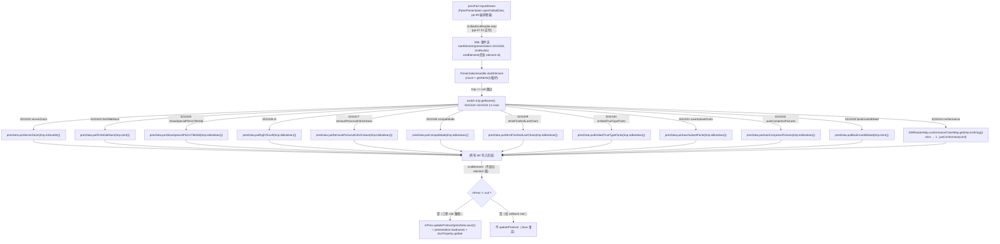
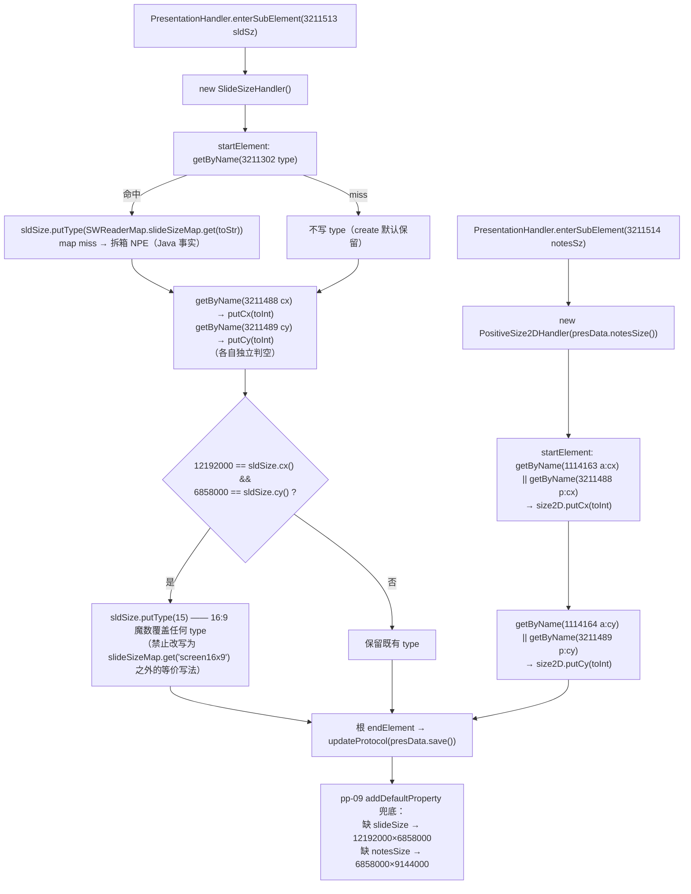
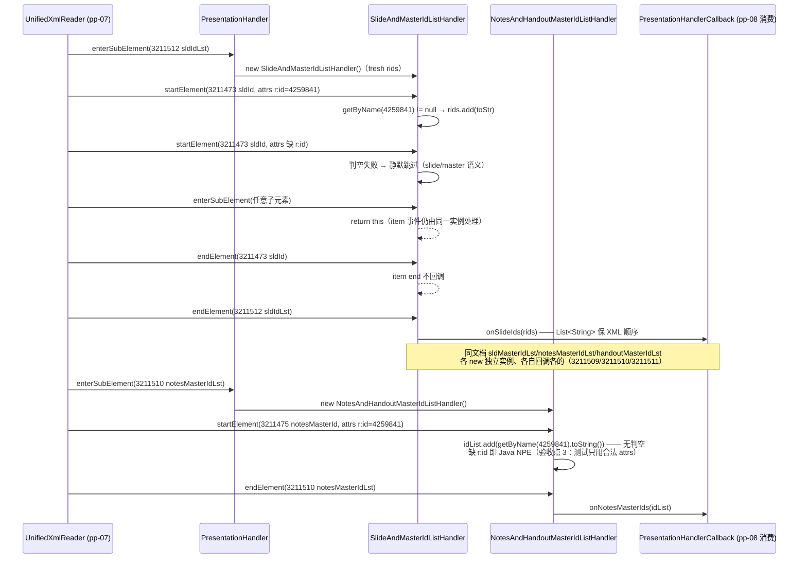
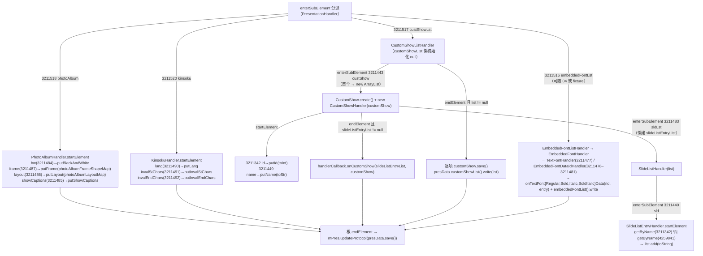
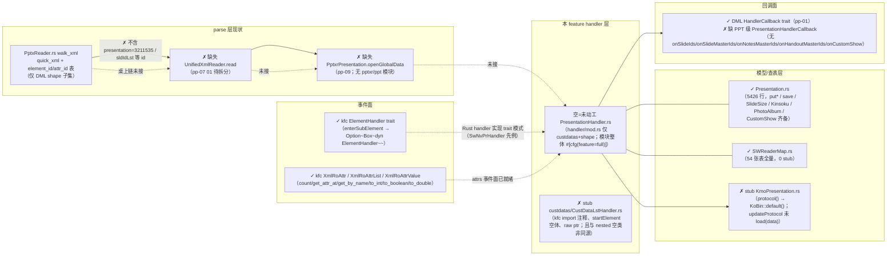

# pp-06-presentation-xml — p:presentation 根 XML（键类/流程/依赖/Java↔Rust 对比）

> 分析依据：feature FEATURE.md / FUNCTIONS.md / functions.csv + Java 源码（真读：
> `PresentationHandler.java`、`PptxrPresentation.java`、`PositiveSize2DHandler.java`、
> `PresentationHandlerCallback.java`、`SWReaderMap.java`、`DefaultElementHandler.java`、
> `ElementHandler.java`、`Presentation.java`（节读）、`KmoPresentation.java`（节读）、
> `kfc/xsd/pml/P.java`、`kfc/xsd/shared/R.java`、`kfc/xsd/dml/A.java`）+ Rust 现状
> （`Presentation.rs`、`SWReaderMap.rs`、`KmoPresentation.rs`、`kfc_alpha` reader 事件面、
> `HandlerCallback.rs`、`PptxReader.rs`、`handler/` 模块注册、`ppt_core_mvp_audit.csv`）
> 管线：parse→layout→render（见 libs/ppt-core/PIPELINE_LAYOUT_RENDER_PLAN.md 顶层对比——
> 注：任务简报所指 `PARSER_JAVA_RUST_PIPELINE.md` 在仓库中不存在，实际 master 文档为
> `PIPELINE_LAYOUT_RENDER_PLAN.md`；本 feature 位于 **S0 parse**，§1-S0 / §2.1）

> 分析日期：2026-08-30（feature 目录快照 2026-08-29/30）
> feature 状态：**spec**（functions 01–04 均 spec，loop 未开始）；Rust handler 层未动工

---

## 0. Feature 目标与管线位置

**一句话目标**：把 `p:presentation` 根 XML 的内存事件（`count()+getAttrAt` 属性循环、
`startElement/endElement/enterSubElement`）转写为 `Presentation`（KoBin 模型）根属性、
`SlideSize`/`notesSize` 尺寸，并在四个 rId 列表的 `endElement` 一次性回调
`PresentationHandlerCallback.onSlideIds/onSlideMasterIds/onNotesMasterIds/onHandoutMasterIds`
（外加 photoAlbum/kinsoku/custShow/embeddedFontLst 子树），最后经
`KmoPresentation.updateProtocol(presData.save())` 持久进 protocol。

**上游（depends_on_feature，manifest.csv）**：`pp-01-pptx-parse`（pass）提供
`SWReaderMap` 查表、`HandlerCallback`/回调面、`kfc` `XmlRoAttr` 事件面、`R.id`=4259841；
`pp-03-dml-style`（spec）提供 `TextListStyleHandler`（3211521 defaultTextStyle 交 pp-03）。

**下游**：`pp-08-slides-walk`（spec，消费四个 on*Ids 回调建 KmoSlide 壳）；
`pp-09-pptx-open`（spec，`PptxrPresentation.openGlobalData`/`addDefaultProperty` 编排骨架、消费
`put*` 后的 `Presentation.save()` 与 sldSz/notesSz）。

**本 feature 回答的问题**（FEATURE.md 目标与范围外说明）：
1. `p:presentation` 12 个根属性如何落到 `Presentation` 的 12 个 `put*`（serverZoom→
   putServerZoom(double) … conformance→putConformace(int) 经查表）；
2. sldSz（type/cx/cy + 16:9 魔数覆盖 type=15）与 notesSz（`PositiveSize2DHandler`
   双命名空间 a:/p:）如何写尺寸；
3. 四个 rId 列表如何收集成 `List<String>`、在**列表 endElement** 而非 item 处一次性回调，
   且 `enterSubElement` 返回 this（自食 item 事件）；
4. **不创建 KmoSlide**（pp-08 的事）、**不打开 ZIP/OPC**（pp-12）、**ModifyVerifier 密码循环
   移出**（加密）、`TextListStyleHandler` 只传 `presData.defaultTextStyle()`（pp-03 业务）。

---

## 0.5 设计动机与心智模型

心智模型：**本层把「presentation.xml 的扁平 XML 事件流」投影成「KoBin 模型的 put*/save 快照
+ 回调出去的 rId 引用列表」**——handler 是纯事件消费者，不持有 XML 树；模型写入是
`Presentation`（KoBin serialization model），跨 handler 的产物（rId 列表、customShow、
embeddedFont）一律经 `PresentationHandlerCallback` 回调给上层装配者（pp-08/09）。

设计矛盾 → 主数据结构 → 关键手段：

| 矛盾 | 主数据结构 | 关键手段 |
|---|---|---|
| XML 事件是「流式」的，而模型需要「快照」持久进 protocol | `Presentation`（KoBin map + create 默认） | `startElement` 即 `put*`；根 `endElement` 才 `save()` + `updateProtocol`（一次协议写） |
| rId 列表回调需要「整表」而 item 是逐个事件 | nested `SlideAndMasterIdListHandler.rids: List<String>` | `enterSubElement → return this` 自食 item 事件累积，列表 `endElement` 一次性回调 |
| 各列表语义不同（slide/master 判空跳过 vs notes/handout 无判空 NPE） | 两个独立 nested handler 类 | 按 3211509/3211512 与 3211510/3211511 分派不同类，判空策略各自封装 |
| notesSz 命名空间跨界（p: 与 a: 双前缀） | `PositiveSize2DHandler.size2D`（DML transform 复用类） | `getByName(a:cx=1114163) || getByName(p:cx=3211488)` 短路取值 |
| 16:9 是尺寸魔数而非枚举 | `Presentation.SlideSize` + `SWReaderMap.slideSizeMap` | cx/cy 写入后 `12192000==cx() && 6858000==cy()` → `putType(15)` 覆盖任何 type |

各结构角色速查：

| 角色 | 解决什么矛盾 | 关键机制 | 谁消费 |
|---|---|---|---|
| `PresentationHandler`（根） | 根部属性 → put* + 子元素分发 | `startElement` 12-case attr 循环；`endElement` `mPres != null` 才 updateProtocol | pp-09 |
| `SlideAndMasterIdListHandler` | slide/master rId 整表回调 | 3211473/3211474 判空 add；列表 end 回调 | pp-08 `onSlideIds`/`onSlideMasterIds` |
| `NotesAndHandoutMasterIdListHandler` | notes/handout rId 整表回调（NPE 语义） | 3211475/3211476 无判空 add；列表 end 回调 | pp-08 `onNotesMasterIds`/`onHandoutMasterIds` |
| `SlideSizeHandler` + `PositiveSize2DHandler` | 尺寸/16:9 魔数 | slideSizeMap 查表 + 魔数覆盖；双命名空间 cx/cy | pp-09 `addDefaultProperty` 兜底对比 |
| `CustomShowListHandler` 树 | 自定义放映跨 handler 回调 | 懒初始化 list + `onCustomShow(list, customShow)` + `customShowList().write` | pp-08 播放侧 |
| `PresentationHandlerCallback` | 跨 feature 产物出口 | abstract 空实现 + 子类覆写（`PresentationHandlerCallbackImpl` 在 pp-07 范围） | pp-08/07 |

本 feature 特有的「为什么」细节：
- **挂点 CP 选择**：`endElement` 不区分 element 值 — `mPres.updateProtocol(presData.save())`
  对**根元素任意 end 都执行**（Java 事实，行 85–90）；这是「根解析结束才落协议」的临界点。
- **判空不对称是有意的**：slide/master（3211473/3211474）`getByName(4259841) != null` 才 add；
  notes/handout（3211476/3211475）直接 `getByName(4259841).toString()` **无判空** —— 缺 r:id
  即 Java NPE。验收点 3 明确「测试用合法 attrs，不发明更安全的 Rust」。
- **16:9 覆盖时序**：`putType(15)` 在 cx/cy 写入**之后**执行，且**必须覆盖**查表出来的 type
  （FEATURE.md「不过扩展」：不许改用 `slideSizeMap.get("screen16x9")` 之外的等价写法）。
- **列表实例生命周期**：父级 `enterSubElement` 每进一个列表 `new` 一个 handler 实例（fresh
  rids），同文档四列表并存互不串扰；nested handler 的 `enterSubElement` 一律 `return this`。
- **ModifyVerifierHandler 移出**：密码循环（`CryptTool.checkModifyPassword`）+ `passProvider`
  回环为加密语义，不进改写列表（01 的 `passProvider` 字段也不进 Rust，仅 ctor 占位/省略）。

---

## 1. 键类分析（类图）

### 1.1 类图（Java 侧命名）

```mermaid
classDiagram
    class DefaultElementHandler {
        +startElement(int element, XmlRoAttr attrsNotCopy)
        +endElement(int element)
        +characters(String chars)
        +enterSubElement(int subElement) ElementHandler
    }
    class PresentationHandler {
        -KmoPresentation mPres
        -Presentation presData
        -KsoFilterPasswdProvider passProvider
        -PresentationHandlerCallback handlerCallback
        +PresentationHandler(KmoPresentation, KsoFilterPasswdProvider, PresentationHandlerCallback)
        +PresentationHandler(PresentationHandlerCallback)
        +startElement(int, XmlRoAttr)★
        +endElement(int)★
        +enterSubElement(int) ElementHandler★
    }
    class SlideAndMasterIdListHandler {
        -List~String~ rids
        +startElement(int, XmlRoAttr)★
        +enterSubElement(int) ElementHandler★
        +endElement(int)★
    }
    class NotesAndHandoutMasterIdListHandler {
        -List~String~ idList
        +startElement(int, XmlRoAttr)★
        +enterSubElement(int) ElementHandler★
        +endElement(int)★
    }
    class SlideSizeHandler {
        -SCREEN16X9_X = 12192000
        -SCREEN16X9_Y = 6858000
        +startElement(int, XmlRoAttr)★
    }
    class PhotoAlbumHandler {
        +startElement(int, XmlRoAttr)★
    }
    class KinsokuHandler {
        +startElement(int, XmlRoAttr)★
    }
    class CustomShowListHandler {
        -List~CustomShow~ customShowList
        +enterSubElement(int) ElementHandler★
        +endElement(int)
    }
    class CustomShowHandler {
        -CustomShow customShow
        -List~String~ slideListEntryList
        +startElement(int, XmlRoAttr)
        +enterSubElement(int) ElementHandler
        +endElement(int)★
    }
    class SlideListHandler {
        -List~String~ slideListEntryList
        +enterSubElement(int) ElementHandler
    }
    class SlideListEntryHandler {
        +startElement(int, XmlRoAttr)★
    }
    class EmbeddedFontListHandler {
        -List~EmbeddedFontListEntry~ fontList
        +enterSubElement(int) ElementHandler
        +endElement(int)
    }
    class EmbeddedFontHandler {
        -EmbeddedFontListEntry fontListEntry
        +enterSubElement(int) ElementHandler
    }
    class EmbeddedFontDataIdHandler {
        +startElement(int, XmlRoAttr)
    }
    class CustDataLstHandler {
    }
    class ModifyVerifierHandler {
    }
    class PositiveSize2DHandler {
        -PositiveSize2D size2D
        +PositiveSize2DHandler(PositiveSize2D)
        +init(PositiveSize2D)
        +startElement(int, XmlRoAttr)★
    }
    class PresentationHandlerCallback {
        +PresentationHandlerCallback(int mode)
        +onSlideIds(List~String~)
        +onSlideMasterIds(List~String~)
        +onNotesMasterIds(List~String~)
        +onHandoutMasterIds(List~String~)
        +onCustomShow(List~String~, CustomShow)
        +onTextFontRegularData(String, EmbeddedFontListEntry)
    }
    class HandlerCallback {
        +HandlerCallback(int mode)
    }
    class PptxrPresentation {
        -DEFAULT_SLDSIZE_CX = 12192000
        -DEFAULT_SLDSIZE_CY = 6858000
        -DEFAULT_NODESIZE_CX = 6858000
        -DEFAULT_NODESIZE_CY = 9144000
        +open()★
        -openGlobalData()★
        -addDefaultProperty()
        +getPresentationSlideSizeType(KmoPresentation) int
    }
    class Presentation {
        +open(KoBin) Presentation
        +save() KoBin
        +putServerZoom(double) … +putConformace(int)
        +slideSize() SlideSize
        +notesSize() PositiveSize2D
        +customShowList() CustomShowList
        +embeddedFontList() EmbeddedFontList
        +kinsoku() Kinsoku
        +photoAlbum() PhotoAlbum
        +defaultTextStyle() TextListStyle
    }
    class KmoPresentation {
        +protocol() KoBin
        +updateProtocol(KoBin data)
    }

    DefaultElementHandler <|-- PresentationHandler
    DefaultElementHandler <|-- SlideAndMasterIdListHandler
    DefaultElementHandler <|-- NotesAndHandoutMasterIdListHandler
    DefaultElementHandler <|-- SlideSizeHandler
    DefaultElementHandler <|-- PhotoAlbumHandler
    DefaultElementHandler <|-- KinsokuHandler
    DefaultElementHandler <|-- CustomShowListHandler
    DefaultElementHandler <|-- CustomShowHandler
    DefaultElementHandler <|-- SlideListHandler
    DefaultElementHandler <|-- SlideListEntryHandler
    DefaultElementHandler <|-- EmbeddedFontListHandler
    DefaultElementHandler <|-- EmbeddedFontHandler
    DefaultElementHandler <|-- EmbeddedFontDataIdHandler
    DefaultElementHandler <|-- CustDataLstHandler
    DefaultElementHandler <|-- ModifyVerifierHandler
    DefaultElementHandler <|-- PositiveSize2DHandler
    PresentationHandler *-- SlideAndMasterIdListHandler
    PresentationHandler *-- NotesAndHandoutMasterIdListHandler
    PresentationHandler *-- SlideSizeHandler
    PresentationHandler *-- PhotoAlbumHandler
    PresentationHandler *-- KinsokuHandler
    PresentationHandler *-- CustomShowListHandler
    PresentationHandler *-- EmbeddedFontListHandler
    PresentationHandler *-- CustDataLstHandler
    PresentationHandler *-- ModifyVerifierHandler
    CustomShowListHandler *-- CustomShowHandler
    CustomShowHandler *-- SlideListHandler
    SlideListHandler *-- SlideListEntryHandler
    EmbeddedFontListHandler *-- EmbeddedFontHandler
    EmbeddedFontHandler *-- EmbeddedFontDataIdHandler
    PresentationHandler --> Presentation : presData
    PresentationHandler --> KmoPresentation : mPres
    PresentationHandler --> PresentationHandlerCallback : handlerCallback
    PresentationHandler --> PositiveSize2DHandler : 3211514 notesSz
    PresentationHandlerCallback --|> HandlerCallback
    PptxrPresentation --> PresentationHandler : 构造（openGlobalData）
    PptxrPresentation --> Presentation : addDefaultProperty / openOtherGlobalData
    PresentationHandler --> SWReaderMap : conformance/slideSize/photo 查表
    PptxrPresentation --> KmoPresentation : mPres
```



> Mermaid 注：`List~String~` 为 mermaid 泛型语法；Java 实际为 `List<String>` /
> `List<Presentation.CustomShow>` / `List<Presentation.EmbeddedFontListEntry>`。
> `SlideListEntryHandler`/`EmbeddedFontDataIdHandler`/`CustDataLstHandler`/`ModifyVerifierHandler`
> 未画继承边之上的 `extends DefaultElementHandler` 者除外（全部 `extends DefaultElementHandler`）。

### 1.2 逐类明细（签名以真实源码为准）

#### PresentationHandler（feature 主键类，`show/pptxr/handler/PresentationHandler.java`）

| 项 | 内容 |
|---|---|
| 继承/实现 | `extends DefaultElementHandler`（即 `implements ElementHandler`：`startElement/endElement/characters/enterSubElement`） |
| 关键字段 | `KmoPresentation mPres`（ctor1 注入；endElement 判空对象）；`Presentation presData`（ctor1 = `Presentation.open(pres.protocol())`；ctor2 = null）；`KsoFilterPasswdProvider passProvider`（仅 ModifyVerifier 用，本 feature 移出）；`PresentationHandlerCallback handlerCallback`（02/04/EmbeddedFont 回调出口） |
| 构造 | `PresentationHandler(KmoPresentation pres, KsoFilterPasswdProvider passProvider, PresentationHandlerCallback handlerCallback)` — 三参，立即 `Presentation.open(pres.protocol())`；`PresentationHandler(PresentationHandlerCallback handlerCallback)` — 仅回调，`presData` 为 null（startElement 触碰即 NPE，Java 事实） |
| ★ `startElement(int element, XmlRoAttr attrsNotCopy)` | `count()`+`getAttrAt(i)` 循环；`tmp == null` 跳过；switch `tmp.getName()` 12 case（3211523–3211534）→ 对应 `put*`；conformance miss → `putConformace(1)` |
| ★ `endElement(int element)` | **不区分 element 值**：`if (null != mPres) mPres.updateProtocol(presData.save())` |
| ★ `enterSubElement(int subElement)` | 分发：3211295→null；3211509/3211512→`SlideAndMasterIdListHandler`；3211510/3211511→`NotesAndHandoutMasterIdListHandler`；3211513→`SlideSizeHandler`；3211514→`PositiveSize2DHandler(presData.notesSize())`；3211516→`EmbeddedFontListHandler`；3211517→`CustomShowListHandler`；3211518→`PhotoAlbumHandler`；3211519→`CustDataLstHandler`；3211520→`KinsokuHandler`；3211521→`TextListStyleHandler(presData.defaultTextStyle(), handlerCallback)`（pp-03）；3211522→`ModifyVerifierHandler`（移出）；default→null |

#### SlideAndMasterIdListHandler（02 主体，nested private）

| 项 | 内容 |
|---|---|
| 继承/实现 | `extends DefaultElementHandler`（nested private class） |
| 关键字段 | `List<String> rids`（ctor 建 `new ArrayList()`） |
| ★ `startElement(int element, XmlRoAttr attrsNotCopy)` | `(element == 3211473 \|\| element == 3211474) && (tmp = getByName(4259841)) != null` 才 `rids.add(tmp.toString())` — item 判空，缺 r:id 静默跳过 |
| ★ `enterSubElement(int subElement)` | `return this` — 任何子元素自食 |
| ★ `endElement(int element)` | `3211512 → onSlideIds(rids)`；`3211509 → onSlideMasterIds(rids)`（**列表 end 才回调**） |

#### NotesAndHandoutMasterIdListHandler（02 主体，nested private）

| 项 | 内容 |
|---|---|
| 继承/实现 | `extends DefaultElementHandler`（nested private class） |
| 关键字段 | `List<String> idList` |
| ★ `startElement(int element, XmlRoAttr attrsNotCopy)` | `element == 3211476 \|\| element == 3211475` → `idList.add(getByName(4259841).toString())` — **无判空**，缺 r:id 即 Java NPE（接受点 3） |
| ★ `enterSubElement(int subElement)` | `return this` |
| ★ `endElement(int element)` | `3211511 → onHandoutMasterIds(idList)`；`3211510 → onNotesMasterIds(idList)` |

#### SlideSizeHandler（03 主体，nested private）

| 项 | 内容 |
|---|---|
| 继承/实现 | `extends DefaultElementHandler`（nested private class） |
| 关键常量 | `private static final int SCREEN16X9_X = 12192000; SCREEN16X9_Y = 6858000` |
| ★ `startElement(int element, XmlRoAttr attrsNotCopy)` | 四步：① `getByName(3211302 type)` → `sldSize.putType((Integer)SWReaderMap.slideSizeMap.get(tmp.toString()))`（map miss → 拆箱 NPE，Java 事实）；② `getByName(3211488 cx)` → `putCx(tmp.toInt())`；③ `getByName(3211489 cy)` → `putCy(tmp.toInt())`；④ `12192000 == sldSize.cx() && 6858000 == sldSize.cy()` → `sldSize.putType(15)`（**覆盖** map 值） |

#### PhotoAlbumHandler / KinsokuHandler / CustDataLstHandler（04，nested）

| 类 | 继承 | 关键方法 |
|---|---|---|
| `PhotoAlbumHandler` | `extends DefaultElementHandler`（nested private） | ★ `startElement`：`3211484 bw→putBlackAndWhite(toBoolean)`、`3211487 frame→putFrame(photoAlbumFrameShapeMap.get(toStr))`、`3211486 layout→putLayout(photoAlbumLayoutMap.get(toStr))`、`3211485 showCaptions→putShowCaptions(toBoolean)`；无 enter/end 重载 |
| `KinsokuHandler` | `extends DefaultElementHandler`（nested **class**，包级） | ★ `startElement`：`3211492 invalEndChars→putInvalEndChars`、`3211491 invalStChars→putInvalStChars`、`3211490 lang→putLang` |
| `CustDataLstHandler`（nested） | `extends DefaultElementHandler`（nested class，**空类**） | 无成员，仅接线（3211519 → new 实例）；与 `handler/custdatas/CustDataLstHandler.java`（独立包、带 custDataLst/handlerCallback 字段）是**两个不同类** |

#### CustomShowListHandler 树（04，nested）

| 类 | 关键字段 | 关键方法 |
|---|---|---|
| `CustomShowListHandler` | `List<Presentation.CustomShow> customShowList = null`（懒初始化） | ★ `enterSubElement`：`3211443 → 若 null 建 list；CustomShow.create() + new CustomShowHandler(customShow)`；`endElement`：list != null 才逐项 `customShow.save()` + `presData.customShowList().write(list)` |
| `CustomShowHandler` | `customShow`、`List<String> slideListEntryList = null`（懒） | `startElement`：`3211342 id→putId(toInt)`、`3211449 name→putName(toStr)`；`enterSubElement`：`3211483 → 懒建 slideListEntryList + new SlideListHandler(list)`；★ `endElement`：`slideListEntryList != null` 才 `handlerCallback.onCustomShow(slideListEntryList, customShow)` |
| `SlideListHandler` | `List<String> slideListEntryList`（共享注入） | `enterSubElement`：`3211440 → new SlideListEntryHandler()`，default → null（Java fallthrough，`handler` 恒为该值） |
| `SlideListEntryHandler` | 无 | ★ `startElement`：`getByName(3211342 id) || getByName(4259841 r:id)` 任一命中 → `slideListEntryList.add(temp.toString())` |

#### EmbeddedFontListHandler 树（可随 04 或延后 fixture）

| 类 | 关键方法 |
|---|---|
| `EmbeddedFontListHandler` | `enterSubElement`：`3211482 → EmbeddedFontListEntry.create() + new EmbeddedFontHandler(entry)`；`endElement`：逐项 `font.save()` + `presData.embeddedFontList().write(fontList)` |
| `EmbeddedFontHandler` | `enterSubElement`：`3211477 → new TextFontHandler(fontListEntry.font())`（DML 字体 handler）；`3211478–3211481 → new EmbeddedFontDataIdHandler()` |
| `EmbeddedFontDataIdHandler` | `startElement`：`getByName(3211342 id) || getByName(4259841 r:id)` 命中后按元素分派：`3211478→onTextFontRegularData`、`3211479→onTextFontBoldData`、`3211480→onTextFontItalicData`、`3211481→onTextFontBoldItalicData`（参数 `(String rid, EmbeddedFontListEntry)`） |

#### ModifyVerifierHandler（nested private）— 移出

`startElement`：读 cryptAlgorithmSid(3211500)/hashData(3211503)/saltData(3211502)/spinCount(3211501)
→ `ModifyVerifier` + `passProvider.getWritePassword` 回环 + `CryptTool.checkModifyPassword`
→ `cryptInfo().setModifyVerifier/setReadOnly/setWritePassword`。**加密，不进改写列表。**

#### PositiveSize2DHandler（DML transform 复用类，notesSz 用）

| 项 | 内容 |
|---|---|
| 继承/实现 | `extends DefaultElementHandler`（`drawing/dmlr/handler/shape/sppr/transform`） |
| 关键字段 | `PositiveSize2D size2D`（可由 ctor 或 init 注入） |
| 构造 | `PositiveSize2DHandler(PositiveSize2D size2D)` → `init(size2D)`；`public void init(PositiveSize2D size2D)` |
| ★ `startElement(int element, XmlRoAttr attrsNotCopy)` | `getByName(1114163 a:cx) || getByName(3211488 p:cx)` → `size2D.putCx(toInt)`；`getByName(1114164 a:cy) || getByName(3211489 p:cy)` → `size2D.putCy(toInt)`（`||` 短路，取同一 tmp） |

#### PresentationHandlerCallback（跨 feature 回调面，`show/pptxr/ppt/`）

| 项 | 内容 |
|---|---|
| 继承/实现 | `public abstract class PresentationHandlerCallback extends HandlerCallback`（DML `HandlerCallback`，pp-01:02 锁定 mode 语义） |
| 构造 | `PresentationHandlerCallback(int mode)` → `super(mode)` |
| 方法（全部空实现，子类覆写） | `onSlideIds(List<String> rids)`；`onSlideMasterIds(List<String> rids)`；`onNotesMasterIds(List<String> ids)`；`onHandoutMasterIds(List<String> ids)`；`onCustomShow(List<String> slideListEntryRidList, Presentation.CustomShow customShow)`；`onTextFontBoldData/onTextFontBoldItalicData/onTextFontItalicData/onTextFontRegularData(String rid, Presentation.EmbeddedFontListEntry fontListEntry)` |
| 消费方 | pp-07 `PresentationHandlerCallbackImpl`（+ `handlerCallback.load()`）；pp-08 `PptxrSlides.onSlideIds` |

#### PptxrPresentation（编排骨架，`show/pptxr/ppt/PptxrPresentation.java`）

| 项 | 内容 |
|---|---|
| 类/字段 | `public final class`；常量 `DEFAULT_SLDSIZE_CX=12192000`、`DEFAULT_SLDSIZE_CY=6858000`、`DEFAULT_NODESIZE_CX=6858000`、`DEFAULT_NODESIZE_CY=9144000`；`KmoPresentation mPres`、`OpcrPackagePart mPresPart`、`PptxrSlides mSlidesReader`、`PptxrMedias mMedias`、`PptxrThemes mThemes`、`int mMode` 等 |
| 构造 | 7 参（pres/presPart/listener/passProvider/dlProvider/media/mode） |
| ★ `public void open() throws IOException` | `mSlidesReader = new PptxrSlides(...)` → `PptxrSlides.initialize()` → `openGlobalData()` → 空 slideCount 兜底（建 KmoSlide + selection.init + hasBlankSlide）→ `setInitialized(true)` → `mSlidesReader.open()` → `openOtherGlobalData()` → media 延迟装载 |
| ★ `private void openGlobalData() throws IOException` | theme rels → `PptxrThemes.open`；tableStyles rels → `PptxrTableStyles.open`；`stream = mPresPart.getInputStream()` → 建 `PresentationHandlerCallbackImpl(...)` 与 `PresentationHandler(mPres, mPassProvider, callback)` → `UnifiedXmlReader.read(stream, handler)` → `handlerCallback.load()` → `addDefaultProperty()` |
| `private void addDefaultProperty()` | `!hasSlideSize()` → SlideSize {cx=12192000, cy=6858000} save + writeSlideSize；`!hasNotesSize()` → PositiveSize2D {cx=6858000, cy=9144000} save + writeNotesSize；`mPres.updateProtocol(presData.save())` |
| `public static int getPresentationSlideSizeType(KmoPresentation)` | `hasType()` → `type()`；否则 `cx*9 == cy*16` → 15（注意与 handler 的 12192000×6858000 覆盖是两条路径） |

#### 依赖类速览

| 类 | 内容 |
|---|---|
| `DefaultElementHandler`（kfc） | 空实现四方法；`enterSubElement` 返回 null — Rust 侧没有对应 struct，handler 改为直接实现 kfc `ElementHandler` trait（`startElement(&self, i32, &dyn XmlRoAttr)` / `endElement(&self, i32)` / `characters(&self, &str)` / `enterSubElement(&self, i32) -> Option<Box<dyn ElementHandler>>`）|
| `Presentation`（模型） | `open(KoBin)`（含 create 默认）、`save()`、12 个 put*（`putServerZoom(double)`、`putFirstSlideNum(int)`、`putShowSpecialPlsOnTitleSld(boolean)`、`putRightToLeft(boolean)`、`putRemovePersonalInfoOnSave(boolean)`、`putCompatMode(boolean)`、`putStrictFirstAndLastChars(boolean)`、`putEmbedTrueTypeFonts(boolean)`、`putSaveSubsetFonts(boolean)`、`putAutoCompressPictures(boolean)`、`putBookmardIdSeed(int)`、`putConformace(int)`）、`slideSize()`/`notesSize()`（PositiveSize2D）/`customShowList()`/`embeddedFontList()`/`kinsoku()`/`photoAlbum()`/`defaultTextStyle()`、`hasSlideSize()/hasNotesSize()`、`writeSlideSize()/writeNotesSize()` |
| `SWReaderMap` | 54 张静态表（pp-01:01 锁定）；本 feature 用 `conformanceClassMap`{strict→0, transitional→1}、`slideSizeMap`（16 项）、`photoAlbumLayoutMap`（7 项）、`photoAlbumFrameShapeMap`（7 项） |
| `KmoPresentation` | `protocol()` → `((PresentationAtomData)rawData()).presentation.save()`；`updateProtocol(KoBin data)` → `presentation.load(data)` + `docProperty.update(presentation.docProperty())` |
| `UnifiedXmlReader` | 三个静态 `read` overload：`read(InputStream, ElementHandler)` / `read(String srcPath, ElementHandler)` / `read(String, int, int, ElementHandler, boolean)`；内部 `new HLXmlReader(MapManager.getInstance(), handler)` 后 `parser` 一次 — **归 pp-07 01_function_unified_xml_reader** |

---

## 2. 流程图（依据 I/O）

### 2.1 根部属性热路径（01）— 输入端点 → 分发 → 写入 → 协议



### 2.2 尺寸热路径（03）— sldSz / notesSz



### 2.3 rId 列表回调时序（02）— sequenceDiagram 钉死「列表 end 才回调」



### 2.4 子树四（04）— photoAlbum/kinsoku/custShow/embeddedFont 数据流



---

## 3. 依赖关系与改写状态

### 3.1 类间依赖表

| 依赖方 | 被依赖方 | 依赖性质 | 归属 |
|---|---|---|---|
| `PresentationHandler` | `DefaultElementHandler` / `ElementHandler` | 继承（空实现基底） | kfc（pp-01 pass 面，Rust 已建 trait） |
| `PresentationHandler` | `Presentation`（presData） | 模型写入（put*/save） | 本 feature（数据模型已 done） |
| `PresentationHandler` | `KmoPresentation`（mPres） | `endElement` 协议落点 | 本 feature（Rust 为壳，见 §6） |
| `PresentationHandler` | `PresentationHandlerCallback` | 02/04/EmbeddedFont 回调出口 | pp-07 实现类覆写；pp-08 消费 |
| `PresentationHandler` | `SWReaderMap` | conformance/slideSize/photo 查表 | pp-01:01（done） |
| `PresentationHandler` | `PositiveSize2DHandler`（3211514） | notesSz 委托 | DML transform（本 feature 待建） |
| `PresentationHandler` | `TextListStyleHandler`（3211521） | defaultTextStyle 委托 | **pp-03**（不在本 feature） |
| `PresentationHandler` | `UnifiedXmlReader.read` | 事件来源 | **pp-07**（不在本 feature） |
| `PptxrPresentation` | `PresentationHandler` | 构造 + 驱动 | pp-09 编排（Rust 无此文件） |
| `PptxrPresentation` | `PresentationHandlerCallbackImpl` | 回调实现 + `load()` | **pp-07:02** |
| `PptxrPresentation` | `KmoPresentation` | `updateProtocol`/`addDefaultProperty` | pp-09 |
| 02/04 回调 | `PptxrSlides.onSlideIds` 等 | 下游装配 | **pp-08** |
| `SlideSizeHandler` | `Presentation.SlideSize`（putType/putCx/putCy/cx/cy） | 尺寸写入 | 本 feature（模型 done） |
| `PositiveSize2DHandler` | `PositiveSize2D`（putCx/putCy） | notesSize 写入 | 本 feature（模型 done） |

### 3.2 Java↔Rust 路径映射与状态（依据 ppt_core_mvp_audit.csv / rewriting_files.csv / 实读）

| Java 类（路径前缀 `koffice/presentation/core/cn/wps/`） | Rust 路径（前缀 `libs/ppt-core/src/cn/wps/`） | 状态 |
|---|---|---|
| `show/pptxr/handler/PresentationHandler.java` | `show/pptxr/handler/PresentationHandler.rs` | **未开始**（文件不存在；`handler/mod.rs` 仅 `pub mod custdatas; pub mod shape;`，且整个 `handler` 模块在 `#[cfg(feature = "full")]` 下注册） |
| nested `SlideAndMasterIdListHandler` / `NotesAndHandoutMasterIdListHandler` / `SlideSizeHandler` / `PhotoAlbumHandler` / `KinsokuHandler` / `CustomShowListHandler` 树 / `EmbeddedFontListHandler` 树 / nested `CustDataLstHandler` / `ModifyVerifierHandler` | 同上文件内 nested | **未开始**（待 spec→loop 01–04） |
| `drawing/dmlr/handler/shape/sppr/transform/PositiveSize2DHandler.java` | `drawing/dmlr/handler/shape/sppr/transform/PositiveSize2DHandler.rs` | **未开始**（文件不存在，audit 行状态 `rewrite` 为预备项；`sppr/transform/` 现仅 `Transform2DHandler.rs`；本轮可先以 contract fixture 吸收，见 FEATURE.md stub 栏） |
| `show/pptxr/ppt/PresentationHandlerCallback.java` | —（无 `pptxr/ppt` 模块） | **✗缺失**（Rust 侧无此抽象类；`drawing/dmlr/model/HandlerCallback.rs` 有 DML 级 trait，但**不含** onSlideIds/onSlideMasterIds/onNotesMasterIds/onHandoutMasterIds/onCustomShow） |
| `show/pptxr/ppt/PptxrPresentation.java` | — | **✗缺失**（pp-09 编排；仅 `show/layout/slide_viewport.rs` 注释引用其 DEFAULT_SLDSIZE_* 常量） |
| `show/pptxr/util/SWReaderMap.java` | `show/pptxr/util/SWReaderMap.rs` | **done**（555 行，audit `keep`：「full string→int enum tables; no stubs」） |
| `show/data/Presentation.java` | `show/data/Presentation.rs` | **done**（5426 行，audit `keep`：「core presentation assembly, keep semantic」；0 stub marker；nested 字段为 `Option<Box<T>>`，put* 齐备，`save()`/`open()` 就位） |
| `show/app/KmoPresentation.java` | `show/app/KmoPresentation.rs` | **壳**（`protocol()` 返回 `KoBin::default()` 桩；`updateProtocol(&self, KoBin)` 只 `docProperty.update()`，**未执行 presentation.load(data)**） |
| `kfc/xpxml/reader/XmlRoAttr(Value/Leaf/List)` | `libs/core-libs/kfc/kfc_alpha/src/cn/wps/kfc/xpxml/reader/XmlRoAttr*.rs` | **done**（pp-01 契约面：trait `XmlRoAttr` 含 `get_by_name/get_attr_at/count/get_name`；`XmlRoAttrValue` 含 `to_int/to_boolean/to_double/to_string...`；`XmlRoAttrLeaf` 的 `get_by_name/get_attr_at` 为 `-> !` never 型 panic 哨兵，仅 leaf 调用才触发 —— handler 面应走 `XmlRoAttrList`） |
| `kfc/xpxml/reader/ElementHandler(Default)` | `kfc_alpha/.../xpxml/reader/ElementHandler.rs` | **done**（trait 四方法；Rust handler 直接实现 trait，无 Default 基类） |
| `show/pptxr/handler/custdatas/CustDataLstHandler.java`（独立包） | `show/pptxr/handler/custdatas/CustDataLstHandler.rs` | **壳/keep_refactor**（audit：`keep_refactor`「real HandlerCallback binding; kfc imports commented」；`startElement` 空体、`TagsHandler` 走 raw pointer；注意它与 `PresentationHandler` 内 nested 空类**不是同一个类**，本 feature 的 3211519 分派需要的是后者） |
| `show/pptxr/util/UnifiedXmlReader.java` | — | **✗缺失**（pp-07 `01_function_unified_xml_reader` 待拆分；Rust `PptxReader.rs` 的 `walk_xml` 是 quick_xml 的 shape 子集引擎——`element_id` 表仅 DML 元素，无 presentation/sldIdLst 等 id，不是 p:presentation 解析入口） |
| `show/pptxr/ppt/slides/PptxrSlides.java`（pp-08 消费方） | — | **✗缺失**（pp-08 范围，消费本 feature 回调） |

> 注：`rewriting_files.csv` 无本 feature 相关行（grep 无命中），与「spec 未动工」一致。

---

## 4. 最小 feature-critical 改写范围

### 4.1 三栏划分

**must-write（feature 关键类与方法，loop 01→02→03→04 依次落地）**

| 顺序 | 内容 | 依据 |
|---|---|---|
| 01 | `PresentationHandler` 两个 ctor（presData 初始化时机）、`startElement`（count+getAttrAt 12-case → put*，conformance miss → 1）、`endElement`（`mPres != null` 才 updateProtocol(save 结果)） | FEATURE.md 必须栏前两条；01 FUNCTION.md 改写列表 |
| 02 | `SlideAndMasterIdListHandler`/`NotesAndHandoutMasterIdListHandler` 全方法（ctor/startElement/enterSubElement=this/endElement 一次性回调）；Slide/Master 判空 add vs notes/handout 无判空 NPE 复刻；列表 end 才回调、item end 不回调 | 02 FUNCTION.md 改写列表；验收点 2/3 |
| 03 | `SlideSizeHandler`（type/cx/cy 四步 + 16:9 魔数覆盖 putType(15)）；`enterSubElement` case 3211514 → `PositiveSize2DHandler` 接线；notesSz 双命名空间（a:cx=1114163/a:cy=1114164 或 p:cx=3211488/p:cy=3211489） | 03 FUNCTION.md；验收点 4 |
| 04 | `PhotoAlbumHandler`（4 attr）、`KinsokuHandler`（3 attr 字符串）、`CustomShowListHandler` 树（懒初始化 → `Option<Vec<CustomShow>>`、`onCustomShow(list, customShow)`、`customShowList().write`）、nested `CustDataLstHandler` 空类接线、`SlideListEntryHandler` 双 id（3211342/4259841）收集 | 04 FUNCTION.md；FUNCTIONS.md §1 |

**可 stub**

| 内容 | 说明 |
|---|---|
| `PositiveSize2DHandler` | DML transform 本轮可无 Rust 实体，以 contract fixture 吸收双命名空间 cx/cy（FEATURE.md stub 栏）；audit 已预备 `rewrite` 行 |
| EmbeddedFontList 树 | 随 04 或暂缓 constructor fixture（FUNCTIONS.md §1 注）：`onTextFont{Regular,Bold,Italic,BoldItalic}Data` 回调签名留 Recording 面，业务体不展开 |
| `KmoPresentation`/`updateProtocol` 协议引擎 | libs/ppt-core 现状 `protocol()`/`updateProtocol` 为桩；01 交付「save 结果/回调契约」，协议引擎待 pp-09（KmoProtocol 面） |

**可 defer（明确不在本 feature）**

| 内容 | 归属 |
|---|---|
| `ModifyVerifierHandler` 密码循环 | 加密移出（禁止实现） |
| `TextListStyleHandler`（3211521 defaultTextStyle） | pp-03 `02_function_text_list_style` |
| 真实 XML reader 事件分发（`UnifiedXmlReader.read`） | pp-07 `01_function_unified_xml_reader` |
| `PresentationHandlerCallbackImpl` + `load()` | pp-07 `02_function_handler_callback_impl` |
| `KmoSlide` 创建与 slide 装配 | pp-08 |
| ZIP/OPC/`OpcrPackagePart` 打开 | pp-12 / pp-09 |

### 4.2 当前进度（spec：计划拆分）

| function | 状态 | 已就绪的地基 | 待 loop 产出 |
|---|---|---|---|
| `01_function_presentation_attrs` | spec | Rust `Presentation` put* 齐备；`SWReaderMap` conformance 表 done；`XmlRoAttr` 事件面 done | `PresentationHandler.rs` start/end + ctor；`KmoPresentation` contract fake（记录 updateProtocol 与 save 结果） |
| `02_function_id_lists` | spec | `PresentationHandlerCallback` **Rust 缺失** —— 需在本 feature 或 pp-07 前补一个 PPT 级回调 trait/抽象（Recording 测试面） | 两个 nested handler + 四次回调 |
| `03_function_slide_notes_size` | spec | `Presentation.SlideSize` putType/putCx/putCy done；`PositiveSize2D` putCx done；slideSizeMap 16 项 done | `SlideSizeHandler` + `PositiveSize2DHandler`（或 contract fixture） |
| `04_function_photo_kinsoku_custshow` | spec | `Kinsoku`/`PhotoAlbum`/`CustomShow`/`CustomShowList` Rust 模型 done（putLang/putBlackAndWhite/putLayout/putFrame/putId/putName）；photo 两表 done | 三个 nested handler 树 + `onCustomShow` + `customShowList().write` + 空类接线 |

**已知问题（改写前注意）**：
1. `handler` 模块在 Rust 侧被 `#[cfg(feature = "full")]` 门控（`pptxr/mod.rs`），`cargo test` 默认不编译 —— loop 测试需带 `--features full` 或确认测试配置（需人工确认 CI 配置）。
2. `PresentationHandlerCallback` 在 Rust 无对应物：DML `HandlerCallback` trait 无 on*Ids/onCustomShow；需新增 PPT 级回调抽象（或先以 Recording 测试面闭包），这是 02/04 的可测试性前置。
3. Rust `XmlRoAttrLeaf::get_by_name/get_attr_at` 是 `-> !`（panic 哨兵）—— 复刻「缺 r:id 判空」语义时测试夹具必须保证 attrs 非 leaf（走 XmlRoAttrList）；notes/handout 的 Java NPE 只在「合法 attrs」测试路径留档，不发明更安全的 Rust。
4. `CustDataLstHandler` 两个同名类：nested（空类，3211519 分派目标）vs `handler/custdatas/`（独立、带字段、Rust 已有壳）—— loop 中 04 接线的是 nested 那个，不要误用已有壳签名（`new(custDataLst, handlerCallback)` 与 Java nested 无参 ctor 不符，需人工确认 04 的接线形态）。

---

## 5. 验收口径

**数字/枚举/哨兵值钉死（全部经 P.java / R.java / A.java / SWReaderMap.java / PresentationHandler.java 实读核对）**

| 类别 | 钉死值 |
|---|---|
| 根目录元素 | `presentation`=**3211535**；`extLst`=3211295（enterSubElement → null） |
| 12 个根属性 id（3211523–3211534） | serverZoom=3211523→`putServerZoom(double)`；firstSlideNum=3211524→`putFirstSlideNum(int)`；showSpecialPlsOnTitleSld=3211525→`putShowSpecialPlsOnTitleSld(boolean)`；rtl=3211526→`putRightToLeft(boolean)`；removePersonalInfoOnSave=3211527→`putRemovePersonalInfoOnSave(boolean)`；compatMode=3211528→`putCompatMode(boolean)`；strictFirstAndLastChars=3211529→`putStrictFirstAndLastChars(boolean)`；embedTrueTypeFonts=3211530→`putEmbedTrueTypeFonts(boolean)`；saveSubsetFonts=3211531→`putSaveSubsetFonts(boolean)`；autoCompressPictures=3211532→`putAutoCompressPictures(boolean)`；bookmarkIdSeed=3211533→`putBookmardIdSeed(int)`；conformance=3211534→`putConformace(int)` |
| conformance 查表 | `SWReaderMap.conformanceClassMap`：`strict→0`、`transitional→1`；**miss → 1**（不失败） |
| 列表元素与 item（02） | sldMasterIdLst=3211509、notesMasterIdLst=3211510、handoutMasterIdLst=3211511、sldIdLst=3211512；item：sldId=3211473、sldMasterId=3211474、notesMasterId=3211475、handoutMasterId=3211476；`r:id`=**4259841**（R.java `id`） |
| 回调映射 | 3211512→`onSlideIds`；3211509→`onSlideMasterIds`；3211510→`onNotesMasterIds`；3211511→`onHandoutMasterIds`（均在**列表 endElement**，`ArrayList` 顺序 = XML 顺序） |
| 尺寸（03） | `sldSz`=3211513：type=3211302、cx=3211488、cy=3211489；`notesSz`=3211514 → `PositiveSize2DHandler`：`a:cx`=1114163 / `a:cy`=1114164（A.java），或 `p:cx`=3211488 / `p:cy`=3211489 |
| slideSizeMap（16 项） | screen4x3→0、letter→1、A4→2、35mm→3、overhead→4、banner→5、custom→6、A3→7、B4ISO→8、B4JIS→9、B5ISO→10、B5JIS→11、hagakiCard→12、ledger→13、screen16x10→14、**screen16x9→15** |
| 16:9 魔数 | **12192000×6858000** → `putType(15)`（在 cx/cy 写入后执行并覆盖任何 type；与 `PptxrPresentation.getPresentationSlideSizeType` 的 `cx*9==cy*16` 是两条独立路径） |
| 04 元素/attr | photoAlbum=3211518：bw=3211484、showCaptions=3211485、layout=3211486、frame=3211487；kinsoku=3211520：lang=3211490、invalStChars=3211491、invalEndChars=3211492；custShowLst=3211517→custShow=3211443（id=3211342、name=3211449）→sldLst=3211483→sld=3211440（id=3211342 或 r:id=4259841） |
| photoAlbumLayoutMap（7 项） | fitToSlide→0、1pic→1、2pic→2、4pic→3、1picTitle→4、2picTitle→5、4picTitle→6 |
| photoAlbumFrameShapeMap（7 项） | frameStyle1→0 … frameStyle7→6 |
| EmbeddedFont（可延后） | embeddedFontLst=3211516→embeddedFont=3211482→font=3211477（TextFontHandler）/regular=3211478/bold=3211479/italic=3211480/boldItalic=3211481；data id=3211342 或 4259841 |
| ModifyVerifier（移出） | modifyVerifier=3211522；cryptAlgorithmSid=3211500/spinCount=3211501/saltData=3211502/hashData=3211503 —— 不实现 |
| pp-09 兜底默认 | slideSize 缺省 12192000×6858000；notesSize 缺省 6858000×9144000（`addDefaultProperty`） |

**验收四条件（FUNCTIONS.md §4，loop 完成后必须满足）**
1. 空 attrs（count==0）→ put* 全不发、create 默认不变（`endElement` 仍 `updateProtocol(save())`）。
2. sldIdLst 仅 `endElement` 才回调；`enterSubElement` 返回 this（item 事件不丢、不新建 handler）。
3. notes/handout id 缺 `r:id`(4259841) 的 Java NPE 语义只在测试中用合法 attrs 复刻，**不发明更安全的 Rust**。
4. 16:9 `12192000×6858000` → `putType(15)`（覆盖 map 值）。

回归：`cargo test --manifest-path libs/ppt-core/Cargo.toml --test 01_function_presentation_attrs` 等四个
`[[test]]`（与 functions.csv 对齐，Loop L2 才创建；注意 `full` feature 门控，见 §4.2 已知问题 1）。

---

## 6. Java↔Rust 管线对比与缺口审计

### 6.1 Java 完整链路（事实锚点：`PptxrPresentation.openGlobalData`）

```text
PptxrPresentation.open()
  ├─ PptxrSlides.initialize()                      ← pp-08 阅读顺序前置
  ├─ openGlobalData()
  │   ├─ theme rels → PptxrThemes.open             ← pp-04
  │   ├─ tableStyles rels → PptxrTableStyles.open
  │   ├─ presPart.getInputStream()
  │   ├─ new PresentationHandlerCallbackImpl(mSlidesReader, drawingStore, mediaLib,
  │   │      inkLib, fontLib, rels, mMedias, mSlidesReader, mMode, tmpPath)   ← pp-07:02
  │   ├─ new PresentationHandler(mPres, mPassProvider, callback)              ← 本 feature 01
  │   ├─ UnifiedXmlReader.read(stream, handler)                               ← pp-07:01（HLXmlReader 事件分发）
  │   │      └─ 事件进 PresentationHandler + nested handlers（02/03/04/…）    ← 本 feature
  │   ├─ handlerCallback.load()                    ← pp-07:02（connector 重映射）
  │   └─ addDefaultProperty()                      ← 尺寸兜底 → mPres.updateProtocol
  ├─ slideCount==0 → 空 slide 兜底 / docDidFinishInitializing
  ├─ mSlidesReader.open()                          ← pp-08（消费 onSlideIds 建 KmoSlide）
  └─ openOtherGlobalData()                         ← presProps/viewProps/commentAuthors/ITEM
```

### 6.2 Rust 现状链路（标注 ✓已接线 / ✗stub / ✗缺失 / 空=未动工）



### 6.3 核心类 + 依赖审计表

| 类 | critical? | rust_path | 状态 | stub 类型（skill §7.2 口径） | 影响 | 修复建议 |
|---|---|---|---|---|---|---|
| `PresentationHandler`（+ 全部 nested） | **critical** | `show/pptxr/handler/PresentationHandler.rs` | **未开始/✗缺失** | — | 01–04 全部产出缺失；根属性/尺寸/四回调全部断 | loop 01→02→03→04 按 FUNCTION.md 改写；单个文件承载 4 个 function 的 src |
| `Presentation`（模型） | critical（依赖） | `show/data/Presentation.rs` | **done**（audit keep，0 stub） | 无 | — | 无需动作；03/04 直接消费 |
| `SWReaderMap` | critical（依赖） | `show/pptxr/util/SWReaderMap.rs` | **done**（audit keep，0 stub） | 无 | — | 无需动作 |
| kfc `XmlRoAttr`/`ElementHandler` | critical（依赖） | `kfc_alpha/.../xpxml/reader/*.rs` | **done**（pp-01 契约面） | 无（注：`XmlRoAttrLeaf::get_by_name/get_attr_at` 为 `-> !`，属 leaf-only 哨兵，handler 走 XmlRoAttrList） | — | 测试夹具保证 attrs 走 List 面 |
| `PositiveSize2DHandler` | critical（03 依赖） | `drawing/dmlr/handler/shape/sppr/transform/PositiveSize2DHandler.rs` | **未开始**（audit 预备 rewrite；transform 目录仅 Transform2DHandler） | — | 03 的 notesSz 双命名空间 cx/cy 无实现 | 本轮先 contract fixture 吸收；或随 03 落地 |
| `PresentationHandlerCallback` | critical（02/04 依赖） | — | **✗缺失**（Rust 无 pptxr/ppt 模块） | — | 四次 on*Ids + onCustomShow + onTextFont*Data 无回调面；02/04 不可测 | 在本 feature（或 pp-07 前）补 PPT 级回调 trait/抽象 + Recording 测试实现 |
| `KmoPresentation`（protocol/updateProtocol） | 非 critical（壳） | `show/app/KmoPresentation.rs` | **壳**：`protocol()` 桩返回 `KoBin::default()`；`updateProtocol` 未 load(data)（只 `docProperty.update()`） | §7.2 软桩/空 return | 01 `endElement` 的 updateProtocol 断言无法走真实协议；用 contract fake 记录调用 | loop 01 用最小 contract fake 替代（FEATURE.md stub 栏既定），pp-09 再补协议引擎 |
| `UnifiedXmlReader.read` | 非 critical（输入端点，归 pp-07） | —（`PptxReader.walk_xml` 仅 shape 子集） | **✗缺失**（本 feature 不进改写列表） | — | 事件来源断；但本 feature 用内存事件测，不阻塞 loop | pp-07 01_function_unified_xml_reader |
| `TextListStyleHandler` | 非 critical（归 pp-03） | `drawing/dmlr/handler/shape/textshape/text/TextListStyleHandler.rs`（待 pp-03） | 归 pp-03 | — | 3211521 defaultTextStyle 业务不在本 feature | pp-03 `02_function_text_list_style` |
| `PptxrPresentation`/`PptxrSlides` | 非 critical（编排/消费，pp-09/pp-08） | — | **✗缺失** | — | openGlobalData 骨架、onSlideIds 消费在 Rust 不存在 | pp-09 / pp-08 |
| `ModifyVerifierHandler` | 非 critical（移出） | — | **禁止实现**（加密） | — | — | 不进改写列表 |
| `custdatas/CustDataLstHandler`（独立包） | 非 critical（壳） | `show/pptxr/handler/custdatas/CustDataLstHandler.rs` | **壳**（kfc import 注释、startElement 空体、raw pointer） | §7.2 空壳/软桩 | 与 nested 空类接线目标不同源，勿混用 | 04 的 3211519 分派改接 nested 空类（无参 ctor 形态，需人工确认） |
| `handler` 模块注册 | — | `pptxr/mod.rs` | `#[cfg(feature = "full")]` 门控 | — | 默认 `cargo test` 不编译 handler 层 | loop 测试需确认 `--features full` 与 CI 配置（需人工确认） |

### 6.4 结论

**结论：spec-未动工（handler 层）。**

- **feature-critical 代码**（`PresentationHandler` + 全部 nested、`PositiveSize2DHandler`、
  PPT 级 `PresentationHandlerCallback`）在 Rust 侧**一行都未改写**（`PresentationHandler.rs`
  不存在；`pptxr/ppt/` 模块不存在；handlers 整体在 `#[cfg(feature="full")]` 门控下）。
- **地基已 ready（可支撑 loop 立即启动）**：`Presentation.rs`（put*/save/SlideSize/Kinsoku/
  PhotoAlbum/CustomShow 全齐）、`SWReaderMap.rs`（54 表全量）、kfc `XmlRoAttr/ElementHandler`
  事件面 —— 与 FEATURE.md「数据模型已存在，handler 层待建」一致。
- **前置缺口（改写前必须补）**：① PPT 级 `PresentationHandlerCallback`（onSlideIds 等 4 回调 +
  onCustomShow + onTextFont*Data）Rust 无对应物；② `KmoPresentation` 协议引擎为桩（01 按既定
  计划用 contract fake 吸收）；③ `UnifiedXmlReader.read` 归 pp-07（本 feature 用内存事件测试，
  不阻塞）；④ `handler` 模块 `full` feature 门控影响测试命令。
- **不阻塞判定**：本 feature 4 个 function 均为 spec，无「标 done 却 stub」的存量问题；
  因 critical 代码尚未动工，**不可作为 pp-08/pp-09 的下游依赖**（需 loop 完成后重审）。

---

### 附：与 FEATURE.md/FUNCTION.md 状态的一致性核对

- FEATURE.md「Rust 路径：尚不存在（handler/mod.rs 当前仅声明 custdatas/shape）」→ 实读一致
  （另发现 `handler` 模块整体 `#[cfg(feature="full")]`，为文档未提及的构建面事实）。
- FEATURE.md「数据模型 Presentation.rs 已存在（put* / save() 齐备）」→ 实读一致。
- FEATURE.md「libs/ppt-core 当前无 KmoPresentation」→ **已过时**：`show/app/KmoPresentation.rs`
  已存在但为协议桩（`protocol()` 返回 `KoBin::default()`、`updateProtocol` 未 load(data)），
  01 的 contract fake 策略仍然成立。
- FUNCTIONS.md §1「EmbeddedFontList 可随 04 或暂缓 fixture」→ 与 FEATURE.md stub 栏一致。
- 04 FUNCTION.md「CustDataLstHandler.rs（已存在，独立包）」→ 实读确认该 Rust 文件源自
  `handler/custdatas/CustDataLstHandler.java`（带字段版），与 `PresentationHandler` 内 nested
  空类非同源，04 接线需按 nested 空类（无参 ctor）另行落地（需人工确认接线形态）。