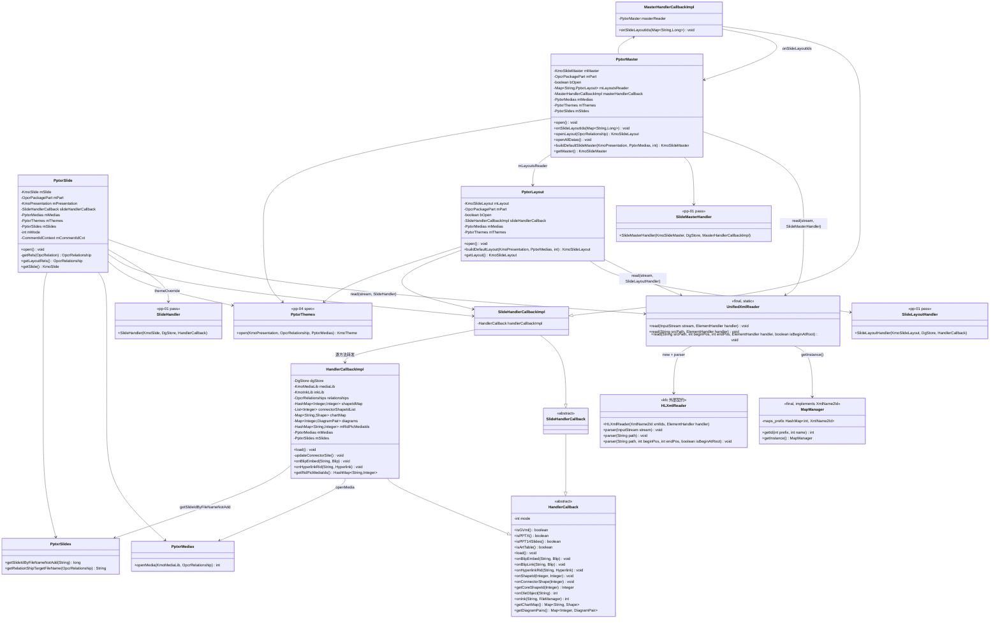
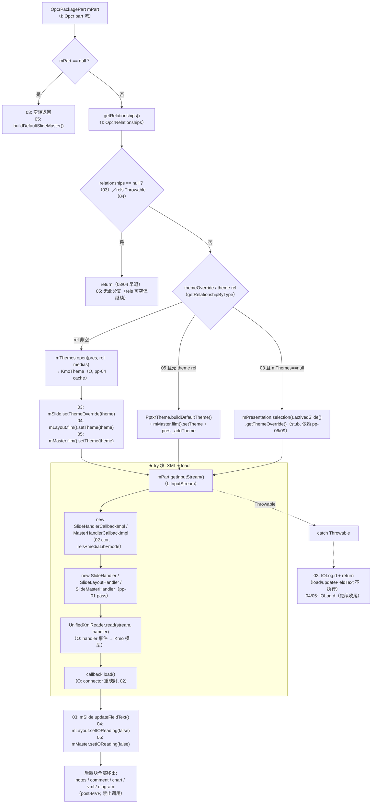
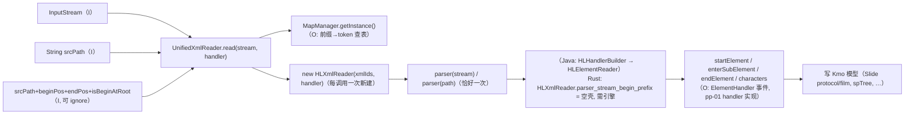
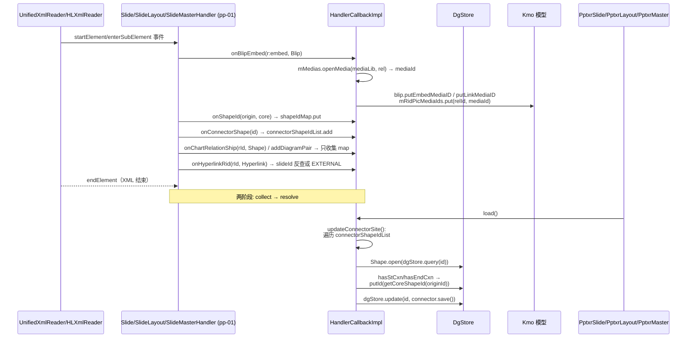
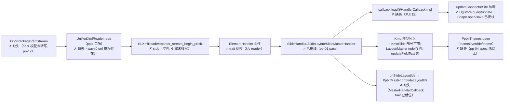

# pp-07-part-open — slide/layout/master part 读入（键类/流程/依赖/Java↔Rust 对比）

> 分析依据：feature FEATURE.md / FUNCTIONS.md / functions.csv + Java 源码（真读）+ Rust 现状（如已实现）
> 管线：parse→layout→render（见 libs/ppt-core/PARSER_JAVA_RUST_PIPELINE.md 顶层对比）
> 分析日期：2026-08（feature 状态 **spec**，5 个 function 均 spec，loop 未开始）

## 0. Feature 目标与管线位置

一句话目标：**把 pp-01 已 pass 的 XML handler 接到 part stream**——`PptxrSlide.open` / `PptxrLayout.open` /
`PptxrMaster.open` 拿到 `OpcrPackagePart` 后，经 `UnifiedXmlReader.read(stream, handler)` 把
slide / layout / master XML 填进 Kmo 模型，随后 `callback.load()`（connector 重映射）收尾，slide 再
`updateFieldText()`。

- **上游（depends_on_feature）**：`pp-01-pptx-parse`（pass）——`SlideHandler`/`SlideLayoutHandler`/
  `SlideMasterHandler`（`ElementHandler` 实现）与 `HandlerCallback` 基类；`pp-02-shape-tree-parse`（pass）——
  spTree 子 handler（`CommonSlideDataHandler` 消费）；`pp-04-theme-part`（spec）——`PptxrThemes.open`
  主题缓存（03/04 themeOverride、05 theme rel）。
- **下游**：`pp-08-slides-walk`（rId 装配与阅读顺序，消费 `getLayoutRels`/`mLayoutsReader` 结果）、`pp-09-pptx-open`（`PptxReader` 编排）、`pp-06-presentation-xml`（01 的 parser 复用）。
- **本 feature 回答的问题**（FEATURE.md I/O 表）：
  1. part 的 InputStream/path 如何恰好一次进入 HLXmlReader 事件面（01）；
  2. XML 期副作用（blip/media rId→mediaId、hyperlink 改写、connector 收集）如何经 `load()` 落定（02）；
  3. slide 的 themeOverride 继承、`callback.load()` 与 `updateFieldText()` 的时序与吞错语义（03）；
  4. layout 的 `bOpen` 幂等与 themeOverride rel（04）；
  5. master 的 theme rel vs default theme、`onSlideLayoutIds` 建 layout reader（05）。
- **范围外**：创建 slide 列表（pp-08）；打开 package/ZIP（pp-09）；读 notes/comment/chart/vml/diagram
  （post-MVP，**禁止调用** `PptxrNotesSlide`/`PptxrComment`/`PptxrChart`/`PptxrVmlDrawing`/
  `PptxrDiagramParts`）；实现 XML 引擎（HLXmlReader/HLElementReader 契约外部化）；01 里实现 XML 引擎。

## 0.5 设计动机与心智模型

1. **一句话心智模型**：本层把「part 字节流」投影成「handler 事件流」，再由 callback 把「rId 引用」
   投影成「媒体/形状 id」——是字节到模型的最后一公里装配，不新增任何 XML 语义。
2. **设计矛盾表**：

   | 矛盾 | 主数据结构 | 关键手段 |
   |---|---|---|
   | XML 事件语义（词汇层）与 part 打开（I/O 层）不该耦合 | `ElementHandler` 事件面 + `UnifiedXmlReader` 静态门面 | handler 构造好后一次 `parser` 调用，事件全部落在 handler 上 |
   | XML 期回调太早，引用（connector/media/hyperlink）要等全图就绪才能解析 | `shapeIdMap` / `connectorShapeIdList` / `mRidPicMediaIds` / `chartMap` / `diagrams` | 回调只收集，`load()` 在 XML 之后统一收尾（两阶段：collect → resolve） |
   | 同一 part 可能被重复打开 | `bOpen`（layout/master） | 先置位再干活，rels Throwable 早退后仍为 true（幂等） |
   | 单张 slide 的 XML 坏了不能拖垮整个打开链 | `IOLog.d` 吞 Throwable 语义 | 03/04/05 各自 try/catch 后 return / 空转，不抛给编排方 |

3. **各结构角色速查**：
   - `UnifiedXmlReader`：静态门面，把「参数差异」折叠成「`HLXmlReader.parser` 恰好一次」；
     消费 `MapManager` 前缀→token 查表（pp-01:01 同族）。
   - `HandlerCallbackImpl`：XML 期副作用接收器 + `load()` 落定器；被
     `SlideHandlerCallbackImpl`（逐方法转发）与 `MasterHandlerCallbackImpl`（+`onSlideLayoutIds`）包装。
   - `PptxrSlide/Layout/Master`：编排器，决定 theme 分支、handler 种类、load/updateFieldText 时序、吞错边界。
4. **本 feature 特有「为什么」**：
   - `updateConnectorSite()` 的 stCxn/endCxn 引用：connector 的起点/终点 id 是 XML 里的 originShapeId，
     必须在 `shapeIdMap`（onShapeId 收集的 origin→core）就绪后重映射——所以 `load()` 必须晚于 XML 结束。
   - `PptxrSlide.open` 的 catch 分支直接 `return`，而 `PptxrLayout/PptxrMaster.open` 的 catch 只跳过
     XML，后续 chart/vml/diagram 块照走（本 feature 全移出，但吞错粒度不同，需保真）。
   - `SlideHandler` 在 Java 持有**具体类型** `SlideHandlerCallbackImpl`/`MasterHandlerCallbackImpl`
     （见 `SlideHandler.java`、`SlideMasterHandler.java` 构造签名）——Rust 侧对应设计为 trait 约束
     （`SlideHandler<C: HandlerCallback>`、`SlideMasterHandler<C: MasterHandlerCallback>`，均已见既有
     Rust 源码），改写时 callback 必须是 `Rc<RefCell<C>>` 包装下的具体 impl。

## 1. 键类分析（类图）

### 1.1 UnifiedXmlReader（pptxr.util，final 静态门面）

| 项 | 内容 |
|---|---|
| 继承/实现 | 无（`public final class`，无接口） |
| 字段 | 无实例字段（全静态方法；Java 源码仅 23 行） |
| 方法（签名→逻辑） | |
| ★`read(InputStream stream, ElementHandler handler) throws IOException` | `new HLXmlReader(MapManager.getInstance(), handler)` → `reader.parser(stream)`（即 parser(stream,true,-1)） |
| ★`read(String srcPath, ElementHandler handler) throws IOException` | 同上，`reader.parser(srcPath)` → FileInputStream → parser(stream,true) |
| `read(String srcPath, int beginPos, int endPos, ElementHandler handler, boolean isBeginAtRoot) throws IOException` | `reader.parser(srcPath, beginPos, endPos, isBeginAtRoot)` → FilePartInputStream（path 切片；FUNCTIONS.md §4 验收 1 允许 ignore） |

> Java 转发链（查证自 `HLXmlReader.java`）：parser(stream) → parser(stream,true) → parser(stream,true,-1)
> → HLHandlerBuilder(HLElementReader).parser(stream)。每次调用**新建** reader（IO 读路径、无缓存）。

### 1.2 HandlerCallback / SlideHandlerCallback（pp-01:02 pass 的基类族）

| 类 | 继承/实现 | 关键字段 | 关键方法 |
|---|---|---|---|
| `HandlerCallback`（abstract） | 无 | `int mode`（0=PPTX / 1=PPT14Slides / 2=GVml / 3=ArtTable） | `isPPTX/isPPT14Slides/isGVml/isArtTable`（mode==0/1/2/3 判定）；`load()` no-op；`getCoreShapeId(Integer)` identity 兜底；`onOleObject(String)→-1`；`onInk(...)→-1`；`getChartMap()/getDiagramPairs()→null`；其余 on* no-op（默认不做事） |
| `SlideHandlerCallback`（abstract，ppt.slides） | extends HandlerCallback | 无 | 仅 `super(mode)` 构造，无其他成员（9 行薄壳） |

### 1.3 HandlerCallbackImpl（ppt.slides，本 feature 核心，02）

| 项 | 内容 |
|---|---|
| 继承/实现 | `extends HandlerCallback` |
| 关键字段 | `DgStore dgStore`（connector 落点查询）；`KmoMediaLib mediaLib`；`KmoInkLib inkLib`；`OpcrRelationships relationships`（rId 反查）；`HashMap<Integer,Integer> shapeIdMap`（origin→core）；`List<Integer> connectorShapeIdList`；`Map<String,Shape> chartMap`；`Map<Integer,DiagramPair> diagrams`；`HashMap<String,Integer> mRidPicMediaIds`（rId→mediaId，懒建）；`PptxrMedias mMedias`；`PptxrSlides mSlides` |
| 构造 | `HandlerCallbackImpl(DgStore, KmoMediaLib, KmoInkLib, OpcrRelationships, PptxrMedias, PptxrSlides, int mode)` → `super(mode)`；建空 shapeIdMap/chartMap/diagrams |
| ★`load()` | 转发 `updateConnectorSite()` |
| ★`updateConnectorSite()`（private） | `connectorShapeIdList != null && dgStore != null` 时遍历：`Shape.open(dgStore.query(id))` → `hasStCxn()/hasEndCxn()` 时 `putId(getCoreShapeId(originId))` → `dgStore.update(id, connector.save())`。**热路径（02 的唯一落定动作）** |
| ★`onBlipEmbed(String embed, Blip)` | embed 非空：rel null → `KmoLog.logPoint` 静默；否则 `mediaId = mMedias.openMedia(mediaLib, rel)` → `blip.putEmbedMediaID(mediaId)` → 懒建并 `mRidPicMediaIds.put(rel.getId(), mediaId)` |
| ★`onBlipLink(String link, Blip)` | 同上但 `putLinkMediaID` |
| `onExtMediaFileLink(String link, Media)` | audio 分支：mediaData 空且 `mediaType>15 && mediaType<32` → openMedia+putMediaID；video 分支：`mediaType>33 && mediaType<46`；rel null → return |
| ★`onHyperlinkRid(String rId, Hyperlink)` | rel null → `putTarget("")`；INTERNAL + slide relsType → slideId（`mSlides` 非空 `getSlideIdByFileNameNotAdd`，空则静态 `PptxrSlides.getSlideIdByFileName`；PPT14Slides → `Ppt14rSlides`，非 MVP）；EXTERNAL → `putTargetInternalMode(false)`；`putType(rel.getType())` |
| `onShapeId(Integer,Integer)` / `getCoreShapeId(Integer)` | shapeIdMap 首次写入（containsKey 才 put）；查询 identity 兜底 |
| `onConnectorShape(Integer)` | 懒建并追加 connectorShapeIdList |
| `onOleObject(String rId)` | `mMedias.openMedia` → mediaId（**rel null 无判空，逐行照抄**） |
| `onChartRelationShip(String rId, Shape)` / `getChartMap()` | `chartMap.put(rId, shape)` —— **只收集不 open chart** |
| `addDiagramPair(int, String×4)` / `getDiagramPairs()` | `diagrams.put(smartArtId, new DiagramPair(colorsId, quickId, layoutId, dataId))` —— 只收集 |
| `onInk(String rId, FileManager)` | rel → `getPackagePart().getInputStream(true)`+`getZipEntry()` → `InkModel` → `inkLib.addInkModel`；IOException → **RuntimeException 上抛**（本 feature 定为壳，先记 rId 或回 -1） |
| `onModel3D(String embed, Model3D)` | embed 非空且 rel 非空 → openMedia + `putEmbedMediaID` |
| `onTags(String id, CustDataLst.TagLst)` | rel 非空 → `new PptxrTags(tagLst, part).open()`，IOException → IOLog（`PptxrTags.open` 停车） |
| `getRidPicMediaIds()` | 返回 `mRidPicMediaIds` |

### 1.4 SlideHandlerCallbackImpl / MasterHandlerCallbackImpl

| 类 | 继承/实现 | 关键字段 | 关键方法 |
|---|---|---|---|
| `SlideHandlerCallbackImpl` | extends SlideHandlerCallback | `HandlerCallback handlerCallbackImpl`（内部委托实例） | 构造 `SlideHandlerCallbackImpl(DgStore,KmoMediaLib,KmoInkLib,OpcrRelationships,PptxrMedias,PptxrSlides,int)` → `super(mode)` + `new HandlerCallbackImpl(...)`；**所有 override（load/onTags/onBlipEmbed/onBlipLink/音频视频族/onHyperlinkRid/onHyperlinkAction/onShapeId/getCoreShapeId/onConnectorShape/onOleObject/onChartRelationShip/getChartMap/getDiagramPairs/addDiagramPair/onInk/onModel3D）逐方法转发** |
| `MasterHandlerCallbackImpl` | extends SlideHandlerCallbackImpl | `PptxrMaster masterReader` | 构造多一个 `PptxrMaster masterReader` 参数；`onSlideLayoutIds(Map<String,Long> ids)` → `masterReader != null` 时 `masterReader.onSlideLayoutIds(ids)`（IOException → printStackTrace）——**XML 期回调把 sldLayoutIdLst 的 rId→layout 交给 master 侧建 reader** |

### 1.5 PptxrSlide（ppt.slides，03）

| 项 | 内容 |
|---|---|
| 继承/实现 | 无（普通类） |
| 关键字段 | `KmoSlide mSlide`（protected）；`OpcrPackagePart mPart`；`KmoPresentation mPresentation`（protected）；`SlideHandlerCallback slideHandlerCallback`；`PptxrMedias mMedias`；`PptxrThemes mThemes`；`PptxrSlides mSlides`；`int mMode`；`CommentIdContext mCommentIdCxt` |
| 构造 | `PptxrSlide(KmoSlide, KmoPresentation, OpcrPackagePart, PptxrMedias, PptxrThemes, PptxrSlides, int mode, CommentIdContext)` 只存引用 |
| ★`open() throws IOException` | 见 §2 流程图 1；大纲：`mPart==null → return`；`relationships==null → return`；themeOverride 分支；try{ `new SlideHandlerCallbackImpl(...)` → `new SlideHandler(mSlide, drawingStore, callback)` → `UnifiedXmlReader.read(stream, handler)` }catch(Throwable){ IOLog.d + **return** }；`slideHandlerCallback.load()`；`mSlide.updateFieldText()`；notes/comment/chart/vml/diagram 五块**移出** |
| ★`getRels(OpcRelation) throws IOException`（private） | mPart null → null；relsCol null → null；遍历 `relsType.endsWith(rel.getType())` 命中返回 |
| `getLayoutRels()` | `getRels(OxfPptRelations.slideLayout())`——保留（pp-08 消费） |
| `getNotesSlideRels()/getCommentRels()/getVmlDrawingRels()` | 停车（post-MVP） |
| `getSlide()` | 返回 mSlide |

### 1.6 PptxrLayout（ppt.slidelayouts，04）

| 项 | 内容 |
|---|---|
| 继承/实现 | 无 |
| 关键字段 | `KmoPresentation mPresentation`；`KmoSlideLayout mLayout`；`OpcrPackagePart mPart`；`boolean bOpen`；`SlideHandlerCallbackImpl slideHandlerCallback`；`PptxrMedias mMedias`；`PptxrThemes mThemes`；`PptxrSlides mSlides`；`int mMode` |
| ★`open() throws IOException` | `!bOpen` 门：**先 `bOpen=true`** → `mPart != null`：`getRelationships()` 独立 try/catch（Throwable → IOLog.d + **return**，幂等仍成立）→ themeOverride rel → `mThemes.open(...)` → `mLayout.film().setTheme(themeOverride)` → try{ `new SlideHandlerCallbackImpl(...)`（rels 用 `mPart.getRelationships()`）→ `new SlideLayoutHandler(mLayout, drawingStore, callback)` → `UnifiedXmlReader.read` + `callback.load()` }catch(Throwable){ IOLog.d }；chart/vml/diagram 移出；`mLayout.setIOReading(false)` |
| ★`buildDefaultLayout(KmoPresentation, PptxrMedias, int) throws IOException`（static） | `PptxrPresentation.getPresentationSlideSizeType(presentation)` → `PptResourceFactory.getResPrivider().getSlideLayout(size)`（null → FileNotFoundException）→ `new KmoSlideLayout` + setIOReading(true) + callback(rels=null, slides=null) + `SlideLayoutHandler` + `UnifiedXmlReader.read`（finally close）→ `callback.load()` → setIOReading(false) |
| `open(KmoSlideLayout, String xmlpath, PptxrMedias)` / `open(KmoSlideLayout, InputStream, PptxrMedias)`（static） | TextStylesHandler 路径同族——**defer**（FEATURE.md 延后项） |
| `getVmlDrawingRels()` / `getRels(OpcRelation)` | 同 PptxrSlide.getRels（`relsType.endsWith(type)`） |
| `getLayout()` | 返回 mLayout |

### 1.7 PptxrMaster（ppt.slidemasters，05）

| 项 | 内容 |
|---|---|
| 继承/实现 | 无 |
| 关键字段 | `KmoSlideMaster mMaster`；`KmoPresentation mPresentation`；`OpcrPackagePart mPart`；`boolean bOpen`；`Map<String, PptxrLayout> mLayoutsReader`（partName→reader）；`MasterHandlerCallbackImpl masterHandlerCallback`；`PptxrMedias mMedias`；`PptxrThemes mThemes`；`PptxrSlides mSlides`；`int mMode` |
| ★`open() throws IOException` | `!bOpen` 门：**先 `bOpen=true`** → `mPart==null` → `mMaster = buildDefaultSlideMaster(...)`；否则 themeRels（`getRelationshipByType(theme)`）非空 → `mThemes.open` → `mMaster.film().setTheme`；空 → `PptxrTheme.buildDefaultTheme()` + `_addTheme` → try{ `new MasterHandlerCallbackImpl(...)` → `new SlideMasterHandler(mMaster, drawingStore, callback)` → `UnifiedXmlReader.read` + `callback.load()` }catch(Throwable){ IOLog.d }；vml/diagram 移出；`mMaster.setIOReading(false)` |
| ★`onSlideLayoutIds(Map<String, Long> rids) throws IOException` | mPart null → return；逐 rId：`rels.getRelationship(rId)` → `part != null` → `new KmoSlideLayout(presentation)` + setIOReading(true) + `createPptxrLayout(...)` → `mLayoutsReader.put(rels.getPartName(), reader)` + `mMaster._addLayout(layout)` + `layout.setMaster(mMaster)` |
| `createPptxrLayout(...)`（protected） | `new PptxrLayout(...)`（可子类覆写） |
| ★`openLayout(OpcrRelationship layoutRels) throws IOException` | `!bOpen → open()`；`mLayoutsReader.get(partName)` 命中 → `layoutReader.open()` + getLayout()；miss → `PptxrLayout.buildDefaultLayout` + setMaster |
| ★`openAllDatas() throws IOException` | `!bOpen → open()`；mLayoutsReader 空 → buildDefaultLayout + `_addLayout`；非空 → 逐个 `open()` |
| ★`buildDefaultSlideMaster(KmoPresentation, PptxrMedias, int) throws IOException`（static） | `new KmoSlideMaster` + `PptxrTheme.buildDefaultTheme()` + `_addTheme` + `getSlideMaster(size)`（null → FileNotFoundException）+ callback(MasterHandlerCallbackImpl, masterReader=null, rels=null) + `SlideMasterHandler` + read（finally close）+ `callback.load()` + `PptxrLayout.buildDefaultLayout` + `_addLayout` + setMaster |
| `open(KmoPresentation, SlideMaster, OpcrPackagePart, PptxrMedias)`（static） | TextStylesHandler 路径——**defer** |
| `getVmlDrawingRels()` / `getRels(OpcRelation)` | 同 PptxrSlide.getRels |
| `getMaster()` | 返回 mMaster |

## 2. 流程图（依据 I/O）

### 2.1 slide/layout/master part open 主流程（03/04/05 共形）

要点（FEATURE.md I/O 锁死）：
- **03 错误语义**：XML Throwable → IOLog + return，`load()`/`updateFieldText()` 不执行，不抛给调用方；
  null part 空转。
- **04 幂等**：`bOpen` 在 rels 处理**之前**置位 → rels Throwable 早退后第二次 open 仍不重复 parse。
- **05 分支**：缺 part → `buildDefaultSlideMaster`；`onSlideLayoutIds` 为每个 rId 建 `PptxrLayout` reader
  并 `_addLayout`（数据流见 2.3）。

### 2.2 UnifiedXmlReader 分发（01）

### 2.3 handler 回调时序（02，sequenceDiagram）

### 2.4 master sldLayoutIdLst → layout reader（05 特有）

## 3. 依赖关系与改写状态

### 3.1 类间依赖表

| 依赖方 | 被依赖方 | 用途 | 归属 |
|---|---|---|---|
| UnifiedXmlReader | MapManager（pptxr.util） | 前缀→token 查表（XmlName2Id） | pp-01:01 同族（Rust 未接线） |
| UnifiedXmlReader | HLXmlReader（kfc.xpxml.hlxml） | parser 入口（外部契约） | kfc（Rust 空壳） |
| UnifiedXmlReader | ElementHandler（kfc.xpxml.reader） | 回调事件面 | kfc（trait 已存在） |
| PptxrSlide | SlideHandler / SlideHandlerCallbackImpl / UnifiedXmlReader / PptxrThemes / PptxrMedias / PptxrSlides | 03 主链 | pp-01 / pp-04 / 本 feature |
| PptxrLayout | SlideLayoutHandler / SlideHandlerCallbackImpl / UnifiedXmlReader / PptxrThemes | 04 主链 | pp-01 / pp-04 / 本 feature |
| PptxrMaster | SlideMasterHandler / MasterHandlerCallbackImpl / UnifiedXmlReader / PptxrThemes / PptxrLayout | 05 主链 | pp-01 / pp-04 / 本 feature |
| HandlerCallbackImpl | OpcrRelationships / OpcrRelationship / PptxrMedias / PptxrSlides / DgStore / Shape / KmoMediaLib / KmoInkLib / PptxrTags | rId 反查、媒体落点、connector 重映射 | kfc opcr / 模型层 / 媒体模块 |
| MasterHandlerCallbackImpl | PptxrMaster | onSlideLayoutIds 回调 | 本 feature |
| PptxrLayout.buildDefaultLayout / PptxrMaster.buildDefaultSlideMaster | PptResourceFactory / PptxrPresentation.getPresentationSlideSizeType | 缺 part 时的内置资源流 | 资源层 |

### 3.2 Java ↔ Rust 路径映射表

| Java 路径（koffice/presentation/core/cn/wps/...） | Rust 路径（libs/ppt-core/src/cn/wps/...） | 状态 |
|---|---|---|
| show/pptxr/util/UnifiedXmlReader.java | （不存在；模板 = core-libs/io/uof-io/src/cn/wps/io/uof/util/UnifiedXmlReader.rs，wave0 uof 口味，`Mode::Uof`） | **未开始**（pptx 口味需新建，`Mode::Normal`） |
| show/pptxr/util/MapManager.java | show/pptxr/util/MapManager.rs（audit 行 637 记 167 行 stub_map→-1，**当前文件已不存在**，mod.rs 注释掉） | ✗ 缺失/壳 |
| show/pptxr/util/SWReaderMap.java | show/pptxr/util/SWReaderMap.rs（555 行，无 stub） | ✓ 已接线（pp-01:01 pass，54 张映射表） |
| drawing/dmlr/model/HandlerCallback.java | drawing/dmlr/model/HandlerCallback.rs（trait + HandlerCallbackState） | ✓ 已接线（pp-01:02 pass，审计 keep_refactor，FileManager 参数 stub） |
| show/pptxr/ppt/slides/SlideHandlerCallback.java | （无；Rust 以 trait 替代薄壳） | 设计适配（不单独建类） |
| show/pptxr/ppt/slides/HandlerCallbackImpl.java | （show/pptxr/ppt/ 整树未创建） | **未开始** |
| show/pptxr/ppt/slides/SlideHandlerCallbackImpl.java | 同上 | **未开始** |
| show/pptxr/ppt/slidemasters/MasterHandlerCallbackImpl.java | （Rust 已有约束 trait `MasterHandlerCallback: HandlerCallback`，见 SlideMasterHandler.rs:35） | **未开始**（需实现 trait） |
| show/pptxr/ppt/slides/PptxrSlide.java | （不存在） | **未开始** |
| show/pptxr/ppt/slidelayouts/PptxrLayout.java | （不存在） | **未开始** |
| show/pptxr/ppt/slidemasters/PptxrMaster.java | （不存在） | **未开始** |
| show/pptxr/handler/slides/SlideHandler.java | show/pptxr/handler/slides/SlideHandler.rs（`SlideHandler<C: HandlerCallback>`，已 pass） | ✓ 已接线（pp-01:05） |
| show/pptxr/handler/slidelayouts/SlideLayoutHandler.java | show/pptxr/handler/slidelayouts/SlideLayoutHandler.rs | ✓ 已接线（pp-01:06） |
| show/pptxr/handler/slidemasters/SlideMasterHandler.java | show/pptxr/handler/slidemasters/SlideMasterHandler.rs（`<C: MasterHandlerCallback>`） | ✓ 已接线（pp-01:07） |
| show/pptxr/ppt/theme/PptxrThemes.java / PptxrTheme.java | （show/pptxr/ppt/theme/ 未创建） | spec（pp-04，未动工） |
| show/pptxr/ppt/media/PptxrMedias.java | （未创建；`openMedia(KmoMediaLib, OpcrRelationship)→int` 无 Rust 落点） | ✗ 缺失（依赖项） |
| show/pptxr/ppt/slides/PptxrSlides.java | （未创建） | ✗ 缺失（依赖项） |
| show/pptxr/ppt/tags/PptxrTags.java | （未创建） | ✗ 缺失（02 onTags 停车） |
| kfc/kfc_alpha/.../hlxml/HLXmlReader.java | core-libs/kfc/kfc_alpha/.../hlxml/HLXmlReader.rs | ✗ stub（parser_stream_begin_prefix 返回 Ok(())，HLHandlerBuilder/HLElementReader 未转写） |
| kfc/opcr/*（OpcrPackagePart/OpcrRelationships/OpcrRelationship） | kfc_alpha/.../opcr/（仅 OpcUtil.rs + mod.rs） | ✗ 缺失（pp-12 范畴） |
| show/app/slide/KmoSlide.java | show/app/slide/KmoSlide.rs（1934 行，keep_refactor） | ✓ 部分（updateFieldText 为 TODO_RUST_CODE 壳；spTree/setThemeOverride/addNoteSlide/setIOReading 存在） |
| show/app/slide/KmoSlideLayout.java / KmoSlideMaster.java | show/app/slide/KmoSlideLayout.rs / KmoSlideMaster.rs | ✗ 壳（film()/_addLayout()/setIOReading() 全 todo!()；audit 裁决 delete，新 layout 层替代） |
| drawing/app/DgStore.java | drawing/app/DgStore.rs（query/update 存在） | ✓ 已接线 |
| drawing/data/shape/Shape.java | drawing/data/shape/Shape.rs（open/save/hasStCxn/stCxn/endCxn/hasEndCxn 存在） | ✓ 已接线 |

## 4. 最小 feature-critical 改写范围

### 4.1 三栏划分（依据 FEATURE.md 必须/壳/延后 + loop §5）

| 栏 | 内容（类/方法） |
|---|---|
| **must-write** | ① `UnifiedXmlReader.rs`（pptx 口味）：`read(stream,handler)` + `read(path,handler)` 两个 overload，每次新建 HLXmlReader + `parser` 恰好一次；path 切片 overload ignore。② `HandlerCallbackImpl.rs`：`load()`→`updateConnectorSite()`；onBlipEmbed/onBlipLink/媒体族 rId→mediaId（`mMedias.openMedia` + `putEmbedMediaID/putLinkMediaID` + `mRidPicMediaIds`）；`onHyperlinkRid`（INTERNAL/external + slideId 反查）；onShapeId/getCoreShapeId/onConnectorShape；onChartRelationShip/addDiagramPair 只收集。③ `SlideHandlerCallbackImpl.rs`（逐方法转发）+ 实现 `MasterHandlerCallback` trait（`onSlideLayoutIds`）。④ `PptxrSlide.rs open()`：themeOverride → XML(吞 Throwable 不抛) → load → updateFieldText；null part 空转；`getRels`/`getLayoutRels` 保留。⑤ `PptxrLayout.rs open()`：bOpen 先置位 + themeOverride rel → XML+load；`buildDefaultLayout`。⑥ `PptxrMaster.rs open()`：theme rel vs default theme；`onSlideLayoutIds`/`openLayout`/`openAllDatas`；`buildDefaultSlideMaster`。 |
| **可 stub** | 03 的 `mPresentation.selection().activedSlide().getThemeOverride()` else 分支（依赖 pp-06/pp-09 selection）；02 的 `onInk`（ink 模型，记 rId 或回 -1）；`PptxrTags.open`（custData 关联 part）；ppt14 模式分支（`Ppt14rSlides.getSlideIdByFileName`） |
| **可 defer** | notes/comment/chart/vml/diagram 五块（含对应 rel 查询 getNotesSlideRels/getCommentRels/getVmlDrawingRels）；`PptxrLayout.open(xmlpath/xmlstream)` 静态 overload 与 `PptxrMaster.open(pres, SlideMaster, part, medias)` 静态（TextStylesHandler 路径）；import 引擎自身（HLXmlReader/HLElementReader 契约外部化） |

### 4.2 当前进度（spec 阶段：计划拆分，loop 未开始）

| function | 目标类 | 状态 | 计划拆分（FUNCTIONS.md §5 loop 顺序 01→02→03→04→05） |
|---|---|---|---|
| 01 | UnifiedXmlReader | spec | 依据 wave0 uof-io 模板建 pptx 口味；`read` 前两 overload 实写、第三个 ignore（FUNCTIONS.md §4 验收 1）；`MapManager` 接线待 loop 确认 |
| 02 | HandlerCallbackImpl / SlideHandlerCallbackImpl | spec | 全部 XML 回调 override + load/updateConnectorSite；转发层逐一对照；不改 pp-01:02 基类 |
| 03 | PptxrSlide | spec | open 主线至 load+updateFieldText；themeOverride 分支；三条早退路径（null part/rels null/Throwable） |
| 04 | PptxrLayout | spec | bOpen 幂等 + themeOverride rel + buildDefaultLayout |
| 05 | PptxrMaster | spec | theme rel vs default；onSlideLayoutIds 建 layout reader；buildDefaultSlideMaster |

> 已知前置风险：01 的 I/O 输出（HLXmlReader parser 事件）依赖 kfc 解析引擎，而 Rust 侧
> `HLXmlReader::parser_stream_begin_prefix` 为空壳（§6），loop 前需确认引擎供应方式（kfc 连带改写
> 或按 FEATURE.md 契约外部化后用注入式 fixture 兜底——pp-04 已是注入式 read fixture 口径）。

## 5. 验收口径

FEATURE.md 验收（FUNCTIONS.md §4，spec 阶段原样列出）：

1. **UnifiedXmlReader 三种 overload 都接到 HLXmlReader**（path 切片 overload 可 ignore 直到需要）。
2. **Slide open：XML 失败不抛给调用方**（IOLog + return；`load()`/`updateFieldText()` 不执行）。
3. **Master `bOpen`：第二次 open 不重复 parse**（04 同语义：rels Throwable 早退后 bOpen 仍为 true）。
4. **不调用 chart/vml/notes**（断言副作用计数为 0——`PptxrNotesSlide`/`PptxrComment`/`PptxrChart`/
   `PptxrVmlDrawing`/`PptxrDiagramParts` 零调用）。

钉死的数字/枚举/哨兵（真读 Java 源码取证）：

| 项 | 值 | 来源 |
|---|---|---|
| HandlerCallback mode 枚举 | 0=PPTX / 1=PPT14Slides / 2=GVml / 3=ArtTable（`mode==0/1/2/3` 判定） | HandlerCallback.java:27-41；Rust HandlerCallback.rs:84-105 一致 |
| mediaType 窗口 | audio `15<type<32`；video `33<type<46`（onExtMediaFileLink） | HandlerCallbackImpl.java:150,165 |
| relsType（OxfPptRelationsImpl，rel URI 后缀） | theme=`.../relationships/theme`；themeOverride=`.../relationships/themeOverride`；slideLayout=`.../relationships/slideLayout`；slide=`.../relationships/slide`；notesSlide=`.../relationships/notesSlide`；comments=`.../relationships/comments`；vmlDrawing=`.../relationships/vmlDrawing`；slideMaster=`.../relationships/slideMaster` | OxfPptRelationsImpl.java:182-350 |
| getRels 匹配规则 | `relation.getRelsType().endsWith(rel.getType())`（遍历，非按 rId） | PptxrSlide.java:129 / PptxrLayout.java:165 / PptxrMaster.java:224 |
| onHyperlinkRid INTERNAL 分支 | slide relsType 时 `PptxrSlides.getRelationShipTargetFileName(rel)` → slideId（`getSlideIdByFileNameNotAdd` 或静态 `getSlideIdByFileName`）→ `putTarget(Long.toString(slideId))`；EXTERNAL → `putTargetInternalMode(false)` | HandlerCallbackImpl.java:197-223 |
| onInk 错误语义 | IOException → `new RuntimeException(e)` 上抛（FEATURE.md 定为壳） | HandlerCallbackImpl.java:273-282 |
| 默认 media 查询 | `mRidPicMediaIds` 懒建（onBlipEmbed/onBlipLink 首次 put 前 `new HashMap`） | HandlerCallbackImpl.java:107-111 |
| mode 判定消费点 | `onHyperlinkRid` 用 `this.isPPTX()`，pp-01:02 基类锁定 | HandlerCallbackImpl.java:202 |
| Rust 侧既有约束 | `SlideHandler<C: HandlerCallback>`（SlideHandler.rs:30）、`SlideMasterHandler<C: MasterHandlerCallback>`（SlideMasterHandler.rs:35-40，`onSlideLayoutIds(&mut self, ids: &[(String, i64)])`）——新 callback 必须满足 | Rust 源码 |

## 6. Java↔Rust 管线对比与缺口审计

### 6.1 Rust 端现状（本 feature 相关全量节点）

```mermaid
classDiagram
    class UnifiedXmlReader {
        <<show/pptxr/util>>
        ✗ 缺失（pptx 口味未建）
    }
    class MapManager {
        <<show/pptxr/util>>
        ✗ 缺失（mod.rs 注释；xsd maps 未转写）
    }
    class SWReaderMap {
        <<show/pptxr/util>>
        ✓ 已接线（pp-01:01 pass, 54 表）
    }
    class HandlerCallback {
        <<drawing/dmlr/model trait>>
        ✓ 已接线（pp-01:02 pass; FileManager 参数 stub）
    }
    class HandlerCallbackImpl {
        <<show/pptxr/ppt/slides>>
        ✗ 缺失（未开始）
    }
    class SlideHandlerCallbackImpl {
        <<show/pptxr/ppt/slides>>
        ✗ 缺失（未开始）
    }
    class MasterHandlerCallback {
        <<trait, slidemasters>>
        ✓ 约束 trait 已就位（pp-01:07）
    }
    class PptxrSlide {
        <<show/pptxr/ppt/slides>>
        ✗ 缺失（未开始）
    }
    class PptxrLayout {
        <<show/pptxr/ppt/slidelayouts>>
        ✗ 缺失（未开始）
    }
    class PptxrMaster {
        <<show/pptxr/ppt/slidemasters>>
        ✗ 缺失（未开始）
    }
    class SlideHandler {
        <<pp-01 pass>>
        ✓ 已接线 SlideHandler~C: HandlerCallback~
    }
    class SlideLayoutHandler {
        <<pp-01 pass>>
        ✓ 已接线
    }
    class SlideMasterHandler {
        <<pp-01 pass>>
        ✓ 已接线 ~C: MasterHandlerCallback~
    }
    class HLXmlReader {
        <<kfc_alpha/hlxml>>
        ✗ stub（parser_stream_begin_prefix 空壳）
    }
    class OpcrModel {
        <<kfc_alpha/opcr>>
        ✗ 缺失（仅 OpcUtil.rs; pp-12 范畴）
    }
    class KmoSlide {
        <<show/app/slide>>
        ~ 部分（updateFieldText TODO_RUST_CODE 壳; 其余查询在）
    }
    class KmoSlideLayout {
        <<show/app/slide>>
        ✗ 壳（film/setMaster/setIOReading = todo!()）
    }
    class KmoSlideMaster {
        <<show/app/slide>>
        ✗ 壳（film/_addLayout/setIOReading = todo!()）
    }
    class DgStore {
        <<drawing/app>>
        ✓ 已接线（query/update）
    }
    class Shape {
        <<drawing/data/shape>>
        ✓ 已接线（open/save/stCxn/endCxn）
    }
    class PptxrThemes {
        <<pp-04 spec>>
        ✗ 缺失（未动工）
    }
    class PptxrMedias {
        <<show/pptxr/ppt/media>>
        ✗ 缺失（openMedia 无落点）
    }
    class PptxrSlides {
        <<show/pptxr/ppt/slides>>
        ✗ 缺失
    }
    UnifiedXmlReader --> MapManager
    UnifiedXmlReader --> HLXmlReader
    PptxrSlide --> UnifiedXmlReader
    PptxrLayout --> UnifiedXmlReader
    PptxrMaster --> UnifiedXmlReader
    PptxrSlide --> SlideHandler
    PptxrLayout --> SlideLayoutHandler
    PptxrMaster --> SlideMasterHandler
    PptxrMaster --> PptxrLayout
    SlideHandler --> HandlerCallback
    SlideMasterHandler --> MasterHandlerCallback
    HandlerCallbackImpl --> PptxrMedias
    HandlerCallbackImpl --> OpcrModel
    PptxrSlide --> OpcrModel
    PptxrSlide --> KmoSlide
    PptxrLayout --> KmoSlideLayout
    PptxrMaster --> KmoSlideMaster
    PptxrSlide --> PptxrThemes
    PptxrMaster --> DgStore
```

### 6.2 Rust 端关键链路接线（输入→解析→回调）

**断点按输入→解析→回调顺序报告**：第一环断在 **opcr part 模型缺失**（03–05 输入面，pp-12 范畴）；
第二环断在 **kfc XML 引擎空壳**（HLXmlReader.parser 不产生任何事件，01 的「parser 恰好一次 + 事件转发」
无法真测）；第三环断在 **show/pptxr/ppt/ 整树未创建**（02–05 的 callback/open 类全部未动工）。
pp-01 的 handler 层已完整，可作为本 feature 的稳定下游锚点。

### 6.3 缺口表

| # | 类/项 | 状态/stub 类型 | 影响 | 阻塞哪个下游 feature |
|---|---|---|---|---|
| 1 | kfc `HLXmlReader.rs` parser 引擎（HLHandlerBuilder/HLElementReader 未转写；`parser_stream_begin_prefix` 返回 Ok(())） | ✗ stub（空壳） | 01「parser 恰好一次→事件经 handler 回调」的**输入链硬门闩**；真实 pptx part 无法进事件面 | 阻塞 pp-07 全部 function；pp-04/pp-06/pp-09 的 part 打开（pp-04 已用注入式 fixture 绕行） |
| 2 | `pptxr.util.UnifiedXmlReader.rs`（pptx 口味） | ✗ 缺失（wave0 模板仅 uof 口味 `Mode::Uof`，需按 `Mode::Normal` 新建） | 01 无承载类 | 阻塞 03–05、pp-04 02、pp-06、pp-09 |
| 3 | `show/pptxr/util/MapManager.rs` | ✗ 缺失（mod.rs 注释；audit 曾记 stub_map→-1 已移除） | 前缀→token 查表断裂（事件分发依赖） | 阻塞 01 的等价深参；pp-01:01 表在但入口断 |
| 4 | `show/pptxr/ppt/` 整树（HandlerCallbackImpl / SlideHandlerCallbackImpl / MasterHandlerCallbackImpl / PptxrSlide / PptxrLayout / PptxrMaster） | ✗ 缺失（未动工） | 02–05 全部无承载类；`MasterHandlerCallback` trait 已就位但无 impl | 阻塞 pp-08（rId 装配消费 getLayoutRels/mLayoutsReader）、pp-09 |
| 5 | `PptxrMedias.openMedia` | ✗ 缺失（媒体模块未建） | 02 blip/media rId→mediaId 无落点 | 阻塞 02/03/04/05 的媒体引用；可先 stub 落点 |
| 6 | `PptxrThemes.open`（pp-04） | ✗ 未动工（spec） | 03/04 themeOverride、05 theme rel 的 KmoTheme 供应断裂 | 阻塞 03–05 的 theme 分支（FEATURE.md：经 pp-04 写 layout） |
| 7 | `OpcrPackagePart/OpcrRelationships/OpcrRelationship`（kfc opcr） | ✗ 缺失（仅 OpcUtil.rs；pp-12 范畴） | 03–05 输入面无 part/rels 抽象 | 阻塞 03–05 与 pp-12（需 trait/fixture 替身先行） |
| 8 | `KmoSlide.updateFieldText` | ~ 壳（TODO_RUST_CODE 空体） | 03 步骤 6 无实义（依赖 text operator） | 不阻塞本 feature 验收（可照抄调用点），阻塞后端文本字段渲染 |
| 9 | `KmoSlideLayout.rs` / `KmoSlideMaster.rs` | ✗ 壳（film/_addLayout/setMaster/setIOReading 全 todo!()；audit 裁决 delete，新 layout 层替代） | 04/05 的模型写入落点为空 | 阻塞 04/05 的真实模型写入（需先落新 layout 层或按审计方案重建） |
| 10 | `PptxrSlides`（getSlideIdByFileNameNotAdd 等） | ✗ 缺失 | 02 onHyperlinkRid INTERNAL slideId 反查无实现 | 阻塞 02 超链接分支；非空 mSlides 时需 stub 表 |
| 11 | `PptxrTags.open` / InkModel / FileManager / ppt14 分支 | 壳（FEATURE.md 明示 stub/defer） | 非 MVP 面 | 不阻塞（已在停车列表） |

非 critical 壳已标注：02 的 `onInk`（壳）、`onTags`（PptxrTags.open 停车）、03 的 selection else 分支
（stub）、ppt14 模式分支（停车）——与 FEATURE.md「必须/壳/延后」一致。

### 6.4 结论

**spec-未动工**。

- Java 完整链路成立：`PptxrSlide/Layout/Master.open`（part→rels→theme→XML→load→收尾）→
  `UnifiedXmlReader`（3 overload → HLXmlReader.parser 一次）→ `Slide*Handler`（pp-01 事件面）→
  `HandlerCallbackImpl`（collect→load 两阶段，connector/media/hyperlink 落定）。
- Rust 现状：pp-01 的 handler 层与 `HandlerCallback` trait、`MasterHandlerCallback` trait、
  SWReaderMap、DgStore/Shape 模型原子均 ✓已接线；`show/pptxr/ppt/` 整树（02–05）✗未动工；
  输入面两处硬缺口——opcr part 模型 ✗缺失（pp-12）与 kfc `HLXmlReader` 解析引擎 ✗空壳；
  theme 供应侧 pp-04 ✗未动工。
- 结论判定：本 feature 全部 5 个 function 为 spec、loop 未开始，属「spec-未动工」，不能作为
  pp-08/pp-09 的下游依赖依据；改写启动时按 §4.2 loop 顺序 01→02→03→04→05，并在 loop 前先确认
  缺口 #1（XML 引擎）与 #7（opcr part 抽象）的供应方式（引擎契约外部化 + fixture/抽象 part）。