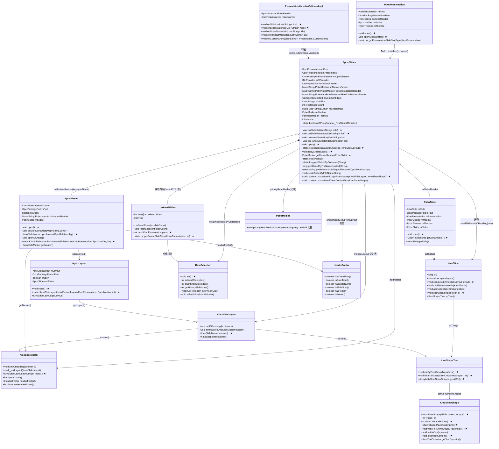
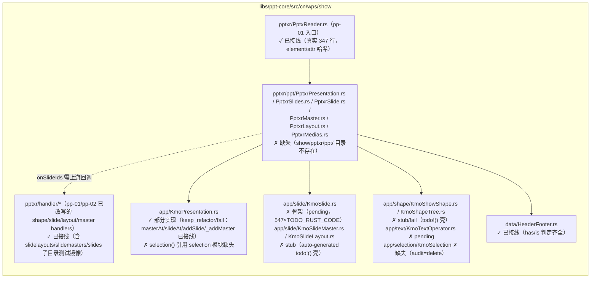

# pp-08-slides-walk — rId 装配与阅读顺序（键类/流程/依赖/Java↔Rust 对比）

> 分析依据：feature FEATURE.md / FUNCTIONS.md / functions.csv + Java 源码（真读，行号取自
> `koffice/presentation/core/cn/wps/show/pptxr/ppt/slides/PptxrSlides.java` 等）+ Rust 现状（真查
> `libs/ppt-core/src/cn/wps/` + `rewriting_files.csv` + `ppt_core_mvp_audit.csv`）
> 管线：parse→layout→render（见 libs/ppt-core/PIPELINE_LAYOUT_RENDER_PLAN.md §1-S0 / §2.1）；本 feature 属 S0 parse 的「rId 装配/阅读顺序」环节，不解析任何 part XML 内容
> 分析日期：2026-（本次生成，feature 状态 spec）

---

## 0. Feature 目标与管线位置

**一句话目标**：`PresentationHandlerCallback.onSlideIds/onSlideMasterIds` 回调驱动的 KmoSlide/KmoSlideMaster
**壳装配（不解析 XML）**、`mSlideIdMap` 静态反查表、`UnReadSlides` 阅读顺序主循环
（master→layout→slide open 顺序 + 首屏 delayCreateSlides + ForceQuit 中断），以及空文档路径的
`changeLayout(slideAt(0), 默认 layout)` placeholder 复制。

**上下游**：
- `depends_on_feature`：pp-06-presentation-xml（`sldIdLst/sldMasterIdLst` 的 rId 列表回调）→
  pp-07-part-open（`PptxrSlide/Layout/Master.open` 与 part/rels 读取、`UnifiedXmlReader`）→ 本 feature；
  间接依赖 pp-02（`changeLayout` 的 ph 元数据 `type/isPlaceHolder/ph`）与 pp-01（DML 回调基础契约，pass）。
- 下游：pp-09-pptx-open（`PptxReader` 编排，`mSlidesReader.open()` 由 pp-09 触发）。
- 不依赖：pp-05 timing/transition；本 feature 是 pp-09 的**上游**。

**本 feature 回答的问题**（FEATURE.md I/O 表 + 范围外说明）：
1. 给定 presentation.xml 的 rId 序列，前 N 张（`getCreateSlideCount` 截断，默认 ≤ 10）如何变成 KmoSlide 壳
   并挂进 `mPres`/`mSlideIdMap`？缺 rel/part 的 rId 如何处理（跳过、不回溯）？
2. master/layout/slide 三者按什么顺序 open（master→layout→slide），layout 的 master rel 如何反查
   `mMastersReader`，查不到时默认 master/layout 怎么补齐？
3. 阅读顺序由什么决定（`UnReadSlides.next` 的分值序列），首屏补建与事件通知（`onSlideListChanged`）
   何时发生，ForceQuit 在哪一环中断？
4. 空 slide 列表时如何用默认 layout 的 placeholder 填充 `slideAt(0)`（`changeLayout` 的 copy/hf 判定）？
- 范围外：slide/layout/master 的 XML 内容解析（pp-07）；NotesMaster/HandoutMaster 全文（defer）；
  `getSlideIdByFileNameNotAdd` 的 customShow 完整链路（pp-06 defer）；不改已 pass 的 pp-01/pp-02 语义。

---

## 0.5 设计动机与心智模型

**心智模型**：本 feature 把「presentation.xml 的 rId 名单」投影成「KmoSlide 壳数组 + 一张
target-basename→slideId 反查表 + 一个按用户意图排序的未读游标」，让 XML 内容解析（pp-07）可以在
「壳已就位、顺序已定」的前提下逐张进行。

设计矛盾与手段：

| 矛盾 | 主数据结构 | 关键手段 |
|---|---|---|
| 文件大、首屏要快：不能等全部 slide 解析完再显示 | `slideRids`（全量名单）+ `createSlideCount`（首屏壳数） | `getCreateSlideCount` 截断（默认 min(10, n)，selection 索引在尾部时向后推）；首屏 `delayCreateSlides` 按需补建 |
| 媒体/阅读需要「按文件名反查 slideId」（ViewProperty、customShow） | `static Map<String, Long> mSlideIdMap` | `getRelationShipTargetFileName`（rel target 取最后一个 `/` 后一段）作 key；`initialize` 复位；static 跨实例共享 |
| 打开顺序必须是 master→layout→slide，但 slide 只知道自己 layout rel | `mMastersReader: Map<partName, PptxrMaster>` + `PptxrMaster.mLayoutsReader: Map<partName, PptxrLayout>` | slide 的 layoutRels → layout part 的 rels 里找 slideMaster 类型 rel → partName 查 `mMastersReader`；查不到走 `buildDefaultSlideMaster/buildDefaultLayout` |
| 阅读顺序要贴近用户意图（当前页/缩略图/历史优先），又不能漏读 | `UnReadSlides.mUnReadSlides: boolean[]` + `mTop` 顺序游标 | `next()` 的「分值序列」：priorityList → active(0,+1,-1,+2,-2,+3,-3) → thumbnail(0,+1,-1) → history(0,+1,-1) → 从 mTop 顺序兜底 |
| 打开一个损坏/空文档要有可读底子 | 默认资源模板（`PptResourceFactory` 提供的默认 master/layout XML + 空列表分支） | open() 空列表 → 默认 layout 的 placeholder 复制到 `slideAt(0)`（`changeLayout`）|

各结构角色速查：
- `PptxrSlides`（装配器/编排器）→ 消费 rId 列表与 rels，产出壳容器，驱动 open 循环；pp-09 编排的中间层。
- `UnReadSlides`（静态内嵌）→ 消费 selection 探针，产出「下一张待读 index」，是阅读顺序唯一裁决者。
- `KmoSlide/KmoSlideMaster/KmoSlideLayout`（模型壳）→ 消费建壳动作（`setIOReading(true)` 标记 IO 态），产出挂进 `mPres` 的文档树。
- `changeLayout/shapeNeedCopyFromLayout/shapeNeedClearContentText`（static 工具）→ 消费 layout 的 ph 元数据与 master HeaderFooter，产出空 slide 的占位 shape 副本。
- 关键「为什么」：① `setIOReading(true)` 让未完成的壳不触发编辑事件（IO 导入期语义）；② `OPLogDumper_FirstSlideIOFinished` 是一次性性能短路（首张读完后直接 return，供日志切断 IO 后续）；③ `ForceQuitException` 在 `slideReader.open()` **之前**检查——保证「收了用户取消命令后绝不再解析下一张」。

---

## 1. 键类分析（类图）

本 feature 全部键类在 Java 侧：`PptxrSlides`（含静态内嵌 `UnReadSlides`）+ 关键依赖
`PptxrPresentation`（构造/触发）、`PresentationHandlerCallbackImpl`（回调转发）、`PptxrSlide`/`PptxrMaster`/`PptxrLayout`
（open 顺序协作）、模型 `KmoSlide`/`KmoSlideMaster`/`KmoSlideLayout`/`KmoShapeTree`/`KmoShowShape`/
`KmoSelection`/`HeaderFooter`、`PptxrMedias`（记桩）。



### 键类明细表

| 类（Java） | 继承/实现 | 关键字段（名:类型→作用） | 关键方法（签名→1 行逻辑，★热路径） |
|---|---|---|---|
| `PptxrSlides`（show/pptxr/ppt/slides/，583 行，final） | 无（纯装配器） | `mPres:KmoPresentation`→目标模型；`mPresRelses:OpcrRelationships`→pres 根 rels（rId→rel 解析）；`mOpenListener:KmoPresOpenEventListener`→完成事件；`mDlProvider:IDLProvider`→ForceQuit 判据；`mSlidesReader:List<PptxrSlide>`→已建壳 slide 读者；`mMastersReader:Map<String,PptxrMaster>`→key=partName；`mNotesMastersReader/mHandoutMastersReader`→延后；`slideRids:List<String>`→全量 rId 名单；`createSlideCount:int`→首屏壳数游标；`static mSlideIdMap:Map<String,Long>`→target basename→slideId 反查表；`mMedias/mThemes/mMode/mCommentIdCxt` | `void onSlideIds(List<String>)`★：set slideRids、截断 createSlideCount、逐 rId 建壳+map.put、`slideCount()>0` 时 `selection().init()`（+history selectSlide）<br>`void onSlideMasterIds(List<String>)`★：逐 rid 建 KmoSlideMaster 壳→`mMastersReader.put(partName)`+`_addMaster`<br>`void open()`★：UnReadSlides 主循环（getMasterReader→master.open→openLayout→setLayout→slide.open→事件），first-slide 分支 delayCreate+resetSlides+onSlideListChanged，尾部 master openAllDatas、空列表 changeLayout、notes/handout<br>`static void changeLayout(KmoSlide,KmoSlideLayout)`★：setLayout+initSpTreeGroupTransform+逐 ph 判定复制<br>`static void initialize()`：map==null→new 否则 clear<br>`static long getSlideIdByFileName(String)`：map hit / `0L`<br>`static String getRelationShipTargetFileName(OpcrRelationship)`：null→`""`；target 末段 basename<br>`long getSlideIdByFileNameNotAdd(String)`：miss→`createSlidesByFileName` 补建后重查（customShow，defer）<br>`private void delayCreateSlides()`★：从 createSlideCount 顺序补建剩余（rel/part null 跳过、不 `++`），map.put<br>`private PptxrMaster getMasterReader(PptxrSlide)`★：layoutRels→layoutPart→∞ rels→type endsWith slideMaster 类型→`mMastersReader.get(partName)` |
| `UnReadSlides`（PptxrSlides 静态内嵌，407–582 行） | `public static class` | `mUnReadSlides:boolean[]`→未读标记（初始全 true）；`mTop:int`→顺序兜底游标 | `UnReadSlides(int slideCount)`：全 true<br>`void resetSlides(int)`：扩容保留旧值、新位补 true<br>`int next(KmoPresentation)`★：priorityList 首个未读→active ±0..±3→thumbnail 0,+1,-1→history 0,+1,-1→mTop 顺序扫描；无未读→-1<br>`static int getCreateSlideCount(KmoPresentation,int)`★：`min(10,n)`，selection active/thumbnail/history 索引落在 `[count,n)` 时向后推（每候选最多 +10、不越 n） |
| `PptxrPresentation`（181 行，final） | 无 | `mPresPart:OpcrPackagePart`→pres 根 part；`mSlidesReader:PptxrSlides`→本 feature 装配器；`mMedias/mThemes/mMode/...` | `void open()`★：`new PptxrSlides(mPres, presPart.getRelationships(), ...)` + `PptxrSlides.initialize()`（59 行）→openGlobalData（回调解析）→`mSlidesReader.open()`（72 行）→openOtherGlobalData→delayLoadMedias→priorityReadMedia<br>`private void openGlobalData()`★：theme/tableStyles rel 打开；`UnifiedXmlReader.read(presPart 流, PresentationHandler)` + `handlerCallback.load()` |
| `PresentationHandlerCallbackImpl`（198 行） | `extends PresentationHandlerCallback`（抽象基类提供空实现） | `mSlidesReader:PptxrSlides`；`relationships:OpcrRelationships`；`handlerCallbackImpl:HandlerCallback` | `void onSlideIds(List<String>)`★：`mSlidesReader != null` 才转发（40–44 行）<br>`void onSlideMasterIds/onNotesMasterIds/onHandoutMasterIds`：同构转发<br>`void onCustomShow(...)`：`getSlideIdByFileNameNotAdd`/`getRelationShipTargetFileName` 消费 map（defer） |
| `PptxrSlide`（158 行） | 无 | `mSlide:KmoSlide`；`mPart:OpcrPackagePart`（slide part）；`mSlides:PptxrSlides` | `void open()`★：themeOverride→`UnifiedXmlReader.read(part 流, SlideHandler)`→`callback.load()`→updateFieldText→notesSlide/comment/chart/vml/diagram 分派（pp-07 内容）<br>`OpcrRelationship getLayoutRels()`★：`getRels(OxfPptRelations.slideLayout())`——mPart rels 里 type endsWith `…/slideLayout` 的 rel<br>`KmoSlide getSlide()`：返回 mSlide |
| `PptxrMaster`（233 行） | 无 | `mMaster:KmoSlideMaster`；`mPart:OpcrPackagePart`；`bOpen:boolean`；`mLayoutsReader:Map<String,PptxrLayout>` | `void open()`★：theme→`UnifiedXmlReader.read(master 流, SlideMasterHandler)`→`callback.load()`→vml/diagram<br>`KmoSlideLayout openLayout(OpcrRelationship)`★：`mLayoutsReader.get(layoutRels.getPartName())` 命中→`layoutReader.open()`+`getLayout()`；miss→`buildDefaultLayout` + `setMaster(this.mMaster)`<br>`void openAllDatas()`：无 layout 壳→补默认 layout；否则逐个 `layoutReader.open()`<br>`static KmoSlideMaster buildDefaultSlideMaster(...)`★：`PptxResourceFactory` 默认模板流 + 默认 theme + `_addLayout(buildDefaultLayout)` |
| `PptxrLayout`（173 行） | 无 | `mLayout:KmoSlideLayout`；`mPart`；`bOpen` | `void open()`★：themeOverride→`UnifiedXmlReader.read(layout 流, SlideLayoutHandler)`<br>`static KmoSlideLayout buildDefaultLayout(...)`★：默认模板流 + `SlideLayoutHandler` 解析 |
| `KmoSlide`（模型） | `extends KmoAtom<SlideAtomData> implements KmoProtocol, ISlide`（51 行） | — | `long id()`（67）；`KmoShapeTree spTree()`（100）；`void setLayout(KmoSlideLayout)`（159）★；`void setThemeOverride(KmoTheme)`（621）；`void addNoteSlide(KmoNoteSlide)`（726）；`void setIOReading(boolean)`（936）★ |
| `KmoSlideMaster`（模型） | — | — | `void setIOReading(boolean)`；`void _addLayout(KmoSlideLayout)`（89）；`KmoSlideLayout layoutAt(int)`（107）★；`int layoutCount()`（72）；`HeaderFooter headerFooter()`（132）；`boolean hasHeaderFooter()`（136） |
| `KmoSlideLayout`（模型） | — | — | `void setIOReading(boolean)`（202）；`void setMaster(KmoSlideMaster)`（82）；`KmoSlideMaster master()`（78）★；`KmoShapeTree spTree()`（55） |
| `KmoShapeTree`（模型） | — | — | `void initSpTreeGroupTransform()`（73）★；`void insertShapes(List<KmoShowShape>, int)`（570）★；`ArrayList<KmoShowShape> getAllPh()`（665）★ |
| `KmoShowShape`（模型） | — | — | `KmoShowShape(ISlide parent, int type)`（108）★；`int type()`（544）★；`boolean isPlaceHolder()`（552）★；`ShowShape.Placeholder ph()`（566）★；`void writePh(ShowShape.Placeholder)`（556）★；`void setNoGrp(boolean)`（582）；`void clearTextContents()`（959）★；`KmoTextOperator getTextOperator()`（1577） |
| `KmoSelection`（模型，selection/） | `implements IKmoSelection` | `activedSlideIndex=-1`；`activedThumbnailSlideIndex=-1`；`historySlideIndex=-1`；`priorityList:ArrayList<Integer>` | `void init()`★（43–48）：`state=1; activedSlideIndex=0; slideRange={0}; notifyIni()`；`int activedSlideIndex()`（92）；`int thumbnailSlideIndex()`（114）；`int getHistorySlideIndex()`（122）；`ArrayList<Integer> getPriorityList()`（130）；`void selectSlide(int)`（134） |
| `HeaderFooter`（模型，data/） | — | HF 三组开关（dateTime/slideNum/footer），支持 parent 链继承 | `boolean hasDateTime()`（170）/`isDateTime()`（162）；`boolean hasSlideNum()`（150）/`isSlideNum()`（142）；`boolean hasFooter()`（~186）/`isFooter()`（182）★ 均被 `shapeNeedCopyFromLayout` 消费 |
| `PptxrMedias`（95 行，final） | — | `mGlobalMediasIdx:Map<String,Integer>` | `void priorityReadMedia(KmoPresentation pres)`（73–83）：MVP 记桩（FUNCTIONS.md stub 清单） |

> 注：`ViewPropertyHandlerCallback`（pp-06 侧）第 19 行 `preSlide.putId((int)PptxrSlides.getSlideIdByFileName(fileName))` 是 `getSlideIdByFileName` 的存量直接调用方，pp-08 的 map 读写必须保证 Java 语义（miss→0L）。

---

## 2. 流程图（依据 I/O）

### 2.1 装配热路径（rId 列表 → 壳 → 阅读循环）

```mermaid
flowchart TD
    A["presentation.xml part 流 InputStream"] --> B["PptxrPresentation.openGlobalData<br/>UnifiedXmlReader.read(stream, PresentationHandler)"]
    B --> C["PresentationHandler → PresentationHandlerCallbackImpl 回调<br/>I: List~String~ rIds"]
    C -->|onSlideIds rIds| D["PptxrSlides.onSlideIds ★<br/>I: rIds + mPresRelses.getRelationship(rid)"]
    C -->|onSlideMasterIds rIds| E["PptxrSlides.onSlideMasterIds ★<br/>I: master rIds + rels"]
    D --> D1["createSlideCount = UnReadSlides.getCreateSlideCount(mPres, rIds.size())<br/>默认 min(10, n)；selection 索引在尾部→后推"]
    D1 --> D2{"getRelationship(rid) != null<br/>&& getPackagePart() != null ?"}
    D2 -->|"否：静默跳过（不 addSlide、不写 map、不回溯）"| D2E["idx 不回溯，实际建壳数 ≤ createSlideCount"]
    D2 -->|"是"| D3["new KmoSlide(mPres).setIOReading(true)<br/>new PptxrSlide(...) → mSlidesReader.add<br/>mPres.addSlide(slide)"]
    D3 --> D4["mSlideIdMap.put(getRelationShipTargetFileName(rels), slide.id())<br/>key = target 末段 basename"]
    D4 --> D5{"mPres.slideCount() > 0 ?"}
    D5 -->|"是"| D6["mPres.selection().init()<br/>（state=1, activedSlideIndex=0, slideRange={0}）"]
    D6 --> D7{"getHistorySlideIndex() > 0<br/>&& < slideCount ?"}
    D7 -->|"是"| D8["selection.selectSlide(historySlideIndex)"]
    E --> E1["new KmoSlideMaster(mPres).setIOReading(true)"]
    E1 --> E2["mMastersReader.put(rels.getPartName(), new PptxrMaster(...))<br/>O: Map~String,PptxrMaster~"]
    E2 --> E3["mPres._addMaster(master)"]
    D8 --> F["PptxrPresentation.open 尾部<br/>mSlidesReader.open() ★"]
    E3 --> F
    F --> G["UnReadSlides.next(mPres)<br/>O: int slideIndex / -1 结束"]
    G -->|"-1"| H["open() 收尾<br/>masters openAllDatas → 空列表 changeLayout → notes/handout"]
    G -->|"slideIndex"| I["getMasterReader(slideReader) ★<br/>slide.getLayoutRels → layoutPart.getRelationships →<br/>type endsWith '…/relationships/slideMaster' → mMastersReader.get(partName)"]
    I -->|"null（无 layoutRels / 无 slideMaster rel / 未注册）"| J["默认路径：PptxrMaster.buildDefaultSlideMaster<br/>+ PptxrLayout.buildDefaultLayout + layout.setMaster(default)<br/>+ slide.setLayout(layout)<br/>indexOfMaster==-1 才 _addMaster"]
    I -->|"masterReader"| K["masterReader.open() →<br/>KmoSlideLayout layout = masterReader.openLayout(slide.getLayoutRels())<br/>O: KmoSlideLayout"]
    K --> L["slideReader.getSlide().setLayout(layout)"]
    L --> M{"mDlProvider.isOpenForceQuit() ?"}
    M -->|"true"| M1["throw ForceQuitException（slide.open 之前，中断循环）"]
    M -->|"false"| N["slideReader.open()（pp-07 内容解析）"]
    N --> O["slide.setIOReading(false)"]
    O --> P["mOpenListener.slideDidFinishReadingEverything(slideIndex)"]
    P --> Q{"bFirstSlide ?（首张才执行）"}
    Q -->|"是"| R["delayCreateSlides() 补建其余 rId<br/>→ slides.resetSlides(mSlidesReader.size())<br/>→ mPres.eventListeners().onSlideListChanged()"]
    R --> S{"OPLogDumper_FirstSlideIOFinished ?"}
    S -->|"true"| T["直接 return（性能短路，一次即止）"]
    S -->|"false"| U["mMedias.priorityReadMedia(mPres)（MVP 记桩）"]
    U --> G
```



### 2.2 open() 回调时序（master→layout→slide 顺序钉死）

```mermaid
sequenceDiagram
    participant P as PptxrPresentation.open
    participant S as PptxrSlides
    participant U as UnReadSlides
    participant M as PptxrMaster
    participant L as PptxrLayout
    participant SL as KmoSlide(setLayout)
    participant SD as PptxrSlide
    participant EV as KmoPresOpenEventListener
    P->>S: open()
    loop while next() != -1
        S->>U: next(mPres)
        U-->>S: slideIndex（分值序列见 §5）
        S->>S: getMasterReader(slideReader)
        alt masterReader != null
            S->>M: open()
            M-->>S: (bOpen 置位)
            S->>M: openLayout(slide.getLayoutRels())
            alt layoutReader 命中 mLayoutsReader
                M->>L: layoutReader.open()
                L-->>M: getLayout()
            else miss
                M->>L: buildDefaultLayout() + setMaster(mMaster)
            end
            M-->>S: KmoSlideLayout layout
        else masterReader == null
            S->>S: buildDefaultSlideMaster + buildDefaultLayout<br/>layout.setMaster(default); indexOfMaster==-1 → _addMaster
        end
        S->>SL: slide.setLayout(layout)
        Note over S: ForceQuit 检查点：isOpenForceQuit() → throw ForceQuitException
        S->>SD: slideReader.open()（pp-07 内容解析）
        SD-->>S: open() 完成
        S->>SL: slide.setIOReading(false)
        S->>EV: slideDidFinishReadingEverything(slideIndex)
        alt 首张（bFirstSlide）
            S->>S: delayCreateSlides() + resetSlides(size)
            S->>P: mPres.eventListeners().onSlideListChanged()
            Note over S: OPLogDumper_FirstSlideIOFinished → 直接 return
        end
        S->>S: mMedias.priorityReadMedia(mPres)
    end
    S->>M: 全部 master open() + openAllDatas()
    alt mSlidesReader.size() == 0
        S->>S: changeLayout(slideAt(0), 默认 layout=masterAt(0).layoutAt(0))
        S->>EV: slideDidFinishReadingEverything(0)
    end
    alt notesMastersReader 空
        S->>S: buildDefaultNotesMaster + setNoteMaster（MVP 保留此默认测试）
    end
```

---

## 3. 依赖关系与改写状态

### 3.1 类间依赖表（Java 侧）

| 依赖方 | 被依赖方 | 依赖性质 |
|---|---|---|
| `PptxrSlides` | `OpcrRelationships.getRelationship(rId)` / `OpcrRelationship.getTarget()/getPartName()/getPackagePart()` | I/O 端点（rId→rel→part） |
| `PptxrSlides.onSlideIds` | `UnReadSlides.getCreateSlideCount`；`KmoSlide`；`KmoSelection.init/getHistorySlideIndex/selectSlide` | 截断 + 建壳 + 初始化 |
| `PptxrSlides.open` | `UnReadSlides.next/resetSlides`；`PptxrSlide.getLayoutRels/getSlide`；`PptxrMaster.open/openLayout/openAllDatas/buildDefaultSlideMaster`；`PptxrLayout.buildDefaultLayout`；`IDLProvider.isOpenForceQuit`；`KmoPresOpenEventListener.slideDidFinishReadingEverything`；`PptxrMedias.priorityReadMedia` | 阅读循环编排 |
| `PptxrSlides.changeLayout` | `KmoSlide.spTree/setLayout`；`KmoSlideLayout.master/spTree`；`KmoShapeTree.initSpTreeGroupTransform/getAllPh/insertShapes`；`KmoShowShape`；`HeaderFooter`；`KmoTextOperator`（pp-11 文本层） | 空文档兜底 |
| `PptxrPresentation.open` | `PptxrSlides`（构造 + `initialize()`）；`PresentationHandlerCallbackImpl`；`UnifiedXmlReader.read` | 触发点 |
| `PresentationHandlerCallbackImpl` | `PptxrSlides`（转发）；`PptxrSlides.getRelationShipTargetFileName/getSlideIdByFileNameNotAdd`（customShow） | 回调桥 |
| `PptxrSlide.open`（pp-07） | `OxfPptRelations.slideLayout()` rel 类型匹配；SlideHandler + UnifiedXmlReader | getLayoutRels 数据源 |

### 3.2 Java↔Rust 路径映射与状态

| Java 路径（koffice/presentation/core/cn/wps/） | Rust 路径（libs/ppt-core/src/cn/wps/） | 状态（判据：rewriting_files.csv / ppt_core_mvp_audit.csv / 文件存在性） |
|---|---|---|
| `show/pptxr/ppt/slides/PptxrSlides.java`（含 UnReadSlides） | `show/pptxr/ppt/slides/PptxrSlides.rs`（目标） | **未开始**（`show/pptxr/ppt/` 目录不存在，两 csv 均无行） |
| `show/pptxr/ppt/PptxrPresentation.java` | `show/pptxr/ppt/PptxrPresentation.rs`（目标） | **未开始** |
| `show/pptxr/ppt/slides/PptxrSlide.java` | 同包 .rs（目标） | **未开始**（pp-07 属主） |
| `show/pptxr/ppt/slidemasters/PptxrMaster.java` | 同包 .rs（目标） | **未开始**（pp-07 属主） |
| `show/pptxr/ppt/slidelayouts/PptxrLayout.java` | 同包 .rs（目标） | **未开始**（pp-07 属主） |
| `show/pptxr/ppt/PresentationHandlerCallback(Impl).java` | 同包 .rs（目标） | **未开始**（pp-06 属主，Rust 侧无 PresentationHandler*/UnifiedXmlReader） |
| `show/pptxr/ppt/media/PptxrMedias.java` | 同包 .rs（目标） | **未开始**（priorityReadMedia 记桩） |
| `show/pptxr/PptxReader.java` | `show/pptxr/PptxReader.rs`（347 行，真实，pp-01 入口 element_id/attr_id 哈希） | **done 邻接**（pp-01 基础契约；不含 ppt/ 装配） |
| `show/app/KmoPresentation.java` | `show/app/KmoPresentation.rs`（2182 行） | **keep_refactor / fail**（audit: “top container needed; strip editor refs”；masterAt/slideAt/addSlide/_addMaster 已接线；`selection` 模块引用缺失） |
| `show/app/slide/KmoSlide.java` | `show/app/slide/KmoSlide.rs`（1934 行） | **pending / 骨架**（547 处 `TODO_RUST_CODE`，逻辑未落地） |
| `show/app/slide/KmoSlideMaster.java` | `show/app/slide/KmoSlideMaster.rs`（60 行） | **壳**（auto-generated，50×`todo!()`；不在 rewriting_files.csv） |
| `show/app/slide/KmoSlideLayout.java` | `show/app/slide/KmoSlideLayout.rs`（63 行） | **壳**（auto-generated，53×`todo!()`） |
| `show/app/shape/KmoShowShape.java` | `show/app/shape/KmoShowShape.rs`（42 行） | **壳 / fail**（rewriting 659；todo!() 遍布） |
| `show/app/shape/KmoShapeTree.java` | `show/app/shape/KmoShapeTree.rs` | **fail**（rewriting 585） |
| `show/app/text/KmoTextOperator.java` | `show/app/text/KmoTextOperator.rs` | **pending**（rewriting 681；changeLayout 文本复制依赖） |
| `show/app/selection/KmoSelection.java` | —（模块目录不存在） | **delete**（audit 判 editor 侧删除；KmoPresentation.rs 仍 import 该模块 → selection 接线断链） |
| `show/data/HeaderFooter.java` | `show/data/HeaderFooter.rs` | **真实**（318+ 行，has/is 判定齐全） |
| `kfc/…/OxfPptRelations(Impl).java` | — | rel 类型字符串常量（见 §5），Rust 侧无对应；pp-08 需自行以字符串常量钉死 |

> 状态判据补充：pp-06/pp-07/pp-08/pp-09 manifest 全部 spec；`show/pptxr/mod.rs` 只有
> `pub mod util; #[cfg(feature="full")] pub mod handler; pub mod PptxReader;`，无 `ppt` 模块。

---

## 4. 最小 feature-critical 改写范围

### 4.1 must-write / 可 stub / 可 defer

| 栏 | 内容（本 feature 直接产出，写入 `libs/ppt-core/src/cn/wps/show/pptxr/ppt/slides/PptxrSlides.rs`） |
|---|---|
| **must-write** | `PptxrSlides` 全量：`onSlideIds`（getCreateSlideCount 截断 + 缺 rel 不 addSlide + map.put + `selection.init` 与 history selectSlide）、`onSlideMasterIds`（partName 键 + `_addMaster`）、`open` 主循环（getMasterReader → master.open → openLayout → setLayout → slide.open → setIOReading(false) → slideDidFinishReadingEverything；bFirstSlide 分支 delayCreateSlides+resetSlides+onSlideListChanged；OPLogDumper 短路；空列表 changeLayout；notes 默认分支）、`getMasterReader`（endsWith slideMaster 类型匹配）、`delayCreateSlides`（缺 rel/part 跳过、不 `++`）、static `initialize/getSlideIdByFileName/getRelationShipTargetFileName`（null→`""` / 无 `/` 整段 / miss→0L）、`changeLayout` + `shapeNeedCopyFromLayout`（type==1 && isPlaceHolder + hf 4/5/6 双条件）+ `shapeNeedClearContentText`（phType 4/5/6 保留）、`UnReadSlides`（next 分值序列 + resetSlides 扩容 + getCreateSlideCount min-10） |
| **可 stub** | `UnReadSlides.next` 的 priorityList 首项优先（selection priority 未全接线时先走 active 分值序列，FUNCTIONS.md §stub）；`mMedias.priorityReadMedia` 记桩；NotesMaster 默认分支保留（`buildDefaultNotesMaster`+`setNoteMaster` 一条默认测试）；`createSlidesByFileName`/`getSlideIdByFileNameNotAdd` 可留接口待 pp-06 customShow 接线 |
| **可 defer** | NotesMaster/HandoutMaster 全文（`onNotesMasterIds`/`onHandoutMasterIds` 的 reader 详解）；`getNotesMasterReader`；selection 完整状态（Rust 侧 KmoSelection 模块被 audit 判 delete，next() 依赖需降级为「active 分值序列 + 顺序兜底」） |

### 4.2 当前进度与计划拆分（spec：loop 未开始）

| function | 内容 | 状态 | 计划 |
|---|---|---|---|
| `01_function_slide_id_map` | static initialize / getSlideIdByFileName / getRelationShipTargetFileName | spec，未动工 | 先写（无内部依赖，可独立单测；`initialize` 改全局静态需测试间复位） |
| `02_function_on_ids` | onSlideIds / onSlideMasterIds 建壳 | spec，未动工 | 依赖 01 的 map 写入 hook（map.put 在 02/03 路径） |
| `03_function_unread_walk` | open 主循环 / UnReadSlides / getMasterReader / delayCreateSlides | spec，未动工 | 依赖 02 容器 + pp-07 的 PptxrSlide/Master/Layout.open（部分可 stub 接口先行） |
| `04_function_change_layout` | changeLayout / 两个 static 判定 | spec，未动工 | 依赖 pp-02 ph 元数据（KmoShowShape/KmoShapeTree Rust 均为壳，需先解锁或提供最小判据）；空文档路径 |

loop 顺序按 FUNCTIONS.md §5：`01 → 02 → 03 → 04`。01/02 可独立闭环（fake rels/parts），03 需要 pp-07
接口（open 循环可先对 `slideReader.open()` 以接口接缝 stub 推进主循环语义），04 需要 pp-02 模型解锁或
最小 ph 元数据判据（type/isPlaceHolder/ph/hf）。

---

## 5. 验收口径

FEATURE.md §验收 与 FUNCTIONS.md §4 四条验收（钉死）：

1. **缺 rel 的 rId 不 addSlide**：`onSlideIds`/`delayCreateSlides`/`createSlidesByFileName` 中
   `getRelationship(rid)==null` 或 `getPackagePart()==null` 均静默跳过，**不 addSlide、不写 mSlideIdMap、
   不记 mMastersReader**，且该 idx 不回溯（实际建壳数 ≤ `createSlideCount`）。
2. **`getRelationShipTargetFileName(null)→""`；无 `/` 用整段 target**：
   - `relationship==null → ""`；
   - `target.lastIndexOf("/")`：`index>=0 && index<target.length()` → `substring(index+1)`；
     `index==-1`（无 `/`）→ `substring(0)` 整段；target 以 `/` 结尾 → `""`（如 `"a/b/"` → `""`）。
3. **open：layout 无 master rel → 默认 master 路径**：`getMasterReader` 返回 null（slide 无 layoutRels /
   layoutPart 无 relationships / rels 中无 endsWith slideMaster 类型 / `mMastersReader.get(partName)` 未命中）
   → `PptxrMaster.buildDefaultSlideMaster` + `PptxrLayout.buildDefaultLayout` +
   `layout.setMaster(defaultSlideMatser)` + `slide.setLayout(layout)`；`mPres.indexOfMaster(default)==-1` 才 `_addMaster`。
4. **changeLayout：非 type=1 或不 isPlaceHolder 不 copy**：`shapeNeedCopyFromLayout` 短路——`type()!=1` →
   false；`!isPlaceHolder()` → false；然后按 `ph().type()` switch。

钉死的数字/枚举/哨兵值：

| 项 | 值（Java 源码字面量） |
|---|---|
| 首屏截断 | `getCreateSlideCount`：`count = slideCount > 10 ? 10 : slideCount`；候选 `count <= sldIdx && sldIdx < slideCount` 时 `for(idx<10){ if(sldIdx+1<=slideCount) ++sldIdx; }`（每候选最多 +10、不越 slideCount）；active→thumbnail→history 依次尝试，都不满足返回 `count` |
| `next` 分值序列 | priorityList 首个未读优先；active 系：`sldIdx, +1, -1, +2, -2, +3, -3`；thumbnail 系：`sldIdx, +1, -1`；history 系：`sldIdx, +1, -1`；兜底：`mTop` 顺序扫描；无未读 → `-1` |
| `getSlideIdByFileName` miss | 返回 `0L`（`mSlideIdMap.get(fileName)` null 拆箱 0） |
| hf 判定（ph type） | `case 4`：`!layout.master().hasHeaderFooter() → false`；否则 `!hf.hasDateTime() || hf.isDateTime()`；`case 5`：`!hf.hasSlideNum() || hf.isSlideNum()`；`case 6`：`!hf.hasFooter() || hf.isFooter()`；`default → true` |
| 文本清洗 | `shapeNeedClearContentText`：`phType != 4 && phType != 5 && phType != 6` → true（`clearTextContents()`）；4/5/6 → false（`getTextBody().updateProtocol(layoutPh protocol)` + `textOperator.save(newShape)`） |
| 性能短路 | `static OPLogDumper_FirstSlideIOFinished=false`；open() 首张后若为 true 直接 return |
| 中断 | `mDlProvider.isOpenForceQuit()` true → 在 `slideReader.open()` **之前** `throw ForceQuitException` |
| rel 类型字符串 | slideMaster rel type = `http://schemas.openxmlformats.org/officeDocument/2006/relationships/slideMaster`（`getRelsType().endsWith(rels.getType())` 匹配）；slideLayout 同前缀 `…/relationships/slideLayout`；slide `…/relationships/slide`（OxfPptRelationsImpl.java 260–282） |
| selection.init | `state=1; activedSlideIndex=0; slideRange={0}; notifyIni()`；history 边界 `> 0 && < slideCount` 才 `selectSlide(historySlideIndex)` |
| KmoSlide 壳标记 | 建壳后 `setIOReading(true)`；open 完成 `setIOReading(false)`；事件 `slideDidFinishReadingEverything(slideIndex)`（抛 `FirstPageForceQuitException`） |
| 空列表默认 layout | `masterCount()==0 → buildDefaultSlideMaster.layoutAt(0)`；否则 `masterAt(0).layoutAt(0)`；随后 `changeLayout(slideAt(0), layout)` + `slideDidFinishReadingEverything(0)` |

---

## 6. Java↔Rust 管线对比与缺口审计

### 6.1 Java 完整链路（S0 parse 段）

```text
PptxReader（pp-09 编排）→ PptxrPresentation.open
  ├─ new PptxrSlides(mPres, presPart.getRelationships(), listener, dlProvider, medias, themes, mode, commentCxt)
  ├─ PptxrSlides.initialize()                       ← 复位 static mSlideIdMap
  ├─ openGlobalData: UnifiedXmlReader.read(presPart 流, PresentationHandler)
  │    └─ PresentationHandlerCallbackImpl.onSlideIds / onSlideMasterIds（mSlidesReader 非 null 才转发）
  │         ├─ onSlideIds: 截断 → KmoSlide 壳 → mSlidesReader/mPres.addSlide/mSlideIdMap.put → selection.init
  │         └─ onSlideMasterIds: KmoSlideMaster 壳 → mMastersReader(partName)/_addMaster
  ├─ mPres slideCount==0 → 建空 KmoSlide + selection.init + hasBlankSlide(true) + docDidFinishInitializing(true)
  ├─ mSlidesReader.open()                           ← 本 feature 主战场
  │    └─ UnReadSlides.next 循环：getMasterReader → master.open → openLayout → slide.setLayout →
  │       (ForceQuit 检查) → slide.open(pp-07) → setIOReading(false) → slideDidFinishReadingEverything
  │       → 首张: delayCreateSlides + resetSlides + onSlideListChanged；OPLogDumper 短路；priorityReadMedia
  │    └─ 全部 master openAllDatas；空列表 changeLayout(slideAt(0), 默认 layout)；
  │       notes masters 空 → buildDefaultNotesMaster + setNoteMaster；handout 逐开
  └─ openOtherGlobalData / delayLoadMedias / priorityReadMedia
```

### 6.2 Rust 现状（本 feature 及其上游在 Rust 侧的实际接线）



**输入→解析→回调断点逐一报告（最先断的一环即硬门闩）**：
1. **回调链断点（第一硬门闩）**：Rust 侧无 `PresentationHandler*` / `UnifiedXmlReader`（pp-06/pp-07 均 spec 未动工），
   presentation.xml 的 `sldIdLst/sldMasterIdLst` 事件目前没有路由到任何装配器——`PptxrSlides.onSlideIds` 无触发源。
2. **装配器缺失**：`show/pptxr/ppt/` 目录整体不存在，本 feature 目标类 100% 未生成（`PptxrSlides.rs`、`UnReadSlides` 均无）。
3. **模型壳**：`KmoSlide.rs` 为 547×TODO_RUST_CODE 骨架（`id/setLayout/setIOReading/spTree` 签名在但逻辑未落地）；
   `KmoSlideMaster/KmoSlideLayout` 为 todo!() 自动壳；`KmoShowShape/KmoShapeTree` fail 壳——
   `changeLayout` 的 ph 元数据链（`getAllPh/type/isPlaceHolder/ph/master().headerFooter`）在 Rust 侧不可用。
4. **selection 断链**：`KmoSelection` 模块被 audit 判 delete 且目录不存在，但 `KmoPresentation.rs` 仍
   `use …::selection::KmoSelection`——`selection.init/activedSlideIndex/getHistorySlideIndex/getPriorityList`
   在 Rust 侧无实现，`UnReadSlides.next`/`onSlideIds` 的 selection 交互需降级处理（FUNCTIONS.md stub 计划已覆盖）。

### 6.3 缺口表（类 / 影响 / 阻塞哪个下游 feature）

| 缺口（Rust 侧） | 影响 | 阻塞下游 |
|---|---|---|
| `show/pptxr/ppt/` 全目录缺失（PptxrSlides/PptxrPresentation/PptxrSlide/PptxrMaster/PptxrLayout/PptxrMedias） | 本 feature 0% 动工，无装配/阅读循环 | pp-09-pptx-open（编排依赖 `mSlidesReader.open()`） |
| `PresentationHandler*` + `UnifiedXmlReader` 缺失（pp-06/pp-07） | `onSlideIds/onSlideMasterIds` 无触发源，rId 列表进不了装配器 | pp-08 本 feature 的输入端点；pp-07 的 part open |
| `KmoSlide.rs` 骨架 + `KmoSlideMaster/KmoSlideLayout` todo!() 壳 | 建壳/挂树（addSlide/_addMaster/setLayout/setIOReading）无真实逻辑 | pp-08、pp-09；渲染侧 layout 链 |
| `KmoShowShape/KmoShapeTree` fail 壳（pp-02 依赖） | `changeLayout` 的 `getAllPh/insertShapes/type/isPlaceHolder/ph` 不可用，空文档兜底断 | pp-08 的 04 function；pp-09 空文档路径 |
| `KmoSelection` 模块缺失（audit=delete） | `selection.init/next 分值序列/history` 无实现；`next()` 只能降级为 active 分值 + 顺序兜底 | pp-08 的 02/03 function（stub 计划已覆盖）；pp-09 阅读顺序 |
| `KmoTextOperator` pending | `changeLayout` 的 `getTextBody().updateProtocol`/`save`（ph 4/5/6 文本复制）不可用 | pp-08 的 04 function（MVP 可先记桩） |

### 6.4 结论

**spec-未动工**。Java 侧链路完整（PptxrSlides 583 行全量阅读 + 关键依赖签名全部真读核验）；
Rust 侧 `show/pptxr/ppt/` 目标目录 100% 未生成，上游 pp-06（回调）/pp-07（part open/UnifiedXmlReader）同为
spec 未动工，模型层（KmoSlide/KmoSlideMaster/KmoSlideLayout/KmoShowShape/KmoShapeTree/KmoSelection）为
骨架/壳/缺失。本 feature 不可作为 pp-09 的当前依赖依据。改写前置条件：pp-06/pp-07 至少提供
回调接缝与 part/rels 抽象（fake rels 即可满足 01/02 loop）；04 需要 pp-02 的 ph 元数据最小判据或
模型先解锁；selection 相关语义按 FUNCTIONS.md 降级 stub。HeaderFooter.rs 是唯一可立即复用的真实依赖。