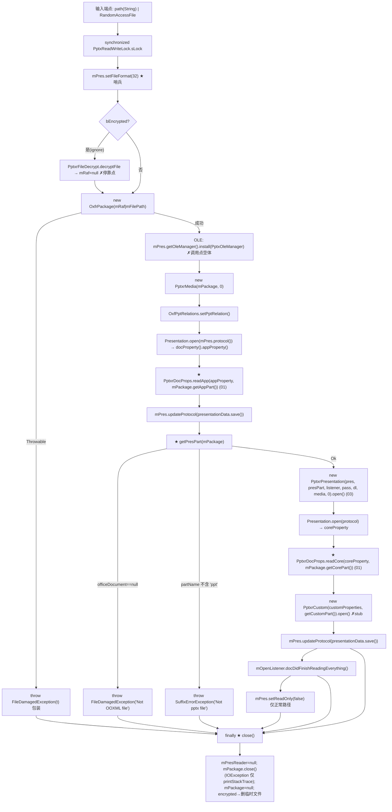
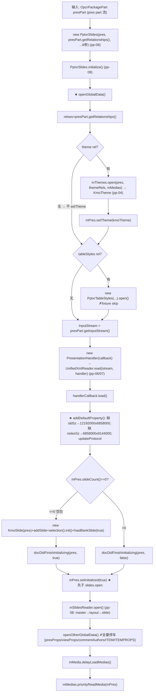
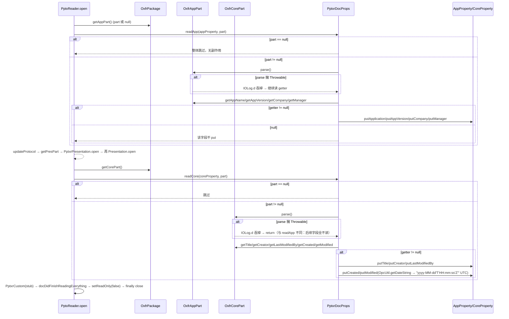
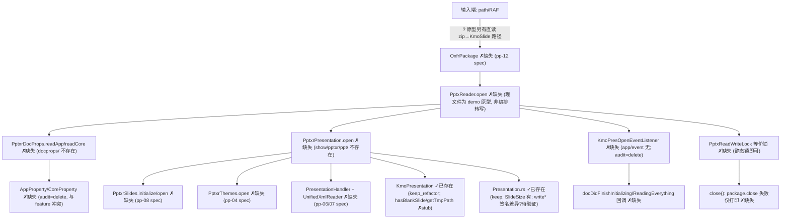

# pp-09-pptx-open — PptxReader 编排（键类/流程/依赖/Java↔Rust 对比）

> 分析依据：feature FEATURE.md / FUNCTIONS.md / functions.csv + Java 源码（真读：PptxReader.java 144 行、PptxrPresentation.java 181 行、PptxrDocProps.java 85 行、PptxReadWriteLock.java、KmoPresOpenEventListener.java、PresentationReader.java、OxfPptRelations.java、OpcUtil.java）+ Rust 现状（真读：show/pptxr/PptxReader.rs 原型、KmoPresentation.rs、Presentation.rs、docproperty/mod.rs、Cargo.toml、tests/）+ 改写台账（ppt_core_mvp_audit.csv / rewriting_files.csv / rewrite_modules.csv / deferred_files.csv）
> 分析日期：2026-09-…（本文件为覆盖式刷新）
> 管线：parse→layout→render（见 libs/ppt-core/parser/features/PIPELINE.md 管线裁决；注：模板所指 `libs/ppt-core/PARSER_JAVA_RUST_PIPELINE.md` 不存在，真实文件为 `parser/features/PIPELINE.md`）

> 状态快照：**spec**（拆分完成，loop 未开始）。FUNCTIONS.md 4 function 01–04 均 spec；**functions.csv 第 4 行 `04_function_pptx_reader` 状态误标 `pass`（与 FEATURE.md / FUNCTION.md 的 spec 冲突，需人工确认）**。

---

## 0. Feature 目标与管线位置

**一句话目标**：锁定 `PptxReader.open` 的调用顺序与失败语义，把 `pptx bytes/RAF → OxfrPackage → 文档属性 → getPresPart 校验 → PptxrPresentation 装配 → 完成回调 → close()` 串成 MVP 唯一允许进入管线的总闸门（仍可用内存 `OxfrPackage` fixture，不要求 ZIP 落盘）。

**上下游（depends_on_feature）**：
- depends_on：pp-04-theme-part（`PptxrThemes.open → KmoTheme + setTheme`）；pp-06-presentation-xml（`PresentationHandler` + `callback.load` 写 `Presentation`）；pp-08-slides-walk（`PptxrSlides.initialize/open` 装配顺序）。间接：pp-01（SWReaderMap/HanlderCallBack 事件面）、pp-02（spTree）、pp-07（`UnifiedXmlReader` + part open）、pp-12（`OxfrPackage` OPC 包桥接，真实文件→part/流）。
- 下游：feature-output（整链总闸门）；产物 `KmoPresentation` 供 layout pl-* → render pr-* 渲染。

**本 feature 回答的问题**（FEATURE.md I/O 表 + 范围外说明）：
1. 打开顺序：`readApp`（01）先于 `getPresPart`；`readCore`（01）在 `pres.open`（03）之后、`PptxrCustom`（stub）之前；`docDidFinishReadingEverything()` → `setReadOnly(false)` → finally `close()` 必跑。
2. 失败语义：`new OxfrPackage(...)` 抛 Throwable → 包装 `FileDamagedException(t)`；`getPresPart`：`getOfficeDocument()==null` → `FileDamagedException("Not OOXML file")`；`!part.getPartName().contains("ppt")` → `SuffixErrorException("Not pptx file")`。
3. 文档属性语义：null part 跳过；`part.parse()` 的 Throwable 吞掉（readApp **继续**读 getter，readCore **直接 return**）；各 getter null 不 put；日期 `OpcUtil.getDateString` → `yyyy-MM-dd'T'HH:mm:ss'Z'`（UTC）。
4. 范围外（本 feature 只留调用点 stub）：decrypt（`PptxrFileDecrypt` / `ModifyVerifier`）、OLE install、custom xml、viewProps / commentAuthors、notes / handout、timing 子树。

---

## 0.5 设计动机与心智模型

**心智模型**：本层把「pptx 容器（ZIP/OPC package）+ 两个元数据 part」投影成「`KmoPresentation`（协议 bin）+ 文档属性 + 首屏回调序列」，是唯一合法的打开入口；下层 feature（pp-04/06/07/08）各自只产出局部，谁先谁后、失败怎么处置、资源何时释放全部归 `PptxReader.open` 一个编排者裁决。

设计矛盾与手段：

| 矛盾 | 主数据结构 | 关键手段 |
|---|---|---|
| 下层各自为政，无总入口 → 打开顺序悬空 | `PptxReader`（字段：mPres/mFilePath/mRaf/bEncrypted/mPackage/mPresReader…） | `open()` 单方法线性编排 + `synchronized(PptxReadWriteLock.sLock)` 全局互斥 + try/finally `close()` |
| 元数据 part 可选、解析可失败 → 不能崩整链 | `AppProperty`/`CoreProperty` + `OxfrAppPart`/`OxfrCorePart` | 三套独立语义：null part 跳过 / parse Throwable 吞掉（readApp 继续 vs readCore return）/ getter null 不 put；日期统一 `getDateString` |
| 空文档也要能首屏 | `PptxrPresentation` + `KmoPresentation`（slideCount/addSlide/hasBlankSlide） | slideCount==0 → 造空白 `KmoSlide` + `hasBlankSlide(true)` + `docDidFinishInitializing(pres, true)`；>0 → `(pres, false)`；`setInitialized(true)` 先于 `slides.open()` |
| 主题必须先行（对齐 word：styles 先于正文） | `PptxrThemes` + `OpcrRelationships` | `openGlobalData` 先按 theme rel type 找 `mThemes.open` 再 `setTheme`，无 theme rel **不** setTheme；tableStyles 可 fixture skip |
| 资源泄漏 / 半开状态 | `OxfrPackage` + mPackage/mPresReader | finally `close()`：mPresReader=null → mPackage.close()（IOException 仅 printStackTrace）→ mPackage=null → encrypted 删临时文件 |

本 feature 特有的「为什么」：
- **挂点 CP**：`setReadOnly(false)` 只在正常路径执行（在 try 内、finally 前），即异常路径不置可写；`setInitialized(true)` 必须在 `slides.open()` **之前**。
- **`PptxrMedia` 创建时机**：`new PptxrMedia(mPackage, 0)` 在 `OxfPptRelations.setPptRelation()` 之前创建，并作为参数贯穿传入 `PptxrPresentation`（媒体延迟加载 `delayLoadMedias` / 优先读 `priorityReadMedia` 在 slides.open 之后）。
- **`getPresPart` 前置**：`readApp` 在 `getPresPart` 之前执行（即使后缀校验失败，文档属性已读但异常已抛出——注意 Java 若 getPresPart 抛异常，readCore/PptxrCustom/回调全不执行，直接进 finally close）。
- **License 哨兵**：`setFileFormat(32)` 是打开链第一动作（文件格式标记）。
- **回调顺序哨兵**：`docDidFinishInitializing(pres, true|false)` 在 `openGlobalData` 之后、`setInitialized(true)` 之前；`docDidFinishReadingEverything()` 在 readCore/custom 之后、`setReadOnly(false)` 之前。

---

## 1. 键类分析（类图）

```mermaid
classDiagram
    class PresentationReader {
        <<interface>>
        +open() void throws IOException
        +isLargestFile() boolean
        +currentSlide(int var1) void
        +close() void throws IOException
    }
    class KmoPresOpenEventListener {
        <<interface>>
        +docDidFinishInitializing(KmoPresentation var1, boolean var2) void
        +slideDidFinishReadingEverything(int var1) void
        +docDidFinishReadingEverything() void
    }
    class PptxReadWriteLock {
        +static final Object sLock
    }
    class OxfrPackage {
        +OxfrPackage(String filePath) throws IOException
        +OxfrPackage(RandomAccessFile raf) throws IOException
        +getOfficeDocument() OpcrPackagePart
        +getAppPart() OxfrAppPart
        +getCorePart() OxfrCorePart
        +getCustomPart() OxfrCustomPart
        +close() void
    }
    class PptxReader {
        -KmoPresentation mPres
        -String mFilePath
        -RandomAccessFile mRaf
        -boolean bEncrypted
        -KmoPresOpenEventListener mOpenListener
        -KsoFilterPasswdProvider mPassProvider
        -IDLProvider mDlProvider
        -OxfrPackage mPackage
        -PptxrPresentation mPresReader
        +open() void throws IOException
        +close() void throws IOException
        -getPresPart(OxfrPackage pack) OpcrPackagePart
        +isLargestFile() boolean
        +currentSlide(int slideIndex) void
    }
    class PptxrPresentation {
        -static final int DEFAULT_SLDSIZE_CX = 12192000
        -static final int DEFAULT_SLDSIZE_CY = 6858000
        -static final int DEFAULT_NODESIZE_CX = 6858000
        -static final int DEFAULT_NODESIZE_CY = 9144000
        -KmoPresentation mPres
        -OpcrPackagePart mPresPart
        -PptxrSlides mSlidesReader
        -PptxrMedia mMedia
        -PptxrMedias mMedias
        -PptxrThemes mThemes
        -int mMode
        +open() void throws IOException
        -openGlobalData() void throws IOException
        -addDefaultProperty() void
        -openOtherGlobalData() void throws IOException
        +static getPresentationSlideSizeType(KmoPresentation) int
    }
    class PptxrSlides {
        +static initialize() void
        +PptxrSlides(KmoPresentation, OpcrRelationships, KmoPresOpenEventListener, IDLProvider, PptxrMedias, PptxrThemes, int, CommentIdContext)
        +open() void throws IOException
        -onSlideIds(List~String~) void
    }
    class PptxrThemes {
        +PptxrThemes(int mode)
        +open(KmoPresentation pres, OpcrRelationship themeRels, PptxrMedias medias) KmoTheme
    }
    class PresentationHandler {
        +PresentationHandler(KmoPresentation pres, KsoFilterPasswdProvider passProvider, PresentationHandlerCallback handlerCallback)
    }
    class UnifiedXmlReader {
        +static read(InputStream stream, ElementHandler handler) void
    }
    class PptxrDocProps {
        -static final String TAG = null
        +static readApp(AppProperty appProperty, OxfrAppPart part) void throws IOException
        +static readCore(CoreProperty coreProperty, OxfrCorePart part) void throws IOException
        +static readThumbsnail(OxfrCorePart part) void throws IOException
    }
    class AppProperty {
        +putApplication(String value) void
        +putAppVersion(String value) void
        +putCompany(String value) void
        +putManager(String value) void
    }
    class CoreProperty {
        +putTitle(String value) void
        +putCreator(String value) void
        +putLastModifiedBy(String value) void
        +putCreated(String value) void
        +putModified(String value) void
    }
    class KmoPresentation {
        +protocol() KoBin
        +updateProtocol(KoBin data) void
        +setFileFormat(int format) void
        +setReadOnly(boolean bOnly) void
        +setInitialized(boolean initialized) void
        +slideCount() int
        +addSlide(KmoSlide slide) void
        +hasBlankSlide(boolean) void
        +setTheme(KmoTheme theme) void
        +getTmpPath() String
    }

    PresentationReader <|-- PptxReader
    PptxReader --> PptxrPresentation : mPresReader
    PptxReader ..> PptxrDocProps : static readApp/readCore
    PptxReader ..> OxfrPackage : mPackage 构建/close
    PptxReader ..> PptxReadWriteLock : synchronized(sLock)
    PptxReader ..> KmoPresOpenEventListener : mOpenListener
    PptxrPresentation --> PptxrSlides : mSlidesReader
    PptxrPresentation --> PptxrThemes : mThemes
    PptxrPresentation --> PptxrMedia : mMedia
    PptxrPresentation --> PptxrMedias : mMedias
    PptxrPresentation ..> PresentationHandler : UnifiedXmlReader.read
    PptxrPresentation ..> UnifiedXmlReader
    PptxrPresentation --> KmoPresentation : mPres
    PptxrDocProps ..> AppProperty : put*
    PptxrDocProps ..> CoreProperty : put*
    OxfrPackage --> PptxReader : getOfficeDocument/getAppPart/getCorePart
```



### 1.1 `PptxReader`（编排器，热路径全部）

| 项 | 内容 |
|---|---|
| 继承/实现 | `final class PptxReader implements PresentationReader`（`app/io/PresentationReader.java`：open/isLargestFile/currentSlide/close） |
| 关键字段 | `mPres→KmoPresentation`：目标文档；`mFilePath→String`：path 后端；`mRaf→RandomAccessFile`：RAF 后端（与 mFilePath 二选一）；`bEncrypted→boolean`：加密标志（解密分支 ignore）；`mOpenListener→KmoPresOpenEventListener`：完成后回调；`mPassProvider→KsoFilterPasswdProvider`：密码提供者（decrypt 用，本 feature 不测）；`mDlProvider→IDLProvider`；`mPackage→OxfrPackage=null`：OPC 包（pp-12 桥接）；`mPresReader→PptxrPresentation=null`：03 编排 |
| 关键方法 | `PptxReader(KmoPresentation, String path, KmoPresOpenEventListener, KsoFilterPasswdProvider, boolean encrypted, IDLProvider)` → 存 mFilePath + `init`；`PptxReader(KmoPresentation, RandomAccessFile, …同上)` → 存 mRaf + `init`；`private init(pres, openListener, passProvider, encrypted, dlProvider)` → 记录 mPres/bEncrypted/mOpenListener/mPassProvider/mDlProvider |
| ★ | `public void open() throws IOException`（PptxReader.java:56）：`synchronized(PptxReadWriteLock.sLock)` 包整体 → `mPres.setFileFormat(32)` → `oriPath=mFilePath` → encrypted 分支 `decryptFile`（ignore）→ `new OxfrPackage(mRaf|mFilePath)` 抛 Throwable 则 `throw new FileDamagedException(t)` → OLE install（移出，调用点）→ `new PptxrMedia(mPackage,0)` → try{ `OxfPptRelations.setPptRelation()`；`Presentation.open(mPres.protocol())` 取 `docProperty().appProperty()` → `PptxrDocProps.readApp(...)`；`updateProtocol(presentationData.save())`；`getPresPart(mPackage)`；`new PptxrPresentation(...).open()`；再 `Presentation.open(...)` 取 `coreProperty` → `readCore(...)`；`new PptxrCustom(...).open()`（stub）；`updateProtocol(...)`；`docDidFinishReadingEverything()`；`setReadOnly(false)` } finally { `close()` } |
| ★ | `public void close() throws IOException`（:110）：`mPresReader=null`；`mPackage!=null` → try `mPackage.close()` catch `IOException e` 仅 `printStackTrace` → `mPackage=null`；`bEncrypted` → `new File(mFilePath)` exists 则 delete（临时文件清理） |
| ★ | `private OpcrPackagePart getPresPart(OxfrPackage pack) throws IOException`（:134）：`part=pack.getOfficeDocument()`；`part==null` → `throw new FileDamagedException("Not OOXML file")`；`!part.getPartName().contains("ppt")` → `throw new SuffixErrorException("Not pptx file")`；否则 return |
| 空实现 | `isLargestFile()` 恒 false（:103）；`currentSlide(int slideIndex)` 空体（:107） |

### 1.2 `PptxrPresentation`（pres part 装配，02/03）

| 项 | 内容 |
|---|---|
| 继承/实现 | `final class PptxrPresentation`（无接口） |
| 常量 | `DEFAULT_SLDSIZE_CX=12192000`、`DEFAULT_SLDSIZE_CY=6858000`、`DEFAULT_NODESIZE_CX=6858000`、`DEFAULT_NODESIZE_CY=9144000`（addDefaultProperty 默认尺寸） |
| 关键字段 | `mPres→KmoPresentation`；`mPresPart→OpcrPackagePart`（pres part）；`mOpenListener/mPassProvider/mDlProvider`；`mSlidesReader→PptxrSlides`；`mMedia→PptxrMedia`；`mMedias→PptxrMedias`；`mThemes→PptxrThemes`；`mMode→int`；`mCommentIdCxt→CommentIdContext`（comment 移出） |
| 构造 | `PptxrPresentation(KmoPresentation, OpcrPackagePart presPart, KmoPresOpenEventListener, KsoFilterPasswdProvider, IDLProvider, PptxrMedia media, int mode)`：记字段 + `mMedias=new PptxrMedias(mMedia, mPres, 0)`（PptxrPresentation.java:52）+ `mThemes=new PptxrThemes(mMode)`（:53）+ `mCommentIdCxt=new CommentIdContext(mPres)`（:54） |
| ★ | `public void open() throws IOException`（:57）：`mSlidesReader=new PptxrSlides(mPres, mPresPart.getRelationships(), mOpenListener, mDlProvider, mMedias, mThemes, mMode, mCommentIdCxt)` → `PptxrSlides.initialize()` → `openGlobalData()` → `slideCount()==0`：`new KmoSlide(mPres)`+`addSlide`+`selection().init()`+`hasBlankSlide(true)`+`docDidFinishInitializing(mPres, true)`；`>0`：`docDidFinishInitializing(mPres, false)` → `mPres.setInitialized(true)` → `mSlidesReader.open()` → `openOtherGlobalData()`（移出）→ `mMedia.delayLoadMedias()` → `mMedias.priorityReadMedia(mPres)` |
| ★ | `private void openGlobalData() throws IOException`（:78）：`relses=mPresPart.getRelationships()`；`themeRels=relses.getRelationshipByType(OxfPptRelations.theme().getRelsType())` → 非 null 则 `kmoTheme=mThemes.open(mPres, themeRels, mMedias)` + `mPres.setTheme(kmoTheme)`（无 theme rel 不 setTheme）；`stylesRels=tableStyles()` → rel 与 part 均非 null 则 `new PptxrTableStyles(mPres, part, mMedias, mSlidesReader, mMode).open()`（fixture skip）；`stream=mPresPart.getInputStream()`；`handlerCallback=new PresentationHandlerCallbackImpl(mSlidesReader, mPres.drawingStore(), mPres.mediaLib(), mPres.inkLib(), mPres.fontLib(), mPresPart.getRelationships(), mMedias, mSlidesReader, mMode, mPres.getTmpPath())`（10 参）；`new PresentationHandler(mPres, mPassProvider, handlerCallback)` → `UnifiedXmlReader.read(stream, handler)` → `handlerCallback.load()` → `addDefaultProperty()` |
| ★ | `private void addDefaultProperty()`（:103）：`presData=Presentation.open(mPres.protocol())`；`!hasSlideSize()` → `new SlideSize` + `putCx(12192000)` + `putCy(6858000)` + `save()` + `writeSlideSize(sldSize)`；`!hasNotesSize()` → `new PositiveSize2D` + `putCx(6858000)` + `putCy(9144000)` + `save()` + `writeNotesSize(size2D)`；`mPres.updateProtocol(presData.save())` |
| 移出 | `private void openOtherGlobalData() throws IOException`（:124）：presProps → `PptxrPresProps`；viewProps → `PptxrViewProps` 或 `buildDefaultViewProperty()`（无 rel 走默认）；commentAuthors → `PptxrCommentAuthors`；ITEM/ITEMPROPS → `PptxrItem`/`PptxrItemProps`；最后 `updateProtocol`。**全量停车（post-MVP）** |
| 类级 | `public static int getPresentationSlideSizeType(KmoPresentation)`（:165）：slideSize 有 type 用 type，否则 `cx*9==cy*16` → 15（16:9 魔数；不在 4 function 清单内，标注备查） |

### 1.3 `PptxrDocProps`（01 文档属性）

| 项 | 内容 |
|---|---|
| 继承/实现 | `class PptxrDocProps`（全 static，无字段除 `TAG=null`） |
| ★ | `public static void readApp(AppProperty appProperty, OxfrAppPart part) throws IOException`（:15）：`part!=null` → try `part.parse()` catch Throwable 仅 `IOLog.d(TAG,"Throwable",e)` **继续**；`getAppName()!=null→putApplication`；`getAppVersion()!=null→putAppVersion`；`getCompany()!=null→putCompany`；`getManager()!=null→putManager`（4 个独立 null 分支） |
| ★ | `public static void readCore(CoreProperty coreProperty, OxfrCorePart part) throws IOException`（:46）：`part!=null` → try `part.parse()` catch Throwable `IOLog.d` 后 **直接 return**（与 readApp 差异：后续字段不读）；`getTitle()!=null→putTitle`；`getCreator()!=null→putCreator`；`getLastModifiedBy()!=null→putLastModifiedBy`；`getCreated()!=null→putCreated(OpcUtil.getDateString(created))`；`getModified()!=null→putModified(getDateString(modified))` |
| 空实现 | `public static void readThumbsnail(OxfrCorePart part) throws IOException`（:83）空体，模板保留 |

### 1.4 关键依赖类（非本 feature 键类，1 行速查）

| 类 | 角色 |
|---|---|
| `PptxReadWriteLock` | `public static final Object sLock = new Object()`（show/PptxReadWriteLock.java:4），`open()` 全局互斥；Rust 等价：crate 级 `static` 锁（OnceLock/Mutex），类本身可退化为常量 |
| `PptxrSlides`（pp-08） | `static initialize()`（:52）、`PptxrSlides(...8 参)`（:92）、`open()`（:103）、`onSlideIds/onSlideMasterIds/onNotesMasterIds/onHandoutMasterIds`、`changeLayout`、静态内嵌 `UnReadSlides` |
| `PptxrThemes`（pp-04） | `PptxrThemes(int mode)`（:20）、`open(KmoPresentation, OpcrRelationship themeRels, PptxrMedias) → KmoTheme`（:24） |
| `PresentationHandler`（pp-06） | `extends DefaultElementHandler`；`PresentationHandler(KmoPresentation, KsoFilterPasswdProvider, PresentationHandlerCallback)`；内含 `SlideAndMasterIdListHandler`/`NotesAndHandoutMasterIdListHandler`/`SlideSizeHandler` 等 nested |
| `PresentationHandlerCallback`（pp-06） | `onSlideIds(List<String>)`/`onSlideMasterIds`/`onNotesMasterIds`/`onHandoutMasterIds`/`onCustomShow`/`onTextFont*Data`… |
| `UnifiedXmlReader`（pp-07） | `static read(InputStream, ElementHandler)` / `read(String srcPath, ...)`；XML 事件 → ElementHandler |
| `OxfrPackage`（pp-12） | 两个 ctor + `getOfficeDocument()→OpcrPackagePart`、`getAppPart()→OxfrAppPart`、`getCorePart()→OxfrCorePart`、`getCustomPart()→OxfrCustomPart`、`close()`；WPS 私有 OPC 封装，Rust 侧无对应 |
| `OxfPptRelations` | 静态关系表：`setPptRelation()`；`theme()/tableStyles()/presProps()/viewProps()/commentAuthors()/ITEM/ITEMPROPS → OpcRelation`；ITEM rel type=`…/relationships/customXml`、ITEMPROPS=`…/customXmlProps` |
| `AppProperty` / `CoreProperty` | doc property 写入面：`putApplication/putAppVersion/putCompany/putManager`；`putTitle/putCreator/putLastModifiedBy/putCreated/putModified(String)` |
| `OpcUtil.getDateString(Date)` | `OpcUtil.java:119-123`：`SimpleDateFormat("yyyy-MM-dd'T'HH:mm:ss'Z'")` + `TimeZone UTC` |

---

## 2. 流程图（依据 I/O）

### 2.1 `PptxReader.open` 总闸门（function 04）



### 2.2 `PptxrPresentation.open` 内部（function 03 + 02）



### 2.3 文档属性 I/O 时序（function 01，含 readApp/readCore 差异）



---

## 3. 依赖关系与改写状态

### 3.1 类间依赖表（Java 侧）

| 本类 | 依赖 | 归属 feature/层 | 用途 | Rust 状态 |
|---|---|---|---|---|
| PptxReader | OxfrPackage | pp-12（OPC 桥接） | 包构建/close/取 part | ✗缺失（pp-12 spec） |
| PptxReader | PptxrPresentation | 本 feature 03 | pres 打开编排 | ✗缺失 |
| PptxReader | PptxrDocProps | 本 feature 01 | readApp/readCore | ✗缺失 |
| PptxReader | PptxrMedia / PptxOleManager | 本 feature / 移出 | 媒体延迟加载 / OLE install 调用点 | ✗缺失 / 移出 |
| PptxReader | PptxrCustom | 移出（post-MVP） | custom xml 调用点 stub | ✗缺失 |
| PptxReader | KmoPresOpenEventListener | app 层（audit delete）| 完成回调 | ✗缺失（Rust 无 app/event 模块） |
| PptxReader | PptxReadWriteLock | show 层 | synchronized 互斥 | ✗缺失（可用 crate 静态锁等价） |
| PptxrPresentation | PptxrSlides | pp-08（spec） | initialize/open 装配 | ✗缺失 |
| PptxrPresentation | PptxrThemes | pp-04（spec） | theme → KmoTheme + setTheme | ✗缺失 |
| PptxrPresentation | PresentationHandler + Callback | pp-06（spec） | presentation.xml 事件 + rId 列表回调 | ✗缺失 |
| PptxrPresentation | UnifiedXmlReader | pp-07（spec） | InputStream → ElementHandler | ✗缺失 |
| PptxrPresentation | PptxrTableStyles | 本 feature stub | openGlobalData rel 分支 | ✗缺失（可 fixture skip） |
| PptxrPresentation | Presentation / SlideSize / PositiveSize2D | data 层（keep） | addDefaultProperty 尺寸读写 | ✓已存在（Presentation.rs；无 rust 访问器 需人工确认） |
| PptxrPresentation | KmoPresentation | app 层（keep_refactor） | slideCount/addSlide/setInitialized/setTheme… | ✓已存在（部分方法 stub，见 §3.2） |
| PptxrDocProps | OxfrAppPart / OxfrCorePart | core-libs（kfc） | parse + 10 个 getter | ✗缺失（kfc Rust 侧未出货，需 contract fixture） |
| PptxrDocProps | AppProperty / CoreProperty | data/docproperty（audit delete） | put* 写入 | ✗缺失（docproperty/mod.rs 仅注释 stub） |
| PptxrDocProps | OpcUtil.getDateString | kfc/opcr | 日期格式化 | ✗缺失（格式常量可直接内联：见 §5） |

### 3.2 Java↔Rust 路径映射表

| java_path | rust_path | 状态（来源） |
|---|---|---|
| koffice/presentation/core/cn/wps/show/pptxr/PptxReader.java | libs/ppt-core/src/cn/wps/show/pptxr/PptxReader.rs | **未开始**（现文件为未注册 demo 原型 `open_pptx_bytes`，非本类转写，见 §6.5） |
| koffice/presentation/core/cn/wps/show/pptxr/ppt/PptxrPresentation.java | （无；show/pptxr/ppt/ 目录不存在） | 未开始 |
| koffice/presentation/core/cn/wps/show/pptxr/docprops/PptxrDocProps.java | （无；show/pptxr/docprops/ 目录不存在） | 未开始 |
| koffice/presentation/core/cn/wps/show/PptxReadWriteLock.java | （无） | 未开始（等价静态锁） |
| koffice/presentation/core/cn/wps/show/app/KmoPresentation.java | src/cn/wps/show/app/KmoPresentation.rs | **依赖-done**（audit: keep_refactor，2182 行/1 stub 标记/750 javacom；hasBlankSlide 丢值 stub、getTmpPath 空实现） |
| koffice/presentation/core/cn/wps/show/data/Presentation.java | src/cn/wps/show/data/Presentation.rs | **依赖-done**（audit: keep，5426 行；含 SlideSize；writeNotesSize 签名为 `Option<&PositiveSize2D>` 与 Java 有差异，需人工确认） |
| koffice/presentation/core/cn/wps/show/data/docproperty/AppProperty.java | （docproperty/mod.rs 中 `// pub mod AppProperty;` 注释掉） | **依赖-壳**（audit: delete「app metadata, not needed」；与 pp-09-01 写入需求冲突，需人工确认，见 §6.5） |
| koffice/presentation/core/cn/wps/show/data/docproperty/CoreProperty.java | （同上，未生成） | **依赖-壳**（audit: delete；同上冲突） |
| koffice/presentation/core/cn/wps/show/app/event/KmoPresOpenEventListener.java | （无；app/event 模块不存在，KmoPresentation.rs 中 import 悬空） | **依赖-壳**（audit: delete「editor event listener」；pp-09 测试需 Recording listener，需人工确认） |
| koffice/presentation/core/cn/wps/show/pptxr/ppt/slides/PptxrSlides.java | （无） | 依赖-未动工（pp-08 spec） |
| koffice/presentation/core/cn/wps/show/pptxr/ppt/theme/PptxrThemes.java | （无） | 依赖-未动工（pp-04 spec） |
| koffice/presentation/core/cn/wps/show/pptxr/handler/PresentationHandler.java | （无；handler/mod.rs 仅声明 shape/custdatas，`#[cfg(feature="full")]`） | 依赖-未动工（pp-06 spec） |
| koffice/presentation/core/cn/wps/show/pptxr/util/UnifiedXmlReader.java | （无） | 依赖-未动工（pp-07 spec） |
| koffice/core-libs/kfc/kfc_alpha/src/cn/wps/kfc/ooxfr/OxfrPackage.java | （无） | 依赖-未动工（pp-12 spec；wave0 OPC 本体在 core-libs） |
| koffice/presentation/core/cn/wps/show/pptxr/util/PptxrFileDecrypt.java | src/cn/wps/show/pptxr/util/PptxrFileDecrypt.rs | 依赖-壳（audit: delete；解密非 MVP；rewriting_files.csv:657 fail） |
| koffice/presentation/core/cn/wps/show/pptxr/docprops/PptxrCustom.java 等移出类 | （无） | 未开始（post-MVP，调用点 stub） |

---

## 4. 最小 feature-critical 改写范围

### must-write（feature 关键类与方法，Rust 侧必须真实现）
1. `PptxReader.rs`：两个 ctor + `init`；★`open()`（顺序与 Java 一字不差；crate 级静态锁替代 `synchronized(sLock)`；`setFileFormat(32)`；OxfrPackage Throwable → FileDamaged 包装）；★`close()`（mPresReader=null → mPackage.close 失败仅记日志 → mPackage=null → encrypted 删临时文件）；★`getPresPart`（两条异常消息钉死）；`isLargestFile` 恒 false / `currentSlide` 空体保留。
2. `PptxrPresentation.rs`：ctor（含 `PptxrMedias`/`PptxrThemes`/`CommentIdContext` 装配）；★`open()`（slideCount==0/>0 两条 initializing 回调 + `setInitialized(true)` 先于 slides.open + slides.open + delayLoadMedias + priorityReadMedia）；★`openGlobalData()`（theme 先于 presentation.xml、无 theme rel 不 setTheme、tableStyles 分支 fixture skip、`UnifiedXmlReader.read` + `callback.load`）；★`addDefaultProperty()`（4 个尺寸常量 + hasSlideSize/hasNotesSize 判缺）；`openOtherGlobalData` 全量停车 stub。
3. `PptxrDocProps.rs`：★`readApp`（parse Throwable 吞掉继续；4 getter null 不 put）；★`readCore`（parse Throwable 吞掉 **return**；5 字段含日期格式化）；`readThumbsnail` 空体。
4. 测试契约层（tests/ 镜像）：`KmoPresOpenEventListener` Recording 实现（docDidFinishInitializing/ReadingEverything 顺序录制）；`OxfrPackage` 内存 fixture（getOfficeDocument null/partName 无 ppt/正常 三态 + parse 抛 Throwable 的 App/Core part）。

### 可 stub（保留调用点，正文热路径不依赖业务体）
- `PptxrCustom.open` 调用点保序空体；`PptxOleManager.install` 调用点空体；`PptxrTableStyles`（有 rel 时 fixture skip）；encrypted 分支整体 `#[ignore = "spec: post-MVP"]`（不 fake decrypt）；`openOtherGlobalData` 全量（presProps/viewProps/commentAuthors/ITEM/ITEMPROPS）矩阵项 ignore。

### 可 defer
- decrypt（`PptxrFileDecrypt`/`ModifyVerifier`）、custom xml、viewProps/commentAuthors 业务体、notes/handout、timing 子树、`getPresentationSlideSizeType`（类级方法，不在 4 function 清单，随类保留即可）。

### 当前进度与计划拆分
- 4 function 全 spec，Rust 未动工；loop 顺序按 FUNCTIONS.md §5：`01 → 02 → 03 → 04`（04 编排用 01–03 golden + Recording listener 锁顺序）。
- **需人工确认项**：① functions.csv 04 行误标 `pass`（应 spec）；② 现存 `04_function_pptx_reader` `[[test]]`（tests/cn/wps/show/pptxr/PptxReader.rs）与 pp-09 function 04 的目标测试名重名（loop L2 建 `[[test]]` 时冲突，需重命名旧原型测试或并入）；③ AppProperty/CoreProperty 被 audit 标 delete 但与 01 功能需求矛盾（01 pass 需要最小属性容器）；④ `PptxReader.rs` 原型（quick-xml/zip 直读）未被任何 CSV 注册，不应作为本 feature Rust 目标（见 §6.5）。

---

## 5. 验收口径

FEATURE.md §4 / FUNCTIONS.md §4 验收 4 条（spec 阶段即以此为准）：
1. **readApp：各 getter null 不 put**（4 个独立分支；part==null 整体跳过；parse Throwable 吞掉后继续读）。
2. **openGlobalData：无 theme rel 不 setTheme**（theme 先于 presentation.xml 的顺序由 Recording 锁定）。
3. **slideCount==0 与 >0 两条 initializing 回调**（==0：空白 slide + `docDidFinishInitializing(pres, true)` + hasBlankSlide(true)；>0：`(pres, false)`）。
4. **PptxReader.close：package.close 失败只 printStackTrace（不向上抛）；encrypted 删临时文件**。

钉死的数字/枚举/哨兵值（必须与 Java 字面量一致）：
- `mPres.setFileFormat(32)` —— 打开链第一动作。
- 默认尺寸：slide `cx=12192000, cy=6858000`；notes `cx=6858000, cy=9144000`（PptxrPresentation 常量与 addDefaultProperty 字面量双处一致）。
- 异常消息：`FileDamagedException("Not OOXML file")`、`SuffixErrorException("Not pptx file")`；check 子串 `part.getPartName().contains("ppt")`。
- 构造失败：`new OxfrPackage(...)` 抛 Throwable → `FileDamagedException(t)`（包装，不只 getPresPart 抛）。
- 日期格式：`OpcUtil.getDateString` → `"yyyy-MM-dd'T'HH:mm:ss'Z'"` + `TimeZone UTC`（OpcUtil.java:119-123）。
- 顺序哨兵：readApp 先于 getPresPart；readCore 在 `mPresReader.open()` 之后；`docDidFinishReadingEverything()` 在 readCore 之后、`setReadOnly(false)` 之前；`setReadOnly(false)` 仅正常路径（try 内、finally 前）；`setInitialized(true)` 在 slides.open 前；finally `close()` 必跑。
- 16:9 魔数：`cx*9 == cy*16` → slideSizeType=15（`getPresentationSlideSizeType`，类级方法，README 备查）。

---

## 6. Java↔Rust 管线对比与缺口审计

### 6.1 Java 完整链路（输入端点 → 模型）

```text
path(String)/RandomAccessFile
 → PptxReader.open（synchronized sLock）
 → setFileFormat(32)
 → OxfrPackage(raf|path)                ← ZIP/OPC 解包（pp-12 桥接）
 → getAppPart() → PptxrDocProps.readApp   ← AppProperty（null 跳过/吞 throwable/继续读）
 → getPresPart()                          ← officeDocument null→FileDamaged；partName 无 "ppt"→SuffixError
 → PptxrPresentation.open
     → PptxrSlides.initialize()
     → openGlobalData：theme rel → PptxrThemes.open → setTheme；tableStyles（skip）；UnifiedXmlReader.read(presentation.xml 流) → PresentationHandler → callback.load()；addDefaultProperty（缺 sldSz/notesSz 写默认）
     → slideCount==0/>0 → docDidFinishInitializing(pres, boolean)
     → setInitialized(true) → PptxrSlides.open()（pp-08 master→layout→slide）→ openOtherGlobalData（post-MVP）→ delayLoadMedias → priorityReadMedia
 → Presentation.open → readCore（CoreProperty；吞 throwable 直接 return）
 → PptxrCustom.open（stub）
 → docDidFinishReadingEverything() → setReadOnly(false)
 → finally close()：mPresReader=null；mPackage.close（IOException 仅打印）；mPackage=null；encrypted 删临时文件
```

### 6.2 Rust 端现状图（本 feature + 依赖闭包；空 = 未动工）



### 6.3 键类与依赖审计表

| 类 | critical? | rust_path | 状态 | stub 类型/缺口 | 影响 | 修复建议 |
|---|---|---|---|---|---|---|
| PptxReader | 是（04） | show/pptxr/PptxReader.rs（现有为原型） | 未开始 | 编排类缺失；现文件为 quick-xml/zip 直读 demo，语义不同且未注册 CSV | 整链无入口 | function 04 loop 按 Java 转写；原型文件重命名/移出或标记 demo |
| PptxrPresentation | 是（02/03） | （无） | 未开始 | 缺失 | 02/03 全无 | function 02→03 转写 |
| PptxrDocProps | 是（01） | （无） | 未开始 | 缺失 | 01 全无 | function 01 转写 |
| KmoPresOpenEventListener | 是（04 回调面） | （无；audit delete） | 依赖-壳 | 缺失；import 悬空 | 回调无法录制/接线 | loop 建最小 trait + Recording 实现（测试契约） |
| AppProperty / CoreProperty | 是（01 输出面） | docproperty/mod.rs 注释态 | 依赖-壳 | audit 裁决 delete 与 feature 需求矛盾 | readApp/readCore 无处写 | 按 01 需求建最小容器（覆盖 audit delete 需人工确认） |
| Presentation（data） | 依赖 | show/data/Presentation.rs | 依赖-done | 存在但 `writeNotesSize(&mut self, Option<&PositiveSize2D>)`、无 docProperty() 访问器等与 Java 有出入 | addDefaultProperty/readCore 桥接需适配 | loop 时核对签名，需人工确认 |
| KmoPresentation | 依赖 | show/app/KmoPresentation.rs | 依赖-done | `hasBlankSlide` 丢值 stub（`let _ = hasBlankSlide;`）、`getTmpPath` 返回 String::new() | 空白 slide 标志/临时目录语义丢 | loop 前修 hasBlankSlide（&mut 或内部可变）；getTmpPath 由 PptxrPresentation 传入 tmp 参数规避 |
| PptxrSlides / PptxrThemes / PresentationHandler / UnifiedXmlReader / OxfrPackage / OxfPptRelations | 依赖 | （无） | 依赖-未动工 | 完整缺失 | 03 无法真实装配 | 属 pp-04/06/07/08/12，各自 spec 完成后 pp-09 再接线；or contract fixture |

### 6.4 断点顺序（输入→解析→回调）

1. **输入链硬门闩**：`OxfrPackage`（pp-12）无 Rust → `PptxReader.open` 两个 ctor 无法构建包。现有原型走 `zip::ZipArchive` 直读是旁路，不满足 Java 语义（如 getOfficeDocument/getAppPart part 定位、close 语义）。
2. 解析链：`PptxrDocProps.parse()` 依赖 kfc 层 `OxfrAppPart/OxfrCorePart` parse——Rust 无对应（需 contract fixture 吸收）。
3. 回调链：`KmoPresOpenEventListener`（docDidFinishInitializing/ReadingEverything）与 `KmoPresOpenEventListenerGroup` 均无 Rust（audit delete）→ Recording 测试契约需先补最小 trait。
4. 模型链：`AppProperty/CoreProperty` 缺失（audit delete 冲突）；`KmoPresentation.hasBlankSlide` 丢值 stub。

### 6.5 特别标注（需人工确认）

- **现存 `show/pptxr/PptxReader.rs`（347 行）**：`open_pptx_bytes/open_pptx_path` 直读 zip → `KmoSlide`，含自己的 `element_id/attr_id` 哈希表与 `walk_xml`；错误串 "FileDamaged: Not OOXML file"/"SuffixError: Not pptx file" 但触发语义与 Java 不同（Java 看 officeDocument/partName，原型看 presentation.xml 是否存在、是否找到 slide1.xml）。该文件未被 `ppt_core_mvp_audit.csv`/`rewriting_files.csv` 注册（grep 无行），也不含 ctor/init/open/close/getPresPart——**它不是 Java `PptxReader` 的转写**，不能算本 feature 的 Rust 目标；其测试 `tests/cn/wps/show/pptxr/PptxReader.rs`（[[test]] `04_function_pptx_reader`）服务于 mvp_pipeline 渲染 demo，与 pp-09 function 04 目标测试**重名冲突**，loop 时必须处理（重命名/移出），否则 Cargo.toml 出现重复 test name。
- **functions.csv row 4 `04_function_pptx_reader` 状态 `pass`**：与 FEATURE.md（01–04 均 spec）、04 FUNCTION.md（spec）、manifest.csv（pp-09 spec）冲突——疑似误标（可能是「04 是编排 function，loop 建议先测」被写成 pass）。
- **audit CSV 对 AppProperty/CoreProperty/KmoPresOpenEventListener 的 `delete` 裁决**：与 pp-09-01（readApp/readCore 写入）和 04（Recording 回调）需求直接冲突；audit 快照早于 feature 拆分，feature 需求优先（最小容器/trait），但需人工确认裁决更新。

### 6.6 结论

**spec-未动工**。

- 本 feature 的三个 Rust 目标类（PptxReader / PptxrPresentation / PptxrDocProps）**全部未开始**；现存同名 `PptxReader.rs` 是 unregistered demo 原型，语义与 Java 编排不同，不可作为目标。
- 依赖闭包（pp-04/06/07/08/12）全为 spec 未动工；模型侧 KmoPresentation/Presentation 已存在（keep）但带丢值 stub（hasBlankSlide）与签名出入（writeNotesSize Option）需要适配。
- 持续阻塞项：OxfrPackage（pp-12）与全链路入口互相等待——pp-09 的 04 可用内存 OxfrPackage fixture 先行（FEATURE.md 允许），但真实文件入链要等 pp-12。
- 按 FEATURE.md 原则：本 feature 推进不改变 pp-01/pp-02 语义；PptxrCustom/openOtherGlobalData 矩阵项 `#[ignore = "spec: post-MVP"]` 不得计 pass，直到忽略项从必测拿掉或实现。