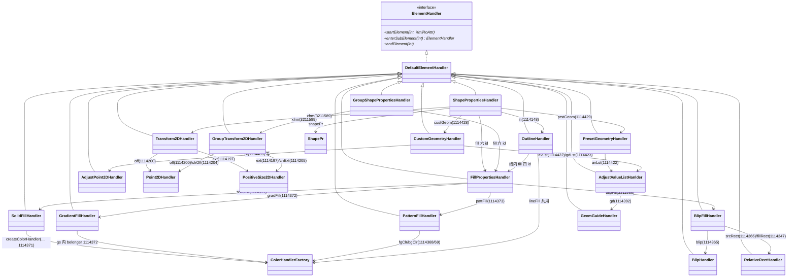
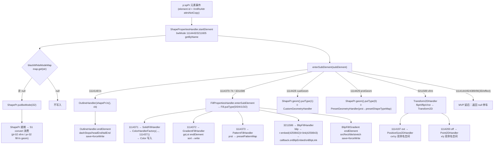
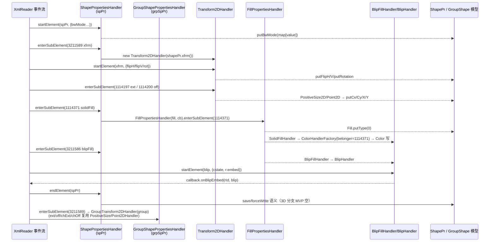

# pp-10-dml-sppr — 形状 spPr（渲染阻塞）（键类/流程/依赖/Java↔Rust 对比）

> 分析依据：feature FEATURE.md / FUNCTIONS.md / functions.csv + Java 源码（真读）+ Rust 现状（已核实：cargo check pass、01 测试 5/5 绿）
> 管线：parse→layout→render（见 libs/ppt-core/parser/features/PIPELINE.md 顶层对比；本 feature = S0 parse 的 spPr→ShapePr 写入，是 S1 convert 的输入侧）
> 分析日期：2026-09-12

## 0. Feature 目标与管线位置

**一句话目标**：把 `p:spPr` 与 `p:grpSpPr` 子树从 pp-02 的 deferred 分发改成**写入 `ShapePr` 模型**——bwMode、xfrm（off/ext/rot/flip）、fill（六类最小集）、ln（线属性）、geometry（prstGeom/custGeom 最小集）四条子链，为 S1 convert（pl-02/pr-02）提供坐标/几何/填充/线条输入。

- **上游 depends_on**：pp-01-pptx-parse（`HandlerCallback` 回调语义、`XmlRoAttr`/元素 id 事件面、`SWReaderMap` 查表）；pp-02-shape-tree-parse（spTree 分发 → spPr 子事件；pp-02:02/03/04 构造 `ShapePropertiesHandler`、pp-02:05 group 路径构造 `GroupShapePropertiesHandler`）。
- **下游**：pp-11-dml-txbody（依赖 pp-10）；layout `pl-02-xfrm-geometry`（xfrm→ShapeInfoCache）、render `pr-02-shape-command`（fill/ln/geom→绘制指令）、pl-03-ph-merge（fill 消费）。
- **本 feature 回答的问题**（FEATURE.md I/O 表与范围外说明）：形状落在 DgStore 行后，其 spPr 能否被解析进模型？四个 function 分别回答：01——顶层分发 + bwMode/Transform2D 是否精确；02——fillType 六分支 + solid 实色链是否能写；03——ln 的 w/cmpd/cap/algn/lineJoin/dash 是否进 Outline；04——prstGeom id/avLst、custGeom rect/path 是否进 Geometry2D。
- **范围外**（不回答）：效果层（effectLst/effectDag/1114389/1114390）、3D（scene3d=1114144/sp3d=1114145）、图片位图解码、gradient 停靠全表、theme 槽回填（pp-03/04）、KmoShowShape 装配（pp-07）、convert/排版/绘制（pl-*/pr-*）。
- **状态口径（发现不一致）**：FEATURE.md / FUNCTIONS.md 标 **spec**，functions.csv 中 `01_function_shape_properties` 标 **pass**（且其 FUNCTION.md 已有 §3.7 覆盖报告 + §3.9 对齐报告 PASS）。核实后 01 确已有可编译实现与绿测试（见 §6），02/03/04 仍 spec。**「01=pass 需 review 裁决复核」**——01 交付出含 NamedHandler 壳与模型偏差（见 §4/§6）。

## 0.5 设计动机与心智模型

这个 feature 的结构解决什么矛盾、为什么这样设计：

1. **心智模型**：本层把「XML 元素 id + attr 事件流」投影成「`ShapePr` 上的属性写入」——handler 是事件→模型的**翻译器**，模型是 S1 convert 的唯一输入。Java 的 spPr 在 *handler 构造时传入模型对象引用*，子元素经 `enterSubElement` 返回**子 handler** 继续消费子树事件，`endElement` 统一 `save()`+`forceWrite*` 落盘。
2. **设计矛盾 → 手段**：
   | 矛盾 | 主数据结构 | 关键手段 |
   |---|---|---|
   | 一棵 spPr 子树塞七条独立属性链 | `ShapePr` 聚合（xfrm/fill/ln/geom/effect/3D） | handler 按子元素 id 分发，每链一个 handler 持有对应子模型引用 |
   | 子元素 id 与 attr id 双命名空间（a: 1114xxx vs pml 3211xxx/3276xxx） | `XmlRoAttr.getByName(int)` + 元素 id 常量 | 逐 attr `getByName` 判空；id 数值双写（如 rot=1114201/3276881） |
   | 字符串枚举值（"rect"/"clr"）→ 整数哨兵 | `DGMap` 静态查表 | map miss → null → **不写入**（Java `if (x != null)` 语义） |
   | 多条子元素需要 endElement 统一落盘 | `save()`+`forceWrite*/write*` 分离 | 非空才 save+write（dashLst/avLst/gsLst/pathLst/headEnd/srcRect 等） |
3. **结构角色速查**：`ShapePropertiesHandler`（shape 形态顶层入口）与 `GroupShapePropertiesHandler`（group 形态，pp-02:05）只做分发；`Transform2DHandler`/`FillPropertiesHandler`/`OutlineHandler`/geom handler 是四条写入链；`ColorHandlerFactory` 是 solid/gs 内统一色链工厂（belonger 上下文 id 决定回调语义）；`DGMap` 是被所有 handler 消费的枚举映射单例。
4. **本 feature 特有的为什么**：
   - 01 的 `endElement` 对 scene3D/sp3d 做 `save()`+`forceWriteScene3D/forceWriteSp3d`——MVP 不做 3D，但 Java 空语义保留（ShapePr.java:693/741 确认存在）。
   - `FillPropertiesHandler` 是 spPr/ln/rPr/grpSpPr **四入口共用**的分发器（Java 同一模板被四处 new），type 与子 handler 一一对应，同一次 spPr 内后出现的 fill 覆盖前一个 type（同一 Fill 实例 putType）。
   - `GroupTransform2DHandler` 复用 `PositiveSize2DHandler`/`Point2DHandler` 实例并 `init()` 重定向目标模型（handler 实例复用而非重建），子级比例走 `group.groupXfrm().childPoint()/childExtents()`（1114204/1114205）。
   - 04 的 `processAdjCoordinateValue/processAdjAngleValue`：字符串先 `Integer.parseInt` 成功→数值，失败→`putGeomGuideName`（公式名），这是自定义几何的坐标/角度二义性消解。
   - 所有枚举映射（blackWhiteMode 11 条、presetShapeType 187 条等）数量与数值以 `DGMap.java` 字面量为权威（见 §5），Rust 侧当前只有 blackWhiteModeMap。

## 1. 键类分析（类图）



### 1.1 顶层分发（01_function_shape_properties）

**ShapePropertiesHandler**（`…/sppr/ShapePropertiesHandler.java`，extends DefaultElementHandler）

| 关键字段 | 类型 → 作用 |
|---|---|
| `shapePr` | `ShapePr` → 写入目标（bwMode/geom/fill/ln/xfrm 聚合体） |
| `callback` | `HandlerCallback` → 透传 fill/ln 子 handler（blip/theme 回调） |
| `scene3DProperties` | `Scene3DProperties` → 3D 延后（MVP 不实例化） |
| `shape3DProperties` | `Apply3DShapeProperties` → 3D 延后 |

| 关键方法（签名 → 1 行逻辑） |
|---|
| ★ `ShapePropertiesHandler(ShapePr, HandlerCallback)` → 仅存引用 |
| ★ `startElement(int, XmlRoAttr)` → bwMode 双 id(1114443/3211605) `getByName`，`DGMap.blackWhiteModeMap` miss 不写，否则 `shapePr.putBwMode` |
| ★ `enterSubElement(int)` → switch 分发：1114144/1114145(3D 延后)、1114148→`OutlineHandler(shapePr.ln(), cb)`、1114370–74/3211586→`new FillPropertiesHandler(shapePr.fill(), cb).enterSubElement(sub)`、1114389/90(效果延后)、1114428→`geom().putType(1)`+`CustomGeometryHandler`、1114429→`putType(0)`+`PresetGeometryHandler`、3211589→`Transform2DHandler(shapePr.xfrm())`；default→null |
| `endElement(int)` → scene3D/sp3d 非空则 `save()`+`forceWriteScene3D/forceWriteSp3d`（MVP 空语义保留） |

**GroupShapePropertiesHandler**（`…/sppr/GroupShapePropertiesHandler.java`）

| 字段 | 作用 |
|---|---|
| `group`（`Shape`）、`handlerCallback` | group 的 spPr 写入目标 + 回调透传 |

| 关键方法 |
|---|
| ★ `startElement(int, XmlRoAttr)` → 同 spPr：bwMode 双 id map 查值 → `group.spPr().putBwMode` |
| ★ `enterSubElement(int)` → 1114144 3D、fill 六 id（同分发）、1114389/90 效果、3211589→`GroupTransform2DHandler(group)`；default→null（无 ln/prstGeom/custGeom 分支） |

### 1.2 xfrm 写入链（01）

**Transform2DHandler**（`…/transform/Transform2DHandler.java`）——字段 `transform2d: Transform2D`

| 方法 | 逻辑 |
|---|---|
| ★ `startElement(int, XmlRoAttr)` | flipH=1114202→`putFlipHorizontal(toBoolean)`；flipV=1114203→`putFlipVertical`；rot=1114201 **或** 3276881→`putRotation(toInt)` |
| ★ `enterSubElement(int)` | 1114197→`PositiveSize2DHandler(transform2d.extents())`；1114200→`Point2DHandler(transform2d.point())` |

**PositiveSize2DHandler**——字段 `size2D`；`init(PositiveSize2D)`（GroupTransform 复用）
★ `startElement`：cx=1114163 **或** 3211488→`putCx(toInt)`；cy=1114164 **或** 3211489→`putCy(toInt)`

**Point2DHandler**——字段 `point2D`；`init(Point2D)`（复用）
★ `startElement`：x=1114161 **或** 3211405→`putX(toInt)`；y=1114162 **或** 3211406→`putY(toInt)`

**GroupTransform2DHandler**（`…/transform/GroupTransform2DHandler.java`）——字段 `group: Shape`

| 方法 | 逻辑 |
|---|---|
| ★ `startElement` | flipH/flipV/rot（仅 1114201）→ `group.spPr().xfrm().put*` |
| ★ `enterSubElement` | 1114197→extents()、1114200→point()、1114204→`group.groupXfrm().childPoint()`、1114205→`groupXfrm().childExtents()`；size/point handler 实例复用 + `init()` 重定向；两分支返回各自的 handler |

### 1.3 fill 族（02_function_fill）

**FillPropertiesHandler**（`…/fill/FillPropertiesHandler.java`）——字段 `fill: Fill`、`handlerCallback`

| ★ `enterSubElement(int)` | noFill=1114370→putType(5) 不返回；solidFill=1114371→putType(0)+`SolidFillHandler(fill.solidFill(), cb)`；gradFill=1114372→putType(4)+`GradientFillHandler`；pattFill=1114373→putType(1)+`PatternFillHandler`；grpFill=1114374→putType(3) 不返回；blipFill=3211586→putType(2)+`BlipFillHandler` |

**SolidFillHandler**——`★ enterSubElement` → `ColorHandlerFactory.createColorHandler(subElement, color, cb, 1114371)`（belonger=1114371）

**GradientFillHandler**——字段 `gradientFill`、`gradientStops: List<GradientStop>`、`handlerCallback`
- `startElement`：rotWithShape=1114329→`putRotWithShape(toBoolean)`；flip=1114346→`putFlip(DGMap.tileFlipMap.get)`（map miss → putFlip(null) ⚠ Java 无判空，需人工确认 Rust 对照）
- `enterSubElement`：1114340→PathHandler、1114341→LinHandler、1114344→`gsLst` 新建列表+GsLstHandler、1114345→`RelativeRectHandler(tileRect)`
- ★ `endElement`：stops 非空 → 逐个 `save()` → `Collections.sort(MyCompare)`（按 pos 升序）→ `gradientFill.gsLst().write(stops)`
- 内嵌：`PathHandler`（pathShadeTypeMap）+ `LinHandler`（ang=1114337/scaled=1114338）+ `GsLstHandler`（gs=1114343 → GradientStop.create + gsHandler 复用 init；GsHandler 的 `pos=1114342→putPos(toPercentage)`、色走 factory belonger=1114372）

**PatternFillHandler**——`startElement`：prst=1114293→`putPrst(DGMap.presetPatternMap.get)`；`enterSubElement`：fgClr=1114368/bgClr=1114369→`ColorHandler`

**BlipFillHandler**——字段 `blipFill`、`callback`、`srcRect: RelativeRect`、`stretch: FillMode.StretchInfo`、`tile: FillMode.TileInfo`
- `enterSubElement`：1114348→`fillMode().putType(0)`+TileHandler；1114349→`putType(1)`+StretchHandler；1114365→`BlipHandler(blipFill.blip(), cb)`；1114366→`RelativeRect.create()`+RelativeRectHandler
- `startElement`：rotWithShape=1114329→`putRotWithShape`；dpi=1114367→`putDpi(toInt)`
- ★ `endElement`：srcRect/tile/stretch 非空 → `save()`+`forceWriteSrcRect/forceWriteTile/forceWriteStretch`
- 内嵌 `TileHandler`（algn=1114328 rectAlignmentMap、flip=1114346 tileFlipMap、sx=1114198/sy=1114199 toPercentage、tx=1114335/ty=1114336 toInt）、`StretchHandler`（fillRect=1114347→RelativeRectHandler）

**BlipHandler**——字段 `blip`、`callback`、`effects: List<Effect>`
- ★ `startElement`：cstate=1114364→`putCstate(blipCompressionMap)`（blip 与 map 值都非空才写）；**r:link=4259843 且 callback 非空 → `callback.onBlipLink(tmp.toString(), blip)`；r:embed=4259842 且 callback 非空 → `callback.onBlipEmbed(...)`**
- `enterSubElement`：14 种效果 handler（1114165 tint/1114172 alphaMod/…/1114363 hsl，mode 28/4/22/0/…/20）——**MVP 延后，Rust 返回 None + 注释**（FUNCTION.md §1.8 显式不实现）
- `endElement`：effects 非空 → `blip.effects().write`

**RelativeRectHandler**——★ `startElement`：l=1114213/t=1114214/r=1114193/b=1114195 → `putLeft/Top/Right/Bottom(toPercentage)`

### 1.4 outline（03_function_outline）

**OutlineHandler**（`…/outline/OutlineHandler.java`）——字段 `outline: Outline`、`handlerCallback`、`dashStops: List<DashStop>`、`headEnd/tailEnd: LineEnd`

| 方法 | 逻辑 |
|---|---|
| ★ `startElement` | w=1114304→`putWidth(toInt)`；cmpd=1114442→`putCompoundType(compoundLineTypeMap)`（miss 不写）；cap=1114441→`putLineCap(lineCapMap)`；algn=1114328→`putStrokeAlignment(penAlignmentMap)` |
| ★ `enterSubElement` | 1114370–73 线内 fill→共用 `FillPropertiesHandler(outline.fill(), cb)`；1114433→`lineJoin().putType(2)`（round）；1114434→putType(0)（bevel）；1114435→putType(1)+`MiterHandler`（miter，len attr=1114432→`putMiterJoinLimit(toPercentage)`）；1114437→`PrstDashHandler`（val=1114158→`putPresetDash(presetLineDashValueMap)`）；1114438→dashStops 建表+`CustomDashHandler`（ds=1114436，d=1114160→`putDashLength`、sp=3211593→`putSpaceLength`，均 toPercentage）；1114439/1114440→`Outline.LineEnd.create()`+`LineEndHandler`（type=1114388 lineEndTypeMap、w=1114304 lineEndWidthMap、len=1114431 lineEndLengthMap） |
| ★ `endElement` | dashStops 非空 → save 逐条 + `outline.customDashLst().write`；headEnd/tailEnd 非空 → `save()`+`forceWriteHeadEnd/forceWriteTailEnd` |

### 1.5 geometry（04_function_geometry）

**PresetGeometryHandler**（`…/geometry/PresetGeometryHandler.java`）——字段 `presetGeometry: PresetGeometry`、`adjustableValues: List<GeomGuide>`
- ★ `startElement`：prst=1114293→`putPrst(presetShapeTypeMap.get)`（miss 不写）
- ★ `enterSubElement`：1114422→avLst 建表+`AdjustValueListHanlder`
- ★ `endElement`：非空 → save 逐条 + `presetGeometry.avLst().write`

**CustomGeometryHandler**（`…/geometry/CustomGeometryHandler.java`，657 行）——字段 `customGeometry`、`adjustValues/shapeGuides: List<GeomGuide>`
- ★ `enterSubElement`：1114422→avLst、1114423→gdLst（均 AdjustValueListHanlder）、1114424→ahLst（AdjustHandle 族）、1114425→cxnLst（ConnectionSite 族）、1114426→`RectHandler(customGeometry.rect())`、1114427→`PathListHandler`
- ★ `endElement`：avLst/gdLst 非空 → save+write
- 私有工具：`processAdjCoordinateValue(String, AdjCoordinate)`（parseInt 成功→putCoordinate，失败→putGeomGuideName）、`processAdjAngleValue(String, AdjAngle)`（同构）
- PathListHandler.PathHandler ★ `startElement`：extrusionOk=1114421、fill=1114380(fillModeMap)、h=1114305、stroke=1114420、w=1114304；★ `enterSubElement`：close=1114414→segment putType(0)、moveTo=1114415→putType(1)、lnTo=1114416→putType(2)、arcTo=1114417→putType(3)、quadBezTo=1114418→putType(5)、cubicBezTo=1114419→putType(4)；★ `endElement`：segments save+`path.pathSegmentLst().write`
- **MVP 最小子集**：rect(1114426) + pathLst/moveTo/lnTo/close；ahLst/cxnLst/quadBezTo/cubicBezTo/arcTo 契约旁路延后（FUNCTION.md）
- 其余：`AdjustValueListHanlder`（gd=1114392→GeomGuide.create+复用 init）、`GeomGuideHandler`（fmla=1114391→putFmla toString、name=1114136→putName toString）、`AdjustPoint2DHandler`（x=1114161/y=1114162 → 各自 processAdjCoordinateValue）

**ColorHandlerFactory**（`…/handler/color/ColorHandlerFactory.java`，02 依赖）——★ `createColorHandler(int subElement, Color, HandlerCallback, int belonger)`：1114215→RgbColorModelPercentageHandler、1114216→RgbColorModelHexHandler、1114217→HslColorHandler、1114218→SystemColorHandler、1114219→SchemeColorHandler(color, cb, belonger)（theme 槽）、1114220→PresetColorHandler；default→null。

## 2. 流程图（依据 I/O）

### 2.1 spPr 热路径写入链（Java 侧）



### 2.2 group 形态（p:grpSpPr）与 handler 回调时序



## 3. 依赖关系与改写状态

### 3.1 类间依赖表

| 依赖方 | 依赖类 | 依赖性质 |
|---|---|---|
| ShapePropertiesHandler | ShapePr / Transform2D / Fill / Outline / Geometry2D（data 模型） | 写入目标聚合 |
| ShapePropertiesHandler | OutlineHandler / FillPropertiesHandler / PresetGeometryHandler / CustomGeometryHandler / Transform2DHandler / Scene3DHandler / Shape3DHandler / EffectPropertiesHandler | 子元素分发 |
| GroupShapePropertiesHandler | Shape.spPr / FillPropertiesHandler / GroupTransform2DHandler / EffectPropertiesHandler / Scene3DHandler | group 分发 |
| FillPropertiesHandler | Fill（putType）/ SolidFillHandler / GradientFillHandler / PatternFillHandler / BlipFillHandler | fill 六分支 |
| SolidFillHandler / GradientFillHandler(GsHandler) | ColorHandlerFactory（belonger 1114371 / 1114372） | 色链 |
| BlipFillHandler | FillMode（TileInfo/StretchInfo）/ RelativeRect / BlipHandler | blip 子树 |
| BlipHandler | HandlerCallback（onBlipEmbed/onBlipLink）/ DGMap.blipCompressionMap / Effect 族（延后） | 回调节点 |
| OutlineHandler | Outline（putWidth/putCompoundType/putLineCap/putStrokeAlignment/lineJoin/customDashLst/LineEnd）/ FillPropertiesHandler | ln 链 |
| PresetGeometryHandler | PresetGeometry（putPrst/avLst）/ AdjustValueListHanlder / DGMap.presetShapeTypeMap | prstGeom |
| CustomGeometryHandler | CustomGeometry（avLst/gdLst/rect/pathLst）/ AdjustValueListHanlder / AdjustPoint2DHandler / DGMap.fillModeMap | custGeom |
| 全部 handler | DGMap 静态查表 | 枚举→i32 |
| 全部 handler | DefaultElementHandler / ElementHandler（kfc 事件接口） | 基类契约 |

### 3.2 Java↔Rust 路径映射与改写状态（依据 ppt_core_mvp_audit.csv + 实测工作树）

Rust 根：`libs/ppt-core/src/cn/wps/`（Java 根：`koffice/presentation/core/cn/wps/`）

| Java 类 | rust_path（同包路径 .rs） | 审计表 verdict | **实测现状（2026-09-12）** |
|---|---|---|---|
| ShapePropertiesHandler / GroupShapePropertiesHandler | `drawing/dmlr/handler/shape/sppr/ShapePropertiesHandler.rs` | rewrite（275 行空壳） | **已重写**：156 行，bwMode/xfrm/fill 六分发/geom putType 已在；**ln/geom 返回 NamedHandler 壳**；写 `layout_shape::ShapePr` |
| Transform2DHandler / Point2DHandler / PositiveSize2DHandler / GroupTransform2DHandler | `…/sppr/transform/Transform2DHandler.rs` | rewrite（121/72/72/203 行 stub） | **已重写**：199 行，flip/rot/off/ext 双命名空间已在；GroupTransform2DHandler 存在但**无激活调用点** |
| FillPropertiesHandler / SolidFillHandler | `…/sppr/fill/FillPropertiesHandler.rs` | rewrite（110 行 stub） | **已重写**：132 行，六 id putType 在；solid→srgbClr(1114216) hex 写入；**grad/patt/blip 为 NamedHandler 壳、无 callback**；RgbColorModelHexHandler 复用本地实现 |
| GradientFillHandler / PatternFillHandler / BlipFillHandler / BlipHandler / RelativeRectHandler | `…/sppr/fill/`（仅 FillPropertiesHandler.rs 存在） | rewrite | **缺失/未写**：`fill/mod.rs` 仅 `pub mod FillPropertiesHandler;` |
| OutlineHandler（+nested Miter/LineEnd/PrstDash/CustomDash） | `…/sppr/outline/`（仅 mod.rs） | rewrite（428 行 stub） | **未写**：`outline/mod.rs` 注释 `// pub mod OutlineHandler` |
| PresetGeometryHandler / CustomGeometryHandler（+nested 族） | `…/sppr/geometry/`（仅 mod.rs） | rewrite（129/1191 行 stub） | **未写**：`geometry/mod.rs` 注释 |
| EffectPropertiesHandler 等 | `…/sppr/effect/`（仅 mod.rs） | rewrite | **未写**（延后项） |
| Scene3D/Shape3D/Bevel | `…/sppr/threeD/`（仅 mod.rs） | rewrite | **未写**（延后项） |
| ColorHandlerFactory / SchemeColorHandler / RgbColorModelHexHandler | `drawing/dmlr/handler/color/` | （02 依赖，最小集） | 色链最小集内复用；当前 sppr 仅直接 new `RgbColorModelHexHandler`（未走 factory，schemeClr=1114219 未接） |
| DGMap | `drawing/dmlr/util/DGMap.rs` | （delete 空壳 12 行） | **仅 blackWhiteModeMap**（27 行）；lineCap/compoundLineType/penAlignment/presetLineDash/lineEnd×3/presetShapeType/presetPattern/tileFlip/rectAlignment/blipCompression/fillMode/pathShade 均缺 |
| ShapePr / Transform2D / Fill 族 / Outline / Geometry2D（data 模型） | `drawing/data/…` | keep（ShapePr.rs 1300 行在） | **编译面存在**（`drawing/data/mod.rs` 全开）；**但 sppr handler 当前写 `show/util/layout_shape` 轻模型，未用 data 模型** |

> 注：`show/pptxr/handler/shape/mod.rs` 中 SwShapeHandler/SwPictureHandler/SwConnectorShapeHandler/SwGroupShapeHandler/SwNvPrHandler/SwShapeAlertnateContentHandler **全部注释**（未编译）——pp-02 对 sppr 的构造调用点当前不在编译面；唯一激活调用点是 `show/pptxr/PptxReader.rs::parse_one_sp`（289-292 行，见 §6）。

## 4. 最小 feature-critical 改写范围

### 4.1 判定（按「能画出矩形+实色+线」裁剪，FEATURE.md 必须/壳/延后）

**must-write（feature-critical，禁止 stub/壳）**

| 类/项 | 关键方法 | 归属 function |
|---|---|---|
| ShapePropertiesHandler | startElement(bwMode) / enterSubElement 分发 / endElement 空语义 | 01 |
| GroupShapePropertiesHandler | startElement / enterSubElement（group 契约随 01 验收） | 01 |
| Transform2DHandler / PositiveSize2DHandler / Point2DHandler | 四个 attr 双命名空间 + ext/off 子分发 | 01 |
| GroupTransform2DHandler | flip/rot + ext/off/chExt/chOff 复用 init | 01（group） |
| FillPropertiesHandler | 六 id → putType 0-5 精确 + 子 handler 返回 | 02 |
| SolidFillHandler + ColorHandlerFactory 最小色链 | createColorHandler(1114371)；**srgbClr(1114216) 与 schemeClr(1114219) 均必返回非 None**（Sample_ppt 主题色） | 02 |
| OutlineHandler | w/cmpd/cap/algn + lineJoin 3 分支 + PrstDash + endElement flush | 03 |
| PresetGeometryHandler + AdjustValueListHanlder + GeomGuideHandler | prst(1114293)→presetShapeTypeMap + avLst 写入 | 04 |
| CustomGeometryHandler 最小子集 | rect(1114426) + pathLst(1114427) + moveTo/lnTo/close（1114415/16/14 → segment putType 1/2/0） | 04 |
| DGMap 最小查表 | blackWhiteMode（已有）+ presetShapeType/compoundLineType/lineCap/penAlignment/presetLineDash +（02 需要）tileFlip/rectAlignment/blipCompression/fillMode | 01-04 |
| HandlerCallback 透传 | onBlipEmbed/onBlipLink（4259842/4259843 判空语义）、onAdjustThemeColor(belonger) | 02 |
| walk_xml 事件面（Rust 实测端） | element_id/attr_id 表补齐 pml 变体与 02/03/04 所需子树 id；若走 pp-07 真 reader 则按 pp-07 | 01-04 |

**可 stub（壳，须已标注 + 不经过热路径）**

| 项 | 理由 |
|---|---|
| gradFill 全量（PathHandler 的 pathShade、gsLst 排序泊位） | 双停靠最小先过；排序/停靠全表延后 |
| pattFill fg/bg 色 | prst id 先行 |
| blip 14 种效果 handler（tint/alpha/duotone…） | MVP 不做位图效果；占位矩形 |
| custGeom ahLst(1114424)/cxnLst(1114425)/quadBezTo/cubicBezTo/arcTo | 契约旁路；rect+moveTo/lnTo/close 已可画 |
| tile/stretch 细节 | 默认 fillMode 语义先行 |

**可 defer（延后，不写 stub 也可）**

| 项 | 理由 |
|---|---|
| effect 链（effectLst/effectDag=1114389/90）与 3D 三件套（scene3d=1114144/sp3d=1114145） | MVP 不做效果/3D；ShapePropertiesHandler 返回 null 停车即可 |
| DGMap 全量静态表 | 以测试字面量/最小常量代替，不整表恢复 |
| KmoShowShape 装配 / convert / render（pl-*/pr-*） | pp-07 起与下游 feature 职责 |
| 坐标公式解析（GeomGuide fmla 求值） | 只存字符串 |

### 4.2 当前进度（每 function）

| function | 状态 | 完成度 / 剩余 |
|---|---|---|
| 01_function_shape_properties | functions.csv=**pass**，FUNCTION.md 有覆盖(55%)+对齐 PASS；实测测试 5/5 绿 | bwMode ✓；xfrm 四属性 ✓；fill 六分发 putType ✓；solid→srgbClr ✓；**ln/geom 子分发为 NamedHandler 壳（无真实写入）✗**；**写 layout_shape 模型而非 data/ 模型 ✗（需 review 裁决）**；GroupShapePropertiesHandler 无激活调用点 ✗ |
| 02_function_fill | spec | **未动工**：grad/patt/blip 壳、schemeClr 未接、BlipHandler 回调未写 |
| 03_function_outline | spec | **未动工**：outline/mod.rs 注释、handler 全缺 |
| 04_function_geometry | spec | **未动工**：geometry/mod.rs 注释、handler 全缺 |

**推荐 loop 顺序**：01（复核/重定模型）→ 02 → 03 → 04（FUNCTIONS.md §5）。

## 5. 验收口径

钉死数字（元素/attr id 已对照 `koffice/core-libs/kfc/kfc_alpha/src/cn/wps/kfc/xsd/dml/A.java`、`pml/P.java`、`shared/R.java` 与 DGMap.java 字面量）：

- **bwMode**：attr 1114443（a:）/ 3211605（p:）；`blackWhiteModeMap` **11 条**：auto=1、clr=0、gray=2、ltGray=3、invGray=4、grayWhite=5、blackGray=6、blackWhite=7、black=8、white=9、hidden=10；map miss → **不写**（Java `if (blackWhiteMode != null)`）。
- **xfrm（01）**：flipH=1114202、flipV=1114203、rot=1114201 **/3276881**；ext=1114197（cx=1114163 **/3211488**、cy=1114164 **/3211489**）；off=1114200（x=1114161 **/3211405**、y=1114162 **/3211406**）；`enterSubElement` 未知 id → null（如 1114199）。
- **fill（02）**：noFill=1114370→type **5**、solidFill=1114371→**0**、gradFill=1114372→**4**、pattFill=1114373→**1**、grpFill=1114374→**3**、blipFill=3211586→**2**；blip 内 `r:embed`=**4259842**、`r:link`=**4259843** 回调（callback 非空才回调）；belonger：solid=1114371、gs=1114372；色 id：scrgb=1114215、srgbClr=1114216、hsl=1114217、sys=1114218、schemeClr=1114219、prst=1114220；`blipCompressionMap` 5 条（email=0/screen=4/print=3/hqprint=1/none=2）。
- **ln（03）**：w=1114304（toInt）、cmpd=1114442（compoundLineTypeMap）、cap=1114441（lineCapMap）、algn=1114328（penAlignmentMap）；lineJoin：round=1114433→**2**、bevel=1114434→**0**、miter=1114435→**1**（miter len=1114432）；prstDash=1114437（val=1114158→presetLineDashValueMap）；custDash=1114438（ds=1114436、d=1114160、sp=3211593，均 toPercentage）；head/tailEnd=1114439/1114440（type=1114388、w=1114304、len=1114431）。
- **geometry（04）**：prstGeom=1114429（prst=1114293→`presetShapeTypeMap` **187 条**（DGMap.java:59-249 实测 `this.put` 计数））；avLst=1114422、gdLst=1114423（gd=1114392、fmla=1114391、name=1114136）；rect=1114426（l=1114213、t=1114214、r=1114193、b=1114195，processAdjCoordinateValue：parseInt 成功→数值、失败→putGeomGuideName）；pathLst=1114427、path=1114340（extrusionOk=1114421、fill=1114380 fillModeMap、h=1114305、stroke=1114420、w=1114304）；segment：close=1114414→type**0**、moveTo=1114415→**1**、lnTo=1114416→**2**、arcTo=1114417→**3**、quadBezTo=1114418→**5**、cubicBezTo=1114419→**4**；pt=1114409。
- **FUNCTION.md 对齐点**：`enterSubElement` 返回值与 Java 一一对应（不返回 handler 的分支保持 null/None）；`GradientFillHandler.endElement` 按 `pos()` 升序稳定排序（对标 `Collections.sort(MyCompare)`）；`BlipFillHandler.endElement` srcRect/tile/stretch 存在才 save+forceWrite。
- **Rust 端目标模型偏差（需人工确认）**：FEATURE.md/FUNCTIONS.md 锁定写入 `data/shape/ShapePr.rs`（已实测存在 putBwMode@739、xfrm()@745、geom()@823、fill()@901、ln()@979）；当前实现写 `show/util/layout_shape` 轻模型（Transform2D 528 行、FillObj/ShapePr 单文件）——**与「禁止绕开既有 data/*.rs 模型另造新模型」冲突，01 验收时须裁决**。

## 6. Java↔Rust 管线对比与缺口审计

### 6.1 Java 完整链路

```
OpcrPackagePart 输入流 → UnifiedXmlReader.read → element id 事件面（SWReaderMap）
  → PptxrSlide/PptxrLayout/PptxrMaster.open 的 DML handler（S0 parse，PLAN §1）
    → p:spTree → SwShapeHandler（pp-02，DgStore 行提交）
      → p:spPr → ShapePropertiesHandler（本 feature 01）→ ShapePr
        → a:xfrm → Transform2D                  → ShapePr.xfrm()
        → a:ln → OutlineHandler                 → ShapePr.ln()
        → a:solidFill/gradFill/… → FillPropertiesHandler → ShapePr.fill()
        → a:prstGeom/custGeom → GeometryHandler → ShapePr.geom()
  → S1 convertConvertTool.shapePropertiesToPublicShape 消费 ShapePr（pl-*/pr-*）
```

### 6.2 Rust 现状（实测工作树，已 cargo check pass）

```mermaid
flowchart TD
    A["pptx bytes → open_pptx_bytes<br/>(show/pptxr/PptxReader.rs)"] --> B["parse_slide_xml → parse_one_sp<br/>extract_tag(\"spPr\")"]
    B --> C["walk_xml(xml_str, handler)<br/>✓ 已接线（quick-xml 字符串遍历）"]
    C -->|"element_id/attr_id 局部表<br/>✗ 子集：缺 gs/gsLst/lin/blip/srcRect/tile/<br/>stretch/w/prstDash/avLst/path 等"| D["ShapePropertiesHandler<br/>✓ 已接线（写 layout_shape::ShapePr）"]
    D -->|"1114443/3211605 bwMode"| E["✓ putBwMode（DGMap.blackWhiteModeMap 存在）"]
    D -->|"3211589 xfrm"| F["✓ Transform2DHandler<br/>flipH/flipV/rot + ext/off 双命名空间"]
    D -->|"fill 六 id"| G["FillPropertiesHandler ✓ putType<br/>1114371 → SolidFillHandler ✓（srgbClr→solid）<br/>1114372/73/3211586 → ✗ NamedHandler 壳"]
    D -->|"1114148 ln"| H["✗ NamedHandler{kind:\"OutlineHandler\"} 壳<br/>（真实 OutlineHandler 缺失/模块注释）"]
    D -->|"1114428/29 geom"| I["✗ NamedHandler{kind:\"Preset/CustomGeometryHandler\"} 壳<br/>（仅 geom_type 0/1 写入；real handler 缺失）"]
    D -->|"1114144/45/4389/90"| J["None（延后 ✓ 语义对齐）"]
    Group["GroupShapePropertiesHandler / GroupTransform2DHandler<br/>✗ 编译存在但无激活调用点<br/>（SwGroupShapeHandler 模块注释未编译）"]
    D --> K["ShapePropertiesHandler.commit()<br/>✓ 回写 xfrm/fill_obj → ShapePr（KmoShowShape）"]
    K --> L["render::mvp_pipeline::render_pptx_bytes（04 测试端到端）"]
```

**判定 **：`ShapePropertiesHandler` 的构造点已被 `PptxReader.rs:290 parse_one_sp` 接线，01 主链（bwMode/xfrm/solidFill→srgb）真实可跑（cargo test 5/5 绿）；但 **ln/geom/effect 子分发全部是 NamedHandler 空壳**、**02/03/04 handler 族全部未写且模块接线注释**、**group 契约无激活调用点**、**callback 透传被删（ctor 无 HandlerCallback 参数）**——输入链从「01 完成后」起断在子链上。

### 6.3 缺口表

| 类/项 | Rust 现状 | 影响 | 阻塞下游 |
|---|---|---|---|
| OutlineHandler（+nested 4） | ✗ 未写（outline/mod.rs 注释） | ln 子树无任何写入；ShapePropertiesHandler 返回壳 | 03 未动工；pr-02-shape-command |
| FillPropertiesHandler 子族（Gradient/Pattern/BlipFill/Blip/RelativeRect） | ✗ 未写（仅 FillPropertiesHandler.rs） | grad/patt/blip type 写入断在壳；blip rId 回调缺 | 02 未动工；pr-02-shape-command、pl-03-ph-merge |
| PresetGeometryHandler / CustomGeometryHandler（+nested 族） | ✗ 未写（geometry/mod.rs 注释） | prst 查表与 custGeom rect/path 无写入 | 04 未动工；pr-02-shape-command |
| DGMap | ✗ 仅 blackWhiteModeMap；presetShapeType(187)/line×6/tileFlip/rectAlignment/blipCompression/fillMode/pathShade/presetPattern 缺 | 枚举→i32 查表无来源（以测试字面量暂代） | 02/03/04 全链 |
| 事件面（element_id/attr_id / walk_xml） | ✗ 子集表（19 元素/11 attr，实测），无 pml 变体与 02/03/04 子树 id | walk_xml 无法产生 gs/blip/ln 子树事件；真 reader 事件面待 pp-07 | 01 之后的所有子树链 |
| HandlerCallback 透传 | ✗ sppr ctor 已删 callback 参数（pp-01:02 pass 语义未破坏但未接线） | onBlipEmbed/onBlipLink/onAdjustThemeColor 无调用点 | 02 blip/theme 色；pr-02 fill |
| 写入模型 | ✗ 写 `show/util/layout_shape`（FillObj/Transform2D 轻模型）而非 `data/shape/ShapePr`（1300 行） | 与 FEATURE.md 目标模型不一致；data 模型空转 | 下游 convert 消费方（pl-02/pr-02 fixture 对模型字段敏感） |
| GroupShapePropertiesHandler / GroupTransform2DHandler | ✗ 编译存在、无激活调用点（SwGroupShapeHandler 注释） | group 形态 spPr/xfrm 不进模型 | pl-02 group rect；pp-02:05 group 路径 |
| Scene3D/Shape3D/Effect 族 | ✗ 未写（延后项，None 停车语义已对齐） | 3D/效果不写入（MVP 允许） | 无（显式延后） |

### 6.4 结论

**现状：缺口-critical（spec 进度：「01 实现一半 + 02/03/04 未动工」）**。

- 01 的 FUNCTION.md 声称 pass（覆盖 55% + 对齐 PASS），但交付物包含 **NamedHandler 壳（ln/geom 子分发）**、**模型偏差（layout_shape vs data/）** 与 **callback 缺失**——按本 skill 判定（critical 禁壳），01 不能直接作为下游依赖，需先复核重做后再由 review 裁决 spec→pass。
- 渲染阻塞链在 **02/03/04（ln/fill 子族/geometry 全部未写）** 与 **group 契约（无激活调用点）** 上仍是断点：当前 `ShapePr` 只有 xfrm/bw_mode/geom_type/fill_obj(solid) 有值，fill 非 srgb、ln、geom 均空——pl-02/pr-02 仍无完整输入，**不可作下游依赖**。
- 非 critical 的壳（3D/effect/显式延后项）已按「延后返回 None」处理，符合规范，不阻塞。

**修复路径**：按 FUNCTIONS.md §5 顺序重做 01（定模型到 data/ + 真实子 handler 或先接 02/03/04）+ 02（fill 六链 + blob 回调）→ 03 → 04（geom 最小集 + DGMap 最小表）→ 激活 group 路径（取消 SwGroupShapeHandler 注释 + 接线）。