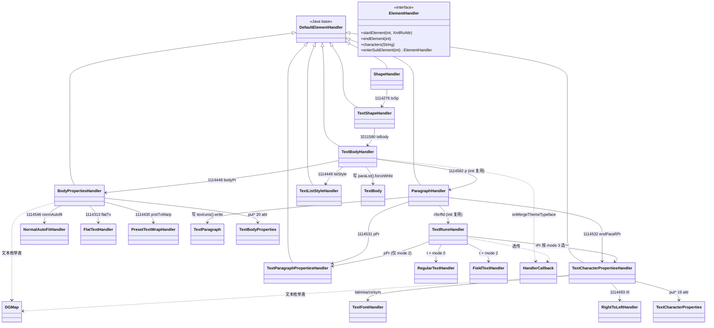
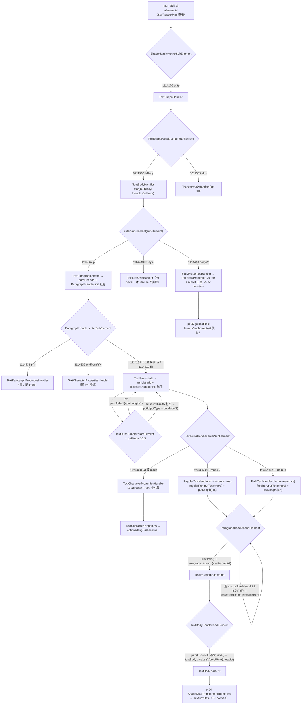
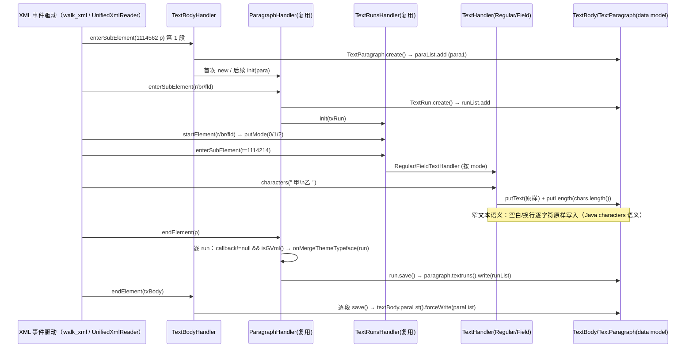
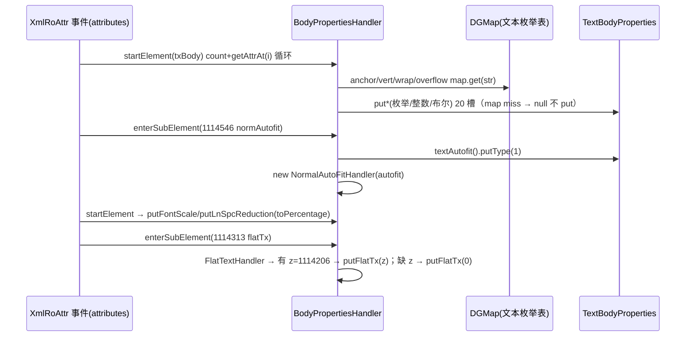

# pp-11-dml-txbody — 形状 txBody（键类/流程/依赖/Java↔Rust 对比）

> 分析依据：feature FEATURE.md / FUNCTIONS.md / functions.csv + Java 源码（真读：TextBodyHandler / TextShapeHandler / ShapeHandler / ParagraphHandler / BodyPropertiesHandler / TextCharacterPropertiesHandler / TextParagraphPropertiesHandler / DGMap / HandlerCallback）+ Rust 现状（真读：TextBodyHandler.rs / 模块接线 / data/text 模型 / HandlerCallback.rs / DGMap.rs / ppt_core_mvp_audit.csv）
> 管线：parse→layout→render（见 libs/ppt-core/parser/features/PIPELINE.md 顶层对比）
> 分析日期：本会话工作树快照（TextBodyHandler.rs mtime 2026-08-31；ppt_core_mvp_audit.csv 为 2026-08 版审计）
> 状态：spec（拆分完成 loop 未开始；Rust handler 需**重做**而非增量）

## 0. Feature 目标与管线位置

**一句话目标**：把 `p:txBody` 子树从 pp-02 的 constructor fixture 改写成真实解析——段落 `a:p`、run 链 `a:r`/`a:br`/`a:fld` + `a:t` 纯文本 + rPr 最小集写进 `TextBody`（Rust：`data/text/TextBody.rs`），bodyPr 属性写进 `TextBodyProperties`；有字才必要（无字可只靠 pp-10 画矩形），不排版、不渲染。

管线位置（depends_on_feature 链）：

```text
pp-01-pptx-parse (pass) ── HandlerCallback / XmlRoAttr 事件面 / SWReaderMap 查表
  └─> pp-02-shape-tree-parse (pass) ── spTree 分发生成 txBody 子事件（txBody 现为 constructor fixture）
        └─> pp-10-dml-sppr (spec) ── spPr 使形状可画（rPr fill/ln 分支复用 pp-10:02/03 共享 handler）
              └─> pp-11-dml-txbody (spec, 本 feature)
                    ├─ 01 text_body ├─> pl-04-text-box（ShapeDataTransform.exToInternal → TextBoxData）
                    └─ 02 text_body_props ├─> pl-05（getTextRect 消费 insets/anchor/autofit) / pr-03（DrawText）
```

本 feature 回答的问题（FEATURE.md I/O 表与范围外说明）：

| in | out（本层不提供） |
|---|---|
| `p:txBody` → `TextBody` 容器；`a:p` 段落列表；`a:r`(mode 0)+`a:br`(mode 1)+`a:fld`(mode 2 最小：id/type 落 fieldRun)；每 run 的 rPr 最小集（sz/b/i/u/strike/lang/kern/spc/baseline/cap 等）；bodyPr 的 insets/anchor/vert/wrap/autofit/rot/overflow 四型 | 排版（pl-04/pl-05）；lstStyle 主题文本样式（pp-03）；reader/part 打开（pp-07 起）；富文本全量（渐变线/高亮/下划线详情/超链接目标解析）；`onMergeThemeTypeface` 中文字体合并业务体（GVML 语义 Stub） |

缺失后果：txBody 不解析 → 文本框空 → pl-04 无 para/run 原料、`getTextRect` 无 insets 依据 → **有字必断**（无字 pptx 可只画矩形，MVP 语义成立）。

## 0.5 设计动机与心智模型

1. **心智模型**：S0 parse 把「XML 元素 id 事件流」投影成「惰性 KoBin 树模型」——handler 只是「事件 → 模型 put*」的适配器，模型提交（`save()`/`write()`/`forceWrite()`）全部押在 `endElement` 时机，保证同一容器子树解析完才整体落盘。
2. **矛盾：多实例子元素与单 handler 复用冲突**。N 个 `a:p`、每段 N 个 run，不能每次 new 全套对象 → 解决：容器对象（`paraList`/`runList`）由父级持有，handler 单实例化后靠 `init(newTarget)` 重绑定；handler 跨元素复用**不残留上一元素状态**（`init` 里 runList 归零）。
3. **矛盾：XML 字符串枚举需要按编号查表归一**。dml 无运行期 schema，属性靠编号（count+getAttrAt 循环 + switch）；字符串枚举（anchor/vert/wrap/underline/cap/strike…）走 `DGMap` 的 String→int 表，**miss 收 null 不 put**（与 switch default 无副作用一致）。
4. **run 的三态合一**：`a:r`/`a:br`/`a:fld` 共享 `TextRunsHandler`，用 `TextRun.mode()`（0/1/2）区分字符写入目标（regularRun/linebreakRun/fieldRun）与 rPr 目标；`br` 与 `fld` 无需普通文本但 `fld` 有 id/type，mode 状态机在 `startElement` 置位。
5. **GVML 私有语义挂点**：`HandlerCallback.onMergeThemeTypeface(run)` 只在 `callback != null && isGVml()`（callback mode==2）时逐 run 触发——WPS 私有格式需主题字体合并，PPTX 模式（mode 0）不触发；判空与调用时机是 pp-01 pass 语义，**不可改**。

## 1. 键类分析（类图）



### 1.1 分发上游（pp-02 pass 链路，Java 侧真读）

| 类 | 继承/实现 | 关键字段（名:类型→作用） | 关键方法（签名→1 行逻辑） |
|---|---|---|---|
| `ShapeHandler`（`…/dmlr/handler/shape/`） | extends `DefaultElementHandler` | `Shape shape`（含 `textShape()`）；`HandlerCallback handlerCallback`；`int storeShapeId`；`DgStore dgStore` | `enterSubElement(int subElement)` ★：case 1114276（txSp）→ `new TextShapeHandler(shape.textShape(), dgStore, storeShapeId, handlerCallback)`；case 3211578 → `ShapePropertiesHandler(shape.spPr(), callback)`（pp-10）。`endElement`：`dgStore.update(storeShapeId, shape.save())` |
| `TextShapeHandler`（`…/textshape/`） | extends `DefaultElementHandler` | `TextShape textShape`；`HandlerCallback callback`；`int storeShapeId`；`DgStore dgStore` | `enterSubElement(int)` ★：case 1114270 → `textShape.putUssShapeRect(true)`；**case 3211580（txBody）→ `new TextBodyHandler(textShape.textBody(), callback)`**；case 3211589 → `Transform2DHandler(textShape.transform2D())`。`endElement`：`dgStore.update(storeShapeId, textShape.save())` |

### 1.2 本 feature 键类（均 Java 真读）

| 类 | 继承/实现 | 关键字段（名:类型→作用） | 关键方法（签名→1 行逻辑） |
|---|---|---|---|
| `TextBodyHandler`（`…/textshape/text/`） | extends `DefaultElementHandler` | `TextBody textBody`→写入目标；`HandlerCallback handlerCallback`→GVML 透传；`List<TextParagraph> paraList`→跨 p 复用容器；`ParagraphHandler paragraphHandler`→单实例复用 | `TextBodyHandler(TextBody, HandlerCallback)`→绑定模型+回调。`enterSubElement(int)` ★：case 1114448（bodyPr）→ `new BodyPropertiesHandler(textBody.bodyPr(), callback)`（交 02）；case 1114449（lstStyle）→ `new TextListStyleHandler(textBody.listStyle(), callback)`（归 pp-03）；case 1114562（p）→ `paraList` 懒建 + `TextParagraph.create()` 入列 + `paragraphHandler` 首次 `new`/后续 `init(para)` 复用，返回该 handler。`endElement(int)` ★：`paraList != null` 时逐段 `paragraph.save()`，然后 `textBody.paraLst().forceWrite(paraList)` |
| `ParagraphHandler`（`…/textshape/text/paragraph/`） | extends `DefaultElementHandler`；含 nested `TextRunsHandler`/`RegularTextHandler`/`FieldTextHandler` | `HandlerCallback handlerCallback`；`TextParagraph paragraph`→init 重绑定；`List<TextRun> runList`→init 归零；`TextRunsHandler textRunsHandler`→复用 | `ParagraphHandler(TextParagraph, HandlerCallback)`→init+绑定回调；`init(TextParagraph)`★→重绑定+`runList = new ArrayList()`。`enterSubElement(int)`★：case 1114193/1114618/1114619（r/br/fld）→ `TextRun.create()` 入 runList + `TextRunsHandler` 复用返回；case 1114531（pPr）→ `new TextParagraphPropertiesHandler(paragraph.paraPr(), callback)`（壳）；case 1114532（endParaRPr）→ `new TextCharacterPropertiesHandler(paragraph.endParaRPr(), callback)`（同 rPr 模板）。`endElement(int)`★：逐 run——`callback != null && isGVml()` 时 `onMergeThemeTypeface(run)`，随后 `run.save()`；最后 `paragraph.textruns().write(runList)` |
| `TextRunsHandler`（nested static） | extends `DefaultElementHandler` | `TextRun txRun`→init 重绑定；`HandlerCallback handlerCallback` | `init(TextRun)`→重绑定。`startElement(int, XmlRoAttr)`★（mode 状态机）：case 1114193→`putMode(0)`；case 1114618→`putMode(1)+putLength(1)`；case 1114619（fld）→ `getByName(1114245 缺 id)`判空：非空才 `fieldRun().putId(...)`/`putType(1114388)` 与 `putMode(2)`（**缺 id 不置 mode 2**）。`enterSubElement(int)`★：case 1114214（t）→ mode 0/2 分派 `RegularTextHandler`/`FieldTextHandler`，其余 null；case 1114531（pPr）→ 仅 mode 2 返回 `TextParagraphPropertiesHandler(fieldRun().pPr(), callback)`；case 1114603（rPr）→ 按 mode 0/1/2 取 `regularRun().rPr()`/`linebreakRun().rPr()`/`fieldRun().rPr()` 建 handler |
| `RegularTextHandler` / `FieldTextHandler`（nested static） | extends `DefaultElementHandler` | `TextRun txRun` | `characters(String chars)`★：`txRun.regularRun().putText(chars)` / `txRun.fieldRun().putText(chars)` + `txRun.putLength(chars.length())`（**窄文本原样写入，空白/换行不归一；长度 = Java UTF-16 code unit 数**） |
| `TextCharacterPropertiesHandler`（`…/textshape/text/run/`） | extends `DefaultElementHandler`；含 nested `RightToLeftHandler` | `TextCharacterProperties runProp`；`HandlerCallback handlerCallback` | `startElement(int, XmlRoAttr)`★：`count()`+`getAttrAt(i)` 循环，19 个 attr case（b=1114195→`options().putBold`、cap=1114441→`DGMap.textCapMap`、i=1114504、kumimoji=1114586、lang=1114587、altLang=1114588、sz=1114589→`putFontSize(toInt)`、u=1114590→`textUnderlineMap`、strike=1114591→`textStrikeMap`、kern=1114592、spc=1114593、normalizeH=1114594、baseline=1114595→`toPercentage`、noProof=1114596、dirty=1114597、err=1114598、smtClean=1114599、smtId=1114600、bmk=1114601→`putBookmarkLinkTarget`）。`enterSubElement(int)`：latin/ea/cs/sym（1114140/1114141/1114142/1114584）→ `new TextFontHandler(runProp.xxxFont())`（字体装载契约）；rtl=1114493→`RightToLeftHandler`（val=1114158 布尔 → `options().putRightToLeft`，false 也写）；ln/fill（5 子元素+3211586）/effect/highlight/uLn/hlink 等 12 分支→**延后**（Rust 返回 null 并注释延后）；extLst=3211295→null |
| `BodyPropertiesHandler`（`…/textshape/text/`） | extends `DefaultElementHandler`；含 nested `NormalAutoFitHandler`/`PresetTextWrapHandler`/`FlatTextHandler` | `TextBodyProperties bodyProperties`；`HandlerCallback handlerCallback`（透传，本类实际不消费） | `startElement(int, XmlRoAttr)`★：`count()`+`getAttrAt` 循环 20 case——rot=1114201→`putRotation(toInt)`、anchor=1114301→`textAnchoringTypeMap`、vert=1114480→`textVerticalTypeMap`、anchorCtr=1114481→`putAnchorCenter`、horzOverflow=1114482→`textHorzOverflowTypeMap`、spcFirstLastPara=1114548、vertOverflow=1114549→`textVerOverflowMap`、wrap=1114550→`textWrapMap`、lIns/tIns/rIns/bIns=1114551/2/3/4→`put*Inset(toInt)`、numCol=1114555、spcCol=1114556、rtlCol=1114557、fromWordArt=1114558、forceAA=1114559、upright=1114560、compatLnSpc=1114561。`enterSubElement(int)`★：noAutofit=1114545→`textAutofit().putType(0)`+null；normAutofit=1114546→`putType(1)`+`NormalAutoFitHandler`；spAutoFit=1114547→`putType(2)`+null；flatTx=1114313→`FlatTextHandler`；prstTxWarp=1114430→`PresetTextWrapHandler`（延后）；scene3d=1114144/sp3d=1114145（延后）；extLst=3211295→null |
| `NormalAutoFitHandler`（nested） | extends `DefaultElementHandler` | `TextBodyProperties.Autofit autofit` | `startElement`★：`getByName(1114543 fontScale)`→`putFontScale(toPercentage)`；`getByName(1114544 lnSpcReduction)`→`putLnSpcReduction(toPercentage)` |
| `FlatTextHandler`（nested） | extends `DefaultElementHandler` | 无（闭包取 outer `bodyProperties`） | `startElement`★：`getByName(1114206 z)` 非空→`putFlatTx(toInt)`，**缺 z → `putFlatTx(0)`**（else 分支） |
| `TextParagraphPropertiesHandler`（`…/paragraph/`） | extends `DefaultElementHandler`；含 bullet/lnSpc/tab 多 nested | `TextParagraphProperties textProp`；`HandlerCallback handlerCallback` | `startElement`：11 attr（algn=1114328、marginL=1114476、marginR=1114477、rtl=1114493、lvl=1114611、indent=1114612、defTabSz=1114613、eaLnBrk=1114614、fontAlgn=1114615、latinLnBrk=1114616、hangingPunct=1114617）；`enterSubElement`：bullet 系 1114563-1114575、lnSpc=1114606/spcBef=1114607/spcAft=1114608、tabLst=1114609、defRPr=1114610。**本 feature 仅壳**（对齐/缩进/行距最小集随 pl-05 再补） |

### 1.3 关键依赖类（Java 侧）

| 类 | 角色 | 本 feature 需要的接口 |
|---|---|---|
| `HandlerCallback`（`dmlr/model/`，pp-01 pass） | GVML 挂点 | `boolean isGVml()`（`mode == 2`）、`void onMergeThemeTypeface(TextRun run)`（默认空实现；null 判空由调用方做） |
| `DGMap`（`dmlr/util/`） | 枚举表 | 8 张文本 map（见 §5 钉死键值）：textAnchoringTypeMap、textHorzOverflowTypeMap、textVerticalTypeMap、textVerOverflowMap、textWrapMap、textCapMap、textStrikeMap、textUnderlineMap（另 textWrapShapeMap/textHorzAlignmentMap 等属延后/壳分支） |
| `TextFontHandler`（`dmlr/handler/font/`） | rPr 字体族装载 | `TextFontHandler(TextFont)`——latin/ea/cs/sym 分支返回（字体族业务体属延后，Rust 侧无实现，需标注） |
| 数据模型 `data/text/*.java` | 写入目标 | `TextBody.paraLst().forceWrite(List<TextParagraph>)`；`TextParagraph.textruns().write(List<TextRun>)`；`TextRun.create()/putMode/putLength/mode()/regularRun()/linebreakRun()/fieldRun()`；`TextCharacterProperties` 19 个 put*；`TextBodyProperties` 20 个 put* + `textAutofit().putType/putFontScale/putLnSpcReduction` |

## 2. 流程图（依据 I/O）

### 2.1 写入热路径（元素 id 流 → 分发 → handler → 模型）



### 2.2 段落/run 写入时序（handler 回调时序）





## 3. 依赖关系与改写状态

### 3.1 类间依赖表（本 feature 消费 / 被消费）

| 依赖方向 | 依赖 | 归属 feature | 说明 |
|---|---|---|---|
| 本 feature → | `HandlerCallback`（isGVml / onMergeThemeTypeface） | pp-01:02 pass | GVML 判空/调用时机不可改；onMergeThemeTypeface 业务体 Stub |
| 本 feature → | txBody 事件入口（spTree 分发构造 TextBodyHandler） | pp-02:02/03/04 pass | 02/03/04 已验收，txBody 原为 constructor fixture；不改 DgStore/spTree 提交语义 |
| 本 feature → | `ShapePropertiesHandler` rPr fill/ln 复用 | pp-10:02/03 | 01 的 rPr fill/ln 分支复用 pp-10 共享 handler（本 feature 分支延后，仅契约） |
| 本 feature → | `data/text/*.rs` 模型 | feature 外公共模型 | TextBody 953 / TextParagraph 953 / TextRun 2089 / TextBodyProperties 3209 / TextCharacterProperties 2922 行均在（keep_refactor） |
| 本 feature → | `DGMap` 8 张文本 map | dmlr/util | Rust DGMap.rs 仅 blackWhiteModeMap，**8 表缺失**（缺口-critical，见 §6） |
| 本 feature → | `kfc XmlRoAttrList`（count/getAttrAt/getByName/toInt/toBoolean/toPercentage） | kfc_alpha wave0 | ✓ 已实现（count/get_attr_at/get_name_at/get_by_name/to_int/to_boolean/to_percentage 齐全） |
| 本 feature → | `TextListStyleHandler` lstStyle 契约 | pp-03 spec | 本 feature 不实现、构造时不伪造 |
| 下游 ← 本 feature | `TextBody.paraLst()` 段落/run | pl-04-text-box | TextBoxData 原料 |
| 下游 ← 本 feature | `TextBodyProperties` insets/anchor/autofit | pl-05 / pr-03 | getTextRect 依据 / DrawText |

### 3.2 Java↔Rust 路径映射与改写状态

| Java 类（java_path 前缀：koffice/presentation/core/cn/wps/…） | Rust 路径（前缀：libs/ppt-core/src/cn/wps/…） | 状态（依据 ppt_core_mvp_audit.csv + 工作树真读） |
|---|---|---|
| `drawing/dmlr/handler/shape/textshape/text/TextBodyHandler.java` | `…/drawing/dmlr/handler/shape/textshape/text/TextBodyHandler.rs`（231 行） | **pending（重做）**：audit 记「160 行 / 10 todo stub / local stub text types → rewrite」；工作树现为 surf 原型（TextBodySurf→KmoTextOperator），非 Java 语义，10 stub 之外还缺 mode 状态机/bodyPr 分发/GVML 回调/forceWrite 时序 |
| `…/textshape/text/paragraph/ParagraphHandler.java`（+nested 三件套） | `…/textshape/text/paragraph/` 仅 mod.rs（`// pub mod ParagraphHandler; // LLM: temporarily disabled until rewrite`） | **未开始**：audit 记「415 行 / 108 javacom / runs broken → rewrite」；文件已删 |
| `…/textshape/text/run/TextCharacterPropertiesHandler.java`（+nested RightToLeftHandler） | `…/textshape/text/run/` 仅 mod.rs（`// pub mod TextCharacterPropertiesHandler; // LLM: template has Java syntax`） | **未开始**：audit 记「452 行 / 49 stubs → rewrite」；文件已删 |
| `…/textshape/text/BodyPropertiesHandler.java`（+nested 三件套） | `BodyPropertiesHandler.rs` 不存在 | **未开始（新建）**：无历史 stub 记录 |
| `…/textshape/text/paragraph/TextParagraphPropertiesHandler.java` | 无 .rs | **壳**：最小集随 pl-05，本 feature 不写 |
| `…/textshape/text/TextListStyleHandler.java` | `data/text/TextListStyle.rs`（1650 行，22 stubs） | 归 pp-03（`02_function_text_list_style`），本 feature 不实现 |
| `drawing/dmlr/util/DGMap.java`（8 文本 map） | `…/drawing/dmlr/util/DGMap.rs`（27 行） | **缺口**：仅 blackWhiteModeMap；8 张文本 map 缺失（需新建或按字面量表） |
| `drawing/dmlr/handler/font/TextFontHandler.java` | `…/drawing/dmlr/handler/font/` 仅 mod.rs | **未开始**：audit 记「78 行 / 4 stubs → rewrite」；文件已删（rPr latin/ea/cs/sym 分支依赖） |
| `drawing/data/text/TextBody.java` | `…/data/text/TextBody.rs`（953 行） | **keep_refactor（12 stubs）**：模型在场；`ParagraphList.write/forceWrite(&[()])` 为 **todo!() 桩**（列表 API 未真正存储 TextParagraph） |
| `drawing/data/text/TextParagraph.java` | `…/data/text/TextParagraph.rs`（953 行） | **keep_refactor（12 stubs）**：`TextRunList.write` 同类列表桩 |
| `drawing/data/text/TextRun.java` | `…/data/text/TextRun.rs`（2089 行） | **keep_refactor（7 stubs）**：putMode/putLength/mode/regularRun/linebreakRun/fieldRun/putText 均在 |
| `drawing/data/text/TextCharacterProperties.java` | `…/data/text/TextCharacterProperties.rs`（2922 行） | **keep_refactor（18 stubs，core）**：19 个 attr 的 put* 均在（含 options()/putBaseline(f64)/putFontSize(i32)） |
| `drawing/data/text/TextBodyProperties.java` | `…/data/text/TextBodyProperties.rs`（3209 行） | **keep_refactor（18 stubs）**：20 个 put* + `textAutofit().putType/putFontScale/putLnSpcReduction` 均在 |
| `drawing/dmlr/model/HandlerCallback.java` | `…/drawing/dmlr/model/HandlerCallback.rs` | **done（pp-01 pass）**：`isGVml()`=mode==2、`onMergeThemeTypeface` trait 方法在场 |
| kfc `xpxml/reader/XmlRoAttr(java)` | kfc_alpha `XmlRoAttrList.rs` | **done**：count/get_attr_at/get_name_at/get_by_name/to_int/to_boolean/to_percentage 齐全 |
| kfc `xpxml/reader/DefaultElementHandler.java` | ppt-core 本地 `drawing/dmlr/handler/mod.rs::ElementHandler` trait | **done（本地契约）**：kind/startElement(&mut)/enterSubElement/endElement/characters 默认空 |

## 4. 最小 feature-critical 改写范围

### Must-write（feature 关键，禁 stub）

| 项 | 范围 | 关键语义点 |
|---|---|---|
| `TextBodyHandler.rs`（重做） | 字段 textBody/handlerCallback/paraList/paragraphHandler；`ctor(TextBody, HandlerCallback)`、`enterSubElement`（1114448→02 分发、1114449→pp-03 契约/不伪造、1114562→建段+init 复用）、`endElement`（判空 forceWrite） | paraLst 顺序 = XML 顺序；空段也入列；`endElement` 才提交 |
| `ParagraphHandler.rs` + `TextRunsHandler`/`RegularTextHandler`/`FieldTextHandler`（新建） | mode 状态机（0/1/2）；fld 缺 id 不置 2；t 的 `characters` 原样写 + putLength；rPr 按 mode 三分发；pPr 仅 mode 2；endElement 的 GVML 判空与 textruns().write 时序 | fld 判空 `tmp != null`；GVML 时机在 callback 判空之内；runList 由 init 归零 |
| `TextCharacterPropertiesHandler.rs`（新建） | count+getAttrAt 循环 + 19 attr case（数值与 Java 一致）；子元素最小集 latin/ea/cs/sym + rtl；其余分支返回 null + 注释延后 | DGMap miss → null 不 put；toPercentage/toInt/toBoolean 复用 kfc 语义 |
| `BodyPropertiesHandler.rs` + `NormalAutoFitHandler`/`FlatTextHandler`（新建） | 20 attr case + autofit 三型 putType(0/1/2) + normAutofit 两 toPercentage + flatTx 缺 z 写 0 | presage: 3D/prstTxWarp/extLst → null |
| `DGMap` 8 张文本 map | 字面量表（§5 钉死键值），或 function 内局部表 | anchor/vert/wrap/overflow/underline/strike/cap 走表；miss 不收 |
| 列表 API 解锁（模型侧，最小面） | `ParagraphList.forceWrite/write`、`TextRunList.write` 从 `&[()]`/todo!() 改为真实 `&[TextParagraph]`/`&[TextRun]` | 否则 forceWrite 语义无法落地（可随 01 loop 一并处理或列队） |

### 可 stub（壳，需标注 DEFERRED_NON_FUNCTION）

- `TextParagraphPropertiesHandler` 最小集（algn/marginL/marginR/lvl/indent——对齐缩进随 pl-05）；endParaRPr 全量。
- `PresetTextWrapHandler`/`adjList`（返回 None + \`todo!("DEFERRED_NON_FUNCTION")\` 注释，MVP 无文本变形）。
- 3D：`Scene3DHandler`/`Shape3DHandler`（scene3d=1114144/sp3d=1114145 → null）。
- `onMergeThemeTypeface` 中文字体合并业务体（GVML Stub；回调时机照常触发）。

### 可 defer（延后）

- 多栏 numCol/spcCol/rtlCol 业务体（字段可写、layout 不消费）；prstTxWarp；flatTx 外 3D。
- rPr 效果全量：ln/fill（5 子元素+3211586）/effect（1114389/1114390）/highlight=1114583/uLn 系（1114579/1114580/1114581/1114582）/hlink（1114243/1114585）——分支返回 null 延后；TextFontHandler 字体族业务体（latin/ea/cs/sym 只保装载契约）。
- lstStyle（归 pp-03）。

### 当前进度（spec feature → 计划拆分）

| function | 覆盖 Java 类 | Rust 现状 | 计划 |
|---|---|---|---|
| 01_function_text_body | TextBodyHandler；ParagraphHandler 族；TextCharacterPropertiesHandler（rPr 最小集） | TextBodyHandler.rs 为 surf 原型（待重做）；其余缺失 | loop 1：template --recursive 重新生成 Java 结构模板 → 删本地 stub → 接 `data/text/*.rs` 真实模型 → tests 镜像 `tests/cn/wps/drawing/dmlr/handler/shape/textshape/text/01_function_text_body.rs` |
| 02_function_text_body_props | BodyPropertiesHandler + NormalAutoFitHandler/FlatTextHandler | 无 .rs（新建）；TextBodyProperties.rs 模型完整 | loop 2：新建 handler + DGMap 文本 map → `…/02_function_text_body_props.rs` |

（推荐顺序：01 先行交付段落/run 链与 bodyPr 分发契约；02 并行实现，01 提供 1114448 分发接入。）

## 5. 验收口径

数字/枚举/哨兵值钉死（来源：Java 源码真读 + FUNCTIONS.md §2 已查证 `dml/A.java`）：

- **元素 id**：txSp=1114276、txBody=3211580、bodyPr=1114448、lstStyle=1114449、p=1114562、r=1114193、br=1114618、fld=1114619、pPr=1114531、endParaRPr=1114532、t=1114214、rPr=1114603、id=1114245、type=1114388、extLst=3211295。
- **rPr attr id（19 个）**：sz=1114589、b=1114195、i=1114504、u=1114590、strike=1114591、cap=1114441、lang=1114587、altLang=1114588、kern=1114592、spc=1114593、baseline=1114595、kumimoji=1114586、normalizeH=1114594、noProof=1114596、dirty=1114597、err=1114598、smtClean=1114599、smtId=1114600、bmk=1114601；子元素：latin=1114140、ea=1114141、cs=1114142、sym=1114584、rtl=1114493、val=1114158。
- **bodyPr attr id（20 个）**：rot=1114201、anchor=1114301、vert=1114480、anchorCtr=1114481、horzOverflow=1114482、spcFirstLastPara=1114548、vertOverflow=1114549、wrap=1114550、lIns=1114551、tIns=1114552、rIns=1114553、bIns=1114554、numCol=1114555、spcCol=1114556、rtlCol=1114557、fromWordArt=1114558、forceAA=1114559、upright=1114560、compatLnSpc=1114561；子元素：flatTx=1114313、prstTxWarp=1114430、noAutofit=1114545、normAutofit=1114546、spAutoFit=1114547、fontScale=1114543、lnSpcReduction=1114544、z=1114206、scene3d=1114144、sp3d=1114145。
- **run mode**：r→0、br→1（putLength(1)）、fld 有 id→2；fld 缺 id=1114245 → 不置 mode 2、putId/putType 均不写；t 分支仅 mode 0/2 有文字。
- **DGMap 文本 map 键值**（Java `DGMap.java` 真读）：
  - `textAnchoringTypeMap`{b:2, ctr:1, dist:4, just:3, t:0}
  - `textHorzOverflowTypeMap`{clip:1, overflow:0}
  - `textVerticalTypeMap`{eaVert:4, horz:0, mongolianVert:5, vert:1, vert270:2, wordArtVert:3, wordArtVertRtl:6}
  - `textVerOverflowMap`{clip:2, ellipsis:1, overflow:0}
  - `textWrapMap`{none:0, square:1}
  - `textCapMap`{none:1, small:2, all:0}
  - `textStrikeMap`{noStrike:0, sngStrike:1, dblStrike:2}
  - `textUnderlineMap`（19 键）{none:12, words:17, sng:13, dbl:4, heavy:11, dotted:9, dottedHeavy:10, dash:0, dashHeavy:1, dashLong:2, dashLongHeavy:3, dotDash:5, dotDashHeavy:6, dotDotDash:7, dotDotDashHeavy:8, wavy:14, …余 3 键按 Java 原表}
- **autofit type**：noAutofit→0、normAutofit→1（+fontScale/lnSpcReduction toPercentage）、spAutoFit→2；后写覆盖。
- **flatTx**：含 z=1114206 → putFlatTx(toInt)；缺 z → **putFlatTx(0)**（Java else 分支）。
- **提交时序**：`TextBodyHandler.endElement` 在 paraList 非空时逐段 `save()` + `paraLst().forceWrite(paraList)`；`ParagraphHandler.endElement` 逐 run（GVML 判空恰一次）`save()` + `textruns().write(runList)`。
- **窄文本**：`characters(String)` 原样写入（前后空白/换行不归一；与 Java 逐字符语义一致）；长度 = Java `chars.length()`（UTF-16 code unit），**Rust `chars().count()` 对增补平面字符有差异，以 kfc 语义为准（待 loop 确认）**。
- **验收条件**（FEATURE.md 验收 1-4）：01 内存 attrs/events 完成段落/run 链写入（paraLst 顺序、run mode、t 文本、rPr 最小集与 Java 一致；GVML 回调时机锁定）；02 bodyPr fixture 完成 insets/anchor/vert/wrap/autofit 写入且可被 pl-04 contract 消费；不打开 part、不装配 slide；`cargo test --test 01_function_text_body` / `02_function_text_body_props` 绿；覆盖率/对齐报告按 FUNCTION.md §3.7/§3.9 补。

## 6. Java↔Rust 管线对比与缺口审计

### 6.1 Java 完整链路（S0 parse → S1 convert）

```text
p:txBody XML（SpTreeHandler 驱动，SWReaderMap 查表出 element id）
  → ShapeHandler.enterSubElement(1114276) → TextShapeHandler
  → TextShapeHandler.enterSubElement(3211580) → TextBodyHandler(textShape.textBody(), callback)
     ├─ bodyPr(1114448) → BodyPropertiesHandler → TextBodyProperties（20 attr + autofit 三型 + flatTx）
     ├─ lstStyle(1114449) → TextListStyleHandler（pp-03）
     └─ p(1114562) 循环 → ParagraphHandler（init 复用，单实例）
          ├─ pPr(1114531) → TextParagraphPropertiesHandler（壳）
          ├─ r/br/fld(1114193/1114618/1114619) → TextRunsHandler（mode 0/1/2 状态机）
          │    ├─ t(1114214) → Regular/FieldTextHandler.characters → putText + putLength
          │    └─ rPr(1114603) → TextCharacterPropertiesHandler（19 attr + latin/ea/cs/sym + rtl）
          └─ endParaRPr(1114532) → TextCharacterPropertiesHandler（同模板）
  → endElement 链：ParagraphHandler（逐 run GVML onMergeThemeTypeface + save + textruns().write）
                 → TextBodyHandler（逐段 save + paraLst().forceWrite）
  → S1 convert（pl-04）：ShapeDataTransform.covertTextBodyProperties 把文本模型投影为
    KmoTextOperator/KmoTextBody → S2 layout：TextBoxData / renderModel.getTextRect(TextBodyProperties) → pr-03 DrawText
```

### 6.2 Rust 现状（真读工作树，标注接线状态）

```mermaid
flowchart TD
    subgraph kfc["kfc_alpha wave0（✓ done）"]
        K1["XmlRoAttrList 事件面<br/>✓ 已接线 (count/get_attr_at/get_by_name/to_*)"]
    end
    subgraph mvp["pp-01 / pp-02（pass）"]
        P1["HandlerCallback.rs<br/>✓ isGVml/onMergeThemeTypeface 在场"]
        P2["SwShapeHandler.rs (full 门内)<br/>✗ stub：3211580 调 TextBodyHandler::new(Shared<TextBody>, callback)<br/>与现值不符 → 断链候选"]
        P3["pp-02 测试镜像<br/>✗ stub：本地 TextBodyHandler 占位（仅校验 kind=TextBodyHandler）"]
    end
    subgraph feature["pp-11 目标（需重做/新建）"]
        F1["TextBodyHandler.rs（现值 231 行）<br/>✗ stub：TextBodySurf 原型，非 Java 语义；<br/>缺 bodyPr 分发/mode 状态机/GVML/forceWrite"]
        F2["ParagraphHandler.rs<br/>✗ 缺失（模块已注释 // pub mod）"]
        F3["TextCharacterPropertiesHandler.rs<br/>✗ 缺失（模块已注释）"]
        F4["BodyPropertiesHandler.rs<br/>✗ 缺失（从未有）"]
        F5["DGMap.rs<br/>✗ 缺失 8 张文本 map（仅 blackWhiteModeMap）"]
        F6["TextFontHandler.rs<br/>✗ 缺失（font/ 仅 mod.rs）"]
    end
    subgraph model["data/text 模型（keep_refactor）"]
        M1["TextBody.rs 953 行<br/>✓ 模型在场；✗ ParagraphList.write/forceWrite 为 &[()] + todo!() 桩"]
        M2["TextParagraph.rs 953 行<br/>✓ 模型在场；✗ TextRunList.write 同类桩"]
        M3["TextRun.rs 2089 行<br/>✓ putMode/putLength/mode/regularRun/linebreakRun/fieldRun 在场"]
        M4["TextCharacterProperties.rs 2922 行<br/>✓ 19 个 put* 在场"]
        M5["TextBodyProperties.rs 3209 行<br/>✓ 20 个 put* + textAutofit 在场"]
    end
    subgraph layout["pl-04/pl-05 消费（full 门内）"]
        L1["DataTransform.exToInternal<br/>✓ 消费 KmoShowShape.text_op: KmoTextOperator<br/>（body_pr 字段即 02 输出落点）"]
    end
    K1 --> P2 --> F1
    P2 --> F4
    F1 --> F2 --> F3 --> M4
    F1 --> F4 --> M5
    F4 --> F5
    F2 --> M3
    F1 --> M1
    F2 --> M2
    layout route 无直接接线：现值 TextBodyHandler.to_operator 直出 KmoTextOperator（demo 路径，绕过 data/text 模型）
```

### 6.3 缺口表（类 / 影响 / 阻塞下游）

| 类（Rust 侧） | stub 类型 | 影响 | 阻塞哪个下游 feature |
|---|---|---|---|
| `TextBodyHandler.rs`（现值 surf 原型） | 非 Java 语义实现：无 1114448/1114449 分发、无 run mode、无 GVML 回调、无 save/forceWrite 时序；且 `SwShapeHandler.rs:225` 调用 `TextBodyHandler::new(Shared<TextBody>, Callback)` 与现值 ctor 签名不符（full 门内编译失败候选，被 picparser 独立错误遮蔽） | 段落/run 链无法按 Java 语义进 `TextBody`；demo 直出 KmoTextOperator 绕过模型 | pp-11 自身；pl-04（无 para/run 原料）、pr-03 |
| `ParagraphHandler` / `TextRunsHandler` / `Regular/FieldTextHandler`（缺失） | 模块注释 `// pub mod`，文件已删（audit：415 行 runs broken rewrite） | 段落与 run 三态（mode 0/1/2）、fld id/type、t 窄文本写入全缺 | pl-04 断在「run 链无实现」 |
| `TextCharacterPropertiesHandler`（缺失） | 模块注释，文件已删（audit：49 stubs rewrite） | rPr 19 attr + 最小集无实现 → 字号/斜体/下划线进不了模型 | pl-05/pr-03 的字号字体依据 |
| `BodyPropertiesHandler` + nested（缺失） | 从未存在 | insets/anchor/vert/wrap/autofit 无写入 → 文本区几何无依据 | pl-05 getTextRect、pr-03 落点 |
| `DGMap` 8 张文本 map（缺失） | Rust DGMap.rs 27 行仅 blackWhiteModeMap | anchor/vert/wrap/overflow/underline/strike/cap 枚举无法映射（miss 全不写 = 值丢失） | 02 与 01 rPr 最小集同时断 |
| `ParagraphList`/`TextRunList` 列表 API（stub） | `write/forceWrite(&mut self, &[()])` + `todo!()`；`read(&[()]…)`（TextBody.rs 12 stubs） | `paraLst().forceWrite(paraList)`/`textruns().write(runList)` 无法真正承载 TextParagraph/TextRun | pp-11 提交语义；pl-04 读侧（模型 keep_refactor 队列） |
| `TextFontHandler`（缺失） | font/ 仅 mod.rs（audit：4 stubs rewrite） | rPr latin/ea/cs/sym 字体族装载契约无实现 | 随 pp-03/字体族 feature；可先壳（返回 null 并注释） |

### 6.4 结论

**spec-未动工（function loop 未开始；Rust handler 需重做而非增量）**。

- 输入侧门闩：`XmlRoAttrList`（kfc）与 `HandlerCallback`（pp-01 pass）在场，事件/回调契约可用——但 feature 自身四个 handler（TextBodyHandler 现值≠Java 语义 / ParagraphHandler / TextCharacterPropertiesHandler / BodyPropertiesHandler）均未按 Java 语义接线，`SwShapeHandler` 的 3211580 分支为签名不符的 `TextBodyHandler::new` 调用（full 门内断链），pp-02 测试镜像对 txBody 只验 kind 不验逻辑。
- 数据侧可用面：`data/text` 五模型（TextBody/TextParagraph/TextRun/TextCharacterProperties/TextBodyProperties）put* 层在场；**列表 API（ParagraphList/TextRunList write/forceWrite）是 `&[()]` + `todo!()` 桩**，直接影响 01 的提交语义（forceWrite）。
- 最缺的关键依赖：**DGMap 8 张文本 map**（02 的 20 attr 中 5 张 + 01 rPr 的 3 张共用）与 **TextFontHandler**（rPr 字体装载契约）。
- loop 策略：按 FUNCTIONS.md §5 顺序 `01 → 02`；01 用 `template --recursive` 重建 Java 结构模板、删本地 stub、接真实 `data/text` 模型，02 新建 handler 并行；测试镜像根 `tests/cn/wps/drawing/dmlr/handler/shape/textshape/text/`。**不可增量补丁现有 TextBodyHandler.rs**（其为演示用途 surf 原型，非 Java 结构模板）。