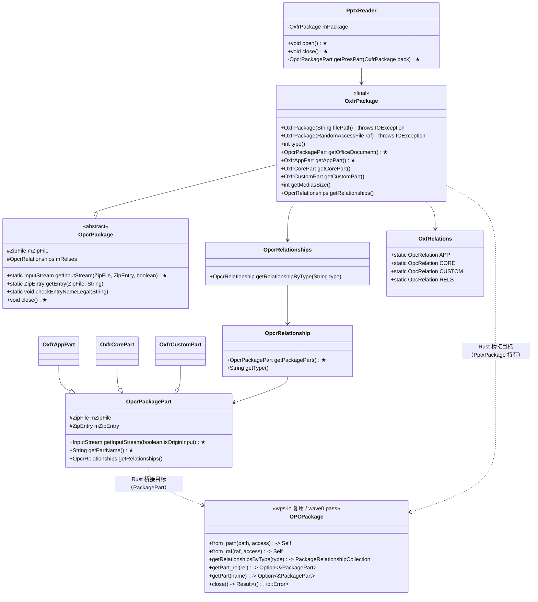
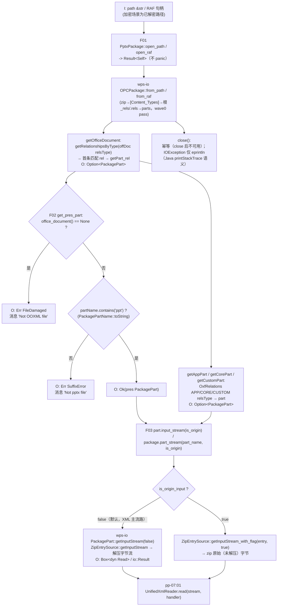
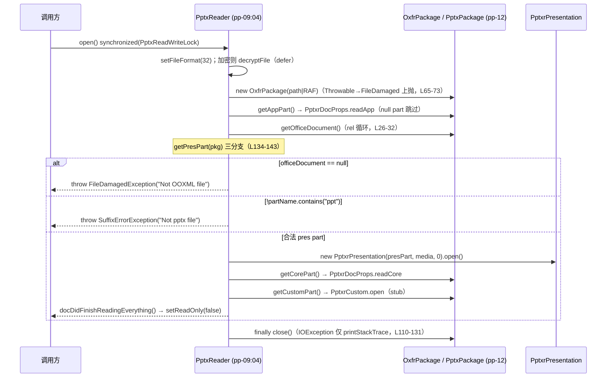

# pp-12-opc-package — PPTX OPC 包桥接（键类/流程/依赖/Java↔Rust 对比）

> 分析依据：feature FEATURE.md / FUNCTIONS.md / functions.csv + Java 源码（真读）+ Rust 现状（如已实现）
> 管线：parse→layout→render（见 libs/ppt-core/PIPELINE_LAYOUT_RENDER_PLAN.md 顶层对比；S0 parse = PptxReader/open 链 → KmoPresentation）
> 状态参考：libs/ppt-core/ppt_core_mvp_audit.csv、libs/ppt-core/rewriting_files.csv、libs/ppt-core/parser/features/<pp-07|pp-09>/FEATURE.md

## 0. Feature 目标与管线位置

**一句话目标**：把 Java 侧 WPS 私有 OPC 封装 `OxfrPackage extends OpcrPackage`（直接持有 `ZipFile` + 根 rels `mRelses`）与
`PptxReader.getPresPart`（FileDamaged/SuffixError 双异常）桥接到 Rust 已存在的 POI 风格 OPC（`io_wps_io` 的
`OPCPackage`/`PackagePart`，wave0 `02..07_function_opc_*` pass）——补上「真实 .pptx 文件 → part/流」的最后一环，
**不重抄第二份 OPC**。

- **上游**：depends_on 无（OPC 基础在 core-libs `io_wps_io`：`OPCPackage::from_path/from_raf`、`getRelationshipsByType`、
  `getPart_rel`、`PackagePart::getInputStream`，wave0 已 pass；ppt-core Cargo.toml 已声明 `io_wps_io` 依赖）。
- **下游**：被 pp-07（part 流输入，`01 unified_xml_reader`）、pp-09（`04 pptx_reader`：open 的 package 输入 + getPresPart + close）消费。
- **本 feature 回答的问题**（FEATURE.md I/O 表与范围外说明）：
  1. path/RAF → `PptxPackage::open`（桥接 wps-io OPCPackage，成败即返回，不 panic）；
  2. officeDocument/app/core/custom 四类 rel 定位（`getOfficeDocument`/`getAppPart`/`getCorePart`/`getCustomPart`）；
  3. `getPresPart()`：officeDocument==null → `FileDamaged("Not OOXML file")`；partName 不含 `"ppt"` → `SuffixError("Not pptx file")`；
     合法 → 返回该 part（Java `PptxReader.getPresPart` 134-141 行逐句对齐）；
  4. part → 字节流（`OpcrPackagePart.getInputStream(isOriginInput)` 语义，isOriginInput=false 走解压读）。
- **范围外**：zip 解压本身（wave0 `02_function_unzip`）、`[Content_Types]`/rel 解析（wave0 `03/04`）、part 集合构建（wave0 `05/07`）、
  XML 事件（pp-07:01）、打开编排（pp-09）、加密 `PptxrFileDecrypt`（加密 feature）、repair-file 重试（`OpcrPackage` ctor repair 分支）。

## 0.5 设计动机与心智模型

1. **避免语义分叉的第二份 OPC**：Java 侧 `kfc_alpha` 的 `OpcrPackage`/`OpcrPackagePart` 是 WPS 按自有 API 重写的
   POI 风格 OPC（持 `ZipFile` 直接枚举 entry）；Rust 侧 `io_wps_io` 已是 POI 风格 `OPCPackage`（wave0 pass）。
   本 feature 只做 **PPT 侧薄桥接**（`PptxPackage`），禁止在 ppt-core 或 kfc_alpha 里再实现 zip/rels/CT 逻辑，
   否则同样的「officeDocument rel → part」逻辑会出现两套实现、两套 bug。
2. **失败语义前置为哨兵**：`getPresPart` 的 `FileDamagedException("Not OOXML file")` 与
   `SuffixErrorException("Not pptx file")` 是 Java 在解析早期显式拒绝「不是 OOXML」/「不是 PPTX」文件的机制；
   不桥接则非法文件会在下游中途 panic 或静默解析出空模型。Rust 用 `Result` 表达同三分支、消息逐字对齐。
3. **把「打开→定位→流」收敛进一个生命周期句柄**：`PptxPackage` 同时承担门面（4 个 rel 定位入口）与资源容器
   （close 幂等、IOException 不重抛），让 pp-07/pp-09 只认这一个句柄，不需要暴露 OPC 内部结构。
4. **复用泛化 rel API 而非逐一特化**：Java 侧 `getOfficeDocument/getAppPart/getCorePart/getCustomPart` 都是
   「循环 `mRelses` 匹配 relsType → 取首个匹配」的同构写法；Rust 以 `getRelationshipsByType(relsType)` + `getPart_rel`
   一次性覆盖四类定位，常量表（`OxfRelations` APP/CORE/CUSTOM + officeDocument 字面量）保持与 Java 逐字一致。

## 1. 键类分析（类图）

Java 侧键类：`OxfrPackage`、`OpcrPackage`（父类）、`OpcrPackagePart`（+ 三个子类）、`OpcrRelationships`、
`OpcrRelationship`、`OxfRelations`（常量表）、`PptxReader`（getPresPart/close 语义源）；
关键依赖类：wps-io `OPCPackage`（Rust 复用目标，不加进改写）。



### 键类明细表（签名/行号均来自真读源码）

| 类 | 继承/实现 | 关键字段（名:类型→作用） | 关键方法（签名→1 行逻辑，★=热路径） |
|---|---|---|---|
| `OxfrPackage`（kfc_alpha，84 行） | final extends `OpcrPackage` | 无新增字段；复用父类 `mZipFile`/`mRelses` | `OxfrPackage(String filePath) throws IOException` → super(filePath)（L13-15）；`OxfrPackage(RandomAccessFile raf)` → super(raf)（L17-19）；`int type()` → 恒 1（TYPE_OOXML，L21-23）；★`OpcrPackagePart getOfficeDocument()` → for 循环 `mRelses`，type 等于 `http://schemas.openxmlformats.org/officeDocument/2006/relationships/officeDocument` 即返回 `rels.getPackagePart()`（L26-32）；★`OxfrAppPart getAppPart()` → 匹配 `OxfRelations.APP.getRelsType()` 强转（L39-47）；`OxfrCorePart getCorePart()` → 匹配 `OxfRelations.CORE.getRelsType()`（L49-57）；`OxfrCustomPart getCustomPart()` → 匹配 `OxfRelations.CUSTOM.getRelsType()`（L59-67）；`int getMediasSize()` → 枚举 `mZipFile.entries()`，对 name 含 `/media/` 的 entry 累加 `getCompressedSize()`（L69-83） |
| `OpcrPackage`（kfc_alpha，275 行） | abstract | `protected ZipFile mZipFile`；`protected OpcrRelationships mRelses`；`private OpcrContentTypes mContentTypes`；`private String mRepairFile/mRepairLog`；常量 `MAX_SIZE_ENTRY=1073741824`、`INAVALID_NAME="../"`、`TYPE_GVML=0/TYPE_OOXML=1/TYPE_ARTTABLE=2` | ctor(String)：`new ZipFile` + `new OpcrRelationships(zipFile,"")`；IOException → `zipFileRepair` 修复分支（L36-54，defer）；ctor(RandomAccessFile)：同构，IOException 仅记 `mRepairLog`（L56-66）；★`static InputStream getInputStream(ZipFile, ZipEntry, boolean isOriginInput)` → `zipFile.getInputStream(entry, isOriginInput)`，Throwable 吞掉返 null（L211-218）；`static ZipEntry getEntry(ZipFile, String)` → `'/'→'\\'`、小写两次回退查找，entry size > 1GiB 抛 `FileDamagedException`（L220-241）；`static void checkEntryNameLegal(String)` → name 含 `"../"` 抛 `FileDamagedException`（L243-247）；★`void close()` → `mZipFile.close(); mZipFile=null;` 并删 repair 临时文件（L164-176）；`getDefaultContentType/getContentType` → 懒建 `OpcrContentTypes`（L70-94） |
| `OpcrPackagePart`（kfc_alpha，84 行） | 普通类 | `private ZipFile mZipFile`；`private ZipEntry mZipEntry`；`private OpcrRelationships mRelses` | ctor(ZipFile, ZipEntry)（L16-20）；★`InputStream getInputStream(boolean isOriginInput) throws IOException` → `OxfrPackage.getInputStream(mZipFile, mZipEntry, isOriginInput)`（L22-24，实际落在 OpcrPackage 静态方法）；`InputStream getInputStream()` → `getInputStream(false)`（L26-28）；`getZipEntry()/getZipFile()` → 内省（L30-36）；`OpcrRelationships getRelationships()` → 懒建（L38-54）；★`String getPartName()` → `mZipEntry.getName()` + `checkEntryNameLegal`（L56-60）；`int getPartSize()` → size>0 直接返回，否则流 available（L62-83） |
| `OxfrAppPart` / `OxfrCorePart` / `OxfrCustomPart`（kfc_alpha ooxfr） | extends `OpcrPackagePart` | AppPart：`mAppName/mAppVersion/mManager/mCompany/...` 等 doc-props 字段 | ctor 透传 (zipFile, entry)；`void parse() throws IOException` → part 流喂 `HLXmlReader.parser`（AppPart L22-27）——**parse/getter 属 pp-09:01，本 feature 只管流与定位**；CustomPart 的 `open()` 属 pp-09（PptxrCustom） |
| `OpcrRelationships`（kfc_alpha，80 行） | extends `DefaultElementStrHandler`，implements `Iterable<OpcrRelationship>` | `ArrayList<OpcrRelationship> mRelses`；`ZipFile mZipFile`；`String mParentPartName` | ctor(ZipFile, parentPartName)：`OpcUtil.getRelsesName(parentPartName)` 取 rels part 流 → `HLXmlReader.parser`（L18-28）；`OpcrRelationship getRelationshipByType(String type)` → 循环按 type 等值返回首个（L57-65）；`getRelationship(String rid)` → 按 Id（L47-55）；`enterSubElement(String)` → subLabel 以 `Relationship` 结尾则建 rel 并加入（L71-79） |
| `OpcrRelationship`（kfc_alpha，188 行） | extends `DefaultElementStrHandler` | `ZipFile mZipFile`；`String mParentPartName/mId/mType/mTarget`；`OpcrPackagePart mPart`（懒）；`OpcTargetMode mTargetMode`（默认 INTERNAL） | ★`OpcrPackagePart getPackagePart()` → 懒解析：`OpcUtil.getPartNamex(parent, target)` → `OxfrPackage.getEntry` 找到 entry，按 type 分派 `OxfrAppPart/OxfrCorePart/OxfrCustomPart/OpcrPackagePart`（L53-87）；`String getType()` → 返回 mType（L30-32）；`addAttr(name, value)` → Id/Type/Target（URL decode、strict 转换）/TargetMode（L144-159） |
| `OxfRelations`（kfc_alpha，14 行） | final，纯常量 | 无 | 静态常量：`APP`(contentType `...extended-properties+xml`, relsType `http://schemas.openxmlformats.org/officeDocument/2006/relationships/extended-properties`, target `/docProps/app.xml`)；`CORE`(contentType `...package.core-properties+xml`, relsType `http://schemas.openxmlformats.org/package/2006/relationships/metadata/core-properties`, target `/docProps/core.xml`)；`CUSTOM`(contentType `...custom-properties+xml`, relsType `http://schemas.openxmlformats.org/officeDocument/2006/relationships/custom-properties`, target `/docProps/custom.xml`)；`RELS`（L6-9） |
| `PptxReader`（presentation core，144 行） | implements `PresentationReader` | `KmoPresentation mPres`；`String mFilePath`；`RandomAccessFile mRaf`；`boolean bEncrypted`；`OxfrPackage mPackage`；`PptxrPresentation mPresReader` | 双 ctor（path/RAF）→ `init(...)`（L38-54）；★`void open() throws IOException` → synchronized；`setFileFormat(32)`；加密则 `PptxrFileDecrypt.decryptFile`（L60-63，defer）；`new OxfrPackage(mRaf|mFilePath)`，catch Throwable → `FileDamagedException(t)`（L65-73）；`PptxOleManager.install`（L76，stub）；`new PptxrMedia(package,0)`（L77）；`OxfPptRelations.setPptRelation()`（L80，post-MVP stub）；`PptxrDocProps.readApp(..., getAppPart())`（L83）；★`getPresPart(pack)`（L85）；`new PptxrPresentation(...).open()`（L86-87）；`readCore(..., getCorePart())`（L90）；`new PptxrCustom(customPart).open()`（L91-92，stub）；`docDidFinishReadingEverything()`；`setReadOnly(false)`；**finally `close()`**（L96-97）；★`void close()` → `mPresReader=null`；`mPackage.close()` 的 IOException 仅 `printStackTrace` 不重抛；`mPackage=null`；加密时删解密临时文件（L110-131）；★`private OpcrPackagePart getPresPart(OxfrPackage pack)` → 见 §2 三分支（L134-143） |

## 2. 流程图（依据 I/O）

### 2.1 主流程（桥接层，标注 I/O 数据类型）



### 2.2 PptxReader.open 编排时序（Java 语义源，pp-09:04 消费）



## 3. 依赖关系与改写状态

### 3.1 类间依赖表

| 依赖方 | 被依赖方 | 依赖关系 | 状态（Java 侧） |
|---|---|---|---|
| `OxfrPackage` | `OpcrPackage` | extends（拿到 `mZipFile`/`mRelses`/静态 `getInputStream`/`getEntry`/`close`） | 父子均在 kfc_alpha |
| `OxfrPackage.getOfficeDocument/getAppPart/getCorePart/getCustomPart` | `OpcrRelationships` 迭代 + `OpcrRelationship.getPackagePart()` | 循环匹配 relsType（F01 核心） | 逻辑在 OxfrPackage |
| `OpcrRelationship.getPackagePart` | `OxfrPackage.getEntry`（静态）→ `ZipEntry` + `OxfRelations` 常量 | 懒建 part，按 relsType 分派 3 个子类 | 懒解析 |
| `OpcrPackagePart.getInputStream` | `OpcrPackage.getInputStream(ZipFile, ZipEntry, boolean)`（静态） | 桥到 `ZipFile.getInputStream(entry, isOriginInput)` | 3 层转发 |
| `PptxReader.open` | `OxfrPackage` ctor + `getAppPart/getOfficeDocument/getCorePart/getCustomPart` + `close` | 编排 + 失败语义（F02 语义源） | presentation core |
| `PptxReader` | `OxfPptRelations.setPptRelation()` | 全局静态布置（post-MVP stub） | 调用点在 open |
| `OxfrPackage` | `OpcrContentTypes`（经 `OpcrPackage`） | getDefaultContentType/getContentType | kfc_alpha |
| Rust 目标 `PptxPackage` | wps-io `OPCPackage`/`PackagePart`/`PackageRelationship(Collection)`/`ZipEntrySource`/`FakeZipEntry` | 桥接而非重写（F01-F03） | wave0 pass |

### 3.2 Java↔Rust 路径映射表

| Java 路径 | Rust 现状路径 | 状态 |
|---|---|---|
| `koffice/core-libs/kfc/kfc_alpha/.../ooxfr/OxfrPackage.java` | 目标：`libs/ppt-core/src/cn/wps/show/pptxr/opc/PptxPackage.rs`（**新建**，尚未存在，pptxr/mod.rs 无 `pub mod opc;`）；现存旁路壳：`libs/core-libs/kfc/kfc_alpha/src/cn/wps/kfc/ooxfr/OxfrPackage.rs`（1071B，`pub struct OxfrPackage {}` 全 `todo!()`） | **未开始**（壳 = todo 桩，feature 裁决：桥接走 ppt-core 新文件、不填 kfc 壳） |
| `kfc_alpha/.../ooxfr/OxfrCustomPart.java` | `kfc_alpha/.../ooxfr/OxfrCustomPart.rs`（`new()/getInputStream()` 全 `todo!()`） | 壳（pp-09 PptxrCustom 属 stub 面） |
| `kfc_alpha/.../opcr/OpcrPackage.java` | wps-io `libs/core-libs/io/wps-io/src/cn/wps/io/opc/OPCPackage.rs`（`from_path`/`from_raf`/`getPart`/`getPart_rel`/`getRelationshipsByType`/`close`） | **复用（done，wave0 pass，禁改）** |
| `kfc_alpha/.../opcr/OpcrPackagePart.java` | wps-io `libs/core-libs/io/wps-io/src/cn/wps/io/opc/PackagePart.rs`（`getInputStream(is_origin_input)` L284、`getInputStream_default` L302、`getPartName()` L386 → `&PackagePartName`） | **复用（done）** |
| `kfc_alpha/.../opcr/OpcrRelationships.java` / `OpcrRelationship.java` | wps-io `PackageRelationshipCollection.rs` / `PackageRelationship.rs`（`getRelationshipType` L176 / `getTargetURI` L211）+ `OPCPackage::getPart_rel` L331 | **复用（done）** |
| `kfc_alpha/.../opcr/OpcUtil.java`（getRelsesName/getPartNamex 等） | `kfc_alpha/.../opcr/OpcUtil.rs`（`getRelsesName`/`getPartNamex`/`getDateString` 等已译，10KB） | done 可复扫（rel 路径工具，01 可选依赖） |
| `kfc_alpha/.../ooxfr/OxfRelations.java` | 无 Rust 对应（常量表待建：PP_REL_* 常量 or 内联进 PptxPackage.rs） | **未开始**（01 附属） |
| `kfc_alpha/.../ooxfr/OxfPptRelations.java` | 无 | 未开始（post-MVP stub：`setPptRelation` 全局布置） |
| `koffice/presentation/core/.../pptxr/PptxReader.java`（getPresPart 134-141/close 110-131） | `libs/ppt-core/src/cn/wps/show/pptxr/PptxReader.rs`（现状 347 行 = element_id/attr_id 哈希表 + `walk_xml` + `open_pptx_bytes/open_pptx_path` fixture 解析器，**无 OPCPackage/getPresPart/close 编排**）；getPresPart 校验归 02；open/close 编排归 pp-09:04 | PptxReader.rs 未在 audit CSV 登记（编排待 pp-09）；02 属本 feature |
| `show/pptxr/util/PptxrFileDecrypt.java` | `libs/ppt-core/src/cn/wps/show/pptxr/util/PptxrFileDecrypt.rs`（audit CSV L639 判 `delete`：decryption stubs，加密非 MVP） | 移出（加密 feature） |

> 状态判定来源：ppt_core_mvp_audit.csv（pptxr 模块 18 行：handler 系 keep_refactor/rewrite；`PptxrFileDecrypt.rs` delete）、
> rewriting_files.csv（106 行，无 opc/ooxfr/opcr 行）、FEATURE.md §Java 对照裁决列。

## 4. 最小 feature-critical 改写范围

### 计划拆分（spec 状态：拆分完成、loop 未开始；3 function 全部 0% 实现）

| function | must-write（feature 关键类与方法） | 可 stub | 可 defer |
|---|---|---|---|
| `01_function_package_open` | `opc/PptxPackage.rs` 新建：`open_path(path)->Result<Self>`、`open_raf(raf)->Result<Self>`（桥接 wps-io from_path/from_raf）；`office_document()->Option<&PackagePart>`（officeDocument relsType 常量，Java OxfrPackage.java:27 字面量）；`app_part/core_part/custom_part()`（OxfRelations APP/CORE/CUSTOM 常量）；`close()`（幂等 + IOException 仅 eprintln）；`pptxr/mod.rs` 挂 `pub mod opc;`；relsType 常量表 | `getMediasSize`（`todo!("DEFERRED_NON_FUNCTION")`）；`type()` 返回 1 可省 | repair-file 重试分支（OpcrPackage ctor）；`OxfPptRelations.setPptRelation`（post-MVP） |
| `02_function_pres_part_locate` | `get_pres_part(&self)->Result<&PackagePart, PresPartError>`：office_document()==None → `Err(FileDamaged("Not OOXML file"))`；`partName.contains("ppt")` 失败 → `Err(SuffixError("Not pptx file"))`；否则 Ok；`PresPartError` 枚举（可挂 `PptxOpenError` 同一枚举） | —（本 function 无跨 function 停车点） | — |
| `03_function_part_stream` | `part.input_stream(is_origin)->io::Result<Box<dyn Read>>`（is_origin=false 解压读，桥 `PackagePart::getInputStream`；true 走 `ZipEntrySource::getInputStream_with_flag` 原始字节）；`package.part_stream(part_name, is_origin)`；part_name 内省 | — | 流缓存（Java 每次新建，不缓存，不变量 3） |

### 当前进度（per function）

| function_id | 拆分 | loop（改写-测试-回归） | 测试镜像（tests/cn/wps/show/pptxr/opc/） |
|---|---|---|---|
| 01_function_package_open | ✅ spec（FUNCTION.md 已写） | 未开始 | 未建 |
| 02_function_pres_part_locate | ✅ spec | 未开始 | 未建 |
| 03_function_part_stream | ✅ spec | 未开始 | 未建 |

**队形**：loop 顺序 `01 → 02 → 03`（FUNCTIONS.md §5）；三 function 共用一个 src 文件 `PptxPackage.rs`，三个 `[[test]]`
（`01_function_package_open` / `02_function_pres_part_locate` / `03_function_part_stream`），fixture 用 wave0
`FakeZipEntry`/`ZipEntrySource` 风格内存 zip，不依赖真实 pptx 落盘。

## 5. 验收口径

spec 状态 → 钉死 FEATURE.md / FUNCTIONS.md §4 验收条件与哨兵值：

1. **常量/哨兵值（必须逐字一致）**：
   - officeDocument relsType：`http://schemas.openxmlformats.org/officeDocument/2006/relationships/officeDocument`（OxfrPackage.java:27）
   - APP relsType：`http://schemas.openxmlformats.org/officeDocument/2006/relationships/extended-properties`（OxfRelations.java:6）
   - CORE relsType：`http://schemas.openxmlformats.org/package/2006/relationships/metadata/core-properties`（OxfRelations.java:7）
   - CUSTOM relsType：`http://schemas.openxmlformats.org/officeDocument/2006/relationships/custom-properties`（OxfRelations.java:8）
   - 错误消息：`"Not OOXML file"` / `"Not pptx file"`（PptxReader.java:137/139 字面量）
   - `type()` = 1（TYPE_OOXML，OxfrPackage.java:22）；`setFileFormat(32)`（PptxReader.java:58，属 pp-09）
   - partName 校验是 `contains("ppt")` **不是**后缀 equals（02 不变量 2，Java PptxReader.java:138）
   - entry 超 `MAX_SIZE_ENTRY=1073741824`（1 GiB）→ FileDamaged（OpcrPackage.java:25/235，由 wps-io 侧兜底）
2. **FEATURE.md 验收四条**：① `open` 对非法文件返回「打开失败」Err 不 panic（Throwable→FileDamaged 上抛归 pp-09:04）；
   ② `getPresPart` 三输入恰映射两异常一成功、消息逐字对齐；③ `close` 幂等、关闭失败不重抛（eprintln 级）；
   ④ 同一 `PptxPackage` 下 `getPresPart` 与 `getPart(partName)` 指向同一 part。
3. **FUNCTIONS.md §4 串联验收**：01 合法 zip 打开 Ok、损坏文件 Err 不 panic；02 三分支（无 officeDocument / partName 无 "ppt" / 合法）
   机械断言 `Result` 变体 + 消息串；03 流字节 == 对应 zip entry 解压字节、isOriginInput 两分支语义锁定、缺 entry → Err(NotFound)、零长 entry → 空流 Ok；
   04 回归 wave0 `02..07_function_opc_*` 不回退（本 feature 不碰 wps-io）。
4. **范围红杠**：不重抄 OPC（zip/rels/CT 全走 io_wps_io）；不改 wave0 已 pass 语义；加密（PptxrFileDecrypt）不顺手做。

## 6. Java↔Rust 管线对比与缺口审计

### 6.1 Java 侧完整链路

`PptxReader.open()`（synchronized、setFileFormat(32)、decrypt 前置）→ `new OxfrPackage(raf|path)`
（OpcrPackage ctor：`new ZipFile` + `OpcrRelationships(zipFile,"")` 解析根 `_rels/.rels`；IOException 走 zipFileRepair 修复分支；
ArrayIndexOutOfBounds → FileDamagedException）→ `getAppPart()` 读 app 属性 → `getOfficeDocument()`
（循环 `mRelses` 匹配 officeDocument relsType → `rels.getPackagePart()` 懒解析 entry）→ `getPresPart` 三分支校验
（null→FileDamaged("Not OOXML file")；partName 无 "ppt"→SuffixError("Not pptx file")；合法→返回 part）→
`new PptxrPresentation(presPart,...).open()`（pp-07/pp-08 消费 part 流：`OpcrPackagePart.getInputStream(false)`
→ `OpcrPackage.getInputStream(zipFile, entry, false)` → `ZipFile.getInputStream(entry, false)` 解压字节）→
`readCore(getCorePart())` → `PptxrCustom(getCustomPart()).open()` → 完成回调 → finally `close()`
（package.close 的 IOException 仅 printStackTrace）。

### 6.2 Rust 侧现状（mermaid 标注）

```mermaid
flowchart LR
    subgraph wave0["io_wps_io（pass，禁改）"]
        OPC["OPCPackage.rs<br/>from_path/from_raf<br/>getRelationshipsByType<br/>getPart_rel / getPart / close"]
        PP["PackagePart.rs<br/>getInputStream(is_origin)<br/>getPartName / getContentType"]
        ZES["ZipEntrySource / FakeZipEntry<br/>getInputStream / getInputStream_with_flag"]
    end
    subgraph pp12["pp-12（本 feature，全部未动工）"]
        PKG["opc/PptxPackage.rs<br/>❌ 未建（计划：open/office_document/…/close）"]
        PRES["get_pres_part 三分支<br/>❌ 未建"]
        STREAM["part_stream / input_stream<br/>❌ 未建"]
    end
    subgraph kfc["kfc_alpha（旁路壳，非目标）"]
        KOX["OxfrPackage.rs ✗stub（todo!()）"]
        KOX2["OxfrCustomPart.rs ✗stub（todo!()）"]
    end
    subgraph pp09["pp-09（下游 spec）"]
        PR["PptxReader.rs<br/>⚠ 现有 fixture 解析器<br/>（无 open/getPresPart/close 编排）"]
    end
    OPC --> PKG
    OPC --> PRES
    PP --> STREAM
    ZES --> STREAM
    OPC ..-> KOX : 壳（裁决：不复刻）
    PRES --> PR : 02 校验载体
    PKG --> PR : open 输入
```

### 6.3 缺口表

| # | 类/模块 | 影响 | 阻塞哪个下游 |
|---|---|---|---|
| 1 | `opc/PptxPackage.rs` **整模块缺失**（pptxr/mod.rs 未挂 `opc`） | 真实 .pptx path/RAF 无 Rust 句柄；物源链在进入 pp-07/pp-09 前即断 | 阻塞 pp-07:01（part 流输入）、pp-09:04（open 的 package 输入 + getPresPart + close） |
| 2 | `get_pres_part` 三分支 + `PresPartError` 缺失 | FileDamaged/SuffixError 失败语义无载体，非法文件无法在早期显式拒绝 | 阻塞 pp-09:04 的 getPresPart 必测项 |
| 3 | part → 流桥接缺失 | `UnifiedXmlReader.read(stream, handler)` 与 `readApp/readCore` 无真流可读，只能吃 fixture | 阻塞 pp-07:01、pp-09:01 |
| 4 | kfc_alpha `OxfrPackage.rs` / `OxfrCustomPart.rs` 是 `todo!()` 壳（ooxfr/mod.rs 已挂） | 若被调用方误用直接 panic；feature 裁决为绕过（不去填壳），需确保无人依赖壳（查看引用方） | 潜在误导下游；**需人工确认**是否删壳/dead-code 或留待 PP-09 接线时处置 |
| 5 | `PptxReader.rs`（ppt-core）现状是 `open_pptx_bytes/open_pptx_path`（直接用 `zip` crate 遍历 + walk_xml） | 与 pp-09 目标（OPCPackage + getPresPart + close 编排）不一致；且该文件未登记进 ppt_core_mvp_audit.csv | pp-09:04 改写时须重做 open 链（依赖本 feature 02） |
| 6 | wps-io `OPCPackage::from_path/from_raf` 失败时 **`panic!`**（OPCPackage.rs:261/274） | 与 01 契约「Result/Err 不 panic」冲突——桥接层必须把 panic 转 Err（catch_unwind 或请 wps-io 增加 Result 入口） | 阻塞 01 的验收②（损坏文件返回 Err 不 panic）；**需人工确认** wps-io 是否接受新增非 panic 入口（不改语义只加 API） |
| 7 | `OxfPptRelations.setPptRelation` 全局布置 / `OpcRelation` 常量体系 | 属于 post-MVP 全局布置；不可在本 feature 顺手实现 | pp-09:04 调用点留空体即可，不阻塞 |
| 8 | `PptxrFileDecrypt` 加密链路 | 加密文件不在 MVP；audit CSV L639 判 delete | 无（加密 feature 接管） |

### 6.4 结论

**spec-未动工**。本 feature 缺的不是 OPC 本体（wps-io `OPCPackage`/`PackagePart` wave0 已 pass，且
`PackagePart::getInputStream(is_origin_input)` 已天然对应 Java `OpcrPackagePart.getInputStream(boolean)`），
而是 **PPT 侧桥接层 `opc/PptxPackage.rs`（3 个 function 全部 0%）** 与 `getPresPart` 失败语义的 Rust 载体。
拆分已齐（FUNCTION.md §0-§3 各齐、测试方案用内存 zip fixture），loop 顺序 `01→02→03` 即可开工；
开工前须先解决缺口 #6（wps-io from_path/from_raf 的 panic→Err 桥接，需人工确认 API 策略）。
无 pass/壳项；下游 pp-07、pp-09 为 spec，本 feature 交付后其物源输入即就绪。