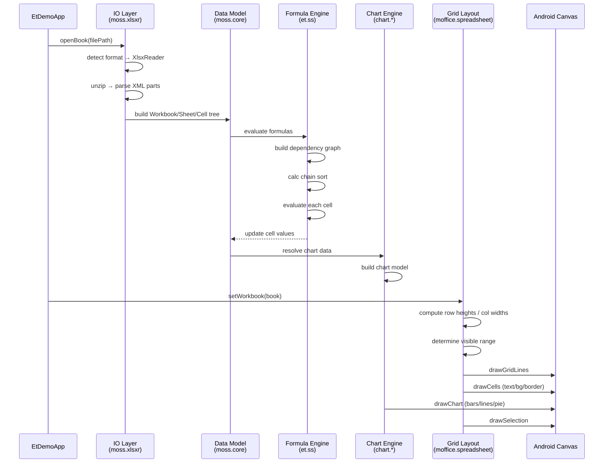

# ET 渲染管线完整追踪

从 XLSX 文件打开到网格渲染的完整数据流。

---

## 1. 文件打开入口

```
EtBookHelper.openBook(context, filePath, listener)
  → KmoAppApi.openBook(filePath)
    → moss.app.KmoBook (工作簿句柄)
```

### 关键类
- `cn.wps.moss.app.KmoAppApi` — 全局 API 入口
- `cn.wps.moss.app.KmoBook` — 工作簿生命周期管理
- `cn.wps.moss.app.event.KmoBookOpenEventListener` — 异步打开回调

---

## 2. IO 层：文件解析

```
KmoBook.open()
  → 检测文件格式 (XLSX/XLS/XLSB/CSV/HTML)
  → [XLSX] moss.xlsxr.XlsxReader
    → zip 解压 → 读取 [Content_Types].xml
    → xl/workbook.xml → 工作簿结构
    → xl/sharedStrings.xml → 共享字符串表
    → xl/styles.xml → 样式表
    → xl/worksheets/sheet*.xml → 工作表数据
    → xl/drawings/*.xml → 绘图对象
    → xl/charts/*.xml → 图表
  → [XLS] moss.xlsr.XlsReader → BIFF 二进制解析
  → [CSV] moss.plainr.PlainReader → 文本解析
```

### 关键类（XLSX 路径，297 文件）

| 类/包 | 文件数 | 职责 |
|-------|-------:|------|
| `moss.xlsxr.workbook.*` | ~30 | 工作簿 XML 解析 |
| `moss.xlsxr.worksheet.*` | ~40 | 工作表 XML 解析（行/列/单元格） |
| `moss.xlsxr.style.*` | ~25 | 样式 XML 解析 |
| `moss.xlsxr.drawing.*` | ~20 | 绘图 XML 解析 |
| `moss.xlsxr.chart.*` | ~15 | 图表 XML 解析 |
| `moss.xlsxr.sharedstrings.*` | ~10 | 共享字符串 |
| `moss.filefmt.*` | 365 | 格式常量/枚举/映射 |

---

## 3. 数据模型层

```
解析完成 → 内存数据模型
  moss.core.Workbook
    → moss.core.Sheet (工作表)
      → moss.core.Row (行)
        → moss.core.Cell (单元格)
          → CellValue (数值/文本/布尔/错误/公式)
          → CellStyle (格式/字体/对齐/边框/填充)
    → moss.core.SharedStrings
    → moss.core.StyleSheet
```

### 关键类
- `moss.core.Workbook` / `moss.core.Sheet` / `moss.core.Cell`
- `moss.core.CellValue` — 单元格值类型
- `moss.core.CellStyle` — 单元格样式
- `moss.app.KmoSheet` — 工作表 API 封装
- `moss.app.KmoRange` — 区域操作

---

## 4. 公式计算层

```
模型加载完成 → 公式计算
  et.ss.CalcChain → 计算链排序
  et.ss.FormulaEvaluator → 公式求值
    → et.ss.functions.* → 400+ 内置函数
    → et.ss.DependencyGraph → 依赖关系图
    → 脏标记传播 → 增量重算
```

### 关键类（431 文件）
- `et.ss.CalcChain` — 计算链管理
- `et.ss.FormulaParser` — 公式语法解析
- `et.ss.FormulaEvaluator` — 公式求值器
- `et.ss.functions.*` — Math/Statistical/Logical/Text/Date/Lookup 函数
- `et.ss.DependencyGraph` — 单元格依赖关系

---

## 5. 图表层

```
图表数据 → chart.*
  chart.data.ChartData → 系列/类别数据模型
  chart.chartxml.* → 图表 XML 解析 (DrawingML Chart)
  chart.chartole.* → OLE 图表对象
  chart.typo.* → 图表文本排版
  chart.render.* → 图表渲染
    → 柱形图/折线图/饼图/散点图/面积图 等
```

### 关键类（796 文件）
- `chart.data.ChartData` — 图表数据模型
- `chart.chartxml.ChartXmlReader` — 图表 XML 解析
- `chart.render.ChartRenderer` — 图表渲染分发
- `chart.render.BarRenderer` / `LineRenderer` / `PieRenderer` 等

---

## 6. 网格布局层

```
数据模型 → 网格布局
  moffice.spreadsheet.GridView
    → 行高计算（自动行高需要文本测量）
    → 列宽计算
    → 合并单元格区域
    → 冻结窗格分割
    → 可见区域裁剪
```

### 关键类
- `moffice.spreadsheet.GridView` — 网格视图
- `moffice.spreadsheet.GridRenderer` — 网格渲染器
- `moffice.spreadsheet.CellRenderer` — 单元格渲染
- `moffice.spreadsheet.SelectionRenderer` — 选区渲染

---

## 7. 渲染层

```
布局结果 → Canvas 渲染
  GridRenderer.draw(canvas)
    → 绘制网格线
    → 遍历可见单元格
      → CellRenderer.drawCell(canvas, cell, bounds)
        → 绘制背景填充
        → 绘制边框
        → 绘制文本（对齐/换行/溢出）
        → 绘制条件格式图标
    → 绘制合并单元格
    → 绘制冻结窗格分割线
    → 绘制选区高亮
  DrawingRenderer.draw(canvas)
    → 绘制浮动形状（图片/图表/SmartArt）
```

---

## 8. 完整数据流（Mermaid）



---

## 文档日期
- **编写日期**: 2026-04-30
