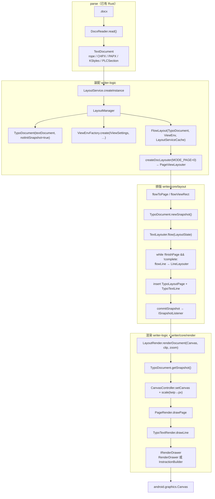
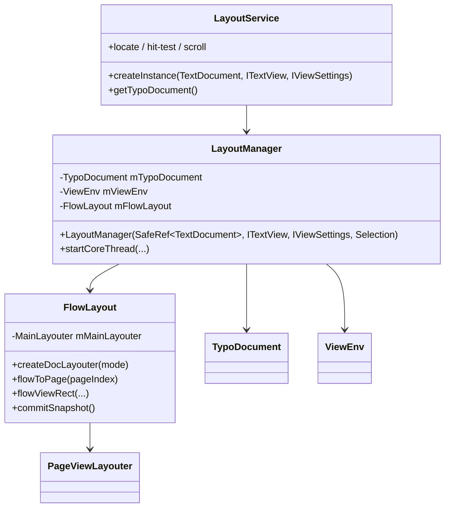
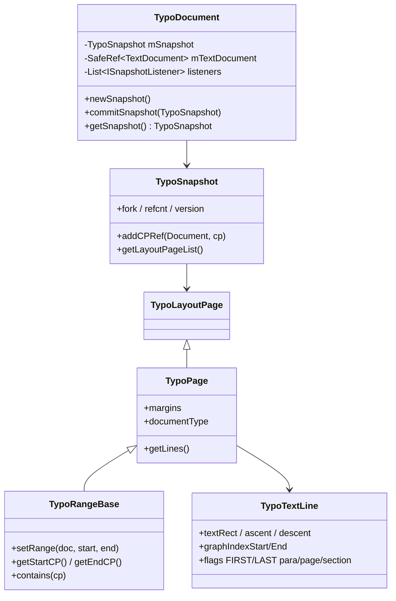
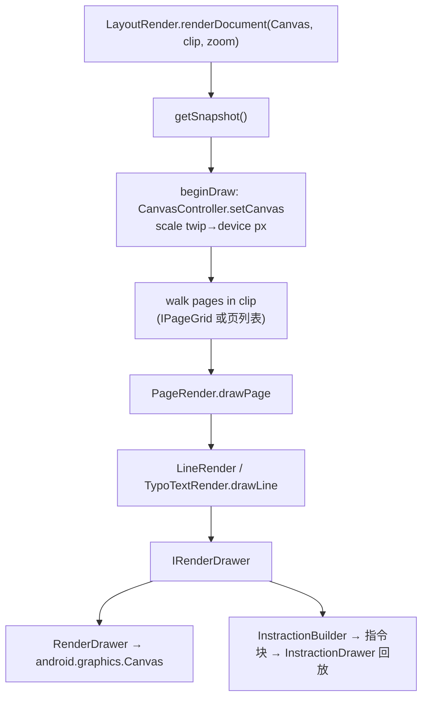

# Java 排版/渲染全链 ↔ Rust 对照

> 分析日期：2026-08-21  
> Java 源：`koffice/writer/core`（layout + cache + render）+ `koffice/writer/writer-logic`（LayoutManager / LayoutService / LayoutRender / instruction_cache）+ `koffice/core-libs/wpslayout` + `koffice/core-libs/thirdparty/font`  
> Rust 源：`libs/word-core`、`libs/core-libs/wpslayout`、`libs/core-libs/thirdparty/font`  
> 对照规则：`libs/word-core/RUST_REWRITE_RULE.md` Stage1/2/3  
> 像素级对齐与 Android 耦合细目：[PIXEL_ALIGNMENT_ANDROID_VS_FLUTTER.md](./PIXEL_ALIGNMENT_ANDROID_VS_FLUTTER.md)

本文是 layout MVP 的**类级蓝皮书**。feature 拆分见 [SPLIT_PRINCIPLES.md](./SPLIT_PRINCIPLES.md) 与 `features/wr-0X-*`。  
**已完成（行级叶子 wr-09..16 + session wr-18..20）：** [LINE_PARITY_PLAN.md](./LINE_PARITY_PLAN.md)。  
**现行下一波（Java 热路径 + 实排 L2）：** [state-java-l2-parity/NEXT_PLAN.md](../state-java-l2-parity/NEXT_PLAN.md)（wc-06/07 + wr-21..24）。

---

## 0. 架构结论（先读）

1. **Java 是 Android 应用内的同步+后台排版**：`LayoutService`（UI）→ `LayoutManager`（装配）→ `CoreThread/CoreFlow`（后台驱动 `FlowLayout`）→ `LayoutRender.renderDocument(android.graphics.Canvas, …)`。
2. **目标架构切断在指令层**：Rust 内核产出 `RenderCommand[]`；Flutter 只画。内核不得 import `android.*` / Flutter 引擎。
3. **正文排版不走 RichTextLayout**。`RichTextLayout`（2900 行）是形状/艺术字/文本框路径。正文热路径是：
   `PageViewLayouter` → `MainLayouter` → `TextLayouter.flow` → `LineLayouter` → `FontStyleFactory` → `ITypeface`（`AndroidTypeface` + `FreeTypeJNI`）。
4. **没有名为 `TypoLine` 的类**。行对象是 **`TypoTextLine`**。页是抽象 **`TypoPage`**，主文档页是 **`TypoLayoutPage`**。
5. **TypoSnapshot 是指针竞技场（2104 行）**。MVP **不复刻 `int pointer` 内存块**，改用 owned Rust struct，但 **对外契约**（`getStartCP`/`getEndCP`、页序、行几何、flag）必须与 Java JSON 对齐（Stage2 ±0.01px）。
6. **instruction_cache 已是准指令集**：`InstractionBuilder.drawText/drawLine/drawRect/…` 把 `IRenderDrawer` 录成可回放块。wr-07 以该接口为语义源，输出显式 enum，而不是移植 int-block 分配器。
7. **parse 已就绪**。wc-05 `functions.csv` 7/7 pass。layout 可以从 TextDocument fixture 起步，不必等 styles 子链缺口 C。
8. **不能承诺与 Android 截图像素级一致。** 排版几何（L2）可双跑对齐；`Paint.measureText` / `Canvas.drawText` 光栅无法被 FreeType + Flutter 比特级替换。验收以 Stage2/3 JSON 为准。
9. **2026-09-03：产品 `layout_document` 已是 SAX → TextDocument → RunStream → env `LineLayout`/`paginate`，仍不是本文件 S09–S11（`TextLayouter.flow`）。** wr-09..16 叶子绿 ≠ 产品热路径对齐。现行计划：[state-java-l2-parity](../state-java-l2-parity/README.md)。验收仍是 **L2 行级**（同一页/同一行/同一 cp 区间 + 行框 ±0.01px）；行内 xpos 与光栅允许像素差。

---

## 1. 端到端调用图（Java 现状）



**目标 Rust+Flutter（同一语义，切断点不同）：**


---

## 2. 类图（Java 热路径，MVP 必懂）

### 2.1 装配层（writer-logic）



| 类 | Java 路径 | 行数 | 职责 | Rust |
|----|-----------|------|------|------|
| LayoutService | `writer-logic/.../service/LayoutService.java` | 1887 | App API：快照、命中、滚动 | **无**（MVP 用同步 `layout_document()` 代替后台线程） |
| LayoutManager | `writer-logic/.../core/LayoutManager.java` | 246 | 装配 TypoDocument+ViewEnv+FlowLayout | **无** → wr-06 入口壳 |
| IViewSettings | `writer/core/.../service/IViewSettings.java` | 295 | 缩放/模式 → ViewEnv | **无** → wr-02 用常量 ViewEnv |
| ITextView | `writer/.../render/base/ITextView.java` | — | Android 视图尺寸/滚动 | **替换为** Flutter 视口参数（不进内核） |

**LayoutManager 构造（钉死顺序，Java L141–151）：**

1. `mTypoDocument = new TypoDocument(textDocument, true)`（不立刻 init snapshot）
2. `mLayoutExtraStatus = new LayoutExtraStatus(...)`
3. `mViewEnv = ViewEnvFactory.create(viewSettings, …)`
4. `mFlowLayout = new FlowLayout(mTypoDocument, mViewEnv, cache)`
5. `viewSettings.setViewEnv(mViewEnv)`

MVP：无 `ITextView` / `Selection` / `CoreThread`。同步调用 `FlowLayout.flowDocument()` 等价物。

### 2.2 排版层（writer/core/layout）

继承（页模式）：

```text
PageViewLayouter  →  MainLayouter  →  TextLayouter
```

`FlowLayout.createDocLayouter`（Java L356–377）：

| mode | 类 | MVP |
|------|----|-----|
| 0 默认 | `PageViewLayouter` | **必须** |
| 1 | `WebViewLayouter` | defer |
| 2 | `PhoneViewLayouter` | defer |
| 3 | `PhoneViewScrollLayouter` | defer |
| 4 | `ShareViewLayouter` | defer |

| 类 | 路径 | 行数 | 职责 | MVP |
|----|------|------|------|-----|
| MainLayouter | `layout/base/MainLayouter.java` | 902 | `flowPage` / `flowToPage` / `flowDocument` | must：`flowToPage` 循环 `flowPage` |
| TextLayouter | `layout/base/TextLayouter.java` | 1380 | `flow(LayoutState)`：`preFlow` → `while flowLine` → `postFlow`；`processPagination` / `finishPage` | must：无表/无图的 `flowLine` |
| LineLayouter | `layout/base/line/LineLayouter.java` | 1029 | run 放置、换行、对齐、装饰收集 | must：空格断行 + 左对齐 |
| PageViewLayouter | `layout/pageview/PageViewLayouter.java` | 1009 | 打印页模式 | must：单节 |
| ViewEnv | `layout/base/env/ViewEnv.java` | 828 | 视口/模式/气球/修订开关 | must：`mViewMode=0` + 页宽高；其余默认 |
| FontStyleFactory | `layout/base/env/FontStyleFactory.java` | — | PropertySet → TypoFontStyle + ITypeface | must：字号/粗体/颜色 |
| SectionLayouter | `pageview/PageViewSectionLayouter.java` | — | PLCSection → 页尺寸 | must：读默认节 PageSetup |
| SmallerConfig / IPageGrid | `smallerscale/*` | 22 / 126 / 1433 | 多页网格、缩略 | **defer** |
| Table*Layouter / DrawingLayouter / HeaderFooter* | 大量 | — | 表/图/页眉 | **defer** |
| EditTextLayouter | 2326 | 编辑态 | **defer** |

**TextLayouter.flow 钉死（Java L190–208）：**

```text
preFlow(state)                    # PageLayouter.start, 记 mStartCP
while !state.finishPage && !isComplete(state):
    flowLine(state)               # ParaLayouter.start + LineLayouter
postFlow(state)                   # collectPageRange, PageLayouter.end
```

`isComplete`：`layoutState.srcList.isEmpty()`（源 CP 耗尽）。

分页信号（TypoTextLine flags）：`LASTLINEOFPAGE` / `LASTLINEOFSECTION` / `LASTLINEOFCOLUMN`；段属性寡妇孤儿经 `processPagination`。MVP：内容高度耗尽或 `\f` 分页符 → 新页；寡妇孤儿 **defer**。

### 2.3 缓存层（writer/core/cache）— Typo*



| 类 | 行数 | 字段/契约（MVP 要保住的） | Rust |
|----|------|---------------------------|------|
| TypoDocument | 402 | 当前 snapshot、listener、`commitSnapshot` | **无** wr-06 |
| TypoSnapshot | 2104 | 版本、页列表、CP ref 表、fork/refcount | **无** wr-01/06；MVP owned 列表，不做 arena |
| TypoRangeBase | 129 | `startCP = cpRef + Δstart`，`endCP = cpRef + Δend`，半开区间 `[start, end)` | wr-01 用绝对 cp + 可选 ref（语义相等） |
| TypoPage | 738 | 边距、行表、documentType、flags | wr-01 |
| TypoLayoutPage | 1029 | 主文档页（图/脚注 **defer**） | wr-01 先等同 TypoPage |
| TypoTextLine | 658 | 行框、ascent/descent、graph 下标、flags | wr-01（**不是 TypoLine**） |
| TypoPara | — | 段级 graph 数组（run 几何） | wr-01 最小：每行一组 run |
| TypoPageLinesIterator | 221 | 页内行游标 | wr-01 |
| TypoFontStyle / TypoSHDs / TypoBRCs | style/ | 行内样式/底纹/边框 | wr-03/07 最小字体+颜色；底纹 defer |

**CP 模型（钉死）：**

- 全文线性 Character Position，与 TextDocument rope / CHPX / PAPX **同一套 cp**（Stage1 已锁）。
- `TypoRangeBase.contains(cp)`：`cp >= start && cp < end`。
- `TypoTextLine` 的 cp **通常不存在 RangeBase 槽**，而由 `TypoPara` 的 graph index `[OFFSET_GRAPH_INDEX_START, END]` 反查。MVP 可在行上直接存 `start_cp/end_cp`，Stage2 JSON 用同一字段名。

**Snapshot 生命周期（钉死）：**

```text
newSnapshot() / fork
  → layout 写入 forked snapshot
  → beforeCommit(version)
  → commitSnapshot：替换 current，通知 ISnapshotListener
  → 读者 getSnapshot()（Java clone+refcount）→ 用完 release()
```

MVP：单线程、无 fork；`layout()` 直接替换 `current: TypoSnapshot`。listener 可先做成 `Fn()` 回调。

### 2.4 渲染层



| 类 | 路径 | 行数 | Android 耦合 | Rust 替换 |
|----|------|------|--------------|-----------|
| LayoutRender | `writer-logic/.../render/LayoutRender.java` | 721 | `android.graphics.Canvas/Bitmap/Rect/Handler` | wr-07：`render_snapshot(snap, clip) -> Vec<RenderCommand>` |
| CanvasController | `.../CanvasController.java` | 339 | Canvas save/clip/translate | wr-07：`Save/Restore/Clip/Translate` 指令 |
| RenderDrawer | `.../drawer/RenderDrawer.java` | 1392 | Paint/Canvas | **不移植**；语义进 RenderCommand |
| IRenderDrawer | `writer/core/.../render/base/IRenderDrawer.java` | 166 | 绘制原语接口 | wr-07 指令集的方法表 |
| PageRender | `writer/core/.../render/renderer/PageRender.java` | 1288 | 页背景/行/表/图 | must：页背景 FillRect + 行文本 |
| TypoTextRender | `.../TypoTextRender.java` | 832 | 行 → drawText | must |
| InstractionBuilder | `instruction_cache/InstractionBuilder.java` | — | 录制 drawText/Line/Rect/… | **语义源**；不移植 int-block |
| DecoLineCache | wpslayout `data/DecoLineCache.java` | 624 | `draw(Canvas)` 下划线 | wr-07 02：DrawLine 指令 |

**InstractionBuilder 已录制的原语（wr-07 最小集加粗）：**

| 方法 | MVP |
|------|-----|
| **drawText(String/char[], x, y, bold, italic)** | **must** |
| **drawLine / drawRect / drawColor / fillRect** | **must**（页框、下划线） |
| drawRoundRect / drawCircle / drawPath / drawPicture / drawBitmap / drawShape / drawWordArt | defer |
| drawSelection / drawEmoji / drawPageTag | defer |

### 2.5 度量 / 字体

| 类 | 路径 | 用途 | Rust |
|----|------|------|------|
| FreeTypeJNI | `thirdparty/font/.../FreeTypeJNI.java` | glyph advance、kerning、path | **`core_libs_font` 已编译** |
| AndroidTypeface | `.../impl/AndroidTypeface.java` 1036 | ITypeface：FreeType + `Paint.measureText` fallback | wr-03：只用 FreeType，禁止 Paint |
| FontHost / TypefaceFactory | font | 族名 → typeface | wr-03 `04_font_host`：注入表 + SchemaItem；宿主读文件 |
| RichTextLayout | wpslayout 2900 | 形状富文本 | **defer**（crate 目前不能编译） |
| BaseTextLayout | 195 | TextBox typo | defer |
| BulletDrawer | 174 | 项目符号 | defer（编号 wr 后续） |

---

## 3. Android 耦合 → RenderCommand（必须切断）

| Java 耦合 | 出现位置 | 内核替换 | 上层 |
|-----------|----------|----------|------|
| `android.graphics.Canvas` | LayoutRender, CanvasController, RenderDrawer, DecoLineCache, PageRender | `RenderCommand` | Flutter `Canvas` |
| `Paint` / `TextPaint` / `Typeface` | RenderDrawer, AndroidTypeface | 度量走 FreeType（现网另有 Paint 回退，不对齐则断行漂） | **按指令 x 逐字画**；`TextPainter` 整串 shaping 会二次排版 |
| `android.view` / Handler / ITextView | LayoutService, LayoutRender | 视口矩形作为 **入参**，不持有 View | Flutter Widget |
| `Bitmap` / `Path` / `Matrix` | 图/艺术字 | defer | — |
| `CoreThread` 后台排版 | LayoutManager.startCoreThread | MVP **同步** `layout()` | 可选 isolate |

**坐标约定（钉死）：**

- 排版内部单位：**twip**（与 Java `PageSetup` / 节属性一致）。默认页 `PageSetup(11906, 16838, 1800, 1800, 1440, 1440)`（与 wc-05 `createDefaultSectionPropertySet` 676 号属性相同）。
- RenderCommand 携带 **twip**。Java `beginDraw` 用 `canvas.scale(zoom * MetricsUtil.twips2pixel_x_ratio)`，其中 `twips2pixel_x_ratio = 1.3333536 / 20`（**96 DPI 约定，不是 `DisplayMetrics.density`**）。Flutter 必须抄同一公式，再按 `devicePixelRatio` 落到物理像素。禁止内核写死某台 Android 的 density。

**建议指令 enum（wr-07；可扩展，Stage3 序列相等）：**

```text
Save / Restore
SetClip { x, y, w, h }
Translate { dx, dy }
FillRect { x, y, w, h, color }
StrokeRect { x, y, w, h, color, width }
DrawLine { x1, y1, x2, y2, color, width }
DrawText { page, font_id, size_twip, color, x, y, text, fake_bold, skew_x, xpos[]? }  // Java 热路径是逐字 xpos；整串 TextPainter 禁止用于 Stage3
BeginPage { index, width, height } / EndPage
```

---

## 4. 逐层 Java ↔ Rust 对照表

| 层 | Java | Rust 现状 | 差距 / 承接 feature |
|----|------|-----------|---------------------|
| 解析 | DocxReader + DocumentImporter | wc-01..05 **pass** | styles 子链缺口 C；纯文本可忽略 |
| 文档模型 | TextDocument / PLCSection / PageSetup | **在 compile surface** | 不去改（call-only） |
| Typo 缓存 | cache/Typo* | **无** | wr-01 + wr-06 |
| 视图参数 | ViewEnv / IViewSettings | PageSetup 有；ViewEnv **无** | wr-02 |
| 度量 | FontStyleFactory + ITypeface + FreeTypeJNI | font crate **可编译**；word-core 未接线；wpslayout **红** | wr-03 |
| 断行 | LineLayouter | **无** | wr-04 |
| 分页 | TextLayouter / MainLayouter / PageViewLayouter | **无** | wr-05 |
| 装配 | LayoutManager / FlowLayout | **无** | wr-06（同步壳） |
| 渲染 | LayoutRender + IRenderDrawer | **无** | wr-07 |
| 跨端 | Android Activity | **无** | wr-08 |
| numformat | layout/numformat | `.rs` 存在 **未进 lib.rs** | 编号 feature 再导出；本 MVP 不用 |

`libs/word-core/src/cn/wps/moffice/writer/layout/base/` 仅有空目录（env/line/table/…），**0 个 .rs**，且 `lib.rs` 注释写明 layout 未导出。

---

## 5. 最小 MVP 范围（must / stub / defer）

### 5.1 必须（第一张 Flutter 页）

- 单节、纯段落、无表/图/页眉/脚注/修订气球
- ViewEnv：`MODE_PAGE=0`，A4，边距 1440 twip，zoom=1
- 一种默认字体 + 字号（来自 rPr / 样式 10.5pt Normal）+ 前景色
- 空格断行、左对齐、简单行高
- 页高耗尽分页（可先单页）
- TypoPage + TypoTextLine + Snapshot（owned）
- `DrawText` + 页 `FillRect`/`StrokeRect`
- Flutter 画 page 0

### 5.2 壳（保留 Java 签名/位次，todo DEFERRED）

- TypoSnapshot arena / mem block
- IPageGrid / SmallerConfig
- CoreThread / LayoutService 全 API
- instruction_cache 持久化
- LayoutRender 的 magnifier/thumb/preview

### 5.3 延后（不进本轮 feature 种子）

- 表、图、文本框、艺术字、分栏、页眉页脚、脚注尾注
- 两端对齐、CJK 标点挤压、bidi
- 寡妇孤儿、节属性变更换页细节
- RichTextLayout / wpslayout 编译修复（可作为 wr-03 前置审计，不阻塞 FreeType 路径）
- 滚动/缩放/选中（wr-08 03）

---

## 6. 与 parse feature 的接缝

```text
wc-05 DocxReader.read()
  → TextDocument（Stage1 JSON）
       ↓ 本目录起点
wr-02 ViewEnv(PageSetup from PLCSection or default)
wr-03 measure runs from CHPX
wr-04 wrap to lines
wr-05 pack lines into pages
wr-01+06 TypoSnapshot
wr-07 RenderCommand
wr-08 Flutter
```

**禁止** layout feature 回头改 parse 热路径（DocxReader / DocumentImporter），除非 Stage1 对照证明文档模型缺字段。

---

## 7. 验收（沿用 RUST_REWRITE_RULE）

| Stage | 产物 | 容差 |
|-------|------|------|
| 1 | DocumentModel JSON | 严格相等（parse 已在做） |
| 2 | TypoSnapshot JSON：页序、行 `start_cp/end_cp`、x/y/width/height、run 文本 | 坐标 ±0.01px |
| 3 | RenderCommand 列表 | 序列 + 字段相等 |

黄金样本：`libs/word-core/test-samples/` 增补 `plain-one-para.docx` / `plain-multi-para.docx` / `font-size-color.docx`。

---

## 8. 端到端逐环节 I/O（.docx 字节 → 屏幕像素，不遗留环节）

> 记号：**I**=输入 · **O**=输出 · 单位约定：**twip**（1pt=20twip）贯穿排版与指令；**px** 仅出现在最末两级（twip→px 公式 `scale = zoom × 1.3333536/20`，96DPI 约定，Flutter 再乘 `devicePixelRatio`）。

### S01 字节 → OPC 包（解压/类型/关系/Parts）
| 项 | 内容 |
|----|------|
| Java | `ZipEntrySource` + `ContentTypeManager` + `PackageRelationshipCollection` + `OPCPackage`（wave0 02–05/07） |
| I | `.docx` 字节（或路径/RAF/流）、PK 魔数、`[Content_Types].xml`、`_rels/.rels` |
| O | `OPCPackage`：part 表（URI→Part）、类型表、关系图；每 Part 可 `getInputStream()` |
| Rust | wave0 `02/03/04/05/07` **pass** |
| 边界 | 坏 zip/类型缺失在本环节红，不得泄漏成下游「importer 没回调」 |

### S02 任一 Part 流 → XML 事件（元素身份）
| 项 | 内容 |
|----|------|
| Java | `XmlReader`/`opt.XmlParse` + `Name2IdMap`（elementId = 命名空间+本地名哈希） |
| I | Part `InputStream`、根 handler、namespaces（`w:` 主命名空间） |
| O | `onStart_with_id(elementId, ns, local, q, attrs)` / `onEnd_with_id` / `onCharacters` 事件流，attrs 为原始属性表 |
| Rust | wave0 `06_xml_elementid` + `08_xml_dispatch` **pass** |
| 边界 | 属性在此是**不透明** `&dyn Any`；读值在 S04 |

### S03 事件 → handler 栈分发
| 项 | 内容 |
|----|------|
| Java | `DispatchHandler2`：首事件按根 filterIndex 匹配，其后 `栈顶.getElementHandler(id, ns)` → push → `onStart`；`onEnd` 弹栈 |
| I | S02 事件流 + 根 handler |
| O | 栈式回调序列（styles/document/numbering… 各 Handler 的 onStart/End） |
| Rust | wave0 `08_xml_dispatch` pass；styles 链 `15_function_styles_handler_chain` pass；numbering/settings/fonts 子链 TODO（无编号/设置的最小 docx 可跳过） |

### S04 属性事件 → PropertySet（pPr/rPr 转换）
| 项 | 内容 |
|----|------|
| Java | `PropHandler/PprHandler/RprHandler` + `PropChildHandler` + `*ConverterSimple`（wc-03）→ `MutablePropertySet` |
| I | elementId + attrs（`getValue(MAIN_NS, name)`）+ `StyleId2Sti` + mode |
| O | run/段 `MutablePropertySet`（prop 桶：字号 10、粗体 5、对齐 3385…）填充到 `Prop`/`ParagraphSimple` |
| Rust | wc-03 `01..07` **pass**（ConvertHelper/measure/brc_shd/run_highfreq/para_convert/correct_prop） |
| 边界 | 属性值为「内核 propId」，非 OOXML 直读——所有下游只消费 propId 桶 |

### S05 正文事件 → 文档落库（rope/CHPX/PAPX/节）
| 项 | 内容 |
|----|------|
| Java | `SubDocumentImporter`（start/run/end/table/field）+ `MainDocumentImporter` + `CoreHelper.appendText/appendParagraph` |
| I | `onImportParagraphStart(paraId)`、`onImportRun(text|char[],chpx)`、`onImportParagraphEnd(paragraph, layerTable)`… |
| O | main rope 追加文本；`CHPX`@run 首 CP；`PAPX`@段首 cp0；特殊字符 `\r/\f/0x07/19,20,21`；`KParagraphsID`（paraId↔PAPX entry）；`PLCSection`（`\f` 记截止 CP） |
| Rust | wc-04 `01..07` **pass**（paragraph_context/run_text/paragraph_end/table_cell/field_control/maindoc_guard/section_add） |
| **cp 语义钉死** | `mPositionInserted = document.getLength()`（Start 抓）→ appendParagraph 的 PAPX insert CP；CHPX insert CP = 当次 length；`\r`=0x0D、`\f`=0x0C、`\u0007`=0x07 |

### S06 编排与收尾 → 完整 TextDocument（Stage1 交付物）
| 项 | 内容 |
|----|------|
| Java | `DocxReader.read()` + `DocumentImporter` 路由 + styles 两阶段 + `FinishReadingWork.go()` |
| I | S01–S05 事件（经 S03 分发到 styles/主文档/…）+ OPC 元数据 |
| O | **TextDocument**：rope（末段 `\r` 经 supplyEndPara）+ CHPX/PAPX + `KStyles`（rPr/pPr 默认、Normal sti=0、用户样式先于正文）+ `PLCSection`（≥1 默认节）+ `guessedTotalLength` + metadata；`ISnapshot` 上传：`read()` 12 步顺序 |
| Rust | wc-05：**02 pass**；03 模板在编面（ctor/路由待实现）；01 src 完成待 loop；04–07 spec。styles 链已通（wave0 15 pass）→ 07 的 e2e 样式断言可去 ignore |
| 验收 | Stage1：TextDocument JSON 与 Java 严格相等 |

### S07 排版装配 + 视图参数（页几何/模式）
| 项 | 内容 |
|----|------|
| Java | `LayoutService→LayoutManager`：`TypoDocument(textDoc, notInit)` + `ViewEnvFactory.create(IViewSettings)` + `FlowLayout`；`createDocLayouter(MODE_PAGE=0)` |
| I | TextDocument（S06）+ 视图设置（宽/高/缩放/mode）+ 节 PageSetup（PLCSection） |
| O | `ViewEnv`（内容区宽高 = 页宽−边距，twip）、`FlowLayout` + `PageViewLayouter` 就绪、排版范围（整文档/增量） |
| Rust | wr-02：`page_setup`（11906/16838/1800/1800/1440/1440 → 内容区 8306×13598 twip）+ `view_env`（MODE_PAGE，zoom=1）——**待 loop** |
| 边界 | MVP 同步全量排版：无 CoreThread、无增量；`IViewSettings` 用常量替代 |

### S08 度量：字体解析 + 字符 advance/行高数据
| 项 | 内容 |
|----|------|
| Java | `FontHost`/`FontTool.addFontMapScheme`/`TypefaceFactory`（族名→文件）+ `FontStyleFactory`（PropertySet→TypoFontStyle+ITypeface）+ `AndroidTypeface`/`FreeTypeJNI`（glyph advance/ascender/descender）+ `PaintFontHelper.getCharWidth` |
| I | run 样式（fontId/size_twip/粗斜/色）+ 文本片段 + 字体文件 |
| O | 逐字符 advance（hmtx，字体单位）+ ascender/descender（hhea/OS2，字体单位）；**换算：x_twip = units × size_twip × 20 / upem** |
| Rust | wr-03：`04_font_host`（注入表，对标 FontHost；**layout 不探盘**）+ `01_font_stack`（ttf-parser）+ `02_run_metrics` |
| 验收 | 同一 TTF：ttf-parser advance vs Java FreeType 黄金样本差 ≤0.5twip |

### S09 断行 wrap（run 序列 → 行）
| 项 | 内容 |
|----|------|
| Java | `LineLayouter`（LineLayouter.java 1029 行）+ `TextLayouter.flow→flowLine` |
| I | 段内 run 序列 + 每 run 宽度（S08）+ 内容区宽（S07） |
| O | 行集合：每行 = run 子区间（start_cp/end_cp）+ 累积宽 ≤ 内容宽；空格断点回退；超宽单词强制截断；`\r` 段末断行 |
| Rust | wr-04：`run_width_cache` + `wrap`——**待 loop** |
| 边界 | MVP 空格断行；两端对齐/CJK 标点挤压/bidi 延后（后续 rustybuzz） |
| 验收 | 每行 start/end cp 与行宽（twip）→ Stage2 |

### S10 行几何：行高/基线/对齐 → 行框
| 项 | 内容 |
|----|------|
| Java | `LineLayouter`（行高/基线）+ `setTextAlignment`（jc）+ 段前段后（spcBef/Aft） |
| I | S09 折行 + 字号→行格 + PAPX（191/236 等：段前段后/行距）+ jc（3385） |
| O | `TypoTextLine` 行框（top/height、chanel asc/des、flags：FIRST/LAST of para/page/section）+ 行内起始 x（对齐后） |
| Rust | wr-04：`line_height` + `alignment`——**待 loop**；行框落 wr-01 `typo_line` |
| 验收 | 行 top/height/基线（twip）→ Stage2 |

### S11 分页：页满判定/分页符/节切换 → 页序列
| 项 | 内容 |
|----|------|
| Java | `TextLayouter.processPagination` + `MainLayouter.flowPage` + `PageViewLayouter`/`SectionLayouter`（节 PageSetup） |
| I | 行流（S10）+ 页内容高（S07）+ PLCSection 节序列 + `\f` 分页符 |
| O | 页序列：`TypoLayoutPage`（含行容器、页序 mPage、cp 区间）；断页标 `LASTLINEOFPAGE`；节切换换页尺寸 |
| Rust | wr-05：`page_break` + `section_grid`——**待 loop** |
| 边界 | MVP 单节连续分页；寡妇孤儿/跨节重排延后 |
| 验收 | 页序/每页 cp 区间 → Stage2 |

### S12 快照组装：TypoDocument/TypoSnapshot（版本 + CPRef）
| 项 | 内容 |
|----|------|
| Java | `TypoDocument.newSnapshot→commitSnapshot` + `TypoSnapshot`（页列表/CPRef 表/版本 VER_FIRSTCACHE→VALIDBEGIN）+ `ISnapshotListener` |
| I | 页序列（S11）+ 文本引用（cp） |
| O | **TypoSnapshot**（页集合 + CPRef 注册表 + 版本）→ 渲染/命中只读源；编辑平移（updatePageRanges）维护 cp |
| Rust | wr-01（typo_snapshot/page/line/iterator/typo_run——typo_page 已 pass，其余 spec）+ wr-06（typo_document/snapshot_build 待 loop） |
| 验收 | Stage2：TypoSnapshot JSON（页序/行 start_cp/end_cp/x/y/width/height）±0.01px |

### S13 定位/命中（字符 ↔ 页/行/run）——渲染辅助
| 项 | 内容 |
|----|------|
| Java | `LocateTool`/`LayoutLocater`/`getTextLayoutPos`（偏移→para/line/行内偏移）；`IPageGrid.pageIndexFromChar` |
| I | cp + TypoSnapshot（S12） |
| O | 视觉位置（页/行/run/x）——选区/光标/高亮绘制输入；滚动定位输入 |
| Rust | 由 wr-01 `typo_iterator`（页→行迭代+contains）+ wr-05 `section_grid`（cp→页）承接（MVP 仅定义接口，交互延后 wr-08-03） |

### S14 渲染指令化：TypoSnapshot → RenderCommand（twip）
| 项 | 内容 |
|----|------|
| Java | `LayoutRender.renderDocument(Canvas, clip, zoom)` + `CanvasController`（scale twip→px）+ `PageRender`/`TypoTextRender` + `IRenderDrawer`（RenderDrawer/InstractionBuilder） |
| I | TypoSnapshot（S12）+ 视口矩形 + zoom |
| O | 绘制指令（twip 坐标）：`BeginPage/EndPage`、`FillRect`（页背景/底纹）、`DrawText`（页/x/y/font_id/size_twip/color/text + 逐字 xpos）、`DrawLine/DrawRect`（下划线/边框，DecoLineCache 语义） |
| Rust | wr-07：`text_command` + `deco_command` + `serialize`——**待 loop**；指令 enum 见 §3；InstractionBuilder 为语义源（不移植 int-block） |
| 验收 | Stage3：指令序列+字段与 Java InstractionBuilder 回放相等 |

### S15 指令序列化 + 跨端传输
| 项 | 内容 |
|----|------|
| 实现 | serde_json（word-core 已有）→ JSON/二进制；UniFFI/dart:ffi 传输（RUST_REWRITE_RULE 模式） |
| I | RenderCommand 序列（S14） |
| O | JSON 字节流（含 version 字段）；Flutter 侧反序列化 |
| Rust | wr-07-03 serialize（待 loop）+ wr-08-01 uniffi_export（待 loop） |
| 验收 | Stage3 对比文件即 S15 输出 |

### S16 Flutter 解析指令 → 绘制调用（twip→px）
| 项 | 内容 |
|----|------|
| 实现 | Flutter `Canvas`/`TextPainter`；`scale = zoom × 1.3333536/20 × devicePixelRatio`（96DPI 约定，禁止内核写死 density） |
| I | RenderCommand JSON（S15）+ 视口尺寸/DPR |
| O | Canvas 调用序列：transform(scale) → 兼容 Begin/EndPage → fillRect/文本描画（逐字 xpos 或每 run 一个 TextPainter） |
| Rust | wr-08-02 flutter_painter（待 loop） |
| 边界 | **逐字 xpos 用于 Stage3 对齐**；整串 TextPainter 二次排版 ≠ Java 断行 → 仅允许装饰性差值场景 |

### S17 字形光栅化与合成（像素点）
| 项 | 内容 |
|----|------|
| 实现 | Flutter 引擎：Skia/Impeller 内 HarfBuzz 类 shaping + FreeType/系统字体 rasterizer → glyph 位图/路径 → 按 font_id 着色（fill）→ 图层合成（layer tree → Skia picture → GPU 光栅化） |
| I | Canvas 调用序列（S16）+ 字体资源（Flutter 侧须能按 font_id 找到同一字体文件） |
| O | **屏幕像素**：每页光栅化到图层/位图；页背景/文本/装饰按 z-order 合成 |
| Rust | **无（引擎职责）**——此环节由 Flutter 原生完成，Rust 只保证：字体文件一致 + 坐标/字号与 S08 度量同源 |
| 边界 | 比特级与 Android 截图不对齐（§0.8）；验收以 Stage2/3 JSON 为准 |

### S18 视口合成（滚动/缩放/页间隙）
| 项 | 内容 |
|----|------|
| 实现 | Flutter 视口：页竖向排列（页间隙）、滚动 offset、可用页范围（S13 cp→页）、重绘当前可见页 |
| I | 手势/滚动 offset + 页高度表（S11）+ DPR |
| O | 屏幕最终像素（可见页子集合成） |
| Rust | wr-08-03 interaction（待 loop）；MVP 先固定第一页 |

### S19 交互回环（输入 → 重排/重绘）——闭环说明
| 项 | 内容 |
|----|------|
| 实现 | 编辑/视图变化 → S07 重新驱动（MVP 全量）；滚动/缩放只重绘（S18）；选中命中经 S13 |
| I | 用户事件（滚动/点击/缩放/编辑） |
| O | 新 Snapshot（S12）或新指令集（S14）→ 重绘 |
| Rust | MVP 同步全量；增量/线程化延后（wr-05-03 relayout_cache 占位） |

---

### 全程坐标/单位总表（钉死，任何环节不得混用）

| 环节 | 单位 | 值来源 |
|------|------|--------|
| S01–S06 | cp / twip（属性值内部） | rope/PropertySet |
| S07–S14 | **twip** | PageSetup（S07）、advance 换算（S08） |
| S15–S16 | twip → px | `zoom × 1.3333536/20`（96DPI）再 × DPR |
| S17–S18 | px（物理） | 光栅化/合成 |

---

## 9. Java ↔ Rust 逐环节对照大表（S01–S19 + 横切项）

| 环节 | Java 实现（类 / 位置） | Rust 现状（承接 feature·function / src 路径） | 状态 · 缺口 · 验收 |
|------|------------------------|-----------------------------------------------|--------------------|
| S01 字节→OPC 包 | `ZipEntrySource`/`ContentTypeManager`/`PackageRelationshipCollection`/`OPCPackage`（wave0） | wave0 `02_unzip` `03_content_types` `04_relationships` `05_parts` `07_opc_package`（wps-io） | ✅ pass。坏 zip/类型缺 → 本环节红 |
| S02 Part 流→XML 事件 | `XmlReader`+`Name2IdMap`+`XmlParse`（opt） | wave0 `06_xml_elementid` | ✅ pass。attrs 为不透明对象，读值在 S04 |
| S03 事件→handler 栈 | `DispatchHandler2`（栈顶 getElementHandler→push→onStart/onEnd） | wave0 `08_xml_dispatch`；styles 链 `15_styles_handler_chain` | ✅ 前两者 pass；numbering/settings/fonts 子链 TODO（最小 docx 可跳过） |
| S04 属性→PropertySet | `Prop/Ppr/Rpr/PropChildHandler` + `*ConverterSimple`（wc-03） | wc-03 `01_importer_mode`..`07_correct_prop` | ✅ pass。产出内核 propId 桶 |
| S05 正文事件→落库 | `SubDocumentImporter`/`MainDocumentImporter` + `CoreHelper.append*` | wc-04 `01..07`（paragraph_context/run_text/paragraph_end/table_cell/field_control/maindoc_guard/section_add） | ✅ pass。cp 锚定：PAPX@段首 cp0、CHPX@run 首 CP、`\f` 记 PLCSection |
| S06 编排/收尾→TextDocument | `DocxReader.read()` + `DocumentImporter` + styles 两阶段 + `FinishReadingWork.go()` | wc-05 `02_style_event` pass；`01_io_style` src 完成待 loop；`03_di_construct_route` 模板在编面（ctor/路由 DEFERRED）；`04/05/06/07` spec | ◐ 进行中。Stage1 JSON 门闩 |
| S07 装配+ViewEnv | `LayoutService→LayoutManager` + `ViewEnvFactory` + `FlowLayout(createDocLayouter MODE_PAGE=0)` | wr-02 `01_page_setup` `02_view_env`（layout/base/env/ViewEnv.rs 待建） | ✗ 待 loop。A4：11906/16838/边距 1800/1800/1440/1440 → 内容区 8306×13598 twip |
| S08 度量（字体+advance） | `FontHost`/`TypefaceFactory` + `FontStyleFactory` + `AndroidTypeface`/`FreeTypeJNI`（`.so`）+ `PaintFontHelper.getCharWidth` | wr-03 `04_font_host` + `01_font_stack`（ttf-parser）+ `02_run_metrics` | ◐ FontHost 注入表 pass；同帧 TTF advance 差≤0.5twip；FreeTypeJNI 壳留 Backend B |
| S09 断行 wrap | `LineLayouter`（1029 行）+ `TextLayouter.flow→flowLine` | wr-04 `01_run_width_cache` `02_wrap`（layout/base/text/） | ✗ 待 loop。空格断行；标点挤压/bidi 延后（rustybuzz） |
| S10 行几何（行高/对齐） | `LineLayouter` + `setTextAlignment` + spcBef/Aft | wr-04 `03_alignment` `04_line_height`；行框落 wr-01 `03_typo_line` | ✗ 待 loop。top/height/基线 twip → Stage2 |
| S11 分页/节/网格 | `TextLayouter.processPagination` + `MainLayouter.flowPage` + `PageViewLayouter`/`SectionLayouter` | wr-05 `01_page_break` `02_section_grid`（layout/base/） | ✗ 待 loop。断页标 LASTLINEOFPAGE；单节 MVP |
| S12 快照组装 | `TypoDocument.newSnapshot/commitSnapshot` + `TypoSnapshot`（arena/CPRef/版本）+ `ISnapshotListener` | wr-01 `01_typo_snapshot`..`05_typo_run`（cache/ 已有 .rs，**typo_page pass**）+ wr-06 `01_typo_document` `02_snapshot_build` | ◐ wr-01 部分 pass。Stage2 JSON（页序/行 start_cp/end_cp/x/y/w/h ±0.01px） |
| S13 定位/命中 | `LocateTool`/`LayoutLocater`/`getTextLayoutPos` + `IPageGrid.pageIndexFromChar` | wr-01 `04_typo_iterator` + wr-05 `02_page_grid`（cp→页二分） | ✗ 接口定义；交互 wr-08-03 延后 |
| S14 渲染指令化 | `LayoutRender.renderDocument` + `CanvasController` + `PageRender`/`TypoTextRender` + `IRenderDrawer`（RenderDrawer/InstractionBuilder） | wr-07 `01_text_command` `02_deco_command`（rendercommand/，twip 指令 enum 见 §3） | ✗ 待 loop。Stage3：指令序列与 InstractionBuilder 回放相等 |
| S15 序列化+传输 | —（Java 直接 Canvas） | wr-07 `03_serialize`（serde JSON）+ wr-08 `01_uniffi_export`（cfg(feature=uniffi)） | ✗ 待 loop。S15 输出即 Stage3 对比文件 |
| S16 Flutter 解析指令→Canvas | — | wr-08 `02_flutter_painter`（解析 JSON→Canvas/TextPainter；`scale=zoom×1.3333536/20×DPR`） | ✗ 待 loop。逐字 xpos；整串 TextPainter 二次排版禁用于 Stage3 |
| S17 字形光栅化+合成（像素） | `android.graphics.Canvas/Paint`（Framework Skia） | 无 Rust——Flutter Skia/Impeller 光栅化；Rust 保证字体文件一致 + 坐标/字号与 S08 同源 | △ 引擎职责。比特级不对齐 Android（§0.8），验收以 Stage2/3 JSON 为准 |
| S18 视口合成（滚动/缩放/页间隙） | `LayoutService.onScroll` + View 层 | wr-08 `03_interaction`（MVP 固定第一页） | ✗ 待 loop（M4） |
| S19 交互回环（输入→重排/重绘） | `FlowLayout.update(DocumentEvent)` + CoreThread | MVP 同步全量；wr-05 `03_relayout_cache` 占位（增量延后） | ✗ 占位 |

### 横切对照项

| 项 | Java | Rust | 钉死 |
|----|------|------|------|
| cp 模型 | TextDocument rope/CHPX/PAPX 同一 cp | 同（wr-01 TypoRangeBase 半开 `[start,end)`） | Stage1 严格相等 |
| 单位 | 排版内 twip；绘制 px（`twips2pixel_x_ratio=1.3333536/20`） | 同：S07–S14 twip；S16 `zoom×1.3333536/20×DPR` | 混用即失败 |
| 页/行对象名 | `TypoLayoutPage`/`TypoTextLine`（**无 TypoLine**） | Rust 同名 struct（cache/） | 命名对齐 Java，防二次发明 |
| 快照 | arena（pointer） | owned Vec/HashMap（§0.5 契约等价） | JSON 契约对齐即可 |
| 正文排版路径 | 不走 RichTextLayout（文本框专用） | wr-04/05 直接 LineLayouter-min | RichTextLayout 及 wpslayout 红 = 非阻塞 |
| 测量后端 | FreeType（freetype-jni.so） | ttf-parser（MIT，零 so）+ rustybuzz（后续 shaping） | same-hmtx ⇒ 数值对齐；>0.5twip 判失败 |
| 验收 | — | Stage1=模型 JSON；Stage2=快照 JSON ±0.01px；Stage3=指令序列 | RUST_REWRITE_RULE |
