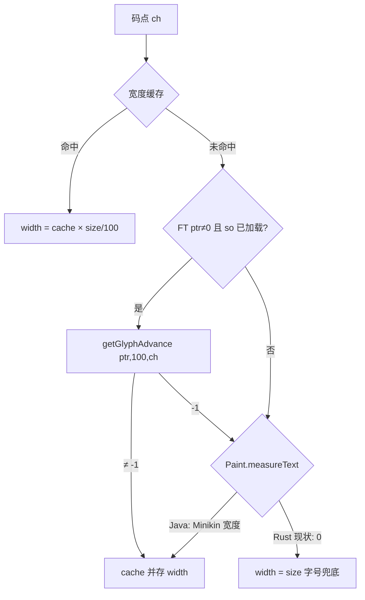

# 度量双引擎 · 绘制 · 指令缓存：原理、差异与断行补救

> 日期：2026-08-21  
> 配套：[PIXEL_ALIGNMENT_ANDROID_VS_FLUTTER.md](./PIXEL_ALIGNMENT_ANDROID_VS_FLUTTER.md)  
> 源码：`AndroidTypeface.getWriterLayoutAdavances*` · `FreeTypeJNI` · `FontStyleFactory.calcAscentAndDescent` · `RenderDrawer.drawText` · `InstractionBuilder`

本文展开三件事：**(1) 测宽双引擎到底是什么**（不是「Android 系统自带的排版」）；**(2) 画字**；**(3) 指令缓存**。  
产品约束：**换行点/少一行不可接受**—— wr-03 必须把「Paint 回退」的**角色**用可移植实现补上，而不是删掉后假装 FreeType 单引擎等于现网。

---

## 0. 先把两套东西分开

| | **FreeTypeJNI** | **TextPaint.measureText** |
|--|-----------------|---------------------------|
| 谁实现的 | WPS native：`cn.wps.libs.thirdparty:freetype-jni:20.2.4`（AAR 里的 `libfreetype-jni.so`）。Java `FreeTypeJNI` 只有 `native` 声明 + `loadLibrary`。**本 git 仓库没有 C/C++ 源码**（见 §1.2.1） | **Android 框架** `android.graphics.Paint` / `android.text.TextPaint` |
| 是不是「系统排版」 | 否。读 **TTF 文件**，按 cmap 取 glyph，算 **advance（字宽）** | 否，也不是 `StaticLayout`。只是 **测一个字符串有多宽** |
| 输入 | 字体文件路径 → native `typefacePtr` + Unicode 码点 | `android.graphics.Typeface`（系统字体对象，含 Minikin fallback）+ 字符串 |
| Writer 正文热路径 | **第一选择** | **FT 失败后的备用** |
| Rust 现状 | `FreeTypeJNI.rs` 已 `extern` 到 native；需真正链上 so/.a 且 `sIsLoadLibSucceed=true` | `TextPaint.measureText_slice` **写死返回 0.0**（壳） |

Android 系统**另外**还有 `StaticLayout` / `BoringLayout`（按段落断行）。Writer **不用它们断行**。断行是 WPS 自己的 `LineLayouter`：先向 `ITypeface` 要每个字符的宽，再自己决定在哪切开。

所以「双引擎」= **同一套 Writer 断行算法，字宽有两个供应商**。不是两套排版内核。

---

## 1. 度量步骤（决定会不会换行）

### 1.1 Writer 到底问谁要宽度

热路径不是 `getTextWidths`（那一组有的重载 **只走 Paint**），而是：

```text
LangLayout / TypefaceTool / GraphFactory / EnglishBreaker
  → ITypeface.getWriterLayoutAdavances(...)     // 或 *EM
  → AndroidTypeface.getWriterLayoutAdavances
```

`getWriterLayoutAdavances(float size, char[] text, …)` 伪代码（Java 606–643 行，钉死）：

```text
scal = size / 100.0          // 永远先在 100px 上测，再线性缩放到排版字号
ptr  = family.getNativeFreeTypeFontPointer(style)   // 打开 TTF 得到的 C 指针
usePaintOnced = false

for each char ch in run:
    if cache hit:  widths[i] = cache[ch] * scal; continue

    if usePaintOnced:
        w = Paint.measureText(ch)          // 本批后续全部改走 Paint
    else:
        w = (ptr != 0) ? FreeTypeJNI.getGlyphAdvance(ptr, 100, ch) : -1
        if w == -1:
            Paint.setTextSize(100); Paint.setTypeface(androidTypeface)
            w = Paint.measureText(ch)
            if w <= 0:
                widths[i] = size            // 最后兜底：用字号当宽度
                continue
            usePaintOnced = true            // sticky：本批后面不再问 FT

    cache[ch] = w                          // 缓存的是 100px 宽度
    widths[i] = w * scal
```

整数重载再 `(int)(w * scal + 0.5)`。`*EM` 变体在字体的 `unitsPerEM` 上测，逻辑相同。

**`size=100` 是什么意思：** 不是「Android 规定要用 100」。这是 WPS 自己的标定：所有字宽先在 **100px 字号**下量一次，缓存按码点存一份，再 `× (排版字号/100)`。好处是换 10.5pt / 12pt 不用重新 JNI。代价是 **忽略 hinting 随字号非线性变化**（现网 Java 也这样，Rust 必须抄，才能对齐 Java）。

### 1.2 FreeType 这一支：原理

```text
FontFamilyImpl.getNativeFreeTypeFontPointer(style)
  → 磁盘上的 TTF/OTF 路径
  → FreeTypeJNI.newTypeface(fullPath)     // native FT_New_Face
  → 得到 long ptr

FreeTypeJNI.getGlyphAdvance(ptr, 100, ch)
  → 若 so 没加载 / ptr==0 / ch==0  → 返回 -1.0
  → 否则 native doGetGlyphAdvance：
       FT_Get_Char_Index(face, ch)
       若 cmap 里没有该码点 → 通常也是 -1（缺 glyph）
       否则 load glyph，读 advance.x，按 100px 缩放
```

这是 **读字体文件里的 hmtx/glyf**，不经过 Android 字体服务，**不**走 `/system/fonts.xml` 的 fallback。  
WPS 把常用字体（含 CJK）打进包或映射到本地文件；`FontHost` + `FontTool.addFontMapScheme` 决定「宋体」对应哪一个文件。

`FallbackFontFamilyWrapper.getNativeFreeTypeFontPointer` **固定返回 0**。这类 family 在 Java 上 **整条测宽都会立刻掉进 Paint**。

#### 1.2.1 没有 C++ 源码，度量还能保证一样吗？

**短答：本仓库确实没有 `doGetGlyphAdvance` 的 C/C++ 实现；「不能保证」只适用于「另写一套 FreeType」。复用同一份 native 二进制则可以保证。**

事实：

- Gradle 依赖是预编译包：`freetype_jni: 'cn.wps.libs.thirdparty:freetype-jni:20.2.4'`，本地路径约定 `thirdparty/freetype-jni/freetype-jni-20.2.4.aar`。AAR 里是各 ABI 的 `.so`，不是源码。
- Java 侧只有 JNI 门面：`System.loadLibrary("freetype-jni")` 然后 `native doGetGlyphAdvance(...)`。真正算宽的是 so 里对 **FreeType** 的封装（C 或 C++，从命名和行业惯例看是 C/C++ 调 `libfreetype`）。
- 度量是否一致 **不取决于我们能不能读懂源码**，而取决于 **调用的是不是同一段机器码 + 同一份 TTF**。

三条路：

| 路 | 做什么 | 与 Java 字宽 |
|----|--------|----------------|
| **A. 链同一份 so** | Android 上 Rust/JNI 调 `Java_cn_wps_font_FreeTypeJNI_doGetGlyphAdvance`（或向内部要同一套 C API 的 `.a`） | **可以比特级相同**。不需要 C++ 源码。限制：现成 AAR 是 Android ABI + **JNI 符号名**；本仓库 Rust 写的是 `extern "C" fn native_doGetGlyphAdvance`，**符号对不上**，不能指望现在这份 `.rs` 已经在调那份 so。桌面/iOS 也加载不了 Android `.so`。 |
| **B. 用 rust `freetype` / `freetype-sys` 重实现** | 自己 `FT_New_Face` + `FT_Get_Advance` | **默认不能保证相同**。缺源码就不知道：FreeType 版本、`FT_LOAD_NO_HINTING` / `TARGET_LIGHT` / `TARGET_NORMAL`、26.6 怎么取整、缺 glyph 返回 -1 还是 .notdef、kerning 是否打开。应用黄金表（Java 在真机导出 100px advance）可以把差异收敛到门闩，但那是 **对拍**，不是从源码证明等价。 |
| **C. 拿到内部 freetype-jni 源码** | 同一份 C++ 编进 Flutter 各端 | 与 A 同等保证，且可跨 Android/iOS/桌面。这是应对「本仓库没有源码」的组织解法，不是算法解法。 |

因此：

- 「Java 只是 JNI 包装」= 算法不在 Java 里，在 so 里。
- 「目前没有源码」= **ioffice 这份 git 没有**；Maven 坐标说明公司内部一定有发布仓，需要向维护 `cn.wps.libs.thirdparty:freetype-jni` 的组要源码或稳定 C ABI。
- 「无法保证度量一样」**不成立为宿命**：主路径（有 TTF 文件的字）选 A 或 C 就能和现网 FT 支路对齐；选 B 就必须靠黄金表，且要钉死 load/hint 标志。Paint 回退支路仍然是另一回事（§1.3），与有没有 freetype-jni 源码无关。

#### 1.2.2 FreeType 开源能不能「解决没有 freetype-jni 源码」？

**能解决的是引擎层；不能自动等于那份 AAR。正确做法是：用开源 FreeType 自己写一层薄包装，用 Java so 当对拍 oracle，而不是去复刻闭源 so。**

两层不要混：

```text
libfreetype.so / libfreetype.a     ← 开源（FTL 或 GPL），读 TTF、算 advance
        ↑
freetype-jni 20.2.4                ← WPS 胶水：JNI 符号、size=100、缺字返回 -1、
                                      选哪种 FT_LOAD_*、26.6→float 怎么转、TTFHeader 填哪些表
        ↑
Java FreeTypeJNI.java              ← 本仓库有，API 已钉死
```

缺的是中间那一层胶水，不是 FreeType 本身。胶水通常是几百行 C，职责已被 Java 签名规定清楚：

| Java native | 开源 FreeType 对应（标准用法） | 本仓库已知约束 |
|-------------|-------------------------------|----------------|
| `doNewTypeface(path, index)` | `FT_New_Face` / `FT_New_Memory_Face` | 失败返回 0 |
| `doGetGlyphAdvance(ptr, size, ch)` | `FT_Set_Char_Size` + `FT_Get_Char_Index` + `FT_Get_Advance` / `FT_Load_Char` | size≤0 或 ch==0 在 Java 层已拦成 -1；native 缺 glyph 也必须能返回 -1，否则 Paint 回退不会触发 |
| `doGetGlyphAdvanceEM` | 用 `face->units_per_EM` 设计单位，不设像素字号 | Writer `*EM` 热路径 |
| `doGetTTFHeader` | 读 OS/2 / hhea / post / name，填 Java `TTFHeader` 字段 | 字段名已在 Java 公开 |
| `doGetKerningEM` | `FT_Get_Kerning` | 无表则 0 |

所以 **「没有 WPS C++」≠「不能实现同等度量」**。用开源 FreeType 重写胶水是正路（上表路 B），前提是把胶水的**未知旋钮**用对拍钉死，而不是假设 `freetype` crate 默认参数等于 20.2.4。

未知旋钮（要对拍，不是猜）：

1. **FreeType 版本**（AAR 里链的是 2.10？2.13？）——向内部组问，或从 so 的字符串里看；Rust 侧 **pin 同一 major.minor**。
2. **`FT_LOAD_*`**：layout 常用 `NO_HINTING` / `LINEAR_DESIGN` / `NO_BITMAP`。Java 在 100px 量完再线性 `× size/100`，强烈暗示他们要 **随字号线性的 advance**（hint 随 ppem 非线性，和这套标定打架）。这是优先假设，**必须用黄金表验证**，不能当已证明。
3. **26.6 → Java float**：`(advance.x / 64.0)` 还是再 round。
4. **cmap 未命中**：返回 -1（让 Java 走 Paint）还是 `.notdef` 宽度。现网 `width == -1.0F` 才进 Paint，包装必须能表达「没有这个字」。

推荐工程路径（不依赖那份 Android AAR 也能上 Flutter）：

```text
1. 本仓库用 freetype（FTL 许可）实现与 FreeTypeJNI.java 同签名的 Rust API
2. 在仍能跑 Java 的环境（真机/模拟器）对同一 TTF 导出：
     ch → FreeTypeJNI.getGlyphAdvance(ptr, 100, ch)
3. Rust 调同一 TTF；先试 NO_HINTING + 26.6/64
4. 黄金表 CI：逐码点相等（或文档化的 ULP）才允许进 wr-04
5. 若某批码点对不上：只改胶水旋钮（hint/rounding），不要改 LineLayouter
6. 并行：向 freetype-jni 维护组要 20.2.4 胶水源码或「load flags + FT 版本」一页纸
     ——有则跳过 3–5 的试错；没有也不阻塞，oracle 已够
```

开源 FreeType **解决不了**的（别指望）：

- `Paint.measureText` 仍然是 Android Minikin，和 FT 开不开源无关（§1.3 / §4 P1）。
- 不能「cargo add freetype 就能比特级等于 20.2.4」，中间差的就是胶水旋钮。
- 不能把 Android `.so` 当桌面/iOS 库用；跨端本来就要自己编 FreeType。

**结论：** 没有 freetype-jni 源码是流程问题，不是技术死结。引擎用开源 FreeType 重写胶水即可；用现网 so 当 oracle 锁旋钮，断行就能锁。要内部源码只是为了少做几天对拍，不是唯一解。


### 1.3 Paint 这一支：是不是「Android 系统能力」

**是 Android 图形栈的测宽 API，不是 Android 排版引擎。**

```text
TextPaint (extends Paint)
  setTypeface(android.graphics.Typeface)   // 系统字体对象
  setTextSize(100)
  measureText(char[], index, 1)
    → Minikin 选 glyph（本字体没有就按 fonts.xml fallback 到 Noto/Emoji/…）
    → Skia 按当前 hint/亚像素设置算 advance
    → 返回 float 像素宽度
```

和 Writer 断行的关系：

- Writer **借用**它当「FT 打不开文件 / 这个 TTF 没有这个码点」时的 **宽度预言机**。
- 真正画到屏幕时，`RenderDrawer` **再次**用同一套 `Typeface` + `Canvas.drawText`（见 §2）。度量引擎和光栅引擎在 Android 上碰巧都是 Skia/Minikin 家族，但 Writer 排版坐标仍按 **逐字 FT-or-Paint 宽度** 累加，不是 `StaticLayout`。

`initFontMetrics()` 里的 `Paint.getFontMetrics`（ascent/descent at 100px）是 **另一份** `mFontMetrics`。Writer 正文行高 **优先不走它**：

```text
FontStyleFactory.calcAscentAndDescent
  ascent  = typeface.getWriterLayoutAscent()   // LayoutMetricsInfo.ascent
  descent = typeface.getWriterLayoutDescent()

getWriterLayoutAscent
  ← doCalcLayoutMetricsInfo(TTFHeader)         // FreeType 读 OS/2 winAscent 等
  ← 仅当拿不到 TTFHeader 时，才用 mFontMetrics（Paint）填 ascent/descent
```

所以：**换行（水平）怕的是字宽双引擎；分页（垂直）怕的是 TTFHeader 缺失时掉进 Paint FontMetrics。** 有合法 TTF 时，行高公式是跨平台的（OS/2 + `doGetLatinAscentAndDescent`）。先前总览文档把「行高 = Paint FontMetrics」说得过满，此处更正。

### 1.4 `usePaintOnced`（sticky）在干什么

同一 **一次** `getWriterLayoutAdavances` 调用里，只要有一个字符 FT 失败且 Paint 成功，后面未命中缓存的字符 **不再问 FT**，全部 Paint。

这是性能补丁（避免每个缺字都 JNI），不是排版正确性补丁。副作用：同一 run 里可能前半 FT 宽度、后半 Paint 宽度混用。要对齐 Java 断行，Rust 必须 **复刻 sticky**，不能「每个字独立选更好的引擎」（那会比 Java 更正确，但 Stage2 对不齐）。

### 1.5 Java 关系图

```text
CHPX 字体名/字号
  → FontStyleFactory.createTypeface
  → FontHost/FontTable.get(family) → IFontFamily
       ├─ 有 TTF 文件 → FontFamilyImpl → FT ptr ≠ 0
       └─ 仅系统名 / Fallback wrapper → ptr = 0
  → AndroidTypeface
       ├─ getWriterLayoutAdavances  → 字宽 → LineLayouter 累加 → 断行
       └─ getWriterLayoutAscent/Descent → maxAscent/maxDescent → 行高/分页

Paint / Typeface 只活在 AndroidTypeface 内部，Layouter 看不见 Android。
```

### 1.6 和当前 Rust 方案的差异（这是断行炸弹）

| 点 | Java 现网 | 改写方案（wr-03 原文） | 当前 `AndroidTypeface.rs` |
|----|-----------|------------------------|---------------------------|
| 主路径 | FT @ 100px × size/100 | 「只用 FreeType，禁止 Paint」 | 控制流已抄 Java，含 `usePaintOnced` |
| FT 失败 | `Paint.measureText` → 系统 fallback 宽度 | 当作可 stub | **`measureText_slice` 恒返回 0.0** |
| 宽度 ≤ 0 | `widths[i] = size`（用字号当宽） | 未钉死 | 抄了这句：FT 失败 ⇒ 宽 = 字号 |
| 字体文件 | 包内字体 + 系统 Typeface fallback | 「单字体栈」 | 未接线到真实 FontHost 文件 |
| `sIsLoadLibSucceed` | 启动加载 so 为 true | 假定 FT 可用 | OnceLock **默认 false** → `getGlyphAdvance` **永远 -1** |
| 行高 | TTFHeader；失败才 Paint | FT metrics | `getFontMetrics` 壳不填数 |

因此：**不是「FreeType 和 Paint 差 0.5px」那么温和。** 按现状接线，FT so 未标 loaded 时整页字宽都会变成 `size` 或 0，断行必然乱。即使 so 加载成功，缺字/无文件时 Java 用系统字体宽度，Rust 用 0→`size`，中文缺字会变成「每个字都是 10.5pt 方框」，行宽爆炸或塌缩。



---

## 2. 绘制步骤（决定黑像素长什么样）

排版已经给出每个字的 **twip 坐标**。绘制不再重新断行。

```text
LayoutRender.beginDraw
  canvas.save()
  canvas.scale(zoom * 1.3333536/20)     // twip → 96dpi 像素；字号仍按 twip 传给 Paint
  PageRender / TypoTextRender
  TypoTextRender.commit
    drawer.drawText(chars, posBuffer[], y, fakeBold, fakeItalic)
  RenderDrawer
    textPaint: ANTI_ALIAS | SUBPIXEL_TEXT_FLAG
    fakeBold → setFakeBoldText
    fakeItalic → setTextSkewX(-0.25)
    for i: canvas.drawText(chars, i, 1, xpos[i], y, textPaint)
```

要点：

1. **矩阵一次 scale**，后面所有 `drawText`/`drawRect` 的数字都是 twip。Flutter 必须抄同一矩阵，不能再让 `TextPainter` 用另一套 px 字号去排。
2. **逐字 x**：`xpos[]` 来自排版宽度累加。这是把「FT/Paint 量出来的宽」锁到绘制位置上。整串 `TextPainter.layout()` 会按 HarfBuzz 再算一遍 kerning/连字，**x 会漂，L2 失败**。
3. **假粗/假斜** 是 Paint 的几何变换，不是换 bold.ttf。Flutter 用 `FontWeight.w700` 会比 Java 更黑、更宽，可能把视觉上「看起来像多挤出一个字」。位置仍由 xpos 锁死，但相邻字可能重叠或留缝。
4. **光栅**（AA、LCD、Hint）属于 L3，换引擎必差；**不**应再改变 xpos。补救断行靠 §4，不靠把 Flutter 画得更像 Android。

Java 关系：`TypoTextRender` 只依赖 `IRenderDrawer`；`RenderDrawer` 才碰 `android.graphics.Canvas`。指令路径用 `InstractionBuilder` 实现同一接口（§3）。

与 Rust 方案：内核输出 `DrawText { text, x, y, xpos[], fake_bold, skew_x, font_id, size_twip }`；Flutter **按 xpos 画**。Demo 可用 TextPainter；要对齐 Typo **禁止** Paragraph 二次 shaping。

---

## 3. 指令缓存（语义切断，不负责测宽）

```text
IRenderDrawer.drawText / drawLine / drawRect / scale / clip
        │
        ├─ RenderDrawer        → 当时就画到 Android Canvas
        └─ InstractionBuilder  → 把调用写成字节块（instruction_cache）
                                    InstractionParser 再回放到 Canvas
```

这是 **display list**：录的是「在 twip 空间画这些图元」，不是 PNG。  
Rust `RenderCommand` 与它对等。Stage3 比的是 **指令序列**（谁先画线、文本内容、坐标）。

它 **不**替代 `getWriterLayoutAdavances`。如果度量已经断行错了，指令里的 x/y/换行都会错，指令对齐只是把错误忠实画出来。

回放仍进光栅器 → L3 仍差。指令层「完美替换」只保证：**同一份 TypoSnapshot 在 Android 和 Flutter 上几何图元一致**。

---

## 4. 断行连锁：不可接受，当前 Rust 方案怎么补

约束：L2 换行点必须与 Java 双跑一致（允许 ±0.01 twip 级坐标容差，**不允许**多一字/少一行）。

### 4.1 原则

1. **断行算法已经是平台无关的**——不要改 `LineLayouter` 来「适应」错误字宽。  
2. **补的是字宽预言机**，使 `getWriterLayoutAdavances` 对每个码点吐出与 Java **同一套 100px 宽度**（再同一套 `× size/100` 与 `+0.5`）。  
3. 「禁止在内核链 `android.graphics`」仍然成立；禁止的是 **依赖 Android SDK**，不是禁止 **复刻 Paint 回退的语义**。

### 4.2 补救分层（按必须做的顺序）

**P0 — 让 FreeType 真正成为主引擎（否则整页走兜底）**

| 动作 | 为何 |
|------|------|
| 链上 **同一份** freetype-jni（要 C ABI 或 JNI 桥，不是现在这个对不上符号的 `extern native_do*`）；不要把「另写 freetype-sys」写成默认 P0，除非同时上黄金表 | 现状默认 `sIsLoadLibSucceed=false`，所有 `getGlyphAdvance` 为 -1 |
| `FontFamilyImpl` 打开 **与 Android 包内相同的 TTF 路径**（含 docx 嵌入字体落地） | ptr=0 会整族掉进回退 |
| wr-03 测宽入口必须走 `getWriterLayoutAdavances*`，禁止另写一套「字符串 sum」绕过缓存/sticky/100px 标定 | 否则和 Java 公式都不同 |

验收：对嵌入宋体/Calibri 的纯 ASCII+常用汉字，Java/Rust 逐字 100px advance **逐码点相等**（或 ±0.01）。

**P1 — 用「字体 fallback 链」替换 Paint，而不是返回 0/`size`**

Paint 在 FT 失败时做的事，本质是：**换一张系统里有这个 glyph 的脸，再量 advance**。可移植替换：

```text
primary face（文档指定 / 映射后的 TTF）
  → cmap 命中：FT advance（与 Java 主路径相同）
  → cmap 未命中或 ptr=0：
        按 WPS FontHost 映射表 + 一条钉死的 fallback 列表
        （例：嵌入字体 → 内核 Noto Sans / 思源 / Noto Emoji，文件打进 Flutter 资产）
        对列表中下一张脸再 FT_Get_Char_Index
        命中则用 **那张脸** 的 advance（仍 @100px）
  → 全部未命中：用主脸 .notdef 的 advance（或 Java 的 `widths[i]=size`），并 **打 telemetry / 测试失败**
```

Sticky：与 Java 一样，**一次调用里第一次掉进 fallback 脸之后，后续未缓存字符继续用同一 fallback 策略**（若要对齐 Java 的「整批改 Paint」，等价于「整批改用 fallback 脸的 FT」，不要来回跳）。

**不要**在 Flutter 侧用 `TextPainter` 量宽再传回 Rust。测宽必须留在内核，否则两端各量一次，断行无法锁。

**P2 — 黄金表把门闩钉死（防止静默漂）**

在 Android（或能跑 Java 字体模块的环境）导出：

```text
font_id + style + ch  →  getWriterLayoutAdavances(100, [ch]) 的原始 cache 宽度
```

Rust CI：`assert_eq` 覆盖 BMP 常用区 + 测试 fixture 文档里出现过的所有码点。  
差 1 个码点就 fail wr-03，**不准**进 wr-04。这是防止「偶发缺字 → 整页换行全乱」的唯一可靠闸。

**P3 — 行高走 TTFHeader，禁止用壳 FontMetrics**

`getWriterLayoutAscent/Descent` 必须走 `FreeTypeJNI.getTTFHeader` + `doCalcLayoutMetricsInfo`。  
Rust 里 `Paint.getFontMetrics` 空实现会在 header 失败时得到 0 行高 → 分页塌缩。P0 打开 face 后 header 应成功；header 失败视为 wr-03 硬错误，不要静默 0。

**P4 — Stage2 双跑作为 layout 总闸**

同一 fixture docx：Java `TypoSnapshot` JSON vs Rust。比：

- 每行 `startCP/endCP`（换行点）**整数全等**
- 行 `x,y,width,height` ±0.01
- 页数全等

换行点全等 ⇒ 「少一行」类连锁在 CI 即死，不会漏到 Flutter。

### 4.3 明确不做什么

| 做法 | 为何不行 |
|------|----------|
| wr-04 里「检测行溢出再手动折」来修字宽误差 | 会与 Java 算法分叉，越修越远 |
| 用 Flutter 量宽驱动 Rust 断行 | 把 Android Paint 换成了另一套 Minikin，断行仍会乱，且 JNI/FFI 往返 |
| 忽略 sticky，每字选 FT 或 fallback「更准的」 | 比 Java 正确，但对不齐现网 |
| 把 Paint 链进 Rust（android.graphics） | 无法上 Flutter 桌面/iOS |
| 只测 ASCII Hello 就过 wr-03 | 中文/emoji/符号才是 Paint 回退高发区 |

### 4.4 改写方案文档应改的钉子

wr-03 原文把 **fallback 链 / Paint.measureText** 标成 stub。按产品约束应改为：

| 项 | 原 | 改为 |
|----|----|------|
| Paint 回退 | stub / 禁止 | **禁止 Android Paint API**；**必须**有等价 fallback（P1） |
| 单字体栈 | MVP 简化 | MVP 至少：主字体 TTF + 一条 CJK/Emoji fallback 文件；缺字 **禁止**静默 `width=size` 除非黄金表允许 |
| 验收 | 字符串宽度 >0 | **与 Java 逐码点 100px advance 表相等** + Stage2 换行点全等 |

P0–P2 做完后，「字宽没对齐导致少一行」在工程上变为 **CI 红**，而不是上屏后连锁。L3 光栅差仍然存在，但那不会改换行点。

---

## 5. 三步对照（一页纸）

| 步骤 | Java 做什么 | 是不是 Android 系统排版 | Rust+Flutter 替换物 | 失败时的版面症状 |
|------|-------------|-------------------------|---------------------|------------------|
| **度量** | FT 量 100px 字宽，失败则 Paint（Minikin fallback），sticky | 否；只用了系统 **测宽 API** 当备胎 | 同源 TTF 的 FT + **自管 fallback 字体文件**（角色等于 Paint） | 换行/分页全错（不可接受 → §4） |
| **绘制** | scale 到 96dpi，逐字 `drawText` 在已排 x 上 | 是系统 **光栅**（Skia） | RenderCommand + Flutter 按 xpos 画 | 字糊/彩边/假粗体；**位置仍对** |
| **指令** | 把 drawer 调用录下来回放 | 否，只是 display list | `RenderCommand[]` | 度量错则指令也错；度量对则几何可对齐 |

**一句话：** Paint 不是 Android 的 Word 排版，只是「这张 TTF 没有这个字时，问系统另一张脸有多宽」。Rust 不能删掉这问句；必须改问 **打进包里的 fallback TTF**，并用 Java 黄金表锁死答案，断行连锁才不会发生。
