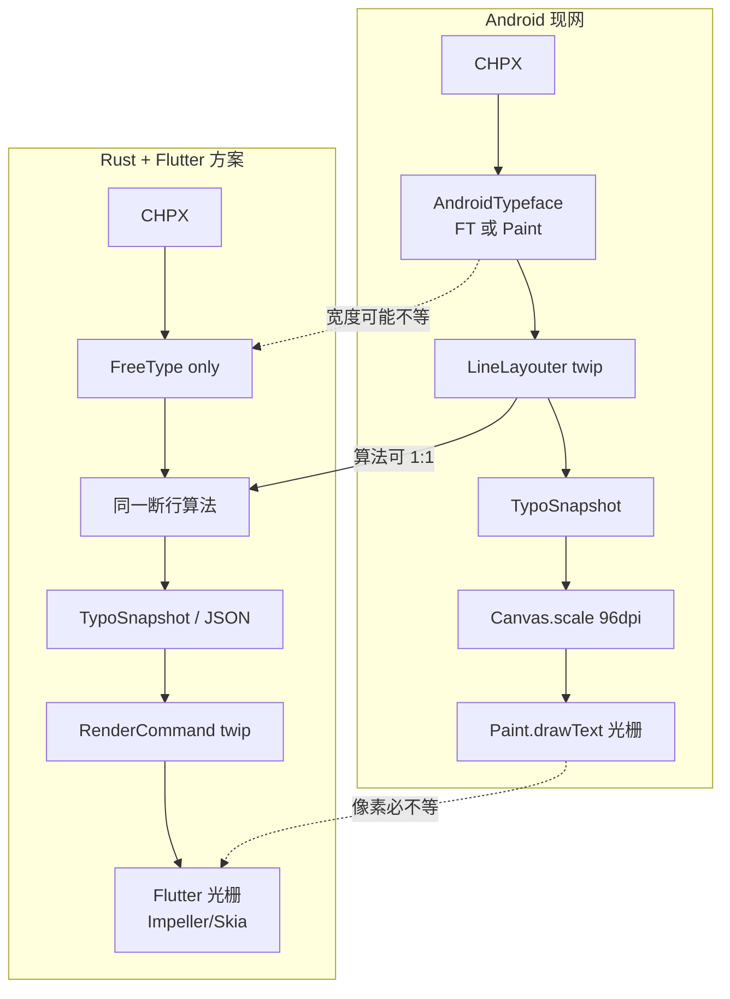

# Android 像素对齐可行性：layout → render 全链对照

> 日期：2026-08-21  
> 问题：Rust + Flutter 方案能否做到与 Android WPS **像素级对齐**？原内核哪些阶段绑死 Android？能否被「完美替换」？  
> 结论先讲：**排版几何（断行/分页/坐标）可以对齐到 twip / 亚像素级；字形光栅与抗锯齿不能保证与 Android 截图像素级一致。**「完美替换」对 View/线程/Canvas API 成立，对 **Paint 测宽 + Canvas.drawText 光栅** 不成立。

相关：[JAVA_RUST_PIPELINE.md](./JAVA_RUST_PIPELINE.md) · [PIPELINE_LAYOUT_RENDER_PLAN.md](./PIPELINE_LAYOUT_RENDER_PLAN.md) · **[MEASURE_DRAW_INSTRUCTION.md](./MEASURE_DRAW_INSTRUCTION.md)**（双引擎原理与断行补救）

---

## 0. 结论（三级对齐）

| 级别 | 含义 | 与 Android 现网 | 本方案能否达到 |
|------|------|-----------------|----------------|
| **L1 文档模型** | rope / CHPX / PAPX / 样式 / cp | Stage1 JSON | **可以**（parse 已按此验收） |
| **L2 排版几何** | 行宽、换行点、页边界、run 原点 (x,y)、行高（**twip**） | Stage2 JSON ±0.01 | **可以逼近**，条件：同一套字体文件 + **同一套 glyph advance 公式**（含 Paint 回退语义）+ 同一套取整 |
| **L3 帧缓冲像素** | 每个屏幕像素的 RGBA（字形轮廓、Hint、LCD/灰阶 AA、假粗体） | 设备截图 diff | **不能作为硬保证**；同 DPI 下「观感接近」可以做，像素级 SSIM=1 不能承诺 |

「像素级对齐」若指 L3：即使两台 Android 之间，因 GPU、Skia 版本、`SUBPIXEL_TEXT_FLAG`、字体 hint 也常对不齐。跨引擎（Android Minikin/Skia `Canvas.drawText` vs Flutter Impeller/Skia `TextPainter` vs Rust FreeType 位图）更不可能比特级一致。

若产品验收改为 **L2（坐标/断行与 Java 双跑 JSON）+ L3 人工观感 / 容差截图（允许 AA 差 1px）**，则与改写方案一致，且可工程化。

---

## 1. Java 管线里「什么是平台无关的」

下列阶段的 **算法与数据**不依赖 Android SDK，可以（且应该）在 Rust 原样复刻：

| 阶段 | 类型 | 单位 | 平台无关性 |
|------|------|------|------------|
| 文档 | TextDocument / PLCSection / PageSetup | cp、twip | 无关 |
| 视图参数 | ViewEnv 的 mode / 页盒子 / zoom 输入 | twip、无量纲 zoom | 无关（`IViewSettings`/`ITextView` 是 Android 壳） |
| 分页/断行控制流 | `TextLayouter.flow` / `finishPage` / 空格断行 | twip 累加 | **算法无关**；**输入宽度**依赖度量 |
| Typo 缓存 | 页/行/cp 区间 | twip | 无关（arena 实现可变，契约不变） |
| 指令语义 | `IRenderDrawer.drawText/Line/Rect` 的参数列表 | 排版坐标 | 无关；**实现**绑 Canvas |
| 缩放公式 | `canvas.scale(zoom * twips2pixel_x_ratio)` | 见下 | 公式无关；ratio 常数绑「96dpi 约定」 |

**Java 正文绘制坐标系（钉死）：**

```text
排版输出：twip
beginDraw:
  scale = zoom * MetricsUtil.twips2pixel_x_ratio
  twips2pixel_x_ratio = point2pixel_x_ratio / 20
  point2pixel_x_ratio = 1.3333536   // 96 DPI：1pt ≈ 1.333 px
  ⇒ scale(zoom=1) ≈ 0.066667  （210 twip 字号 = 10.5pt = 14 px）
drawText / fillRect 的 x,y,size 仍按 twip 传，靠 Canvas 矩阵变成设备像素
fontStyle.fontSize 以 twip 传给 Paint.setTextSize（变换后才是 px）
```

`MetricsUtil.DPI = 96`，**不是** `DisplayMetrics.density`。高分屏上「看起来多大」由 View 尺寸和用户 zoom 决定，但 **layout→px 的主公式是 96dpi**。Flutter 必须复制这一公式，否则 L2 对齐的 JSON 对了、屏幕上的毫米尺寸仍会漂。

---

## 2. 绑死 Android 的阶段（完整 layout → render）

按数据流从上到下。每一行回答三件事：依赖什么、Rust+Flutter 能否替换、替换后结果差在哪。

### 2.1 装配 / 线程 / 视图 — 可完美替换（API 级）

| Java 依赖 | 用途 | 替换 | 结果差异 |
|-----------|------|------|----------|
| `ITextView` / `android.view.View` | 视口宽高、滚动、invalidate | Flutter `Size` + `ScrollController` 作为 **入参** | 无（不进入排版公式） |
| `Handler` / `CoreThread` | 后台排版、UI 读 snapshot | 同步 `layout()` 或 isolate | 时序不同，**静止画面无差**；滚动中「未排完」行为需产品取舍 |
| `LayoutService` 与 Activity 生命周期 | 持有 snapshot | Dart 层持有 commands | 无 |
| `Reusable` / 对象池 | GC 压力 | Rust 所有权 | 无视觉差 |

这些是 **壳**，不是光栅器。改写方案「切断在 RenderCommand」对这一层成立。

### 2.2 度量 — **不能**用「只用 FreeType」完美替换 Android 现网

`AndroidTypeface` 是 **双引擎**：

```text
优先：FreeTypeJNI.getGlyphAdvance(ptr, size=100, ch) 再 × (size/100)
失败或一旦回退：TextPaint.measureText（android.graphics.Paint + android.graphics.Typeface）
并且 usePaintOnced=true 后，同一批后续字符 sticky 走 Paint
```

另外：

- `initFontMetrics()` **只用 Paint.getFontMetrics**（size=100，`ANTI_ALIAS` + flags **128 = SUBPIXEL_TEXT_FLAG**），再按 size/100 缩放。ascent/descent/行高来自 **Minikin/Skia 度量**，不是 FreeType。
- 若干 `getTextWidths` 重载 **直接 Paint.measureText**，不经过 FreeType。
- `android.graphics.Typeface`：系统字体回退、emoji、中日韩 fallback 链由 Android 字体服务决定。

| 若 Rust 只接 FreeType | 对 L2 的影响 |
|----------------------|-------------|
| 西文+已嵌入 docx 字体、FT 能打开 | 多数 glyph advance 可对齐 Java 的 FreeType 支路 |
| 缺字 / 系统 fallback | Java 走 Paint；Rust 若无等价 fallback，**宽度不同 → 断行点不同 → 整页错位** |
| 行高 | Writer **优先** TTF OS/2（`getWriterLayoutAscent` ← `getTTFHeader`）；仅 header 失败才用 Paint FontMetrics。Rust 若 face 打不开会得到 0 行高 |
| 字距 | Paint 可能含 hinting 后宽度；FT 取决于 `FT_LOAD_TARGET_*` / 是否 unhinted |

**「完美替换」条件（度量）：**

1. 嵌入与 Java 相同的 TTF/OTF（含 docx 字体表、同一 CJK 默认字体文件，不能靠「系统苹方 vs 系统 Noto」混用）。
2. 复刻 Java 的 **FT 失败 → Paint** 语义：Rust 侧没有 Paint，必须实现 **等价回退**（HarfBuzz + 同一 fallback 字体列表，或自研宽度表），并用黄金样本把 advance 接到 Java 输出。
3. 行高：走 `getTTFHeader` + `doCalcLayoutMetricsInfo`（与 Java Writer 一致）。header 失败视为硬错误，不要用空 Paint FontMetrics。

**断行连锁不可接受：** wr-03 不得把 Paint 回退删成「宽度=字号」。用打包 fallback TTF 扮演 Paint 的角色，并用 Java 100px advance 黄金表 + Stage2 换行点全等做门闩。步骤与补救见 [MEASURE_DRAW_INSTRUCTION.md](./MEASURE_DRAW_INSTRUCTION.md) §4。

改写方案 wr-03 写「禁止 Paint」在跨平台上正确，但这意味着 **默认不会复制 Android 现网每一条 measure 路径**。要对齐现网，wr-03 必须增加「与 Java AndroidTypeface 双跑」的 Stage2 门闩，而不是假设 FreeType 单引擎等于 Android。

### 2.3 断行 / 分页算法 — 可替换；对度量敏感

`LineLayouter` / `TextLayouter.flow` 本身无 Android import。  
**输入**是 run 宽度和行高。度量漂 0.5twip，在行尾可能多一个词，整行重排。

替换质量：

- 算法 1:1 转写 + L2 JSON 对照：**可以**做到与 **同一度量结果** 的 Java 布局一致。
- 与 **真机 Android 截图** 一致：还取决于 2.2。

取整：Java 大量 `int` 槽、`(int)(x+0.5)`（`ZoomService.round`）。Rust 必须同一套，否则 L2 ±0.01 都过不了。

### 2.4 绘制：Canvas / Paint — API 可替换，光栅不可完美替换

现网热路径：

```text
LayoutRender.beginDraw
  → canvas.scale(zoom * twips2pixel)
  → PageRender / TypoTextRender
  → RenderDrawer.drawText(...)
       textPaint: ANTI_ALIAS | SUBPIXEL_TEXT_FLAG
       fakeBoldText / textSkewX(-0.25) 模拟粗斜体
       canvas.drawText(chars, x, y, textPaint)   // Skia/Minikin 光栅
```

| Android API | 作用 | Flutter 对应 | 像素差异来源 |
|-------------|------|--------------|--------------|
| `android.graphics.Canvas` | 矩阵、clip、drawText/Rect/Path | `dart:ui` Canvas / CustomPainter | Impeller vs Skia、AA、gamma |
| `Paint` 文本 | 字形光栅、假粗体、斜体 skew | `TextPainter` / `Paragraph` 或 `Canvas.drawParagraph` | **不同 shaping（libtxt/HarfBuzz）+ 不同 hint** |
| `Typeface` | 系统字体 | `FontLoader` / 打包字体 | fallback 链 |
| `Path` / `DashPathEffect` | 下划线、虚线、修订线 | `Path` + `dash` | 相位、圆头方头 |
| `Bitmap` / `Shader` | 图、渐变、图案填充 | `Image` / `ui.Gradient` | 滤波、色彩空间 |
| `ColorModeRender` | 夜间/背景 | 自绘 | 产品色值可对齐，阴影/叠色难 |
| HWUI / GPU | 合成 | Impeller/Skia GPU | 全屏合成差 |

**假粗体 / 假斜体：** Java 没有对应 face 时 `setFakeBoldText(true)`、`setTextSkewX(-0.25)`。Flutter `FontWeight.w700` 若选了真 bold 文件，笔画比 fake bold **更宽**；若也 fake，仍是另一套算法。要对齐必须：**同一 face 文件 + 同一 fake 策略（在指令里显式 `fake_bold`/`skew_x`）**，并由 Flutter 用 `Paint` 级 API 模拟，而不是换字重。

**逐字 `xpos[]` 绘制：** `TypoTextRender.commit` 走 `drawText(..., posBuffer, y, bold, italic)`，即 **每个字符独立 x**。这是为了把排版宽度（FT/Paint 测的）和绘制位置锁在一起。若 Flutter 用 `TextPainter` 整串 shaping，**会二次排版**，x 与 Typo 不一致（字距、kerning、连字）。

要对齐 L2 位置并尽量接近 L3：

- RenderCommand 必须带 **per-glyph 或 per-run 的已排 x**（现网已是 per-char xpos）。
- Flutter **禁止**对同一 run 再做 TextPainter 自动断行/kerning；应 `canvas.drawParagraph` 关闭多余 shaping，或 **按码点 draw 在给定 x**（与 Java `drawText` 单字循环同构）。

即便如此，**单字 `Canvas.drawText` 的轮廓填充**仍是 Skia，与 FreeType 位图、与 Impeller 文本，像素都会差。

### 2.5 instruction_cache — 可替换为 RenderCommand（语义层完美）

`InstractionBuilder` 录的是 **draw 调用**，不是 PNG。回放仍进 `InstractionDrawer` → Android Canvas。  
Rust 的 `RenderCommand` 与它对等。这是 **跨端正确切断点**。  
它 **不**解决光栅器差异。

### 2.6 密度 / 屏幕 — 可替换，但要抄 96dpi 约定

| 项 | Java | Flutter 正确做法 |
|----|------|------------------|
| 主缩放 | `zoom * (1.3333536/20)` | 同一常数；`devicePixelRatio` **另计** |
| 逻辑像素 | 96dpi 映射后的 px | `logical = twip * scale / dpr` 或物理层再 × dpr |
| 与真机 Android 截图比 | 需同一 zoom、同一输出分辨率 | 在 **相同 CSS 像素网格** 上比，而不是「iPhone 3x vs Android xxhdpi」直接 memcmp |

高 DPI 上 Flutter `devicePixelRatio=3` 会把同一逻辑布局栅格到更多物理像素，AA 更细，截图尺寸不同。要比像素必须 **先把两边渲染到同一 bitmap 尺寸**（例如 11906 twip 页 → 固定 794×1123 px @96dpi）。

### 2.7 其它 Android 专有、MVP 可延后

| 依赖 | 阶段 | 替换 | 备注 |
|------|------|------|------|
| `Bitmap` 图 | 绘图 | 解码后 DrawImage | 缩放滤波差 |
| 音频控件 `ITextView.getEmbedAudioControl` | beginDraw | 无 | MVP 无 |
| 气球修订线 DashPathEffect | 装饰 | Path dash | 相位 |
| WordArt / Shader | 艺术字 | defer | 强烈绑 Paint |
| `android.text.TextPaint` | 度量+绘制 | 见 2.2/2.4 | 核心难点 |

---

## 3. 技术方案对照（现网 vs 目标）

```text
现网 Android
  度量：FreeType(100px) 或 Paint.measureText
  行高：Paint.FontMetrics
  排版：twip 整数槽
  绘制：Canvas.scale(96dpi) + Paint.drawText（可假粗/斜，可逐字 x）
  字体：android.graphics.Typeface + 系统 fallback

目标 Rust + Flutter
  度量：core_libs_font FreeType（方案默认；无 Paint）
  行高：FT metrics（默认）或标定表
  排版：同一套 Java 算法（wr-04/05）
  绘制：RenderCommand → Flutter Canvas
        若用 TextPainter 整串 shaping → 与 Typo x 冲突（禁止）
        若逐字/逐 run 按指令 x 绘制 → L2 位置可对齐
  字体：必须打包与 Android 相同的文件，否则 fallback 即 L2 失败
```



---

## 4. 最终渲染结果会差在哪里（按现象）

| 现象 | 原因 | 能否消掉 |
|------|------|----------|
| 换行点不同、一页多/少一行 | 字宽/行高 ≠ Android Paint/FT 混合结果；或取整不同 | 双跑 Stage2 + 复刻回退/FontMetrics 可大幅消；系统字体不同则不能 |
| 同一行最后一个字左右差几 px | kerning、hint、假粗体宽度 | 逐字 xpos 绘制可锁 **排版 x**；字形黑像素仍差 |
| 字更「瘦/糊/彩边」 | SUBPIXEL LCD vs 灰阶；Impeller vs HWUI；gamma | 不能像素级消；可关 LCD、统一灰阶 AA 改善观感 |
| 粗体更黑 | 真 bold 文件 vs `fakeBoldText` | 指令带 `fake_bold`，Flutter 模拟 fake，不要换字重 |
| 斜体角度不同 | `TEXT_SKEW_VALUE = -0.25` vs italic face | 指令带 `skew_x=-0.25` |
| 中文换行完全乱 | 系统字体 fallback 链不同 | 打包 Noto/思源等同款文件 |
| 页边框/下划线差 1px | clip round、hairline、scale 后 stroke | 复制 `minStroke` twip、round 规则 |
| 夜间模式底色 | ColorModeRender | 色值表对齐即可 |
| 滚动中闪空白 | 无 CoreThread 增量排版 | 产品行为差，非静止像素 |

---

## 5. 「完美替换」总表

| Android 依赖 | 替换物 | API/架构能否替换 | 视觉能否等价 |
|--------------|--------|------------------|--------------|
| View / Handler / 线程 | Flutter 入参 + 同步 layout | **是** | 静止帧无关 |
| Canvas 矩阵/clip/rect/line | Flutter Canvas + RenderCommand | **是** | 几何图元 **接近**（AA/hairline 除外） |
| Paint 测宽 / FontMetrics | FreeType 或自建回退 | **否（不是同一实现）** | 必须用对照门闩，不能假设 |
| Typeface 系统 fallback | 打包字体 | **部分** | 文件一致才行 |
| Canvas.drawText 光栅 | TextPainter / 逐字 draw | **否** | L3 不能保证 |
| instruction_cache | RenderCommand JSON | **是（语义）** | 不自动带来 L3 |
| 96dpi MetricsUtil | 同一常数 | **是** | 必须抄，否则整页缩放错 |
| FakeBold / Skew | 指令字段 + Flutter Paint | **是** | 需显式模拟 |
| Bitmap/Shader/PathEffect | 对应 Flutter API | **是** | 滤波/相位差 |
| 音频/气球/艺术字 | defer | — | 本 MVP 不比 |

---

## 6. 若产品坚持「尽量接近 Android 截图」的工程策略

按投入从低到高：

1. **验收改 L2**：Java（可跑在桌面/设备）与 Rust 双跑 TypoSnapshot JSON、RenderCommand 列表。这是改写方案已写的 Stage2/3，**应作为门闩**。不要用「手机截图 memcmp」作为 CI。
2. **字体锁定**：docx 嵌入字体 + 内核默认 CJK/Latin 文件与 Android 包内一致；禁止「用系统字体」。
3. **度量对齐**：用 Java `AndroidTypeface.getTextWidths` 在固定 size=100 上打黄金表，Rust FT 对不过的码位走标定/HarfBuzz，而不是 silent Paint。
4. **绘制同构**：Flutter **按指令 x 逐字画**，关闭 Paragraph 自动 kerning/断行；`fake_bold`/`skew_x` 按 Java 常量。
5. **同一输出栅格**：导出 PNG 时固定 `zoom=1`、页宽 794 px（A4 @96dpi），再做允许 AA 的 perceptual diff（阈值，不是 0）。
6. **（高成本）字形自绘**：Rust FreeType 光栅成 glyph atlas，指令改为 `DrawGlyph(id,x,y)`，Flutter 只 blit。这能让 **Rust 与「FT 位图」一致**，但 **仍不等于** Android `Canvas.drawText`。只有在 Android 也改成 FT 位图绘制时才能两边像素级一致——那是改现网，不是「替换」。

不建议：用 Flutter `TextPainter` 排一整段去「接近 Word」。那会放弃 Typo 坐标，L2 失败。

---

## 7. 对当前改写方案的修正建议（文档层）

| 原方案表述 | 应改为 |
|------------|--------|
| wr-03 禁止 Paint，默认即对齐 Android | 禁止在 **Rust 链入 android.graphics**；对齐现网需 **Stage2 双跑** + fallback/FontMetrics 策略单独立项 |
| RenderCommand + TextPainter 即第一页 | 第一页可以用 TextPainter 做 demo；**Stage3 对齐必须逐字/逐 run 定位绘制** |
| 像素级对齐 | 对外承诺 **L2 几何对齐**；L3 为观感/容差截图 |
| 96dpi 未强调 | ViewEnv/Flutter 变换必须抄 `1.3333536/20` |

---

## 8. 一句话

- **依赖**：Android 绑死的是 **View 壳、Paint 度量回退、Typeface fallback、Canvas 文本光栅**；排版控制流和 twip 模型是跨平台的。  
- **替换**：壳和指令层可以完美换成 Flutter；**测宽与画字不能换成「另一个实现」还声称像素级等于 Android。**  
- **结果**：按方案做完，可以得到 **同一套分页/坐标** 的跨端文档（这是产品该要的）；**不能**得到与某台 Android 截图逐像素相同的 PNG，除非把两端的度量与光栅都锁成同一引擎并固定输出分辨率。
