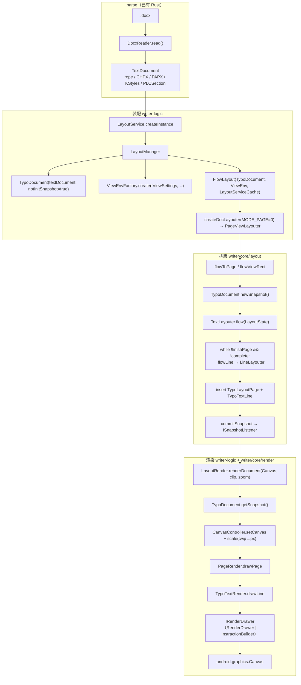

# 00_overview — Java 管线端到端总览

## 1. 架构一句话

Java 是 **Android 应用内同步+后台排版**：UI（`LayoutService`）→ 装配（`LayoutManager`）→ 后台驱动（`CoreThread/CoreFlow` → `FlowLayout`）→ 渲染（`LayoutRender.renderDocument(Canvas, …)`）。
Rust 目标架构**切断在指令层**：内核产出 `RenderCommand[]`，Flutter 只画；内核禁止 import `android.*` / Flutter 引擎。

## 2. 端到端调用图

## 3. 架构切断点（钉死）

| 层 | Java | Rust 替换 / 处理 |
|----|------|------------------|
| 解析 | DocxReader + DocumentImporter | wc-01..05（Stage1 已锁） |
| 装配 | LayoutService / LayoutManager / CoreThread | **无**：MVP 用同步 `layout_document()`；wr-06 入口壳 |
| 背景排版 | CoreThread/CoreFlow | MVP 同步全量 |
| 排版几何 | PageViewLayouter → TextLayouter → LineLayouter | wr-04/05（twip） |
| 缓存 | cache/Typo*（arena pointer） | wr-01/06 owned struct，对外契约对齐 |
| 度量 | ITypeface（AndroidTypeface + FreeTypeJNI） | wr-03 ttf-parser（同一 TTF 同 hmtx） |
| 渲染 | LayoutRender + IRenderDrawer | wr-07 RenderCommand[]（twip） |
| 跨端 | android.graphics.Canvas | wr-08 Flutter Canvas/TextPainter |

## 4. 单位约定（唯一权威）

| 环节 | 单位 | 值来源 |
|------|------|--------|
| S01–S06 | cp / twip（属性内部） | rope / PropertySet |
| S07–S14 | **twip** | PageSetup（S07）、advance 换算（S08） |
| S15–S16 | twip → px | `zoom × 1.3333536/20`（96DPI）再 × DPR |
| S17–S18 | px（物理） | 光栅化 / 合成 |

默认页 `PageSetup(11906, 16838, 1800, 1800, 1440, 1440)`（twip）→ 内容区 **8306 × 13598 twip**。

## 5. CP 语义（贯穿全程）

- 全文线性 CP，与 TextDocument rope / CHPX / PAPX / PLCSection 同一套。
- `TypoRangeBase` 半开区间 `[start, end)`；`contains(cp)`: `cp >= start && cp < end`。
- 段首 CP 由 `importParagraphStart` 时刻 `document.getLength()` 抓取（PAPX 挂点）。

## 6. 验收（RUST_REWRITE_RULE 三阶段）

| Stage | 产物 | 容差 |
|-------|------|------|
| 1 | DocumentModel JSON | 严格相等 |
| 2 | TypoSnapshot JSON（页序/行 start_cp/end_cp/x/y/w/h） | ±0.01px |
| 3 | RenderCommand 列表 | 序列 + 字段相等 |

> 不能承诺与 Android 截图像素级一致：`Paint.measureText`/`Canvas.drawText` 光栅无法被 FreeType+Flutter 比特级替换；验收只认 Stage2/3 JSON。

## 7. 全局读图顺序

按 `S01 → S19`。想快速理解「正文热路径」：S05 → S08 → S09 → S10 → S11 → S12 → S14 → S16。