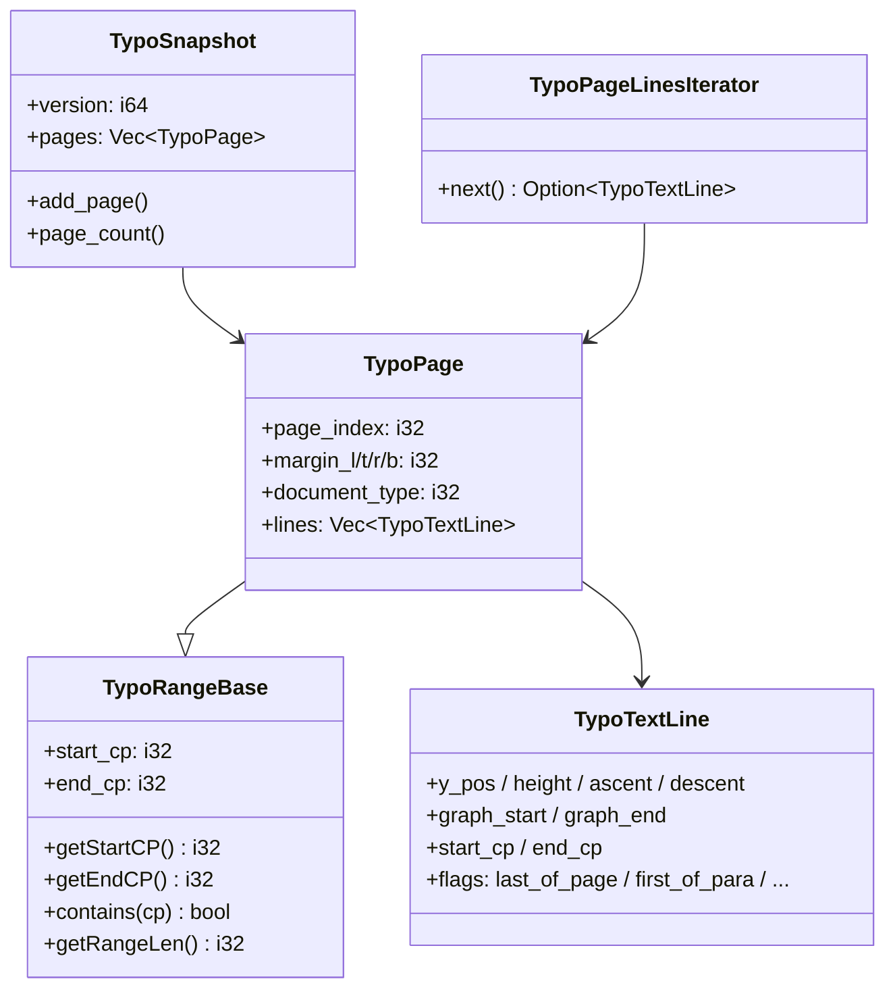
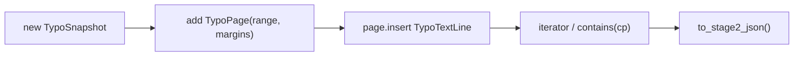

# wr-01-typo-cache — Typo 数据结构（类图 / 流程 / 最小改写范围）

> Feature：owned 的页/行/快照/迭代器，对齐 Java `TypoPage` / `TypoTextLine` / `TypoRangeBase` / `TypoSnapshot` **公开查询契约**。  
> **不**实现排版算法、**不**移植 `TypoSnapshot.alloc(int)` 竞技场。  
> Java：`koffice/writer/core/cn/wps/moffice/writer/cache/`  
> Rust：`libs/word-core/src/cn/wps/moffice/writer/cache/`（loop 新建，需进 `lib.rs`）

---

## 0. Feature 目标与管线位置

| 项 | 值 |
|----|----|
| Feature | `wr-01-typo-cache` |
| depends_on | 无（可与 parse 并行）；下游 wr-06 组装、wr-04/05 写入几何 |
| 种子类 | TypoRangeBase · TypoPage · TypoTextLine · TypoSnapshot（最小页列表）· TypoPageLinesIterator |
| 目标 | 能构造页、插入行、按 cp 查询、导出 Stage2 JSON 子集 |
| 非目标 | MainLayouter、度量、Canvas、MemBlock |

本层本质：**排版结果的内存模型**。Java 用 snapshot 内 `int pointer` 槽；Rust MVP 用 struct 字段，JSON 字段名与 Java getter 对齐。

---

## 1. 类图

### 1.1 `TypoRangeBase`（Java 129 行）

| 字段（Java 槽） | 含义 | Rust MVP |
|-----------------|------|----------|
| OFFSET_RANGE_REF=7 | CP 锚 ref | 可省略；存绝对 start/end |
| OFFSET_RANGE_START/END=8/9 | 相对锚的 Δ | `start_cp` / `end_cp` 绝对 |

**钉死：** `contains(cp) <=> start <= cp < end`；`getRangeLen = end - start`。

### 1.2 `TypoPage`（Java 738 行，抽象）

must-write：margins、documentType、行容器、range。  
stub：page BRC、extendRanges、旋转亚洲文字 flags。  
defer：TypoLayoutPage 的 drawings/footnotes（wr 后续）。

### 1.3 `TypoTextLine`（Java 658 行）— **不是 TypoLine**

must-write：text rect top/height、channel asc/des、y_pos、graph index、para ptr（可用 id）、flags 子集（FIRST/LAST para、LAST page）。  
stub：SHDs/Borders/Highlights/DocFields/balloon height。

### 1.4 `TypoSnapshot`（Java 2104 行）

must-write：`pages: Vec`、version、`page_count`、按 index 取页。  
stub：`alloc`/`set(pointer)`/`fork`/`refcount`/`addCPRef` 竞技场。  
Java `getSnapshot()` clone：Rust 用 `Arc<TypoSnapshot>` 或 clone owned。

### 1.5 `TypoPageLinesIterator`（Java 221 行）

must-write：forward iteration。stub：insert-in-the-middle。

---

## 2. 流程

写入方是 wr-04/05；本 feature 只保证结构合法。

---

## 3. Java ↔ Rust

| Java | Rust | 本轮 |
|------|------|------|
| TypoRangeBase.java | cache/TypoRangeBase.rs | must-write |
| TypoPage.java | cache/TypoPage.rs | must-write 子集 |
| TypoTextLine.java | cache/TypoTextLine.rs | must-write 子集 |
| TypoSnapshot.java | cache/TypoSnapshot.rs | must-write 页列表 |
| TypoPageLinesIterator.java | cache/TypoPageLinesIterator.rs | must-write |
| TypoMemBlock*.java | — | defer |
| TypoLayoutPage extra | 等同 TypoPage | stub extra 字段 |

---

## 4. 最小改写范围

**must-write：** RangeBase 查询、Page 边距+行、TextLine 几何+cp+flags 子集、Snapshot 页数组、Iterator。  
**stub：** arena API 签名（若生成全文件模板）。  
**defer：** Drawing/Table/HeaderFooter Typo 类型、LocateTool。

---

## 5. 编译面

crate：`libs/word-core`。`lib.rs` 增加 `writer/cache/{TypoRangeBase,TypoPage,TypoTextLine,TypoSnapshot,TypoPageLinesIterator}`。禁止拉 LayoutManager。
