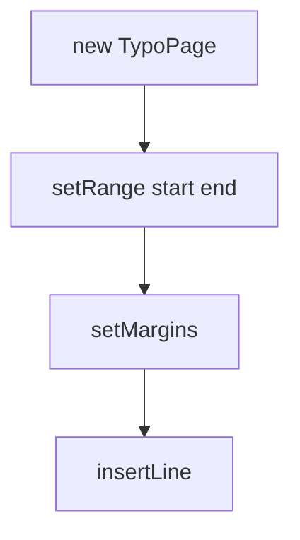

# 01_function_typo_page — TypoPage 结构：cp 区间 + 行容器

| 项 | 值 |
|----|----|
| feature | wr-01-typo-cache |
| order | 1 |
| crate | `libs/word-core/Cargo.toml` |
| 入口 | TypoPage 构造 / setRange / setMargins / insertLine / getStartCP/getEndCP |
| 独立性 | 叶子结构；不跑 Layouter |
| 测试状态 | pass |

## 1. 功能说明

### 1.1 一句话

主文档页的宿主：半开 cp 区间、四边距、documentType、行列表。Rust owned Vec，不移植 pointer 槽。

### 1.2 输入

| 入口 | 输入 | Java 路径 |
|------|------|-----------|
| 构造+setRange | start/end cp + Document 类型 0 | TypoPage.java / TypoRangeBase.java |

### 1.3 输出

| 字段/副作用 | 含义 |
|-------------|------|
| startCP/endCP | 半开区间 |
| marginLeft/Top/Right/Bottom | twip |
| lines | 空列表可 insert |

### 1.4 上游

无。PageSetup 边距由 wr-02 提供，本 function 只存数字。

### 1.5 下游

02 往页上插行；03 把页放进 Snapshot。

### 1.6 关键不变量（钉死）

1. contains(cp) 当且仅当 startCP <= cp < endCP。
2. getRangeLen() == endCP - startCP。
3. insertLine 后 lines.len 增加；不隐式改 page range（range 由排版方设置）。
4. documentType 默认 0（MAIN）。

### 1.7 依赖与实现状态（必写，着重）

| 依赖 | 归属 | 本 function 需要的接口 | 已实现 | 暂缓（保留 Java 注释+签名） | 禁止本 function 去改 |
|------|------|------------------------|--------|-----------------------------|----------------------|
| TypoRangeBase | 本 feature | getStartCP/getEndCP/contains/getRangeLen/setRange 绝对 cp | **本轮已实现**（owned start_cp/end_cp） | arena `setRange(ref,Δ)` / `addCPRef` | 不改 TextDocument |
| TypoTextLine | 02 | insert 存 owned 空壳 | **本轮最小 `new()` 空壳**（02 填几何） | 样式槽 / LineLayouter | 不实现 LineLayouter |
| TypoSnapshot / TypoList / TypoMemoryObj | 03 / arena | 仅出现在 **暂缓方法签名** | 本轮 compile-surface 空结构（禁止当完成语义） | alloc/set/pointer 全树 | 不移植 MemBlock |

## 2. 核心代码与流程

Java：`koffice/writer/core/cn/wps/moffice/writer/cache/TypoPage.java`
Rust：`libs/word-core/src/cn/wps/moffice/writer/cache/TypoPage.rs`（loop 新建或改写）



## 3. 测试方案

### 3.1 代码审计与测试面

| symbol | Java/Rust 路径 | 输入/状态 | 输出/副作用 | 关键分支/错误 |
|--------|----------------|-----------|-------------|---------------|
| `setRange(Document,start,end)` / owned `setRange(start,end)` | TypoRangeBase.java:18-22；Rust 存绝对 cp（不移植 addCPRef 槽） | start/end | getStartCP/getEndCP | Java 不校验 end&lt;start；len=end-start 可为负 |
| `getRangeLen` | TypoRangeBase.java:62-64 | range 已设 | end-start | — |
| `contains(cp)` | TypoRangeBase.java:102-108；TypoPage.java:326-328 在 extendRanges=0 时等于基类半开 | cp 相对 [start,end) | bool | end 不含；start 含 |
| `setMargin` / getters | TypoPage.java:78-128 | 四 twip | roundtrip | 无 snapshot 槽，owned 四字段 |
| `insertLine` / `getLineCount` / `hasLines` | TypoPage.java:174-186, 142-148 | 空壳行 + linePos | Vec 长度 | 空 list 时 Java 会 alloc TypoList；Rust owned 直接 push/insert |
| `getDocumentType` | TypoPage.java:58-76 | 默认 | 0 = MAIN | 未 set 时 0 |

### 3.2 覆盖矩阵

| coverage_id | 接口/代码路径 | 场景类别 | 必测? | test_id / 未覆盖理由 |
|-------------|---------------|----------|-------|----------------------|
| TP-RANGE | setRange+getStartCP/getEndCP/getRangeLen | 主路径 | 是 | TP1 |
| TP-CONTAINS | contains 含/不含/end 边界 | 边界 | 是 | TP2 |
| TP-MARGIN | setMargin 四边距 roundtrip | 主路径 | 是 | TP3 |
| TP-INSERT | insertLine 0/1/N；hasLines | 主路径 | 是 | TP4 |
| TP-DOCTYPE | 默认 documentType=0 | 主路径 | 是 | TP5 |
| TP-INSERT-RANGE | insertLine 不改 page range | 状态 | 是 | TP6 |


### 3.3 可测试性

不开完整 docx 管线。用内存构造结构体 / 假上游输出。坐标单位 twip。

### 3.4 用例表

| id | 覆盖项 | 前置状态 | 输入摘要 | 期望输出/副作用 | 失败语义 |
|----|--------|----------|----------|-----------------|----------|
| TP1 | TP-RANGE | 空页 | range 0,10 | start=0 end=10 len=10 | 区间错 |
| TP2 | TP-CONTAINS | range 0,10 | cp=0/9/10 | T/T/F | 半开错 |
| TP3 | TP-MARGIN | — | 1440×4 | getters 相等 | 边距丢 |
| TP4 | TP-INSERT | 空；再 insert 1 再 insert 到 N=2 | 0 行 hasLines=false；1/2 行 len 单调 | 未插入 |
| TP5 | TP-DOCTYPE | new | 不 set | documentType=0 | 默认错 |
| TP6 | TP-INSERT-RANGE | range 0,10 后 insert 2 行 | range 仍 0,10 | 隐式改 range |

### 3.5 测试代码位置

crate: `libs/word-core/Cargo.toml`
src:   `libs/word-core/src/cn/wps/moffice/writer/cache/TypoPage.rs`
       `libs/word-core/src/cn/wps/moffice/writer/cache/TypoRangeBase.rs`
test:  `libs/word-core/tests/cn/wps/moffice/writer/cache/TypoPage.rs`

### 3.6 测试运行脚本

```bash
cargo test --manifest-path libs/word-core/Cargo.toml --test 01_function_typo_page

bash .cursor/skills/feature-function/scripts/function-coverage.sh \
  --crate libs/word-core --test 01_function_typo_page \
  --src src/cn/wps/moffice/writer/cache/TypoPage.rs \
  --src src/cn/wps/moffice/writer/cache/TypoRangeBase.rs \
  --report libs/word-core/layout/features/wr-01-typo-cache/functions/01_function_typo_page/FUNCTION.md
```

### 3.7 覆盖率报告

<!-- coverage-report:begin -->
tool: cargo-llvm-cov (`cargo llvm-cov --test 01_function_typo_page --json`)
date: 2026-08-22 01:26

| src | lines covered | line % | regions covered | region % |
|-----|---------------|--------|-----------------|----------|
| `src/cn/wps/moffice/writer/cache/TypoPage.rs` | 42/220 | 19.1% | 50/229 | 21.8% |
| `src/cn/wps/moffice/writer/cache/TypoRangeBase.rs` | 16/62 | 25.8% | 17/65 | 26.2% |
| **function total** | **58/282** | **20.6%** |  |  |
<!-- coverage-report:end -->

### 3.8 模板布局校验（必跑，PASS 才能标 pass）

```bash
node .cursor/skills/function-java2rust/scripts/check-template-layout.mjs \
  --rs libs/word-core/src/cn/wps/moffice/writer/cache/TypoPage.rs \
  --java koffice/writer/core/cn/wps/moffice/writer/cache/TypoPage.java

node .cursor/skills/function-java2rust/scripts/check-template-layout.mjs \
  --rs libs/word-core/src/cn/wps/moffice/writer/cache/TypoRangeBase.rs \
  --java koffice/writer/core/cn/wps/moffice/writer/cache/TypoRangeBase.java
```

校验：`// java` 行数不降；活成员注释与 Rust 签名相邻。不在改写列表上的方法：`todo!("DEFERRED_NON_FUNCTION")` + 停车模版体。禁止 dummy `let X = ()`。Java 无对应语句：`// rust: no-stmt`。

**本轮结果：** TypoPage.rs PASS；TypoRangeBase.rs PASS。
